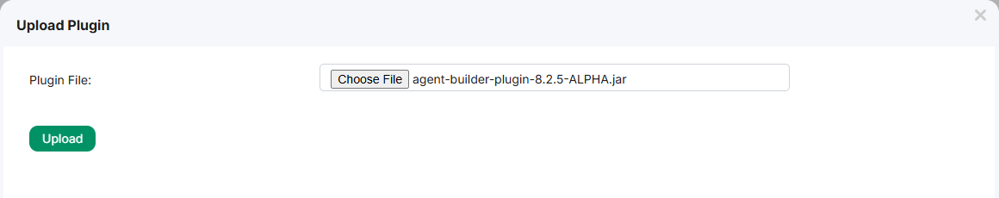
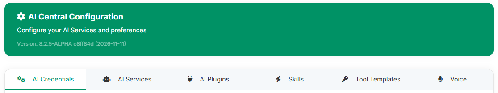
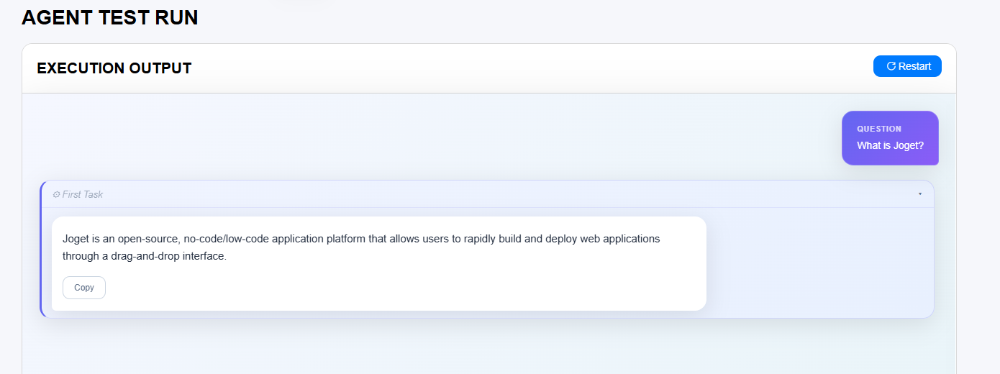
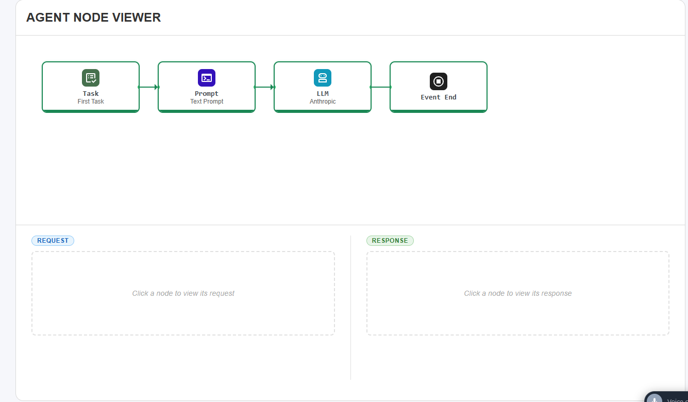
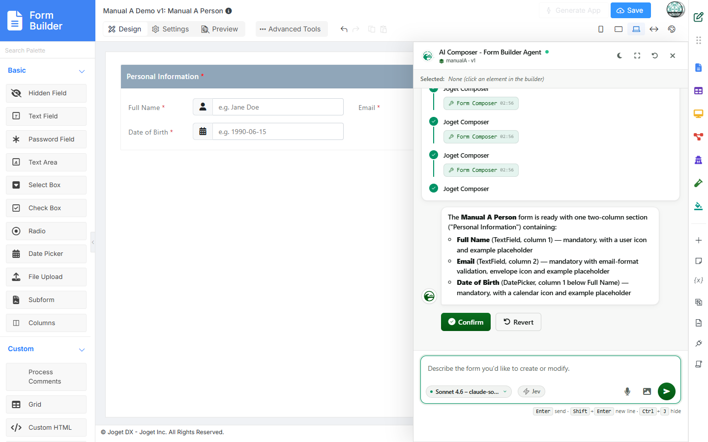

# Installing and Setting Up Your Joget Instance

This page shows you how to install the Agent Builder plugin jar on a Joget DX Enterprise instance, how to confirm that it loaded, and how to do the first configuration in the right order. It also lists everything the plugin adds to Joget (menus, console pages, builders and plugin types), what it stores and where, how to upgrade and remove it, and what to check in clustered and Joget Cloud environments. It is written for the person who administers the Joget server. Composer MCP is a separate plugin with its own installation steps on [Composer MCP: Install, Configure and Connect](18-composer-mcp-setup.md).

## What you install

You install one file: `agent-builder-plugin-8.2.5-ALPHA.jar` (an alpha build). It is an OSGi plugin bundle, the normal Joget plugin format. This one jar contains all of the following:

- **AI Central Config**: the settings page where you store AI credentials and choose the AI model that agents and composers use.
- **Agent Builder**: the builder in which you design AI agents, plus the Agent Eval Builder for testing them.
- **AI Composers**: chat panels inside the Form, List, UI, Process and Theme builders, and the Orchestrator that drives them together.
- **Monitoring pages**: the agent execution audit trail, usage dashboard, session monitor and evaluation runs.
- **Joget AI Assistant**: a Userview menu that gives your app users a chat page.
- **Voice input**: dictation for the composers and an optional hands-free mode (beta).

You do not need to install anything else for these features. You do need an account (an API key) with at least one AI provider. See [AI Central Config Reference](03-ai-central-config.md) for the provider list.

## Prerequisites

> **Note:** Agent Builder 8.2.5-ALPHA is an early build, two releases ahead of the current stable release. Its features are subject to change and can be unstable. Use it on development and test servers only, not in production.

| Item | Requirement | Notes |
|---|---|---|
| Joget edition | **Joget DX Enterprise** | The agent, composer, monitoring and assistant features register only on the Enterprise edition. If the plugin starts on another edition, the server log shows the line `This plugin jar does not support community version` and the features do not appear. |
| Joget version | **Joget DX 9.1 or later** (this manual was checked on Joget DX 9.1.2) | Composer MCP requires Joget DX 9.1 or later, so use one DX 9.1 server for both plugins. Every procedure and screenshot in this manual comes from Joget DX 9.1.2. |
| Java | **Java 11 or later** on the Joget server | The plugin is compiled for Java 11. |
| Database | The database that Joget already uses | The plugin creates its own tables in this database the first time it starts. The database user must be allowed to create and alter tables. See the section "What the plugin stores and where". |
| Joget user | A user with the **Admin** role or the **App Creator** role | Both roles can open AI Central Config. See the access table in [AI Central Config Reference](03-ai-central-config.md). |
| Browser | A current version of Chrome, Edge, Firefox or Safari for the builders and composers | The composers need JavaScript and WebSocket support. For voice dictation with the Google Web Speech provider you need Chrome or another Chromium-based browser (for example Edge). It does not work in Firefox, and Brave disables it by default. Microphone access in a browser normally needs an HTTPS address (or `localhost`). |
| AI provider account | An API key for at least one supported provider (OpenAI, Anthropic, Google Gemini, OpenRouter, IBM watsonx), or the address of an OpenAI-compatible server (LM Studio, Ollama or similar) | You can start with one provider. |

### Network requirements

The Joget server must be able to open outbound HTTPS connections to the AI provider you use. Check these with your network team before you start.

| Destination | Used for | When it is needed |
|---|---|---|
| `api.openai.com` | OpenAI models; OpenAI speech-to-text (Whisper) for dictation | If you use OpenAI or the Whisper voice provider |
| `api.anthropic.com` | Anthropic (Claude) models | If you use Anthropic |
| `generativelanguage.googleapis.com` | Google Gemini models | If you use Google Gemini |
| `openrouter.ai` | OpenRouter models | If you use OpenRouter |
| `us-south.ml.cloud.ibm.com` | IBM watsonx models (the default address; your region may differ) | If you use IBM |
| Your own model server | Custom (OpenAI-compatible) models | If you use LM Studio, Ollama or a gateway |
| `api.typesafe.ai` | TypeSafe System One (decision tools, hands-free voice, Jev acceleration) | Only if you add a TypeSafe credential |
| Joget Marketplace | The list on the **AI Plugins** tab of AI Central Config | Only to browse and install other Joget AI plugins from that tab |

The browser of the person using a composer must also be able to reach OpenAI directly when you turn on **Realtime** speech-to-text, because the browser streams the microphone audio to OpenAI. See the Voice tab in [AI Central Config Reference](03-ai-central-config.md).

If your server reaches the internet through a proxy, the proxy must allow these destinations. The provider address is fixed per provider, but you can change the **API URL** of a model node, or use the **Custom** provider, to send traffic to an internal gateway.

## Install the plugin jar

1. Sign in to the Joget console as a user with the Admin role.
2. Open **Settings > Manage Plugins**. (In the Joget console, **Settings** is the entry in the bottom bar; it opens the **System Settings** side menu, which lists **Manage Plugins**.) The page has the buttons **Reload** and **Upload**, and the tabs **Installed Plugins**, **Update** and **Configurable Plugins**.
3. Click **Upload**. The dialog **Upload Plugin** opens. Click **Choose File**, select `agent-builder-plugin-8.2.5-ALPHA.jar`, and click **Upload** in the dialog.
4. Wait until Joget reports that the upload finished. Joget installs the bundle and starts it. This can take a minute because the plugin creates database tables and installs its default skills on the first start.
5. Reload the console page in your browser (a hard refresh, for example Ctrl+F5, so the browser does not keep old scripts).

After the upload, the tab **Installed Plugins** lists the bundle as one row. The **Plugin Name** is **Joget AI Agent Builder** and the **File Name** is the name of the jar you uploaded. Manage Plugins lists one row for each jar, not one row for each plugin inside it: the many plugins that the jar contains (see the section "Map of everything the plugin adds") do not appear as separate rows.

> **Note:** Upload the jar only once per server (or once per node name in a cluster that does not share the plugin folder; see the section "Notes for clustered and Joget Cloud environments"). Uploading a second copy with a different file name can leave two versions of the plugin installed. If that happens, follow the steps in the section "Replace the jar with a newer one".

## Confirm that the plugin loaded

Do the checks in this order. Stop at the first one that fails and go to the section "Troubleshooting".

1. **Server log.** Open the Joget server log (for example `catalina.out`, or the log of your Tomcat service). After the upload you should see no line saying `does not support community version`, and no stack trace that names `org.joget.ai`. Messages from `DefaultSkillSeeder` such as `Seeded default skill: joget-form-builder` mean the default skills were created.
2. **Settings menu.** Open **Settings**. In the **System Settings** side menu a new entry **AI Central Config** is listed, between **Directory Manager** and **Manage Plugins**.
3. **Open AI Central Config.** Click it. The page title is **AI Central Configuration** (subtitle "Configure your AI Services and preferences"). A banner at the top shows the plugin version, followed by a build identifier and the build date. You see six tabs: **AI Credentials**, **AI Services**, **AI Plugins**, **Skills**, **Tool Templates** and **Voice**. This is the quickest proof that the plugin works.
4. **Monitor menu.** Open **Monitor**. Next to the standard Joget entries (for example **Running Processes** and **Audit Trail**) you should see four entries from the plugin: **AI Usage Dashboard**, **Agent Execution Audit Trail**, **Agent Eval Dashboard** and **AI Session Monitor**.
5. **Skills seeded.** In AI Central Config open the **Skills** tab. You see the default skills (for example `joget-form-builder` and `joget-orchestrator`) with the status **Active**.

## Map of everything the plugin adds

Use this table to find any part of the plugin. "Who" shows the Joget roles that the plugin itself allows. Joget's own screens can add more restrictions. For example, in the standard Joget console the **Monitor** area is limited to system administrators, so an App Creator who is not a system administrator may not be able to open the pages listed under **Monitor**.

### Console pages

| What | Where it appears | Who | What it is for |
|---|---|---|---|
| **AI Central Config** | **Settings > AI Central Config** | Admin or App Creator | Credentials, AI services, skills, tool templates, central instructions and voice settings. Full reference: [AI Central Config Reference](03-ai-central-config.md). |
| **Agent Execution Audit Trail** | **Monitor > Agent Execution Audit Trail** | Admin or App Creator | List of every agent and composer run with its trace (filters: app, type, status, dates). Click a row to open **Agent Execution Detail** with the **Agent Node Viewer**. See [Runtime Settings, Monitoring and Cost](09-runtime-and-monitoring.md). |
| **AI Usage Dashboard** | **Monitor > AI Usage Dashboard** | Admin or App Creator | Token usage (total prompt tokens and total completion tokens) and the list of model calls, grouped by model class or by plugin name. |
| **AI Session Monitor** | **Monitor > AI Session Monitor** | Admin or App Creator | Live list of open composer sessions, optional session limits, a switch to disable single composers, and a **Kill All Sessions** button. |
| **Agent Eval Dashboard** | **Monitor > Agent Eval Dashboard** | Admin or App Creator | Results of evaluation runs (the page heading reads **Agent Eval Runs**). See [Evaluating Agents](10-evaluating-agents.md). |

### Builders and in-builder panels

| What | Where it appears | What it is for |
|---|---|---|
| **AI Agent Builder** | App Composer, **Builders** tab: the card **AI Agent Builder** (click its **+** button to create an agent) | Design agents: a model node, tasks, prompts, tools, enhancers, decisions and guards. Opens with **Design**, **Settings** and **Preview**. See [Building Agents Step by Step](05-building-agents-tutorials.md). |
| **Agent Eval Builder** | App Composer, **Builders** tab: the card **Agent Eval Builder** | Build evaluation suites that test an agent. |
| **AI Composer - Form Builder Agent** | Chat panel in the Form Builder (`/web/console/app/<app>/<version>/form/builder/...`) | Create and change forms by describing them. |
| **AI Composer - Datalist Builder Agent** | Chat panel in the List Builder (List Composer) | Create and change lists. |
| **AI Composer - UI Builder Agent** | Chat panel in the UI Builder (UI Composer) | Create and change userview pages and menus. |
| **AI Composer - Process Builder Agent** | Chat panel in the Process Builder | Create and change processes. |
| **AI Composer - Theme Builder Agent** | Chat panel in the Theme Builder (the custom builder page `cbuilder/theme/design`) | Create and change themes. |
| **AI Orchestrator Agent** | Chat panel on the app's builders page (`/web/console/app/<app>/<version>/builders`) | Build a whole app across the other composers. See [The Orchestrator: Building Whole Apps](13-orchestrator.md). |

The composers use a chat icon that you click to open the panel. The panel can be collapsed with **Ctrl+J**. Day-to-day use is described in [AI Composers User Guide](12-composers-user-guide.md).

### Elements for your apps

| What | Where it appears | What it is for |
|---|---|---|
| **AI Agent** (process tool) | Process Builder: a tool activity, plugin **AI Agent** | Run an agent from a workflow step. See [Using Agents Inside Joget Apps](08-using-agents-in-apps.md). |
| **Run AI Agent** (datalist action) | Datalist Builder: a list action | Run an agent from a button on a list. |
| **Joget AI Assistant** | Userview Builder: add a menu item, category **Marketplace**, element **Joget AI Assistant** | A chat page for your app users. It runs a saved process (**Process Mode**) or a saved agent (**Agent Mode**). It can be the home page of a userview. See [Voice Input and the Joget AI Assistant](16-voice-and-assistant.md). |

### Plugin types and extension points

The jar also registers these **plugin types** (called "custom plugin interfaces" in Joget). They are the places where other plugins can add their own pieces. The type names below are the names that the **Filter by Type** list in **Settings > Manage Plugins** shows. When someone installs a plugin jar that implements one of these types, that jar appears as its own row in **Installed Plugins**, and you can find it by choosing the type in **Filter by Type**. The jar itself also uses the general Joget types **Console Page** (AI Central Config and the Monitor pages), **Custom Builder** (the Agent Builder and the Agent Eval Builder), **Web Service** and **WebSocket** (the composer chat connection).

| Plugin type | What a plugin of this type adds | Developer page |
|---|---|---|
| AI Agent Tool | An action an agent or composer can call | [Writing Custom Tools](24-custom-tools.md) |
| AI Agent Prompt | A way to build prompt messages | [Writing Custom Guards, Enhancers, Decisions and Prompts](25-custom-guards-enhancers-decisions-prompts.md) |
| AI Agent Enhancer | A step that processes a task reply | same page |
| AI Agent Decision | A rule that routes between tasks | same page |
| AI Agent Guard | An input or output check | same page |
| AI Agent LLM | A model node for the Agent Builder canvas | [Adding a Custom LLM Provider](26-custom-llm-providers.md) |
| LLM Provider Plugin | A provider that appears in **Model Class** when you add an AI service | [Adding a Custom LLM Provider](26-custom-llm-providers.md) |
| AI Credential Provider | A provider that appears in **Configuration Type** when you add an AI credential | [Adding a Custom LLM Provider](26-custom-llm-providers.md) |
| Decision (System One) Provider Plugin | A provider for the Decision tools | [Writing Custom Tools](24-custom-tools.md) |
| **LLM Model Capability Provider** | The list of settings that a model accepts (an LLM model capability provider) | [Adding a Custom LLM Provider](26-custom-llm-providers.md) |
| **Voice Provider Plugin** | A speech-to-text provider for dictation (a voice provider plugin) | [Voice Input and the Joget AI Assistant](16-voice-and-assistant.md) |

### Built-in building blocks (palette elements)

These appear inside the Agent Builder palette. They are documented one by one on the reference pages.

| Group | Elements | Reference |
|---|---|---|
| LLM Services | OpenAI, Anthropic, Google Gemini, OpenRouter, IBM watsonx model nodes; OpenAI and Gemini embedding tools | [Building Block Reference: Prompts, LLMs, Enhancers, Decisions and Guards](07-reference-other-blocks.md) |
| Prompts | BeanShell, Persona, Text Prompt, Form Data Schema, List Data, Form Data, JSON API, File, Agent Variable, Output Format | same page |
| Tools | Database Query, Email, JSON API, GitLab, Google Web Search, Group, Run Agent, Orchestrator, User Input, display tools, Decision, Mem0 memory, MCP Client, Pinecone, composer tools and more | [Building Block Reference: Tools](06-reference-tools.md) |
| Enhancers | BeanShell, Store to Form, Store to Variable, Store to Agent Variable, Code Extractor, JSON Extractor | [Building Block Reference: Prompts, LLMs, Enhancers, Decisions and Guards](07-reference-other-blocks.md) |
| Decisions | Response Condition, BeanShell | same page |
| Guards | LLM Based, Rule Based, Webhook | same page |

### Behind the scenes

| What | Purpose |
|---|---|
| Voice transcription service and hands-free voice services | Web services used by the dictation button and by hands-free mode. They are internal and have no menu. |
| Hands-free voice loader | A script added to console pages. It does nothing unless an administrator switches hands-free voice on in the **Voice** tab. |
| Default skills and tool templates | Created on first start. See the section "What the plugin stores and where". |

## First-time configuration order

Configure in this order. Each step needs the one before it. The detailed field tables are on [AI Central Config Reference](03-ai-central-config.md).

1. **Add an AI credential.** Open **Settings > AI Central Config > AI Credentials**, click **Add Credential**, choose the provider (**Configuration Type**), enter the **API Key**, give the credential a name, and click **Add**. The credential stores a secret that agents and services can reuse.
2. **Add an AI service and make it active.** Open the **AI Services** tab, click **Add AI Service**. In the first step select the credential under **Use Saved Credential (Optional)**, then pick the **Model Name**, name the service and click **Add**. Then, in the **Current AI Service** box at the top, choose the service in **Active AI Service** and click **Save**. The composers, the Orchestrator and the LLM decision provider use the active service. A new service is not active until you do this.
3. **Set defaults (optional).**
   - **Central Instructions** (**Skills** tab): rules that go into every composer and agent. Leave them empty until you know what you need.
   - **Voice** tab: dictation works out of the box in Chromium browsers. Add an OpenAI key here if you want dictation in any browser.
   - **Tool Templates** and **Skills**: the defaults are ready to use.
4. **Check Session Monitor limits (optional).** Open **Monitor > AI Session Monitor** and set limits if many people will use the composers at the same time. See [Runtime Settings, Monitoring and Cost](09-runtime-and-monitoring.md).

Agents built on the Agent Builder canvas do not use the active AI service. Each agent has its own model node, which takes its key either from a saved AI credential (the **AI Configuration** field) or from a key typed into the node. So for agents you only need step 1, and for composers you need steps 1 and 2.

## Ten-minute smoke test

This test proves that the plugin, your credential and your network all work. It needs an app (any app) and an API key.

### Part 1: first agent run (about 5 minutes)

1. Do the first-time configuration steps 1 and 2 above.
2. Open any app in the App Composer. On the **Builders** tab, in the card **AI Agent Builder**, click the **+** button. The dialog **Create New AI Agent** opens. Enter an **ID** (the field already starts with `AI-`) and a **Name**, keep the **Template** `Blank`, and click **Save**. The agent opens in the **Design** view. (The other templates are **Research & Tech Writer**, **Document Compliance Checker**, **Claim Processing** and **FAQ Assistant**.) The first time you open a builder, Joget shows a short guided tour; close it or click **Next** to go through it.
3. A blank agent already has the area **Define Agent** with the drop zones **Add a LLM service to here** and **Drop a prompt to here**, and a task named **First Task** with drop zones for a guard, prompt, tool, enhancer and decision rule. In the palette group **LLM Services** drag a model node (for example **Open AI** or **Anthropic**) onto **Add a LLM service to here**. Click the node. The **Properties** panel opens. In **AI Configuration** choose your credential. Check that **Model** has a model name you can use (a new node is prefilled with the provider default, for example `gpt-5.4` for **Open AI**). Click **Apply Change**.
4. In the palette group **Prompts** drag **Text Prompt** onto **Drop a prompt to here** in **First Task**. Click the prompt. A new **Text Prompt** contains the sample text `Research and write an in-depth article on ${query}.` Replace it with `Answer in one short sentence: ${query}` and click **Apply Change**.
5. A blank agent has no input variable, so **Preview** would show no input field. Open the **Settings** tab. In the table **Input Variables** click the **+** button below it, and enter the **Name** `query` and a **Label** such as `Question` (leave **Type** as `Text`). Click **Save** (top right).
6. Click **Preview**. The **Agent Test Run** page opens. Under **Configure Agent Inputs** the field **Question** (the label you gave) is shown. Type `What is Joget?` and click **Run Agent**.
7. **Expected result:** the answer appears under **Execution Output**. In the **Agent Node Viewer** the nodes **Task** (First Task), **Prompt** (Text Prompt), **LLM** and **Event End** are all outlined in green. A red model node means the call failed: click the node and read the **RESPONSE** panel for the provider message.
8. Open **Monitor > Agent Execution Audit Trail**. The run is listed with the **Agent Name** you gave, the **Agent Type** `AI Agent Builder` and the **Trigger Source** `Builder Preview`.

### Part 2: first composer message (about 3 minutes)

1. In the same app, open or create a form in the **Form Builder**.
2. Click the round composer chat icon at the bottom right of the builder (it carries the Joget logo). The panel **AI Composer - Form Builder Agent** opens and shows **What should we build?** with three suggestion buttons. If it shows **No AI Service Configured** and a **Go to AI Central Config** button, no service is active: go back to step 2 of the configuration order.
3. In the panel, check that your AI service is selected. The service picker is the drop-down at the bottom left of the message box (its tooltip is **Select AI Service**). It lists each service as `<service name> – <model name>`, and marks the active service with `(default)`.
4. Type `Create a form with the fields Full Name, Email and Date of Birth` and press Enter (or click the arrow button, whose label is **Send**).
5. **Expected result:** the panel shows the progress of the run (steps such as **Skill Invoker (Composer)** and **Form Composer**), then a summary of what it built, for example a section with **Full Name**, **Email** and **Date of Birth** fields. The new fields appear in the form on the canvas. The panel then shows the buttons **Confirm** and **Revert**: click **Confirm** to keep the change (or **Revert** to undo it), then save the form in the builder as you normally do.
6. Open **Monitor > AI Usage Dashboard**. It lists the model calls you just made (the **Plugin Name** of a composer call is `AI Composer`).

### Part 3: record the result

If both parts worked, the installation is complete. If a step failed, use the section "Troubleshooting".

## Replace the jar with a newer one

1. Back up the database and the `app_ai_skills` folder (see the section "What to back up").
2. Make a note of the version shown in the banner of AI Central Config.
3. Open **Settings > Manage Plugins** and upload the newer jar in the same way as the first time.
4. Reload the console with a hard refresh.
5. Open **AI Central Config** and check that the banner shows the new version.
6. Run the smoke test again.

What happens during an upgrade:

- **Database tables** are updated by the plugin when it starts. You do not run scripts.
- **Settings** (credentials, services, central instructions, tool templates, voice) stay as they are.
- **Default skills and default tool templates** carry a version number inside the plugin. If the new jar has a newer version of a default skill, the plugin replaces that skill's instructions, description and scope with the new text when it starts. **Edits you made to a default skill are lost.** To keep your own wording, copy the skill under a new name before you upgrade. Skills you created yourself are never changed.
- On the **Skills** tab a default skill that has newer text in the plugin shows an **Update Available** badge, and a sync button copies the plugin text over your copy (after a confirmation).
- If the old version still shows after the upload, open **Settings > Manage Plugins**, uninstall the old plugin, upload the new jar and restart Joget.

## Remove the plugin

1. Back up first. Removing the plugin does not delete its data, but you may want a copy.
2. Open **Settings > Manage Plugins**, tick the check box of the row **Joget AI Agent Builder** in **Installed Plugins**, and click **Uninstall Plugin** (the button below the list).
3. Reload the console.

What remains after removal:

| Item | State |
|---|---|
| AI Central Config, composers, monitoring pages, the Joget AI Assistant menu | Gone. |
| Agents and evaluation suites saved in your apps | The definitions stay in the apps, but they cannot be opened or run until the plugin is installed again. |
| Userviews that use **Joget AI Assistant**, processes that use **AI Agent**, lists that use **Run AI Agent** | These elements stop working. Remove them from the apps first if you do not plan to reinstall. |
| Database tables and settings | Stay. A later reinstall finds them again. |
| `app_ai_skills` folder | Stays. |

To erase all data of the plugin, remove the objects listed in the section "What the plugin stores and where". Do this only after a backup, and only if you will not reinstall.

## What the plugin stores and where

### Database tables

The plugin creates and updates these tables in the Joget database when it starts. The database user needs permission to create and alter tables.

| Table | Content |
|---|---|
| `ai_agent_execution` | One row per agent run (status, times, who started it, trigger source). |
| `ai_agent_trace_event` | The step-by-step trace of each run. This can grow large. |
| `ai_agent_version` | Saved versions of agent definitions. |
| `ai_agent_async_job` | Queue of agents started with Run Mode **Asynchronous**. |
| `ai_agent_abort_request` | Requests to stop a running agent. |
| `ai_agent_input_response` | Answers that users give to interactive tools such as User Input. |
| `ai_system_agent` | System agents (agents that the platform itself runs). |
| `ai_eval_run` | Results of evaluation runs. |
| `ai_llm_calls` | One row per model call: model, plugin name, token counts, and the request and response text. |
| `ai_assistant_conversation`, `ai_assistant_message`, `ai_assistant_run` | Conversation history and runs of the Joget AI Assistant. |

> **Note:** The table `ai_llm_calls` stores the text that was sent to the model and the reply. If a prompt contains a secret or personal data, that text is stored too. Plan retention for this table and for `ai_agent_trace_event` in the same way as for other business data.

### Rows in the Joget settings table (`wf_setup`)

The plugin keeps its configuration as rows in the Joget settings table `wf_setup`. The `property` value names the setting.

| Setting (`property`) | Holds |
|---|---|
| `AI_CONFIGS` | AI credentials (the **AI Credentials** tab). Secret fields are stored in Joget's protected format. |
| `MY_AI_SERVICES` | AI services (the **AI Services** tab), including optional keys typed directly into a service. |
| `CURRENT_AI_SERVICE` | The name of the active AI service. |
| `AI_CENTRAL_INSTRUCTIONS` | The central instructions (global and per target). |
| `AI_TOOL_TEMPLATES` | The tool templates. |
| `VOICE_PROVIDER_CONFIG` | The voice provider choice, the OpenAI key for speech-to-text, and the hands-free settings. |
| `aiComposerSessionLimits` | Session limits saved on the **AI Session Monitor** page. |
| `aiComposerEnablement` | Which composers are switched on (also from the Session Monitor). |

A value in `wf_setup` has a size limit set by the database column (for example 64 KB on MySQL). If a change would be larger, AI Central Config refuses it and shows a message that starts with "Nothing was saved". Skills are stored as files for exactly this reason.

### Files in the wflow folder

| Path (below the `wflow` folder of your Joget installation) | Content |
|---|---|
| `app_ai_skills/<skill name>/SKILL.md` | One folder per skill. The file starts with a header (id, name, description, status, the composers it is for, tools) followed by the instructions as Markdown text. You can read it, compare it and edit it by hand. A change to a file is picked up without a restart. |
| `app_ai_skills/.skills.lock` | A small lock file that stops two servers writing skills at the same time. |
| `tmp/ai_form_img_*` | Temporary copies of images that you attach to the Form Composer. |

The `wflow` folder is the folder that also holds `app_forms`, `app_plugins` and similar folders. When Joget runs with several tenants or profiles, each one has its own folder, and a skill written for one is not visible to another.

### In your apps

Agent definitions and evaluation suites are builder definitions of the app. They are saved with the app and are part of an app export (`.jwa`). Forms, lists, userviews and processes that the composers create are normal Joget objects of the app.

### What to back up

| Back up | Why |
|---|---|
| The Joget database (it contains the tables and the `wf_setup` rows above) | Credentials, services, run history, assistant conversations. |
| The `wflow/app_ai_skills` folder | Your skills. |
| App exports (`.jwa`) of apps that contain agents | Agent definitions. |
| The plugin jar you installed | To reinstall the same version. |

If you restore a backup on a different server and a credential no longer works, open **AI Credentials**, edit the credential and enter the key again.

## Notes for clustered and Joget Cloud environments

### What works across nodes without extra setup

- **Settings** are in the shared database, so every node sees the same credentials, services and instructions.
- **Run history, traces and usage** are in the database.
- **Asynchronous agent jobs** are claimed with an atomic database update, so only one node runs a given job.
- **Answers to interactive tools** (for example User Input) are stored in the database, so the node that receives the answer can be a different node from the one that runs the agent.
- **Joget AI Assistant conversations** are stored in the database.

### What you must arrange

| Topic | What to do |
|---|---|
| Plugin on every node | The jar must be active on every node. In a standard Joget cluster the nodes share the plugin folder; after the upload, check the log of each node for the plugin start. |
| Skills | Skills are files in `wflow/app_ai_skills`. The folder must be on storage that all nodes share (the same shared `wflow` folder that holds your app data). If each node has its own folder, a skill saved on one node is missing on the others. |
| WebSocket | A composer panel keeps one WebSocket open to one node. The load balancer must allow WebSocket upgrades for `/jw/web/socket/` and must not move an open connection to another node. |
| Session monitor and limits | The live session list and the session counters are held in the memory of the node that owns the connection. The **AI Session Monitor** page shows the sessions of the node that answers the request. |
| Outbound network | Every node needs outbound HTTPS to the AI provider. |

### Joget Cloud

- The plugin writes files only below the `wflow` folder and stores everything else in the database.
- Make sure the Cloud environment allows outbound HTTPS to your AI provider, and that your plan allows you to upload a plugin jar. Ask your Joget Cloud contact if the upload or a provider address is blocked.
- Composer panels use WebSocket. Check on a test app that the panel connects before you roll it out.

## Limitations and things to know

- **Alpha build.** The jar is `8.2.5-ALPHA`. Behaviour and screens can change in a later build.
- **Enterprise only.** The agent builder, the composers and the monitoring pages do not register on other Joget editions.
- **One active AI service for composers.** The composers use the active AI service unless the user picks another service in the composer panel. The service you mark active in the **Current AI Service** box is the default for all users.
- **Skills are files, settings are database rows.** A database restore alone does not bring back skills. Back up both.
- **The default skills are overwritten on upgrade** when the plugin carries a newer version of them (see the section "Replace the jar with a newer one").
- **Prompts and replies are stored.** `ai_llm_calls` and the trace table keep the text of model calls.
- **Hands-free voice is a beta feature** and is off by default. It needs a TypeSafe credential and an OpenAI key. See [Voice Input and the Joget AI Assistant](16-voice-and-assistant.md).
- **The AI Plugins tab needs access to the Joget Marketplace** to show its list.

## Troubleshooting

| Symptom | Likely cause | What to do |
|---|---|---|
| The log shows `This plugin jar does not support community version` and the Agent Builder, composers and Monitor pages are missing | The server is not a Joget DX Enterprise edition | Install the plugin on an Enterprise server. |
| After the upload there is no **AI Central Config** under **Settings** | The plugin did not start, or the console page is cached | Hard-refresh the browser. Read the log for a stack trace near the upload time. In **Manage Plugins** check that the plugin is listed and enabled. Restart Joget if the log shows an unfinished start. |
| The log shows an error about creating tables at start | The database user cannot create or alter tables | Give the user the permission, or create the tables with a database administrator account, then restart. |
| **AI Central Config** opens, but a message says you are not authorized (HTTP 401) | Your user is neither Admin nor App Creator | Use an Admin user, or give your user the App Creator role. |
| The **Monitor** pages are missing for an App Creator | Joget limits the Monitor area to system administrators | Use a system administrator account for these pages. |
| The composer panel shows **No AI Service Configured** | No AI service is marked active | Open **AI Services**, choose the service in **Active AI Service** and click **Save**. |
| The agent preview shows a red model node with 401 or 403 | Wrong or missing API key | Open the credential in **AI Credentials**, enter the key again. Check that the node uses the right **AI Configuration**. |
| The agent preview or composer waits and then fails with a timeout | The server cannot reach the provider (firewall or proxy) | Test the provider address from the Joget server. Allow outbound HTTPS to it. |
| The **AI Configuration** dropdown of a model node is empty | There is no credential for that provider | Add a credential for the provider in **AI Credentials**, or use the **Create AI Configuration** button the dropdown shows. |
| The **Skills** tab is empty after the upload | The skills could not be written (permissions on the `wflow` folder) | Make sure the Joget server user can write to `wflow`. Restart the plugin or Joget. Read the log for `Could not seed default skill`. |
| Skills saved on one cluster node are missing on another | `app_ai_skills` is not on shared storage | Put the `wflow` folder on storage shared by all nodes. |
| Two versions of the plugin are listed in **Manage Plugins** | A second jar with a different file name was uploaded | Uninstall the older one and restart Joget. |
| The dictation (microphone) button does nothing in Firefox | The Google Web Speech provider needs a Chromium browser | Use Chrome or Edge, or set up the **OpenAI Whisper API** provider in the **Voice** tab. |

## Where to go next

- [AI Central Config Reference](03-ai-central-config.md): every tab and field, provider by provider.
- [Agent Builder Concepts and How an Agent Runs](04-agent-builder-concepts.md): how an agent works before you build one.
- [Building Agents Step by Step](05-building-agents-tutorials.md): tutorials that start where the smoke test ends.
- [AI Composers User Guide](12-composers-user-guide.md): using the composers in the builders.
- [Composer MCP: Install, Configure and Connect](18-composer-mcp-setup.md): installing the second plugin so outside AI tools can drive the composers.
