# AI Central Config Reference

AI Central Config is the one settings page where you connect Joget to AI providers and set the defaults that agents and composers use. This page is the complete reference for every tab, every field, every default value and every allowed value, and it explains how Joget decides, at run time, which credential and which model an agent or composer uses. It also gives setup steps for each built-in provider. It is written for the administrator or App Creator who configures the AI features. Skills and tool templates are covered in full on [Skills, Central Instructions and Tool Templates](22-skills-and-tool-templates.md); here you find only how their tabs work.

## Who can open the page and where it is

Open **Settings > AI Central Config**. (In the Joget console, **Settings** is the entry in the bottom bar. It opens the **System Settings** side menu, which lists **AI Central Config** between **Directory Manager** and **Manage Plugins**. The address is `/jw/web/console/plugin/AI Central Config`.) The page title is **AI Central Configuration** and the subtitle is **Configure your AI Services and preferences**. A line at the bottom of the green banner shows `Version:` followed by the plugin version, a build identifier and the build date.

| Question | Answer |
|---|---|
| Who can open it | Users with the **Admin** role or the **App Creator** role. |
| What happens for other users | The page and all of its actions refuse the request (HTTP 401). The server checks the role again on every save, so hiding the menu is not the only protection. |
| Does one change affect everyone | Yes. All settings are instance-wide. There are no per-user or per-app copies. |
| Is the plugin Enterprise only | Yes. See [Installing and Setting Up Your Joget Instance](02-installation-and-setup.md). |

The page has **six tabs**, in this order:

| No | Tab | What it holds |
|---|---|---|
| 1 | **AI Credentials** | Saved provider keys and connection data. |
| 2 | **AI Services** | Named model choices, and the one that is active. Used by the composers. |
| 3 | **AI Plugins** | A list of Joget AI plugins that you can install from the Joget Marketplace. |
| 4 | **Skills** | Central Instructions (rules for every composer and agent) and the skill list. |
| 5 | **Tool Templates** | Pre-configured tools that skills and agents can reuse. |
| 6 | **Voice** | Speech-to-text provider for dictation, and the hands-free voice (beta) settings. |

Each tab starts with a grey information bar with a question-mark icon and one line that describes the tab. This page quotes that line for each tab.

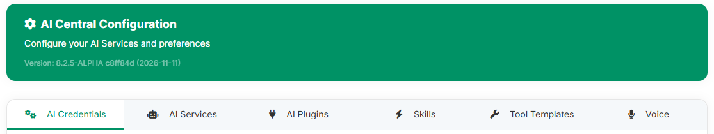

> **Note:** The page has no **API Server** section and no **PII Masking** section. Older descriptions of the product may mention them; they are not part of this page. If you need to hide personal data from the model, use the guards described in [Security and Governance](11-security-and-governance.md).

### The two ideas to understand first

Joget keeps credentials and models in two separate lists:

- An **AI Credential** is a saved secret for one provider: a name, a provider and an API key (and for some providers more data). A credential says nothing about which model to call.
- An **AI Service** is a named model choice: a provider, a model name and tuning values such as temperature. A service can borrow its key from a credential, or hold its own key.

Different parts of the product read these lists in different ways:

| Part of the product | Reads | Does it use the active AI service? |
|---|---|---|
| AI Composers (Form, List, UI, Process, Theme) and the Orchestrator | An **AI Service** | Yes, unless the user picks another service in the panel |
| Decision tools with the **LLM** provider | An **AI Service** | Yes, when the tool's service field is empty |
| Agents on the Agent Builder canvas | The **model node** inside the agent; the node can take its key from an **AI Credential** | No |
| Embedding tools, Pinecone tool | An **AI Credential** | No |
| TypeSafe features (Decision tools with the TypeSafe provider, Jev acceleration, hands-free voice) | A **TypeSafe AI Credential** | No |

The section "How settings are resolved at run time" below goes through each case in detail.

## Tab 1: AI Credentials

The **AI Credentials** tab has the information bar "Store your AI provider credentials and API keys" and the header **Manage AI Credentials** with the button **Add Credential**. Each row shows the credential name, and below it the categories and provider in the form `<categories> (<provider>)`, for example `LLM,EMBEDDING (OpenAI)`, `LLM (Anthropic)` or `SYSTEM ONE (TypeSafe)`. Each row has an edit (pencil) icon and a delete (trash) icon. With no credentials the tab shows **No AI Credentials Yet** and the text "Click "Add Credential" to store your first AI provider credential". There is no filter on the list.

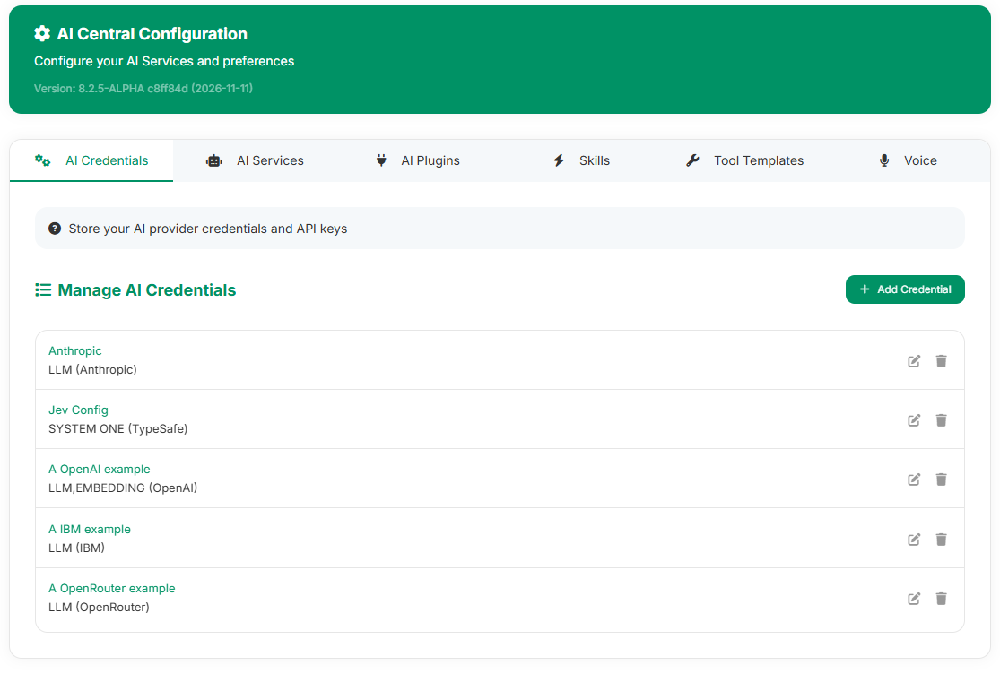

### Add a credential

1. Click **Add Credential**. The popup **Add AI Credential** opens. It has three numbered steps with **Next** and **Back** buttons.
2. **Step 1.** Choose the **Configuration Type** (the provider). The list is in alphabetical order and the first entry, **Anthropic**, is selected when the popup opens.
3. **Step 2.** Fill in the fields for that provider (tables below). A key field is a password field with an eye icon at its right end: click the icon to show or hide what you typed.
4. **Step 3.** Enter the **Configuration Name**. The placeholder is `e.g., OpenAI Config`. The name must be unique.
5. Click **Add**. The message "AI configuration created successfully" appears at the bottom of the tab and the row is listed.

If the name already exists, the popup shows "AI configuration name already exists".

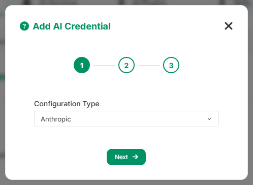

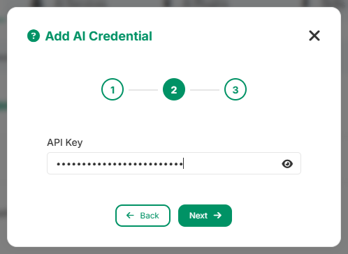

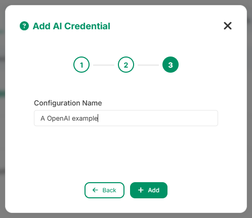

You can also create a credential from where you need it. When an **AI Configuration** dropdown (in an agent's model node, for example) has no credential for its provider, it shows a **Create AI Configuration** button. The button opens this popup with the provider already selected, and the dropdown refreshes when you return.

### Providers and fields

The **Configuration Type** list contains these providers (the list itself is sorted alphabetically: Anthropic, Custom, Google Gemini, IBM, OpenAI, OpenRouter, Pinecone, TypeSafe):

| Configuration Type | Categories | Fields (step 2) | Required | Notes |
|---|---|---|---|---|
| **OpenAI** | LLM, EMBEDDING | **API Key** (hidden input, placeholder "Enter your API key") | Yes | Usable for OpenAI models and OpenAI embeddings. |
| **Google Gemini** | LLM, EMBEDDING | **API Key** | Yes | Usable for Gemini models and Gemini embeddings. |
| **Anthropic** | LLM | **API Key** | Yes | |
| **IBM** | LLM | **API Key** | Yes | IBM Cloud API key for watsonx. The project ID is entered on the model node, not here. |
| **OpenRouter** | LLM | **API Key** | Yes | |
| **Custom** | LLM | **API Key**, **Base URL** (placeholder `e.g., https://api.example.com/v1`) | Both required | For any OpenAI-compatible server: LM Studio, Ollama, a gateway, a proxy. See the picture below this table. |
| **Pinecone** | VECTOR DB | **API Key** | Yes | For the Pinecone tool (vector search). |
| **TypeSafe** | SYSTEM ONE | **API Key**, **Model**, **Base URL**, **Timeout (ms)** | API Key only | See below. |

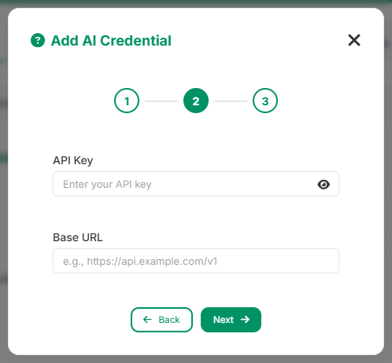

The category is set by the provider; you cannot change it. It decides where the credential shows up: a model node lists only credentials of its own provider with category LLM, an embedding tool lists only EMBEDDING credentials, and so on.

AWS Bedrock is not available in this build: it is not in the list.

### The TypeSafe credential

A TypeSafe credential connects Joget to the TypeSafe System One service (also called Jev). It is not a chat model. It cannot be chosen in an AI service, and it does not show in model lists.

| Field | What it does | Default | Allowed values | Notes |
|---|---|---|---|---|
| **API Key** | Authenticates your instance with TypeSafe. | none | text | Required. |
| **Model** | The System One model id. | `jev-latest` | text | Leave as `jev-latest` unless TypeSafe asks you to pin a version. |
| **Base URL** | The TypeSafe endpoint. Marked **Advanced**. | `https://api.typesafe.ai` | an `http` or `https` address | Change only for a private or regional deployment. |
| **Timeout (ms)** | Total time allowed for one request, retries included. Marked **Advanced**. | `4000` | 500 to 60000 | When the time runs out, the feature falls back to its normal path. |

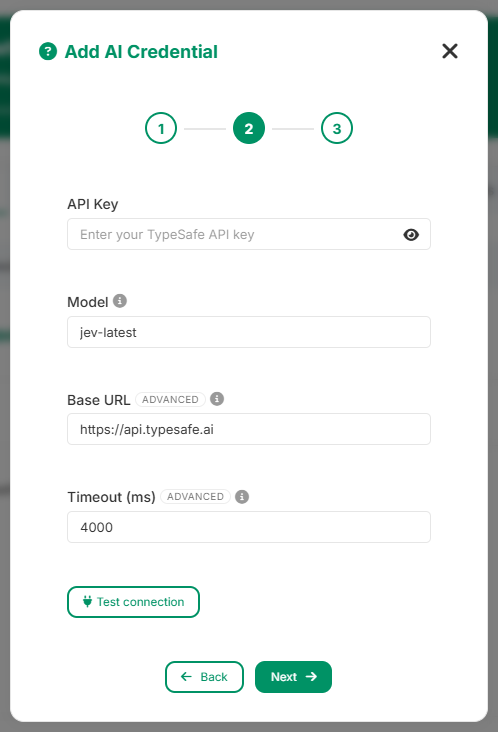

The TypeSafe form has a **Test connection** button. It sends a one-question test and shows `Connected to TypeSafe (<model>, <n> ms)` on success, or a reason on failure: for example `TypeSafe connection failed: The API key was rejected (HTTP 401)`, a message that TypeSafe returned another HTTP status, that TypeSafe could not be reached or timed out, or that the Base URL is not a valid address. The message appears in the popup under the button. When you edit an existing credential you can test without typing the key again.

What uses a TypeSafe credential: Decision tools whose provider is **TypeSafe (Jev)**; the **Jev** acceleration toggle in the composer panel (the toggle is disabled with the hint "Add a TypeSafe credential in AI Central Config" until a credential exists); and hands-free voice. If you create several TypeSafe credentials, features that do not name one use the first one in the list that has a key.

### Edit a credential

Click the pencil icon. The popup **Edit AI Credential** shows the credential name and the key fields. The provider and name cannot be changed. Secret fields are filled with a masked value. Leave a masked field alone to keep the saved secret, or type a new value to replace it. Click **Save**; the message is "AI Configuration updated successfully".

### Delete a credential

Click the trash icon and confirm in **Delete AI Configuration**. It asks `Are you sure you want to delete the credential "<name>"?` and has the buttons **Cancel** and **Delete**. If an AI service uses the credential, Joget refuses: `Cannot delete credential "<name>" because it is currently used by the following AI Service(s): <names>`. Change or delete those services first. Agents' model nodes that refer to the credential by name are not checked: if you delete the credential, those nodes fail at run time until you choose another.

### Limitations and things to know

- **Secrets and editing.** Secrets are saved in Joget's protected format when you create a credential. When you edit and save an existing credential or AI service, secret fields that you did not change can be stored in readable form in the settings table. The Whisper key in the **Voice** tab is not affected. If the confidentiality of keys in the database matters to you, restrict access to the database and its backups, use provider keys with spend limits, and check the stored rows after you edit.
- **Credentials are not tested on save.** Except for TypeSafe there is no connection test. The first call to the provider shows whether the key works (see the smoke test in [Installing and Setting Up Your Joget Instance](02-installation-and-setup.md)).
- **A key typed into an agent or service is separate.** Changing a credential changes every service and node that points to it by name, but not those that hold their own copy of a key.

## Tab 2: AI Services

An **AI Service** is what the composers call. The tab has two areas: **Current AI Service** at the top and **Manage AI Services** below. The description is "Manage your AI Services and select the one to be used for generation".

With no services the tab shows **No AI Services Configured** and the text "To get started, add an AI Credential first, then create an AI Service." and "Click "Add AI Service" to create your first AI Service."

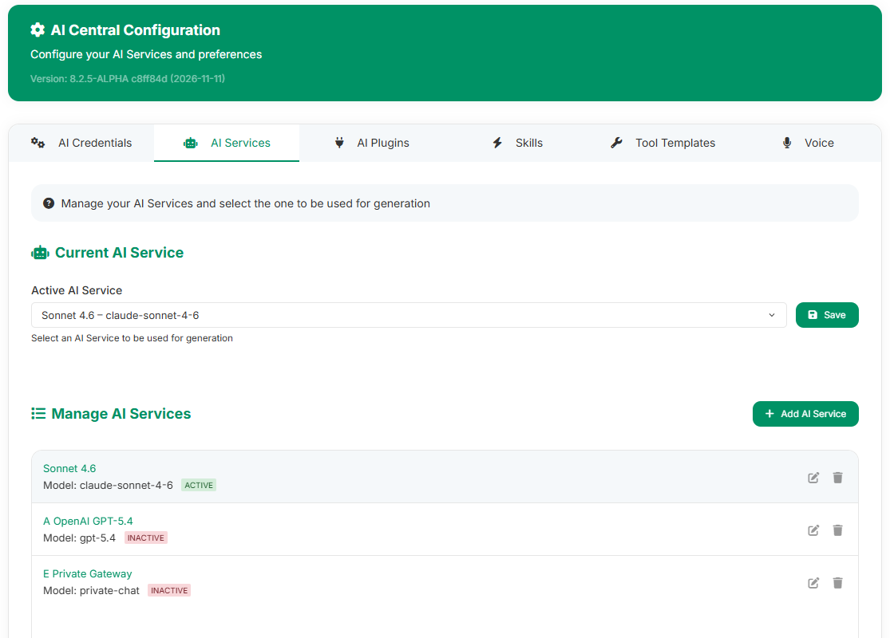

### Current AI Service

| Field | What it does | Default | Notes |
|---|---|---|---|
| **Active AI Service** | Chooses the service that composers use when the user has not picked one. | none | A drop-down whose entries read `<service name> – <model name>`. Choose a service and click **Save**. The message is "Current AI Service saved successfully!". The help text is "Select an AI Service to be used for generation". |

A new service is created as **not active**. You must set it here. If the active service is deleted, or the last service is deleted, the active setting is cleared, and the composers show **No AI Service Configured** until you choose a new one.

### Add an AI service

Click **Add AI Service**. The popup **Add AI Service** has three steps, with **Next**, **Back** and **Add**.

**Step 1: choose the provider**

| Field | What it does | Default | Allowed values |
|---|---|---|---|
| **Use Saved Credential (Optional)** | Takes the key and address from a saved AI Credential. | `-- None (Manual Setup) --` | The entries read `<credential name> (<provider>)`. Any credential whose category is LLM is offered, except those of the providers IBM and OpenRouter, which are not offered here (a credential of the provider TypeSafe is not an LLM credential and is not offered either). |
| **Model Class** | The provider. | **Anthropic** (first in list) | **Anthropic**, **Google Gemini**, **OpenAI**, **Custom** (in this order), and any provider added by another plugin (see [Adding a Custom LLM Provider](26-custom-llm-providers.md)). |

When you pick a saved credential, **Model Class** is set to the provider of that credential and is greyed out, and the key fields are hidden. The service then stores only the credential name.

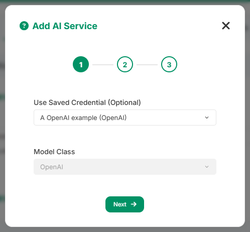

**Step 2: model and settings.** The step has two collapsible sections.

*Credential Configuration*

| Field | Shown for | What it does | Default | Notes |
|---|---|---|---|---|
| **API Key** | OpenAI, Anthropic, Google Gemini, Custom (when no saved credential is used) | The key for this service only. | empty | Hidden input with an eye icon. For **Custom** it is the last of the three fields (placeholder "Enter a key"). |
| **Model Name** | OpenAI, Anthropic, Google Gemini | The model to call. A combobox: pick from the list or type any model id. | The first model id of the provider's suggestion list (see "Model suggestions" below), for example `gpt-5.6-sol` for OpenAI and `claude-fable-5` for Anthropic | The form fills this field in when you reach step 2. Replace it with the model you want. If you clear the field and leave it empty, Joget uses the provider's default model (see the defaults table below). Whatever you type is sent to the provider unchanged, so a typing error shows up only at run time. |
| **Custom LLM URL** | Custom | The base address of the OpenAI-compatible server. | empty | Required. Placeholder "Enter a URL". Enter the base address only, for example `http://localhost:1234/v1`. Do not add `/chat/completions`. Joget adds the path. |
| **Custom Model Name** | Custom | The model id the server expects. | empty | Required. Placeholder "Enter a name". |

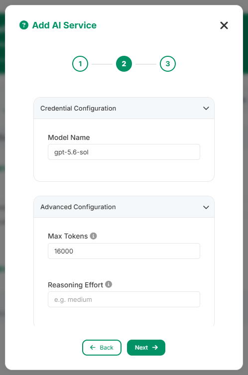

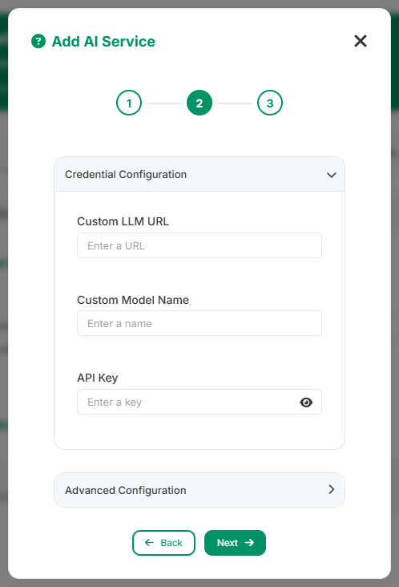

*Advanced Configuration* (all optional; empty means "use the model's default"). Which fields are shown depends on the provider and on the model name you enter: a field the model would reject is hidden.

| Field | What it does | Prefilled value | Allowed values |
|---|---|---|---|
| **Temperature** | Controls randomness. Lower is more focused, higher is more creative. | `0.2` when the model accepts it (the field is not shown for models that do not) | A number from 0 to 2 (refer to your provider for its own range). |
| **Top P** | Limits sampling to the most likely tokens (nucleus sampling). | empty | A number from 0 to 1. |
| **Top K** | Limits sampling to the K most likely tokens. | empty | A whole number, 0 or more. |
| **Max Tokens** | Upper limit of tokens in one reply. | `16000` | A whole number, 1 or more. |
| **Reasoning Effort** | How much hidden reasoning the model does before it answers. | empty | A text field with the placeholder `e.g. medium`. Allowed values: `none`, `minimal`, `low`, `medium`, `high`, `xhigh`, `max`. The model accepts only some of these (see provider notes). |
| **Thinking Budget Tokens** | A fixed token budget for hidden reasoning, for older thinking models. | empty | A whole number, 1 or more. |

Which model accepts which field:

| Models | Fields offered |
|---|---|
| OpenAI `gpt-4*`, `gpt-3*`, `chatgpt-*` | Temperature, Top P, Max Tokens |
| OpenAI `gpt-oss*` | Temperature, Top P, Max Tokens, Reasoning Effort |
| OpenAI `gpt-5*`, `o3`, `o1`, `o4`, `*-codex`, and newer ids | Max Tokens, Reasoning Effort |
| Anthropic Claude 4.7 and later, Claude Opus 5, Sonnet 5, Fable 5 | Max Tokens, Reasoning Effort |
| Anthropic Claude 4.6 | Temperature, Top P, Top K, Max Tokens, Reasoning Effort |
| Anthropic Claude 4.5 | Temperature, Top P, Top K, Max Tokens, Reasoning Effort, Thinking Budget Tokens |
| Anthropic Claude 4.1 and older | Temperature, Top P, Top K, Max Tokens, Thinking Budget Tokens |
| Google Gemini 3 and later | Temperature, Top P, Top K, Max Tokens, Reasoning Effort |
| Google Gemini 2.x and older | Temperature, Top P, Top K, Max Tokens, Thinking Budget Tokens |
| Custom | All fields are shown; the server decides what it accepts |

Joget leaves out of the request the fields a model does not accept, because a provider rejects a request with an unsupported field.

**Step 3: name the service**

| Field | What it does | Notes |
|---|---|---|
| **AI Service Name** | The name that appears in the active-service list and in the composer panel. | Required and unique (placeholder "Enter a name"). A duplicate gives "AI Service Name already exists". After saving you see "AI Service created successfully!". |

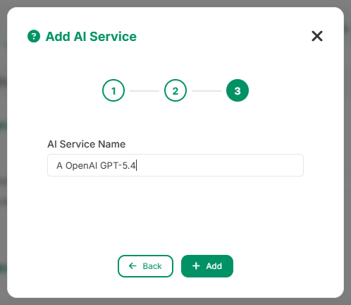

### Edit and delete a service

- The pencil icon opens **Edit AI Service**. The same fields appear. Saved secrets show as masked values; leave them as they are to keep them. Click **Save**.
- The trash icon opens **Delete AI Service** with **Cancel** and **Delete**.
- A row shows the service name and `Model: <model name>`, and a badge: **ACTIVE** (green, and the row is highlighted) for the active service and **INACTIVE** (red) for the others.

### Hide providers (optional, for administrators)

You can remove providers from the **Model Class** list, and hide the existing services of those providers, with a Java system property on the Joget server:

```text
-Dai.central.config.hidden.providers=OpenAI,Custom
```

Use the provider names exactly as the list shows them, separated by commas (`OpenAI`, `Anthropic`, `Google Gemini`, `Custom`). Hidden services are not deleted; they are only not shown in the page. Restart the server for the property to take effect.

### Limitations and things to know

- **OpenRouter and IBM are not AI services.** The composers and Orchestrator can run only on OpenAI, Anthropic, Google Gemini, Custom, or a provider added by another plugin. To use OpenRouter or IBM models through the composers, point a **Custom** service at an OpenAI-compatible address of your own, or use them in agents only.
- **The composer output limit is fixed.** Whatever **Max Tokens** you set on a service, the composers and the Orchestrator ask the model for at most 16000 tokens in one reply. The other tuning fields of the service (temperature, top P, top K, reasoning effort, thinking budget) are passed through.
- **Model names are not checked.** Joget does not verify that the model id exists for your account. If a composer reports a provider error about the model, correct the **Model Name**.
- **A service with a saved credential changes provider with the credential.** The provider is taken from the credential, not from the **Model Class** you saw when you created the service.

## Tab 3: AI Plugins

The **AI Plugins** tab is a catalogue. Its description is "Browse available plugins and install the ones you need." The header is **Install Joget AI Plugin**.

| Item | Behaviour |
|---|---|
| What is listed | The Joget AI plugins that the Joget Marketplace offers, each with an image and its name. At the time of writing the list holds **Joget AI Agent Builder**, **AI Form Fill Element** and **Joget AI Designer**. The list is fetched from the Marketplace, so the Joget server needs access to it. |
| Install | Click **Install Plugin** on a row. A popup **Install Plugin** asks "Do you want to install the <name>?" with **Cancel** and **Install**. The row shows **Installing...** and then "<name> installed successfully!" or "Installation failed!". |
| Installed | A plugin that is already present shows a green **Installed** badge instead of the install button. When you have installed the jar from this manual, the row **Joget AI Agent Builder** shows **Installed**. |
| Empty list | **No AI Plugins Available**, with the text "There are currently no AI plugins available for installation." |

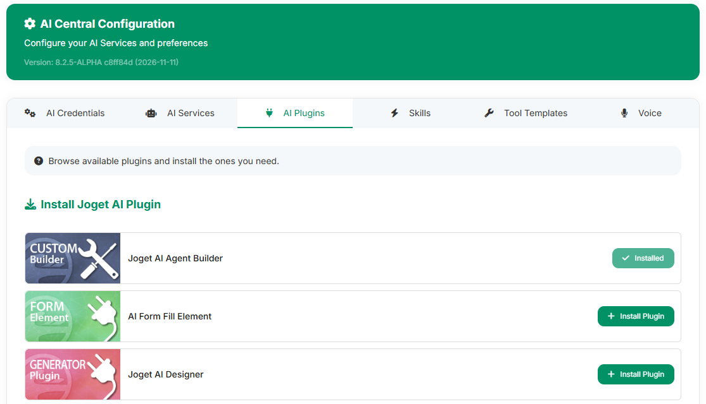

You do not need this tab for the plugin provided with this manual. Use it only to add other Joget AI plugins from the Marketplace.

## Tab 4: Skills

The **Skills** tab has two parts: **Central Instructions** at the top and the skill list below. The tab description is "Define reusable skill instructions and global system instructions for your AI Composers". What a skill is, how to write one and how agents use them is on [Skills, Central Instructions and Tool Templates](22-skills-and-tool-templates.md). This section describes only the tab.

### Central Instructions

Central Instructions are rules that Joget adds to the start of every conversation with a model, before the prompts of the agent or the composer.

| Field | What it does | Default | Notes |
|---|---|---|---|
| **Global** | Text sent with every composer and every agent. | empty | The help text says "These instructions are always injected into every composer and agent system message". The placeholder is "e.g. Always respond in a professional tone. Prefer concise answers...". |
| One item per target | Text sent only to one target: **Agent Builder** (all agents) or one composer (for example "AI Composer - Form Builder Agent"). | empty | Shown as collapsible items under **Global**, one for each target found on the instance: **Agent Builder**, **AI Composer - Datalist Builder Agent**, **AI Composer - Form Builder Agent**, **AI Composer - Process Builder Agent**, **AI Composer - Theme Builder Agent**, **AI Composer - UI Builder Agent** and **AI Orchestrator Agent**. Click an item's header to open or close its text box. |

Click **Save** in the Central Instructions header. The message is "Central Instructions saved successfully".

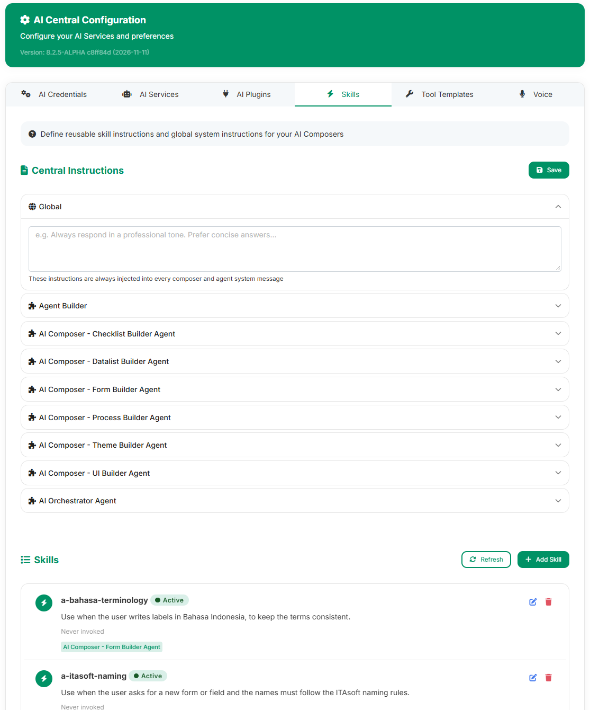

How the text reaches the model: for a run, Joget joins the **Global** text and the text of the target (the composer that runs, or Agent Builder for agents), separated by a blank line, and adds the result as a system message before the prompts. If both are empty, nothing is added.

### Skills list

| Control | What it does |
|---|---|
| **Refresh** | Reloads the skill list and the usage statistics. |
| **Add Skill** | Opens the **Add Skill** popup. |
| Skill card | Shows the name with a status badge (for example **Active**), the description, statistics (`<n> invocations`, `<n> success`, `<n> failed`, `Last: <time>` or `Never invoked`) and, as small chips, the targets it is for. Each card has an edit (pencil) and a delete (trash) icon. While the list loads, or when it is empty, the tab shows **No Skills Configured** and the text "Create skills to provide reusable instructions to your AI Composers". |
| **Update Available** badge and sync button | Shown on a default skill when the plugin carries newer text. The sync button asks "Sync "<name>" instructions from the plugin? This will overwrite your current content." and replaces the text. Sync is offered for these default skills: `joget-form-builder`, `joget-form-validators-binders`, `joget-datalist-builder`, `joget-process-builder`, `joget-userview-builder`, `joget-theme-builder`, `joget-orchestrator`. |

The fields of the **Add Skill** and **Edit Skill** popups:

| Field | What it does | Default | Notes |
|---|---|---|---|
| **Skill Name** | The name the model uses to call the skill. | empty | Required, unique. Example `weekly-status-report`. A duplicate gives "A skill with this name already exists". |
| **Description** | One or two sentences telling the model when to use the skill. | empty | The model reads this to decide which skill to call. |
| **Instruction** | The full text of the skill, in Markdown. | A two-section template (`## Section One`, `## Section Two`) | Use `## ` headings to split it into sections; the model can fetch only the sections it needs. A **Nav:** line at the top lists the sections; the button **Nav** (with a refresh icon) writes it as the first line of the text, in the form `**Nav:** Section A - Section B`. A grey line `Nav: Section A - Section B` under the editor previews it. The editor has **Write** and **Preview** tabs. |
| **Available For** | The targets that can see the skill. | none ticked | One check box each for **Agent Builder**, **AI Composer - Datalist Builder Agent**, **AI Composer - Form Builder Agent**, **AI Composer - Process Builder Agent**, **AI Composer - Theme Builder Agent**, **AI Composer - UI Builder Agent** and **AI Orchestrator Agent**. Help text: "Select which composers and builders this skill will be available in". A name that is not an installed composer is refused. |
| **Associated Tool Templates** | Tool templates that are made available whenever this skill is called. | none | One check box for each active tool template. Help text: "When this skill is invoked, these tool templates are also made available for use in that conversation turn". If there are none: "No active tool templates configured. Create one in the Tool Templates tab." |
| **Status** | Whether the skill is offered. | **Active** | Three options (see the table below), each with a short description. |

| Status | Meaning |
|---|---|
| **Active** | Discoverable and executable. |
| **Draft** | Hidden from all agents and composers. |
| **Deprecated** | Not discoverable, but still executable by name. |

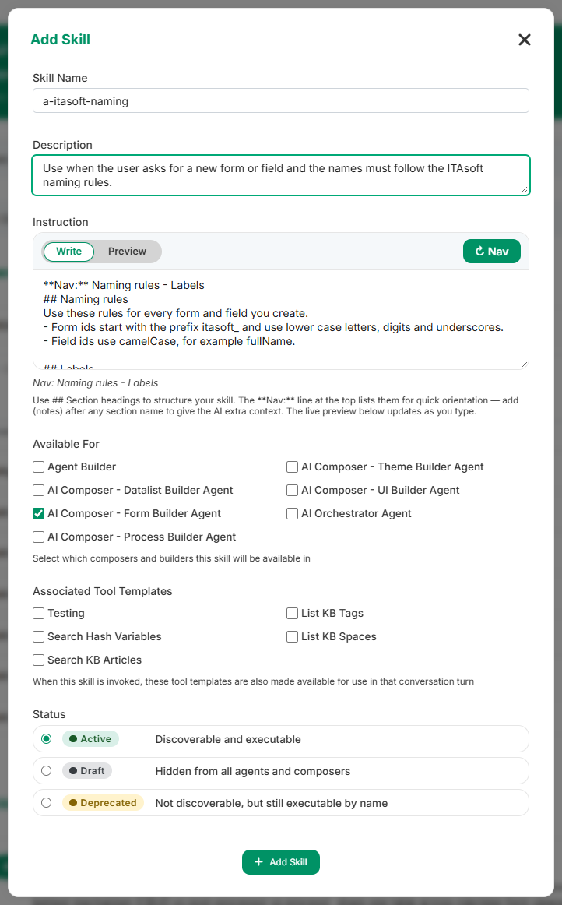

The first time the plugin starts it creates these default skills: `joget-form-builder`, `joget-form-validators-binders`, `joget-datalist-builder`, `joget-process-builder`, `joget-userview-builder`, `joget-form-field-ui`, `joget-theme-builder`, `joget-orchestrator`, `joget-app-design`, `joget-known-solutions` and `joget-hash-variables`.

### Limitations and things to know

- **Skills are files**, one `SKILL.md` per skill in the `wflow/app_ai_skills` folder. If the server cannot write there, a save fails with "Nothing was saved — the skill file could not be written."
- **Default skills are refreshed by the plugin.** When a new plugin version carries newer text for a default skill, the plugin replaces that skill when it starts. Copy a default skill under a new name before you edit it heavily.
- **Size limit for settings.** Central Instructions share a database column with other settings. A very long text can be refused with a message that starts "Nothing was saved".

## Tab 5: Tool Templates

A **tool template** is a tool, such as a Database Query or a JSON API call, that you have configured once and given a name. Skills can pull it in automatically, and builders can reuse it. The tab description is "Define reusable pre-configured tool instances that can be associated with skills and made available to AI Composers". Details and examples are on [Skills, Central Instructions and Tool Templates](22-skills-and-tool-templates.md).

The tab lists the templates (header **Tool Templates**, button **Add Tool Template**). Each row shows the display name, a status badge, the tool type (for example `JSON API`), the description, and chips for the targets it is available for. With none: **No Tool Templates Configured**.

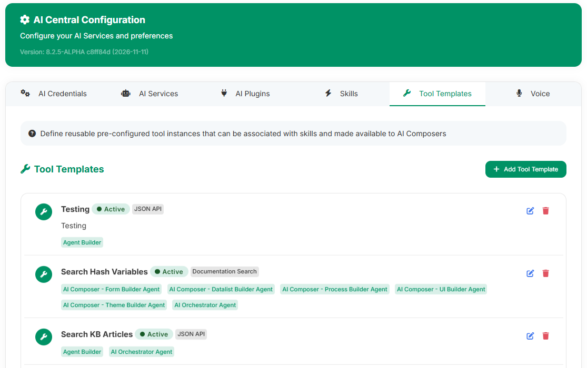

| Field | What it does | Default | Notes |
|---|---|---|---|
| **Display Name** | The label people see. | empty | Example `Fetch Design References`. |
| **Template Name (slug)** | The unique id used by skills to refer to the template. | Filled in from the display name: lower case letters and digits, other characters become `-` | Required, unique. A duplicate gives "Tool template name already exists". |
| **Description** | What the template does. The model reads it. | empty | |
| **Tool Type** | Which tool the template configures. | `-- -- Select a tool type -- --` | Required. The list offers the installed tools by their display names (for example **Database Query**, **Documentation Search**, **Email**, **JSON API**, **MCP Client**, **Pinecone**, **User Input**, and tools that other plugins add, such as **Acme Standards Lookup**), except a few that cannot be templated: the skill tools, **Tool Group**, **Run AI Agent**, App Context, **Set Agent Variable** and the **AI Agent** process tool. Help text: "Select the tool class to configure". |
| **Tool Configuration** | The property form of the chosen tool. | the tool's own defaults | Appears when you choose a **Tool Type**, under a heading with the tool name. The fields change with the tool. Grids have **+ Add Row** and a remove icon. |
| **Available For** | Where the template is offered: **Agent Builder** (shows in the palette as a tool template) and/or composers. | none ticked | The same seven check boxes as for skills. |
| **Status** | **Active**, **Draft** or **Deprecated**. | **Active** | The same meanings as for skills: Draft is hidden, Deprecated is kept for existing use. |

Create saves with the **Create** button, **Edit Tool Template** has **Save**, and **Delete Tool Template** has **Cancel** and **Delete**.

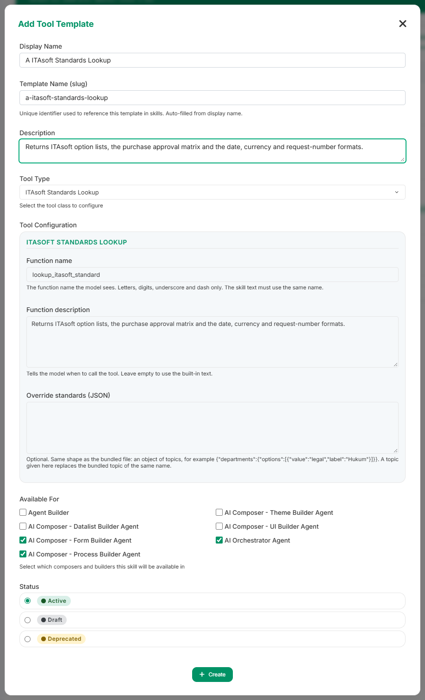

The plugin creates one template on its first start (templates that you or other plugins add are listed next to it): **Search Hash Variables** (slug `search_hash_variables`, a documentation tool for the Joget hash variable reference), available to the composers and the Orchestrator.

## Tab 6: Voice

The **Voice** tab has the description "Choose which speech-to-text provider the AI Composer's dictation button uses, and configure any credentials it needs". It has two parts: **Voice Provider** and **Hands-free Voice (beta)**. Both are saved with the one **Save** button in the tab header ("Voice provider configuration saved successfully"). Using voice in the builders is explained on [Voice Input and the Joget AI Assistant](16-voice-and-assistant.md).

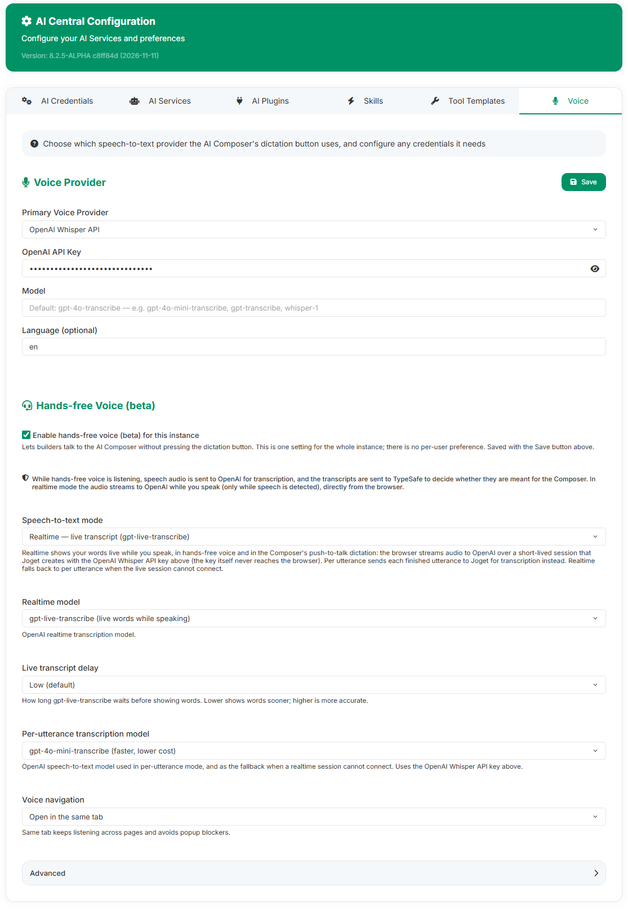

### Voice Provider (dictation)

| Field | What it does | Default | Allowed values / notes |
|---|---|---|---|
| **Primary Voice Provider** | The speech-to-text provider the composer's dictation (push-to-talk) button tries first. | **OpenAI Whisper API** | A drop-down with **Google Web Speech API** and **OpenAI Whisper API**, plus any provider added by another plugin. If the first provider cannot run, the panel falls back to the next usable one. |
| **OpenAI API Key** (shown for OpenAI Whisper API) | Key used to send audio to OpenAI for transcription. The key stays on the server. | empty | Required for Whisper. A password field with an eye icon. Stored encrypted. Without a key, Whisper is not offered and Google Web Speech becomes the working provider. |
| **Model** (Whisper) | The OpenAI transcription model. | empty; the placeholder reads "Default: gpt-4o-transcribe — e.g. gpt-4o-mini-transcribe, gpt-transcribe, whisper-1" | Text. When empty, `gpt-4o-transcribe` is used. |
| **Language (optional)** (Whisper) | Fixes the spoken language. | empty (auto-detect) | An ISO-639-1 code such as `en` or `id`. The placeholder reads "ISO-639-1 code, e.g. en — blank auto-detects, which can misfire on short clips". |

For **Google Web Speech API** the tab shows this note: "Only works in Chrome and other Chromium-based browsers (e.g. Edge). Not supported in Firefox, and disabled by default in Brave." It needs no key, runs in the browser, and sends the audio to Google.

Audio always leaves your Joget server with both providers: to OpenAI (Whisper) or to Google (Web Speech). Check your data-residency rules before you enable either.

### Hands-free Voice (beta)

> **Preview:** Hands-free voice is a beta feature and is off by default. It lets a builder talk to the AI Composer without pressing the dictation button. It needs both a **TypeSafe** credential (see the section "Tab 1: AI Credentials") and an OpenAI Whisper API key (above). If either is missing, the switch cannot be turned on and the tab says "Hands-free voice cannot be turned on yet:" with the missing item.

This is one setting for the whole instance. There is no per-user setting. Only Admin and App Creator users get hands-free voice.

| Field | What it does | Default | Allowed values |
|---|---|---|---|
| **Enable hands-free voice (beta) for this instance** | Switches the feature on. | off | on / off |
| **Speech-to-text mode** | How speech is turned into text. **Realtime** shows your words live while you speak, in hands-free voice and in the dictation button. **Per utterance** sends each finished utterance to Joget for transcription. | **Realtime** | **Realtime — live transcript (gpt-live-transcribe)**, **Per utterance** |
| **Realtime model** | The OpenAI realtime transcription model. | `gpt-live-transcribe` | `gpt-live-transcribe` (live words while speaking), `gpt-transcribe` (transcribes after each utterance) |
| **Live transcript delay** | How long `gpt-live-transcribe` waits before it shows words. Lower is faster, higher is more accurate. | **Low** | **Minimal (fastest)**, **Low (default)**, **Medium**, **High (most accurate)** |
| **Per-utterance transcription model** | The model for **Per utterance** mode, and the fallback when a realtime session cannot connect. Uses the OpenAI key above. | `gpt-4o-mini-transcribe` | `gpt-4o-mini-transcribe` (faster, lower cost), `gpt-4o-transcribe` (more accurate) |
| **Voice navigation** | Where a spoken "go to ..." command opens a page. | **Open in a new tab** | **Open in a new tab**, **Open in the same tab** (keeps listening across pages and avoids popup blockers) |
| **Addressed-to-Composer threshold** (Advanced) | How sure, from 0 to 1, TypeSafe must be that the speech is meant for the Composer. | `0.85` | A number from 0 to 1 |
| **Action threshold** (Advanced) | The lowest confidence for acting on a recognised command. Below it the Composer asks "Did you mean...?". | `0.70` | A number from 0 to 1 |
| **Auto-apply threshold** (Advanced) | The lowest confidence for applying an edit without waiting for a spoken "apply". | `0.90` | A number from 0 to 1 |

The three thresholds are inside a collapsed section named **Advanced** at the bottom of the tab. Click its header to open it.

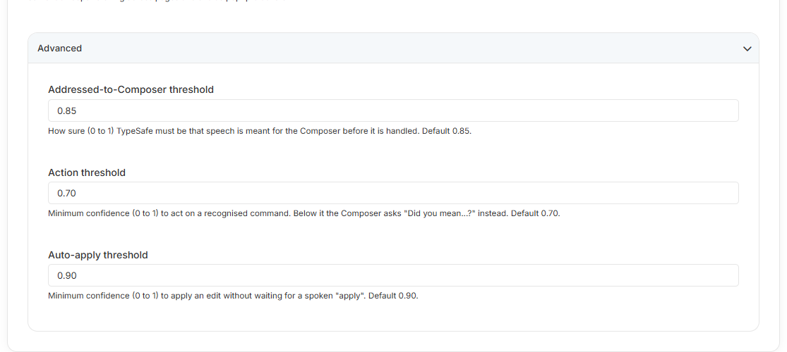

A threshold outside 0 to 1 gives the error "Thresholds must be numbers between 0 and 1".

**Privacy.** While hands-free voice is listening, speech audio is sent to OpenAI for transcription, and the transcripts are sent to TypeSafe to decide whether they are meant for the Composer. In **Realtime** mode the audio streams to OpenAI directly from the browser while you speak, and only while speech is detected. The OpenAI key itself never reaches the browser: Joget uses it to create a short-lived session.

> **Note:** With **Realtime** selected (the default) and an OpenAI key saved, the dictation button also tries the realtime provider first, ahead of the primary provider you chose. The primary provider and Google Web Speech remain as fallbacks.

## How settings are resolved at run time

This section answers the question "which credential and which model will this actually use?".

### Case 1: an AI Composer or the Orchestrator

1. The composer panel has a service picker (**Select AI Service**). If the user chose a service, that service is used.
2. If the user chose none, the **Active AI Service** from the AI Services tab is used.
3. If there is no active service, the panel shows **No AI Service Configured** ("Add and activate an AI service in Central Config to start using this composer.") with a **Go to AI Central Config** button.

The service is then turned into a model call:

| Question | Rule |
|---|---|
| Where does the API key come from | From the saved credential if the service has one (**Use Saved Credential**), otherwise from the key typed into the service. |
| Which provider | If the service uses a saved credential, the provider of that credential. Otherwise the **Model Class** of the service. |
| Which address | The credential's **Base URL** (Custom), or the service's **Custom LLM URL**, if set. Otherwise the provider's standard address. |
| Which model | The **Model Name** (or **Custom Model Name** for Custom). If empty, the provider default: `gpt-5.4` (OpenAI), `claude-sonnet-5` (Anthropic), `gemini-3.5-flash` (Google Gemini). |
| Tuning values | The service's own Temperature, Top P, Top K, Reasoning Effort and Thinking Budget Tokens, when set. If both a credential and the service define the same name, the credential wins. |
| Reply size | Always 16000 tokens at most for composers and the Orchestrator, whatever **Max Tokens** says. |

If the provider is not installed (for example a custom provider whose plugin was removed), the run fails with "Unsupported LLM provider". The provider name **Custom** is handled by the OpenAI client.

### Case 2: an agent built in the Agent Builder

An agent does not use AI Services and does not use the active service. The agent has one **model node** (OpenAI, Anthropic, Google Gemini, OpenRouter or IBM). The node decides:

| Question | Rule |
|---|---|
| Where does the key come from | If **AI Configuration** is set to a saved credential, the key of that credential. Otherwise the **API Key** typed into the node. |
| Which model | The node's **Model** field (required). |
| Settings | The node's own fields (**Max Tokens**, **Temperature** and so on). Defaults are in the table below. |
| Per task | A task can set its own timeout values (**LLM Socket Timeout (seconds)**, **LLM Connect Timeout (seconds)**), which override the agent's values for that task. |

The **AI Configuration** dropdown of a node lists only credentials of that node's provider with category LLM. This is why an OpenAI node never shows an Anthropic credential.

### Case 3: Decision tools

The Decision tools let you pick a provider. With the **LLM** provider, the tool uses an **AI Service**: the one named in the tool's field, or the active service if the field is empty. With the **TypeSafe (Jev)** provider, the tool uses a **TypeSafe credential**: the one named in the tool, or the first TypeSafe credential if none is named.

### Case 4: embeddings, Pinecone, Joget AI Assistant

- The OpenAI and Gemini embedding tools and the Pinecone tool take their key from a saved credential of category EMBEDDING or VECTOR DB (or a key typed into the tool).
- The Joget AI Assistant in **Agent Mode** runs a saved agent, so the agent's own model node decides. In **Process Mode** it runs a process.

### Case 5: Central Instructions, skills and tool templates

- Central Instructions are added to every run as described on the **Skills** tab.
- A skill is offered to a target only if the skill is **Active** and **Available For** includes that target. A tool template is offered to a target only if it is **Active** and **Available For** includes that target.

### Summary of "who uses what"

| Setting | Composers and Orchestrator | Agent canvas agents | Decision tools (LLM) | Decision tools (TypeSafe) | Voice |
|---|---|---|---|---|---|
| Active AI Service / AI Services | Yes | No | Yes | No | No |
| AI Credential (LLM) | Through a service | Through the node's **AI Configuration** | Through a service | No | No |
| TypeSafe credential | Only for the Jev toggle | No | No | Yes | Hands-free only |
| Central Instructions | Yes | Yes | No | No | No |
| Voice tab | Dictation | No | No | No | Yes |

## Defaults per provider

These are the values in the shipped build. They apply to the **model node** of an agent (the node fields start with these values) and to the **provider default model** used when an AI service has no **Model Name**. In the Agent Builder palette the nodes are named **Anthropic**, **Google Gemini**, **IBM**, **Open AI**, **OpenRouter LLM** and, when another plugin adds one, for example **Private Gateway LLM**. The Anthropic node labels its field **Max Token**; the table calls the field **Max Tokens**.

| Provider | Default model | Default **Max Tokens** (agent node) | Standard address | Other defaults on the agent node |
|---|---|---|---|---|
| OpenAI | `gpt-5.4` | 4096 | `https://api.openai.com/v1/chat/completions` | Temperature and Top P empty; **Reasoning Effort** empty (options: none, low, medium, high, xhigh) |
| Anthropic | `claude-sonnet-5` | 32000 | `https://api.anthropic.com/v1/messages` | **Anthropic Version** header `2023-06-01`; Temperature, Top P, Top K empty; **Reasoning Effort** options: low, medium, high, xhigh, max |
| Google Gemini | `gemini-3.5-flash` | 8192 | `https://generativelanguage.googleapis.com/v1beta/models/{model}:generateContent` | **Reasoning Effort** options: minimal, low, medium, high |
| OpenRouter | `google/gemma-3-27b-it:free` | 4096 | `https://openrouter.ai/api/v1/chat/completions` | Temperature 1.0, Top P 1.0, Top K 1, Frequency Penalty 0.0, Presence Penalty 0.0, Repetition Penalty 1.0, Min P 0.0, Top A 0.0 |
| IBM watsonx | `meta-llama/llama-3-2-11b-vision-instruct` | empty on a new node (the provider default applies) | `https://us-south.ml.cloud.ibm.com/ml/v1/chat/completions` | API Version `2024-05-31`; **Project ID** is required |
| Custom | none: you must enter **Custom Model Name** | server-dependent | none: you must enter **Custom LLM URL** | Uses the OpenAI client |

Notes on the table:

- On the AI Service form, **Max Tokens** is prefilled with `16000` and **Temperature** with `0.2` for every provider. The composers cap replies at 16000 tokens anyway.
- The default model (`gpt-5.4` and so on) is only a starting value. Always check which models your provider account can use.
- The OpenRouter default model is a free model. Free models are rate-limited and can be slow; choose a paid model for real work.

### Model suggestions in the AI Service form

The **Model Name** combobox suggests the following ids. You can type any other id.

| Provider | Suggested model ids |
|---|---|
| OpenAI | `gpt-5.6-sol`, `gpt-5.6-terra`, `gpt-5.6-luna`, `gpt-5.5`, `gpt-5.5-pro`, `gpt-5.4`, `gpt-5.4-pro`, `gpt-5.4-mini`, `gpt-5.4-nano`, `gpt-5.3-codex`, `gpt-5.2`, `gpt-5.2-pro`, `gpt-5.1`, `gpt-5`, `gpt-5-pro`, `gpt-5-mini`, `gpt-5-nano`, `o3`, `o3-pro`, `gpt-4.1`, `gpt-4.1-mini`, `gpt-4o`, `gpt-4o-mini` |
| Anthropic | `claude-fable-5`, `claude-opus-5`, `claude-sonnet-5`, `claude-opus-4-8`, `claude-opus-4-7`, `claude-opus-4-6`, `claude-sonnet-4-6`, `claude-opus-4-5`, `claude-sonnet-4-5`, `claude-haiku-4-5`, `claude-opus-4-1`, `claude-sonnet-4` |
| Google Gemini | `gemini-3.6-flash`, `gemini-3.5-flash`, `gemini-3.5-flash-lite`, `gemini-3.1-pro-preview`, `gemini-3.1-flash-lite`, `gemini-3-pro-preview`, `gemini-3-flash-preview`, `gemini-2.5-pro`, `gemini-2.5-flash`, `gemini-2.5-flash-lite`, `gemini-2.0-flash`, `gemini-2.0-flash-lite` |

Which models you can actually call depends on your provider account and region. See [AI Composers User Guide](12-composers-user-guide.md) for advice on choosing a model for composer work.

## Provider setup steps

Each recipe has two parts: what to do at the provider, and what to do in AI Central Config. Do the credential first, then the service if you want composers to use the provider.

### OpenAI

1. At the OpenAI platform, create an API key for your organisation. Make sure billing is active and the project can use the model you plan to call.
2. In **AI Credentials** click **Add Credential**. **Configuration Type**: **OpenAI**. Enter the **API Key**. **Configuration Name**: for example `OpenAI main`. Click **Add**.
3. In **AI Services** click **Add AI Service**. Under **Use Saved Credential (Optional)** choose `OpenAI main`. **Model Name**: for example `gpt-5.4`. Leave the Advanced fields empty at first (GPT-5 family models accept only **Max Tokens** and **Reasoning Effort**). **AI Service Name**: for example `OpenAI GPT-5.4`. Click **Add**.
4. Set it in **Active AI Service** and click **Save**.
5. For agents: drag the **Open AI** model node from the palette group **LLM Services** into an agent, choose `OpenAI main` in **AI Configuration** and check **Model**.

The same OpenAI credential also serves the OpenAI embedding tool. A separate OpenAI key is typed in the **Voice** tab for speech-to-text.

### Anthropic

1. In the Anthropic console, create an API key.
2. **AI Credentials > Add Credential**: **Configuration Type** **Anthropic**, the **API Key**, a name such as `Anthropic main`.
3. **AI Services > Add AI Service**: choose the credential, **Model Name** `claude-sonnet-5` (or another id from the list), name the service, **Add**. Newer Claude models accept **Max Tokens** and **Reasoning Effort** only; Claude 4.6 and older also accept Temperature and the sampling fields.
4. Make the service active.
5. For agents: use the Anthropic model node; the **Anthropic Version** field keeps `2023-06-01` unless Anthropic tells you otherwise.

### Google Gemini

1. In Google AI Studio, create an API key.
2. **AI Credentials > Add Credential**: **Configuration Type** **Google Gemini**, the **API Key**, a name such as `Gemini main`.
3. **AI Services > Add AI Service**: choose the credential, **Model Name** `gemini-3.5-flash` (or another id), name the service, **Add**. Gemini 3 and later accept **Reasoning Effort**; Gemini 2.x accepts **Thinking Budget Tokens**.
4. Make the service active.
5. For agents: use the Google Gemini model node.

### OpenRouter (agents only)

1. At OpenRouter, create an API key.
2. **AI Credentials > Add Credential**: **Configuration Type** **OpenRouter**, the **API Key**, a name such as `OpenRouter main`.
3. Open an agent in the Agent Builder, drag the **OpenRouter LLM** model node into the agent, choose the credential in **AI Configuration**, and set **Model** to an OpenRouter model id (for example `google/gemma-3-27b-it:free`).
4. OpenRouter cannot be chosen as an AI service. To use OpenRouter in the composers, create a **Custom** credential and service that point at the OpenRouter OpenAI-compatible address, and use a model id from OpenRouter.

### IBM watsonx (agents only)

1. In IBM Cloud, create an API key, and note the **Project ID** of your watsonx.ai project and the region of the service.
2. **AI Credentials > Add Credential**: **Configuration Type** **IBM**, the **API Key**, a name such as `IBM main`.
3. In an agent, drag the **IBM** model node, choose the credential in **AI Configuration**, enter the **Project ID** (required), and set **Model**. If your region is not `us-south`, change **API URL** to your region's address.
4. IBM cannot be chosen as an AI service in this build.

### Custom: LM Studio, Ollama, a gateway or any OpenAI-compatible server

Use this for a local model, a company gateway, Azure OpenAI or any server that offers the OpenAI chat-completions interface.

1. Start the server and note the base address, for example `http://localhost:1234/v1` for LM Studio or `http://localhost:11434/v1` for Ollama. Joget adds `/chat/completions` itself. The address must be reachable from the Joget server, not only from your own computer: `localhost` means the Joget server.
2. Note the exact model id that the server expects.
3. **AI Credentials > Add Credential**: **Configuration Type** **Custom**. **API Key**: the key the server expects. Many local servers ignore it but the field is required, so enter any text. **Base URL**: the base address from step 1.
4. **AI Services > Add AI Service**: choose the credential (**Model Class** becomes **Custom**). In the Advanced fields leave everything empty first. If you do not use a saved credential, enter **API Key**, **Custom LLM URL** and **Custom Model Name** in the form.
5. Make the service active, then send one short composer message as a test.

Small local models often cannot produce the long structured output the composers need. Test with a simple request first. The same **Custom** credential is not offered in agent model nodes; for agents, use the **Open AI** model node with its **API URL** field set to your server.

### Pinecone (vector search tool)

**AI Credentials > Add Credential**, **Configuration Type** **Pinecone**, enter the **API Key**. Choose it in the **AI Configuration** field of the Pinecone tool.

### TypeSafe (System One)

**AI Credentials > Add Credential**, **Configuration Type** **TypeSafe**. Enter the **API Key** you received from TypeSafe. Leave **Model**, **Base URL** and **Timeout (ms)** at their defaults unless TypeSafe tells you otherwise. Click **Test connection** before you save.

## Limitations and things to know

- **Composers need an OpenAI, Anthropic, Google Gemini, Custom or plugin-provided service.** OpenRouter and IBM work in agents only.
- **No general connection test.** Only the TypeSafe credential has a **Test connection** button. For other providers, run the smoke test.
- **Secrets can be stored in readable form after an edit.** See the limitation on the AI Credentials tab.
- **The Voice tab sends audio to a third party.** OpenAI (Whisper and Realtime) or Google (Web Speech), depending on the provider.
- **Hands-free voice is a beta feature** that is off by default.
- **The page changes the whole instance.** Test on a non-production server first.
- **Free or very small models** often fail on long composer tasks.

## Troubleshooting

| Symptom | Likely cause | What to do |
|---|---|---|
| **AI Central Config** is missing under **Settings** | The user is not Admin or App Creator, or the plugin did not load | Check the user's role, then see [Installing and Setting Up Your Joget Instance](02-installation-and-setup.md). |
| The composer panel says **No AI Service Configured** | No service is active, or the active service was deleted | **AI Services > Active AI Service** > choose a service > **Save**. |
| The **Use Saved Credential (Optional)** list shows only `-- None (Manual Setup) --` | There is no LLM credential of a provider that services can use (IBM and OpenRouter credentials are not offered) | Add an OpenAI, Anthropic, Google Gemini or Custom credential. |
| `Cannot delete credential "X" because it is currently used by...` | An AI service still uses it | Edit or delete the listed services first. |
| "AI Service Name already exists" / "AI configuration name already exists" | Names must be unique | Choose another name. |
| A composer run fails at once with a provider error about the model | Wrong **Model Name**, or the account cannot use that model | Correct the model name, or try the provider default. |
| Error like "unsupported parameter" from the provider | A tuning value the model rejects | Clear the Advanced fields of the service; they should be empty unless you need them. |
| Replies are cut off | The model's own limit or the 16000-token composer limit | Ask for smaller steps, or use a model with a larger limit. For agents raise **Max Tokens** on the model node. |
| Custom server: connection refused or timeout | The address is wrong, or `localhost` does not point to the Joget server | Use an address reachable from the Joget server; test it from that machine. |
| Custom server: 404 | The **Custom LLM URL** includes a path or lacks `/v1` | Enter the base address only, for example `http://host:1234/v1`. |
| Agent model node: **AI Configuration** dropdown is empty | No credential of that provider exists | Add a credential for the provider, or use **Create AI Configuration**. |
| Nothing saved: "Nothing was saved — this change needs N KB but the wf_setup.value database column only holds M KB" | Too much text in one setting | Shorten the central instructions or the tool template. |
| Skill save fails: "the skill file could not be written" | The server cannot write to the `wflow` folder | Fix the folder permissions. |
| Hands-free voice cannot be turned on | No TypeSafe credential, or no Whisper key | Add both, then save the **Voice** tab again. |
| Dictation button does nothing in Firefox | Google Web Speech needs Chrome or Edge | Add the OpenAI Whisper API key and use it as **Primary Voice Provider**. |
| The **AI Plugins** tab is empty | The server cannot reach the Joget Marketplace | Check outbound access; this tab is optional. |

## Where to go next

- [Installing and Setting Up Your Joget Instance](02-installation-and-setup.md): install the jar and run the ten-minute smoke test.
- [Agent Builder Concepts and How an Agent Runs](04-agent-builder-concepts.md): what an agent is, and how the model node and tasks work.
- [Skills, Central Instructions and Tool Templates](22-skills-and-tool-templates.md): write skills and build tool templates.
- [Voice Input and the Joget AI Assistant](16-voice-and-assistant.md): dictation and hands-free voice in use.
- [Adding a Custom LLM Provider](26-custom-llm-providers.md): add a provider that appears in **Model Class** and **Configuration Type**.
