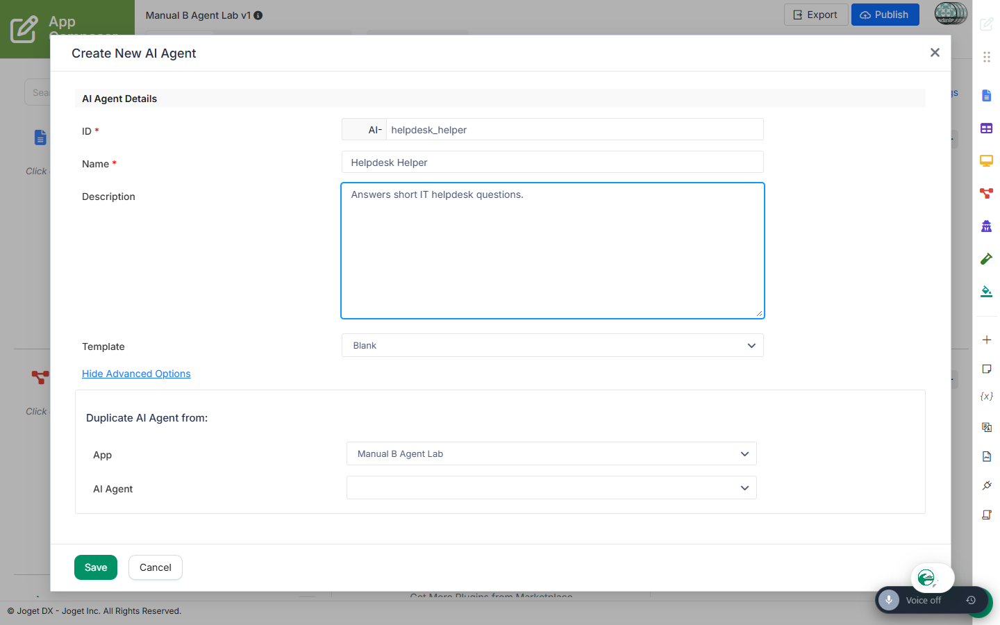
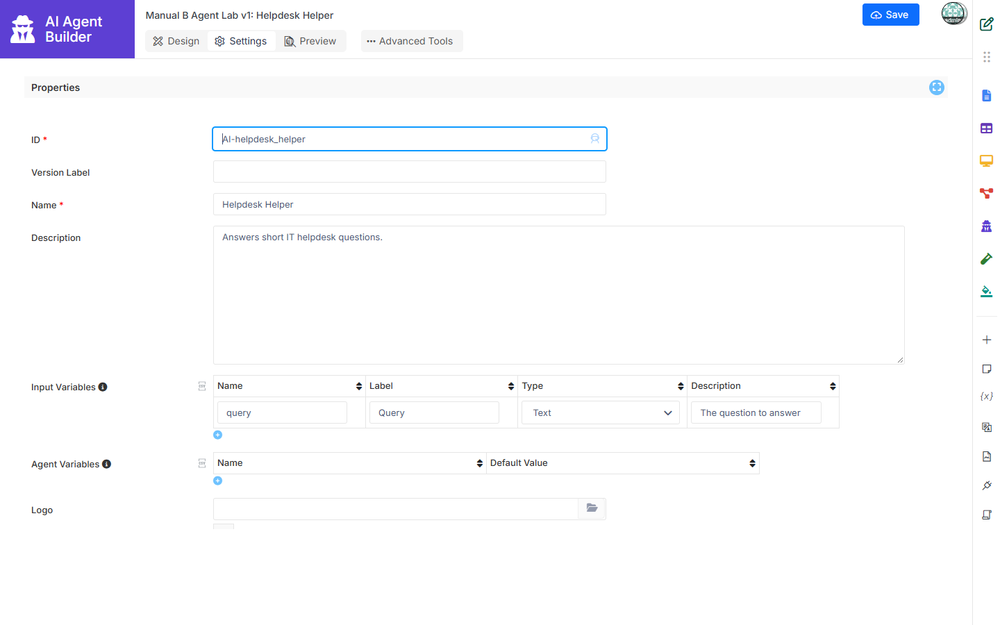
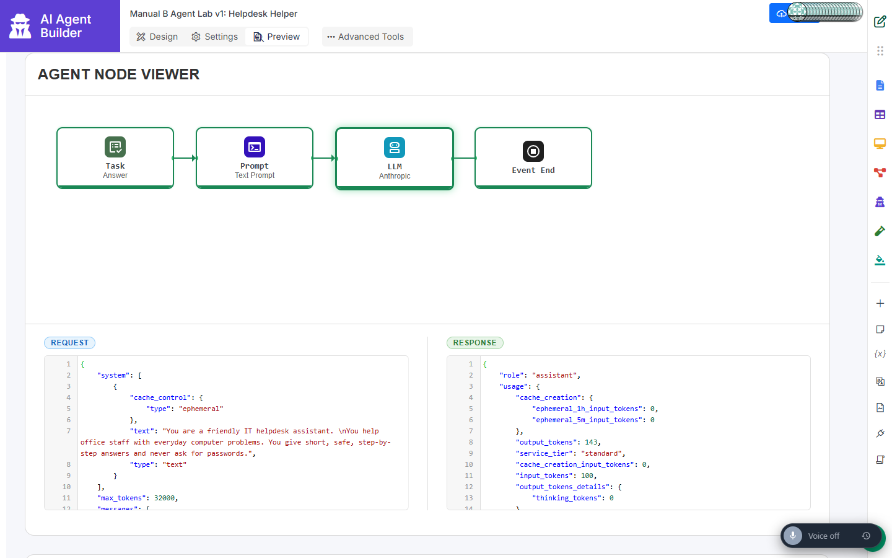
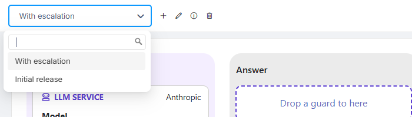

# Agent Builder Concepts and How an Agent Runs

This page explains what an agent is in Agent Builder, which building blocks you can put in it, and exactly what happens from the moment an agent starts until it returns an answer. It also lists every agent-level and task-level setting with its default, describes what happens when something fails, explains agent versioning, and gives design rules and worked examples. Read it before you build your first agent, and come back to it when an agent does something you do not expect. It is written for expert Joget implementers; the click-by-click procedures are on [Building Agents Step by Step](05-building-agents-tutorials.md).

## What an agent is

An **agent** is a definition stored in your Joget app, like a form or a datalist. You build it in **AI Agent Builder** in the App Composer. The definition has three parts:

1. **Properties**: the ID, name, description, the **Input Variables** the caller supplies, and the **Agent Variables** the agent uses as scratch values during a run.
2. **The agent section**: exactly one **LLM service** (the language model and its credentials) and optional **agent-level prompts** that apply to every task, for example a **Persona**.
3. **Tasks**: an ordered list of steps. A task is one conversation turn with the model. It has its own prompts, tools, guards, enhancers and decisions.

A run executes the tasks in order. A **decision** at the end of a task can send the run to another task, stop it, or let it continue.

Keep these ten points in mind. The rest of the page explains each one.

1. An agent has one LLM service. Only the first LLM service on the canvas is used.
2. A task is a fresh model conversation. It starts from the shared history, adds its own prompts, lets the model call tools, and produces one final answer.
3. Prompts and tools shape the request. Guards check it. Enhancers and decisions act on the answer.
4. Tool calls, tool results and task prompts exist only while their task runs. Only the final answer of a task is added to the history that later tasks see.
5. To pass structured data to a later task, store it in an **agent variable**, a process variable or a form record.
6. The agent runtime does not write to your Joget data by itself. Writes happen in enhancers, in tools, in BeanShell scripts, or in the caller (for example the **AI Agent** tool in a process).
7. Every block that runs is traced. You can inspect each step in the **Agent Node Viewer** and later in **Agent Execution Audit Trail** (menu **Monitor > Agent Execution Audit Trail**).
8. A run has limits that you set: maximum tasks, maximum tool-call rounds, timeouts, retries and a context budget.
9. Some safety checks are advisory. A guard that calls a model or a web service lets content through when that call fails. Section "Failure paths" lists every case.
10. Agent Builder runs only on Joget DX Enterprise.

## The builder: canvas, palette and screens

Open your app in the App Composer. The builders are shown as panels. In the **AI Agent Builder** panel, click the **+** button (or click **Add New** under **AI Agent Builder** in the bar on the right). The dialog **Create New AI Agent** opens. Enter an **ID**, a **Name** and a **Description**, and pick a **Template**. The **ID** box shows the fixed prefix `AI-` in front of what you type. **Show Advanced Options** lets you create the agent as a copy of an existing one (**Duplicate AI Agent from**, then an **App** and an **AI Agent**). Click **Save**.

| Template | What you get |
|---|---|
| **Blank** | One empty task called **First Task**, no LLM service, no prompts. |
| **Research & Tech Writer** | A persona and prompts that research a topic and write an article. |
| **Document Compliance Checker** | A file input and prompts that check a document against policy rules. |
| **Claim Processing** | A file input and prompts that review a claim document and recommend approve, reject or request more information. |
| **FAQ Assistant** | A question input that answers from a supplied FAQ, with an optional web search. |



### The canvas

The canvas has two areas, top to bottom:

1. The **agent section**. It has a drop zone **Add a LLM service to here** and a drop zone **Drop a prompt to here**. Prompts placed here are agent-level: they run once at the start and apply to every task.
2. The **task list**. Each task is a box with five drop zones: **Drop a prompt to here**, **Drop a tool to here**, **Drop an enhancer to here**, **Drop a decision rule to here** and **Drop a guard to here**. To add a task, click the task name to select the task. A small toolbar appears above its top-right corner. Click the **+** icon (**Add Task**) in that toolbar. A new task is added after the selected one and is named **New Task**. The same toolbar moves the task (arrow icons) and removes it (trash icon).

You build by dragging blocks from the palette on the left into a drop zone. Click a block to open its properties. They open in a floating **Properties** window with the buttons **Apply Change** (save the values into the canvas), **Close**, **Dock** (fix the window at the right side) and **Undock**. Changing a block and closing the window also applies the change, but you must still click **Save** in the toolbar to store the agent. Every block has two common properties:

| Field | What it does | Default | Notes |
|---|---|---|---|
| **Personalized Name** | A name shown for this block in the Agent Node Viewer. | Empty | Use it to tell two blocks of the same type apart. |
| **Enabled** | Turns the block on or off without deleting it. | Enabled | A disabled block is skipped when the agent runs. |

You can copy and paste blocks. A tool can be pasted only next to an existing tool.

### The palette

| Palette section | Contents |
|---|---|
| **LLM Services** | Open AI, Anthropic, Google Gemini, OpenRouter LLM, IBM |
| **Prompts** | Agent Variables, BeanShell, File, Form Data, Form Data Tables Schema, JSON API, List Data, Output Format, Persona, Text Prompt |
| **Tools** | AJAX Display, BeanShell, Database Query, Decision (Multiple Choice), Documentation Search, Email, File Viewer, GitLab, Google Web Search, Tool Group, HTML Display, HTML UI Input, JSON API, MCP Client, Mem0 Chat Memory, AI Orchestrator, Pinecone, Run AI Agent, Script Runner, Set Agent Variable, Invoke Skill, URL Display, User Input. The full list with all fields is on [Building Block Reference: Tools](06-reference-tools.md). |
| **Tool Templates** | Pre-configured tools that an administrator saved in AI Central Config. Only templates that are **Active** and available for Agent Builder appear. |
| **Enhancers** | BeanShell, Code Extractor, JSON Extractor, Store to Agent Variable, Store to Form, Store to Process Variable |
| **Decisions** | BeanShell, Response Condition |
| **Guards** | LLM Safety Check, Rule-Based Guard, Webhook Guard |

The palette also shows blocks that other plugins add. Plugins from the examples repository, for example, add **Private Gateway LLM**, **Indonesian ID Validator**, **Acme Standards Lookup**, **App Naming Check**, **NPWP Format and Notice** and **NIK PII Guard**. The add-on **Upgrade Advisor** adds **Upgrade Advisor scan**. Entries are listed in alphabetical order of the plugin class name inside each section, so a block can be out of order by label (for example **Tool Group** comes after **Google Web Search**).

### Settings, Design and Preview

The builder has these screens:

| Screen | What it is for |
|---|---|
| **Design** | The canvas described above. |
| **Settings** | The agent properties and all agent-level settings (see "Settings reference"). |
| **Preview** | The **Agent Test Run** page where you enter inputs, run the agent and read the trace. See "Streaming and tracing" and [Building Agents Step by Step](05-building-agents-tutorials.md). |

A version bar above the canvas lets you keep named versions of the agent. See "Agent versioning".



The **Settings** screen is titled **Properties**. Between **ID** and **Name** there is the field **Version Label**, for the label of the active version (see "Agent versioning"). You can leave it empty.

## The building blocks

Every block is a Joget plugin. Agent Builder has six kinds of block. Each acts at a different point of a run.

| Block | What it is for | When it acts | Built-in blocks |
|---|---|---|---|
| **LLM service** | Calls the language model. | Every model call of the run. | Open AI, Anthropic, Google Gemini, OpenRouter LLM, IBM. A custom provider added by a plugin also appears. |
| **Prompt** | Adds messages or request settings before the model is called. | Agent prompts once at the start. Task prompts at the start of each task. | Persona, Text Prompt, Output Format, Form Data, Form Data Tables Schema, List Data, JSON API, File, Agent Variables, BeanShell |
| **Tool** | Gives the model functions it can call to fetch data or do something. | During a task, when the model asks for a function. | See [Building Block Reference: Tools](06-reference-tools.md) |
| **Guard** | Checks the messages going to the model (input) and the answer coming back (output). | Input guards before the model call. Output guards after the tool loop. | Rule-Based Guard, LLM Safety Check, Webhook Guard |
| **Enhancer** | Post-processes the answer: cleans it, saves it, stores it in a variable. | After the answer, in the order shown. | JSON Extractor, Code Extractor, Store to Form, Store to Process Variable, Store to Agent Variable, BeanShell |
| **Decision** | Chooses what happens next: continue, jump to a task, or stop. | After the enhancers of a task. | Response Condition, BeanShell |

[Building Block Reference: Prompts, LLMs, Enhancers, Decisions and Guards](07-reference-other-blocks.md) lists every field of every block except tools.

### Agent and task

The **agent** holds the identity, inputs, variables, the LLM service, agent-level prompts and the run settings. The **description** of the agent is also the function description the model sees when another agent calls this one through the **Run AI Agent** tool, so write it for a model reader.

A **task** has a **Task Name**, optional timeouts, and the five lists of blocks. Tasks run top to bottom. A decision can move the run to any task, forward or backward.

### Persona and prompts

A **Persona** is a prompt. It adds one system message that reads `You are a <Role>.` followed by the **Backstory**. Write the **Role** as a noun phrase (for example `claims reviewer`), because the runtime puts "You are a" in front of it. A new Persona is pre-filled with the sample role `Research Analyst & Tech Writer`; replace it. Put the Persona at agent level so it applies to every task. A Persona in a task applies to that task only.

Other prompts bring data or instructions into the request:

| Prompt | Adds to the request |
|---|---|
| **Text Prompt** | One message with the **Message Role** (**System** or **User**, default **User**) and your **Prompt** text. `${name}` placeholders are filled from agent variables (see "Data containers"). |
| **Output Format** | No message. It switches the model provider to JSON output (**Default (text)**, **JSON Object (any valid JSON)** or **JSON Schema (strict, define structure)**). |
| **Form Data** | One system message with the content of one form record. |
| **Form Data Tables Schema** | One system message describing the app's tables and column IDs, so a model can write correct SQL. |
| **List Data** | One system message with rows of a datalist as a table. |
| **JSON API** | One system message with the result of an HTTP call. It always runs. |
| **File** | One message per file (image, PDF or text). |
| **Agent Variables** | One system message listing the current agent variables. |
| **BeanShell** | One system message with the text your script returns. |

### Tools

A tool exposes one or more **functions** to the model. Each function has a name, a description and arguments. The model decides when to call a function, based only on the **Function Name** and **Function Description**. A vague description is the most common reason for wrong or missing tool calls. The runtime runs the function, gives the returned text back to the model, and calls the model again, until the model stops asking for tools.

Tool groups and skills help when you have many functions:

- **Tool Group** shows the model a single trigger function. The nested tools become visible only after the model calls the trigger.
- **Invoke Skill** lets the model read named instruction documents on demand (see [Skills, Central Instructions and Tool Templates](22-skills-and-tool-templates.md)).

### Decisions

A **Response Condition** decision has a **Routes** grid. Each route has a **Condition**, a **Value / LLM Question**, an **Action** and a **Target Task**. Routes are checked from top to bottom. The first route that matches decides. If no route matches, the run continues to the next task.

| Condition | Matches when |
|---|---|
| **Response contains** | The answer contains the value (case-sensitive). |
| **Response does not contain** | The answer does not contain the value. |
| **Response equals** | The answer is exactly the value, including case and spaces. |
| **Response does not equal** | The answer is not exactly the value. |
| **Response matches regex** | A Java regular expression finds a match anywhere in the answer. An invalid expression never matches. Use `(?i)` for case-insensitive matching. |
| **Ask LLM (yes/no)** | An extra model call, with your question and the answer, returns text that starts with "yes". |
| **Always (unconditional)** | Always. |

| Action | Effect |
|---|---|
| **Abort Execution** | Stops the run. The answer of the current task is the final answer. |
| **Go to Task** | Jumps to the task chosen in **Target Task**. |
| **Continue to Next Task** | Goes to the next task. |

The BeanShell decision runs a script that must return a `DecisionResult`, for example `return DecisionResult.abort();`. The script can use the variables `plugin`, `llm`, `llmConfig`, `response` and `DecisionResult`. A script that returns anything else means "continue".

An agent can also have no LLM service of its own, if every task contains exactly one enabled **Decision (Multiple Choice)** tool and no enabled guard. The runtime then runs the decision tool directly, with the text of the task's user prompts as the case, instead of asking a model to call it. The answer is the tool's output. The decision tool uses the provider and credential set in its own properties (see [Building Block Reference: Tools](06-reference-tools.md)). Such an agent can still use enhancers and decisions.

### Guards

A guard has an **On Violation** setting:

| On Violation | Effect |
|---|---|
| **Block (abort execution)** | The task fails with the message `Content blocked by guard: <reason>`. The run stops. |
| **Sanitize (redact content and continue)** | The matched or flagged content is replaced and the task continues. |
| **Redirect (go to another task)** | The run jumps to the task whose ID you type in **Redirect Task ID**. |

What each guard checks, and what Sanitize does for each direction, is in "The steps inside one task". How guards behave when their own check fails is in "Failure paths".

### Variables

Four kinds of variable are involved in an agent. They are different things.

| Kind | Syntax | Set by | Lives | Holds |
|---|---|---|---|---|
| **Input Variables** | `${query}` | The caller (a person in Preview, a process, a datalist action) | One run | Text, or a file |
| **Agent Variables** | `${name}` in a Text Prompt; **Agent Variables** prompt | Defaults you declare; the **Set Agent Variable** tool; the **Store to Agent Variable** enhancer | One run, across tasks | Text |
| **Process variables** | Process Builder | **Store to Process Variable** enhancer, or the **AI Agent** tool | The process instance | Text |
| **Hash variables** | `#currentUser.username#` and others | Joget | Read-only | Joget data |

"Data containers and how data moves" explains each in detail.

## How an agent runs

### Where a run starts

Every run starts from one of these entry points. The entry point is recorded as the **Trigger Source** in **Agent Execution Audit Trail**.

| Entry point | Trigger Source |
|---|---|
| The **AI Agent** tool in a process, **Synchronous (wait for result)** | Sync Process Tool |
| The **AI Agent** tool in a process, **Asynchronous (fire and forget)** | Async Process Tool |
| The **Run AI Agent** datalist action | Datalist Action |
| **Preview** in the builder | Builder Preview |
| The Joget AI Assistant in agent mode | AI Assistant |
| The **Run AI Agent** tool inside another agent | Sub Agent |
| An evaluation run | Agent Evaluation |
| An AI Composer or other system agent | System Agent |

### The run, step by step

1. **Start.** The runtime creates a run ID and writes an execution record with status `RUNNING`. It records who started the run. When the caller is anonymous it uses the user name supplied by the caller, if any.
2. **Input variables.** Each `${name}` for a declared input is replaced by the supplied value in the whole definition, not only in prompts. A declared input that the caller did not supply becomes an empty string. If the Input Variables grid is empty, no replacement is done at all.
3. **Agent variables.** Each declared agent variable is set to its **Default Value**. For a sub-agent, the values from the calling agent then overwrite the defaults.
4. **LLM service.** The runtime loads the first LLM service of the agent. If there is none, the run fails with `Agent LLM not available.`, except for a decision-only agent as described above.
5. **File inputs.** Inputs of type **File** are added to the shared conversation as file messages.
6. **Agent-level prompts.** First the Central Instructions (if any are configured), then each enabled agent-level prompt, in order. These steps do not appear as nodes in the Agent Node Viewer.
7. **Parent conversation.** For a sub-agent started with **Context Propagation** set to pass the conversation history, the filtered parent messages are added next.
8. **Task loop.** For each task, the runtime checks for an abort request, checks the **Max Iterations** limit, and runs the task (with a time limit if **Task Timeout (seconds)** is set).
9. **Decision.** After the task, the decisions run. The result is continue, go to a task, or abort.
10. **Final answer.** The answer of the last task that ran is the answer of the run. With no tasks the answer is `No task was configured.`
11. **Finish.** The runtime saves the execution record with the final status (`SUCCESS`, `FAILED` or `ABORTED`), the token counts and the number of nodes. If this was a sub-agent, its agent variables are copied back to the caller.

The runtime itself never writes business data. Anything that changes Joget data is done by an enhancer, a tool, a script, or by the caller after the run returns.

```text
Caller
  |  inputs
  v
Start run -> replace ${inputs} -> set agent variables -> load LLM service
  -> Central Instructions + agent prompts  (shared conversation)
  |
  +--> Task 1 --> Task 2 --> ...      (decision can jump or stop)
  |
  v
Final answer = answer of the last task that ran
  |
  +--> caller stores it (AI Agent tool, datalist action) or shows it
```

### The steps inside one task

For each task, in this order:

1. **Task node starts.** A Task node appears in the viewer with a yellow border.
2. **Fresh settings.** The task gets its own copy of the model settings, so a JSON output setting from one task never leaks into the next. Task-level timeouts are applied.
3. **Output expectations.** If the task has a **Store to Form** enhancer with the **JSON Manual Mapping** or **JSON Auto Mapping** strategy, the runtime asks the model for structured JSON that matches the form fields.
4. **Task conversation.** The task takes a copy of the shared conversation. Everything the task adds from here on exists only for this task.
5. **Task prompts.** Each enabled prompt adds its messages. The Central Instructions are added again at the start of this step.
6. **Input guards.** Each enabled guard checks the task conversation, which now includes the task prompts. See below.
7. **Tools.** The tools of the task are prepared and their functions are offered to the model. A tool that is configured but cannot be loaded fails the task with `<Type> class could not be loaded: <class>`.
8. **Trim and first call.** The context window is trimmed if needed (see "Context window handling"), then the model is called. With token streaming on, the reply streams to the screen.
9. **Tool loop.** While the model asks for functions, the runtime runs them, adds the results, trims, and calls the model again.
10. **Output guards.** Each enabled guard checks the final answer.
11. **Hand-over.** The final assistant message of the task is added to the shared conversation. With **Include Task Metadata in Next Task** on, it is prefixed with `Task N 'name' result: `.
12. **Enhancers.** Each enabled enhancer runs in order on the final answer.
13. **Task node ends.** The node turns green (or red on failure).

Then the decisions run.

#### The tool loop

When the model answers with function calls instead of text, the runtime does the following:

1. It adds the model's message to the task conversation.
2. It runs each call and adds a result message for it.
3. It trims the context if needed and calls the model again with the results.
4. If the new answer again asks for functions, it repeats from step 1. Each repeat is one **round**.

Rules of the loop:

- **Sequential by default.** Calls in one model reply run one after another, in order.
- **Parallel when allowed.** With **Enable Parallel Tool Calls** on, a reply that contains more than one call runs on a thread pool of **Parallel Tool Call Threads** threads. This happens only if no call in the reply is a **User Input** tool, a **Tool Group** trigger, or a tool that declares itself not safe for parallel use. If one call in the reply disqualifies it, the whole reply runs sequentially. Results are always returned in the model's original order.
- **Unknown function.** If the model calls a function that does not exist, the runtime answers with `Error: tool '<name>' is not available to this task...` and the model can recover.
- **Depth limit.** At **Max Tool Call Depth** rounds, the runtime does not run further calls. It answers each pending call with `Tool call skipped: maximum tool call depth (N) reached.` and makes one last model call without tools to get a text answer.
- **Superseded results.** Some tools mark their results as replaceable. When the model repeats the same call with the same arguments, the older result is replaced by the text `[superseded]` to save space.
- **Skill templates.** When the model invokes a skill that is linked to tool templates, those tools become available to the model for the rest of the task.

#### What the guards check

Guards run at two points. A guard has no effect until a violation is found.

| Guard | Input check | Output check |
|---|---|---|
| **Rule-Based Guard** | Checks each User message that has plain text. A match is Blocked, Redirected, or replaced with **Replacement Text** (default `[REDACTED]`) so the model never sees the original. Messages with the System role (a Persona, a System Text Prompt, Form Data and List Data prompts) are not checked. | Checks the answer. Sanitize replaces the matched text in the answer. |
| **LLM Safety Check** | Sends all messages to the **Guard LLM** with your **Safety Prompt**. Block and Redirect work. Sanitize does not change what the model receives on the input side, so choose Block or Redirect for input. | Checks the answer. Sanitize replaces the whole answer with `[Content removed by safety guard]`. |
| **Webhook Guard** | Posts the text of all System and User messages to your **Webhook URL**. Sanitize writes the text your service returns in `sanitized` back into the messages. | Posts the answer. Sanitize replaces the answer with the `sanitized` text. |

The Rule-Based Guard patterns are Java regular expressions and are case-sensitive unless you start the pattern with `(?i)`. A pattern that is not a valid expression is skipped.

## Data containers and how data moves

### What is kept, and for how long

| Container | Holds | Lives | Survives a task? |
|---|---|---|---|
| Shared conversation | Central Instructions, agent prompts, file messages, parent conversation, then the final answer of each finished task | One run | Yes, but only the items listed |
| Task conversation | A copy of the shared conversation, plus the task prompts, every tool call and every tool result of the task | One task | No |
| Agent variables | Text values | One run | Yes |
| Input variables | Text or files supplied by the caller | One run | Yes (they are part of the definition for the run) |
| Process variables | Workflow data | The process instance | Yes, outside the run |
| Form records | Business data | Permanent | Yes, outside the run |
| Hash variables | Read-only Joget data | Evaluated when a block is prepared | Not stored |
| Chat memory (**Mem0 Chat Memory** tool) | Conversation text in an external memory service, per Joget user | Across runs | Yes, outside Joget |

### Between tasks

A later task sees the earlier task's final answer as an assistant message in the history. It does not see the earlier task's prompts, tool calls or tool results. If task 1 looks up a vendor ID with a database tool and task 2 needs the ID, you must hand it over deliberately:

1. In task 1, add a **Store to Agent Variable** enhancer (or let the model call **Set Agent Variable**).
2. In task 2, add an **Agent Variables** prompt, or use `${name}` in a **Text Prompt**.

Two more points:

- A guard that sanitizes the answer, and an enhancer that cleans the answer (**JSON Extractor**, **Code Extractor**), change the answer that the caller and the later enhancers receive. The conversation that the next task sees still holds the model's original reply. Do not rely on a Sanitize to keep a value away from later tasks.
- A decision that jumps back to an earlier task starts that task again with the shared conversation as it is now, including all answers added so far. **Max Iterations** stops endless loops.

### Agent variables

Agent variables are text values that live for one run.

- You declare them in **Settings** in the **Agent Variables** grid (**Name**, **Default Value**). They are set to their defaults at the start of every run. They do not survive between runs.
- **Store to Agent Variable** writes the whole answer (**Value Source**: **Full Response (text)**) or one value taken from a JSON answer (**JSON Field**, with **JSON Field Path** in dot notation such as `order.id`). If the path is not found, it stores the path text itself.
- **Set Agent Variable** is a tool. The model calls `set_agent_variable(name, value)`. The runtime does not check that the name is declared, so a misspelled name quietly creates a new variable. The function description lists the declared names to guide the model.
- The **Agent Variables** prompt adds one system message `Current agent variables:` followed by `- name: value` lines. It takes a snapshot at the moment the prompt runs. A change made later in the same task is not shown until the prompt runs again. Use the **Variables to Inject** grid to choose variables and an optional **Display Label (optional)**. Leave the grid empty to inject all variables. It adds nothing when there are no variables.
- A **Text Prompt** replaces `${name}` with the value of the agent variable of that name when the prompt runs. If no such variable exists the text stays as typed.

Input variables and agent variables use the same `${...}` syntax but are replaced at different times: input variables once at the start of the run in the whole definition, agent variables each time a Text Prompt runs.

### Sub-agents

The **Run AI Agent** tool runs another agent as a function call. The called agent runs on the same thread, waits for completion, has its own run ID and execution record (Trigger Source **Sub Agent**), and gets its own conversation. The calling model fills the called agent's input variables as function arguments.

- Agent variables of the caller are copied to the called agent at the start, and all agent variables of the called agent are copied back to the caller when it ends.
- With **Context Propagation** set to pass the conversation history, the called agent also receives the caller's last **Max Messages to Pass** messages (default 10) as plain text. System messages and tool messages are removed.
- **Trace Visibility Level** controls what the caller's model gets back: **Final Output Only** (default), **Summary** (the answer and the names of the tools used), or **Full Trace**.
- An abort request for the caller also stops its sub-agents.

### Out to Joget

| Mechanism | When | What it writes |
|---|---|---|
| **Store to Form** enhancer | After the answer | **Single Field**: the text into one field. **JSON Manual Mapping**: JSON values into mapped fields. **JSON Auto Mapping**: JSON keys into fields with the same ID. |
| **Store to Process Variable** enhancer | After the answer | One workflow variable. Needs a process context. |
| BeanShell enhancer, tool or prompt | At its point in the run | Whatever your script does. |
| **AI Agent** tool in a process | After the run returns | The answer into a form (**Single Field** or **JSON Manual Mapping**) and into one process variable. |
| Asynchronous jobs | After the background run | The same stores as the **AI Agent** tool. |

### Hash variables

A hash variable such as `#currentUser.username#` or `#form.request.status#` in a block property is resolved when the runtime prepares that block, not when the agent starts. A prompt is prepared when its task starts. An enhancer is prepared after the answer, so a hash variable in an enhancer sees data written by earlier enhancers of the same task. Hash variables resolve in the context of the current user and, when the agent runs from a process, of that process. In Preview there is no process, so hash variables that need a process are empty.

## Context window handling

Every model accepts a limited amount of text per call. Agent Builder keeps each call under a character budget by removing old messages. It never summarises: removed messages are gone.

| Fact | Detail |
|---|---|
| When it runs | Before the first model call of a task, and before every model call that follows tool results. |
| Unit | Characters, about 4 characters per token. There is no token counter. |
| Switch | **Enable Context Window Management**, on by default. |
| **Truncate (drop oldest first)** | Removes the oldest removable message, one at a time, until the total is within **Max Characters**. Then, if **Max Messages** is above 0, until the number of non-system messages is within **Max Messages**. |
| **Sliding Window (keep last N messages)** | Keeps the last **Max Messages** non-system messages, then applies the character limit. Needs **Max Messages** above 0, or it does nothing. |
| Protected | System messages (**Preserve System Messages**) and the first user message (**Preserve First User Message**), both on by default. |
| Pairs | A tool call and its results are removed together, so the conversation stays valid for the provider. |
| Warning | A warning is written to the server log when the conversation reaches **Warn Threshold (%)** of **Max Characters**. |
| Limit reached | If only protected messages remain and the total is still too large, trimming stops and the call goes out too large. The provider may reject it. |

Practical effects:

- Task scoping already keeps the history small, because tool traffic is dropped after every task.
- Inside one task, a very large tool result or a long chain of tool rounds is what gets trimmed first. The oldest tool results disappear first.
- Data from a **List Data**, **Form Data** or **File** prompt counts against the budget like any other message. Cap **Maximum Rows** on **List Data** and **Database Query** so that this data does not crowd out the rest.
- The narrowed model call that follows a **Tool Group** trigger is not trimmed.

## Streaming and tracing

### Token streaming

With **Enable Token Streaming** on, the reply appears word by word instead of all at once. All tokens of a task's replies, including text after tool calls, go into one chat bubble. Streaming works where the agent runs in streaming mode: **Preview**, and the **Agent Chat UI** result mode of the **Run AI Agent** datalist action. Anywhere else the agent falls back to a single complete reply, so turning it on never breaks a run. The setting is off by default.

### What is traced

Every prompt (task phase), tool, model call, guard, enhancer and decision is wrapped in a trace. For each block the runtime records a running event, then a success or failure event with the request and response. Task nodes are recorded too. You see the result in two places:

- The **Agent Node Viewer** in Preview, live while the run is going.
- **Agent Execution Audit Trail** (Monitor menu) afterwards. Details are on [Runtime Settings, Monitoring and Cost](09-runtime-and-monitoring.md).

Token deltas, the final chat message events and user-input events are shown live but are not stored, so a replay from history lacks them. Every model call is also recorded for the **AI Usage Dashboard** when it succeeds. A failed attempt that is retried is not counted.

**Debug Mode** writes every trace event with its full request and response to the server log at INFO level. This includes prompts and data. Use it while building and switch it off before production.

### Reading the Agent Node Viewer

| Border | Meaning |
|---|---|
| Yellow | The block is running. |
| Green | The block finished successfully. |
| Red | The block failed. |

Task nodes start a new row. Other nodes attach to the task they belong to. Click any node to read its **Request** and **Response**. For a model node the request is the real body sent to the provider, so you can see exactly which messages the model received. When a block changes the request itself (for example a **Store to Agent Variable** enhancer), the request shows what it did.



## Settings reference

Open **Settings** in the builder. All settings below belong to the whole agent unless marked as task settings. A blank value in a number field is filled with the default when the agent runs.

### Agent properties

| Field | What it does | Default | Notes |
|---|---|---|---|
| **ID** | Identifies the agent. Used to select it in processes and other agents. | Set when you create the agent; new IDs use the prefix `AI-` | Read-only in Settings. |
| **Name** | Display name. | None | Required. |
| **Description** | Describes the agent. Also the function description when another agent calls this one. | Empty | Write it for a model reader. |
| **Input Variables** | Grid with **Name**, **Label**, **Type** (**Text** or **File**), **Description**. Each name is available as `${name}`. | A `query` row of type **Text** on some templates; the **Blank** template may start empty | If the grid is empty, the agent has no inputs and nothing is replaced. Add a `query` row yourself when you need one. |
| **Agent Variables** | Grid with **Name** and **Default Value**. | None | Reset at the start of each run. |
| **Logo** | Image shown for the agent. | None | |

### Run settings

| Field | What it does | Default | Notes |
|---|---|---|---|
| **Enable Token Streaming** | Streams the reply token by token. | Off | Needs a streaming screen. See above. |
| **Debug Mode** | Logs every trace event to the server log. | Off | Logs prompts and data. |
| **Max Iterations** | Maximum number of task executions in one run. Counts jumps and repeats. | 50 | Positive whole number. When reached, the run stops without an error and returns the last answer. |
| **Enable Parallel Tool Calls** | Runs several tool calls of one reply at the same time. | Off | See "The tool loop". |
| **Parallel Tool Call Threads** | Size of the thread pool. Capped at the number of calls in the reply. | 4 | Positive whole number. |
| **Max Tool Call Depth** | Maximum rounds of tool calls in one task. | 100 | Positive whole number. The help text under this field shows a different number; the field value applies. |
| **LLM Socket Timeout (seconds)** | How long to wait for data once connected. | 120 | Raise it for large inputs or slow reasoning models. |
| **LLM Connect Timeout (seconds)** | How long to wait to connect to the model API. | 30 | |
| **LLM Retry Max Attempts** | Total attempts per model call, including the first. | 3 | Set 1 to turn retries off. |
| **LLM Retry Initial Delay (ms)** | Wait before the first retry. Doubles each attempt. | 1000 | A random 0 to 999 ms is added. |
| **LLM Retry Max Delay (ms)** | Upper limit of one retry wait. | 30000 | |
| **Enable Context Window Management** | Trims old messages before model calls. | True | Select list True/False. |
| **Trimming Strategy** | **Truncate (drop oldest first)** or **Sliding Window (keep last N messages)**. | Truncate | Shown when management is enabled. |
| **Max Characters** | Character budget for the conversation. | 400000 (about 100,000 tokens) | 0 turns the check off. |
| **Max Messages** | Maximum non-system messages. | 0 (off) | Needed for Sliding Window. |
| **Preserve System Messages** | Never remove system messages. | True | |
| **Preserve First User Message** | Never remove the first user message. | True | |
| **Warn Threshold (%)** | Log a warning at this share of **Max Characters**. | 80 | 0 turns the warning off. |

### Task settings

Click a task and choose **Configure Task**.

| Field | What it does | Default | Notes |
|---|---|---|---|
| **Task Name** | Name of the task. Used by decisions and in the viewer. | **First Task** (Blank template), **New Task** (added tasks) | Required. |
| **Include Task Metadata in Next Task** | Prefixes the result passed to later tasks with `Task N 'name' result: `. | Off | Lets later prompts refer to a task by name. |
| **Task Timeout (seconds)** | Maximum wall-clock time of the whole task, including model calls and tools. | Blank (no timeout) | 0 or blank means none. See "Limitations and things to know". |
| **LLM Socket Timeout (seconds)** | Overrides the agent value for this task. | Blank (use the agent value) | |
| **LLM Connect Timeout (seconds)** | Overrides the agent value for this task. | Blank (use the agent value) | |

### LLM service defaults

| Service | Default **Model** | Default **Max Tokens** |
|---|---|---|
| Open AI | `gpt-5.4` | 4096 |
| Anthropic | `claude-sonnet-5` | 32000 |
| Google Gemini | `gemini-3.5-flash` | 8192 |
| OpenRouter LLM | `google/gemma-3-27b-it:free` | 4096 |
| IBM | Set it explicitly | 4096 |

Each LLM service has an **AI Configuration** drop-down that lists the AI Credentials from AI Central Config for that provider, and an optional **API Key** field. See [AI Central Config Reference](03-ai-central-config.md). If no credential exists the drop-down shows **No AI Configuration found** and a **Create AI Configuration** button.

## Failure paths

This table says what happens when each part of an agent fails. A "task failure" ends the run: later tasks do not run, the execution status is `FAILED`, and the caller gets the error text as the answer.

| What fails | What happens | What you see |
|---|---|---|
| **Model call returns HTTP 429 or 5xx, or a network error or timeout** | The call is retried up to **LLM Retry Max Attempts** with growing waits. If all attempts fail, the task fails. | A red LLM node. Retried attempts are not recorded as separate calls. |
| **Model call returns another error** (for example 401 bad key, 400 bad request) | Not retried. The task fails. | A red LLM node. **Response** shows the provider's message. |
| **No LLM service on the agent** | The run fails at once. | The answer `Agent LLM not available.` |
| **A configured block cannot be loaded** (plugin removed, wrong type) | The task fails before the model call. | `<Type> class could not be loaded: <class name>` |
| **A tool throws an error** (sequential run) | The task fails. This includes **Database Query** with an SQL error, and with an SQL operation that is not allowed. | A red Tool node and a red Task node. |
| **A tool throws an error** (parallel run) | The error becomes the tool result `Error: <message>` and the model continues. | A green or red Tool node, the task continues. |
| **A tool returns error text** (for example **JSON API** for an HTTP error) | The model sees the text and decides what to do. | A green Tool node with the text in **Response**. |
| **The model calls an unknown function** | The model gets an error result and can try another function. | A message in the conversation. |
| **Tool depth limit reached** | Pending calls are skipped, then one last call without tools. The run continues. | `Tool call skipped...` results. |
| **Input or output guard, Block** | The task fails with `Content blocked by guard: <reason>`. | A red Task node. |
| **Guard, Redirect** | The run jumps to the task with that ID. If no task has that ID, the run stops with the last answer. | A log warning. |
| **Rule-Based Guard pattern invalid** | The pattern is skipped. | A log warning. |
| **LLM Safety Check cannot run** (no **Guard LLM**, the call fails, or no verdict returns) | The content passes. | A log entry. |
| **Webhook Guard replies with a status other than 200** | Treated as a violation and handled by **On Violation**. With the default Block, the task fails. | A log warning with the status and body. |
| **Webhook Guard cannot be reached, times out, or replies with something that is not JSON** | The content passes. | A log warning. |
| **Webhook Guard has no URL** | The guard is skipped. | A log warning. |
| **Enhancer throws an error** | The task fails after the model has answered. | A red Enhancer node. |
| **Enhancer reports a problem in its result text** | The task does not fail. | Read the **Response** of the enhancer node. |
| **Decision has no matching route** | The run continues to the next task. | |
| **Decision jumps to a task that does not exist** | The run stops quietly and returns the current answer. | A log warning. |
| **Task Timeout reached** | The task is cancelled and fails with `Task '<name>' exceeded timeout of <N>s`. | A red Task node. |
| **Max Iterations reached** | The run stops without an error and returns the last answer. | A log warning. |
| **Abort requested** | The run stops. Status `ABORTED`. The check happens before and after each task, after the first model answer, and before each block starts. A model call already in flight is not interrupted. | **Abort** in Preview, or in **Agent Execution Audit Trail**. |

### What the caller does with a failed run

- **Preview** shows the red node and the error in **Result**.
- The **AI Agent** tool in a process treats an exception, a missing agent, an empty answer, a provider error and a failed run as a failure. **On Agent Failure** then applies: **Continue (log only)**, **Terminate the process (log and rollback)**, or **Set Status & Continue (log and rollback)**. See [Using Agents Inside Joget Apps](08-using-agents-in-apps.md).
- An asynchronous job whose run fails, or whose store step fails, ends in status `FAILED` with the reason, and the reason is written to **Agent Execution Audit Trail**.
- Rollback with **Terminate** or **Set Status** covers only writes made through Joget form data and workflow variables by this agent run, in a synchronous process activity. It does not undo emails, HTTP calls, SQL written through **Database Query**, or other external actions.

## Agent versioning

Agent Builder keeps named versions of an agent so you can save a state, try changes and return. Versions are controlled by the version bar above the canvas.



### The version bar

| Control | What it does |
|---|---|
| Drop-down | Lists the versions of this agent by label. The active one carries `(Active)`. A version without a label shows as `Untitled`. A tooltip shows the version description. |
| **Save as new version** (plus icon) | Creates a version from what is on the canvas now. |
| **Rename version** (pen icon) | Changes the label and description of the selected version. |
| **Show Version Info** (information icon) | Shows **Description**, **Created By**, **Created At**, **Updated By** and **Updated At** of the selected version. Use **Hide Version Info** to close it. |
| **Delete version** (trash icon) | Deletes the selected version. |

### Create a version

1. Click **Save as new version**.
2. In the dialog **Version Label**, enter a label, for example `Initial release`. The label is required and must be unique for this agent (case is ignored). A duplicate gives `A version with this label already exists`.
3. Optionally enter **Description (optional):**.
4. Click **Save**. A message confirms the label was saved.

The new version holds a copy of the canvas as it is at that moment, even if you have not saved it. It becomes the active version when you next save the canvas.

### Work with versions

- **Switch version.** Select a version in the drop-down. Its definition loads onto the canvas. Nothing changes in the stored agent until you click **Save**. When you save, the version you selected becomes the active version.
- **Save updates the selected version.** A saved canvas is written both to the agent and to the active version. A version is therefore a working copy, not a frozen snapshot. To freeze a state, click **Save as new version** before you start the next change. The edits that follow go to the new version, and the earlier version keeps its last saved state.
- **Rename.** Change the label and description. Labels must stay unique.
- **Delete.** Confirm the message `This cannot be undone.`. If you delete the active version, the most recently created remaining version becomes active and loads onto the canvas. If you delete a version that is not active, nothing else changes.

### Which version runs

When an agent runs, Agent Builder uses the definition of the active version. If the agent has no versions, it uses the saved definition. Because every save writes both, they are the same in normal use. The label of the active version is also stored in the agent definition, in a read-only `version` property shown in **Settings**.

Versions belong to one agent in one app version. See "Limitations and things to know" for what the app export carries.

## Design rules for good agents

1. **Pass data between tasks with agent variables.** The next task sees only the final answer text of the previous one.
2. **Make each task's final answer self-contained.** It is the only thing the next task sees. Turn on **Include Task Metadata in Next Task** if later prompts refer to tasks by name.
3. **Write function names and descriptions for the model.** The description decides when a tool is called. State what it returns and when to use it. Name tables and columns in a **Database Query** description.
4. **Keep the tool list short.** Group large catalogues behind **Tool Group**, and move long guidance into skills read through **Invoke Skill**.
5. **Keep tool results small.** Use **Maximum Rows** on **Database Query** and **List Data**, and select only the columns you need. Trimming removes the oldest messages without summarising them.
6. **Give the model read-only data access.** Leave **Allowed SQL Operations** on `SELECT`. Use a database user that can read only what the agent needs.
7. **Use Block or Redirect on input guards you depend on.** An LLM Safety Check or Webhook Guard that fails to run lets content through. Put hard rules in a Rule-Based Guard, in a tool setting, or in a human approval step.
8. **Do not use a guard Sanitize to hide data from later tasks.** The next task still receives the model's original reply.
9. **Return an error text for problems the model can recover from.** In your own tools, an exception ends the task in sequential mode. Built-in tools differ; test the failure case.
10. **Do not combine Task Timeout with agent variables.** Values written inside a timed task may be lost (see the limitations).
11. **Do not combine Enable Parallel Tool Calls with Set Agent Variable.** Values written by parallel calls may be lost. Leave parallel calls off unless the tools only read data.
12. **Validate before you write.** Use **Output Format** or **JSON Extractor** before **Store to Form**, then check the stored record.
13. **Set Max Tokens deliberately.** An answer longer than the limit is cut off.
14. **Set Max Iterations to a small number for agents that jump back.** A routing loop that never ends costs money until the limit.
15. **Use one Persona at agent level.** Two Personas in one place give two competing system messages.
16. **Test with Preview, then in the real entry point.** Hash variables, process data and user identity differ between Preview and a process.

## Worked examples

### Example 1: see the task boundary

Goal: prove that a later task does not see an earlier task's tool result.

1. Build an agent with two tasks and a **Database Query** tool in task 1.
2. Task 1 prompt: `Look up the vendor named ${query} with the tool and tell me its ID.` Task 2 prompt: `What exactly did the tool return earlier? Quote the raw result.`
3. Run it in Preview and click the model node of task 2. Read its **Request**.
4. You see task 1's final answer as an assistant message. You see no tool call and no tool result.
5. To fix it, add a **Store to Agent Variable** enhancer to task 1 (**Variable Name** `vendorId`, **Value Source** **Full Response (text)**), declare `vendorId` in **Settings**, and add an **Agent Variables** prompt to task 2. Run again. Task 2 now starts with a system message `Current agent variables:` and `- vendorId: ...`.

### Example 2: a router

Goal: classify a message, send refunds to a specialist, and answer everything else with a general desk.

1. Declare an agent variable `kind`.
2. Task 1 **Classify**: **Text Prompt** `Reply with REFUND or OTHER only. Message: ${query}`; enhancer **Store to Agent Variable** (**Variable Name** `kind`); decision **Response Condition** with two routes: **Response contains** `REFUND` then **Go to Task** **Refund Desk**, and **Response does not contain** `REFUND` then **Go to Task** **General Desk**.
3. Task 2 **Refund Desk**: a Persona, a Text Prompt, an **Agent Variables** prompt, and a decision with the route **Always (unconditional)** then **Abort Execution**, so that **General Desk** does not run after it.
4. Task 3 **General Desk**: a Persona and a Text Prompt.
5. In Preview you see **Classify** and then only one desk.

Decision conditions compare the exact answer text. A model that answers `Refund.` does not match `REFUND` in a case-sensitive check, so either ask for exact words, use **Response matches regex** with `(?i)refund`, or use **Ask LLM (yes/no)**.

### Example 3: test an input guard

1. Add a **Rule-Based Guard** to a task with the pattern `\d{12}` and **On Violation** **Sanitize (redact content and continue)**.
2. Add a **Text Prompt** with **Message Role** **User** and the text `Summarise: ${query}`.
3. Run with a 12-digit number in the input. Click the model node and read the **Request**: the number is replaced by `[REDACTED]`.
4. Change the prompt's **Message Role** to **System** and run again. The number reaches the model, because the Rule-Based Guard checks only User messages on input.
5. Switch **On Violation** to **Block (abort execution)** and run again. The task fails with `Content blocked by guard`.

### Example 4: see the depth limit

Set **Max Tool Call Depth** to `2` and give a task a tool the model will call repeatedly. After two rounds you see results with `Tool call skipped: maximum tool call depth (2) reached.` and then one text-only answer. Set the value back to a sensible number afterwards.

## Limitations and things to know

- **Only the final answer of a task carries forward.** Everything else a task did is dropped. This is by design.
- **Guards that call out can fail open.** An LLM Safety Check passes content when no Guard LLM is set, when the call fails, or when no verdict returns. A Webhook Guard passes content when the service cannot be reached or does not return JSON. It blocks (with the default **On Violation**) when the service answers with a status other than 200. Do not treat these two guards as your only protection.
- **Input Sanitize is limited.** The Rule-Based Guard sanitizes User messages with plain text only. The LLM Safety Check does not change input messages. For input, prefer Block or Redirect.
- **Output Sanitize and cleaning enhancers do not change what the next task sees.** The next task receives the model's original reply.
- **Task Timeout and agent variables.** A task with a **Task Timeout (seconds)** runs on a separate worker. Agent variables, token counts and node counts changed inside that task may not be visible to the rest of the run. Do not combine them.
- **Parallel tool calls and agent variables.** Values written by **Set Agent Variable** during a parallel batch may be lost. Leave parallel calls off for such agents.
- **Context trimming drops, never summarises.** Design tasks so that large data enters late and small.
- **Central Instructions can appear twice.** They are added at the start of the agent prompts and again with the prompts of each task, so a task that has prompts may carry two copies. Keep them short, and check the **Request** of a model node.
- **Set Agent Variable does not check names.** Declare the variables you use and keep the spelling identical.
- **Run limit.** There is no wall-clock limit for a whole run. Cost is bounded by **Max Iterations**, **Max Tool Call Depth**, task timeouts and the model's own limits.
- **User Input pauses are held in memory.** A run waiting for a person is lost if the server restarts and is not shared between cluster nodes.
- **Version history and export.** The version history is stored in the plugin's own database tables. The app export carries the saved agent definition, which includes the label of the active version, but not the other versions.
- **Enterprise only.** Agent Builder does not register on Joget Community.

## Troubleshooting

| Symptom | Cause | Fix |
|---|---|---|
| Preview shows no input boxes. | The **Input Variables** grid is empty. | In **Settings**, add a row with **Name** `query`, **Type** **Text**. Save and open Preview again. |
| The prompt shows `${query}` literally. | The input is not declared, or the name differs. | Declare the input with exactly that name. |
| The run ends at once with `Agent LLM not available.` | No LLM service on the agent. | Drag an LLM service into **Add a LLM service to here**. |
| The LLM node is red with a 401 or 403. | Wrong or missing API key. | Check the **AI Configuration** or **API Key**. |
| The answer is cut off. | **Max Tokens** is too low. | Raise **Max Tokens** on the LLM service. |
| Task 2 does not know what a tool returned in task 1. | Tool results are dropped after a task. | Store the value in an agent variable and inject it. |
| A route in a decision never matches. | The condition compares exact text. | Use **Response contains**, a regex with `(?i)`, or tell the model to answer with an exact word. |
| The run stopped after many tasks with no error. | **Max Iterations** reached. | Fix the loop in your routes, or raise the limit. |
| The whole task fails when a SQL statement is wrong or not allowed. | **Database Query** errors end the task in sequential mode. | Describe tables and columns in the **Function Description**, and add **Form Data Tables Schema**. |
| A guard does not stop bad input. | It checks only some message roles, or it failed open. | See "What the guards check". Use a Rule-Based Guard with Block, and test. |
| `<Type> class could not be loaded` | A plugin used by the agent is not installed. | Install the plugin or remove the block. |
| An agent with no LLM service ran without error. | It is a routing-only agent: every task has one Decision (Multiple Choice) tool and no guard. | Add an LLM service if you want a model to answer in the agent itself. |
| Agent variable is empty in a later task. | The writer ran in a task with **Task Timeout** or in a parallel batch. | Remove the timeout or switch off parallel calls. |

## Where to go next

- [Building Agents Step by Step](05-building-agents-tutorials.md) builds your first agents with exact clicks.
- [Building Block Reference: Tools](06-reference-tools.md) describes every tool and its fields.
- [Building Block Reference: Prompts, LLMs, Enhancers, Decisions and Guards](07-reference-other-blocks.md) describes every other block.
- [Runtime Settings, Monitoring and Cost](09-runtime-and-monitoring.md) covers monitoring, usage and the settings that apply to a whole server.
- [Using Agents Inside Joget Apps](08-using-agents-in-apps.md) shows how to run an agent from a process, a datalist or an API.
