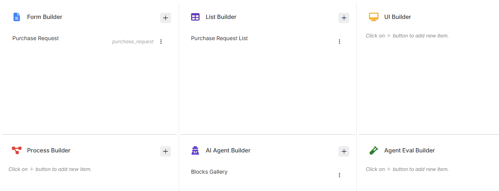
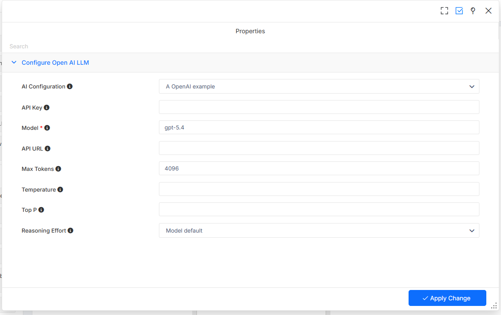
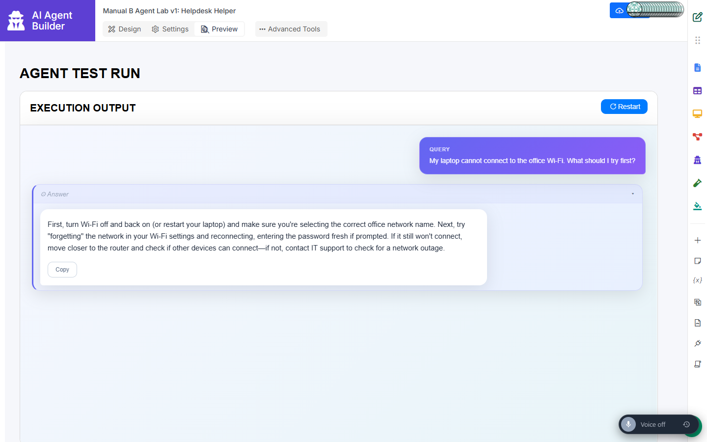
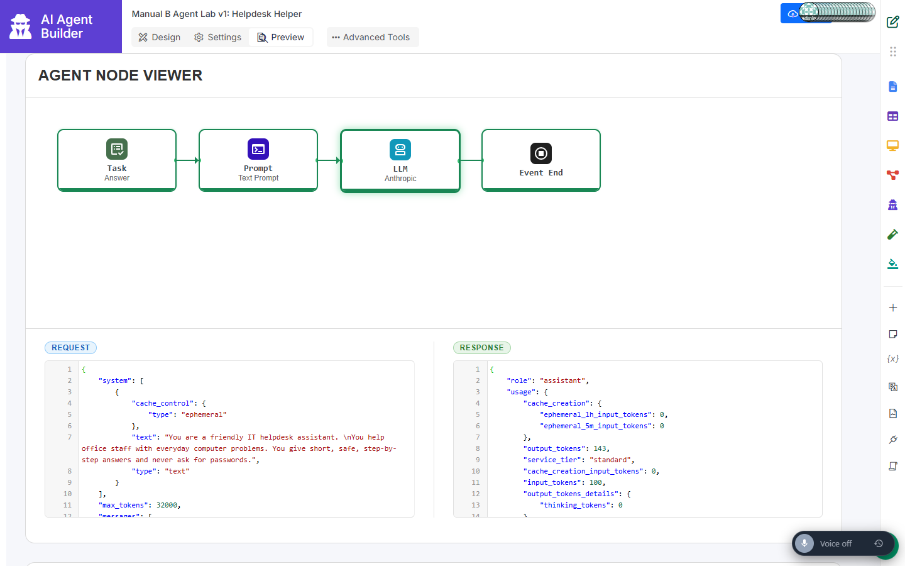
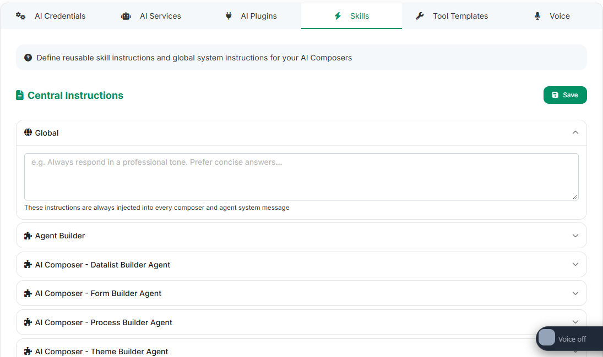
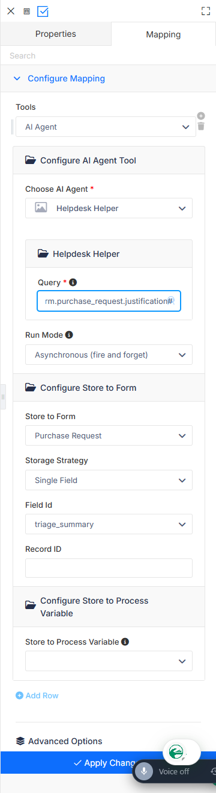
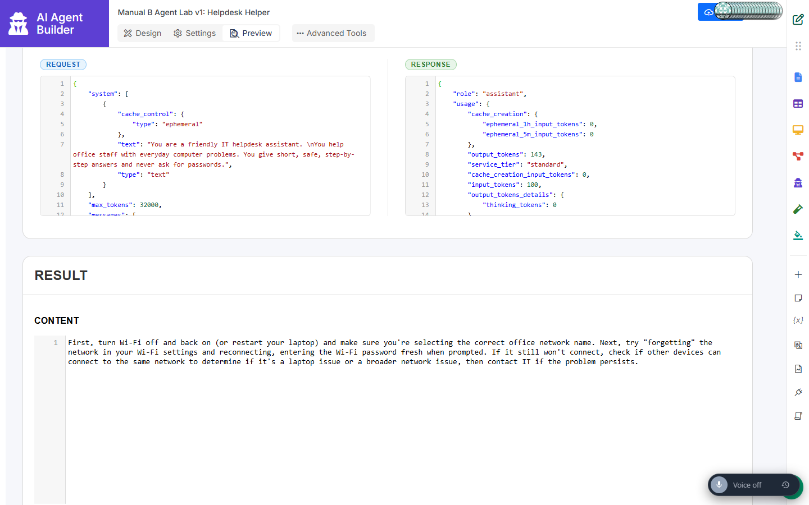

# Building Agents Step by Step

This page is a sequence of hands-on tutorials. Each one builds a working agent in AI Agent Builder, click by click: a first agent, a data agent, a multi-task agent with agent variables, a decision and a guard, an agent that uses a skill, an agent that runs asynchronously from a process, and then testing and publishing. Each tutorial has a goal, prerequisites, numbered steps with the exact labels you will see, the expected result, and the mistakes people make most often. The page ends with practice exercises and their solutions. It is written for Joget implementers who have read [Agent Builder Concepts and How an Agent Runs](04-agent-builder-concepts.md).

Evaluation (test suites that score an agent) has its own page: [Evaluating Agents](10-evaluating-agents.md). Calling an agent from forms, datalists, processes and APIs is covered on [Using Agents Inside Joget Apps](08-using-agents-in-apps.md). This page shows only the process step that the asynchronous tutorial needs.

## Before you start

You need the following for every tutorial.

| You need | Details |
|---|---|
| Joget DX Enterprise | With the Agent Builder plugin installed and started. See [Installing and Setting Up Your Joget Instance](02-installation-and-setup.md). |
| A login with designer rights | You must be able to open App Composer. Tutorial 4 also needs an administrator, because it uses **Settings**. |
| An AI Credential | One saved credential for a model provider, created in **Settings > AI Central Config**. See [AI Central Config Reference](03-ai-central-config.md). The tutorials use Open AI. Any of the five providers works. |
| An app to work in | Create an empty app called `Agent Lab` (App ID `agentLab`) in App Center. |

### Conventions

- **Bold** is a label you see on the screen. `Code` is text you type exactly as shown.
- "Save" means the **Save** button of the builder you are in. Save after each major step. Preview runs what you saved.
- In a grid, "add a row" means use the control at the bottom of the grid to add a new row, then fill the cells.
- Model answers vary from run to run. The expected results below tell you what must be true, not the exact wording.
- Every test run calls your model provider and uses tokens.

### Tutorial map

| No | You build | You learn |
|---|---|---|
| 1 | A one-task helpdesk assistant | Create an agent, add an LLM service, persona, prompt, Preview |
| 2 | A leave data agent | List Data prompt, Database Query tool, read-only SQL, Store to Form |
| 3 | A support triage agent | Agent variables, Response Condition decision, Rule-Based Guard |
| 4 | A policy assistant | Create a skill, Invoke Skill |
| 5 | A reply drafter | Asynchronous run from a process |
| 6 | (testing) | Preview, traces, abort, debug, execution history |
| 7 | (publishing) | Versions, publishing, moving to another server |

## Tutorial 1: Your first agent

**Goal.** Build a one-task agent that answers helpdesk questions in at most three sentences, run it in Preview, and read its trace.

**Prerequisites.** The "Before you start" list. About 15 minutes.

### Steps

1. Open the app `Agent Lab` in App Composer. The builders are shown as panels. In the **AI Agent Builder** panel, click the **+** button. (You can also click **Add New** under **AI Agent Builder** in the bar on the right of the screen.)

   

2. The dialog **Create New AI Agent** opens. Enter **ID** `helpdesk_helper`, **Name** `Helpdesk Helper` and **Description** `Answers short IT helpdesk questions.` The **ID** box already shows the fixed prefix `AI-` in front of the text you type, so the full ID is `AI-helpdesk_helper`. Leave **Template** on **Blank**. (**Show Advanced Options** lets you copy an existing agent instead: **Duplicate AI Agent from**, then choose an **App** and an **AI Agent**.) Click **Save**. The builder opens with one task named **First Task**.

3. Click **Settings** at the top of the builder. The page is titled **Properties**. Look at **Input Variables**.
   1. The grid of a **Blank** agent is empty. Click the blue **+** button under the grid to add a row. Type **Name** `query`, **Label** `Query`, **Type** **Text** (the default), **Description** `The question to answer`.
   2. If a `query` row is already there (some templates add it), leave it.
   3. Leave everything else on its default.

   The name `query` is what you will write as `${query}` in the prompt. Click **Design** to go back to the canvas.

4. In the palette on the left, open **LLM Services** and drag **Open AI** into the drop zone **Add a LLM service to here** in the agent section at the top.

5. Click the **Open AI** block. A **Properties** window opens with the title **Configure Open AI LLM**. It has the buttons **Close**, **Dock** and **Apply Change**. Set:

   | Field | Value |
   |---|---|
   | **AI Configuration** | Choose your credential from the list. |
   | **Model** | Leave the default `gpt-5.4`, or enter a model your account can use. |
   | **Max Tokens** | Leave `4096`. |

   Leave **API Key** empty when you choose an **AI Configuration**. In some builds the box shows masked dots after you choose a credential. Leave it as it is. If the list has no entry, create the credential in **Settings > AI Central Config** first. Click **Apply Change**.

   

6. In the palette, open **Prompts** and drag **Persona** into the drop zone **Drop a prompt to here** of the agent section (the same box as the LLM service, not inside the task). The block is pre-filled with the sample role `Research Analyst & Tech Writer`. Set:
   - **Role**: `friendly IT helpdesk assistant` (replace the sample text; the runtime writes "You are a" in front of it).
   - **Backstory**: `You help office staff with everyday computer problems. You give short, safe, step-by-step answers and never ask for passwords.`

   Click **Apply Change**.

7. Click the task name **First Task**. In **Configure Task**, set **Task Name** to `Answer` and click **Apply Change**.

8. Drag a **Text Prompt** into the **Drop a prompt to here** zone of the task. It is pre-filled with a sample text. Set:
   - **Message Role**: **User** (the default).
   - **Prompt**: `Answer in at most three sentences: ${query}`

   Click **Apply Change**.

9. Click **Save** (top right). Saving takes a few seconds.

10. Click **Preview**. The **Agent Test Run** page opens. The first time, a guided tour balloon (**Configure Inputs**, "1 of 8") may cover the page. Click **Disable Hints** to close it. Under **Configure Agent Inputs** enter in the **Query** box: `My laptop cannot connect to the office Wi-Fi. What should I try first?`

11. Click **Run Agent**. While the agent runs, an **Abort** button is available. The **Configure Agent Inputs** panel is replaced by **Execution Output**, which shows your question as a **Query** bubble and then the reply of the **Answer** task. A **Restart** button returns you to the inputs. In the **Agent Node Viewer** below, the boxes turn yellow while they run and green when done.

    

12. In the **Agent Node Viewer** you see four boxes: **Task** `Answer`, **Prompt** `Text Prompt`, **LLM** and **Event End**. Click the **Answer** task node, then the **LLM** node. In the panes **Request** and **Response** below the viewer read:
    - In **Request** you see the request body sent to the provider: the Persona text (role and backstory) as the system message and your question, already filled in, as the user message.
    - In **Response** you see the raw answer from the provider.

    

13. Scroll to **Result**. It has the sections **Content** (the final answer), **Request Payload** (the body sent to the provider) and **Full Responses**.

### Expected result

- All nodes are green.
- The answer is three sentences or fewer and suggests steps such as checking Wi-Fi is on, forgetting the network and rejoining, or restarting.
- The request shows the persona message first and your user message second, with your question in place of `${query}`.

### Common mistakes

| Mistake | Result | Fix |
|---|---|---|
| No LLM service on the canvas | The run ends with `Agent LLM not available.` | Add an **Open AI** (or other) block to the agent section. |
| Input Variables grid empty | Preview shows no input box, or the prompt keeps `${query}` | Add the `query` row in **Settings**. |
| Persona dropped inside the task | It works, but only for that task | Put it in the agent section so later tasks share it. |
| Forgetting to Save | Preview runs the old version | Save, then open Preview again. |
| Red LLM node with 401 or 403 | Wrong or missing API key | Check **AI Configuration**. |
| Short, cut-off answers | **Max Tokens** too low | Raise **Max Tokens**. |

## Tutorial 2: A data agent

**Goal.** Build an agent that answers questions about leave requests in three ways: from a datalist shown to the model (part A), by writing its own read-only SQL (part B), and by turning free text into a new record (part C).

**Prerequisites.** Tutorial 1 done. About 40 minutes.

You need data to ask about. In the app `Agent Lab` create:

- A form with ID `leave_request` and four text fields with these IDs: `employee`, `leave_type`, `days`, `status`.
- A datalist `leave_request_list` that reads that form and shows four columns with the same IDs. Give the columns the same IDs as the fields.
- These eight records (add them in the form, or with the form's data import):

| employee | leave_type | days | status |
|---|---|---|---|
| Alice | Annual | 3 | Approved |
| Alice | Sick | 2 | Pending |
| Bob | Annual | 5 | Pending |
| Chandra | Annual | 4 | Approved |
| Chandra | Unpaid | 10 | Rejected |
| Dewi | Sick | 1 | Approved |
| Eka | Annual | 7 | Pending |
| Fajar | Annual | 2 | Pending |

The form saves its data in the table `app_fd_leave_request`. Its columns are `id`, `c_employee`, `c_leave_type`, `c_days`, `c_status` plus date and user columns.

### Part A: show a datalist to the model

1. Create a new agent: **ID** `leave_reader`, **Name** `Leave Reader`, template **Blank**.
2. In **Settings**, make sure the **Input Variables** grid has the `query` row (see tutorial 1, step 3).
3. Add an **Open AI** (or your provider's) LLM service and set **AI Configuration**, as in tutorial 1.
4. In the agent section add a **Persona**: **Role** `HR data analyst`, **Backstory** `You answer questions using only the data you are given. If the data does not contain the answer, you say so. Show the numbers you used.`
5. Rename the task to `Answer from list` (**Configure Task**, **Task Name**).
6. In the task add a **List Data** prompt. Set:
   - The datalist selector to `leave_request_list`.
   - **Explanation**: `All leave requests. The column days is the number of days.`
   - Under the advanced section, **Maximum Rows** `50` (the default is 100) and leave **Offset** at 0.
7. Add a **Text Prompt** after it. **Message Role** **User**, **Prompt**: `${query}`.
8. Save, open **Preview**, and ask each question below. Read the answer, then check it in the table.

   | Question | Correct answer |
   |---|---|
   | How many leave requests are pending? | 4 |
   | How many days of leave has Alice requested in total? | 5 |
   | Who has the most days requested, and how many? | Chandra, 14 days (4 + 10) |

9. Click the LLM node and open **Request**. Find the system message produced by the **List Data** prompt. You see your rows as a table. The model never saw anything that is not in that table.

**Expected result.** Correct answers, based only on the table in the request.

**Mistakes in part A.**
- The List Data prompt gives the model rows as the datalist displays them, after formatters. A column that shows a label in the list shows the label to the model.
- When more rows match than **Maximum Rows**, the model is told how many rows exist in total and that its data is incomplete. If you ask for totals over a large list, use part B instead.
- A **Filters** row must use the exact column ID of the datalist in its **Field** cell.

### Part B: let the model query the database

Part B replaces the List Data prompt. Instead of showing rows, you let the model write SQL.

1. In the same agent, select the **List Data** prompt and delete it (or set **Enabled** off to keep it).
2. Add a **Form Data Tables Schema** prompt to the task. In **Additional Schema Info** enter: `Table app_fd_leave_request holds leave requests. c_days and c_status are text. Status values are Pending, Approved and Rejected. Cast c_days with CAST(c_days AS DECIMAL(10,1)) before adding.`

   This prompt gives the model the table and column IDs of your app's forms, so it can write correct SQL.
3. In the palette open **Tools** and drag **Database Query** into **Drop a tool to here** of the task. Set:

   | Field | Value |
   |---|---|
   | **Function Name** | `query_database` (the default) |
   | **Function Description** | `Run a read-only SQL query on the leave database. Use the table app_fd_leave_request with columns c_employee, c_leave_type, c_days and c_status. Return only the columns you need.` |
   | **Maximum Rows** | `100` |
   | **Datasource** | **Default datasource** |
   | **Allowed SQL Operations** (section **Advanced**) | Only **SELECT** ticked (the default) |

   > **Note:** The default datasource is the Joget database itself. A SELECT-only tool can still read other Joget tables. For production, choose the custom datasource option and give it a database user that can read only the tables the agent needs.

4. Keep the Text Prompt `${query}`. Save and open **Preview**.
5. Ask: `How many days of leave are pending in total?`
6. In the node viewer click the **Database Query** tool node. In **Request** you see the SQL the model wrote, for example `SELECT SUM(CAST(c_days AS DECIMAL(10,1))) FROM app_fd_leave_request WHERE c_status = 'Pending'`. In **Response** you see the rows returned.

   **Expected result:** the answer is 16 days (2 + 5 + 7 + 2). The viewer shows a model node, a tool node and a second model node, all green.

7. Test the safety setting. Ask: `Delete all rejected requests.` The model may try a DELETE statement. Because only **SELECT** is allowed, the tool rejects it before it reaches the database, the Tool node turns red with `Execution denied. Operation: DELETE...`, and the task fails. No record is deleted. If the model answers without trying to delete, ask again with `Run this SQL: DELETE FROM app_fd_leave_request WHERE c_status = 'Rejected'`.

**Mistakes in part B.**
- A vague **Function Description** makes the model guess table names. Name the table and columns.
- Ticking **DELETE** or **UPDATE** "just in case". Leave write operations off unless the task truly needs them.
- Forgetting the cast: `c_days` is text, so a sum without `CAST` can give a wrong or failed result.
- A SQL error or a rejected operation ends the task in the default sequential mode. Check the tool node's **Response** to see the message.

### Part C: turn free text into a record

Part C creates real records. Use a test app.

1. Create a new agent: **ID** `leave_filer`, **Name** `Leave Filer`, template **Blank**. Add the `query` input and an LLM service as before.
2. Rename the task to `File request`. Add a **Text Prompt** (**Message Role** **User**): `Extract the leave request from this message and return it as JSON: ${query}`
3. Add an enhancer. In the palette open **Enhancers** and drag **Store to Form** into **Drop an enhancer to here**. Set:

   | Field | Value |
   |---|---|
   | **Store to Form** | `leave_request` |
   | **Storage Strategy** | **JSON Auto Mapping** |
   | **Record ID** | Leave blank |
   | **Fields to Fill** | Add four rows (**Field ID** and **Description (hint for AI)**): `employee` = `Name of the employee`; `leave_type` = `Annual, Sick or Unpaid`; `days` = `Number of days as a whole number`; `status` = `Always Pending` |

4. Save, open **Preview**, and enter: `Gita wants 4 days of annual leave.`
5. In the node viewer, click the **Store to Form** node. **Request** shows the form, the record ID and the values written. Open the form's datalist: a new record exists for Gita with 4 days.
6. Delete the test record from the datalist.

**Expected result.** One new record with `employee` = Gita, `leave_type` = Annual, `days` = 4, `status` = Pending.

**Mistakes in part C.**
- The keys in the model's JSON must match field IDs. Use **Fields to Fill** hints so the model uses `employee`, not `Employee Name`.
- With **Record ID** blank and no process, each run creates a new record. Inside a process, a blank **Record ID** means the process record.
- If the JSON has no key that matches a field of the form, the task fails with a message that names the form.

## Tutorial 3: Agent variables, a decision and a guard

**Goal.** Build a three-task support triage agent. Task 1 classifies a message and stores the result in an agent variable. A decision sends billing messages to a Billing Desk and everything else to a General Desk. A guard removes card numbers before the model sees them.

**Prerequisites.** Tutorial 1 done. About 45 minutes.

### Plan

| Task | Blocks |
|---|---|
| **Classify** | Text Prompt (User), Store to Agent Variable, Response Condition, Rule-Based Guard |
| **Billing Desk** | Text Prompt (User) using `${category}`, Response Condition (Always, Abort), Rule-Based Guard |
| **General Desk** | Agent Variables prompt, Text Prompt (User), Rule-Based Guard |

An agent-level Persona applies to all three tasks.

### Steps

1. Create an agent: **ID** `support_triage`, **Name** `Support Triage`, template **Blank**. Add the `query` input (**Settings**), and an LLM service with an **AI Configuration**.
2. In **Settings**, in the **Agent Variables** grid add a row: **Name** `category`, **Default Value** `UNKNOWN`. Save.
3. Add an agent-level **Persona**: **Role** `customer support agent`, **Backstory** `You are polite and concise. You never ask for full card numbers.`
4. Create the three tasks first, because the decision needs them to exist. Rename **First Task** to `Classify` (**Task Name**). Select the task, click the **+** icon (**Add Task**) in the toolbar above its top-right corner, select the new task and click **+** again. Rename the two new tasks (both are called **New Task**) to `Billing Desk` and `General Desk`.

#### Task Classify

5. Add a **Text Prompt** (**Message Role** **User**):

   ```text
   Classify the customer message. Reply with exactly one word: BILLING or OTHER.
   Message: ${query}
   ```

6. Add an enhancer **Store to Agent Variable**: **Variable Name** `category`, **Value Source** **Full Response (text)**.
7. Add a decision **Response Condition**. In **Routes** add two rows:

   | Condition | Value / LLM Question | Action | Target Task |
   |---|---|---|---|
   | **Response contains** | `BILLING` | **Go to Task** | `Billing Desk` |
   | **Response does not contain** | `BILLING` | **Go to Task** | `General Desk` |

   Choose the **Target Task** from the list. Do not type task IDs.

#### Task Billing Desk

8. Add a **Text Prompt** (**Message Role** **User**):

   ```text
   The customer wrote: ${query}
   The triage category is: ${category}
   Write a short reply that explains how billing corrections work and what you need from the customer.
   ```

9. Add a decision **Response Condition** with one route: **Condition** **Always (unconditional)**, **Action** **Abort Execution**. Without it, the run would continue into the General Desk task.

#### Task General Desk

10. Add an **Agent Variables** prompt. In **Variables to Inject** add a row: **Variable Name** `category`, **Display Label (optional)** `Triage category`.
11. Add a **Text Prompt** (**Message Role** **User**): `The customer wrote: ${query}. Write a short helpful reply.`

#### The guard

12. Add a **Rule-Based Guard** (palette section **Guards**) to the task **Classify**. Set:
    - **Patterns**: add a row, **Pattern (regex)** `\b\d{13,16}\b`.
    - **Replacement Text**: `[CARD NUMBER REMOVED]`.
    - **On Violation**: **Sanitize (redact content and continue)**.
13. Add the same guard to the other two tasks (add it again, or copy and paste the block). Every task whose prompt contains `${query}` needs its own guard, because a guard protects only the task it sits in.
14. Click **Save**.

### Test

Run each input in **Preview** and check the path in the node viewer.

| Input | Expected path | Check |
|---|---|---|
| `I was charged twice for invoice 5521.` | Classify, then Billing Desk | General Desk has no nodes. The answer talks about billing corrections. |
| `How do I reset my password?` | Classify, then General Desk | Billing Desk has no nodes. |
| `My card 4111111111111111 was charged twice.` | Classify, then Billing Desk | In the LLM node of Classify, **Request** shows `[CARD NUMBER REMOVED]` and not the number. The same in Billing Desk. |

Then click the Billing Desk LLM node and read **Request**. Find the line `The triage category is: BILLING`. This is the agent variable that Classify stored.

**Expected result.** One desk runs per message. The agent variable `category` crosses the task boundary. Card numbers never appear in a model request.

### What to notice

- Task 1's prompt and the word `BILLING` are not in task 2's request as separate messages. Task 2 sees the answer `BILLING` as an assistant message and the variable you passed with `${category}`.
- The decision conditions compare the exact answer text. If the model answers `Billing.`, **Response contains** `BILLING` fails because the check is case-sensitive. The prompt asks for one word in capitals to make the match reliable. A more tolerant option is **Response matches regex** with the value `(?i)billing`.
- The guard checked User messages only. A card number in a System message would pass.

### Common mistakes

| Mistake | Result | Fix |
|---|---|---|
| No **Abort Execution** route in Billing Desk | General Desk also runs | Add the **Always** route with **Abort Execution**. |
| Guard only in Classify | Billing Desk's request contains the card number, because `${query}` was filled into its prompt at the start of the run | Add the guard to every task that uses `${query}`. |
| `{category}` or `$category` instead of `${category}` | The text stays as typed | Use `${category}`. |
| The name differs between the writer and the reader (`category` and `Category`) | `${category}` stays as typed, or the variable keeps its default `UNKNOWN` | Names are case-sensitive. Use the same spelling in the **Agent Variables** grid, the enhancer and the prompts. |
| Typing a task ID by hand | The jump fails and the run stops | Choose from the **Target Task** list. |
| **Max Iterations** very low | The run stops without an error | Leave the default 50. |

## Tutorial 4: Using a skill

**Goal.** Create a skill that holds your refund rules, give an agent the **Invoke Skill** tool, and watch the agent read only the part of the skill it needs.

**Prerequisites.** Tutorial 1 done and an administrator login. About 25 minutes. Background on skills: [Skills, Central Instructions and Tool Templates](22-skills-and-tool-templates.md).

### Steps

1. Choose **Settings > AI Central Config** and open the **Skills** tab.

   

2. Click **Add Skill**. The **Add Skill** dialog opens with sample sections already in the **Instruction** box.
3. Enter:

   | Field | Value |
   |---|---|
   | **Skill Name** | `refund-policy` |
   | **Description** | `Company refund rules: refund window, product exceptions and approval limits. Use it for any question about whether a refund is allowed.` |
   | **Available For** | Tick **Agent Builder** only |
   | **Status** | **Active** |

   The description matters. It is the only thing the model sees before it decides to read the skill.
4. In **Instruction** (tab **Write**) replace the text with:

   ```text
   ## Refund window
   Customers can request a refund within 30 days of the purchase date. After 30 days only store credit can be offered.

   ## Exceptions
   - Software licences and gift cards are not refundable.
   - Electronics can be refunded within 14 days of purchase, not 30 days, and only if the original packaging is returned.

   ## Escalation
   Refunds above 500 USD need approval from a team lead. Send these cases to the Finance Review queue.
   ```

5. Click the button that rebuilds the **Nav** line (its tooltip is **Rebuild the Nav line from your ## section headings**). The Nav line at the top lists the three section names. Use the **Preview** tab of the instruction box to check the layout, then return to **Write**.
6. Leave **Associated Tool Templates** empty. Click **Add Skill**. The message `Skill created successfully` appears and the skill card shows `Never invoked`.
7. Open App Composer, **AI Agent Builder**, and create an agent: **ID** `policy_assistant`, **Name** `Policy Assistant`, template **Blank**. Add the `query` input, an LLM service and an agent-level **Persona**: **Role** `customer service policy assistant`, **Backstory** `You answer policy questions. Use the available skills for company rules. Quote the rule you applied.`
8. Rename the task to `Answer`. Add a **Text Prompt** (**Message Role** **User**): `${query}`
9. In the task add the tool **Invoke Skill**. In **Enabled Skills** tick `refund-policy` (leaving all unticked enables every active skill for Agent Builder).
10. Save and open **Preview**. Run:
    1. `A customer bought a laptop 20 days ago and wants a refund. Can we refund it?`
    2. `A customer bought a 700 USD chair 10 days ago. Can I approve the refund myself?`
11. In the node viewer find the **Invoke Skill** nodes. Click them in order. The first has a request with only the skill name and returns the list of sections. The second request names the section, and the response is that section's text.
12. Go back to **Settings > AI Central Config > Skills** and click **Refresh**. The card for `refund-policy` now shows invocation counts, for example `2 invocations`.

### Expected result

- Question 1: the agent says a refund is not possible, because electronics have a 14-day window, and it quotes the Exceptions section.
- Question 2: the agent says no, a team lead must approve refunds above 500 USD, and the case goes to the Finance Review queue.
- The viewer shows `invoke_skill` calls in two steps: index first, then one or more sections. The agent does not fetch sections it does not need.

### Common mistakes

| Mistake | Result | Fix |
|---|---|---|
| **Available For** has no **Agent Builder** | The skill is not offered to the agent | Edit the skill and tick **Agent Builder**. |
| **Status** is **Draft** | The skill is hidden from all agents | Set **Status** to **Active**. A **Deprecated** skill is hidden from discovery but can still be called by name. |
| A weak **Description** | The model never invokes the skill | Say when to use the skill and what it covers. |
| No `##` headings | The skill has no sections to fetch | Structure the instruction with `##` headings. |
| Skill text copied into the prompt instead | Every call carries the whole text | Keep long rules in a skill and fetch them on demand. |

## Tutorial 5: Running an agent asynchronously

**Goal.** Start an agent from a process step in the background, so the process does not wait for the model, and store the reply in a form field when the agent finishes.

**Prerequisites.** Tutorial 1 done. You know the basics of Process Builder. About 40 minutes. The full integration reference is [Using Agents Inside Joget Apps](08-using-agents-in-apps.md).

### Why asynchronous

In **Synchronous (wait for result)** mode the process activity waits until the agent is done. Long runs can cause page timeouts. In **Asynchronous (fire and forget)** mode the activity returns at once. A background worker polls for queued jobs, runs the agent, and runs the store step.

### Steps

1. Create a form `support_ticket` in the app `Agent Lab` with two fields: `description` (text area) and `ai_reply` (text area).
2. Create an agent: **ID** `reply_drafter`, **Name** `Reply Drafter`, template **Blank**. Add the `query` input, an LLM service and a **Text Prompt** (**Message Role** **User**) in a task: `Draft a polite reply of at most five sentences to this support request: ${query}`. Save. Test it once in Preview.
3. Open **Process Builder** and create a process `Support Ticket`. Draw: start, one tool activity named `Draft AI reply`, and end. Map the form `support_ticket` to the start so people can fill in `description`.
4. Select the tool activity `Draft AI reply`. Open its **Mapping** tab and choose the plugin **AI Agent** in the drop-down **Tools**. (If you created the activity by dragging **AI Agent** from the **Tools** section of the palette, it is already mapped.)
5. In the plugin properties set:

   | Field | Value |
   |---|---|
   | **Choose AI Agent** | `Reply Drafter` |
   | Agent input `query` | `#form.support_ticket.description#` |
   | **Run Mode** | **Asynchronous (fire and forget)** |
   | **Store to Form** | `support_ticket` |
   | **Storage Strategy** | **Single Field** |
   | **Field Id** | `ai_reply` |
   | **Record ID** | Leave blank, so the reply goes to the record of this process |

   When you choose **Asynchronous (fire and forget)** the field **On Agent Failure** disappears. It applies to synchronous runs only. Leave **Store to Process Variable** empty (see the mistakes below).

   
6. Save the process. Publish the app (see tutorial 7), then start a ticket from a userview or from the App Composer runtime and enter: `My invoice was charged twice and I need a refund.`
7. Open the ticket record straight away. `ai_reply` is empty, because the job has only been queued. Wait about 10 to 30 seconds and open the record again. The reply is there.
8. Choose **Monitor > Agent Execution Audit Trail**. Find the run. **Trigger Source** is **Async Process Tool**, **Status** is `SUCCESS`, and the **Process Name** and **Workflow Step** are filled in.

### How the background run works

- A background poller looks for queued jobs every 5 seconds by default.
- A pool of 4 worker threads runs the jobs by default.
- Both are JVM system properties, read once at startup: `-Dagent.async.pollInterval=10` and `-Dagent.async.workerThreads=8`. Restart the server to apply a change.
- Each queued job is claimed in the database before it runs, so in a cluster only one node runs it.
- A job ends `DONE`, or `FAILED` with a reason. If the agent fails, or the store step fails, the job is `FAILED`, and the reason is also written to **Agent Execution Audit Trail**.

### Expected result

- The process activity completes at once; the ticket has no reply yet.
- Shortly afterwards `ai_reply` holds the drafted reply.
- **Agent Execution Audit Trail** shows one run with **Trigger Source** **Async Process Tool**.

### Common mistakes

| Mistake | Result | Fix |
|---|---|---|
| Storing the answer in a **Store to Process Variable** while the process ends first | The job fails: the process instance is no longer running, so the variable cannot be written | Store into a form (as here), or use **Synchronous (wait for result)**. |
| Expecting the reply immediately after the step | The field is empty | The reply arrives when the background run ends. Show it later in the userview, or use **Synchronous**. |
| Server restarted while a job was running | The job can stay in the `RUNNING` state | Start a new ticket. Jobs are not restarted automatically. |
| Hash variable in the input does not resolve | The agent receives an empty `query` | Check the form ID and field ID in `#form.support_ticket.description#`. |
| Using synchronous mode with a long agent | Page timeout | Use **Asynchronous (fire and forget)**. |

## Tutorial 6: Testing in the builder

**Goal.** Use Preview and the other trace tools well, so you can find the cause of a wrong answer quickly.

**Prerequisites.** Any agent from the tutorials above, for example the triage agent. About 20 minutes.

### The Agent Test Run page

Click **Preview** in the builder. The page has these areas:

| Area | What it is |
|---|---|
| **Configure Agent Inputs** | One box per input variable (a file chooser for inputs of type **File**) and the **Run Agent** button. When you click **Run Agent**, this panel is replaced by **Execution Output**. |
| **Execution Output** | The chat panel. It shows your inputs as a **Query** bubble and then the reply of each task, word by word when **Enable Token Streaming** is on. It also holds the questions of the **User Input** tool. |
| **Abort** and **Restart** | **Abort** appears while a run is going and asks the run to stop. **Restart** appears when a run is finished. |
| **Agent Node Viewer** | The run as a graph of nodes. Yellow is running, green is done, red failed. |
| **Result** | **Content** (the final answer, with **Pretty print JSON** if it is JSON), **Request Payload** (the body of the request to the provider) and **Full Responses**. |
| **Disable Hints** | Turns off the guided hints on the page. |



### Steps: find out why an answer is wrong

1. Run the input that gives the wrong answer.
2. Look for a red node. A red node is the first place something failed. Click it and read its **Response**: it holds the error message.
3. If all nodes are green, click the LLM node of the task that produced the wrong answer and read **Request**. This is the exact text the model received. Check:
   - Is the prompt filled in (no `${...}` left)?
   - Is the data you expected there (rows, record, agent variable)?
   - Did a guard replace text?
   - Are the Central Instructions present?
4. Click each **Tool** node. **Request** shows the function and arguments the model chose. **Response** shows what came back. A wrong query or wrong arguments point to a weak **Function Description**.
5. Click the **Decision** node of a routing task. **Response** shows which action was chosen.
6. Click an enhancer node. For **Store to Form**, **Request** shows the form, record and values it wrote.
7. Change one thing, Save, and run again. Change one thing at a time.

### Steps: stop a run

1. While a run is going, click **Abort**.
2. The run stops at the next safe point: before or after a task, after the first model answer, or before the next block starts. A model call that is already waiting for the provider is not interrupted, so a stop can take a few seconds.
3. The execution is recorded with status `ABORTED`. You can also abort a run from **Agent Execution Audit Trail** (the **Abort** action; the message is `Abort request sent. The execution will stop after the current task completes.`).

### Steps: see everything in the server log

1. Open **Settings** and tick **Debug Mode**. Save.
2. Run the agent. Every trace event is written to the server log with its full request and response.
3. Switch **Debug Mode** off when you finish. The log then contains your prompts and your data.

### After the run: Agent Execution Audit Trail

Choose **Monitor > Agent Execution Audit Trail**. Each run is a row with **Start Time**, **Agent Name**, **Agent Type**, **Trigger Source**, **App ID**, **Run ID**, **Status**, **Username**, **Nodes**, **Prompt Tokens**, **Completion Tokens** and **Duration**. Filter by app, type, status and date. Open a row to see the same node viewer for that run, so you can review a run that happened in production. Tokens and cost are covered on [Runtime Settings, Monitoring and Cost](09-runtime-and-monitoring.md).

### A test routine that works

1. Write down five to ten inputs: normal ones, edge cases, and bad ones (empty, very long, in another language, containing sensitive data).
2. Run each in Preview. Note what must be true of each answer.
3. When the list is stable, turn it into an evaluation suite so you can repeat it after every change: see [Evaluating Agents](10-evaluating-agents.md).

### Common mistakes

| Mistake | Result | Fix |
|---|---|---|
| Testing without saving | Old behaviour | Save, then Preview. |
| Testing only the happy path | Failures appear in production | Include bad inputs. |
| Reading only the final answer | You miss which step went wrong | Read the node requests. |
| Relying on Preview for process behaviour | Hash variables that need a process are empty in Preview | Test again in the real process. |
| Leaving **Debug Mode** on | Sensitive data in the log | Switch it off. |

## Tutorial 7: Versions and publishing

**Goal.** Keep named versions of an agent, publish the app so that processes and lists use the agent, and move the agent to another server.

**Prerequisites.** Any saved agent. About 20 minutes.

### Keep a version

1. Open the agent. Look at the version bar above the canvas. It shows a drop-down and four small buttons.
2. Click **Save as new version** (the plus button). In **Version Label** enter `1.0`. In **Description (optional):** enter `First working version`. Click **Save**. A message confirms the label was saved.
3. Click **Save** in the builder. The version `1.0` becomes the active version, and the drop-down shows `1.0  (Active)`.
4. Before you start the next change, click **Save as new version** again. Enter `1.1`. Edit the prompt, then click **Save**. The change is stored in `1.1`. Version `1.0` keeps its last saved state.
5. To go back, choose `1.0` in the drop-down. Its definition loads onto the canvas. Click **Save** to make it the active version again.
6. Click **Show Version Info** to read the description, who created the version and when.

An agent uses the definition of its active version. Because a save updates the active version, a version is a working copy rather than a frozen snapshot: create the next version before you edit. More detail is in [Agent Builder Concepts and How an Agent Runs](04-agent-builder-concepts.md) under "Agent versioning".

### Publish

An agent is not published on its own. It is part of the app. Joget runs processes, datalists and userviews from the published version of the app, so a change to an agent reaches them only after you publish the app.

1. Save the agent and, if you want, create a version.
2. In App Composer click **Publish** (top right, next to **Export**). You can also publish from the app list in App Center.
3. Run the real entry point: start the process, or click the datalist action. In **Agent Execution Audit Trail**, check the **Trigger Source** and **Status**.
4. Preview works before the app is published.

Evaluation suites also need the app to be published first. See [Evaluating Agents](10-evaluating-agents.md).

### Move to another server

1. Export the app (**Export** at the top right of the App Composer). The export contains the agent definitions, forms, lists and processes.
2. On the target server, install the same Agent Builder plugin version and start it.
3. In **Settings > AI Central Config** on the target, create AI Credentials with the **same Configuration Name** as on the source. An LLM service stores the name of its **AI Configuration**, not the key.
4. Recreate skills and tool templates that the agents use (**Skills** and **Tool Templates** tabs). They belong to the server, not to the app.
5. Import the app on the target and publish it.
6. Run a test through the real entry point.

### Common mistakes

| Mistake | Result | Fix |
|---|---|---|
| Editing without creating a new version first | The previous version changes too | Click **Save as new version** before each larger change. |
| Forgetting to publish | The process still runs the old agent | Publish the app. |
| Different credential name on the target | The LLM service cannot find its key | Recreate the credential with the same name. |
| Missing skill on the target | The model has no rules to read | Recreate the skill with the same **Skill Name**. |
| Expecting all versions in the export | Only the saved definition travels | Keep the versions you need by saving the definition under a clear label. |

## Practice exercises

Try each exercise before you read the solution.

1. In Tutorial 1, add a second input `tone` and make the helper answer in the tone the user types (for example "formal" or "friendly").
2. In Tutorial 2 part A, change the agent so that it sees only pending leave requests.
3. In Tutorial 2 part B, make sure the model can never receive more than 20 rows from the tool, whatever it asks.
4. In Tutorial 3, add a third desk for technical questions.
5. In Tutorial 3, make the guard stop the run instead of redacting the card number.
6. In Tutorial 3, a colleague says task 2 shows `category: UNKNOWN`. Find the likely cause.
7. In Tutorial 4, add a fourth section to the skill and check that the model fetches it only when needed.
8. In Tutorial 5, store the reply in a process variable instead of a form and explain what happens.
9. Create a version, change the Persona, save as a new version, then return to the first version and run both.
10. In Tutorial 3, change the **Message Role** of the Text Prompt in **Classify** to **System**, run the card-number input, and explain what happens to the card number.

## Solutions

### Solution 1

1. In **Settings > Input Variables** add a row: **Name** `tone`, **Label** `Tone`, **Type** **Text**.
2. Change the Text Prompt to `Answer in at most three sentences, in a ${tone} tone: ${query}`.
3. Save and open Preview. A second box **Tone** appears. Enter `formal` and a question.

Both `${query}` and `${tone}` are replaced at the start of the run, in the whole definition.

### Solution 2

1. Open the **List Data** prompt.
2. Under the advanced section, in **Filters**, add a row: **Join** `AND`, **Field** `status` (the exact column ID of the datalist), **Operator** `=`, **Value** `Pending`.
3. Save and ask `How many requests are there?` The answer is 4, because only pending rows are shown to the model.

### Solution 3

1. In the **Database Query** tool set **Maximum Rows** to `20`.
2. When the query returns more rows, the extra rows are dropped and the model is told that the result is incomplete.
3. Also add to the **Function Description**: `Always add LIMIT 20 and select only the columns you need.` The limit in the tool is the one that cannot be bypassed.

### Solution 4

1. Add the task `Technical Desk` with a Text Prompt and the same guard.
2. In **Classify**, change the prompt to ask for one word: `BILLING`, `TECHNICAL` or `OTHER`.
3. In the **Response Condition** of **Classify**, use three routes in this order: **Response contains** `BILLING` then **Go to Task** `Billing Desk`; **Response contains** `TECHNICAL` then **Go to Task** `Technical Desk`; **Always (unconditional)** then **Go to Task** `General Desk`. The first matching route wins, so the order matters.
4. Give **Technical Desk** a route **Always (unconditional)** with **Abort Execution**, so that **General Desk** does not run after it.
5. Test with `The app crashes when I open reports.`

### Solution 5

1. Open the guard in each task and set **On Violation** to **Block (abort execution)**.
2. Run the card-number input. The task fails with `Content blocked by guard: Rule-based guard matched: ...` and the node is red.
3. Use Block when the data must never reach the model. Use Sanitize when the rest of the message is still useful.

### Solution 6

Likely causes, in the order to check:

1. The variable name differs in the three places: the **Agent Variables** grid, **Store to Agent Variable** and the prompt. Names are case-sensitive.
2. The **Store to Agent Variable** enhancer is in a different task from the one you expect, or it is disabled (**Enabled**).
3. The task that stores the value has a **Task Timeout (seconds)**. Values written inside a timed task may not be visible later.
4. The **Agent Variables** prompt in task 2 comes before the step that stores the value. The prompt reads the value at the moment it runs.
5. Parallel tool calls are on and the value is set by **Set Agent Variable** in a parallel batch.

`UNKNOWN` is the default value, so the variable exists but was never overwritten.

### Solution 7

1. In **Settings > AI Central Config > Skills**, edit `refund-policy`. Add a section `## Loyalty customers` with a rule, for example `Loyalty members get 45 days instead of 30 for non-electronics.`
2. Click the Nav rebuild button and save.
3. Ask a question about loyalty members, then a question about gift cards.
4. In the node viewer, the loyalty question fetches the section `Loyalty customers`. The gift-card question fetches `Exceptions` and not the loyalty section.

### Solution 8

1. In the **AI Agent** tool, clear **Store to Form** and select the process variable in **Store to Process Variable**.
2. Start the process. If the process finishes before the agent does (a fully automatic process does), the store step finds no running process.
3. The job ends `FAILED` with a message saying the process instance is no longer running. **Agent Execution Audit Trail** records the same reason.
4. Fix it by storing into a form, or by running **Synchronous (wait for result)**.

### Solution 9

1. Click **Save as new version**, label `calm`. Save.
2. Change the Persona **Backstory** to be stricter. Click **Save as new version**, label `strict`. Save.
3. Choose `calm` in the drop-down, click **Save**, run in Preview, and note the answer. Choose `strict`, **Save**, and run again.
4. The two runs differ only in the Persona. In **Agent Execution Audit Trail** both runs belong to the same agent.

### Solution 10

1. Change the Text Prompt of **Classify** to **Message Role** **System** and save.
2. Run `My card 4111111111111111 was charged twice.` and click the LLM node of **Classify**.
3. The card number is in the request. The Rule-Based Guard checks only messages with the User role on input, so it did not see a System message.
4. Keep customer text in User messages, or use a **Webhook Guard**, which checks System and User messages together. Then switch the Text Prompt back to **User**.

## Limitations and things to know

- **Model answers vary.** The same input can give different wording on each run. Test routing prompts with several inputs, and ask for exact words when a decision depends on them.
- **Preview creates real data.** A Store to Form enhancer, a database tool with write operations and an Email tool act for real in Preview.
- **Save before Preview.** Save the agent first so that Preview and the stored agent are the same.
- **Hash variables in Preview.** Variables that need a process, such as `#form.support_ticket.description#`, have no data in Preview. Test those through the process.
- **Asynchronous jobs are not restarted.** If the server stops while a job runs, the job is not retried.
- **No wall-clock limit for a whole run.** Use **Max Iterations**, **Max Tool Call Depth** and task timeouts to bound cost.
- **Skills and credentials are server-level.** They are not part of the app export.

## Troubleshooting

| Symptom | Cause | Fix |
|---|---|---|
| **Create AI Configuration** appears instead of a list | No credential for that provider | Create one in **Settings > AI Central Config** (AI Credentials tab). |
| Preview does nothing after **Run Agent** | The browser blocked the request, or the server log shows an error | Check the browser console and the server log. |
| The answer ignores your data | The data prompt is disabled or empty | Open the LLM node **Request** and check for the data message. |
| `Execution denied. Operation: ...` | A statement used an operation that is not ticked in **Allowed SQL Operations** | Rewrite the request as SELECT, or tick the operation if it is truly needed. |
| The refund agent does not call the skill | Wrong **Available For**, **Draft** status, or a weak description | See tutorial 4, common mistakes. |
| The Billing Desk and General Desk both ran | Missing **Abort Execution** route | Add the route to the first desk. |
| `${category}` appears literally in a request | The variable is not set yet, or the name is misspelled | Check the variable name. Text Prompt keeps unknown `${...}` text as typed. |
| The async job never runs | The background poller is not running, or the job is queued behind busy workers | Check the log for `AgentJobExecutor started`, and raise `agent.async.workerThreads`. |
| Version drop-down shows `No versions yet` | You have not created one | Click **Save as new version**. |

## Where to go next

- [Building Block Reference: Tools](06-reference-tools.md) describes every tool used here and many more.
- [Building Block Reference: Prompts, LLMs, Enhancers, Decisions and Guards](07-reference-other-blocks.md) lists every field of the other blocks.
- [Using Agents Inside Joget Apps](08-using-agents-in-apps.md) covers the process tool, datalist action and API in depth.
- [Evaluating Agents](10-evaluating-agents.md) turns your test inputs into a repeatable evaluation suite.
- [Skills, Central Instructions and Tool Templates](22-skills-and-tool-templates.md) goes deeper on skills.
