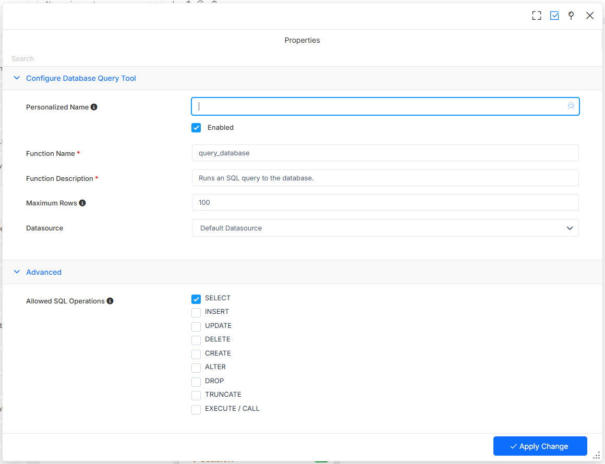
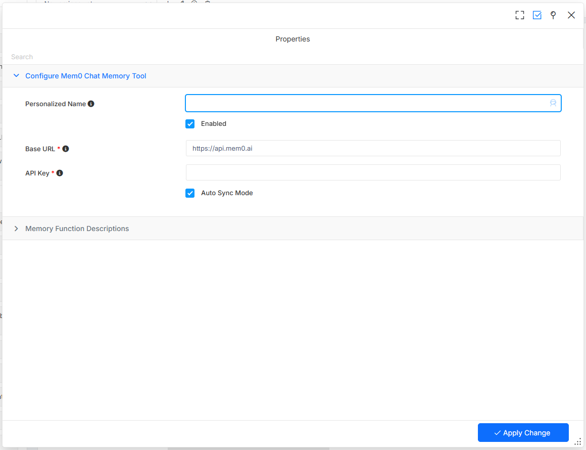

# Building Block Reference: Tools

This page is the reference for the tools in the **Tools** section of the Agent Builder palette. It covers data, knowledge and search, memory and state, and integration and communication tools. The tools that call other agents, ask the user, display content or run scripts are in [Building Block Reference: Tools (continued)](06b-reference-tools-continued.md). Use these pages when you need the exact name, properties, defaults and failure behaviour of a tool. For the concepts behind agents, tasks and tool calls, read [Agent Builder Concepts and How an Agent Runs](04-agent-builder-concepts.md) first.

## How tools work

A tool is a function that the model can ask the agent to run. For each tool on a task, Agent Builder sends the model a **function definition**: a function name, a description and a list of parameters. The model decides when to call it and with which arguments. Agent Builder runs the tool, then sends the result back to the model as text. The model then continues, or calls another tool.

You add a tool to a task by dragging it from the **Tools** section of the palette onto the task. The palette has these sections: **LLM Services**, **Prompts**, **Tools**, **Tool Templates**, **Enhancers**, **Decisions** and **Guards**. **Tool Templates** are saved, pre-configured copies of tools. You manage them in AI Central Config, and you can read about them in [Skills, Central Instructions and Tool Templates](22-skills-and-tool-templates.md).

Your palette may also list tools from the sample plugins of the examples repository and from add-on plugins. Entries such as **Indonesian ID Validator**, **Acme Standards Lookup**, **App Naming Check** and **Upgrade Advisor scan** are not part of Agent Builder. They appear in your palette only when you install those plugins. The tools are listed in alphabetical order of their class name, not of their label, so the order on your screen may differ slightly.

### Properties every tool has

When you drag a tool into a task, Agent Builder adds two properties at the top of its property panel. They are not repeated in the tables below.

| Field | What it does | Default | Notes |
|---|---|---|---|
| **Personalized Name** | A custom name shown for the tool in the node viewer. | Empty | Display only. The model does not see it. |
| **Enabled** | Switches the tool on or off for runs. | Checked | An unchecked tool is skipped without an error. A tool whose Enabled value is saved as empty is also treated as disabled. |

### Function names

Many tools let you set a **Function Name**. The model calls the tool by this name.

- Use only letters (a to z, A to Z), numbers, dashes (-) and underscores (_). The maximum length is 64 characters.
- Each name must be unique inside one task. If two tools on a task offer the same function name, the model sees only the first one.
- Write the **Function Description** for the model, not for people. The model decides from the description alone when to call the tool.

### What happens when a tool fails

Tools report failure in one of two ways.

- **Error text returned to the model.** The tool returns a message that starts with `Error`, or a JSON text with an `error` field. The model reads it and can retry or explain the problem. The JSON API tool, the Mem0 Chat Memory tool and the Set Agent Variable tool work this way.
- **Error that stops the task.** The tool raises an error. The task fails and the run is recorded as failed, unless the agent runs with **Enable Parallel Tool Calls** switched on (see below). The Database Query, Email, Google Web Search, Pinecone, MCP Client, GitLab, Run AI Agent and AI Orchestrator tools work this way.

If the agent setting **Enable Parallel Tool Calls** is on and the model asks for more than one tool in the same step, an error from any tool is turned into the text `Error: <message>` and returned to the model. The run does not stop.

Each tool section below states which of the two behaviours applies.

### Parallel execution

With **Enable Parallel Tool Calls** on (off by default) the agent runs several tool calls from one model response at the same time. It does this only when every tool in that response allows it. These tools never run in parallel with others: **Invoke Skill**, **Tool Group**, **User Input** and **HTML UI Input**. If one of them is in the batch, the whole batch runs one call at a time. Other tools in this reference have no restriction. See [Runtime Settings, Monitoring and Cost](09-runtime-and-monitoring.md) for the agent-level settings, including **Max Tool Call Depth**.

## Quick list of tools

| Palette name | Category | Function name(s) the model sees |
|---|---|---|
| Database Query | Data | the name you set (default `query_database`) |
| Documentation Search | Knowledge and search | the name you set |
| Google Web Search | Knowledge and search | `google_web_search` |
| Pinecone | Knowledge and search | `query`, `upsert`, `upsertChunked`, `upsertBatch`, `delete` |
| (Embedding providers: OpenAI Embedding, Gemini Embedding) | Knowledge and search (providers) | none. They are not palette entries; you choose them inside the Pinecone tool. |
| Mem0 Chat Memory | Memory and state | `store`, `recall`, `query`, `clear`, `deleteById`, `batchDelete` |
| Set Agent Variable | Memory and state | `set_agent_variable` |
| JSON API | Integration | the name you set |
| MCP Client | Integration | one function per tool the MCP server offers |
| GitLab | Integration | nine `gitlab_...` functions |
| Email | Communication | `send_email` |
| Run AI Agent, AI Orchestrator, Invoke Skill, Tool Group, Decision (Multiple Choice) | Agent calling and routing | see [Building Block Reference: Tools (continued)](06b-reference-tools-continued.md) |
| User Input, HTML UI Input, HTML Display, AJAX Display, URL Display, File Viewer | Display and interactive | see [Building Block Reference: Tools (continued)](06b-reference-tools-continued.md) |
| BeanShell, Script Runner | Scripting | see [Building Block Reference: Tools (continued)](06b-reference-tools-continued.md) |

## Data tools

### Database Query

**What it does.** Lets the model run SQL against a database and read the result as a table. The tool checks every statement on the server before it runs it. By default it allows only `SELECT`.

**When to use it.** Use it when the model must answer questions from live data that is not already in a Joget list or form, for example reporting on form data tables (`app_fd_...`) or on a business database.

**When not to use it.** Do not use it to give the model data you already know the model needs on every run. Use a **List Data** or **Form Data** prompt for that (see [Building Block Reference: Prompts, LLMs, Enhancers, Decisions and Guards](07-reference-other-blocks.md)). Do not point it at the Joget system tables with a write-enabled tool.

**Properties**

| Field | What it does | Default | Notes |
|---|---|---|---|
| **Function Name** | The function name the model calls. | `query_database` | Required. Letters, numbers, dash, underscore, 64 characters at most. |
| **Function Description** | What the tool does, for the model. | `Runs an SQL query to the database.` | Required. Describe the tables and columns the model may use. This is the most useful place to put the schema. |
| **Maximum Rows** | The most result rows sent to the model for each statement. | 100 | Blank, 0 or a value that is not a number means 100. Extra rows are dropped and the model is told the result is incomplete. |
| **Datasource** | Which database to connect to. | Default Datasource | Options: **Default Datasource** (the Joget database), **Custom Datasource**. |
| **Custom JDBC Driver** | JDBC driver class name. | Empty | Only for **Custom Datasource**. Required then. The field help gives examples: `com.mysql.jdbc.Driver` (MySQL), `oracle.jdbc.driver.OracleDriver` (Oracle), `com.microsoft.sqlserver.jdbc.SQLServerDriver` (Microsoft SQL Server). |
| **Custom JDBC URL** | JDBC connection URL. | Empty | Only for **Custom Datasource**. Required then. |
| **Custom JDBC Username** | Database user name. | Empty | Only for **Custom Datasource**. Required then. |
| **Custom JDBC Password** | Database password. | Empty | Only for **Custom Datasource**. |
| **Allowed SQL Operations** | The statement types the tool may run. This is under the **Advanced** section. | `SELECT` only | Check any of: SELECT, INSERT, UPDATE, DELETE, CREATE, ALTER, DROP, TRUNCATE, EXECUTE / CALL. |



**What the model sees**

- Function name and description: the values you set.
- One required text parameter, `query`. Its description is built from three parts: `SQL query to execute`, then `Only the following SQL operations are permitted:` followed by the checked operations, then `At most <N> rows are returned, so select only the columns and rows you need.` The model therefore knows the rules before it writes SQL.
- Result: a Markdown table with the column names in the header. A statement that changes data returns `<n> row(s) affected`. A query with no rows returns `No data found`. When more rows exist than **Maximum Rows**, the table ends with a note that the result was truncated and that the model should narrow the query with `WHERE`, aggregates or fewer columns.

**Permission checks.** The check runs on the server, before any statement reaches the database, and does not depend on the model or the prompt.

- A statement needs every operation it performs, not only the first keyword. For example `REPLACE INTO` needs INSERT and DELETE, `INSERT ... ON DUPLICATE KEY UPDATE` needs INSERT and UPDATE, `ALTER TABLE ... DROP COLUMN` needs ALTER and DROP, and a `WITH ... DELETE ... RETURNING ... SELECT` needs both SELECT and DELETE.
- `SELECT ... INTO` counts as CREATE. `EXPLAIN ANALYZE DELETE` counts as DELETE because it runs the delete.
- Statements that are not one of the nine operations are always refused. Examples: `SET`, `USE`, `GRANT`, `LOCK TABLES`, `COMMIT`, `ROLLBACK`.
- SQL that the tool cannot parse, or that databases read in different ways (a backslash before a quote, `#` comments, nested comments, `$$` quotes, `/*! ... */` comments), is refused. Double a quote inside a string (`'O''Brien'`) and use `-- ` or `/* */` comments.
- You can send several statements separated by semicolons. All of them are checked first. If one is not allowed, none runs. They then run in one transaction, and an error rolls back the earlier statements. MySQL and Oracle commit CREATE, ALTER, DROP and TRUNCATE immediately, so those cannot always be rolled back.
- When only SELECT is allowed, the tool also asks the database connection to be read-only.

**Example**

```text
Function Name:        count_open_leave_requests
Function Description: Count leave requests by status. Table app_fd_leave_request,
                      columns c_status (Open, Approved, Rejected) and c_employee_id.
Maximum Rows:         50
Datasource:           Default Datasource
Allowed SQL Operations: SELECT
```

The model may then call `count_open_leave_requests` with `query` set to `SELECT c_status, COUNT(*) AS total FROM app_fd_leave_request GROUP BY c_status`.

**Limitations and failure behaviour**

- A refused statement raises an error: `Execution denied. Operation: <name>. Reason: <reason>`. The task fails (see "What happens when a tool fails"). The refusal is also written to the Joget log. A database error raises `Database error: <message>` in the same way.
- **Default Datasource** is the Joget database. The tool can read every table that the Joget database user can read, not only your app's tables. To limit access, use **Custom Datasource** with a database user that has only the privileges you want.
- The connection details of a custom datasource are stored in the agent definition. Use an account with minimum privileges.
- Each call opens a new connection and closes it afterwards.
- The tool is safe to run in parallel. Two parallel write statements are two separate transactions.

## Knowledge and search tools

### Documentation Search

**What it does.** Stores a block of text (for example product documentation) in the tool and lets the model search it. The text is split into sections, and the model gets the sections that contain its search text.

**When to use it.** Use it for a small to medium reference text that you want the model to look up, instead of putting the whole text in every prompt.

**When not to use it.** Do not use it for a large or changing knowledge base. Use **Pinecone** for meaning-based search over many documents. The search matches exact text only, not meaning.

**Properties**

| Field | What it does | Default | Notes |
|---|---|---|---|
| **Function Name** | The function name the model calls. | Empty | Required. For example `search_leave_policy`. |
| **Function Description** | What the documentation covers. | Empty | Required. |
| **Bundled Documentation File** | The name of a documentation file inside the plugin. | Empty | Set by built-in tool templates. Leave it as it is. |
| **Documentation** | The documentation text. | Empty | Markdown editor. If you fill it in, it is used instead of the bundled file. If it is empty on a built-in template, the bundled file is used. |
| **Section Delimiter** | The text that starts a new section. | `## ` | The default splits at Markdown level-2 headings. |

**What the model sees.** The name and description you set, with one required text parameter `query`: `Keyword or phrase to search for in the documentation`. The result is every section whose text contains the query (ignoring upper and lower case), separated by `---` lines. If nothing matches, the result is `No documentation found matching: <query>`. If the tool has no text, the result is `No documentation available.`

**Example**

```text
Function Name:        search_leave_policy
Function Description: Search the company leave policy. Use before answering any leave question.
Section Delimiter:    ## 
Documentation:        ## Annual leave
                      Full-time staff have 14 days ...
                      ## Sick leave
                      ...
```

**Limitations and failure behaviour**

- The search matches the whole query text as one phrase. A query of `annual leave days` finds a section only if that exact phrase appears in it. Tell the model in the description to search with one or two short words.
- All matching sections are returned with no size limit. A broad query can return a large amount of text and use many tokens.
- An empty query raises an error and the task fails. The tool is safe to run in parallel.

### Google Web Search

**What it does.** Runs a Google Programmable Search (Custom Search) query and returns the titles, snippets and links.

**When to use it.** Use it when the model needs current information from the public web.

**When not to use it.** Do not use it for private or confidential questions: the query text is sent to Google. Do not use it as the only source for facts that must be correct.

**Properties**

| Field | What it does | Default | Notes |
|---|---|---|---|
| **API Key** | The Google Custom Search API key. | Empty | Required. Create it at `https://developers.google.com/custom-search/v1/introduction`. Stored as a password field. |
| **Search Engine Id** | The identifier of your search engine. | Empty | Required. Create the engine at `https://programmablesearchengine.google.com/controlpanel/all`. |

**What the model sees.** Function `google_web_search`, description `Perform a Google web search`, one required text parameter `query` (`Query of the web search`). The result is JSON text with a `search_results` list. Each item has `title`, `description` (the snippet) and `url`. If Google returns no items, the result is a `search_results` text `No results found for the query: <query>`.

**Example**

```text
API Key:          <your key>
Search Engine Id: <your search engine id>
```

**Limitations and failure behaviour**

- The tool sends the request from the Joget server and uses the server's default proxy settings.
- An error from Google (for example a wrong key or an exceeded quota) raises `Google web search failed (HTTP <code>): <message>`. A network error raises `Error executing search request`. Both stop the task.
- The tool returns only the first page of results that Google returns. It does not fetch the linked pages.
- Safe to run in parallel.

### Pinecone

**What it does.** Reads and writes a Pinecone vector index. The tool turns text into a vector with an embedding provider, then searches or stores vectors in Pinecone. It lets the model search by meaning and keep a knowledge base up to date.

**When to use it.** Use it for question answering over many documents (retrieval), or when the model must store notes that it can find again by meaning.

**When not to use it.** Do not use it for exact lookups of structured data (use **Database Query**), or for a small fixed text (use **Documentation Search**).

**Before you start.** In **Settings > AI Central Config**, on the **AI Credentials** tab, add a credential for **Pinecone** (category VECTOR DB, with the API key) and a credential for the embedding provider: **OpenAI** or **Google Gemini** (category EMBEDDING). See [AI Central Config Reference](03-ai-central-config.md). Create the Pinecone index yourself. The embedding dimension of your model must equal the dimension of the index.

**Properties**

| Field | What it does | Default | Notes |
|---|---|---|---|
| **Pinecone Index URL** | The host URL of your index. | Empty | For example `https://your-index-name.svc.pinecone.io`. |
| **Pinecone Configuration** | The Central Config credential that holds the Pinecone API key. | None | Required. Lists credentials of provider Pinecone. |
| **Namespace** | A Pinecone namespace used for every call. | Empty | Optional. Empty means the default namespace. |
| **Result Limit** | The number of matches `query` returns (`topK`). | 5 | If the field is empty or not a number, the tool uses 3. |
| **Filters** | Fixed metadata filters applied to every `query`. A grid with **Field**, **Operator**, **Value**. | None | Operators: Equals, Not Equals, Greater Than, Greater Than Or Equal, Less Than, Less Than Or Equal, In Array, Not In Array, Exists. Rows with an empty part are ignored. Several rows are combined with AND. |
| **Enable Dynamic Filtering** | Lets the model pass its own `filter` JSON when it queries. | Unchecked | When on, the `query` function gets an optional `filter` parameter. It is combined with the fixed filters using AND. An invalid filter is ignored and only the fixed filters are used. |
| **Metadata Schema** | A description of your metadata fields and their allowed values. | Empty | Shown only when dynamic filtering is on. It is added to the description of the `filter` parameter so the model builds valid filters. |
| **Pinecone API Version** | The `X-Pinecone-API-Version` header value. | `2025-10` | Required. |
| **Embedding Provider** | The embedding plugin used to create vectors. | None | Required. Options: **OpenAI Embedding**, **Gemini Embedding**. The fields of the chosen provider appear below it (see the next section). |

**What the model sees.** Five functions.

| Function | Parameters | What it does |
|---|---|---|
| `query` | `query` (required text), `minScore` (optional, a number from 0.0 to 1.0, default 0.0), `filter` (optional, only with dynamic filtering) | Semantic search. Returns `{"matches": [...]}`. Each match has `id`, `score`, `text` (from the stored `text` metadata) and the other `metadata`. Matches below `minScore` are dropped. |
| `upsert` | `id`, `text`, `metadata` (optional JSON text) | Embeds one short text and stores it with the ID. An existing ID is replaced. |
| `upsertChunked` | `id`, `text`, `metadata` (optional), `chunkSize` (optional, default 800), `overlap` (optional, default 100) | Splits a long text into overlapping chunks and stores each as `<id>-chunk-<n>`. Each chunk gets `chunk_index` and `chunk_count` metadata. |
| `upsertBatch` | `items` (JSON list of `{id, text, metadata}`) | Embeds and stores many short texts in one call. |
| `delete` | `ids` (comma-separated IDs) | Deletes vectors by ID. |

The query description tells the model to use it for conceptual or meaning-based questions. The built-in descriptions of the `upsert` and `delete` functions may be empty or show a message key instead of text. Open a run in Preview, look at the request in the node viewer, and explain these two functions in the task prompt if the description is missing.

**Example**

```text
Pinecone Index URL:   https://hr-knowledge-1a2b3c.svc.pinecone.io
Pinecone Configuration: pinecone-prod
Namespace:            hr-policies
Result Limit:         5
Embedding Provider:   OpenAI Embedding
  OpenAI Config:      openai-embeddings
  Model:              text-embedding-3-small
```

**Limitations and failure behaviour**

- Every Pinecone call has a 30-second timeout and is tried twice on a network error. A non-200 reply raises `Pinecone request failed: HTTP <status> - <body>` and stops the task. A missing credential, API key, API version or embedding provider also stops the task.
- All five functions are always offered, including the write functions `upsert`, `upsertChunked`, `upsertBatch` and `delete`. The model can change or delete vectors in your index. Use a Pinecone API key and a namespace that you can afford to lose, and tell the model in the task prompt which functions it may use.
- Invalid metadata JSON is ignored with a log warning: the vector is stored without metadata.
- Safe to run in parallel.

### OpenAI Embedding and Gemini Embedding

**What they are.** These two embedding providers are plugins, not tools the model calls. They have no functions and they do not appear in the palette. They exist so that the **Embedding Provider** field of the Pinecone tool can list them (**Gemini Embedding** and **OpenAI Embedding**, in that order). You do not drag them onto a task.

**Properties.** You set these inside the Pinecone tool, after you choose the provider. They are stored with the prefix `OpenAIEmbedding_` or `GeminiEmbedding_`.

| Field | What it does | Default | Notes |
|---|---|---|---|
| **OpenAI Config** / **Gemini Config** | The Central Config credential (category EMBEDDING) that holds the API key. | None | Required. |
| **Base URL** | Overrides the embedding endpoint. | Empty. OpenAI uses `https://api.openai.com/v1/embeddings`; Gemini uses `https://generativelanguage.googleapis.com/v1beta` | Optional. |
| **Model** | The embedding model ID. | Empty (the field shows an example) | Required. OpenAI examples: `text-embedding-3-small`, `text-embedding-3-large`, `text-embedding-ada-002`. Gemini examples: `text-embedding-004`, `gemini-embedding-001`. |
| **Dimension** | Overrides the vector size. | Empty (model default) | Optional. A value that is not a whole number is ignored and a warning is written to the log. |

**Limitations.** An embedding error (missing config, wrong key, HTTP error) raises an error that stops the task, for example `OpenAI embedding failed: <code> - <body>`.

## Memory and state tools

### Mem0 Chat Memory

**What it does.** Stores and retrieves conversation memory in the Mem0 cloud service, per user and per agent. It lets an agent remember what a user said in earlier conversations.

**When to use it.** Use it for assistants that talk to the same user many times and must keep context.

**When not to use it.** Do not use it for data that must stay inside your own systems: the conversation text is sent to the Mem0 service. Do not use it as a record store for business data.

**Properties**

| Field | What it does | Default | Notes |
|---|---|---|---|
| **Base URL** | The Mem0 service address. | `https://api.mem0.ai` | Required. |
| **API Key** | Your Mem0 API key. | Empty | Required. Stored as a password field. |
| **Auto Sync Mode** | Lets the agent store the conversation automatically. | Checked | When checked, the agent stores the messages itself after each response and does not offer `store` to the model. When unchecked, the model must call `store` itself. |
| **Store**, **Recall**, **Query**, **Clear**, **Delete by ID**, **Batch Delete** | The function description the model sees for each function. | A default description for each (see below) | Required text areas, in the section **Memory Function Descriptions**, which is collapsed until you open it. Edit them to change how and when the model uses each function. |



**What the model sees.** Six functions, with the descriptions from the six text areas.

| Function | Parameters | What it does |
|---|---|---|
| `store` | none (not offered when Auto Sync Mode is on) | Stores the user and assistant messages of the current conversation. |
| `recall` | none | Returns the memories saved for the current user. |
| `query` | `query` (text) | Searches the stored memories. |
| `clear` | none | Deletes all memories for the current user and for this agent. |
| `deleteById` | `memory_id` | Deletes one memory. |
| `batchDelete` | `memory_ids` (list, at most 1000) | Deletes many memories. |

The user is the logged-in Joget user. The agent is the agent ID. Every request has a 20-second timeout.

**Example**

```text
Base URL:        https://api.mem0.ai
API Key:         <your Mem0 key>
Auto Sync Mode:  checked
```

**Limitations and failure behaviour**

- The tool returns failures to the model as JSON text with an `error` field, for example `{"error": "Mem0 GET failed, HTTP 401: ..."}`. The task does not stop.
- `clear` removes the memories of the current user and of the agent in two calls. All six functions are always offered (except `store` in Auto Sync Mode). If the model must never delete memories, change the **Clear**, **Delete by ID** and **Batch Delete** descriptions to tell it not to use them.
- The memory is per Joget user name. A run with no logged-in user stores under the anonymous user name.
- Safe to run in parallel.

### Set Agent Variable

**What it does.** Lets the model write a value into an **agent variable** at run time. Agent variables are declared in the agent properties (**Agent Variables**). Later tasks can read the value, for example with the **Agent Variables** prompt or with `${name}` in a **Text Prompt**.

**When to use it.** Use it when the model has worked out a value (a category, a customer number, a decision) that a later task must use.

**When not to use it.** If you only need to keep the final answer of a task, use the **Store to Agent Variable** enhancer instead. It does not depend on the model calling a tool.

**Properties.** This tool has no properties other than the two common ones.

**What the model sees.** Function `set_agent_variable`. The description is `Set the value of a named agent variable. Use this to store a value the agent has determined so later tasks can use it.` followed by `Available variable names: <the declared names>.` There are two required text parameters: `name` (`Name of the agent variable to set. Must match a variable declared in the agent settings.`) and `value` (`The value to store in the agent variable.`). The result is `{"result": "ok", "variable": "<name>"}`.

**Example.** The agent declares a variable `ticket_category`. The model calls `set_agent_variable` with `name` = `ticket_category` and `value` = `billing`. A later task has the text prompt `Draft a reply for a ${ticket_category} ticket.`

**Limitations and failure behaviour**

- The tool does not check that the name is declared. A name that is not declared is still stored for the run. An **Agent Variables** prompt with an empty list shows every stored variable, while the tool description lists only the declared names.
- An empty name returns `{"result": "error", "message": "Variable name is required"}` and the task continues.
- Values are text. The value exists only for the current run.
- Safe to run in parallel.

## Integration and communication tools

### JSON API

**What it does.** Wraps one HTTP endpoint that returns JSON as a function. You set the URL, method, headers and body. The model supplies the argument values.

**When to use it.** Use it when the data or action is in another system that has a REST API and you need one or two operations.

**When not to use it.** If the system has an MCP server and you need many operations, use **MCP Client**. For logic that needs code, use **BeanShell**. If the data is in your own Joget database, use **Database Query**.

**Properties**

| Field | What it does | Default | Notes |
|---|---|---|---|
| **Function Name** | The function name the model calls. | Empty | Required. |
| **Function Description** | What the call does and when to use it. | Empty | Required. |
| **Function Arguments** | The parameters the model fills in. A grid with **Name**, **Data Type**, **Description**, **Is Required?**. | None | Data types: Boolean, Integer, Number, String. Declare every value the call needs. |
| **JSON URL** | The URL to call. | Empty | Required. Use `{argument_name}` in the URL or body to insert an argument. Joget hash variables (for example `#envVariable.apiHost#`) are also replaced. |
| **Call Type** | The HTTP method. | GET | GET, POST, PUT, DELETE. |
| **Body Type** | How the body is built (POST and PUT only). | Request Parameters | **Request Parameters** (form fields), **Request Parameters as JSON Payload** (a JSON object built from the **Request Parameters** grid), **Custom JSON Payload** (a JSON template you write). |
| **Request Parameters** | Fixed name and value pairs for the body. | None | Values can contain `{argument_name}`. Hidden when **Body Type** is **Custom JSON Payload**. |
| **Custom JSON Payload** | The JSON body template. | Empty | Required when **Body Type** is **Custom JSON Payload**. |
| **Request Headers** | Request headers. A grid of name and value. | None | A header with an empty name or value is not sent. Values can contain `{argument_name}`. |
| **Passover Current Request Cookies** | Sends the current user's session cookie to the API. | Unchecked | Use it for Joget's own endpoints that need the user's session. |
| **Debug Mode** | Writes the request to the server log. | Unchecked | Use it while you set up the call. |

These fields come from the Joget JSON Tool. The body fields (**Body Type**, **Request Parameters**, **Custom JSON Payload**) are shown only when **Call Type** is POST or PUT.

**What the model sees.** The name and description you set, and one parameter for each row of **Function Arguments**. The result is the response body (trimmed) for HTTP 200 to 299. An empty body returns `HTTP <code> <reason> — the API returned an empty response body.`

**Example**

```text
Function Name:        get_order_status
Function Description: Get the status of a customer order by order number.
Function Arguments:   orderId | String | The order number, e.g. SO-1043 | required
JSON URL:             https://erp.example.com/api/orders/{orderId}
Call Type:            GET
Request Headers:      Authorization | Bearer <your token>
```

**Limitations and failure behaviour**

- The tool returns failures to the model as text and the task continues. A non-2xx answer returns `Error: HTTP <code> <reason>.`, a short hint (for 401, 403, 404, 429 and 5xx) and up to the first 500 characters of the body. A connection error returns `Error: <message>. The endpoint may be unreachable or the URL malformed.`
- A URL that points to the same Joget request that is running is refused with `Error: recursive API call blocked`.
- Redirects are followed. The tool sets no timeout of its own.
- Header values are stored in the agent definition in plain text. Do not put long-lived secrets in agents that many people can edit.
- Safe to run in parallel.

### MCP Client

**What it does.** Connects to a remote MCP (Model Context Protocol) server and offers every tool of that server to the model as a function. The names, descriptions and parameters come from the server.

**When to use it.** Use it when an external system publishes an MCP server and you want its tools without configuring each endpoint.

**When not to use it.** If the system has no MCP server, use **JSON API**. If you only need one operation, a single JSON API tool is easier to review.

**Properties**

| Field | What it does | Default | Notes |
|---|---|---|---|
| **MCP Server Name** | A name for this connection. | Empty | Required. Shown in the builder only. |
| **MCP Server Description** | What the server is for. | Empty | Required. Shown in the builder only. |
| **MCP Transport Type** | The protocol used to connect. | HTTP Streamable | **HTTP Streamable** or **Server-Sent Events (Legacy SSE)**. |
| **MCP Server URL** | The endpoint of the MCP server. | Empty | Required. It must be reachable from the Joget server, not only from your browser. |
| **MCP Server Timeout** | Timeout in seconds. | 60 (used when the field is empty or not a number) | Applies to discovery and to each call. |
| **Debug Mode** | Writes discovery and call details to the server log. | Unchecked | Use it while you set up the connection. |

A **Test Connection** button next to these fields connects to the server and shows how many tools it offers and their names. The test always uses the default 60-second timeout.

**What the model sees.** One function for each tool of the MCP server, with the server's own name, description and parameter list. The agent reads the list from the server each time it runs. Parameter types `integer`, `number`, `boolean` and `object` are kept. Any other type becomes text. The result is the text the server returns, or `No result` if the server returns nothing.

**Example**

```text
MCP Server Name:        Project tracker
MCP Server Description: Issues and milestones for the CRM project
MCP Transport Type:     HTTP Streamable
MCP Server URL:         https://mcp.example.com/mcp
MCP Server Timeout:     60
```

**Limitations and failure behaviour**

- If the server cannot be reached when the agent is loaded, the connection offers no tools. The error is written to the server log only. Use **Test Connection** and **Debug Mode** to check the setup.
- A failed call raises `Error: <message>` and the task stops.
- The tool has no field for authentication headers or tokens. It can connect to servers that need no authentication, or that accept the URL alone.
- The tool keeps one connection per server URL, transport and timeout, and reuses it. It closes a connection that was not used for 30 minutes. If the server rejects the session (HTTP 401, 403 or 404), the tool opens a new session and repeats the call once.
- Each MCP Client tool covers one server. Add one tool for each server.
- Safe to run in parallel.

### GitLab

**What it does.** Gives the model read-only access to one GitLab project: issues, comments, merge requests, milestones, members and labels.

**When to use it.** Use it for release notes, planning and status reports from a GitLab project.

**When not to use it.** It cannot create or change anything in GitLab. For other GitLab actions, use **JSON API** or **MCP Client**.

**Properties**

| Field | What it does | Default | Notes |
|---|---|---|---|
| **GitLab URL** | The base URL of your GitLab. | `https://gitlab.com` | Required. |
| **Project ID** | The numeric ID of the project. | Empty | Required. |
| **Private Token** | A personal or project access token with the `read_api` scope. | Empty | Required. Stored as a password field. |
| **Milestone ID** | The numeric ID of the milestone for `gitlab_list_milestone_issues`. | Empty | Optional. |
| **Max Notes Per Issue** | The most comments returned for one issue. | 50 | 0 means no limit. |

**What the model sees.** Nine functions.

| Function | Parameters | Returns |
|---|---|---|
| `gitlab_list_milestone_issues` | `state` (optional: opened, closed, all; default all) | All issues of the configured milestone: IID, title, state, type, labels, assignee. Fails if **Milestone ID** is empty. |
| `gitlab_get_issue_details` | `issue_iid` (required integer) | Title, description, state, type, labels, dates, URL, assignee. |
| `gitlab_get_issue_notes` | `issue_iid` | User comments only (system notes are left out), up to **Max Notes Per Issue**. |
| `gitlab_get_issue_merge_requests` | `issue_iid` | Merge requests related to the issue. |
| `gitlab_get_mr_diffs` | `project_id`, `merge_request_id` (both required integers) | The code diffs of a merge request. |
| `gitlab_list_issues` | `state`, `page`, `per_page` (default 50, at most 100), `order_by`, `sort`, `milestone`, `labels`, `assignee_username` (all optional) | One page of issues, with `page`, `per_page`, `count` and `has_more`. |
| `gitlab_list_milestones` | `state` (optional: active, closed, all) | Milestones with dates and counts. |
| `gitlab_list_project_members` | none | Names and user names. |
| `gitlab_list_labels` | none | Label names and descriptions. |

**Example**

```text
GitLab URL:          https://gitlab.example.com
Project ID:          42
Private Token:       <your token>
Milestone ID:        84
Max Notes Per Issue: 50
```

**Limitations and failure behaviour**

- A GitLab error (wrong token, project not found, missing milestone) raises `GitLab API error: <message>` or a specific message such as `Milestone <id> not found.`, and the task stops.
- `gitlab_get_mr_diffs` can return a large amount of text. Ask the model to request diffs only when needed.
- The token sees everything its scope allows. Use a token for a user who can see only the intended project.
- Safe to run in parallel.

### Email

**What it does.** Sends an email through an SMTP server. The model supplies the recipient, subject and message.

**When to use it.** Use it for notifications that the agent decides to send, for example a summary to a manager.

**When not to use it.** Do not give it to an agent that processes untrusted text without a control such as a **User Input** confirmation or a guard. Text from outside can try to make the model send mail. For fixed notifications in a process, use the Joget Email Tool in the process instead.

**Properties.** These come from the standard Joget Email Tool. **Digital Signature** and **Error Handling** are headings inside the block. The **To** address is not a property: the model supplies it.

| Field | What it does | Default | Notes |
|---|---|---|---|
| **From** | The sender address. | Empty | Hash variables are allowed. |
| **SMTP Host** | The SMTP server. | Empty | If empty, the tool tries the SMTP settings of the Joget instance (**Settings > General Settings**). If neither is set, the send fails. The field help gives the example `smtp.gmail.com`. |
| **SMTP Port** | The SMTP port. | Empty | For example 465 for SSL and 587 for TLS. |
| **Security** | The connection security. | Empty | Empty, **TLS** or **SSL**. |
| **SMTP Username**, **SMTP Password** | SMTP login. | Empty | Optional. |
| **Digital Signature**: **Key Store File Path (P12)**, **Key Store Passphase**, **Issuer Alias** | Digital signature settings. | Empty | Optional. Sign the message with a PKCS#12 certificate. The path is under the `wflow` folder. The label **Key Store Passphase** is spelled this way in the product. |
| **Error Handling**: **Number of Retry When Fail to Send Out Email** | The number of retries after a failed send. | Empty | A whole number. |
| **Error Handling**: **Retry Interval (Seconds)** | Seconds to wait between retries. | Empty | A whole number. |

**What the model sees.** Function `send_email`, description `Send an email to a given recipient with a subject and message.` Three required text parameters: `toEmail` (`The recipient email address.`), `subject` (`Email subject line.`) and `message` (`Body of the email message.`). The result is `Email sent to <address>`.

**Example**

```text
From:     noreply@example.com
SMTP Host:     smtp.example.com
SMTP Port:     587
Security:      TLS
SMTP Username: noreply@example.com
SMTP Password: <your password>
Number of Retry When Fail to Send Out Email: 2
```

**Limitations and failure behaviour**

- The tool sends on the calling thread and reports the real result. A failed send raises `Email not sent: <reason>` (for example `SMTP is not configured` or `no valid recipient`) and the task stops.
- The message is sent as the model wrote it, in UTF-8. Hash variables in the subject and message are replaced.
- The model can address any recipient. The tool has no allow-list.
- Safe to run in parallel, but two parallel calls send two emails.

## Limitations and things to know

- **Errors stop tasks by default.** Most tools raise an error when they fail (see "What happens when a tool fails"). Test each tool in Preview and read the node viewer before you release the agent.
- **Write access is a risk.** Give a tool only the access the task needs: a read-only database user, a GitLab token with `read_api`, only the Pinecone functions you want. Pinecone offers all five functions, Mem0 offers all six, and **Database Query** write operations are your choice.
- **Tool descriptions are the model's only guide.** If a tool is called at the wrong time or with wrong arguments, improve the **Function Description** and the argument descriptions first.
- **Secrets in properties.** Keys and tokens entered in tool properties are stored in the agent definition. Prefer credentials from **AI Central Config** where a tool supports them (Pinecone and the embedding providers do).
- **Data leaves your server.** Google Web Search, Pinecone, Mem0, JSON API, MCP Client, GitLab and Email send data to other systems. Check that this is allowed for your data.

## Troubleshooting

| Symptom | Cause | Fix |
|---|---|---|
| The task fails with `Execution denied. Operation: DELETE` (or another operation). | **Database Query** does not allow that operation. | Check the operation in **Allowed SQL Operations** only if the agent really must write. Otherwise change the prompt. |
| The task fails with `Execution denied ... could not be parsed` or `... read differently`. | The SQL uses a syntax the safety check cannot verify. | Use standard SQL, double quotes inside strings, `-- ` comments, one statement at a time. |
| The model says the result is incomplete. | More rows than **Maximum Rows**. | Ask for totals (`COUNT`, `SUM`, `GROUP BY`) or add `WHERE` conditions. Raise **Maximum Rows** only if needed. |
| The model never calls a tool. | The description does not tell the model when to use it, or the tool is disabled. | Rewrite the **Function Description**. Check that **Enabled** is checked. |
| The model answers `Error: tool '<name>' is not available to this task`. | The model invented a function name, or the tool did not load. | Check the tool is on the same task. Check the server log for `could not be loaded`. |
| MCP Client offers no tools. | The server was unreachable when the agent loaded. | Use **Test Connection**. Check the URL is reachable from the Joget server. Switch on **Debug Mode**. |
| Pinecone fails with `HTTP 400` or a dimension message. | The embedding model's dimension does not match the index. | Use a model, or set **Dimension**, that matches the index dimension. |
| Pinecone fails with `Embedding provider is required`. | **Embedding Provider** is empty. | Choose a provider and fill its fields. |
| `Email not sent: SMTP is not configured`. | **SMTP Host** is empty and Joget has no SMTP settings. | Fill in **SMTP Host** or configure SMTP in Joget. |
| A JSON API call returns `Error: HTTP 401`. | The API credentials in **Request Headers** are missing or wrong. | Correct the header. Use **Debug Mode** to see the request. |
| Documentation Search returns nothing for a multi-word query. | The search needs the whole phrase to appear. | Tell the model to search with one or two words. |

## Where to go next

- [Building Block Reference: Tools (continued)](06b-reference-tools-continued.md)
- [Building Block Reference: Prompts, LLMs, Enhancers, Decisions and Guards](07-reference-other-blocks.md)
- [Building Agents Step by Step](05-building-agents-tutorials.md)
- [Writing Custom Tools](24-custom-tools.md)
