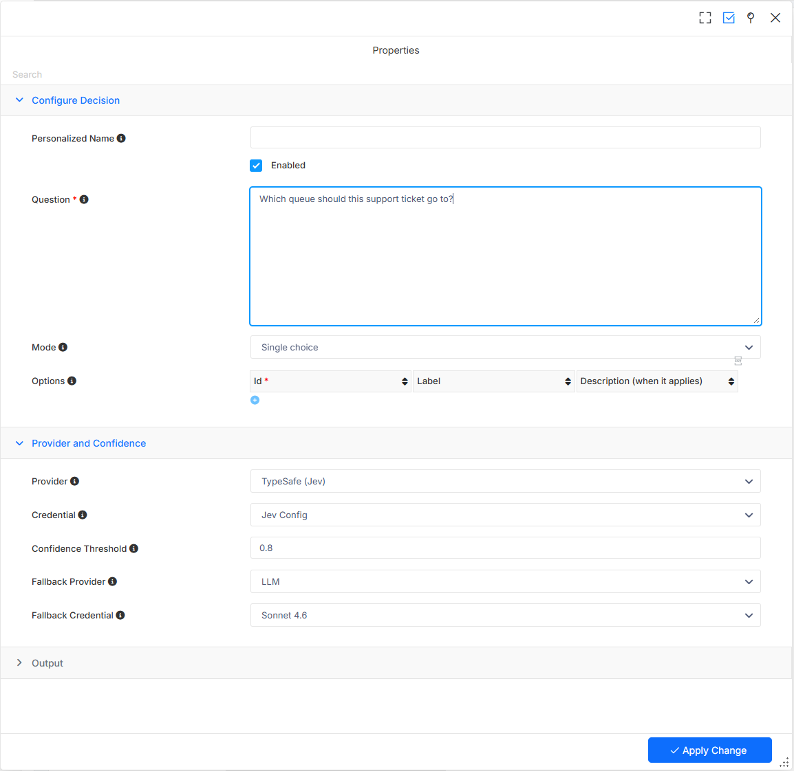

# Building Block Reference: Tools (continued)

This page continues [Building Block Reference: Tools](06-reference-tools.md). It covers the tools that call other agents or route work (Run AI Agent, AI Orchestrator, Invoke Skill, Tool Group and the Preview Decision tool), the tools that talk to the user (User Input, HTML UI Input and the four display tools), and the scripting tools (BeanShell and Script Runner). Read the first page for the shared rules: common properties, function names, how tool errors are handled and parallel execution.

## Agent calling and routing tools

### Run AI Agent

**What it does.** Lets one agent hand a job to another agent of the same app. The called agent runs to the end and its final answer comes back to the calling model as the tool result.

**When to use it.** Use it to split a large job into specialist agents (for example a research agent and a writing agent), or to reuse an agent from several places.

**When not to use it.** Do not use it to group tools. Use **Tool Group** for that. Do not build loops where agent A calls agent B and B calls A: nothing stops this except the agent limits.

**Properties**

| Field | What it does | Default | Notes |
|---|---|---|---|
| **AI Agent ID** | The agent to call. | None | Required. Lists the agents of the current app. |
| **Function Name** | The function name the model calls. | `run_agent` | Required. Letters, numbers, dash, underscore, 64 characters at most. |
| **Context Propagation** | Whether the called agent receives the earlier conversation. | None (default) | **None (default)** or **Pass conversation history**. |
| **Max Messages to Pass** | How many recent messages are passed. | 10 | Shown only for **Pass conversation history**. A value of 0 or a value that is not a number means 10. |
| **Trace Visibility Level** | How much of the called agent's work the calling model sees. | Final Output Only (default) | **Final Output Only (default)**, **Summary (output + tool names)**, **Full Trace (all steps as JSON)**. |

**What the model sees.** One function with the name you set. Its description is the **Description** of the called agent. It has one required text parameter for each **Input Variable** of the called agent, with the input's own description. The result depends on **Trace Visibility Level**.

- Final Output Only: the final text answer.
- Summary: `[Sub-Agent Result]`, then `Answer: <text>` and `Tools used: <names>`.
- Full Trace: a JSON text with `answer` and `trace` (all messages of the run).

When history is passed, only user and assistant text messages are passed. System messages, tool results and assistant turns that only contain tool calls are left out.

**Example**

```text
AI Agent ID:               contract_summariser
Function Name:             summarise_contract
Context Propagation:       None (default)
Trace Visibility Level:    Final Output Only (default)
```

The called agent has an input variable `contract_text`. The model calls `summarise_contract` with `contract_text` set to the text.

**Limitations and failure behaviour**

- If the called agent fails, the tool raises an error with the message of the failure and the calling task stops. An agent that returns nothing gives an empty result.
- The called agent runs inside the same run. Stopping the parent run also stops the called agent.
- If the chosen agent is deleted or its inputs change, the function definition changes with it. Re-test the calling agent after you change the called agent.
- Safe to run in parallel.

### AI Orchestrator

**What it does.** Gives an agent the Orchestrator, which builds or changes whole sets of app artifacts (forms, lists, userviews, processes, themes) from a plain-language instruction. See [The Orchestrator: Building Whole Apps](13-orchestrator.md) for how the Orchestrator works.

**When to use it.** Use it when an agent must create or change app pieces for a user, for example an assistant agent that builds a form on request.

**When not to use it.** Do not give it to agents that serve end users who should not change the app. In `auto` mode it saves changes to the app immediately.

**Properties**

| Field | What it does | Default | Notes |
|---|---|---|---|
| **Timeout (seconds)** | How long the tool waits for the Orchestrator to finish. | 600 | Values below 30 are raised to 30. |
| **App ID Override** | The app to build in. | Empty | Leave empty to use the app of the current context. Used only when there is no current app. |
| **App Version Override** | The app version to build in. | 1 | Used only when there is no current app. |

**What the model sees.** Function `run_orchestrator`. The description says it invokes the Joget AI Orchestrator to build or modify app artifacts (it lists the artifact types of the enabled composers) from a plain-language instruction, and explains the two modes. Parameters:

| Parameter | Required | Meaning |
|---|---|---|
| `message` | Yes | What to build or change. |
| `mode` | No | `auto` (default): build and save at once. `plan`: describe the plan and change nothing. Any other value is treated as `auto`. |

The result is JSON text with `status`, `message`, and when present `pendingItems`, `pendingCount`, `validationSummary`, and `artifacts` (each with `type`, `id`, `name`, `savedToDb`).

**Example.** The task prompt says: "Always call `run_orchestrator` with `mode` set to `plan` first, show the plan, and call it with `auto` only after the user says yes."

**Limitations and failure behaviour**

- An empty `message`, a timeout, or an Orchestrator failure raises an error and the task stops. After a timeout the tool asks the Orchestrator run to stop.
- The tool runs the Orchestrator without a chat window, so nobody can approve steps inside it. Use `plan` mode and a **User Input** tool to get approval before you call it with `auto`.
- The run can take many minutes. Raise **Timeout (seconds)** for large requests.
- Not parallel-restricted, but the Orchestrator changes the same app, so do not run two at once.

### Invoke Skill

**What it does.** Lets the model read a **skill** by name. A skill is a block of expert instructions that you keep in AI Central Config (**Skills** tab). The model asks first for an index of the skill's sections, then for the sections it needs. If the skill has linked tool templates, those tools become available to the agent from that point.

**When to use it.** Use it when you have long guidance (naming rules, domain rules, procedures) that the model needs only sometimes. It keeps the prompt short.

**When not to use it.** Do not use it for short instructions that every run needs. Put those in a **Text Prompt** or in the Central Instructions. See [Skills, Central Instructions and Tool Templates](22-skills-and-tool-templates.md).

**Properties**

| Field | What it does | Default | Notes |
|---|---|---|---|
| **Enabled Skills** | The skills this agent may read. | All unchecked, which means all skills for Agent Builder are allowed | The list shows the skills defined for Agent Builder, with their descriptions. |

**What the model sees.** Function `invoke_skill`. The description explains the two-step use and lists the available skills as `- <name>: <description>`. Parameters: `name` (required, the exact skill name) and `section` (optional, a section name from the index). Without `section`, the result is the section index. With `section`, the result is the text of that section.

**Example.** Enabled Skills: `leave-policy`. The model first calls `invoke_skill` with `name` = `leave-policy`, reads the index, then calls it again with `section` = `Carry forward rules`.

**Limitations and failure behaviour**

- An unknown skill, a skill that is not enabled for this agent, or an empty name raises an error and the task stops.
- The tool never runs in parallel with other tools in the same batch.
- Changes you make to a skill in Central Config apply to the next run.

### Tool Group

**What it does.** Bundles several tools behind one function. The model first sees only the group's trigger function. When it calls the trigger, the model is asked again with only the tools inside the group. This keeps the list of tools short for agents that have many tools.

**When to use it.** Use it when one task has about ten or more tools that fall into clear clusters.

**When not to use it.** Do not use it for fewer than five or six tools. The extra step adds cost and no benefit. To pass a whole job to another agent, use **Run AI Agent**.

**Properties**

| Field | What it does | Default | Notes |
|---|---|---|---|
| **Trigger Function Name** | The function name the model calls to enter the group. | Empty | Required. For example `data_tools`. |
| **Description** | When to use the group and what it contains. | Empty | Required. The model chooses the group from this text alone. |

Drag the tools you want inside onto the **Tool Group** node on the canvas.

**What the model sees.** One function with your trigger name and description, and no parameters. Calling it returns `Sub-tools available. Choose and call the appropriate sub-tool.` and the next model step offers only the nested tools.

**Example**

```text
Trigger Function Name: orders_tools
Description:           Tools to look up and change customer orders and invoices.
Nested tools:          Database Query (query_orders), JSON API (cancel_order)
```

**Limitations and failure behaviour**

- A group with no nested tools does nothing useful. Add at least one tool before you save.
- A batch that contains the trigger runs one call at a time.
- Nested tools keep their own error behaviour.

## Decision (Multiple Choice) — Preview

> **Note:** This tool is a **Preview** feature. Treat results as a supplement to a human check, and test it with your own data before you rely on it.

**What it does.** Picks one option (or several, or a score level, or yes or no) from a fixed list for a case, and returns the choice with a confidence. It never returns an option outside your list. The answer comes from a **decision provider**: **TypeSafe (Jev)**, a fast decision service from TypeSafe, or **LLM**, one of your AI services. If the main provider is unsure, a second provider (the fallback) can answer.

**When to use it.** Use it for routing and classification where the answer must be one of a known set: which queue a ticket goes to, whether a claim needs review, a priority level.

**When not to use it.** Do not use it for open questions or for writing text. Do not use it as the only control on decisions with serious consequences (see the notes on confidence below).

**How to enable it.** The Decision tool is part of the shipped plugin and appears in the **Tools** section of the palette as **Decision (Multiple Choice)** when Agent Builder is installed. To use it:

1. Open **Settings > AI Central Config** and the **AI Credentials** tab (see [AI Central Config Reference](03-ai-central-config.md)).
2. For the TypeSafe provider, add a **TypeSafe** credential: **API Key**, **Model** (leave `jev-latest` unless TypeSafe asks otherwise), **Base URL**, **Timeout (ms)**. Use **Test connection** to check it.
3. For the LLM provider or for a fallback, make sure you have an AI service (an LLM credential) in AI Central Config.
4. Drag the tool onto a task and set the properties below.

If no credential is available for a provider, the tool does not fail. It returns an `uncertain` result with the reason. The process version of this tool (**AI Decision (Multiple Choice)**, for the Process Builder) is described in [Using Agents Inside Joget Apps](08-using-agents-in-apps.md).

**Properties**

| Field | What it does | Default | Notes |
|---|---|---|---|
| **Question** | What to decide. | Empty | Required. The provider sees only this text, the option labels and descriptions, and the case. Be specific. |
| **Mode** | The kind of decision. | Single choice | **Single choice**, **Multi-select**, **Yes / No**, **Score (ordered levels)**. Only the modes the chosen provider supports are listed. |
| **Options** | The fixed answers. A grid with **Id**, **Label**, **Description (when it applies)**. | None | At most 255 options (2 to 10 in Score mode, lowest level first). Not used in Yes / No mode. Descriptions help separate similar options. |
| **Provider** | The provider that answers first. | TypeSafe | TypeSafe (Jev) and LLM are built in. Vendors can add providers as separate plugins. |
| **Credential** | The AI Central Config credential for the provider. | The first credential | For the LLM provider this is an AI service. |
| **Confidence Threshold** | The confidence the answer must reach. | 0.8 | 0 to 1. A value above 1 is read as a percentage. |
| **Fallback Provider** | The provider asked when the main one is below the threshold, fails, or does not support the mode. | LLM | Empty means no fallback. |
| **Fallback Credential** | The credential for the fallback provider. | The first entry of the list (an AI service) | The list has no blank entry. Check it when you use a fallback. |
| **Output Format** | What the model gets back. | JSON | **JSON (choice, confidence, runner-ups, provider)**, **Option id only ("uncertain" when unsure)**, **Option label only ("uncertain" when unsure)**, **One-line summary**. |



The panel has three sections: **Configure Decision** (the **Question**, **Mode** and **Options**), **Provider and Confidence** and **Output**. The last two are collapsed until you open them.

**What the model sees.** Function `make_decision`. The description tells the model to decide which option fits, to return an option id with a confidence or `uncertain`, and not to guess an id itself. It then adds `Question: <your question>` and `Options: <id> (<label>); ...`. One required text parameter: `input` (`The case to decide on: the text, data or description the question is about.`).

The result in the default JSON format looks like this:

```json
{
  "status": "decided",
  "choice": "it",
  "choices": ["it"],
  "confidence": 0.93,
  "runnerUps": [{"id": "hr", "score": 0.04}],
  "provider": "jev",
  "escalated": false,
  "latencyMs": 412
}
```

The status is `decided`, `none` (multi-select and nothing applies) or `uncertain` (no usable answer; the result then has a `reason`). Score mode adds a `score` from 0.0 to 1.0.

**How the answer is produced**

1. The main provider answers. At or above the threshold, that answer is returned.
2. If the main provider is below the threshold, fails, or does not support the mode, the fallback provider answers.
3. The fallback answer must also reach the threshold. If not, the result is `uncertain` and keeps the best guess and the runner-ups.
4. The tool never raises an error to the agent. A missing provider, a missing credential and an unsupported mode all give `uncertain` with a reason.

**Running without an LLM.** An agent with no LLM element, where every task has exactly one enabled Decision tool and no guard, runs the Decision tool directly. The task's user prompts (with variables filled in) become the case, and the tool output is the response. Enhancers and task decisions still run. No LLM service is needed. Add an LLM element, a second tool or a guard and the agent uses the normal tool loop.

**Example**

```text
Question:             Which queue should this support ticket go to?
Mode:                 Single choice
Options:              billing | Billing | Invoices, payments, refunds
                      tech    | Technical | Errors, outages, how-to questions
                      sales   | Sales | Quotes, upgrades, new licences
Provider:             TypeSafe
Confidence Threshold: 0.85
Fallback Provider:    LLM
Output Format:        JSON
```

**Limitations and things to know**

- Provider confidence is not a guarantee. A provider can be confidently wrong on vague input. Use clear option descriptions, keep the threshold high and send `uncertain` results to a person.
- The case text and the option list are sent to the chosen provider, like any other external AI service. Do not send data that your policy does not allow to leave.
- Multi-select over more than 120 options skips TypeSafe and goes straight to the fallback. TypeSafe choice accepts at most 255 options. For more, chain two decision tools.
- The Score mode of the TypeSafe provider has not been checked against many live replies. Test it with your own levels.
- You can test a decision agent with an evaluation suite that uses the **Decision** scorer. See [Evaluating Agents](10-evaluating-agents.md).
- Safe to run in parallel.

## Display and interactive tools

These six tools talk to the person who uses the agent. They need a chat window. They work in the **Preview** tab of the Agent Builder, in the **Agent Chat UI** of the **Run AI Agent** list action (see [Using Agents Inside Joget Apps](08-using-agents-in-apps.md)), and in the Joget AI Assistant in agent mode (see [Voice Input and the Joget AI Assistant](16-voice-and-assistant.md)). They do not work when nobody can see a chat window, for example when the agent runs from the **AI Agent** process tool or from the **Execute and Show Response** list action.

- The **interactive** tools (User Input, HTML UI Input) stop the run and wait for the person to answer.
- The **display** tools (HTML Display, AJAX Display, URL Display, File Viewer) show content and let the run continue at once.
- A display tool tells the model that the content was shown. It cannot check that the person saw it. When there is no chat window, the content is not shown, and the model still gets the success text.

All four display tools have a **Display Mode**. The labels are:

| Display Mode | Meaning |
|---|---|
| **Panel (slide-out, 70% width)** | Opens a side panel. This is the default. |
| **Inline (embedded in chat)** | Puts the content in the chat. |
| **Link (click to open panel)** | Shows a link; the panel opens when the person clicks it. |
| **New Tab** | Opens a new browser tab. Only URL Display offers it. |

### User Input

**What it does.** Pauses the run and shows the user a question, a confirmation, a set of action buttons or a permission request. The answer goes back to the model.

**When to use it.** Use it to ask for missing information, to confirm a risky step, or to let the user choose.

**When not to use it.** Do not use it in agents that run without a chat window.

**Properties**

| Field | What it does | Default | Notes |
|---|---|---|---|
| **Mode** | The kind of interaction. | Ask Question | **Ask Question**, **Confirmation**, **Action Choice**, **Get Permission**. |
| **Function Name** | The function name the model calls. | Empty | Required. |
| **Function Description** | When the model should ask. | Empty | Required. |
| **Default Question** | Question used if the model does not give one. | Empty | Ask Question only. |
| **Confirm Button Label** | Text of the "yes" button. | `Yes` | Confirmation only. |
| **Deny Button Label** | Text of the "no" button. | `No` | Confirmation only. |
| **Timeout (seconds)** | How long to wait for an answer. | 300 | |
| **Default Response on Timeout** | The answer used when the time runs out. | Empty | Not for Get Permission. If empty, a timeout raises an error. |

**What the model sees.** One function with the name and description you set. The parameters depend on the mode:

| Mode | Parameters (all required) | Answer returned to the model |
|---|---|---|
| Ask Question | `question` | The text the user typed. |
| Confirmation | `message` | The label of the button pressed. |
| Action Choice | `message`, `options` (comma-separated button labels) | The label of the button pressed. |
| Get Permission | `action`, `reason` | `Allowed: proceed with the action.` or `Denied: do not proceed with the action.` The buttons are **Allow** and **Deny**. |

**Example**

```text
Mode:              Confirmation
Function Name:     confirm_refund
Function Description: Ask the user to confirm before any refund is issued.
Confirm Button Label: Issue refund
Deny Button Label:    Cancel
Timeout (seconds): 120
```

**Limitations and failure behaviour**

- If the user does not answer in time, **Get Permission** returns `Denied (auto): permission request timed out — the user did not respond. Do not proceed.` For the other modes the tool returns **Default Response on Timeout**, or raises `User input timed out after <n> seconds.` and the task stops when it is empty.
- If the run has no run ID (no chat window), the tool raises `Interactive tools require streaming mode`.
- The tool never runs in parallel with other tools in the same batch.
- Stopping the run while it waits ends the wait.

### HTML UI Input

**What it does.** Shows HTML that the model writes (a form, buttons, a small widget) in the chat, waits for the user to submit it, and returns the submitted values.

**When to use it.** Use it for structured input that the other modes cannot handle, such as a form with several fields.

**When not to use it.** Do not use it when a simple question or choice is enough: model-written HTML is less predictable.

**Properties**

| Field | What it does | Default | Notes |
|---|---|---|---|
| **Function Name** | The function name the model calls. | Empty | Required. |
| **Function Description** | When the model should show the form. | Empty | Required. |
| **Timeout (seconds)** | How long to wait. | 300 | |
| **Default Response on Timeout** | The answer used when the time runs out. | Empty | If empty, a timeout raises an error. |

**What the model sees.** One function with two parameters: `html` (required: self-contained HTML, without `html`, `head` or `body` tags, that contains a way to submit, such as a submit button) and `message` (optional text shown above the HTML). The result is the submitted key and value pairs, one `key=value` per line, or `No data was submitted.`

**Example**

```text
Function Name:        collect_travel_details
Function Description: Show a form to collect travel dates and destination.
Timeout (seconds):    300
```

**Limitations and failure behaviour**

- The HTML is written by the model and runs in the user's browser page. Treat it like any generated content. Do not give this tool to agents that process untrusted text.
- Timeout behaviour is the same as for User Input without a default response.
- The tool never runs in parallel with other tools in the same batch.

### HTML Display

**What it does.** Shows an HTML snippet that the model writes (a table, a chart, formatted text) in the display area.

**When to use it.** Use it to show results that read better as a table or chart than as chat text.

**When not to use it.** Do not use it to collect input (use **HTML UI Input**) or to show an existing page (use **URL Display**).

**Properties**

| Field | What it does | Default | Notes |
|---|---|---|---|
| **Function Name** | The function name the model calls. | Empty | Required. |
| **Function Description** | When to show content. | Empty | Required. |
| **Display Mode** | Where the content appears. | Panel (slide-out, 70% width) | Panel, Inline, Link. |

**What the model sees.** One function with the parameters `html` (required; a snippet without `html`, `head` or `body` tags; scripts go in a `script` tag using jQuery's ready function), `title`, `message` and `css` (all optional). The result is `HTML content rendered.` or `"<title>" rendered.`

**Example**

```text
Function Name:     show_table
Function Description: Show tabular results to the user as an HTML table.
Display Mode:      Panel (slide-out, 70% width)
```

**Limitations.** The tool always reports success. Scripts in the HTML run in the user's browser page.

### AJAX Display

**What it does.** Loads HTML from a URL in the user's browser and shows it in the display area. Use it to show a server-rendered fragment, for example a Joget userview page or a form.

**When to use it.** Use it to show a fragment that belongs in the chat page and needs the user's own session.

**When not to use it.** To show a full page in a frame, use **URL Display**.

**Properties**

| Field | What it does | Default | Notes |
|---|---|---|---|
| **Function Name** | The function name the model calls. | Empty | Required. |
| **Function Description** | When to show the content. | Empty | Required. |
| **Function Arguments** | Parameters the model fills in. A grid with **Name**, **Data Type**, **Description**, **Is Required?**. | None | Data types: Boolean, Integer, Number, String. |
| **URL** | The address to load. | Empty | Required. The field help says to use hash variables such as `#paramName#` to embed argument values. |
| **HTTP Method** | The method used to load the URL. | GET | GET or POST. |
| **Display Mode** | Where the content appears. | Panel (slide-out, 70% width) | Panel, Inline, Link. |

**What the model sees.** One function with one parameter for each argument row, named with the prefix `arg_` (for example `arg_orderId`), plus optional `title` and `message`. The browser sends the arguments as request parameters (without the `arg_` prefix). The result is `Content loaded.`

**Example**

```text
Function Name:   show_order
Function Description: Show the order details page for an order number.
Function Arguments: orderId | String | Order number | required
URL:             /jw/web/userview/orders/main/_/order_details
HTTP Method:     GET
Display Mode:    Panel (slide-out, 70% width)
```

**Limitations.** The browser makes the request, so the page must be reachable from the user's browser and the user must be allowed to see it. The tool reports success even if the page fails to load; the user then sees a load error message. Addresses the chat page considers unsafe are refused in the browser.

### URL Display

**What it does.** Opens a web page in a frame in the display area, or in a new browser tab.

**When to use it.** Use it to show a Joget userview, a report or an external page next to the conversation.

**When not to use it.** Many sites forbid being shown in a frame. For those, use the **New Tab** mode.

**Properties**

| Field | What it does | Default | Notes |
|---|---|---|---|
| **Function Name** | The function name the model calls. | Empty | Required. |
| **Function Description** | When to open pages. | Empty | Required. |
| **URL Mode** | Who decides the address. | Agent Provided (LLM sends the URL) | **Agent Provided (LLM sends the URL)** or **Predefined (creator defines URL and parameters)**. |
| **URL** | The base address. | Empty | Required for Predefined. The model's argument values are added as query parameters. |
| **Function Arguments** | Parameters the model fills in. | None | Predefined mode only. |
| **Display Mode** | Where the page appears. | Panel (slide-out, 70% width) | Panel, Link, New Tab. |

**What the model sees.** In Agent Provided mode: a required `url` parameter. In Predefined mode: one `arg_<name>` parameter for each argument row. Both modes also have optional `title` and `message`. The result is `Opened: <url>` or `URL content opened.`

**Example**

```text
URL Mode:      Predefined (creator defines URL and parameters)
URL:           /jw/web/userview/crm/main/_/customer_view
Function Arguments: id | String | Customer id | required
Display Mode:  Panel (slide-out, 70% width)
```

**Limitations.** In Agent Provided mode the model can open any address. Use Predefined mode when only certain pages are allowed. A page from another site is shown in a restricted frame (no referrer, limited rights). A page of the same Joget site is shown without restriction. A page that forbids framing will show blank.

### File Viewer

**What it does.** Shows a file (image, PDF, video, or another type) in the display area. YouTube links are embedded as videos.

**When to use it.** Use it when the agent finds or creates a file the user should look at.

**When not to use it.** Do not use it to read a file into the model. Use the **File** prompt for that.

**Properties**

| Field | What it does | Default | Notes |
|---|---|---|---|
| **Function Name** | The function name the model calls. | Empty | Required. |
| **Function Description** | When to show a file. | Empty | Required. |
| **Display Mode** | Where the file appears. | Panel (slide-out, 70% width) | Panel or Link. |

**What the model sees.** One function with the parameters `url` (required), and optional `mimeType`, `filename`, `title` and `message`. If `mimeType` is missing, the browser works it out from the file extension. The result is `File ready to view.` or `"<filename>" ready to view.`

**Example**

```text
Function Name:        show_file
Function Description: Show a document or image to the user from its URL.
Display Mode:         Panel (slide-out, 70% width)
```

**Limitations.** The browser loads the file, so the address must be reachable from the user's browser. The tool does not check that the file exists.

## Scripting tools

### BeanShell

**What it does.** Runs a script on the Joget server when the model calls the tool. The script can use any Java and Joget API, so it can do things that no other tool does. Whatever text the script returns becomes the tool result.

**When to use it.** Use it for server-side logic that needs code: business rules, calculations, reading and writing form data through Joget services.

**When not to use it.** If **Database Query** or **JSON API** can do the job, use them. Do not use it for anything that must run in the user's browser (use **Script Runner**).

**Properties**

| Field | What it does | Default | Notes |
|---|---|---|---|
| **Function Name** | The function name the model calls. | Empty | Required. Letters, numbers, dash, underscore, 64 characters at most. |
| **Function Description** | What the function does and when to use it. | Empty | Required. |
| **Function Arguments** | The parameters the model fills in. A grid with **Name**, **Data Type**, **Description**, **Is Required?**. | None | Data types: Boolean, Integer, Number, String. |
| **Script** | The BeanShell code. | Empty | Required. Java syntax. |

**What the model sees.** The name and description you set, and one parameter for each argument row.

**Variables available to the script**

| Variable | Type | Meaning |
|---|---|---|
| `arguments` | JSON object | The values the model sent. Read them with `arguments.getString("name")`, `arguments.optString("name", "")`, `arguments.getInt("count")` and so on. |
| `plugin` | the tool | The tool instance. |
| `llm` | the LLM plugin | The LLM of the agent. |
| `llmConfig` | the run settings | The run settings, including the run ID. |
| `rollback` | rollback helper | Records changes you make so a failed run can undo them (see [Using Agents Inside Joget Apps](08-using-agents-in-apps.md)). It does nothing in other runs. |

The argument values are not available as separate variables. Always read them from `arguments`.

**Example**

```text
Function Name:        get_leave_balance
Function Description: Return the remaining annual leave days for an employee id.
Function Arguments:   employeeId | String | The employee id | required
Script:
  String id = arguments.getString("employeeId");
  // look up the balance with your own logic here
  return "Employee " + id + " has 12 days of annual leave left.";
```

**Limitations and failure behaviour**

- The script must return a String. Returning another type, returning nothing that can be converted, or throwing an error raises an error: the task fails with the error message.
- The script runs with the rights of the Joget server. Only trusted developers should be able to edit agents that contain BeanShell tools.
- The script runs while the agent waits. Slow scripts slow the whole run.
- Safe to run in parallel only if your script is safe to run twice at the same time.

### Script Runner

**What it does.** Runs a JavaScript snippet in the user's browser, in the page that shows the agent chat. Use it to act on the page, for example to fill a field, scroll or show a message.

**When to use it.** Use it for actions that only the browser can do.

**When not to use it.** Do not use it for server work (use **BeanShell**). Be careful with **LLM Generated Script** mode (see below).

**Properties**

| Field | What it does | Default | Notes |
|---|---|---|---|
| **Function Name** | The function name the model calls. | Empty | Required. |
| **Function Description** | What the script does. | Empty | Required. |
| **Mode** | Who writes the script. | Predefined Script | **Predefined Script** (you write it) or **LLM Generated Script** (the model writes it). |
| **Function Arguments** | The parameters the model fills in. | None | Predefined Script only. |
| **JavaScript** | The script to run. | Empty | Predefined Script only. |
| **Message Mode** | The chat message shown when the script runs. | LLM Generated | **LLM Generated**, **Custom Message**, **No Message**. |
| **Custom Message** | The message text. | Empty | Custom Message only. |

**What the model sees.**

- Predefined Script: one parameter `arg_<name>` for each argument row, plus an optional `message` when **Message Mode** is **LLM Generated**.
- LLM Generated Script: a required `script` parameter (JavaScript written as a function body, without the function declaration), an optional `args` parameter (a JSON object passed to the script), and the optional `message`.

The script receives the argument values as an `args` object (for example `args.myParam`) and also as variables with the argument names. The result for the model is always `Script executed.`

**Example**

```text
Mode:               Predefined Script
Function Name:      focus_field
Function Description: Move the cursor to a field on the page by its id.
Function Arguments: fieldId | String | The element id | required
JavaScript:         var el = document.getElementById(args.fieldId);
                    if (el) { el.focus(); }
Message Mode:       No Message
```

**Limitations and failure behaviour**

- The script runs in the browser with the rights of the page. **LLM Generated Script** lets the model run any JavaScript there. Use it only for trusted internal users, or do not use it.
- Errors in the script are written to the browser console only. The model is told `Script executed.` in every case, so it cannot know if the script worked.
- It needs a chat window. With no chat window the script does not run, and the model still gets the success text.

## Limitations and things to know

- **Interactive and display tools need a chat window.** Test them in **Preview**. Do not add them to agents that run from processes, jobs or API calls.
- **Model-written code and HTML run in a browser or on a server.** BeanShell runs on the server with full rights. HTML UI Input, HTML Display and LLM Generated Script run in the user's browser. Limit who can edit the agent, and avoid giving these tools to agents that read untrusted text.
- **Preview feature.** The Decision (Multiple Choice) tool is a Preview. Keep a human review for important decisions.
- **Agent calling costs.** Every Run AI Agent call starts a full agent run with its own model calls. Set clear descriptions so the model calls it only when needed.

## Troubleshooting

| Symptom | Cause | Fix |
|---|---|---|
| The run stops with `Interactive tools require streaming mode`. | The agent ran without a chat window. | Run it in Preview, the Agent Chat UI or the Joget AI Assistant. Remove the interactive tool from agents that run unattended. |
| The run stops with `User input timed out after 300 seconds.` | Nobody answered and no **Default Response on Timeout** is set. | Set a default response, raise the timeout, or answer in time. |
| A display tool says it showed content, but nothing appears. | There is no chat window, or the address is unsafe or unreachable. | Test in Preview. Use a full address that the browser can reach. |
| The BeanShell tool fails with a cast error. | The script returned something that is not a String. | Return a String (for example `String.valueOf(value)`). |
| The BeanShell script says a variable is not defined. | You used an argument name as a variable. | Read it with `arguments.getString("name")`. |
| `invoke_skill` fails with `Skill not found`. | The name is wrong or the skill is not for Agent Builder. | Use the exact name from the list in the function description. |
| Decision tool returns `uncertain` with a reason about a credential. | No credential for the provider. | Add the credential in AI Central Config, or choose another provider. |
| Decision tool returns `uncertain` for clear cases. | The threshold is too high for the provider, or the option descriptions are weak. | Improve the option descriptions. Test with an evaluation suite. Adjust the threshold carefully. |
| The model never uses Run AI Agent. | The description of the called agent is empty or vague. | Edit the called agent's **Description** in its properties. |

## Where to go next

- [Building Block Reference: Tools](06-reference-tools.md)
- [Building Block Reference: Prompts, LLMs, Enhancers, Decisions and Guards](07-reference-other-blocks.md)
- [Using Agents Inside Joget Apps](08-using-agents-in-apps.md)
- [Writing Custom Tools](24-custom-tools.md)
