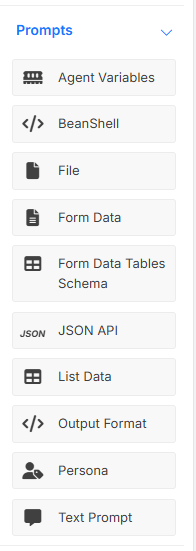
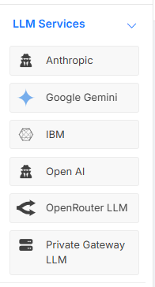
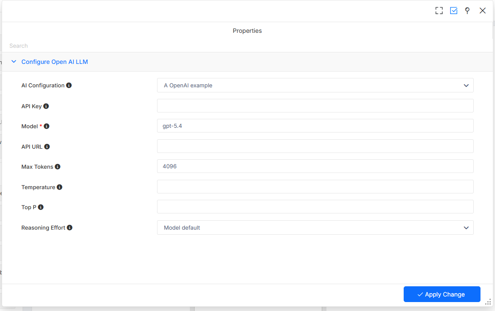
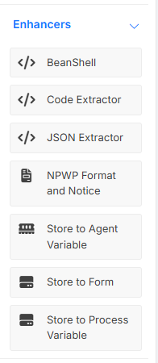
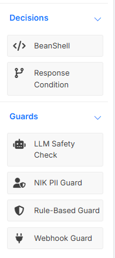

# Building Block Reference: Prompts, LLMs, Enhancers, Decisions and Guards

This page is the reference for every block in the Agent Builder palette that is not a tool: the 10 prompts, the 5 LLM services, the 6 enhancers, the 2 decisions and the 3 guards. For each block it gives the name shown in the palette, what the block does, when to use it, every property with its default, what is sent to the model, and what happens when the block fails. Tools are in [Building Block Reference: Tools](06-reference-tools.md) and [Building Block Reference: Tools (continued)](06b-reference-tools-continued.md). Read [Agent Builder Concepts and How an Agent Runs](04-agent-builder-concepts.md) first if you are new to agents, tasks and the run order.

## How these blocks fit together

A task is built in this order. Every block type has its own place in the order.

```text
1. Prompts          build the messages for the model (system and user messages, data, files)
2. Input guards     check the messages before the model sees them
3. LLM + Tools      the model answers, and may call tools (repeat until it has an answer)
4. Output guards    check the answer
5. Enhancers        change or store the answer (extract JSON, store to a form ...)
6. Decisions        choose what happens next (continue, go to another task, stop)
```

Prompts, guards, enhancers and decisions are added to a task. The LLM service is chosen once for the agent. The palette groups them under **LLM Services**, **Prompts**, **Enhancers**, **Decisions** and **Guards**.

### Properties every block has

Every prompt, enhancer, decision and guard (but not the LLM services) gets two properties at the top of its panel. They are not repeated in the tables below.

| Field | What it does | Default | Notes |
|---|---|---|---|
| **Personalized Name** | A custom name shown for the block in the node viewer. | Empty | Display only. |
| **Enabled** | Switches the block on or off. | Checked | A block that is switched off is skipped. A block saved with an empty Enabled value counts as off. |

### Hash variables and input variables

- Text in block properties can contain Joget hash variables, for example `#form.leave_request.start_date#` or `#currentUser.username#`, when the agent runs from a process or an app page. They are replaced before the block runs.
- `${name}` in the agent definition is replaced with the value of the agent **Input Variable** of that name (for example `${query}`) before the run starts.
- A **Text Prompt** also replaces `${name}` with the current value of an **Agent Variable** of that name.

### If a block cannot be loaded

If a saved agent uses a block whose plugin is not installed (for example you removed a custom plugin), the task fails with a message such as `AgentGuard class could not be loaded: <class name>`. Install the plugin again or remove the block from the agent.

## Prompts

A prompt adds one or more messages to the conversation that the model receives. Prompts run in the order they are listed on the task.



### Persona

Adds a system message `You are a <Role>.` followed by a new line and the backstory. Use it to give the model a role and style.

| Field | What it does | Default | Notes |
|---|---|---|---|
| **Role** | The role of the model. | `Research Analyst & Tech Writer` | Required. Inserted after "You are a". |
| **Backstory** | Further description of how to behave. | Empty | Text editor. |

Example: **Role** `Customer Support Specialist`, **Backstory** `You answer politely and in short sentences. You never promise refunds.`

When not to use it: for rules about the task itself, use a **Text Prompt** with the **System** role. Failure behaviour: none; the block only adds a message.

### Text Prompt

Adds one message with text that you write. This is the prompt you will use most.

| Field | What it does | Default | Notes |
|---|---|---|---|
| **Message Role** | Who the message is from. | User | Required. **System** or **User**. |
| **Prompt** | The message text. | `Research and write an in-depth article on ${query}.` | Required. Use `${input_name}` for agent input variables, `${agent_variable}` for agent variables and hash variables for Joget data. |

Example: **Message Role** `User`, **Prompt** `Summarise this ticket for the support lead: ${query}`.

Failure behaviour: none. A `${name}` that matches neither an input nor an agent variable stays in the text as it is.

### BeanShell (prompt)

Runs a script on the server. If the script returns text, the text is added as a system message. The script can also add messages itself.

| Field | What it does | Default | Notes |
|---|---|---|---|
| **Script** | The BeanShell code. | Empty | Required. Java syntax. If it is empty, nothing is added. |
| **Purpose** | A note for people about what the script does. | Empty | Shown in the builder only. |

Variables in the script: `plugin`, `llm`, `llmConfig`, `messages` (the conversation, which you may change), and `rollback` (see [Using Agents Inside Joget Apps](08-using-agents-in-apps.md)). Return a String, or return nothing.

Example script: `return "Today is " + new java.text.SimpleDateFormat("d MMMM yyyy").format(new java.util.Date());`

Failure behaviour: an error in the script fails the task. The script runs with the rights of the Joget server, so only trusted developers should edit agents that contain it.

### Form Data Tables Schema

Adds a system message that describes the form data tables of the current app: the relationships between tables, and for each table its columns with a short description of each column. The model can then write correct SQL for the **Database Query** tool. The description is built from the forms of the app and is cached until the app changes.

| Field | What it does | Default | Notes |
|---|---|---|---|
| **Additional Schema Info** | Extra text appended after the generated schema. | Empty | For example, notes on the meaning of status values. |

Use it together with **Database Query**. Failure behaviour: an error while building the schema fails the task. The schema covers only forms of the current app.

### List Data

Loads rows from a Joget list (datalist) and adds them as a Markdown table in a system message.

| Field | What it does | Default | Notes |
|---|---|---|---|
| **List** | The list to read. | None | Required. Lists of the current app only. |
| **Explanation** | A sentence placed before the table. | Empty | For example `These are open purchase orders.` |
| **Filters** | Conditions on the rows. A grid with **Join** (AND or OR), **Field**, **Operator**, **Value**. | None | Operators: =, <>, >, >=, <, <=, LIKE, NOT LIKE, IN, NOT IN, IS TRUE, IS FALSE, IS NULL, IS NOT NULL. The **Value** can contain hash variables. |
| **Offset** | The number of rows to skip (starts at 0). | Empty (0) | |
| **Maximum Rows** | The most rows sent to the model. | 100 | Blank or 0 means 100. |
| **Sort By** | A column of the list. | None | |
| **Sort Direction** | The order. | Ascending | **Ascending** or **Descending**. Used only when **Sort By** is set. |

What the model gets: a system message with the **Explanation**, a table of the visible columns (hidden columns are left out; list formatters are applied; HTML is removed), and a note such as `Showing rows 1-100 of 340 matching rows. The data is limited to 100 rows (Maximum Rows setting), so this is not the complete data set.` The model therefore knows when the data is partial.

Example: **List** `open_purchase_orders`, **Sort By** `amount`, **Sort Direction** `Descending`, **Maximum Rows** `20`.

Failure behaviour: if the list does not exist, nothing is added and no error is raised. If the list is set to show no data until a filter is used, and you set no filter and no sort, the table is empty. Other errors fail the task.

### Form Data

Loads one form record and adds it to a system message.

| Field | What it does | Default | Notes |
|---|---|---|---|
| **Form** | The form to read. | None | Required. Forms of the current app only. |
| **Record ID** | The record to load. | Empty | If empty and the agent runs from a process, the record of the process is used. Hash variables are allowed. |
| **Explanation** | A sentence placed before the data. | Empty | |
| **Format** | How the record is written. | Markdown | Required. **Markdown** or **JSON**. |

With **Markdown**, the text follows the form layout: section titles, field labels with values, option labels instead of option codes, and grids as tables. Fields that the current user may not see, and hidden fields, are left out. With **JSON**, the model gets the raw record data in a JSON code block.

Failure behaviour: if the record or form is missing, the data is empty and nothing is added. Other errors fail the task.

### JSON API (prompt)

Calls a JSON web service when the task starts and adds the response as a system message.

| Field | What it does | Default | Notes |
|---|---|---|---|
| **JSON URL** | The address to call. | Empty | Required. Hash variables are allowed. |
| **Call Type** | The HTTP method. | GET | GET, POST, PUT, DELETE. |
| **Body Type**, **Request Parameters**, **Custom JSON Payload** | The request body (POST and PUT only). | Request Parameters | Same as the JSON API tool. |
| **Request Headers** | Request headers (name and value). | None | |
| **Passover Current Request Cookies** | Sends the session cookie of the current user. | Unchecked | |
| **Debug Mode** | Writes details to the server log. | Unchecked | |

These fields come from the Joget JSON Tool. Unlike the JSON API tool, this prompt has no arguments: the model does not choose when to call it.

Failure behaviour: if the call fails, or the reply is not valid JSON, the task fails with `JSON API returned no data (the request failed or the response is not valid JSON)`.

### File

Adds a file to the conversation, for models that can read images or documents. PDF pages are turned into images.

| Field | What it does | Default | Notes |
|---|---|---|---|
| **Message Role** | Who the message is from. | User | **System** or **User**. |
| **Purpose** | The text that goes with the file. | Empty | Required. Tell the model what the file is and what to do with it. |
| **File Type** | How to treat the file. | Text Content | **Image**, **PDF**, **Image / PDF**, **Text Content**. |
| **File Source** | Where the file is. | App Resource | **App Resource**, **Form Upload Field**, **System Path**, **URL**. |
| **App Resource** | A file uploaded to the app resources. | None | Source App Resource. |
| **Form**, **Field Id**, **Record ID** | The upload field and record. | None | Source Form Upload Field. An empty **Record ID** uses the record of the running process. A field with several files adds each file. |
| **System Path** | A path on the Joget server. | Empty | Source System Path. |
| **URL** | A web address. | Empty | Source URL. |

With **PDF** or **Image / PDF**, each PDF page is drawn at 300 dots per inch as a JPEG image, and any image larger than 2000 pixels on its longest side is reduced. Each file or page becomes one message.

Failure behaviour: a missing file for the App Resource, Form Upload Field or System Path source adds nothing, without an error. An unreadable URL, or a damaged PDF, fails the task. The chosen model must accept the file type. **System Path** can read any file that the Joget server process can read, so allow only trusted developers to edit agents that use it.

### Agent Variables

Adds a system message with the current values of agent variables, so the model sees what earlier tasks stored.

| Field | What it does | Default | Notes |
|---|---|---|---|
| **Variables to Inject** | The variables to show. A grid with **Variable Name** (a list of the variables declared in the agent) and **Display Label** (optional). | Empty | Leave empty to show every variable. |

The message looks like `Current agent variables:` followed by lines of `- name: value`. A variable with no value shows an empty value.

### Output Format

Tells the model to answer in JSON. It does not add a message when the provider has a native JSON mode.

| Field | What it does | Default | Notes |
|---|---|---|---|
| **Output Mode** | The format. | Default (text) | Required. **Default (text)**, **JSON Object (any valid JSON)**, **JSON Schema (strict, define structure)**. |
| **JSON Schema** | The schema the answer must follow. | Empty | Needed for **JSON Schema** mode. |

How each LLM service applies it:

| LLM service | What happens |
|---|---|
| Open AI | Uses `response_format`: `json_object`, or `json_schema` with `strict` set to true. OpenAI strict mode needs `additionalProperties: false` and every property listed in `required` on every object. A schema that is not valid JSON falls back to JSON Object. |
| Google Gemini | Sets the response type to `application/json`. For a schema it sends the schema as `responseSchema` (without `additionalProperties`). An invalid schema is ignored with a log warning. |
| Anthropic, OpenRouter LLM, IBM | There is no native mode. An instruction asking for JSON (and the schema, when given) is added as a user message. |

Pair it with the **JSON Extractor** enhancer, which cleans the answer if the model still adds extra text.

## LLM Services

An LLM service is the model connection for an agent. Add one LLM to the agent. The **AI Configuration** field links it to a credential that you create once in AI Central Config (see [AI Central Config Reference](03-ai-central-config.md)).





### Defaults at a glance

| Palette name | Default model | Max tokens default | Default API URL |
|---|---|---|---|
| **Open AI** | `gpt-5.4` | 4096 | `https://api.openai.com/v1/chat/completions` |
| **Anthropic** | `claude-sonnet-5` | 32000 | `https://api.anthropic.com/v1/messages` |
| **Google Gemini** | `gemini-3.5-flash` | 8192 | built from the model name: `https://generativelanguage.googleapis.com/v1beta/models/{model}:generateContent` |
| **OpenRouter LLM** | `google/gemma-3-27b-it:free` | 4096 | `https://openrouter.ai/api/v1/chat/completions` |
| **IBM** | `meta-llama/llama-3-2-11b-vision-instruct` | none in the form (see below) | `https://us-south.ml.cloud.ibm.com/ml/v1/chat/completions` |

### Fields all five services share

| Field | What it does | Default | Notes |
|---|---|---|---|
| **AI Configuration** | The AI Central Config credential (provider and category LLM) that holds the API key. | None | Preferred way to set the key. The list shows credentials for this provider only. |
| **API Key** | An API key typed here. | Empty | Used only when **AI Configuration** is empty. It is stored in the agent definition, so prefer **AI Configuration**. In some builds the box shows masked dots after you choose an **AI Configuration**; leave it as it is. |
| **Model** | The model ID. | See the table above | Required. Free text. Use the exact ID from the provider. |
| **API URL** | The endpoint. | Empty | Optional. Empty means the default URL above. Not offered by Google Gemini. |

All services also read per-task overrides for model, temperature, maximum tokens and top P that you set on a task. Retries, timeouts and the context window are agent settings, not LLM fields. See [Runtime Settings, Monitoring and Cost](09-runtime-and-monitoring.md).

### Open AI

**Use it for** OpenAI chat models. **Do not use it** for a model that your account cannot call; the run fails with the error text from OpenAI.

| Field | What it does | Default | Notes |
|---|---|---|---|
| **Max Tokens** | The most tokens the model may produce in one answer. | 4096 | A whole number of 1 or more. Sent as `max_completion_tokens`. Empty uses the model default. |
| **Temperature** | Randomness. | Empty | 0.0 to 2.0. Ignored by GPT-5 family and o-series models. |
| **Top P** | Nucleus sampling. | Empty | 0.0 to 1.0. Ignored by GPT-5 family and o-series models. |
| **Reasoning Effort** | How much the model thinks before it answers. | Model default | **Model default**, none, low, medium, high, xhigh. Used only by GPT-5, o-series and GPT-OSS models. |

Example: **AI Configuration** `openai-prod`, **Model** `gpt-5.4`, **Max Tokens** `4096`, **Reasoning Effort** `low`.

### Anthropic

**Use it for** Claude models.

| Field | What it does | Default | Notes |
|---|---|---|---|
| **Anthropic Version** | The `anthropic-version` header. | `2023-06-01` | Required. |
| **Max Token** | The most tokens in one answer. | 32000 | A whole number of 1 or more. Anthropic requires a limit. If you clear the field, the service sends 8096. |
| **Temperature** | Randomness. | Empty | 0.0 to 1.0. Ignored by Claude Opus 4.7 and later. |
| **Top P** | Nucleus sampling. | Empty | 0.0 to 1.0. Ignored by Claude Opus 4.7 and later. |
| **Top K** | Limits the sampling pool. | Empty | 0 or more; 0 turns it off. Ignored by Claude Opus 4.7 and later. |
| **Reasoning Effort** | How deeply Claude thinks (adaptive thinking). | Model default | **Model default**, low, medium, high, xhigh, max. For Claude 4.6 and later. |
| **Thinking Budget Tokens** | Tokens for extended thinking. | Empty (off) | Must be less than **Max Token**. Used only by Claude 4.5 and earlier. |

### Google Gemini

**Use it for** Gemini models.

| Field | What it does | Default | Notes |
|---|---|---|---|
| **Max Tokens** | The most tokens in one answer (`maxOutputTokens`). | 8192 | A whole number of 1 or more. Empty uses the model default. |
| **Temperature** | Randomness. | Empty | 0.0 to 2.0. |
| **Top P** | Nucleus sampling. | Empty | 0.0 to 1.0. |
| **Top K** | Limits the sampling pool. | Empty | 0 or more. |
| **Reasoning Effort** | Thinking level (Gemini 3 models). | Model default | **Model default**, minimal, low, medium, high. |
| **Thinking Budget Tokens** | Tokens for thinking (Gemini 2.x models). | Empty (off) | Gemini 3 models use **Reasoning Effort** instead. |

### OpenRouter LLM

**Use it for** any model that you reach through OpenRouter, and for other services that offer an OpenAI-compatible chat endpoint (set **OpenRouter API URL**). The form is titled **Configure Custom LLM**.

| Field | What it does | Default | Notes |
|---|---|---|---|
| **OpenRouter API URL** | The endpoint. | `https://openrouter.ai/api/v1/chat/completions` | |
| **Temperature** | Randomness. | 1.0 | 0.0 to 2.0. |
| **Top P** | Nucleus sampling. | 1.0 | 0.0 to 1.0. |
| **Top K** | Limits the sampling pool. | 1 | 0 or more; 0 turns it off. |
| **Frequency Penalty** | Reduces repeated tokens. | 0.0 | -2.0 to 2.0. |
| **Presence Penalty** | Encourages new topics. | 0.0 | -2.0 to 2.0. |
| **Repetition Penalty** | Reduces repeated phrases. | 1.0 | 0.0 to 2.0. |
| **Min P** | Minimum token probability. | 0.0 | 0.0 to 1.0. |
| **Top A** | Extra probability cutoff. | 0.0 | 0.0 to 1.0. |
| **Max Tokens** | The most tokens in one answer. | 4096 | A whole number of 1 or more. |
| **Thinking Budget Tokens** | Tokens for thinking. | Empty (off) | Only for models that support it. |

The default **Model** is a free model. Free models have strict rate limits and can change, so choose a paid model for real use. A **Top K** of 1 makes the model very deterministic; clear it or raise it if answers look too uniform.

### IBM

**Use it for** models on IBM watsonx.ai. The tool signs in with your IBM Cloud API key and refreshes the access token when needed.

| Field | What it does | Default | Notes |
|---|---|---|---|
| **Project ID** | Your watsonx.ai project. | Empty | Required. |
| **Max Tokens** | The most tokens in one answer. | Empty | A whole number of 1 or more. If empty, no limit is sent and watsonx.ai uses its own. |
| **Temperature** | Randomness. | Empty | 0.0 to 2.0. |
| **Top P** | Nucleus sampling. | Empty | 0.0 to 1.0. |

### Limitations and failure behaviour of LLM services

- A call that fails because of the network, a wrong key or a rejected request raises an error with the text from the provider, and the task fails. Rate-limit (HTTP 429) and server (5xx) errors are tried again according to the agent retry settings.
- The service does not check the model name. A wrong name is reported by the provider when the agent runs.
- Settings that a model ignores (for example **Temperature** on GPT-5) are accepted but have no effect.
- Keys typed into **API Key** are stored in the agent definition. Use **AI Configuration**.

## Enhancers

An enhancer works on the final answer of a task, after the output guards. Enhancers run in the order you list them. Each one sees the answer as the previous one left it.



### BeanShell (enhancer)

Runs a script on the server with access to the answer.

| Field | What it does | Default | Notes |
|---|---|---|---|
| **Script** | The BeanShell code. | Empty | Required. |
| **Purpose** | A note for people. | Empty | |

Variables: `plugin`, `llm`, `llmConfig`, `response` (call `response.getContent()` and `response.setContent(text)`), `rollback`. The returned value is ignored; change the answer with `setContent`. Failure behaviour: an error fails the task.

Example script: `response.setContent(response.getContent().toUpperCase());`

### Code Extractor

Keeps only the code inside a Markdown code fence (three backticks) and removes the fence and the language name. Use it when the model wraps code in explanations.

| Field | What it does | Default | Notes |
|---|---|---|---|
| **Purpose** | A note for people. | Empty | |

If the answer has no fence, it is unchanged. If the fence is not closed, the text after the opening fence is kept. If the result is empty, the original answer is kept. Only the first fenced block is kept.

### JSON Extractor

Finds the JSON in the answer and replaces the answer with clean JSON.

| Field | What it does | Default | Notes |
|---|---|---|---|
| **Purpose** | A note for people. | Empty | |
| **Parse JSON with help from LLMs?** | Asks the model to repair JSON that cannot be parsed. | Yes | **Yes** or **No**. |
| **Instruction for LLM based parsing** | The instruction sent to the model for the repair. | A standard instruction for extracting valid RFC 8259 JSON | Used only when the repair is on. |

The enhancer reads text that is already JSON as it is. Otherwise it takes the first code fence, finds the first balanced `{...}` or `[...]`, removes `//` comments, and repairs JSON that was cut off. If this fails and the repair is on, it asks the LLM once. If the repair is off, the original text is returned unchanged. If the answer has text but no JSON at all, the task fails with `No JSON found in the response`.

### Store to Form

Writes the answer into a Joget form record.

| Field | What it does | Default | Notes |
|---|---|---|---|
| **Store to Form** | The form to write to. | None | Required. |
| **Storage Strategy** | How the answer is written. | Single Field | **Single Field**, **JSON Manual Mapping**, **JSON Auto Mapping**. |
| **Field Id** | The form field that gets the whole answer. | None | Single Field only. |
| **Record ID** | The record to write to. | Empty | Single Field and JSON Auto Mapping. If empty, the record of the running process is used; if there is none, a new record is created. |
| **Base JSON Object** | The JSON array that holds one record per item. | Empty | JSON Manual Mapping only. Empty means one record. |
| **Primary Key** | The JSON key used as the record ID. | `id` | JSON Manual Mapping only. |
| **Field Mapping** | A grid that maps a form field to a JSON key (**Field Name**, **JSON Object Name**). | None | JSON Manual Mapping only. |
| **Fields to Fill** | A grid of **Field ID** and **Description (hint for AI)**. | Empty | JSON Auto Mapping only. Empty means every key in the answer that matches a form field. |

Notes by strategy:

- **Single Field** writes the answer text to one field.
- **JSON Manual Mapping** reads the answer as JSON and copies each mapped JSON key to its field. If a JSON key is missing, the key name is stored as the value. If **Primary Key** is empty and the answer is not a list, the process record is used. Errors are written to the log and do not fail the task, so check the result in the form.
- **JSON Auto Mapping** needs a JSON object as the answer. It stores the keys that match form fields. If no key matches, the task fails with a message that lists the keys and the form fields, and nothing is stored. When you list **Fields to Fill**, the model is also asked to produce those fields.

The default **Primary Key** `id` can create a record whose ID is the word `id` if the answer has no `id` key. Clear it or map it on purpose.

### Store to Process Variable

Writes the answer into a workflow variable of the running process activity.

| Field | What it does | Default | Notes |
|---|---|---|---|
| **Store to Process Variable** | The variable to write. | None | Choose from the variables of the process. |

It does something only when the agent runs from a process (the **AI Agent** process tool). Otherwise it does nothing and raises no error. With **Run Mode** set to Asynchronous, the variable is written only if the process instance is still running when the agent finishes; if the instance has finished, the job fails and the failure is recorded in the agent execution history. See [Using Agents Inside Joget Apps](08-using-agents-in-apps.md).

### Store to Agent Variable

Writes the answer, or one value from it, into an agent variable for later tasks.

| Field | What it does | Default | Notes |
|---|---|---|---|
| **Variable Name** | The agent variable to write. | Empty | Required. Declare the variable in the agent properties to give it a default. |
| **Value Source** | What to store. | Full Response (text) | **Full Response (text)** or **JSON Field**. |
| **JSON Field Path** | The path of the value in the JSON answer. | Empty | JSON Field only. Dots go into objects, for example `order.id`. |

If the answer is not a JSON object, the whole answer is stored. If the path is not found, the path text itself is stored. Combine with **JSON Extractor** when the model might add text around the JSON.

### Limitations and failure behaviour of enhancers

- An enhancer error fails the task, except for **Store to Form** in JSON Manual Mapping mode (logged only) and **Store to Process Variable** outside a process (silent).
- The enhancers change the answer in order. Put **JSON Extractor** before any store enhancer.

## Decisions

A decision runs when a task has finished. It looks at the task answer and tells the agent what to do next. If a task has several decisions, they are checked in order and the first one that does something other than "continue" wins. If none does anything, the agent goes to the next task.



### Response Condition

| Field | What it does | Default | Notes |
|---|---|---|---|
| **Routes** | One or more if-then rules, checked in order. A grid. | None | The first rule that matches wins. If none matches, the agent continues. |

Each row of **Routes** has these columns.

| Column | What it does | Notes |
|---|---|---|
| **Condition** | The test on the answer. | **Response contains**, **Response does not contain**, **Response equals**, **Response does not equal**, **Response matches regex**, **Ask LLM (yes/no)**, **Always (unconditional)**. |
| **Value / LLM Question** | The text to test, or the yes/no question. | Contains and equals tests are case-sensitive. The regex tests whether the pattern is found anywhere in the answer; an invalid regex counts as no match. |
| **Action** | What to do when the test is true. | **Abort Execution**, **Go to Task**, **Continue to Next Task**. |
| **Target Task** | The task to go to. | For **Go to Task**. |

With **Ask LLM (yes/no)**, the agent LLM is asked the question together with the answer and must reply yes or no. A reply that begins with "yes" is true. This costs one extra model call for each check.

Example: route 1: **Condition** `Response contains`, **Value** `NEEDS_REVIEW`, **Action** `Go to Task`, **Target Task** `human_review`. Route 2: **Condition** `Always`, **Action** `Continue to Next Task`.

Failure behaviour: **Abort Execution** ends the agent and returns the answer so far. If the **Target Task** cannot be found, the agent stops and returns the answer so far. A loop of "go to" rules ends at the agent setting **Max Iterations** (default 50). An error in the LLM check fails the task.

### BeanShell (decision)

| Field | What it does | Default | Notes |
|---|---|---|---|
| **Purpose** | A note for people. | Empty | |
| **Script** | The BeanShell code. | Empty | Required. It must return a `DecisionResult`. |

Variables: `plugin`, `llm`, `llmConfig`, `response` (use `response.getContent()`), and `DecisionResult`, a helper with these methods: `abort()`, `continueExecution()`, `goTo(taskId)`, `goToLabel(label)`, `goToIndex(index)` (the first task is 1).

Example script: `return response.getContent().contains("ERROR") ? DecisionResult.goTo("retry_task") : DecisionResult.continueExecution();`

Failure behaviour: if the script returns anything other than a `DecisionResult`, the agent continues. An error in the script fails the task. A target that cannot be found stops the agent.

For the decision-agent tool that picks one option from a list with a confidence, see **Decision (Multiple Choice)** in [Building Block Reference: Tools (continued)](06b-reference-tools-continued.md).

## Guards

A guard checks content before it goes to the model (input) and after the model answers (output). Add a guard to a task. It runs at two points.

- **Input check:** after the prompts of the task have been added and before the model is called. It looks at the messages the model is about to receive.
- **Output check:** after the model and its tools have finished, and before the enhancers. It looks at the final answer.

The guard is not run again for tool results inside one task.

### Violation action (all three guards)

All guards have the same **On Violation** setting.

| Field | What it does | Default | Notes |
|---|---|---|---|
| **On Violation** | What to do when the guard finds a problem. | Block (abort execution) | **Block (abort execution)**, **Sanitize (redact content and continue)**, **Redirect (go to another task)**. |
| **Redirect Task ID** | The ID of the task to jump to. | Empty | Used for **Redirect**. |

How each mode behaves:

| Mode | What happens |
|---|---|
| **Block** | The task fails with `Content blocked by guard: <reason>`. The agent run is recorded as failed and the reason is written to the log. |
| **Sanitize** | The content is replaced and the task continues. For an output check, the answer is replaced before the enhancers run. For an input check, see the table below because it differs by guard. |
| **Redirect** | The agent jumps to the task with the **Redirect Task ID** and continues from there. If no task has that ID, the agent stops and returns the answer so far. |

### When the guard itself fails

A guard that calls an outside service can fail. The result depends on the guard.

| Guard | Situation | Result |
|---|---|---|
| **Rule-Based Guard** | A pattern is not a valid regular expression. | That pattern is skipped (warning in the log). If no valid pattern is left, all content passes. |
| **Rule-Based Guard** | No external call is made. | Nothing else can fail. |
| **LLM Safety Check** | No **Guard LLM** is set, or it cannot be loaded. | Content passes. A warning is written to the log. |
| **LLM Safety Check** | The guard model call fails (network, key, rate limit, timeout), or returns no text. | Content passes (fails open). The error is written to the log. |
| **LLM Safety Check** | The reply does not contain the **Violation Keyword**, for example because the model refused or gave a long explanation. | Content passes. |
| **Webhook Guard** | **Webhook URL** is empty. | Content passes. A warning is written to the log. |
| **Webhook Guard** | The service answers with an HTTP status other than 200 (including 500). | This counts as a violation. The **On Violation** setting is applied: Block fails the task, Sanitize replaces the content with `[Content blocked by external guard]`, Redirect jumps. |
| **Webhook Guard** | The service cannot be reached, a network error or exception occurs, or the 200 reply is not valid JSON. | Content passes (fails open). A warning is written to the log. |
| **Webhook Guard** | The 200 reply has no `safe` field. | Content passes. |

So the LLM Safety Check and the Webhook Guard let content through when they cannot reach their service, while the Webhook Guard blocks when its service answers with an error status. If a missed check is not acceptable, add a **Rule-Based Guard** as well, and monitor the log for guard warnings.

### Rule-Based Guard

Checks text against regular expressions that you write. It makes no external call.

| Field | What it does | Default | Notes |
|---|---|---|---|
| **Purpose** | A note for people. | Empty | |
| **Patterns** | The regular expressions. A grid with **Pattern (regex)**. | None | Java regular expressions, case-sensitive. Use `(?i)` at the start for any case. Any match is a violation. |
| **Replacement Text** | The text that replaces a match in Sanitize mode. | `[REDACTED]` | |
| **On Violation**, **Redirect Task ID** | See above. | Block | |

What it checks: for input, the text of user messages (not system messages, and not messages with file content); for output, the answer. In Sanitize mode every match in every pattern is replaced, in the user message or in the answer. In Block mode the reason lists the patterns that matched.

Example: **Patterns** `\b\d{12}\b` (a 12-digit national ID), **On Violation** `Sanitize`, **Replacement Text** `[ID REMOVED]`.

Use it for known patterns: ID numbers, card numbers, forbidden words. It does not understand meaning.

### LLM Safety Check

Asks a second model whether the content is safe.

| Field | What it does | Default | Notes |
|---|---|---|---|
| **Purpose** | A note for people. | Empty | |
| **Guard LLM** | The model that checks the content, with its own settings. | None | Required. Pick an LLM service and fill in its fields. A fast, low-cost model is recommended. |
| **Safety Prompt** | The instruction sent to the guard model. | `Evaluate the following content for safety. Reply with exactly 'safe' or 'unsafe'.` followed by `Content:` and `{content}` | Use `{content}` where the checked text must go. |
| **Violation Keyword** | The word that marks a violation. | `unsafe` | The guard fires if the reply contains this word, in any case. |
| **On Violation**, **Redirect Task ID** | See above. | Block | |

What it checks: for input, all messages of the task joined together (system and user messages); for output, the answer. The replacement in Sanitize mode is `[Content removed by safety guard]`. For an input check, Sanitize does not change the messages: the problem is logged and the content still goes to the model. Use **Block** or **Redirect** for input checks with this guard.

Example: **Guard LLM** an inexpensive model, **Violation Keyword** `unsafe`, **On Violation** `Block`.

Limitations: each check costs one extra model call per direction. The check is only as good as the guard model and your prompt. Because the check looks for a keyword, make sure the safe reply does not contain that word (for example "this is not unsafe" would fire).

### Webhook Guard

Sends the content to a web service that you run.

| Field | What it does | Default | Notes |
|---|---|---|---|
| **Purpose** | A note for people. | Empty | |
| **Webhook URL** | The address of your service. | Empty | Required. |
| **API Key** | A token sent as `Authorization: Bearer <key>`. | Empty | Optional. |
| **On Violation**, **Redirect Task ID** | See above. | Block | |

Your service receives a POST with JSON: `content` (the text), `direction` (`input` or `output`) and `runId`. It must answer HTTP 200 with JSON:

```json
{ "safe": false, "reason": "Contains a card number", "sanitized": "Pay with card [REMOVED]" }
```

- `safe` (true or false). If it is missing, the content is treated as safe.
- `reason` (optional text for the log).
- `sanitized` (optional). The replacement text for Sanitize mode. If missing, the replacement is `[Content removed by guard]`.

What it sends: for input, the text of user and system messages joined together; for output, the answer. In Sanitize mode for input, the returned text is applied back to the messages.

Limitations: the guard sets no time limit of its own for the call, so a slow service slows the run. Make the service fast and highly available. Every checked text leaves Joget, so the service must meet your data rules.

## Limitations and things to know

- **Guards are filters, not security boundaries.** The Rule-Based Guard checks patterns only. The LLM Safety Check and the Webhook Guard let content through when they cannot reach their service (see "When the guard itself fails"). Use several guards, and check the log.
- **A guard sees only what is in the task.** Data that a tool returns inside a task is not passed through the input guard.
- **Blocked content stops the run.** A **Block** is a failed run in the history. Use **Redirect** to send the case to a safe task instead, for example one that asks the user to rephrase.
- **Free OpenRouter models** have low rate limits and may change or disappear.
- **Reasoning settings** (Reasoning Effort, Thinking Budget Tokens) depend on the model. A value the model does not support is ignored or can be rejected by the provider.
- **Store enhancers write real data.** Test them on a test form first. A failed task after a store enhancer does not undo the stored data, unless the agent runs from the **AI Agent** process tool with a failure setting that rolls back (see [Using Agents Inside Joget Apps](08-using-agents-in-apps.md)).
- **Long data in prompts.** List Data, Form Data and File can add much text to the conversation. Watch cost and context size ([Runtime Settings, Monitoring and Cost](09-runtime-and-monitoring.md)).

## Troubleshooting

| Symptom | Cause | Fix |
|---|---|---|
| The task fails with `<type> class could not be loaded`. | The plugin for a block is not installed. | Install the plugin or remove the block. |
| A List Data prompt adds nothing. | The list ID does not exist in this app, or the list shows no data without a filter. | Check **List**. Add a filter or a sort. |
| The model says the data is partial. | More rows than **Maximum Rows**. | Add filters, or raise **Maximum Rows** carefully. |
| Form Data adds nothing. | **Record ID** is empty and the agent does not run from a process. | Set **Record ID** (hash variables work). |
| The JSON Extractor fails with `No JSON found in the response`. | The answer has no JSON. | Add an **Output Format** prompt, or improve the prompt. |
| Store to Form (Auto Mapping) fails with `None of the keys ... match a field`. | The model used other key names than the field IDs. | Fill **Fields to Fill** with hints, or ask for the field IDs in the prompt. |
| Store to Form stores the text `id` or a key name. | Manual Mapping with a missing key, or the default **Primary Key** `id`. | Check **Field Mapping**. Clear **Primary Key** if the answer has no `id`. |
| A guard in Sanitize mode did not change the input. | LLM Safety Check does not change input messages. | Use **Block** or **Redirect**, or use the Rule-Based Guard to remove text. |
| The task fails with `Content blocked by guard`. | A guard in Block mode found a problem. | Read the reason in the log or the execution history. Fix the content or change **On Violation**. |
| Content that should be blocked passed. | The guard could not reach its model or service. | Look for warnings with `failing open` or `skipping` in the log. Fix the connection. |
| A decision does nothing. | No rule matched, or **Enabled** is off. | Test the rule on the exact answer text. Add an **Always** rule at the end to see the flow. |
| The Anthropic service returns an error about `max_tokens` or thinking. | **Thinking Budget Tokens** is not smaller than **Max Token**. | Lower the budget or raise **Max Token**. |

## Where to go next

- [Building Block Reference: Tools](06-reference-tools.md)
- [Building Agents Step by Step](05-building-agents-tutorials.md)
- [Security and Governance](11-security-and-governance.md)
- [Writing Custom Guards, Enhancers, Decisions and Prompts](25-custom-guards-enhancers-decisions-prompts.md)
- [Adding a Custom LLM Provider](26-custom-llm-providers.md)
