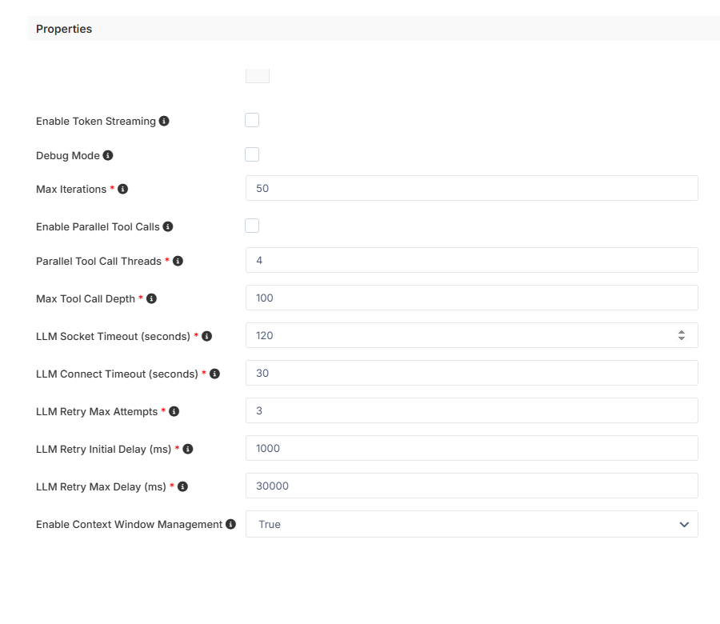
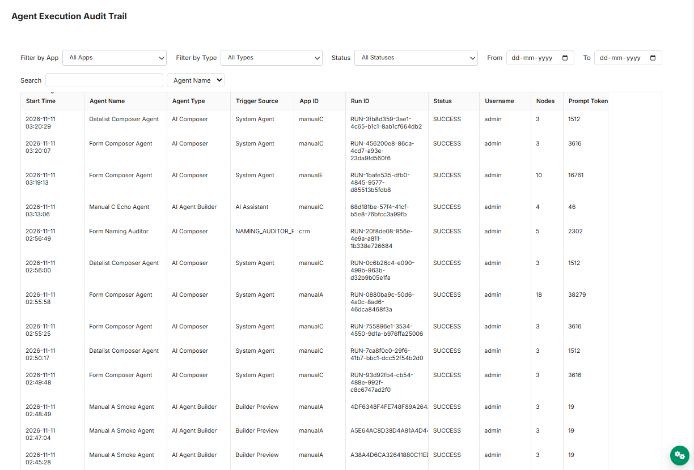
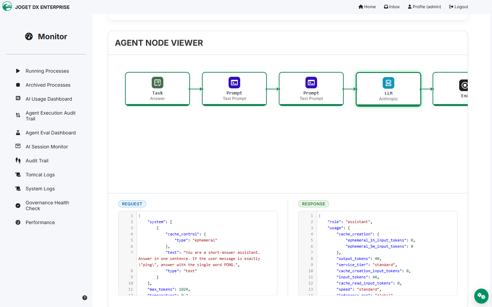
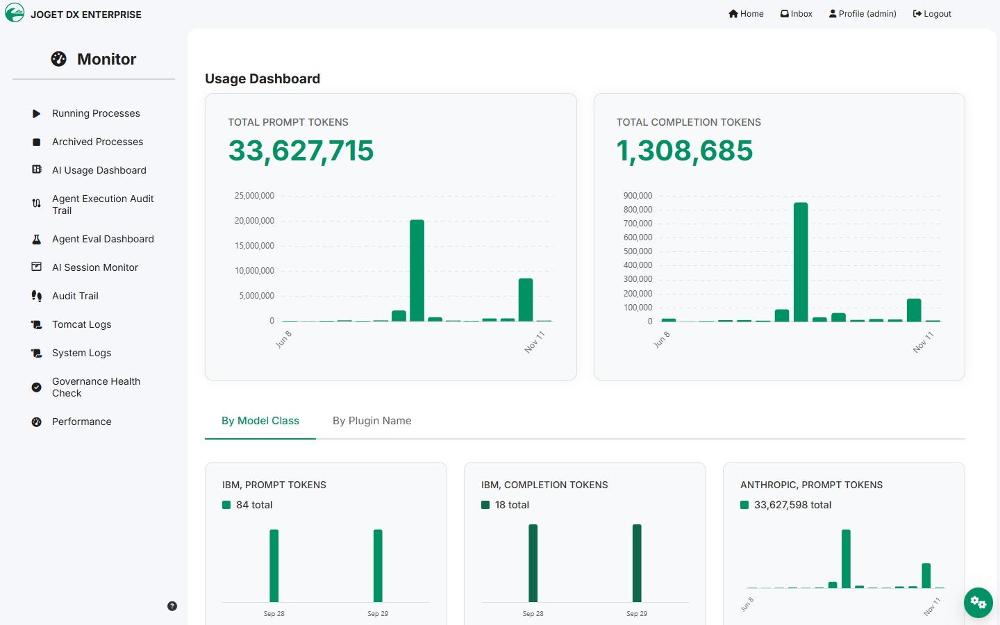
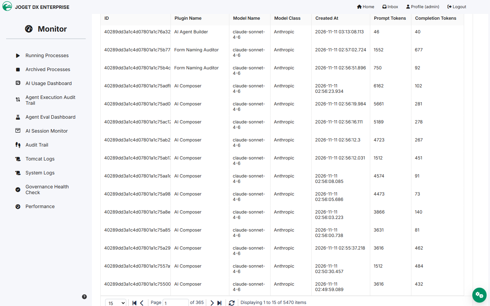
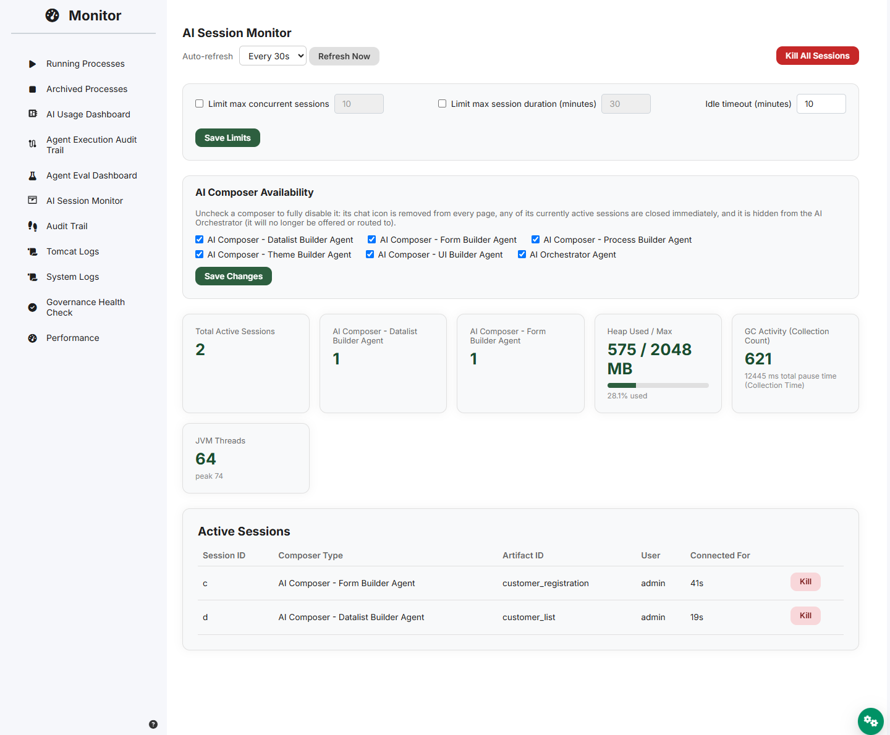

# Runtime Settings, Monitoring and Cost

This page explains how an agent behaves while it runs and how you watch it. It lists every runtime setting with its default and effect, shows how to run agents in the background and tune that, and describes every monitoring screen the plugin adds to the Joget console. It also explains token and cost accounting, what data the plugin keeps, how to purge it, and how to size a server. It is for the partner engineer who deploys and operates Agent Builder for a customer.

## Overview: what you can configure and what you can watch

Agent Builder has three groups of operational features.

| Group | What it is | Where you find it |
|---|---|---|
| Runtime settings | Timeouts, retries, loop limits, parallel tools, context window, streaming, debug mode. They are stored in each agent, so every agent has its own values. | **AI Agent Builder** > **Settings** tab of the agent |
| Asynchronous execution | Runs an agent in the background so the process does not wait. Tuned with two JVM (Java Virtual Machine) system properties. | **AI Agent** process tool (Run Mode) and the server start-up options |
| Monitoring | Screens in the Joget console **Monitor** menu, the agent Preview, and the server log. | **Monitor** menu in the console |

The monitoring screens are:

| Screen (menu label) | What it shows |
|---|---|
| **Agent Execution Audit Trail** | One row per agent run: who, when, which agent, what started it, status, prompt tokens. Opens a trace of every step. |
| **AI Usage Dashboard** | Token totals by model class or by plugin, and a list of every model call that was made. |
| **Agent Eval Dashboard** | Results of evaluation runs (the page heading is **Agent Eval Runs**). See [Evaluating Agents](10-evaluating-agents.md). |
| **AI Session Monitor** | Live AI Composer chat sessions, memory use, session limits, and the switch that turns each composer on or off. |

All four screens, and the settings pages of the plugin, are limited to users who have the Joget administrator role (`ROLE_ADMIN`) or the app creator role (`ROLE_APP_CREATOR`).

> **Note:** Settings are per agent. There is no server-wide screen that sets a default for all agents. New agents start with the defaults in this page. If you want the same values in many agents, set them in one agent and copy that agent.

## Agent runtime settings

### Where to find them

1. Open the app in App Composer.
2. Open the agent in **AI Agent Builder**.
3. Click the **Settings** tab.
4. Scroll past **AI Agent Properties**. All settings in this section apply to the whole agent, not to one task.



### Settings and defaults

| Field | What it does | Default | Notes |
|---|---|---|---|
| **Enable Token Streaming** | Shows the model answer word by word as it is produced, instead of waiting for the full reply. | Off | Works when the run uses streaming mode, which Preview and the chat window of the **Run AI Agent** datalist action use. In other cases the agent returns one full answer. The setting is never harmful: if streaming is not possible, you get the complete reply. A streaming call is not retried once it has started. |
| **Debug Mode** | Writes every trace event, with its full request and response text, to the server log. | Off | Use only while you diagnose a problem. It puts prompts, answers and tool results into a log file. See [Debug Mode and the server log](#debug-mode-and-the-server-log). |
| **Max Iterations** | The largest number of task executions in one run. | 50 | A task that jumps back with a GOTO decision counts each time it runs. When the limit is reached, the run logs a warning and stops normally with the output it already has. A value of 0 or less is replaced by 50. This protects against loops between tasks. |
| **Enable Parallel Tool Calls** | Runs several tool calls from one model reply at the same time. | Off | See [Parallel tool calls](#parallel-tool-calls). |
| **Parallel Tool Call Threads** | The size of the thread pool for parallel tool calls. | 4 | The pool is never larger than the number of tool calls in the batch. Only used when parallel tool calls are on. |
| **Max Tool Call Depth** | The largest number of tool-call rounds inside one task. | 100 | One round is: the model asks for tools, the tools return, the model answers. At the limit the agent does not fail. It answers each pending tool call with the text "Tool call skipped: maximum tool call depth (N) reached." and makes one last model call without tools, so you get a text answer. |
| **LLM Socket Timeout (seconds)** | How long to wait for data after the connection is open. | 120 | Raise it for very large prompts, long outputs or slow reasoning models. A task can override it. |
| **LLM Connect Timeout (seconds)** | How long to wait to open the network connection to the model service. | 30 | A task can override it. |
| **LLM Retry Max Attempts** | Total number of tries for one model call, including the first. | 3 | Set 1 to turn retries off. |
| **LLM Retry Initial Delay (ms)** | Wait before the first retry. | 1000 | The wait doubles on each further retry. |
| **LLM Retry Max Delay (ms)** | The largest wait between two tries. | 30000 | A random extra time of 0 to 999 ms is always added. |
| **Enable Context Window Management** | Removes old messages automatically before a model call so the call stays inside the model limit. | On | See [Context window](#context-window). |
| **Trimming Strategy** | How messages are removed: **Truncate (drop oldest first)** or **Sliding Window (keep last N messages)**. | Truncate | Sliding Window does nothing while **Max Messages** is 0. |
| **Max Characters** | The total character budget for all messages before trimming starts. | 400000 | About 4 characters equal 1 token, so 400000 is roughly 100,000 tokens. It counts characters, not tokens. 0 turns this check off. |
| **Max Messages** | The largest number of non-system messages to keep. | 0 (off) | Needed for Sliding Window. |
| **Preserve System Messages** | Never remove system messages. | On | Keep it on. System messages carry your persona and instructions. |
| **Preserve First User Message** | Never remove the first user message. | On | It holds the original task. |
| **Warn Threshold (%)** | Writes a warning to the log when messages reach this share of **Max Characters**. | 80 | 0 turns the warning off. |

### Settings inside a task

Some limits belong to a single task. Open the task in the agent and look for the **Timeout Settings** section.

| Field | What it does | Default | Notes |
|---|---|---|---|
| **Task Timeout (seconds)** | The longest wall-clock time for the whole task, including model calls and tool runs. | Blank (no timeout) | On timeout the task fails with the message "Task ... exceeded timeout of N s". The task runs on its own worker thread while this is set. Test agent variables and counters after you set a timeout. |
| **LLM Socket Timeout (seconds)** | Overrides the agent-level socket timeout for this task only. | Blank (use the agent value) | |
| **LLM Connect Timeout (seconds)** | Overrides the agent-level connect timeout for this task only. | Blank (use the agent value) | |

There is no limit on the total time of a whole run and no limit on the total tokens or money of a run. A run is bounded by **Max Iterations**, **Max Tool Call Depth**, the task timeout if you set it, and the limits of the model. See [Capacity guidance](#capacity-guidance) for what to do about this.

### Switching a block off without deleting it

Every prompt, tool, enhancer, decision and guard in an agent can be disabled. If the block has no enabled flag, it is on. If the flag is saved as an empty string, the block is off. When a block unexpectedly does nothing, check this flag.

### Retries and timeouts in detail

One model call is one HTTP POST. The agent repeats it according to these rules.

```text
for attempt = 1 .. LLM Retry Max Attempts
    send the request (connect timeout, socket timeout apply)
    if the reply is HTTP 429 or HTTP 5xx and this is not the last attempt
        wait min(initial delay x 2^(attempt-1), max delay) + random 0..999 ms
        try again
    otherwise read the reply
        a permanent error (for example 400, 401, 403, 404) fails at once, no retry
        a good reply is stored and returned
    if the request throws a network error (connection refused, DNS failure,
       socket timeout, connection reset)
        wait the same way and try again, unless this was the last attempt
```

What this means for you:

- The agent retries on HTTP 429 (rate limit), HTTP 5xx (server error) **and** on network exceptions such as a socket timeout. The help text in the Settings tab only mentions 429 and 5xx. The network case is also retried.
- A permanent client error, such as a wrong API key (401) or a bad request (400), is not retried. The run fails at once.
- On the last attempt, a 429 or 5xx reply is not retried. It is read as an error and fails the call.
- With the defaults (3 attempts, 120 s socket timeout), a model service that accepts the connection and then never answers can hold one call for about 6 minutes plus the waits (1 to 2 s, then 2 to 3 s). Lower **LLM Socket Timeout (seconds)** or **LLM Retry Max Attempts** for interactive agents.
- Failed attempts are not recorded in the usage tables, only successful calls are. Token totals are therefore a minimum. How your provider bills an attempt that timed out on your side depends on the provider.
- Tools and tasks have no retry. A failing tool in a sequential batch fails the task. In a parallel batch, the error text becomes the tool result and the model continues.
- Failed async jobs are not retried.

### Parallel tool calls

When the model asks for several tools in one reply, the agent normally runs them one after the other. With **Enable Parallel Tool Calls** on, it runs them together on a pool of threads. The agent uses parallel execution for a batch only when all of these are true:

- the setting is on;
- the batch has more than one tool call;
- no tool in the batch is a **User Input** tool or a **Group** tool (these always run alone, so a batch that contains one runs in order);
- every tool in the batch reports that it is safe for parallel use. A custom tool can say it is not safe. The AI Composer tools say so.

Results return to the model in the original order. Use parallel calls only for independent work, such as several read-only lookups. If one tool writes data that another tool in the same batch reads, leave the setting off. Agent variables written by a tool that runs on a worker thread may not be visible to the next task.

### Context window

Before a model call the agent counts the characters of all messages. If the total is over **Max Characters**, or the number of non-system messages is over **Max Messages**, it removes messages until the limit is met. It drops messages. It never summarises them. An assistant message that asked for a tool and the matching tool results are always removed together, so the conversation sent to the model stays valid.

Because the budget is in characters, a model with a small window can be overrun before the limit applies. If you use such a model, lower **Max Characters** yourself. Tool calls, tool results and task prompts are also dropped between tasks, so the window mostly matters inside one long tool-calling task or in a long chat.

### Streaming

- Streaming sends model tokens to the browser while the model writes. The token events go to an in-memory event bus on the server. They are not saved in the database and are not counted as nodes.
- Streaming uses Server-Sent Events (SSE). If a reverse proxy in front of Joget buffers responses, the Preview looks frozen until the run ends. Switch off buffering for the `/web/json/plugin/.../service` path. For nginx this is `proxy_buffering off;`. The plugin also sends the header `X-Accel-Buffering: no`.
- The event bus is in the memory of one server. In a cluster, the browser must stay connected to the node that runs the agent. Use sticky sessions for the streaming path.
- Very long fields are shortened. A trace event sent live to the browser is cut at 200,000 characters per field. A trace event saved in the database is cut at 1,000,000 characters per field.
- Output guards check an answer after the model has written it. With streaming on, the user can already see the text before an output guard checks it. If the output guard must stop text from reaching the user, turn streaming off for that agent.

### Debug Mode and the server log

With **Debug Mode** on, each trace event is written to the Joget server log at INFO level with its type, label, status, full request and full response. The log is normally the file `joget.log` in the Tomcat `logs` folder of your installation.

Other messages in the log that help you operate the plugin:

| Message (start of text) | Meaning |
|---|---|
| `LLM API returned HTTP 429 on attempt 1/3. Retrying in ... ms.` | A retry after a rate limit or server error. |
| `LLM call failed on attempt ... Retrying in ... ms.` | A retry after a network error. |
| `processTasks: maxIterations (N) reached` | The run stopped at **Max Iterations**. |
| `handleToolCalls: maxToolCallDepth (N) reached` | A task reached **Max Tool Call Depth**. |
| `Task '...' timed out after N s.` | A **Task Timeout (seconds)** expired. |
| `Guard BLOCK`, `Guard REDIRECT` | A guard acted. |
| `ContextWindowManager` warnings | The messages passed **Warn Threshold (%)**. |
| `Async agent job queued: <id>`, `Async agent job completed: <id>`, `Async agent job failed: <id>` | The life of an async job. |
| `AgentJobExecutor started (workers=N, pollInterval=Ns)` | The async executor started with these values. |

## Asynchronous execution

### What it does

The **AI Agent** process tool (called the Agent Process Tool in this manual) has a **Run Mode** field with two values: **Synchronous (wait for result)** (the default) and **Asynchronous (fire and forget)**. In asynchronous mode the process activity returns at once. The agent runs later on a background worker, and then stores its result. Use it to avoid page timeouts in assignment activities and to keep long agents out of the web request. In asynchronous mode the **On Agent Failure** field is not shown, because the process has already moved on.

### How a job runs

1. The process tool writes one row to the database table `ai_agent_async_job` with status `PENDING` and returns. The row holds the agent id, the app id and version, the user name, the process and activity ids, and the **input values of the agent**.
2. A poller wakes up every `agent.async.pollInterval` seconds. It reads up to 8 `PENDING` rows, oldest first.
3. For each row, the poller tries to claim it with one database update that only succeeds while the status is still `PENDING`. In a cluster, only one node wins the claim, so no job runs twice.
4. The winner submits the job to the worker pool (`agent.async.workerThreads` threads).
5. The worker loads the app at the version stored in the job, signs in as the user stored in the job, rebuilds the process and activity context, runs the agent, then runs the output steps (**Store to Form** and **Store to Process Variable**).
6. The job ends `DONE` or `FAILED`.

```text
PENDING --claim--> RUNNING --agent and store steps succeed--> DONE
                      |
                      +--agent run failed, or a store step failed--> FAILED (error_message set)
```

| Status | Meaning |
|---|---|
| `PENDING` | Queued. No worker has claimed it. |
| `RUNNING` | Claimed. The agent is running. |
| `DONE` | The agent returned a usable answer and the store steps worked. |
| `FAILED` | The agent run failed, or a store step failed. The column `error_message` holds the reason. |

A job is `FAILED` when:

- the agent was not found, or the LLM service is not available;
- the agent returned empty content or no JSON response from the model service;
- the model service returned an error payload;
- **Store to Form** failed;
- **Store to Process Variable** failed. This happens when the process instance is no longer running, for example because a fully automatic process finished first. The error text is "Process instance ... is no longer running ..." Store the answer in a form field, or use Synchronous mode, when the process can end before the agent does.

For a failed job, the matching row in **Agent Execution Audit Trail** is changed to `FAILED` and gets an extra trace entry named "Async agent job failed" with the job id, the process instance, the activity, the variable and the reason. Start your investigation there.

### The two tuning properties

Both are JVM system properties. They are read once when the plugin starts. You must restart Joget after a change.

| Property | Default | Effect |
|---|---|---|
| `agent.async.pollInterval` | 5 | Seconds between two checks for `PENDING` jobs. A higher value means less database load and more waiting time before a job starts. Do not set it below 1. |
| `agent.async.workerThreads` | 4 | The number of jobs that run at the same time on this node. A higher value gives more throughput if the server has spare CPU and memory and the model service allows the request rate. |

Set them with the other JVM options, for example in `<JOGET_HOME>/apache-tomcat/bin/setenv.sh` (Linux and macOS) or `setenv.bat` (Windows):

```bash
JAVA_OPTS="$JAVA_OPTS -Dagent.async.pollInterval=10 -Dagent.async.workerThreads=8"
```

```bat
set "JAVA_OPTS=%JAVA_OPTS% -Dagent.async.pollInterval=10 -Dagent.async.workerThreads=8"
```

The log line `AgentJobExecutor started (workers=8, pollInterval=10s)` confirms the values after the restart.

### Tuning guide

| Symptom | Likely cause | What to do |
|---|---|---|
| Rows stay `PENDING` | The executor is not running (plugin not started), or the poll interval is very high. | Search the log for `AgentJobExecutor started`. Lower `agent.async.pollInterval`. |
| Jobs wait a long time although workers are free | One node reads at most 8 `PENDING` rows per poll. | Lower the poll interval. A very high worker count is not fed faster than 8 jobs per interval per node. |
| Many HTTP 429 errors from the model service | All workers share the same provider key and rate limit. | Keep `agent.async.workerThreads` modest. Retries absorb only short bursts. |
| Rows stay `RUNNING` for a very long time | The node that claimed the job stopped during the run. Nothing re-queues such a row. | See the next section. |
| Throughput is lower than expected | Only 4 workers. | Raise `agent.async.workerThreads`, for example to 8, and restart. |

### Stuck RUNNING rows

If a server stops while jobs run, the claimed rows stay `RUNNING` forever. The plugin does not re-queue them and does not time them out. Decide a policy with the customer. A simple policy is to mark old `RUNNING` rows as failed so that they are visible:

```sql
-- MySQL syntax. Test on a copy first. Choose an age longer than your longest agent run.
UPDATE ai_agent_async_job
   SET status = 'FAILED', error_message = 'orphaned after restart'
 WHERE status = 'RUNNING' AND modified_at < NOW() - INTERVAL 60 MINUTE;
```

After you mark a row, the business step that waited for the agent must be started again by a person or by your own process. The plugin does not do this.

### Data kept for async jobs

The column `agent_properties_json` stores the input values of the agent as plain text. If an input can contain personal data or a secret, treat the table as sensitive and purge finished rows soon (see [Purging](#purging)).

## Monitoring surfaces

### Agent Execution Audit Trail

Open **Monitor** in the console, then **Agent Execution Audit Trail**. It lists one row for every run of every agent: runs from a process, from a datalist action, from Preview, from evaluation, from the AI Composers, and runs of sub-agents.



**Columns**

| Column | Meaning |
|---|---|
| **Start Time** | When the run began. The list is sorted newest first. |
| **Agent Name** | The agent that ran. |
| **Agent Type** | **AI Agent Builder** for agents you build. **AI Composer** for the built-in composer and orchestrator agents (system agents). |
| **Trigger Source** | What started the run. See the table below. |
| **App ID** | The app that contains the agent. |
| **Run ID** | The unique id of the run. It ties the run to the trace and to the rows in the usage tables. |
| **Status** | `RUNNING`, `SUCCESS`, `FAILED` or `ABORTED`. |
| **Username** | The Joget user the run is attributed to. |
| **Nodes** | The number of steps (tasks, prompts, tools, model calls, guards, enhancers) the run produced. |
| **Prompt Tokens** | Input tokens the model services counted for the run. |

The list shows these ten columns. Output (completion) tokens and the duration of a run are not columns of the list. The duration is on the detail page of the run (see below). The output tokens are in the table `ai_agent_execution` (column `output_token_count`) and, for each model call, on the **AI Usage Dashboard**.

The list has 15 rows per page. The search box searches by **Agent Name**, **Run ID** or **Username**.

**Filters**

| Filter | Values |
|---|---|
| **Filter by App** | **All Apps** or one app. |
| **Filter by Type** | **All Types**, **AI Agent Builder**, **AI Composer**. |
| **Status** | **All Statuses**, `RUNNING`, `SUCCESS`, `FAILED`, `ABORTED`. |
| **From** and **To** | A date range for the start time. |

**The Trigger Source column**

The **Trigger Source** column is the audit answer to the question "what started this AI action?". The column is sortable.

| Trigger Source (as shown) | What started the run |
|---|---|
| **Builder Preview** | Someone pressed run in the agent Preview inside App Composer. |
| **Sync Process Tool** | The **AI Agent** process tool in a process activity, Run Mode Synchronous. Any run that has a process context and no other source is shown this way. |
| **Async Process Tool** | The **AI Agent** process tool with Run Mode Asynchronous, run by the background executor. |
| **Datalist Action** | The **Run AI Agent** action of a datalist. |
| **AI Assistant** | The Joget AI Assistant in agent mode. |
| **Sub Agent** | Another agent called this agent as a child with the **Run AI Agent** tool. |
| **Agent Evaluation** | An evaluation run, including the runs of a judge agent. |
| **System Agent** | A built-in composer or orchestrator agent. |
| (blank) | No known source. |

**The detail page**

Click a row to open **Agent Execution Detail**. The top shows **Run ID**, **App ID**, **Start Time**, **Duration**, **Node Count**, **Username**, **Full Name**, **Process ID**, **Process Name**, **Assignment ID**, **Workflow Step**, **Trigger Source** and **Status**. Under it, the node viewer shows every step of the run as a tree. Colours show the state: running, success or failed. Click a node to read its request and its response. This is the main tool for answering "why did the agent do that?".



If a run is `RUNNING`, an **Abort** button appears. After you confirm, the message "Abort request sent. The execution will stop after the current task completes." appears. Abort is cooperative. The agent checks for an abort request before and after each task, after the first model answer, and before each traced step. A model call or a tool call that is already in progress is not interrupted, so the run can continue for a short time, and the status shown can be ahead of the real state. The abort request is stored in the database, so it works across cluster nodes.

> **Note:** If the Joget server stops in the middle of a run, the row stays `RUNNING`. The plugin does not clean up such rows. Filter by **Status** `RUNNING` and an old **From** date to find them.

### Agent Preview and the node viewer

In **AI Agent Builder**, the Preview tab runs the agent inside App Composer and shows the same node viewer live: a step is yellow while it runs, green when it succeeds and red when it fails. Click a node to read its request and response. Preview runs appear in **Agent Execution Audit Trail** with the trigger source **Builder Preview**.

### AI Usage Dashboard

Open **Monitor**, then **AI Usage Dashboard**. The page title is "Usage Dashboard". It reads the table of model calls.

- Two tiles show **Total Prompt Tokens** and **Total Completion Tokens**.
- Charts show the token use per day. Tabs switch the grouping: **By Model Class** (the model provider type) and **By Plugin Name**, and show the number of **LLM Calls** next to the tokens.
- A table lists every model call with **ID**, **Plugin Name**, **Model Name**, **Model Class**, **Created At**, **Prompt Tokens** and **Completion Tokens**. It has 15 rows per page and you can sort the columns.





The dashboard shows tokens only. It has no money amounts, no budget and no filter by app or user. For those, use the SQL in [Token and cost accounting](#token-and-cost-accounting).

### AI Session Monitor

Open **Monitor**, then **AI Session Monitor**. It controls the AI Composer chat sessions. A composer chat uses a WebSocket connection that lives in the memory of the Joget server. Agent runs from processes or Preview are not sessions and do not appear here.



| Area | Fields and buttons | Meaning |
|---|---|---|
| Top bar | **Auto-refresh** (Off, Every 15s, Every 30s, Every 60s), **Refresh Now**, **Kill All Sessions** | **Kill All Sessions** ends all composer sessions on this server after you confirm. |
| Limits | **Limit max concurrent sessions**, **Limit max session duration (minutes)**, **Idle timeout (minutes)**, **Save Limits** | See the table below. |
| **AI Composer Availability** | A check box for each composer, **Save Changes** | Clear a box to switch that composer off completely. |
| Tiles | **Total Active Sessions** (and one tile for each composer type that has sessions), **Heap Used / Max**, **GC Activity (Collection Count)**, **JVM Threads** | Memory, garbage collection and threads of the JVM. Watch the heap when many composers are open. |
| **Active Sessions** table | **Session ID**, **Composer Type**, **Artifact ID**, **User**, **Connected For**, **Kill** | **Kill** ends one session after you confirm. A session appears when the user sends the first message in a composer panel, not when the panel is opened. |

**Limits**

| Limit | Default | Effect |
|---|---|---|
| **Limit max concurrent sessions** | Off. The number is 10. | When on and the number of live sessions has reached the number, a new session is refused with the error `SESSION_LIMIT_REACHED`. Existing sessions are not removed. |
| **Limit max session duration (minutes)** | Off. The number is 30. | When on, the server closes a session after this time, even if the user is active (`SESSION_DURATION_EXCEEDED`). |
| **Idle timeout (minutes)** | 10, always on | The server closes a session after this time without activity. It cannot be turned off. It must be smaller than the maximum duration when that limit is on. |

Each value must be at least 1. A saved change is used within about 5 seconds.

**Composer availability.** When you clear a composer and save, its chat icon disappears from every page, its open sessions are closed at once, and the Orchestrator stops offering it. A new session request for it gets the error `COMPOSER_DISABLED`. Use this to switch off composers a customer does not want.

**Error codes.** The browser shows these when a session ends: `SESSION_LIMIT_REACHED`, `SESSION_KILLED`, `SESSION_DURATION_EXCEEDED`, `COMPOSER_DISABLED`. After one of these, the user must reload the browser tab.

> **Note:** The list of sessions, the session limit and **Kill All Sessions** work per Joget node, because sessions live in the memory of each node. In a cluster behind a load balancer, a limit of 10 means 10 on each node, and the page shows the sessions of the node that served the page. The saved limits and the composer availability are stored in the database and apply to every node.

### Agent Eval Dashboard

**Monitor** > **Agent Eval Dashboard** lists evaluation runs (its page heading is **Agent Eval Runs**). The page is described in [Evaluating Agents](10-evaluating-agents.md).

## Where the data is stored

The plugin creates these tables automatically in the Joget database. The names are the same in every installation.

| Table | One row for | Important columns |
|---|---|---|
| `ai_agent_execution` | One agent run | `run_id`, `agent_id`, `agent_name`, `app_id`, `user_id`, `username`, `process_id`, `activity_id`, `process_def_id`, `trigger_source`, `status`, `agent_type`, `node_count`, `input_token_count`, `output_token_count`, `cache_creation_input_tokens`, `cache_read_input_tokens`, `created_at`, `modified_at` |
| `ai_agent_trace_event` | One state of one step | `run_id`, `node_id`, `def_id`, `parent_id`, `type`, `label`, `status`, `request`, `response`, `created_at`. A step writes several rows (running, then the end state). |
| `ai_llm_calls` | One successful model call | `user_id`, `session_id` (the run id), `model_class`, `llm_model`, `temperature`, `max_allowed_length`, `prompt_tokens`, `completion_tokens`, `prompt`, `response`, `plugin_name`, `plugin_class_name`, `plugin_version`, `created_at` |
| `ai_agent_async_job` | One queued async job | `agent_id`, `agent_properties_json`, `app_id`, `app_version`, `username`, `process_id`, `activity_id`, `status`, `error_message`, `created_at`, `modified_at` |
| `ai_agent_abort_request` | One pending abort | `run_id`. Removed when the run ends. |
| `ai_eval_run` | One evaluation run | `suite_id`, `agent_id`, `agent_name`, `app_id`, `status`, `scorer_type`, `total_cases`, `passed_cases`, `overall_score`, `results_json`, `username`, `created_at`, `completed_at` |
| `ai_system_agent` | One composer system agent definition | The definition text. |

Be careful with the column names of `ai_agent_execution`. The column `user_id` holds the **user name** (for example `admin`) and the column `username` holds the **full name**. The names look swapped, but they are as the plugin writes them.

What the tables do not contain: the version or a fingerprint of the agent definition that ran, money amounts, failed model attempts, streaming token events, and the "End", "LLMMessage", "UserInput" and "DisplayUI" events.

The plugin does not create database indexes on these tables. If you query them often or they grow large, add your own (see [Purging](#purging)).

## Token and cost accounting

### What is recorded

| Level | What is recorded | Where |
|---|---|---|
| One model call | Prompt tokens and completion tokens from the usage information the provider returns, the model name, the model class, the full request and the full reply. | `ai_llm_calls` |
| One run | Input tokens, output tokens, cache-creation tokens and cache-read tokens added up over the model calls of this run. | `ai_agent_execution` |
| Dashboards | Token totals by model class and by plugin. Prompt tokens per run in **Agent Execution Audit Trail**. | **AI Usage Dashboard**, **Agent Execution Audit Trail** |

The run total understands the usage format of OpenAI-style, Anthropic and Google Gemini replies, including cached input tokens. The **Agent Execution Audit Trail** list shows prompt tokens only. The output tokens and the cache tokens are in the database table.

### What is not recorded

- No money amounts, price table or currency.
- No budget, quota, alert or spending cap, per agent, per app or per user.
- No tokens for failed attempts. Totals are a minimum.
- No filter by app or user on the **AI Usage Dashboard**.

The plugin counts tokens, so you must convert tokens to money. Take the price list of your provider, multiply, and keep the price list in your own table.

### Ways to control cost

- Choose a smaller, cheaper model for simple agents and for the AI Composers in **AI Central Config**.
- Lower **Max Iterations**, **Max Tool Call Depth** and **Max Characters**.
- Switch off composers you do not need (**AI Session Monitor** > **AI Composer Availability**) and limit the number of sessions.
- Keep prompts short. Every model call sends the whole current conversation, so the cost of a long conversation grows with each call.
- Use a spending limit at the provider. This is the only hard stop. The plugin cannot stop a run when a budget ends.

### Cost reports with SQL

Two tables give complementary data. `ai_llm_calls` has the model name and one row per call. `ai_agent_execution` has the app, agent, trigger source and the cache tokens, but no model name. Join them with `ai_llm_calls.session_id = ai_agent_execution.run_id`.

Create a small price table that you maintain (prices per one million tokens, from your provider):

```sql
CREATE TABLE llm_price (
  model     VARCHAR(100) PRIMARY KEY,
  in_per_m  DECIMAL(10,4) NOT NULL,
  out_per_m DECIMAL(10,4) NOT NULL
);
```

Cost per day, app, agent and model. The query sums the call rows, so a sub-agent run is counted once:

```sql
-- MySQL syntax. Adapt date functions for other databases.
SELECT DATE(c.created_at)        AS day,
       e.app_id, e.agent_name, e.trigger_source, c.llm_model,
       SUM(c.prompt_tokens)      AS input_tokens,
       SUM(c.completion_tokens)  AS output_tokens,
       ROUND(SUM(c.prompt_tokens)     * p.in_per_m  / 1000000
           + SUM(c.completion_tokens) * p.out_per_m / 1000000, 4) AS cost
FROM   ai_llm_calls c
JOIN   ai_agent_execution e ON e.run_id = c.session_id
LEFT JOIN llm_price p       ON p.model = c.llm_model
WHERE  c.created_at >= '2026-11-01'
GROUP  BY day, e.app_id, e.agent_name, e.trigger_source, c.llm_model, p.in_per_m, p.out_per_m
ORDER  BY day, cost DESC;
```

Tokens per user, without evaluation runs:

```sql
SELECT e.user_id AS user_name,
       SUM(e.input_token_count)  AS input_tokens,
       SUM(e.output_token_count) AS output_tokens,
       SUM(e.cache_read_input_tokens)     AS cache_read,
       SUM(e.cache_creation_input_tokens) AS cache_write
FROM   ai_agent_execution e
WHERE  e.created_at >= '2026-11-01'
  AND  e.trigger_source <> 'EVALUATION'
GROUP  BY e.user_id
ORDER  BY input_tokens DESC;
```

In the database the trigger source is stored as a code, not as the label in the screen:

| Stored code | Label in **Agent Execution Audit Trail** |
|---|---|
| `PROCESS_TOOL_SYNC` | Sync Process Tool |
| `PROCESS_TOOL_ASYNC` | Async Process Tool |
| `DATALIST_ACTION` | Datalist Action |
| `AI_ASSISTANT` | AI Assistant |
| `BUILDER_PREVIEW` | Builder Preview |
| `SUB_AGENT` | Sub Agent |
| `EVALUATION` | Agent Evaluation |
| `SYSTEM_AGENT` | System Agent |

Useful splits: `trigger_source = 'EVALUATION'` is test spend; `'SYSTEM_AGENT'` is composer spend.

A budget alert is a job you build: run the daily query once per night and send a message (a Joget process, a script or a monitoring tool) when a threshold is crossed. Tell the customer that this is a partner-built control.

## Data retention, privacy and purging

### What the plugin keeps

Each model call stores the full request and the full reply in `ai_llm_calls` (`prompt` and `response`). Each step of each run stores its request and reply text in `ai_agent_trace_event`. Async jobs store their inputs. Evaluation runs store the inputs and outputs of every case. All of this can contain personal data, business data and the content of files that the agent read. The plugin keeps these rows until you delete them. It has no retention period, no automatic clean-up and no archive.

There is no setting that switches off the saving of prompts and replies. Plan the privacy side with the customer before go-live:

- Limit who can open **Monitor** pages and the database (see [Security and Governance](11-security-and-governance.md)).
- Keep personal data out of prompts where you can, for example by sending only the fields the agent needs.
- Agree a retention period with the data protection officer of the customer and run the purge job below.
- Keep **Debug Mode** off in production. It copies the same content to the server log, which has its own retention.

### Purging

A purge job removes the text first and the rows later. Keep `ai_agent_execution` longest, because it holds the token totals for cost reports. The statements below use MySQL syntax. Adapt them for your database, run them on a copy first, and run them as a scheduled database job or a scheduled Joget process.

```sql
-- 1. Blank the text after 30 days. Metadata and token counts stay.
UPDATE ai_llm_calls         SET prompt = NULL, response = NULL
 WHERE created_at < NOW() - INTERVAL 30 DAY;
UPDATE ai_agent_trace_event SET request = NULL, response = NULL
 WHERE created_at < NOW() - INTERVAL 30 DAY;

-- 2. Delete rows after your legal retention period.
DELETE FROM ai_agent_trace_event WHERE created_at < NOW() - INTERVAL 90 DAY;
DELETE FROM ai_llm_calls         WHERE created_at < NOW() - INTERVAL 180 DAY;
DELETE FROM ai_eval_run          WHERE created_at < NOW() - INTERVAL 180 DAY;

-- 3. Finished async jobs hold the agent inputs in plain text. Remove them early.
DELETE FROM ai_agent_async_job
 WHERE status IN ('DONE','FAILED') AND modified_at < NOW() - INTERVAL 7 DAY;

-- 4. Indexes help the purge and the monitoring pages when the tables are large.
CREATE INDEX idx_trace_run  ON ai_agent_trace_event(run_id);
CREATE INDEX idx_trace_time ON ai_agent_trace_event(created_at);
CREATE INDEX idx_llm_sess   ON ai_llm_calls(session_id);
CREATE INDEX idx_llm_time   ON ai_llm_calls(created_at);
CREATE INDEX idx_exec_time  ON ai_agent_execution(created_at);
```

After you delete trace rows of a run, the detail page of that run in **Agent Execution Audit Trail** shows "No Trace Data Found". The run row and its token counts stay as long as you keep `ai_agent_execution`.

Also rotate the server log files. The log holds retry messages, errors, and, if **Debug Mode** is on, full prompts.

## Capacity guidance

The plugin has no built-in capacity limits other than those in this page. Use these points when you size a server and set limits.

**Model calls.** A model call holds a thread of the Joget server until the answer arrives. With the default timeouts, one call can wait up to 120 s per attempt and 3 attempts. If many users run agents at the same time, the server holds that many threads while it waits for the provider. Check your Tomcat thread limit and the rate limit of your provider key. Lower **LLM Socket Timeout (seconds)** and **LLM Retry Max Attempts** for interactive agents. For slow, long agents use the asynchronous run mode.

**Async jobs.** Throughput on one node is limited by two things: the number of worker threads divided by the average job duration, and 8 jobs per poll interval. With the defaults (4 workers, 5 s) and a job time of 60 s, one node finishes about 4 jobs per minute. All workers of all nodes share one provider key, so the provider rate limit is often the real limit. Raise `agent.async.workerThreads` in small steps and watch the number of HTTP 429 messages in the log.

**Composer sessions.** Each composer chat keeps a WebSocket open on one node and uses memory. In **AI Session Monitor**, set a maximum number of sessions, a maximum duration and an idle timeout that fit the memory of the server, and watch **Heap Used / Max** and **GC Activity**. Example for a small server: 5 sessions, 30 minutes maximum, 10 minutes idle. In a cluster the limits apply per node.

**Database growth.** Every model call stores the full request body and the full reply. A long conversation with large tool results stores the growing history again on each call. A run with tools also stores several trace rows per step. Without a purge job the three tables `ai_llm_calls`, `ai_agent_trace_event` and `ai_agent_execution` grow without limit, and the **AI Usage Dashboard** and **Agent Execution Audit Trail** become slower. Install the purge job and the indexes before go-live and check the table sizes monthly.

**Memory per run.** A run keeps its messages in memory until it ends. **Max Characters** (400000 by default) limits the size of one model call. Lower it for models with a small context window and for servers with little memory.

**Reverse proxy.** Set the read timeout of the proxy above the longest model call you expect (about 6 minutes in the worst case with default retries), and switch off buffering for streaming paths.

**Cluster.** Database tables, async job claims, abort requests, saved session limits and composer availability work across nodes. These items live in the memory of one node and do not: the list of composer sessions, the session limit counter, the streaming event bus, the pause of a run that waits for user input, and the rollback journal of composer changes. Use sticky sessions for the browser, and do not expect a run that waits for a user to continue after a restart.

## Limitations and things to know

- **No cost in money.** The plugin records tokens only. You must maintain prices yourself.
- **No spending cap.** Neither the plugin nor a run can stop at a budget. Set a limit at the provider.
- **No limit for a whole run.** There is no total run timeout. Use **Task Timeout (seconds)**, **Max Iterations** and **Max Tool Call Depth** to bound a run.
- **No retention.** All tables keep their rows until you delete them. Prompts and replies are saved in full and cannot be switched off.
- **Token totals are a minimum.** Failed attempts, streaming events and retries that failed are not counted.
- **Retries include network errors.** One hung model service can hold a call for several minutes.
- **Async jobs are not retried and not recovered.** A `RUNNING` row after a server stop stays `RUNNING`.
- **Async inputs are stored in plain text.**
- **Sessions are per node.** The session list, the session counter and **Kill All Sessions** only see the sessions of one node.
- **Abort is cooperative.** It does not interrupt a model call or a tool call that is already running.
- **No version stored.** A run row does not say which version of the agent definition ran. Record the publish time of every agent change in your change log.
- **Context window is measured in characters, not tokens.**
- **Monitor pages need a role.** Open the four monitoring pages once with a user who has no administrator or app creator role and confirm that the pages and their data are not available. Do this on the customer system before you tell the customer that the pages are protected.

## Troubleshooting

| Symptom | Likely cause | What to do |
|---|---|---|
| An agent run fails after about 6 minutes | The model service did not answer. The agent waited 120 s for each of 3 attempts. | Check the provider status and network. Lower **LLM Socket Timeout (seconds)** and **LLM Retry Max Attempts** if you want a faster failure. |
| The log shows "Retrying in ... ms" for every call | The provider returns 429 (rate limit). | Lower the number of parallel runs or async workers. Ask the provider for a higher limit. Increase **LLM Retry Initial Delay (ms)**. |
| A run stops with a partial result and no error | **Max Iterations** was reached. | Search the log for `maxIterations`. Remove the loop in the GOTO decisions or raise the limit. |
| An answer says "Tool call skipped: maximum tool call depth" | A tool triggers itself or the model keeps calling tools. | Fix the tool or its description. Lower or raise **Max Tool Call Depth** only after you find the cause. |
| The Preview shows nothing until the run ends | A proxy buffers the SSE stream. | Switch off proxy buffering for the plugin service path. |
| Rows stay `PENDING` in `ai_agent_async_job` | The executor did not start, or the poll interval is high. | Check the log for `AgentJobExecutor started`. Check `agent.async.pollInterval`. |
| An async job is `FAILED` with "Process instance ... is no longer running" | The process ended before the agent finished. | Store the answer in a form, or use Synchronous mode. |
| An async job is `FAILED` with "Agent returned empty content" or a provider error | The model returned nothing or an error. | Open the matching row in **Agent Execution Audit Trail** and read the trace. |
| **Agent Execution Audit Trail** is slow | The tables are large and have no indexes. | Run the purge job and create the indexes. |
| The detail page shows "No Trace Data Found" | The trace rows were purged, or the run never started a step. | Check your purge job. |
| Token numbers are zero for a run | The provider reply has no usage block, or the model plugin does not report usage. | Read the reply in the node viewer. The model plugin may not report tokens. |
| A composer user gets `SESSION_LIMIT_REACHED` | The maximum number of sessions is reached on this node. | Raise the limit, kill idle sessions in **AI Session Monitor**, or lower the idle timeout. |
| A composer icon is missing in the designer | The composer is switched off. | **AI Session Monitor** > **AI Composer Availability**, select it, **Save Changes**. |

## Where to go next

- [Evaluating Agents](10-evaluating-agents.md) to test agents and compare results after a change.
- [Security and Governance](11-security-and-governance.md) for roles, secrets, guards and the production readiness checklist.
- [AI Central Config Reference](03-ai-central-config.md) for AI services, credentials and the model settings that affect cost.
- [Troubleshooting](30-troubleshooting.md) for problems across the whole product.
