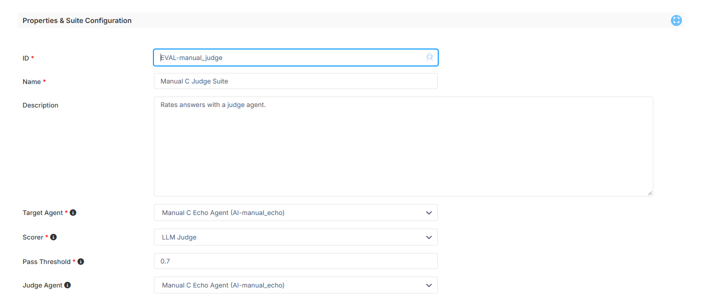
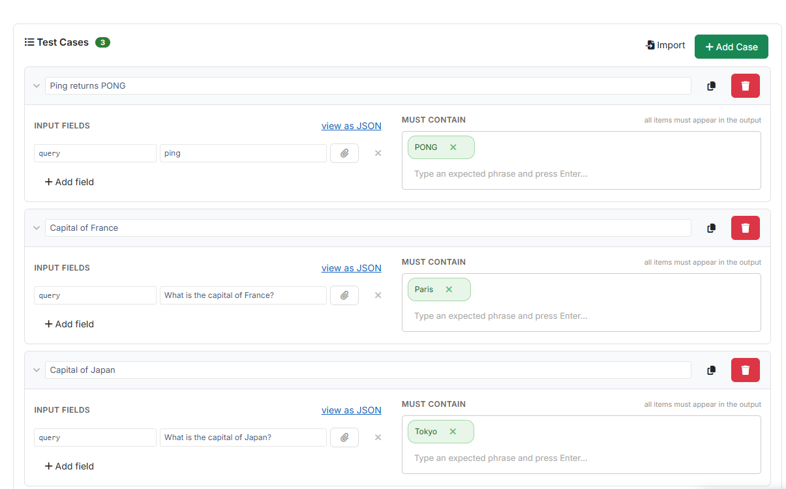
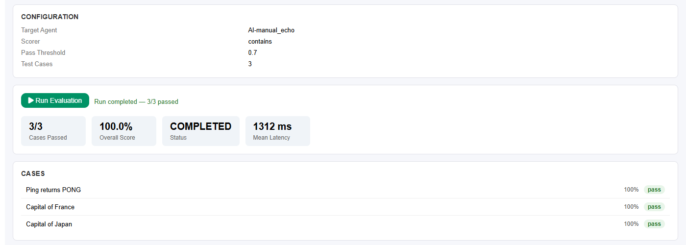
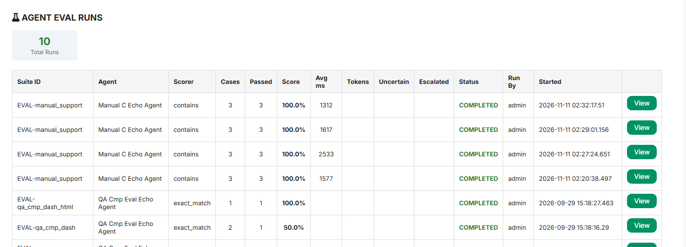
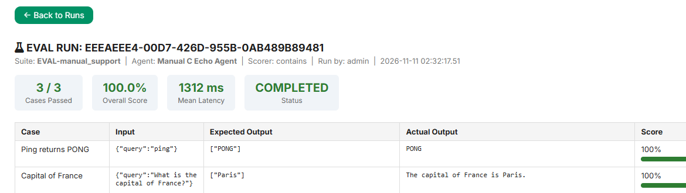

# Evaluating Agents

This page explains the evaluation feature of Agent Builder. You build a suite of test cases for an agent, run the suite, and get a score for every case and for the whole suite. You then run the same suite again after a change and compare. The page covers each scorer and exactly how its score is calculated, how to read results, how to find regressions, and what the feature cannot do. It is for the partner engineer who builds and tests agents.

## Concepts

| Term | Meaning |
|---|---|
| **Eval Suite** | A saved object in your app. It holds the settings (target agent, scorer, pass threshold) and a list of cases. You create it in the **Agent Eval Builder**. |
| **Case** | One test: the input values to send to the agent and the output you expect. |
| **Target Agent** | The agent that the suite tests. It must exist in the same app. |
| **Scorer** | The rule that turns the actual output and the expected output into a score from 0 to 1. There are four: **Exact Match**, **Contains**, **Decision** and **LLM Judge**. |
| **Pass Threshold** | The score a case must reach to pass. The default is 0.7. |
| **Judge Agent** | For the **LLM Judge** scorer only: a second agent that rates the answer. |
| **Run** | One execution of the whole suite. It is saved as one row, with the result of every case. |
| **Overall Score** | The plain average of the scores of all cases, shown as a percent. |

How a run works:

```text
for each case, one after the other:
    1. take the input values of the case
    2. run the target agent with these inputs
    3. take the text of the agent answer
    4. if the agent failed or was not found:  score 0, the case fails
       otherwise: the scorer compares the answer with the expected output
    5. the case passes when score >= Pass Threshold
overall score = sum of case scores / number of cases
```

Every case is a normal agent run. It appears in **Agent Execution Audit Trail** with the trigger source **Agent Evaluation** and with its own tokens and trace. With the **LLM Judge** scorer, each judge call is another run with the same trigger source. Evaluation therefore costs model tokens.

## Before you start

1. The target agent exists, is saved, and works in Preview. Evaluate an agent that already behaves roughly right. An evaluation measures change. It is not a replacement for building the agent.
2. An AI service is configured and active in **AI Central Config**, and the agent can reach it.
3. **Publish the app.** A suite runs the **published** version of your app. If you change the agent and do not publish, the run tests the old version. If the app was never published, the run stops with the message `App '<your app id>' is not published. Publish the app before running an evaluation.`
4. You are a Joget administrator or have the app creator role. Everything in the evaluation feature needs one of these roles.

> **Note:** Make this your routine: change the agent, save, publish, run the suite. Then the result belongs to the version you will deploy.

## Create a suite

1. In App Composer, find the **Agent Eval Builder** block on the builders page and click **+** to create a new **Eval Suite**. Enter an ID, a name and an optional description. The ID gets the prefix `EVAL-` (if you type `support_answers`, the suite is `EVAL-support_answers`).
2. The builder has three tabs: **Design**, **Settings** and **Preview**. Open the **Settings** tab (the section **Properties & Suite Configuration**) and fill in the fields below.
3. Open the **Design** tab. It lists the test cases (the heading is **Test Cases**). Add cases (see the next section).
4. Save.
5. Open the **Preview** tab and run the suite (see [Running a suite](#running-a-suite)).



### Suite fields

| Field | What it does | Default | Notes |
|---|---|---|---|
| **ID** | The id of the suite. | Generated (`EVAL-...`) | Read only. |
| **Name** | The display name. | None | Required. Put a version label in the name when you compare runs (see [Comparing runs](#comparing-runs-and-finding-regressions)). |
| **Description** | Free notes about what the suite covers. | None | Optional. |
| **Target Agent** | The agent that the suite tests. | None | Required. The list shows the agents of the current app, as name and id. |
| **Scorer** | How each answer is scored: **Exact Match**, **Contains**, **Decision (option id, ids, yes/no, score level, uncertain or none)**, **LLM Judge**. | **Exact Match** | See [Scorers](#scorers). The case editor changes with the scorer. |
| **Pass Threshold** | The score from 0 to 1 that a case must reach to pass. | 0.7 | Required. Only 0, 1 or a decimal between them is accepted. One threshold applies to all cases. |
| **Judge Agent** | The agent that rates answers. | None | Shown only for **LLM Judge**. If it is empty, every case scores 0. |
| **Strict Matching** | For **Exact Match** only: also compare upper and lower case. | **False** | Shown only for **Exact Match**. |

The scorer you choose decides how you write the expected output of each case, so choose the scorer first. If you change the scorer later, check every case again.

## Cases

On the **Design** tab, under the heading **Test Cases**, each case is a card.

| Part of the card | What it does |
|---|---|
| Case name | A short name. It is shown in the results. A copy of a case gets the name with "(copy)". |
| **Input Fields** | The values sent to the agent. Each row is a key and a value. The key must be the name of an **input variable** of the target agent (for example `query`). The link **view as JSON** shows the same data as JSON, and **edit as fields** returns. **Add field** adds a row. |
| File input | A field can be a file instead of text. Use the **Toggle file input** button, then **Choose file**. The file is uploaded and sent to the agent as an uploaded file, so an agent that reads files or images can be tested. |
| Expected output | The control depends on the scorer: **Expected Output** (**Exact Match**), **Must Contain** (**Contains**; type a phrase and press Enter to make a chip), **Expected Decision** (**Decision**), **Pass Criteria** (**LLM Judge**; describe what a good answer looks like). |
| **Duplicate**, **Delete** | Copy or remove the case. |

Buttons above the cases: **Add Case**, **Import**. An empty suite shows "No test cases yet" and **Add First Case**.



> **Note:** The input keys must match the input variables of the agent exactly, including upper and lower case. A key that does not match is not used by the agent. The agent then runs with an empty value and the case probably fails.

### Importing cases

Click **Import** and choose a `.xlsx`, `.csv` or `.json` file. The import adds cases to the suite. It does not replace the existing cases.

| Column or key | Required | Meaning |
|---|---|---|
| `name` | No | The case name. If missing, the cases are named "Case 1", "Case 2" and so on. |
| `input` (also accepted: `inputJson`) | Yes | A JSON object such as `{"question":"What is the refund period?"}`. If the text is not valid JSON, it is used as one value under the key `query`. |
| `expectedOutput` (also accepted: `expected`) | Yes | The expected text. For **Contains**, write a JSON array such as `["30 days","refund"]`. |

A CSV or spreadsheet needs a header row and at least one data row. A JSON file must be an array of objects with the same keys. The messages "Could not find required columns. Expected: name, input, expectedOutput", "JSON must be an array of objects." and "Unsupported file type. Use .xlsx, .csv, or .json" tell you what is wrong. Imported text values are stored as they are, so check the expected-output control of a few imported cases after the import.

Example CSV:

```csv
name,input,expectedOutput
Refund period,"{""question"":""What is the refund period?""}","[""30 days"",""refund""]"
Shipping,"{""question"":""Do you ship to Indonesia?""}","[""Indonesia"",""5 to 7 days""]"
```

## Scorers

Every scorer returns a number from 0 to 1. A case passes when `score >= Pass Threshold`. If the agent run failed or the agent was not found, the scorer is not used: the case scores 0, fails, and the run records the error. A scorer name that the plugin does not know is treated as **Exact Match**.

| Scorer | Score | Use it for |
|---|---|---|
| **Exact Match** | 1 or 0 | Class labels and other short, fixed answers. |
| **Contains** | Share of expected phrases found, from 0 to 1 | Facts and identifiers that must appear in a free-text answer. |
| **Decision** | 1 or 0 | Agents that use the **Decision (Multiple Choice)** tool. |
| **LLM Judge** | The rating of a judge agent, divided by 10 | Meaning-based quality when the wording changes. |

### Exact Match

1. Both texts are trimmed (leading and trailing spaces removed).
2. If **Strict Matching** is **False**: the score is 1 when the texts are equal ignoring upper and lower case, otherwise 0.
3. If **Strict Matching** is **True**: the score is 1 only when the texts are identical including case, otherwise 0.
4. If either text is missing, the score is 0.

The whole answer is compared, not part of it. "Billing." does not match "billing". The help text of **Strict Matching** says that, when it is off, the expected text only has to appear inside the answer. That is not what the scorer does. The scorer compares the whole text. Use **Contains** if you want "appears inside".

### Contains

1. The expected output is a list of phrases. The case editor makes the list from the chips. A JSON array string such as `["apple","banana"]` is read as a list. Any other text is one phrase.
2. Each phrase is trimmed. The check is case-insensitive.
3. A phrase is found when it appears anywhere inside the answer as text.
4. Score = number of phrases found / number of phrases.

Examples: 2 of 2 phrases found gives 1.0. 2 of 3 gives 0.667. 0 of 2 gives 0. An empty list gives 0.

Behaviours to know:

- The match is on text, not on words. The phrase `10` is found inside `100`. Write a phrase that is unlikely to appear by accident, such as `total: 100`.
- An empty phrase is always found. Do not leave an empty phrase in the list. It raises the score.
- Phrases test presence only. You cannot say "the answer must not contain X".
- Phrase order and position do not matter.

### Decision

Use this scorer for an agent whose answer comes from the **Decision (Multiple Choice)** tool (see [Building Block Reference: Tools](06-reference-tools.md)). The score is 1 when the agent chose what you expected, and 0 otherwise.

The expected value is one of:

| Expected value | Meaning |
|---|---|
| An option id, for example `billing` | The agent must choose this option. |
| Several ids separated by commas, for example `it, hr` | A multi-select. The order does not matter. |
| `yes` or `no` | A yes/no decision. |
| A score level id | A scoring decision. |
| `uncertain` | The input is outside the scope. The agent must not decide. |
| `none` | A multi-select where no option applies. |

How the comparison works: both sides are changed to lower case, split at commas and semicolons, trimmed, de-duplicated and sorted. The sorted lists must be equal. The agent answer is read from the Decision tool JSON (`status`, `choices`, `choice`). If the status is `uncertain` or `none`, that word is the answer. If the answer is plain text, the text itself is used.

For decision runs, the results also show the status, confidence, provider and whether the case was escalated, and the run shows **Uncertain** and **Escalated** rates (see [Reading results](#reading-results)).

### LLM Judge

The scorer asks a second agent, the **Judge Agent**, to rate the answer. It is the right choice when wording changes but meaning must stay.

How the score is made:

1. The scorer runs the Judge Agent with two input values: `expectedOutput` (the **Pass Criteria** text of the case) and `actualOutput` (the answer of the target agent).
2. The scorer scans the text of the judge reply for the first number. A number is a whole number from 0 to 10, or a single digit with decimals such as `0.5` or `7.5`.
3. If the number is larger than 1, it is divided by 10 and capped at 1. If the number is 1 or smaller, it is used as it is.
4. If the reply contains no number, the scorer looks for words. If the reply contains `pass`, `correct` or `good`, the score is 1. Otherwise, if it contains `fail`, `incorrect` or `poor`, the score is 0. Otherwise the score is 0.
5. If the Judge Agent is missing, or the judge run throws an error, the score is 0.

**Known behaviour of the LLM Judge scorer.** These points follow from the rules above. Read them before you trust a judge score.

| Judge reply | Score | Why |
|---|---|---|
| `8` | 0.8 | 8 is larger than 1, so 8 / 10. |
| `10` | 1.0 | |
| `0.5` | 0.5 | A number up to 1 is used as it is. |
| `1` | **1.0** | A bare 1 is taken as "full marks", not as 1 out of 10. |
| `0` | 0 | |
| `The answer covers 2 of 3 points. Score: 8` | **0.2** | The first number in the text is 2. |
| `correct` | 1.0 | No number, and the word `correct` is found. |
| `incorrect` | **1.0** | No number. The word check for `correct` comes first, and `incorrect` contains `correct`. |
| `not good` | **1.0** | The word `good` is found. |
| `bypassed` | **1.0** | The word `pass` is found inside it. |
| `fail` | 0 | |
| no number and none of the words | 0 | |

What to do about it:

- Tell the Judge Agent to reply with one whole number from 0 to 10 and nothing else, as in the example below. Then the first number is the score, the scale is clear, and the word check is never used.
- Never ask the judge for words such as "correct" or "incorrect".
- Do not use 1 to mean "low". Use 0 to 10.
- A broken judge looks like a regression of the agent under test, because every error gives a score 0. If all scores fall to 0 together, test the judge first.
- The judge cost tokens, appears in **Agent Execution Audit Trail** as **Agent Evaluation**, and can itself be changed by guards and skills. Use a fixed model for the judge, and do not use the same model and prompt that you are testing.
- The **Pass Threshold** of the suite is the only threshold. The scorer does not use a separate one.

### Build a Judge Agent

1. Create an agent, for example `answer_judge`, in the same app.
2. In the **Settings** of the agent, add two input variables named exactly `expectedOutput` and `actualOutput`.
3. Add one task with a **Text Prompt** (Message Role **User**). Example:

```text
You rate an answer against the pass criteria.

Pass criteria:
${expectedOutput}

Answer to rate:
${actualOutput}

Rate how well the answer meets the pass criteria.
Reply with one whole number from 0 to 10 and nothing else.
0 means it fails completely. 10 means it meets all criteria.
```

4. Use a model setting with a low temperature if your AI service allows it.
5. Save the agent and **publish the app**.
6. Test the judge in Preview with five clearly good and five clearly bad answers before you rely on it.
7. In the suite, set **Scorer** to **LLM Judge** and **Judge Agent** to this agent.

Each input variable that the prompt uses as `${name}` is replaced by the value passed in. If the prompt does not use `${expectedOutput}` and `${actualOutput}`, the judge sees nothing to rate.

## Running a suite

1. Open the suite and click the **Preview** tab. It shows the configuration (**Target Agent**, **Scorer**, **Pass Threshold**) and the list of cases.
2. Click **Run Evaluation**.
3. The page shows "Running evaluation..." while the cases run. When all cases are done, it shows "Run completed — X/Y passed".



What you need to know about a run:

- The cases run one after another inside one web request. There is no parallel run, no repeat and no setting for temperature or seed. A long suite keeps the request open. Keep suites to about 50 cases, or split them into several suites. Raise the read timeout of a reverse proxy if you run long suites.
- The run uses the **current unsaved** state shown in the builder, so you can try a change without saving. It uses the **published** version of the app for the agent definitions.
- The run is attributed to the user who clicked the button.
- If the target agent cannot run (for example, no AI service is configured, or the agent was deleted), the case scores 0, fails, and shows an **error** badge. The page also shows "N case(s) could not run because the agent failed: ..." with the reason. An error never counts as an answer.
- An empty suite completes with 0 cases.

## Reading results

### In the Preview tab

Each case shows a badge: **pending**, **running**, **pass**, **fail** or **error**. Tiles show **Cases Passed**, **Overall Score**, **Status** (for example `COMPLETED`) and **Mean Latency**. When the data exists, you also see **Tokens**, **Uncertain** and **Escalated**.

### In Agent Eval Dashboard

Open **Monitor** > **Agent Eval Dashboard** in the console (the page heading is **Agent Eval Runs**). The list shows the newest 50 runs, and **Total Runs** shows the full number. In the console there is no current app, so the list covers all apps.

| Column | Meaning |
|---|---|
| **Suite ID** | The id of the suite. |
| **Agent** | The target agent. |
| **Scorer** | The scorer that was used. |
| **Cases** | The number of cases. |
| **Passed** | The number of cases that passed. |
| **Score** | The overall score, in percent with one decimal. |
| **Avg ms** | The mean time per case, in milliseconds. |
| **Tokens** | Input plus output tokens, only when the run measured them. |
| **Uncertain**, **Escalated** | Rates for decision runs. Empty for other scorers. |
| **Status** | `COMPLETED`, `FAILED` or `RUNNING`. |
| **Run By** | The user who started the run. |
| **Started** | When the run started. |

Click **View** to open the run. The detail page shows the suite, agent, scorer and user, the tiles **Cases Passed** and **Overall Score** (and **Mean Latency** when available), and a table with **Case**, **Input**, **Expected Output**, **Actual Output**, **ms**, **Score** (a bar), and **Result** (**Pass** or **Fail**). **Back to Runs** returns to the list.





Read the **Actual Output** column, not only the badge. A pass can hide a poor answer when the scorer is weak (for example a **Contains** phrase that is too short). A fail is sometimes a good answer with other wording.

### In Agent Execution Audit Trail

Every case, and every judge call, is also a run in **Monitor** > **Agent Execution Audit Trail** with the trigger source **Agent Evaluation**. Use it to see tokens, duration and the trace of one case. Filter the page by the agent name to see the spend of a suite.

### What a run row stores

The row in the table `ai_eval_run` holds: suite id, agent id and name, app id, scorer, status, total and passed case counts, overall score, the user, the start and end time, and the text `results_json`. For every case, `results_json` holds `caseId`, `caseName`, `input`, `expectedOutput`, `actualOutput`, `score`, `passed`, `latencyMs`, and, when they exist, `error`, `inputTokens`, `outputTokens`, and for decision runs `status`, `confidence`, `provider` and `escalated`.

A run row does **not** store the version of the agent, its prompt, the model or the temperature. See the next section for what to do.

## Comparing runs and finding regressions

The console has no screen that compares two runs side by side and no trend chart. The list in **Agent Eval Dashboard** shows runs next to each other, and you compare case by case from the detail pages or with SQL. The method below works well.

### Method

1. **Freeze the test data.** Collect 30 to 100 representative inputs. Include edge cases and some inputs that the agent must refuse. Keep the case file (CSV or JSON) in version control and import it.
2. **Choose the scorer for each kind of case.** Use **Contains** for facts and identifiers. Use **Exact Match** or **Decision** for labels. Use **LLM Judge** for meaning. You can keep one suite per scorer for the same agent.
3. **Label every run.** The run row does not store the agent version. Put a version label in the **Name** of the suite or in your change log, for example `support-answers / prompt v12 / model X`, and note the publish time. The **Started** time then links a run to the version.
4. **Measure the noise.** Models do not answer the same way every time. Publish the current version and run the suite three times. Note the lowest and highest **Score**. A change smaller than this range is not a result.
5. **Change one thing.** Change a prompt, a model, a tool, a skill or a setting. Save, publish, and run the suite three times again.
6. **Compare.** Compare the overall score ranges, then compare case by case. A case that changed from **Pass** to **Fail** is a regression, even if the overall score went up.
7. **Compare cost.** Filter **Agent Execution Audit Trail** by the trigger source **Agent Evaluation** and the agent name for the same time window, and compare tokens and duration. The cost of the judge runs is included.

### Compare with SQL

List the runs of one suite:

```sql
SELECT id, created_at, status, overall_score, passed_cases, total_cases, username
FROM   ai_eval_run
WHERE  suite_id = 'EVAL-SUPPORT-ANSWERS'
ORDER  BY created_at;
```

Compare two runs case by case. This example uses the MySQL 8 function `JSON_TABLE`. Replace the two ids with values from the first query. Test it on your database.

```sql
SELECT a.case_name,
       a.score AS score_before,
       b.score AS score_after,
       b.score - a.score AS change
FROM   JSON_TABLE((SELECT results_json FROM ai_eval_run WHERE id = 'RUN_ID_BEFORE'),
         '$[*]' COLUMNS (case_id VARCHAR(100) PATH '$.caseId',
                         case_name VARCHAR(200) PATH '$.caseName',
                         score DOUBLE PATH '$.score')) a
JOIN   JSON_TABLE((SELECT results_json FROM ai_eval_run WHERE id = 'RUN_ID_AFTER'),
         '$[*]' COLUMNS (case_id VARCHAR(100) PATH '$.caseId',
                         score DOUBLE PATH '$.score')) b
  ON   a.case_id = b.case_id
ORDER  BY change;
```

Cases at the top of the result got worse. For other databases, export both `results_json` values and compare them by `caseId` with any JSON tool.

### Compare from a script

The builder has a web service that returns run data as JSON. It is available to a logged-in administrator or app creator at `<your server>/jw/web/json/plugin/org.joget.ai.agent.lib.AgentEvalBuilder/service`, with these `action` values:

| `action` | Parameters | Returns |
|---|---|---|
| `run` | `suiteId`, `appId` (and optional `suiteJson`) | Runs the suite. Returns the run with its cases and a `metrics` object. |
| `getResult` | `runId` | One run with all case results. |
| `listRuns` | `suiteId` | The runs of a suite. |

The Preview tab calls this service with a POST request that carries the Joget CSRF token (cross-site request forgery protection). A script must send the same token and a valid session. If you leave out `suiteJson`, the service runs the saved version of the suite. A nightly script can call `run`, read the overall score and per-case scores, and stop a release pipeline when the score is lower than your baseline minus the noise. Use a dedicated account with the app creator role, and keep its password out of the repository. The plugin does not provide a built-in release gate.

## Worked example

The agent **Support Answer Agent** answers customer questions from a policy text. It has one input variable `question`. You want to change its prompt to shorter answers, and you want to know whether the change is safe. The agent answers below are examples of what a model could return.

### Step 1: create the suite

1. Open **Agent Eval Builder** and create the suite with name `Support answers v1`.
2. Set **Target Agent** to Support Answer Agent, **Scorer** to **Contains**, **Pass Threshold** to 0.7.
3. Add three cases:

| Case | Input `question` | Must Contain (chips) |
|---|---|---|
| Refund period | What is the refund period? | `30 days`, `refund` |
| Shipping | Do you ship to Indonesia? | `Indonesia`, `5 to 7 days`, `free shipping` |
| Password reset | How do I reset my password? | `Forgot password`, `email` |

4. Save. Publish the app.

### Step 2: run 1 (baseline)

The agent answers:

| Case | Actual output | Phrases found | Score | Result |
|---|---|---|---|---|
| Refund period | "You can ask for a refund within 30 days of the purchase date." | 2 of 2 | 1.000 | Pass |
| Shipping | "Yes, we ship to Indonesia. Delivery takes 5 to 7 days." | 2 of 3 (`free shipping` is missing) | 0.667 | Fail, because 0.667 is below 0.7 |
| Password reset | "Choose Forgot password on the sign-in page. We send a reset link to your email." | 2 of 2 | 1.000 | Pass |

- **Cases Passed:** 2 / 3.
- **Overall Score:** (1.000 + 0.667 + 1.000) / 3 = 0.889, shown as 88.9%.

### Step 3: measure the noise

You run the suite two more times without any change. The overall scores are 88.9%, 88.9% and 77.8%. The range is 77.8% to 88.9%. Smaller differences than this between two versions are not a result.

### Step 4: change one thing and run again

You change the prompt so that answers are shorter, update the suite name to `Support answers v2` (or note "prompt v2" in your log), save, publish, and run. The agent answers:

| Case | Actual output | Phrases found | Score | Result |
|---|---|---|---|---|
| Refund period | "Refunds are possible within 30 days." | 2 of 2 | 1.000 | Pass |
| Shipping | "Yes. Delivery to Indonesia takes 5 to 7 days, with free shipping above 500,000 IDR." | 3 of 3 | 1.000 | Pass |
| Password reset | "Use the reset option on the sign-in page." | 0 of 2 | 0.000 | Fail |

- **Cases Passed:** 2 / 3. The same number as before.
- **Overall Score:** (1.000 + 1.000 + 0.000) / 3 = 0.667, shown as 66.7%.

### Step 5: compare

| Case | Run 1 | Run 2 | Change |
|---|---|---|---|
| Refund period | 1.000 | 1.000 | none |
| Shipping | 0.667 | 1.000 | better |
| Password reset | 1.000 | 0.000 | **regression** |

The count of passed cases is the same (2 of 3), so the pass count hides the change. The overall score fell from 88.9% to 66.7%, which is outside the noise range, and the case table shows the cause: the shorter prompt now leaves out the steps for a password reset. You fix the prompt, publish, and run three times again. You also add the phrase that was missing in the shipping answer to the policy text, if the business requires it.

### Step 6: add a judge for meaning

Wording will differ between versions, so you add a second suite with the **LLM Judge** scorer for the password case. You write the **Pass Criteria** "The answer tells the user to choose Forgot password and says that an email is sent." and use the `answer_judge` agent from [Build a Judge Agent](#build-a-judge-agent). The judge replies with a number such as `8`, which scores 0.8 and passes at the threshold 0.7. You test the judge first with five good and five bad answers. If it replies with the words "correct" or "incorrect", change its prompt, because "incorrect" would score 1.0.

## Limitations and things to know

- **No compare screen, no trend.** Compare runs by hand or with SQL, as described above.
- **No agent version in a run.** A run does not record which version, prompt or model produced it. Label your runs.
- **Sequential and synchronous.** Cases run one after another in one web request. There is no repeat count, no seed, no temperature control and no parallel run.
- **Published app only.** The run uses the published version. Publish before every run.
- **One threshold for all cases.** The pass threshold is a suite setting. There are no weights and no multi-criteria rubric.
- **No checks on how the agent worked.** You cannot assert which tools the agent called, how long it took, or how many tokens it used. The run shows time and, for decision runs, tokens, but these are not pass criteria.
- **Contains has no negative checks**, and an empty phrase always matches.
- **Exact Match compares the whole answer.** Use it only for short, fixed answers.
- **The LLM Judge scorer** has the behaviours listed above: first number wins, a bare 1 is full marks, the words `correct` and `incorrect` both give 1.0, and an error gives 0. Ask the judge for one whole number from 0 to 10.
- **The Strict Matching help text** describes "appears within the output" for the off state. The scorer compares the whole text ignoring case.
- **List shows 50 runs.** **Agent Eval Dashboard** has no paging and no filter. **Total Runs** shows the full count.
- **Case tokens are limited.** The **Tokens** value of a run only counts model calls made by the Decision mechanism. For other agents it is empty. Use **Agent Execution Audit Trail** for token totals.
- **Single agent.** A suite tests one agent. To test the AI Composers, build your own checks.
- **Long suites.** A long suite holds the web request open. Proxy and server timeouts apply.
- **Data kept.** Inputs, outputs and expected text of every case are stored in `ai_eval_run`. Do not use real personal data in cases. See [Runtime Settings, Monitoring and Cost](09-runtime-and-monitoring.md) for purging.

## Troubleshooting

| Symptom | Cause | Fix |
|---|---|---|
| `App '<your app id>' is not published. Publish the app before running an evaluation.` | The app has no published version. | Publish the app, then run again. |
| All cases show **error** and score 0 | No AI service is active, the agent was deleted, or the model call failed. | Read the message "N case(s) could not run because the agent failed: ...". Check **AI Central Config** and run the agent in Preview. |
| All scores are 0 with **LLM Judge** | No **Judge Agent** is selected, or the judge fails. | Select the judge. Run the judge in Preview. Check that the app is published. |
| Judge scores look random | The judge reply has more than one number, or words. | Change the judge prompt to reply with one whole number from 0 to 10 and nothing else. |
| A bad answer scores 1.0 with **LLM Judge** | The judge replied "incorrect", or the first number was 1. | See the judge table above. Use 0 to 10. |
| A **Contains** case passes although the answer is poor | A phrase is too short, or one phrase is empty. | Use longer phrases. Remove empty chips. Read the **Actual Output**. |
| An **Exact Match** case fails for a correct answer | A full stop, a space or a different case. | Use **Contains** or change the agent prompt to reply with the label only. |
| The run uses old agent behaviour | The app was not published after the change. | Publish and run again. |
| The judge sees empty text | The judge agent does not have input variables `expectedOutput` and `actualOutput`, or the prompt does not use them. | Add both input variables and use `${expectedOutput}` and `${actualOutput}` in the prompt. |
| The import says "Could not find required columns" | The header row has no `input` and `expectedOutput` column. | Fix the header names. |
| The run takes a long time or the browser shows a timeout | Many cases, or slow model calls. | Split the suite. Raise the timeout of the proxy. |
| A **Contains** case scores 0 although phrases were typed | The chip list was empty when the suite was saved. | Open the case, check the **Must Contain** chips, save again. |

## Where to go next

- [Runtime Settings, Monitoring and Cost](09-runtime-and-monitoring.md) to read run history, token use and to purge old data.
- [Building Block Reference: Tools](06-reference-tools.md) for the Decision (Multiple Choice) tool used with the Decision scorer.
- [Security and Governance](11-security-and-governance.md) for roles and for what data the model services receive.
- [Building Agents Step by Step](05-building-agents-tutorials.md) to build the agents that you evaluate.
