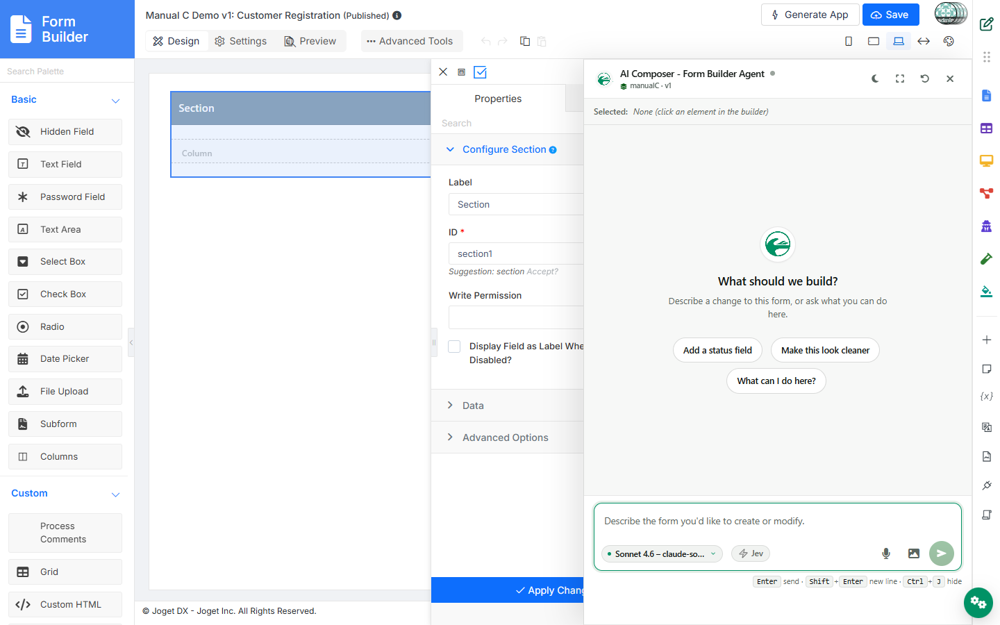
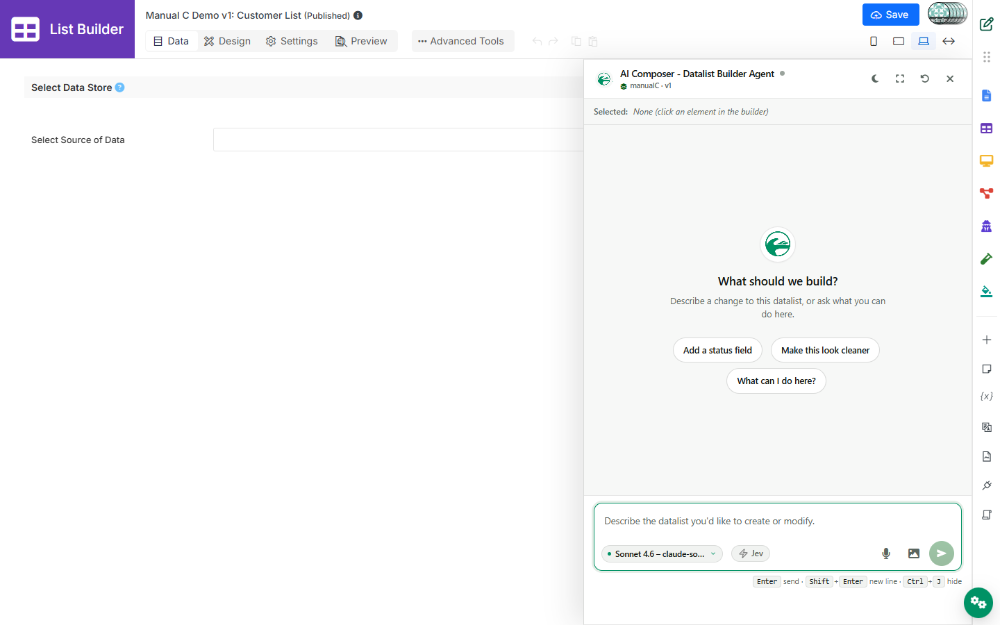
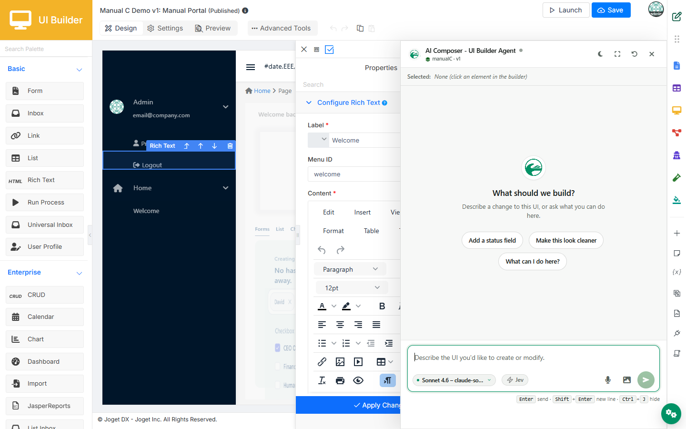
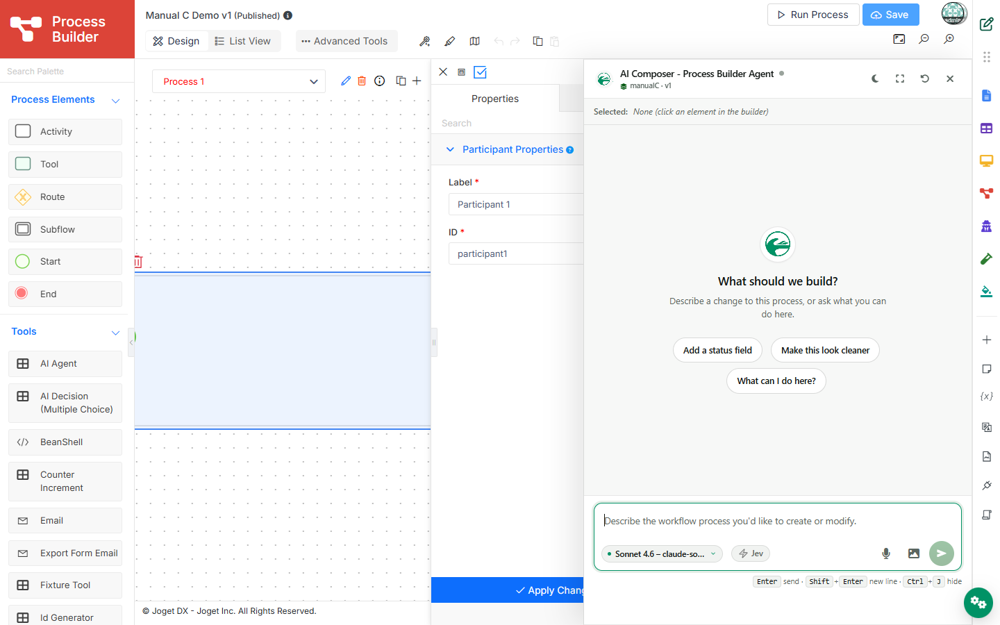
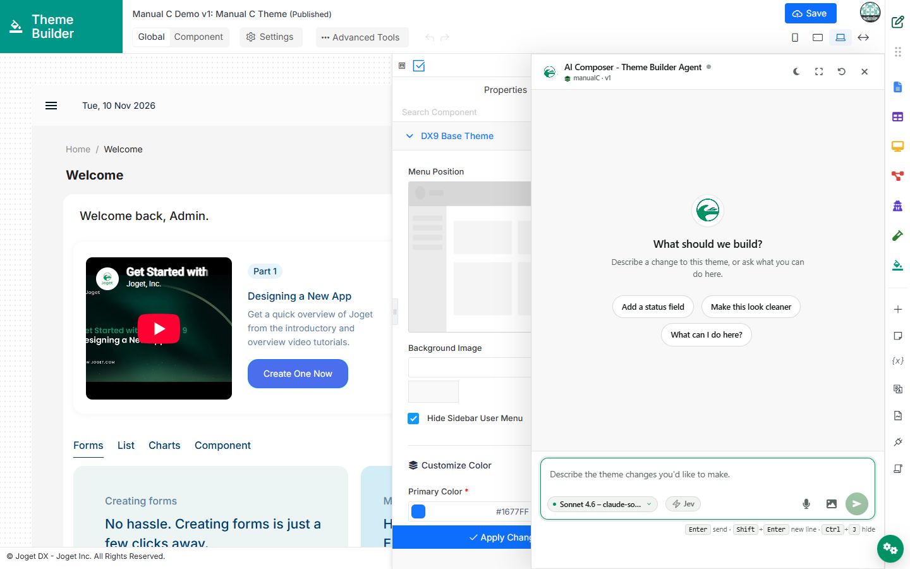
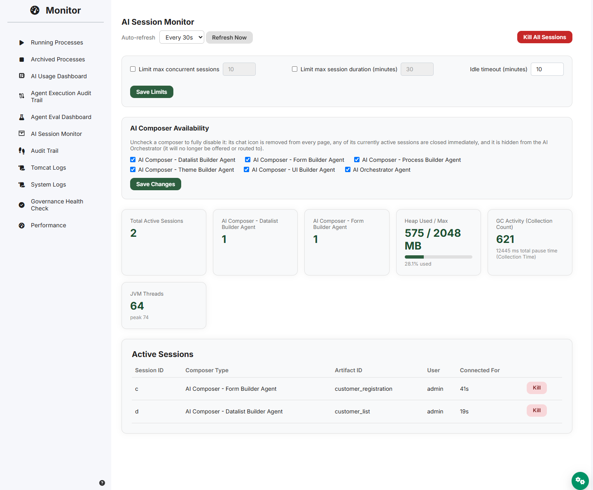
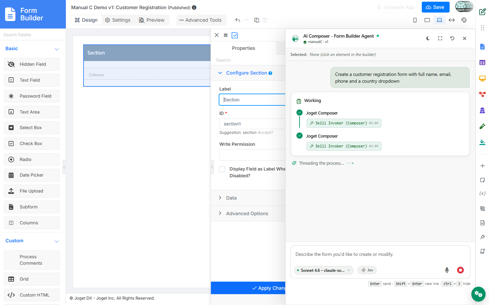
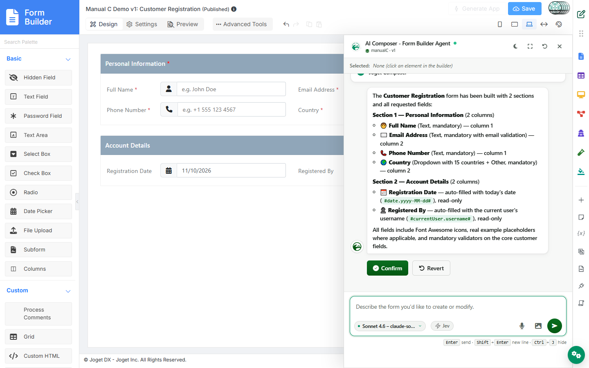

# AI Composers User Guide

The AI Composers are chat panels that appear inside the Joget builders. You describe a change in plain language, and the composer builds or edits the form, list, userview, process or theme that is open in the builder. This page is for Joget implementers who will use the composers every day. It explains where each composer appears, every control in the panel, what each composer can and cannot do, how changes are applied and saved, and what to do when a build goes wrong.

Related pages: [The Orchestrator: Building Whole Apps](13-orchestrator.md) covers the panel that builds a complete app. [Writing Good Composer Prompts](14-composer-prompt-guide.md) has the prompt principles and a cookbook. [Voice Input and the Joget AI Assistant](16-voice-and-assistant.md) covers the microphone button in detail.

## What the AI Composers are

An AI Composer is a chat panel that is added to a builder page. It sends your message and the current content of the builder to an AI model. The model does not write the whole definition freehand. It calls a fixed set of **functions** (for example `add_field` or `create_enhanced_datalist`), and each function changes the definition in a controlled way. Because of this, the result is a valid Joget definition. The model also reads **skills**: bundled instruction documents that hold Joget best practices (see "Bundled skills catalogue" below).

There are five composers for single builders, plus the Orchestrator for whole apps.

| Composer | Panel title | Appears in | Edits |
|---|---|---|---|
| Form Composer | **AI Composer - Form Builder Agent** | Form Builder | One form: sections, columns, fields, validators, binders, defaults, styling |
| List Composer | **AI Composer - Datalist Builder Agent** | Datalist Builder (List Builder) | One list: columns, filters, formatters, actions, joins, template |
| UI Composer | **AI Composer - UI Builder Agent** | Userview Builder (UI Builder) | One userview: categories, menus, dashboards, page components, permissions, identity |
| Process Composer | **AI Composer - Process Builder Agent** | Process Builder | The app's processes: lanes, activities, routes, tools, deadlines, variables |
| Theme Composer | **AI Composer - Theme Builder Agent** | Theme Builder (theme design page) | One theme: colours, fonts, sidebar mode, component styles, login page |
| Orchestrator | **AI Orchestrator Agent** | The app's builders page | A whole app, by calling the five composers in order |

The panel appears on a builder page only when that composer is switched on. An administrator can switch each composer type off (see "Prerequisites").

> **Note:** A composer edits the artifact that is open in its builder. To change a different form, open that form in the Form Builder first. To work on several artifacts in one conversation, use the Orchestrator.

### Which composer to use

| You want to | Use |
|---|---|
| Add or change fields on one form | Form Composer |
| Change columns, filters, status colours or row actions of one list | List Composer |
| Add menus, a dashboard, tiles, charts or permissions to a userview | UI Composer |
| Add an approval step, a route, an email step or a deadline | Process Composer |
| Change colours, fonts or the login page | Theme Composer |
| Build forms, lists, a process and a userview together | Orchestrator |

## Opening and using the chat panel



The same panel appears in the other builders. Only the title, the empty-state text and the message-box placeholder change. The empty panel in the List Builder, the UI Builder, the Process Builder and the Theme Builder:









### Opening the panel

1. Open the builder for the artifact (for example, open a form in the **Form Builder**).
2. A small round launcher button (the "pill") with the Joget logo and a status dot is shown. Click it to open the panel. You can also press **Ctrl+J** (**Cmd+J** on macOS) to open or close the panel.
3. The panel opens docked to the right side of the page, full height.

The connection to the server is opened when you send your first message, not when the page loads: opening the panel and reading the empty state does not create a session in the AI Session Monitor. The status dot next to the title shows the connection state (grey before the first message, green when connected). Under the title the panel shows the app id and version, for example `leave_app · v1`.

### Window controls

| Control | What it does |
|---|---|
| Launcher pill | Click to open the panel. Drag it to move it. It snaps to the nearest left or right screen edge when you release it. |
| **Dock right** / **Undock (float)** button | Switches between docked (right side, full height) and floating. |
| Drag the header | In docked mode, dragging the header more than a few pixels undocks the panel. In floating mode it moves the panel. |
| Resize handles | Floating mode only. Drag any edge or corner. |
| Dock preview | When you drag a floating panel close to the right edge, a preview appears. Release to dock. |
| **Toggle theme** (tooltip "Toggle light / dark theme") | Switches the panel between light and dark. The choice is kept per composer. |
| **New chat** (the round-arrow button; its tooltip reads "Reset conversation") | Clears the conversation, starts a new session and reloads the AI service list. |
| **Collapse** (tooltip "Collapse to pill"; **Ctrl+J**) | Hides the panel and shows the pill again. |

### The input area

| Control | What it does | Notes |
|---|---|---|
| Message box | Type your request. **Enter** sends. **Shift+Enter** adds a new line. | The placeholder depends on the builder, for example "Describe the form you'd like to create or modify." in the Form Builder, "Describe the workflow process you'd like to create or modify." in the Process Builder and "Describe the theme changes you'd like to make." in the Theme Builder |
| Service picker (tooltip **Select AI Service**) | Chooses which AI service answers. Each entry shows `<service name> – <model>`. The service marked `(default)` is the active service from AI Central Config. | The list is hidden when no AI service exists. Your choice is remembered per composer in the browser. |
| **Jev** toggle | Switches on "Jev acceleration" for quick edits. | It has three states. With no TypeSafe credential it is disabled and the tooltip reads "Add a TypeSafe credential in AI Central Config" (see [AI Central Config Reference](03-ai-central-config.md)). With a credential it is off by default and the tooltip reads "Jev acceleration is off. Click to turn on (works with any model)." When you switch it on the tooltip reads "Jev acceleration is on: quick edits skip most model round trips. Click to turn off." When it is on, a small Jev badge appears on accelerated replies, and a "Thinking deeper" chip appears when the composer falls back to the full model run. |
| Microphone button | Dictation. Hold to dictate, or click once to keep listening. Click again, or press **Esc**, to stop. | Details on [Voice Input and the Joget AI Assistant](16-voice-and-assistant.md). Shown only where the browser supports voice input. |
| **Attach image** (image icon, tooltip "Upload Image") | Attaches one or more pictures. | Image files only. Each image must be smaller than 5 MB. Use it for a form mock-up, a spreadsheet screenshot, a flow diagram or a brand sheet. |
| **Send** | Sends the message. | Disabled while the box is empty and no image is attached. |
| **Stop** (appears while a run is in progress) | Stops the run. The panel shows "Generation stopped." | Click **New chat** before you type a different request after a stop. |

A hint line under the box reminds you of the keys: **Enter** send, **Shift+Enter** new line, **Ctrl+J** hide.

### The selected-element bar

The Form, List, UI and Process composers show a bar above the messages: **Selected:** `<label or class name>` and **Path:** `<breadcrumb>`. It shows the element that is currently selected in the builder. When nothing is selected it reads "None (click an element in the builder)".

The composer receives the selected element with every message. This is how "make this field mandatory" changes only the field you clicked, and how "rename this activity" changes only the selected activity. The Theme Composer does not show this bar. The Orchestrator has no builder canvas, so it has no selected element.

### Conversation history

The panel keeps your conversation in the browser page. With each message it sends the last six messages to the server, so you can say "add the same to the other section" or "now make it required". The server keeps no chat history of its own. This has three results:

- If you reload the page, the visible conversation is cleared.
- If you open a different artifact in the same builder, the chat resets so that the previous artifact's history does not leak into the new one.
- A long conversation is not remembered beyond the last six messages. Restate ids and names when you return to an earlier topic.

### Suggestion chips and questions

Before the first message, the panel shows suggestion chips. In the standalone composers they are **Add a status field**, **Make this look cleaner** and **What can I do here?**. You can ask questions at any time ("What fields are in this form?", "What can I do here?"). A reply that is only an answer shows no **Confirm** or **Revert** bar and changes nothing.

### Timeline, slow runs and connection messages

While a run is in progress the panel shows a timeline of steps (thinking, tools executed, sections built). Use **Show steps** and **Hide steps** to expand or collapse it. For forms, the panel reports progress such as "Building section 2 of 3".

| Message | Meaning and action |
|---|---|
| "This is taking longer than expected. You can keep waiting or try a shorter prompt." | Appears after about 20 seconds without progress. Wait, or press **Stop** and send a shorter, more specific request. |
| "Connection lost. Trying to reconnect..." | The panel retries by itself. |
| "Connection failed. Reload the page to reconnect." | Reload the builder page. |
| "Could not connect, so your message was not sent. Press Send to try again." | Press **Send** again. |

## Prerequisites

1. **An active AI service.** In **Settings > AI Central Config**, create an AI credential and an AI service, and make one service the active (current) service. Without one, the panel shows **No AI Service Configured** and a **Go to AI Central Config** button. See [AI Central Config Reference](03-ai-central-config.md). Choose a model that supports tool (function) calling. Stronger models give noticeably better results on large requests.
2. **The bundled skills installed and active.** They are installed when the plugin is installed. Check the **Skills** tab in AI Central Config. See [Skills, Central Instructions and Tool Templates](22-skills-and-tool-templates.md).
3. **An app open in the builder.** All composers need an app context.
4. **The composer switched on.** In the **AI Session Monitor**, the **AI Composer Availability** section has one checkbox per composer type. A composer that is unchecked has no chat icon on any page, its open sessions are closed, and the Orchestrator no longer offers it. If you open a disabled composer's page, the panel shows "This AI Composer feature is currently disabled by an administrator."
5. **Optional session limits.** In the **AI Session Monitor** an administrator can set **Limit max concurrent sessions** (default value 10, shared by all composer types) and **Limit max session duration (minutes)** (default value 30). Both are off by default. An **Idle timeout (minutes)** (default 10) is always on and closes a session that has been inactive. When a limit is reached the panel shows **Maximum Sessions Reached** or **Session Duration Exceeded** with an **Open AI Session Monitor** button. The monitor also has **Kill All Sessions** and a per-session **Kill** button. Sessions are counted per server node.



## How changes are applied and saved

This section applies to the five standalone composers. The Orchestrator has its own modes (see [The Orchestrator: Building Whole Apps](13-orchestrator.md)).

1. **Live preview.** As the model works, the builder canvas updates step by step. You see sections, fields, columns, menus or activities appear.
2. **Confirm or Revert.** When a run changed something, a bar with two buttons appears under the reply. **Confirm** keeps the changes ("Great, keeping those changes."). **Revert** goes back to how the artifact was before the run ("Okay, reverting to how it was before. Let me know how you'd like it done instead.").
3. **Save in the builder.** **Confirm** does not write to the database. You must still click **Save** in the builder itself. For an existing process, the composer's edits are only a preview on the canvas until you click **Save**.
4. **Undo and redo.** Type `undo`, `undo that`, `go back` or `revert` to step back, and `redo` or `redo that` to step forward. The panel handles these words itself, without calling the AI model, using the builder's own undo and redo history. It answers, for example, "Undone. 2 more undo steps available." or "Nothing to undo." The builder's own **Undo** and **Redo** buttons work in the same way.

If the AI service fails part-way, the panel keeps the part that was already applied and says so: "The partial result has been applied — you can continue from here."

### Safeguards applied to every result

- **Plugins that are not installed.** If the result uses a plugin that is not installed on your server, the composer replaces it with an installed equivalent, removes it, or keeps it so no data is lost. It tells you which, in a message such as "`<plugin>` on `<element>` was replaced with the installed `<plugin>`."
- **Form layout repair.** If a form definition does not follow Form > Section > Column > Field, the composer rebuilds the missing wrappers so the form does not appear blank.
- **List repair.** Duplicate actions with the same id are removed, and select filters with no options are filled from the form field.
- **Process repair.** Duplicate transitions between the same two nodes, and transitions that share an id, are repaired so that Joget accepts the process.

## Form Composer

Open a form in the **Form Builder**. The panel title is **AI Composer - Form Builder Agent**.

Before: the form is empty (see the first picture of this page). After a single message, "Create a customer registration form with full name, email, phone and a country dropdown", the canvas shows the new form and the panel shows a summary and the **Confirm** and **Revert** buttons. While the run is going, the panel shows a card with the steps that are executed and the **Stop** button replaces **Send**.





### What it can build and change

| Area | What it supports |
|---|---|
| Structure | Sections with 1, 2 or 3 equal columns; remove a section or field; change a column width; whole-form replacement (see limits) |
| Basic fields | `TextField`, `TextArea`, `HiddenField`, `PasswordField`, `IdGeneratorField` (auto-numbered reference, pattern such as `REF-????`) |
| Selection | `SelectBox`, `Radio`, `CheckBox`, `MultiSelectBox`, `PopupSelectBox` |
| Date and time | `DatePicker` (formats, year range, date ranges), `TimePicker` |
| Files and media | `FileUpload`, `ImageUpload`, `Signature` |
| Calculated and display | `CalculationField`, `StatusTrail` (read-only workflow history), `CustomHTML`, `RichTextEditorField`, `Captcha` |
| Multi-row | `Grid`, `Spreadsheet`, `SpreadSheetGrid`, `AdvancedGrid`, `ListGrid`, `FormGrid`, `SubformRepeater` |
| Embedded forms | `SubForm` (fixed panel), `AjaxSubForm` (loaded on demand), `SectionTabs` (sections as tabs) |
| Validation | Required (mandatory validator), email, numeric, duplicate value, JDBC and BeanShell validators, multi-validators, password rules |
| Data sources | Options typed in, options from another form (`FormOptionsBinder`), options from SQL (`JdbcOptionsBinder`), cascading dropdowns that depend on another field |
| Defaults and variables | Default values, including hash variables such as `#currentUser.fullName#` and `#date.yyyy-MM-dd#` |
| Behaviour | Show or hide a section or field by a condition, read-only fields, placeholders, label icons, help text |
| Appearance | Style properties of sections, columns and fields, custom CSS classes, label markup |
| Change a field type | "Convert field X to a password field" keeps the id and label |
| From a picture | Attach a mock-up image and ask the composer to build the form |

The set of field types you can use depends on what is installed on your server. Ask "Which field types are available?" and the composer lists the installed form field plugins. Some types (`Spreadsheet`, `SpreadSheetGrid`, `ListGrid`, `FormGrid`, `AdvancedGrid`, `MultiSelectBox`, `PopupSelectBox`, `CalculationField`, `TimePicker`, `ImageUpload`, `Signature`, `Captcha`, `StatusTrail`, `AjaxSubForm`, `RichTextEditorField`) are Joget Enterprise plugins. `SubformRepeater` and `SectionTabs` are Marketplace plugins and must be installed first.

### Functions the Form Composer uses

| Function | Purpose |
|---|---|
| `add_section` | Adds a section with 1, 2 or 3 columns and returns its id |
| `add_field` | Adds a field of any installed type to a section column, with optional properties (validators, options, defaults) |
| `update_element` | Changes any property of a section, column or field; converts a field to another type; sets required, validators, defaults, placeholders, icons |
| `remove_element` | Removes a section or field |
| `get_current_form` | Reads the form as it is now, before a targeted edit |
| `apply_form_json` | Replaces the whole form. Used only when you ask to rebuild or replace everything |
| `get_form_context` | Lists the forms of the app with their table names and column names |
| `get_palette_tools` | Lists the installed form field plugins |
| `get_element_definition` | Returns the exact property names and defaults of one or more field types |
| `invoke_skill`, `search_knowledge` | Read best-practice skills and the knowledge base |

### Rules the composer follows

- Column widths are 100% or 50%. Fields in one section never form nested columns.
- Field ids use letters, digits and underscores and are unique in the form. The columns `id`, `dateCreated`, `dateModified`, `createdBy`, `createdByName`, `modifiedBy` and `modifiedByName` are system columns and are never added as fields.
- "Required" is a validator, not a label mark. The composer does not put `*` in labels.
- A request such as "Employee ID (auto-generated)" becomes an ID Generator field, and the composer tells you.
- Dropdowns that list master data use the real master form of your app. Say "from the `department` form" and make sure that form exists.
- Short forms (about 10 to 15 fields, one purpose) read as one continuous form. Longer forms keep section headers.

### How changes are applied

Edits appear live on the canvas. Press **Confirm** and then **Save** in the Form Builder. Select a section or field first if you want the change to apply only there.

### Worked examples

**Create a form.** Open a new, empty form and send:

```text
Create a customer registration form with fields: full name, email, phone number,
date of birth, and country (dropdown with Indonesia, Malaysia, Singapore, Other).
```

Result: one section with five fields. The date of birth is a date picker. The country is a select box with the four options. The email field has an email check.

**Change one field.** Click the `Days` field on the canvas, then send:

```text
Make this field required and only accept numbers.
```

Result: only the selected field gets a mandatory validator and a numeric check.

**Dropdown from master data.**

```text
Add a Department dropdown that lists the records of the existing "department" form.
```

Result: a select box with an options binder on the `department` form.

### Limitations and things to know

- `update_element` cannot reach properties of the form itself: post-processor, form permission, load and store binder, label position. To change these, the composer must replace the whole form with `apply_form_json`. It does this only if you accept the full replacement. Review the result carefully.
- The composer does not check that a sub-form, a datalist or a master form that you name exists. It writes the id you gave. Check the id.
- Deeply nested grids may be simplified. Spreadsheet formulas need checking after the build.
- The Form Builder preview does not draw every element faithfully (for example section tabs, dropdown values loaded from another form, empty sub-form panels). Test the form in a userview.
- A number validator needs the number validator plugin installed. If it is not, the composer replaces it with the default validator and tells you which check could not be kept.
- If a model returns text instead of changing the form, press **Revert** if shown and send the request again with more detail.

## List Composer

Open a list in the **Datalist Builder**. The panel title is **AI Composer - Datalist Builder Agent**.

### What it can build and change

| Area | What it supports |
|---|---|
| New list | `create_enhanced_datalist` creates the list from a form: columns, default filters and a default row action, with date and select columns already formatted |
| Columns | Add columns by form field id (`add_smart_columns`, with an exclude list), remove, rename, reorder, duplicate a column on the same field, show or hide, set width, make sortable, cell links |
| Filters | Text, select (options typed in or copied from the form field), single date, date range, number range, full-text search; replace all filters at once; remove or update one filter |
| Formatters | Date and time (including time only), file download link, email link, font (size, colour), image, status badges (Condition formatter: value, label, background colour, font colour), lookup from a fixed list, lookup from a form, SQL, database wizard, BeanShell, users, organisation hierarchy |
| Actions | Row actions (open, edit, view, delete) and toolbar or bulk actions (delete, SQL actions, hyperlinks, export); reorder, update or remove them |
| Sorting and paging | Default sort column and direction, page size, page-size selector, name and description |
| Binder | Extra conditions on the list's data (`update_binder_property`, for example an HQL `extraCondition` such as `e.customProperties.status = 'Pending'`) |
| Joins | Cross-table joins (`configure_table_joins`), one join per table |
| Templates | `table_classic`, `card_simple`, `card_icon`, `list_column`, `list_simple` |
| Generic edits | `patch_element` merges properties into a column, filter, action, row action or the list itself |

### Functions the List Composer uses

`create_enhanced_datalist`, `add_smart_columns`, `configure_datalist_filters`, `add_column_formatters`, `add_formatter_date`, `add_formatter_file_link`, `add_formatter_email_link`, `add_formatter_font`, `add_formatter_image`, `add_formatter_condition`, `add_formatter_options_static`, `add_formatter_options_binder_form`, `add_formatter_options_binder_jdbc`, `add_formatter_options_binder_database_wizard`, `add_formatter_options_binder_beanshell`, `add_formatter_options_binder_user`, `add_formatter_options_binder_org_hierarchy`, `configure_table_joins`, `add_datalist_actions`, `configure_column_visibility`, `configure_datalist_template`, `mutate_datalist`, `patch_element`, and the context functions `get_datalist_context`, `get_palette_tools`, `get_element_definition`.

`mutate_datalist` operations: `remove_column`, `rename_column`, `update_column`, `duplicate_column`, `reorder_columns`, `clear_column_formatter`, `set_column_action`, `remove_filter`, `update_filter`, `remove_row_action`, `update_row_action`, `remove_action`, `update_action`, `reorder_row_actions`, `reorder_actions`, `update_binder_property`, `update_datalist`.

### Rules the composer follows

- It reads the real forms first, then uses exact field ids from the form. Column, filter and sort names must be real field ids or system columns (`id`, `dateCreated`, `dateModified`, `createdBy`, `createdByName`, `modifiedBy`, `modifiedByName`). A name that does not exist shows as "Missing (name)".
- It prefers 4 to 7 columns that people scan: a reference, names, key dates, status. It leaves out long text.
- Status values become coloured badges, one colour per status. Labels for ids are made with an options formatter, not with a join.
- A row action link needs a real target: a userview menu id or a form URL. An empty link is refused.
- Order matters: create the list, add columns, then set filters. Adding columns again regenerates the default filters, so ask for custom filters after the last column change.
- The full-text search filter is a Marketplace plugin. When it is not installed, the composer uses the built-in text filter with several search columns.

### How changes are applied

Edits appear live in the List Builder. Press **Confirm** and then **Save**. The builder's design canvas shows placeholder rows and its Preview may not run filters. Check filters and data in the userview.

### Worked examples

**One-shot list.**

```text
Create a datalist for the employee form showing id, full name, department, hire date and
status, with filters for department and status, a text search on the name, a row link to
open each employee, a bulk delete action, date formatting on the hire date, default sort by
name and paging of 20 rows.
```

**Status badges.**

```text
On the status column show coloured badges: Pending amber, Approved green, Rejected red.
```

**Change only the date format.**

```text
Show only the date, without the time, on every date column.
```

### Limitations and things to know

- Templates `inbox`, `calendar`, `tree` and `datatables` are not supported by the composer. Use the userview's inbox and calendar menus instead.
- A select filter without options copies the choices of the form field. If that field has no choices, give the options in the prompt.
- Linking a row to another list that is pre-filtered needs the exact filter parameter name of the target list (of the form `d-<number>-fn_<filter>`). The composer cannot see it. Copy it from the target list's address and give it in the prompt.
- Joins: one per table, and joined columns are not added by `add_smart_columns`.
- Card templates need their slot properties; the composer sets them, but check the card on a real page.
- Delete actions need the form id; if "Delete does nothing", ask "set the form of the delete action to `<form id>`".
- It does not check that a table exists. A column on a table that is not there is written as given.

## UI Composer

Open a userview in the **Userview Builder**. The panel title is **AI Composer - UI Builder Agent**. This is the widest composer. It has four groups of functions: navigation, page content, userview-level settings, and userview theme tweaks.

### What it can build and change

**Navigation (categories and menus).** Menus live in categories, and every menu needs a category.

| Menu type | Function | Use |
|---|---|---|
| Category | `add_category`, `edit_category` (rename, hide or show), `set_category_permission` | Sidebar section; the access gate for every menu inside |
| CRUD | `add_crud_menu` | List with add, edit and delete over a form and a list |
| Data list | `add_datalist_menu` | Read-only list |
| Form | `add_form_menu` | A form to fill in; options for popup, read-only, actions after save, button labels |
| Inbox | `add_inbox_menu` | Pending tasks of the current user |
| Run process | `add_run_process_menu` | A button that starts a process |
| Process list | `add_process_list_menu` | My submitted, my completed, my withdrawn, my participated, or the approval inbox of one activity |
| Calendar | `add_calendar_menu` | Calendar over a list with start and end date fields |
| HTML page | `add_html_page_menu`, `edit_html_page` | Rich-text information page |
| Link | `add_link_menu` | External or internal URL |
| Built-in pages | `add_simple_menu` (`universal_inbox`, `user_profile`, `csv_import`) | Pre-built single-purpose menus |
| Inspect and edit | `list_navigation_structure`, `edit_navigation_menu` | Read the structure; change a menu label or simple properties |

**Page content.** Pages (dashboards and menu pages) are made of components placed in columns.

| Group | Functions |
|---|---|
| Dashboard in one call | `generate_dashboard`: a dashboard page with KPI tiles (up to 4 per row) and charts (2 per row) from one form |
| KPI tile | `add_information_tile` (count all, count records matching a field value, sum, average), `edit_information_tile`, `add_static_tile` |
| Chart | `add_chart` (bar, line, pie; count, sum, average, minimum, maximum), `edit_chart_display`, `edit_chart_datasource` |
| Text and layout | `add_heading`, `add_paragraph`, `add_html_block`, `add_label`, `add_button`, `add_accordion`, `add_quick_navigation`, `add_container`, `add_image`, `add_link`, `add_script`; matching `edit_heading`, `edit_paragraph`, `edit_html_block`, `edit_button`, `edit_accordion_panels`, `edit_quick_navigation_items` |
| Embedded widgets | `add_crud`, `add_list`, `add_form`, `add_calendar`, `add_dashboard`, `add_inbox`, `add_list_inbox`, `add_universal_inbox`, `add_run_process`, `add_process_status`, `add_task_delegation`, `add_user_profile`, `add_import`, `add_report`, `add_jasper_reports`, `add_sla_report`, `add_rich_text`, `add_manage_api_key`, `add_manage_permission` |
| Inspect | `list_page_elements` |

Tiles read real numbers. A tile that counts records by status uses a field, a stored option value and a list that has a filter on that field. Charts group a form by a field. When a tile or chart cannot be calculated from the form, the composer reports the reason instead of showing a dummy number.

**Userview settings.** `update_userview_identity` (name, id, description), `update_userview_messages` (welcome message, footer message, logout text), `set_userview_permission`, and `list_directory` (lists organisations, departments, groups and users so that permissions use exact ids).

**Userview theme tweaks.** `update_header_theme`, `update_nav_theme`, `update_content_theme`, `update_typography`, `update_sidebar_mode`. These change the userview's own theme settings. To edit a theme as an artifact of its own, use the Theme Composer.

**General edits.** `mutate_element` (merge, remove, set label on any element by id), `set_element_visibility` (hide or show page components, optionally per permission key), `patch_userview` (last-resort add, merge or remove by path or id), and context functions `get_app_context`, `get_element_json`, `get_userview_structure`, `get_palette_tools`.

### Rules the composer follows

- **Menus and components are different things.** A menu goes in a category. A tile, chart or heading goes on a page. The composer keeps them apart.
- A page on an existing list or form menu keeps a "menu component" placeholder so that the list or form still shows. The composer asks `list_page_elements` before adding to such a page.
- It passes an explicit, unique id for each menu and category. It does not rename the userview id or a custom id unless you ask, because that changes the address.
- **Security.** Joget permissions fail open: with no permission, everyone can see. A new userview gets the "logged in user" permission. A permission on a **category** protects every menu in it. A permission object on a **menu** is ignored at run time, so the composer uses the category. "Hidden" only removes a menu from the sidebar; the page can still be opened by address.
- It looks up exact group, department and user ids with `list_directory`. It never guesses them.
- Dashboards: one row of 3 to 4 tiles, each a different measure, linked to the list it counts; one or two charts with real titles; no placeholder text; no emoji in labels (it uses Font Awesome icons).

### How changes are applied

The userview canvas updates live. Press **Confirm**, then **Save** in the Userview Builder. The builder's preview ignores category permissions. Test role access at the real userview address, logged in as a non-admin user of that role.

### Worked examples

**Add a menu.**

```text
Add a menu "Employee Directory" in the Employees category that shows the list_employee list.
```

**Role category with permission.**

```text
Add a category "Approvals" visible only to the group Managers, with an inbox menu "Pending
Approvals" for the leave_approval process.
```

**Dashboard.**

```text
Build a dashboard from the leave_request form: tiles for total requests, pending requests
(status = Pending) and approved requests (status = Approved), a bar chart of requests by
leave_type and a pie chart by status.
```

### Limitations and things to know

- Permissions are set on the userview and on categories. A single menu cannot carry its own permission object. To block one menu, the composer uses the menu's "deny" or "hide" properties, or a separate category.
- A tile that counts by status needs a list on that form with a filter on the status field. If the filter parameter is wrong, the tile shows the unfiltered total without an error. Compare one tile with its list.
- Components named `TableComponent`, `ListGroupComponent` or `LinkComponent` render nothing, and the composer avoids them.
- Rich-text (HTML page) menus remove custom HTML, CSS and scripts the next time they are edited in the rich-text editor. The composer puts real markup into an HTML block on the page instead.
- A picture of a layout is used as a guide only. Expect an approximation.
- Setting an App Center icon needs a PNG file in the app's resources and is not done by the composer.
- Widgets added with the `add_*` embedded-widget functions are placeholders: configure what they point to in the Userview Builder property panel.

## Process Composer

Open a process in the **Process Builder**. The panel title is **AI Composer - Process Builder Agent**. An app can hold several processes. The composer edits the process open on the canvas unless you name another process.

The panel in the Process Builder is the one shown earlier on this page (**AI Composer - Process Builder Agent**). After a run it shows the same **Confirm** and **Revert** buttons as the Form Composer.

### What it can build and change

| Area | What it supports |
|---|---|
| Whole process | `create_process` builds participants (lanes), activities, routes, transitions and variables in one call, with the forms and plugins attached |
| Lanes | `add_participant`; move an activity to another lane (`mutate_process` `move_activity`); rename or remove a lane |
| Human tasks | `add_activity` with a form, Approve and Reject buttons (statuses you choose), read-only mode for approvers, optional **Clarify** and **Reassign** buttons |
| Decisions | `add_route` and `configure_route_rules`: rules `{variable, operation, value, transitionId}` with operations `==`, `>`, `>=`, `<`, `<=`, `contains`, `in`, `listContains`, `true`, `false`, `regex`. The last rule is also the else branch |
| Automatic steps | `add_tool_activity` with any installed tool plugin, such as `org.joget.apps.app.lib.EmailTool`, JSON tool, BeanShell, database update, or `org.joget.ai.agent.lib.AgentProcessTool` to call an AI agent |
| Sub-processes | `add_subprocess_activity` (synchronous or asynchronous) calling another process of the app |
| Flow | `add_transition` (plain, conditional, otherwise, exception), `add_end_node` (one End node per finishing branch) |
| Forms and buttons | `configure_activity_form`, `configure_activity_plugin` (approval buttons, workflow variable, read-only, clarification, reassignment) |
| Variables | `add_workflow_variable` |
| Deadlines | `set_activity_deadline` with unit day, hour, minute or second, a limit and an escalation activity |
| Safe edits | `mutate_process`: `rename_activity`, `rename_participant`, `move_activity`, `remove_activity`, `remove_transition`, `remove_participant`, `set_start`, `update_form_assignment` |
| Generic edits | `patch_element` for activity, participant and transition names, descriptions, limits and conditions, and for tool plugin properties |
| Context | `get_tool_plugins`, `get_tool_details`, `get_app_context` (forms, lists, and all processes of the app) |

Several processes in one app: every function accepts an optional `processId`. `get_app_context` lists all processes and marks the one that is open. If you do not name a process, the composer edits the open one. Once you name a process, later steps in the same reply stay on it. Write, for example, "In the process `leave_approval_2`, add a Finance approval step."

### Rules the composer follows

- A route sits between Start and the first task. Every activity is connected. Each branch that finishes the process gets its own End node. Only one transition is allowed between the same two nodes.
- Lane names are human roles. Do not use "System" as a lane.
- Route rules: the Approved branch first, the Rejected branch last (it is also the fallback). A route with two or more outgoing transitions needs rules. The `transitionId` in a rule is the id of the transition leaving the route.
- Every variable used by a route must be declared and must be written by something: an approval button, a form field with a workflow variable, or a tool step.
- All task forms share the table of the start form. An approval form has its own form id but the same table.
- Tool steps need an exact tool class from the installed plugins. An unknown tool completes without doing anything. The email tool needs a recipient and a configured SMTP server. Placeholders in email text are hash variables such as `#variable.status#`.
- An AI step uses `org.joget.ai.agent.lib.AgentProcessTool`. Give the composer the agent id and the input names; it does not guess them. Use the synchronous run mode when a later step needs the result.
- Deadlines are a nudge, not a timeout: the escalation branch runs while the original task stays open.

### How changes are applied

The canvas updates live. **Confirm** keeps the edit. For an existing process, nothing is deployed until you click **Save** in the Process Builder. Each save that redeploys the package creates a new version of the process package, so group several edits into one save.

### Worked examples

**Three-step approval.**

```text
Create a simple three-step approval workflow: Submit, Review, and Approve, in three lanes:
Requester, Manager and Finance. Use the form leave_request for Submit and leave_approval
for Review and Approve. A route after Review sends Approved to Approve and Rejected back
to Submit.
```

**Rename and deadline.**

```text
Rename the "Submit" activity to "Initial Request".
Add a deadline of 48 hours to the Review step that escalates to the activity "Escalate".
```

**Clarification loop.**

```text
Add a clarification loop: the manager can send the request back to the requester, who
resubmits.
```

### Limitations and things to know

- **Participants are not mapped to real people by the standalone composer.** A lane that has no mapping gives the task to the person who started the process, so a requester could approve their own request. After a build, open **Participants** in the Process Builder and map every lane to a group, user or workflow variable. When the approver comes from data (for example the manager chosen on the form), the composer declares a workflow variable, and you map the lane to that variable.
- Deadlines are asynchronous. Automatic abort after a time limit is not available through the composer.
- A sub-process step needs the called process to exist in the app, or deployment fails.
- A rule cannot say "A and B" in one rule. Use two routes in a row.
- Ids are permanent once cases are running. Removing an activity ends running instances that sit on it.
- Saving can fail while instances of the process are running. Group your edits into one save, or test on a copy of the app.
- Tool steps that need outside settings (email server, payment gateway, web service) are built but do not work until you configure them.

## Theme Composer

Open a theme in the **Theme Builder**. The panel title is **AI Composer - Theme Builder Agent**. This panel does not show the selected-element bar.

### What it can build and change

| Function | What it changes |
|---|---|
| `update_header_theme` | Header background, header font colour, header height |
| `update_nav_theme` | Sidebar background, link colour, link icon, link background, active link background, colour and icon colour, badge colours, scrollbar, sub-menu colours |
| `update_content_theme` | Primary colour, page background, content background, border colour, footer colour and background |
| `update_typography` | Font size, border radius, line height, icon size, sidebar width, content width, control height, padding |
| `update_sidebar_mode` | `dark-sidebar`, `light-sidebar`, `dark-minimized`, `light-minimized`, `dark-header`, `light-header`, `dark-inline`, `light-inline`, `no`; and switches such as hide the sidebar user menu, responsive switch, push notifications, PWA, help guide |
| `apply_component_changes` | Component styles: Accordion, Breadcrumb, Button, Card, Checkbox, Dropdown, Form, Input, List, Login page, Pagination, Radio, Tab, Table, Typography, Upload, Wizard |
| `get_theme_components`, `get_component_definition` | Lists the component blocks and their exact property names |
| `patch_theme_properties` | Raw key and value changes and custom CSS |
| `check_color_contrast` | Calculates the WCAG contrast ratio between two colours and whether it passes AA |

The composer works in phases: it asks about purpose and brand if they are not clear, may propose up to three named directions as text, applies the theme, and then hands over what changed and what to test. Style directions it knows include Dark Enterprise (the safe default), Minimal, Warm Editorial, Soft and Brutalist, with font and colour suggestions per industry.

### Rules the composer follows

- The primary colour must be exactly `#` followed by six hexadecimal digits. Any other value is refused. (A wrong value would otherwise make every page of the app return an error.)
- Component blocks are changed only through `apply_component_changes`.
- All values are text. No value is set to `null`; empty is `""`.
- A dark sidebar needs a light application title colour and dark header text. The composer sets related colour pairs in the same step.
- When you ask for contrast or WCAG AA, it calls `check_color_contrast` and reports the ratios.
- The login page keeps the fields `#customUsername`, `#customPassword` and `#loginButton`.

### How changes are applied

The theme preview updates live. **Confirm**, then **Save** in the Theme Builder. Log out to see a changed login page.

### Worked examples

```text
Set the sidebar background to dark navy (#0F172A) with white text, and make the
primary colour #2563EB.
```

```text
Apply a theme that meets WCAG AA contrast on all text, and show the ratios.
```

```text
Give the app a modern teal and amber look: set the primary, header, navigation, button,
link and background colours with readable contrast, and add a little custom CSS for
rounded buttons.
```

### Limitations and things to know

- A word that is not a colour ("banana") is interpreted and the composer says how it understood it, or asks. Give hex colours when you need exact values.
- Choosing which theme a userview uses is done in the Userview Builder, not here.
- An uploaded brand screenshot is only approximated. Elements such as single sign-on buttons are not reproduced.
- Web fonts loaded by CSS import need internet access in the user's browser.
- After changing the sidebar mode, nav and header colours may need to be set again for the new mode. Ask the composer to do so.

## Bundled skills catalogue

Skills are instruction documents the composers read while they work. A composer first requests a skill's section index, then the sections it needs. You can see these steps in the run timeline. The plugin installs 11 skills. You manage them in **Settings > AI Central Config**, **Skills** tab. See [Skills, Central Instructions and Tool Templates](22-skills-and-tool-templates.md).

| Skill | What it contains | Used by |
|---|---|---|
| `joget-form-builder` | Choosing the right field type, form structure, layout, class names of all form components, design order, short-form flow, form-level properties, property reference, date pickers, visibility rules, styling, custom HTML, hash variables, cascading dropdowns, sub-forms, section tabs, spreadsheet grids | Form Composer, Orchestrator |
| `joget-form-validators-binders` | Validator classes and settings, options binders from forms and SQL, workflow binder, post-processors for side effects | Form Composer, Orchestrator |
| `joget-form-field-ui` | Label icons, placeholders, which field types support them, icon reference | Form Composer, Orchestrator |
| `joget-datalist-builder` | Call order, columns, filter types, formatters (including status badges and options lookups), row and toolbar actions, joins, binder conditions, templates and card slots, editing an existing list | List Composer, Orchestrator |
| `joget-userview-builder` | Menu types, page canvas, dashboard design, tiles and charts, ids, permissions and security, visibility, inboxes, internal links, role-based layout | UI Composer, Orchestrator |
| `joget-process-builder` | Approval patterns (single level, two level, clarification loop, parallel), route conditions, workflow variables, approval buttons, form assignment, tool steps, email tool, AI agent step, deadlines, sub-processes, lanes, removing elements, several processes in one app, participants | Process Composer, Orchestrator |
| `joget-theme-builder` | Theme workflow, directions and calibration, colour and mode rules, contrast pairs, components, palette, custom CSS, sidebar variations, login page, info tile | Theme Composer, Orchestrator |
| `joget-hash-variables` | Syntax and prefixes of hash variables (`currentUser`, `form`, `variable`, `assignment`, `datalist`, `date`, `request`, `i18n` and others), escaping, where each prefix is valid | All five composers, Orchestrator |
| `joget-known-solutions` | "When X, use Y" rules: native features before scripts, never replace Save, Submit or Approve, email through the Email Tool, dashboard counts from list sizes, approvers as real users, one colour per status, no invented integrations | All five composers, Orchestrator |
| `joget-orchestrator` | How the Orchestrator delegates, writes instructions, passes data between composers, reviews results and answers questions | Orchestrator only |
| `joget-app-design` | How the Orchestrator decomposes a request: entities, roles, lightest mechanism, one table for many views, child and master data, audience lists, participants, naming, audit trail, handover | Orchestrator only |

A twelfth file, `joget-kb-search` (search of the Joget knowledge base), is included in the plugin but is not installed as a default skill, because it needs access to the knowledge base service.

A skill that you create in AI Central Config can be limited to selected composers. Skills edited or created by you are your responsibility: a composer follows what the skill says.

## Per-composer limits

| Composer | Cannot do, or does only partly | What to do instead |
|---|---|---|
| Form | Change form-level properties without replacing the whole form; check that a named sub-form, list or master form exists; draw deeply nested grids exactly; spreadsheet formulas are weak | Accept a full replace for form-level changes; check ids; verify grids and formulas by hand |
| List | `inbox`, `calendar`, `tree` and `datatables` templates; pre-filtered links to another list without the exact parameter name; more than one join per table; check that a table exists | Use userview inbox and calendar menus; give the parameter name; use options formatters instead of joins |
| UI | Per-menu permission objects; a breadcrumb component; replacing the userview theme with one that does not exist; App Center icon; configure placeholder widgets | Use category permissions; build from real parts; set the rest in the property panel |
| Process | Map lanes to people; automatic abort deadlines; check that a sub-process exists; "A and B" in one rule | Map in **Participants**; use asynchronous deadlines with escalation; build the sub-process first; chain two routes |
| Theme | A non-hex primary colour; applying a brand screenshot exactly; changing which theme a userview uses | Give hex values; choose the theme in the Userview Builder |
| All | Run without an active AI service; remember more than the last six messages; undo a Save already made | Configure a service; restate ids; use Joget's app versions or export |

## Recovery: when a build goes wrong

### General

| Symptom | Cause | What to do |
|---|---|---|
| "No AI Service Configured" | No active AI service | Click **Go to AI Central Config**, activate a service, press **New chat** |
| "Maximum Sessions Reached" or "Session Duration Exceeded" | Session limit | Open the **AI Session Monitor**, raise or disable the limit, press **New chat** |
| "Connection lost" or "Connection failed" | Network or server | Wait for the reconnect, or reload the page |
| "This AI Composer feature is currently disabled" | Disabled by an administrator | Ask an administrator to enable it in **AI Composer Availability** |
| The reply shows raw JSON or text only and nothing changed | The model answered instead of calling functions | Press **Revert** if shown, restate the request with ids and detail; try another AI service |
| Wrong change | Request was unclear | Type `undo`, or press **Revert** |
| "No changes were made." or "You are viewing the current UI. Let me know if you want to make any changes." | The model found nothing to do, or took the request for a question | Rephrase as an action with the exact id or name |
| The panel is gone | Collapsed | Press **Ctrl+J** or click the pill |
| Stopped run repeats | You pressed **Stop** and sent a different request without starting over | Press **New chat** first |

### By composer

| Composer | Symptom | What to do |
|---|---|---|
| Form | Dropdown has no options | Say "bind it to the `<form id>` form" and check that the master form has records |
| Form | A validator does nothing | Ask "show me the validator on field `<id>`", then "use the default validator with mandatory true" |
| Form | Wrong field type | "Convert field `<id>` to a password field" |
| Form | Hash variable shows as text | Check the table name and field id in `#form.<tableName>.<field>#` |
| Form | Canvas looks empty after a build | Click **Revert**, or reload the form; ask "show the current form" |
| List | Filters disappeared after adding columns | Ask for the filters again, after the last column change |
| List | A cell shows a raw code, not a label | Ask for an options formatter from the master form |
| List | "Missing (name)" on a column or filter | The name must be a field id of the form; ask the composer to correct it |
| List | A change of default sort emptied the list | **Revert**; sort only by a real column |
| UI | A tile or list is missing on a page | Ask "list the page elements, then add the menu component first" |
| UI | Tile numbers differ from the list | Ask to point the tile at the same list and filter field |
| UI | Permission seems not to work | Set it on the category, and test as a non-admin user at the real userview address |
| Process | The task goes to the requester | Map the lane in **Participants** |
| Process | A route always takes the first branch | Ask "configure route rules on route `<id>`: status == Approved to transition `<id>`, Rejected last" |
| Process | An email step does nothing | Configure SMTP in the general settings, and check the recipient |
| Process | Only the first task ever runs | The route variable is never written; add an approval button or a form field with that workflow variable |
| Theme | Every page returns an error | The primary colour is not a six-digit hex value; **Revert**, then give a hex colour |
| Theme | Title text is invisible on a dark sidebar | Ask for the active link colour to be light and the active link background set explicitly |
| Theme | Login page unchanged | Log out to view it; ask the composer to enable the custom login page |

If a build is badly wrong and you have already saved, restore the previous version from the app's version history or from an app export, and then repeat the request with more detail.

## Troubleshooting

| Symptom | Cause | Fix |
|---|---|---|
| The pill does not appear | The composer is disabled, or the page is not a supported builder page | Check **AI Composer Availability**; open the artifact in its own builder |
| The panel appears but the service picker is empty | No AI service exists | Add a credential and a service in AI Central Config, then press **New chat** |
| A message such as "That prompt was a bit too long for me to process in one go" appears | The request is longer than the model can take | Split the request into smaller parts |
| "The AI service is currently rate-limited" or "The request timed out" | The provider is busy | Wait and send again |
| "There was an authentication issue with the AI service" | The API key is wrong or expired | Fix the credential in AI Central Config |
| The model ignored part of a very long prompt | Very long prompts may be partly ignored by some models | Use one change per message, or the Orchestrator for several artifacts |
| Panel position or look is wrong after a plugin update | Browser cache | Hard-refresh the page |

## Where to go next

- [The Orchestrator: Building Whole Apps](13-orchestrator.md)
- [Writing Good Composer Prompts](14-composer-prompt-guide.md)
- [Voice Input and the Joget AI Assistant](16-voice-and-assistant.md)
- [Skills, Central Instructions and Tool Templates](22-skills-and-tool-templates.md)
- [AI Central Config Reference](03-ai-central-config.md)
