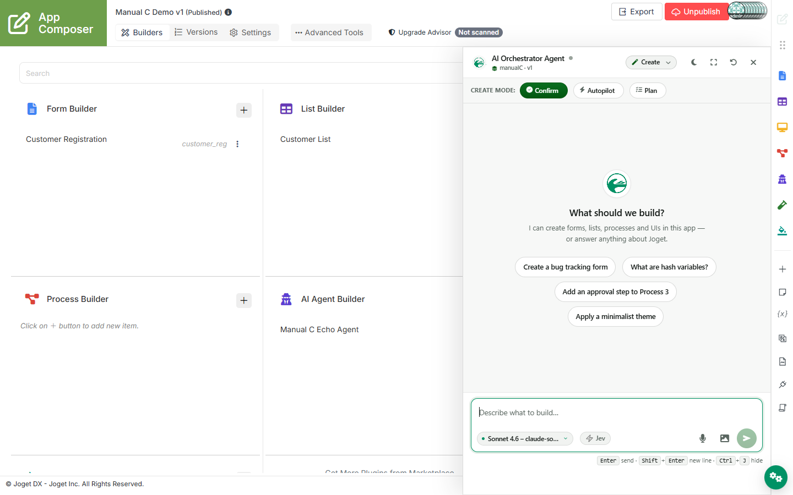
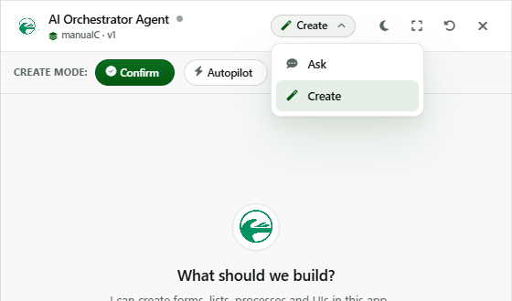
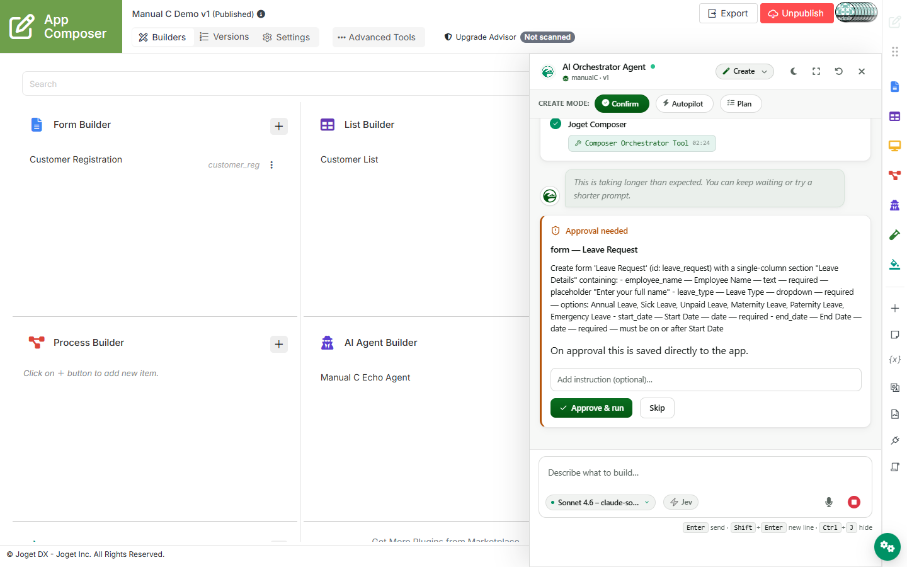
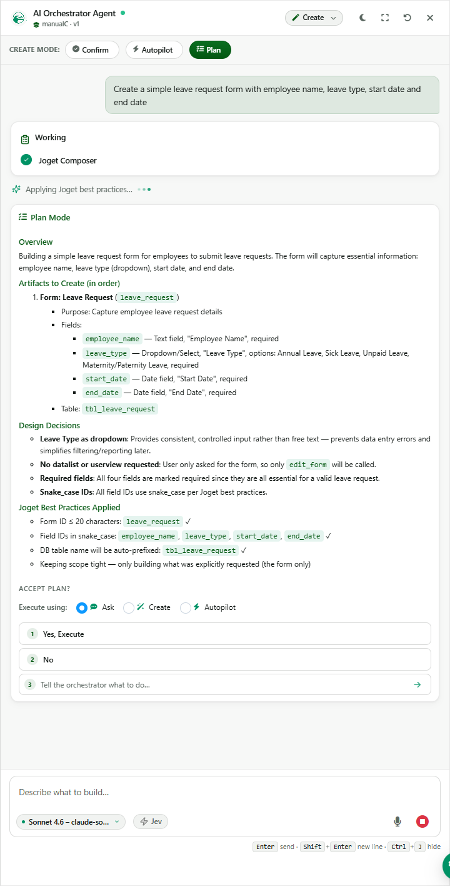

# The Orchestrator: Building Whole Apps

The Orchestrator is the AI Composer that works on a whole app instead of one builder. You describe an application in plain language. The Orchestrator plans it, calls the Form, List, Process, UI and Theme composers in the right order, reviews what they built, saves the result (depending on the mode you choose), and gives you a report of what is left to do by hand. This page is for implementers who build or extend Joget apps with it. It covers the modes, naming rules, review, failure handling, cost, a checklist for after the build, and a complete worked example.

Before you read this page, read [AI Composers User Guide](12-composers-user-guide.md) for the chat panel and the five single-builder composers. The prompt techniques on [Writing Good Composer Prompts](14-composer-prompt-guide.md) apply fully here.

## Where the Orchestrator is

The Orchestrator panel is titled **AI Orchestrator Agent**. It appears on the app's **builders page**: the page of the app in the App Composer that lists the app's builders and artifacts (forms, lists, processes, userviews, themes). It does not appear inside a single builder. It uses the same panel as the other composers: the launcher pill, **Ctrl+J** (**Cmd+J** on macOS), dock and float, **New chat**, the service picker, image attachment, the microphone button and **Stop**.



The empty panel says "What should we build?". Under it a line lists what the Orchestrator can do, for example "I can create or edit datalists, forms, processes, themes, userviews — or answer anything about Joget." (the list follows the composers that are switched on). The panel offers chips: **Create a bug tracking form**, **What are hash variables?**, **Add an approval step to Process 3** and **Apply a minimalist theme**.

The prerequisites are the same as for the other composers: an active AI service in AI Central Config, the bundled skills installed, and the composer switched on in **AI Composer Availability** (AI Session Monitor). See [AI Composers User Guide](12-composers-user-guide.md).

### Standalone composer or Orchestrator

| | Standalone composer | Orchestrator |
|---|---|---|
| Scope | The one artifact open in the builder | The whole app: creates and edits any artifact type |
| Applying changes | Live on the canvas; **Confirm** or **Revert**; then **Save** in the builder | Depends on the mode: **Ask** gives a preview only; **Confirm** and **Autopilot** save to the database |
| Mode selector | None | **Ask** or **Create** (with **Confirm**, **Autopilot**, **Plan**) |
| Selected-element bar | Yes (except Theme) | No |
| Best for | Fine-grained changes to one thing | Creating several linked artifacts, or a change that touches more than one |

Use a standalone composer for a detailed edit to one artifact. Use the Orchestrator to start an app, and then refine each artifact in its own builder.

## Modes

The mode selector is in the panel header. Its button shows the current mode (**Create** by default) and its tooltip reads **Execution mode**. The dropdown has two choices: **Ask** and **Create**. When you choose **Create**, a second row appears, **Create mode:**, with **Confirm**, **Autopilot** and **Plan**.



| Mode | Tooltip in the panel | What happens | Saved to the database? |
|---|---|---|---|
| **Ask** | "Ask — converse and preview changes safely, nothing is saved until you apply" | For each artifact, an approval card appears first. After you approve, the artifact is built and prepared as a **preview**. You open its builder and apply it there. | No. You apply and save in the builder. |
| **Create > Confirm** (default) | "Confirm each change before it is saved to the database" | For each artifact, an approval card appears. After you approve, the artifact is built and saved directly to the app. | Yes, after your approval |
| **Create > Autopilot** | "Autopilot — build and save everything without stopping to ask" | Builds and saves everything with no approval cards. | Yes, with no questions |
| **Create > Plan** | "Plan first — outline the steps before building anything" | Produces a plan only; no artifact is built. A plan card asks whether to execute, and in which mode. | Only when you accept the plan and choose a saving mode |

The default is **Create > Confirm**. The mode you choose, and the last **Create** sub-mode, are remembered in your browser. The message box placeholder is "Ask anything about this app or Joget…" in **Ask** and "Describe what to build…" in the other modes.

### The approval card (Ask and Confirm)



The card is titled **Approval needed**. It describes the artifact: for example "Create form 'leave_request' with fields: ..." or "Update datalist 'leave_requests' — ...". It has:

- **Add instruction (optional)…** : a box where you can add a change. The Orchestrator includes it before building. Press **Enter** in the box to approve.
- **Approve & run** : build this artifact.
- **Skip** : do not build it. The Orchestrator mentions the skipped artifact in its summary.

The card tells you the result: "On approval this is saved directly to the app." (Confirm) or "On approval this is prepared as a preview — open the builder and save there to keep it." (Ask). After approval it shows **Approved · `<name>`**, or **Approved · `<name>` · preview only** in Ask mode.

An approval card that you do not answer waits for 30 minutes and is then treated as skipped.

### Ask mode: applying a preview

In **Ask** mode nothing is written to the app. For each approved artifact the Orchestrator keeps a suggestion in your browser. Open the target builder in the same browser. A badge appears: "You have a suggestion — click to preview". Click it, then **Apply Changes**. The panel says "Applied the orchestrator's suggested changes." Then click **Save** in the builder. If you use another browser, or clear the site data, the suggestion is lost.

### Plan mode



In **Plan** mode the Orchestrator calls no composers. It writes a plan with four headings:

1. **Overview**: what is built and why.
2. **Artifacts to Create (in order)**: a numbered list with the name, purpose and key fields or columns of each artifact.
3. **Design Decisions**: the reasons for the choices.
4. **Joget Best Practices Applied**: snake_case ids, `tbl_` table prefixes, navigation design and similar.

Below the plan, the card asks **Accept plan?** with **Execute using:** and three choices, labelled **Ask**, **Create** and **Autopilot**. **Ask** is selected by default. Their tooltips read "Ask before previewing in builder" (Ask), "Ask then save directly to database" (**Create**, which is the Confirm mode) and "Save directly to database without asking" (Autopilot). The card also lists three numbered answers: **Yes, Execute**, **No** and a box. Click **Yes, Execute** to run, or **No** to discard. The box **Tell the orchestrator what to do…** lets you give feedback instead; press **Enter** to send it and get a new plan.

Plan mode is the cheapest way to check that the Orchestrator understood a large request, because it makes one model call and builds nothing.

## What the Orchestrator creates

The Orchestrator can create or edit these artifact types in the current app. It does it by calling the composers; it never writes definitions itself.

| Artifact | Function | Notes |
|---|---|---|
| Form | `edit_form` | Includes lookup forms (master data), child forms and approval view forms |
| List | `edit_datalist` | Bound to a form built earlier in the same run or an existing form |
| Process | `edit_process` | Lanes, activities with forms, routes, tool steps |
| Userview | `edit_userview` | Categories per role, menus, dashboards, permissions |
| Theme | `edit_theme` | Only when you ask about colours, fonts or visual style |

It builds only what you ask for. "I need a list of leave requests" does not create a userview. A composer that an administrator switched off is not used, and the Orchestrator tells you that the type is disabled instead of substituting another.

Other functions it uses while it works:

| Function | Purpose |
|---|---|
| `get_app_context` | Lists existing forms, lists and userviews, so it can tell creating from updating |
| `request_user_permission` | Raises the approval card (Ask and Confirm modes only) |
| `add_artifact_note` | Records a manual step, such as "configure SMTP", that appears in the final report |
| `get_palette`, `get_element_schema` | Which plugins are installed, and their exact properties |
| `get_form_json` | Loads a saved form so that later steps can use its exact ids |
| `search_knowledge`, `invoke_skill` | Reads the bundled skills, especially `joget-orchestrator`, `joget-app-design` and `joget-known-solutions` |
| `report_completion` | Writes the structured final report |

It can also answer questions ("What is a Joget userview?") in plain text without building anything, and it declines requests that are not about Joget.

## How a run works

```text
Your request
   |
   1. Read context: the app's existing artifacts, your last six chat messages, images
   2. Design brief: one planning pass writes a detailed spec for every artifact
   3. Delegate, in dependency order:
        forms -> lists and processes -> userview -> (theme at any point)
        for each artifact:
           [Ask / Confirm: approval card]
           composer builds the artifact (a full composer run)
           review-and-refine (up to two rounds)
           plugin check, integrity check
           [Confirm / Autopilot: save, repair and retry if the save fails]
   4. Completion report: summary, one entry per artifact, manual steps
```

### The design brief

Before any artifact is built, the Orchestrator runs a planning pass in the role of a "Joget Solution Designer". The result is a **design brief**: one block per artifact, in build order.

| Block | What the brief states |
|---|---|
| Form | Id, name, table; every field with id, label, type, whether required, validation, options and default; sections with headings; two-column layout; placeholders and icons; a status field when records move through steps; lookup and child forms |
| List | Id, name, bound form; columns by real field id; search and filters; default sort; formatters; row actions |
| Process | Id, name, activities in order with the lane; routes including reject paths; the form of each step; notifications |
| Userview | Id, name, categories per role; every menu with its target id, label and icon; dashboard tiles (each tile with its list, filter field and value) and charts; the role that sees each dashboard |
| Theme | Palette and fonts, only if you asked for appearance |

The brief follows rules: snake_case ids of at most 20 characters; views of the same record share one table; the lightest mechanism first (a CRUD menu before a process; a form post-processor before a process for a side effect); reuse what already exists.

For a question, a greeting or a request that builds nothing, there is no brief and nothing is built. If the planning pass fails, the build continues without a brief.

### Delegation: what each composer receives

For every artifact the Orchestrator calls one function (`edit_form`, `edit_datalist`, `edit_process`, `edit_userview` or `edit_theme`). Each call carries:

| Parameter | Meaning |
|---|---|
| `userMessage` | The complete instruction for that one artifact, with the exact ids from the brief |
| `appId`, `appVersion` | The app |
| `json` | `{}` for a new artifact. For an existing list, its id, so that the saved list is edited in place. For an existing form, its saved definition |
| `existingArtifactId` | Used only to change an artifact built earlier in the same run: it updates that artifact instead of creating a second one |
| `imageIndices` | Which of your attached images this composer should see, for example `0` or `0,2` |

In addition, the framework attaches your complete original request and the design brief to every composer call, so the composer sees the whole picture and not only the one-line instruction. It also tells a later composer which artifacts earlier steps built (their ids, table names and a structure summary), even in preview mode. After a form is built, its definition is passed to the next list call automatically.

Ordering rules:

- Build forms first. Lists, processes and the userview depend on form ids, table names and field ids.
- A list needs its form. A userview comes after the forms and lists it shows. A process may come after the forms its steps use.
- A theme is independent.
- If your message names several unrelated artifacts ("a form for orders and a list for invoices"), each gets its own call.
- A view of the same record (for example an approver's form) uses the same table as the first form and reuses its exact field ids. If it did not, the data would split into two tables.

Images are routed by content: a form mock-up goes to the Form Composer, a table or spreadsheet picture to the List Composer, a flow diagram to the Process Composer, a style guide to the Theme Composer, a screen layout to the UI Composer.

> **Note:** Permissions in a userview need exact group, department or user ids. The Orchestrator cannot look them up itself. Put the requirement in your request ("visible only to the group `managers`") and the UI Composer looks the ids up. The groups must already exist.

## Naming and id conventions

The Orchestrator applies these rules to every artifact it creates. They are given to the composers as instructions. The tools themselves only check that an id is well-formed and not already taken.

| Rule | Detail |
|---|---|
| snake_case | Lowercase, digits and underscores, no spaces: `donor_registration`, not `donorRegistration` or `Donor Registration`. Applies to form, list, userview and process ids and to field ids |
| Length | Artifact ids should be 20 characters or fewer. This is an instruction to the composers, not a hard limit in the tools. Labels and display names may be as long as you like |
| Name the core entity | Remove generic words from the id: `Form`, `Submission`, `Details`, `Information`, `Request`, `Entry`, `Record`, `List`, `All`, `Report`, `Overview`, `Management`, `Administration`, `System`. Examples: `donor_registration_form` becomes `donor_registration`; `all_donors_list` becomes `donors`; `leave_request_form` becomes `leave_request`; `employee_information` becomes `employee` |
| Abbreviations | When an id is still too long, it uses `doc`, `reg`, `app` or `mgmt` |
| List ids | No `all` prefix; name by entity: `donors`, `events`, `leave_requests` |
| Table names | A form's table is `tbl_` plus the form id, set automatically: form `leave_request` is stored in table `tbl_leave_request` (the database table name then has Joget's `app_fd_` prefix). Give an explicit `tableName` in your prompt to use another name |
| Id accepted by the tools | An id from your prompt or the brief is used when it starts with a letter and has only letters, digits and underscores (up to 64 characters) and is not taken. Otherwise the id is made from the display name |
| Collisions | An existing artifact is never overwritten. If the id is taken, the tool adds a suffix (`_2`, `_3`) |
| One table per record | Several forms that show the same record share one `tableName` and the same field ids |
| Sub-ids | Categories, menus, sections and activities also get explicit, unique snake_case ids |

To get exact ids, state them in your prompt: "Create form `leave_request` (Leave Request) with tableName `tbl_leave_request`".

## Review and refine

After each composer builds an artifact, the Orchestrator checks the result against your request and the brief.

1. **Digest.** A short structure summary of the artifact is produced: sections and fields with types, columns and filters, categories and menus, dashboard tiles and charts, lanes and routes. It is cut at 3,500 characters.
2. **Review.** A reviewer (an AI call using your selected AI service) compares the digest with your request and the brief and a quality bar for the artifact type. It lists at most six concrete gaps, or answers "complete". It does not invent requirements you never made, and it cannot ask for a change of the artifact's own id.
3. **Refine.** If gaps are found, the same composer is called again to fix only those gaps in the same artifact, keeping its id. By default there are **up to two** refinement rounds per artifact. A further round happens only when the previous one made progress: fewer issues, and not the same issues stated again. An issue that was already tried and came back is not sent again, because the composer cannot fix it.
4. **Guard.** A refinement that comes back under a different id is discarded. A refined process whose references are broken is repaired up to two times and is discarded if it is still broken.

The Orchestrator also reads the digest itself. If something you named is still missing, it may call the composer again with `existingArtifactId` and one specific fix, at most twice per artifact.

What the reviewer looks for:

| Artifact | Quality bar |
|---|---|
| Form | Logical sections; related fields grouped; two columns for short fields; fitting field types; mandatory validators; labels, placeholders and icons; a status field for workflow records; read-only fields for values the applicant must not edit; prefilled values the system knows; fields in reading order |
| List | Columns people scan; search and useful filters; sensible sort; formatters for dates and status; row actions |
| Userview | Categories by role; every requested artifact reachable; a dashboard when it fits; clear labels and icons; no emoji; dashboard tiles in one row with different real values, each linked to its list; one or two charts with real titles; no placeholder text |
| Process | Every step in the right lane; approve and reject paths; forms mapped to steps; notifications where implied |
| Theme | One coherent palette across header, sidebar, buttons and cards; readable contrast |

The review is advisory. If the reviewer fails or answers in an unreadable way, the artifact is treated as complete, so the review can never block a build.

## How failures are handled

| Situation | What the Orchestrator does |
|---|---|
| A composer reports an error | The error is reported for that artifact. The other artifacts continue. The artifact appears in the final report as a pending item with the reason |
| A composer takes longer than 300 seconds | The call ends with a time-out error for that artifact, handled as above |
| The artifact fails a check before saving (for a process: broken references) | The exact problem is sent back to the composer for a targeted repair, up to two times |
| Saving to the app fails (Confirm and Autopilot) | The save error is sent back to the composer for a repair, up to two times, then the save is tried again |
| The repaired or refined version still cannot be saved | The first, unrefined version is saved instead, if it can be |
| Nothing could be saved | The report lists the artifact as "Built but NOT saved" with the reason. The Orchestrator does not call it saved |
| The result uses a plugin not installed on the server | The plugin is replaced by an installed equivalent or removed, and a note is added to the report |
| A composer answers with a question or an explanation | Nothing is built or saved for that step. The answer is passed to you |
| A composer finds nothing to change | Reported as "No changes were needed" |
| An approval is skipped | That artifact is not built and is mentioned in the summary |
| You press **Stop** | The run is cancelled. Artifacts already saved in Confirm or Autopilot stay saved |

The Orchestrator reports each artifact exactly as its result says. An artifact counts as saved only when the save succeeded. In Ask mode the result card says "preview — not saved yet".

### The result cards and the completion report

For each artifact a card shows "`<type>` `<name>` created", then "table `<table>` · saved to `<builder>`" (or "preview — not saved yet" in Ask mode), and a button **Open in `<builder>`** (or **Apply in `<builder>`**). The builders list of the app updates without a page reload.

When the run built something, a second step writes the final report:

- **summary** : what was built, in plain text, naming unsaved artifacts as unsaved.
- **pending items** : one entry per artifact with a one-sentence description, plus a reason where manual work is needed. Typical reasons: assign roles and permissions in the userview; configure SMTP for the email tool; configure credentials for a payment gateway or web service; map participants in the process.
- **best practices** : one or two sentences that confirm conventions such as snake_case ids and `tbl_` tables.
- **violations** : deviations, or "None".

If nothing was built (a question, a decline), there is no report.

## Time and cost

**Time.** The Orchestrator does a lot of work in sequence: a planning pass, then for each artifact a full composer run, a review, possibly refinement rounds, and a save, then the report. A whole app therefore takes much longer than one composer. How long depends on the AI model and provider, the load on them, the size of your request and the number of artifacts. Do not plan around a fixed time. Run large builds when you can wait, and use **Plan** mode first for big requests.

**Cost.** Every step is one or more model calls billed by your AI provider. A whole-app build costs many times a single composer request, because it includes:

- the planning pass;
- one composer run per artifact (a composer run itself has several model turns);
- the review call after each artifact, and one more composer run per refinement round (up to two per artifact);
- repair runs when a check or a save fails;
- the final report step.

Ways to control cost:

- Use **Plan** mode to confirm the shape of the app before you spend on building.
- Write specific prompts. A detailed request needs fewer refinement rounds than a vague one.
- Build in stages: forms and lists first, then the userview, then the process.
- Choose a model that balances quality and price for each stage. See the service picker.
- Watch usage in the **Usage Dashboard**. See [Runtime Settings, Monitoring and Cost](09-runtime-and-monitoring.md).
- An administrator can reduce or switch off the review pass with JVM system properties on the Joget server: `-Daiab.orchestrator.review=false` switches the review off, and `-Daiab.orchestrator.review.rounds=N` sets the number of refinement rounds (0 to 3; the default is 2). Fewer rounds lower the cost and usually lower the quality of the first result.

## Existing artifacts, questions and what it declines

- **Existing artifacts.** The Orchestrator checks which forms, lists and userviews exist before it builds. An artifact that exists but is empty is built fully. An artifact that already has content is treated as an update. It does not create `form_2` for something that exists. If an artifact is complete and you ask for nothing new, it answers "`<name>` already exists with content (id: `<id>`). Would you like me to update it?"
- **Questions.** "What is a Joget userview?" gets a plain answer with no build.
- **Vague build requests.** "Build me a form" produces a sensible generic form, and the Orchestrator tells you what it assumed. A change request that lacks a needed value ("change the default sort" with no column) gets one question.
- **Translating the app's text.** A request such as "translate the menus into French" is a userview change only.

| Request | Behaviour |
|---|---|
| Not about Joget (people, passwords, other topics) | Polite decline |
| "Delete the invoice list" | Explains; no destructive build |
| Needs credentials, endpoints or payment keys | Builds the rest, records a pending item. It does not invent an endpoint |
| Map participants to people | Not done. Handover note in the report |
| A composer is switched off | Says so; asks you to ask an administrator or edit by hand |
| A marketplace plugin is not installed | Uses a core alternative and says so |
| An artifact type you did not ask for | Not built |

## What to check after a build

Do these checks in order. A successful card does not prove the app works.

| # | Check | How |
|---|---|---|
| 1 | Read the final report | Every pending item is a manual step you must do |
| 2 | Each artifact exists once | Open the builders page. There should be no `_2` or `_3` duplicates. Delete any extra by hand |
| 3 | Forms | Open each form. Fields, types, options, required validators and defaults match your request. Dropdowns list real master records |
| 4 | Table names | Forms that show the same record use the same table |
| 5 | Lists | Columns are the ones you named. Status badges show. Filters appear in the userview (the List Builder preview does not run them). Search works |
| 6 | Process | Open the Process Builder. Lanes, activities, routes and end nodes are right. **Map every participant** in **Participants** to a group, user or workflow variable. Check the email step and SMTP |
| 7 | Userview | Categories, menus and icons. Open the userview as each role. Tile numbers match their lists |
| 8 | Permissions | Test as a non-admin user of each role at the real userview address |
| 9 | Theme | Log in and out; check contrast and the login page |
| 10 | Run one record end to end | Submit a request as an employee, approve as a manager, see the status update on the list and the dashboard |
| 11 | Pre-existing apps | Check that earlier processes and forms were not changed unless you asked |

## Limitations and things to know

- **The Orchestrator cannot do what the composers cannot.** See the limits table in [AI Composers User Guide](12-composers-user-guide.md).
- **Participant mapping.** When the Orchestrator saves a process, the first (requester) lane is mapped to the person who starts the process, and the other lanes are set to the admin role so that the process can run. The report says which lanes were set this way. Map each lane to its real group or user in **Participants**.
- **No selected element and no builder context.** To change one field of one form precisely, use the Form Composer.
- **Chat memory is the last six messages.** Restate ids if you come back to a topic later in a long chat.
- **Preview is not saved (Ask mode).** If you close the browser tab before applying, or use another browser, the preview is lost.
- **Re-running the same big prompt in Autopilot** against an app that already has the artifacts is treated as an update. Check for duplicate artifacts afterwards.
- **Stop.** After **Stop**, press **New chat** before you type a new request.
- **Lazy tables.** A form's database table is created when its list is first shown or the first record is saved. SQL charts, SQL options and SQL validators in the same build need that table. Save one record, then open the page.
- **Dashboards.** Tiles read from the form's main list through a filter. A tile counting by status needs a list filter on the status field. Compare each tile with its list.
- **Session limits.** The administrator's limits (concurrent sessions, session duration, idle timeout) apply to the Orchestrator. A long build can hit the duration limit.
- **Model dependence.** Quality varies with the model. Very long prompts may be partly ignored by some models; split large requests into stages.

## Worked example: a small leave-request app

This example builds a leave-request app with a form, an approver form, a list, a two-step approval process and a userview. Use a new, empty app. Create the groups `managers` and `hr` first (in the Joget admin console, **Users > Groups**), so that the userview permissions can use real ids.

1. Open the app's builders page and open the Orchestrator panel.
2. Choose **Create**, then **Plan**. Send the prompt below. Read the plan.
3. In the plan card, choose **Execute using: Create** (tooltip "Ask then save directly to database", the Confirm mode), and click **Yes, Execute**.
4. Approve each approval card (form, form, list, process, userview).
5. Read the report and do the checks in "What to check after a build".

### The prompt

```text
Build a leave-request app.

Form 'leave_request' (Leave Request), tableName 'tbl_leave_request'.
Section 'Employee' (2 columns): employee_name (text, required, default #currentUser.fullName#),
  department (select: Engineering, Finance, HR, Operations; required).
Section 'Leave Details' (2 columns): leave_type (select: Annual, Sick, Unpaid, Maternity; required),
  start_date (date, required), end_date (date, required, must not be before start_date),
  days (number, required), reason (textarea, required, max 500 characters),
  attachment (file upload, optional, for medical certificates).
Section 'Status' (2 columns): status (select: Pending, Approved, Rejected; default Pending; read-only),
  approver_remarks (textarea, read-only).
Add a label icon and a placeholder to every input field.

Approver form 'leave_review' (Leave Review) on the SAME table 'tbl_leave_request', reusing the
exact field ids above. All fields read-only except approver_remarks.

List 'leave_requests' (Leave Requests) over form leave_request. Columns: employee_name,
leave_type, start_date, end_date, days, status (colour badge: Pending amber, Approved green,
Rejected red). Default sort start_date descending. Filters: leave_type, status, a start_date
range. Search across employee_name and reason. Row action: open the record.

Process 'leave_approval_flow' (Leave Approval): lane Employee starts with form leave_request;
lane Manager has the step 'Manager Review' with form leave_review and Approve and Reject buttons
that set the workflow variable status. A route sends Approved to an email step that tells the
employee it was approved, and Rejected to an email step that tells the employee it was rejected.
Then an End node.

Userview 'leave_portal' (Leave Portal), one dashboard for everyone.
Category 'My Leave' (all logged-in users): menu 'My Requests' (CRUD on form leave_request and
list leave_requests), menu 'New Request' (starts process leave_approval_flow).
Category 'Approvals' (group managers only): inbox 'Pending Approvals' for leave_approval_flow.
Category 'HR Admin' (group hr only): menu 'All Leave' (list leave_requests).
Home dashboard with tiles: total requests, pending requests (status = Pending), approved
requests (status = Approved), and one bar chart of requests by leave_type and one pie chart by
status. Icon on every category and menu.
```

### What you should see

The Orchestrator should build the artifacts in this order. The exact ids can differ a little if your request leaves them open, so state them as above.

| Order | Artifact | Id | Typical content |
|---|---|---|---|
| 1 | Form | `leave_request`, table `tbl_leave_request` | Three sections of two columns; 10 fields: required validators, date pickers, select boxes, a file upload; icons and placeholders; `employee_name` defaults to the current user's name; `status` and `approver_remarks` read-only |
| 2 | Form | `leave_review` | Same table and field ids; fields read-only except `approver_remarks` |
| 3 | List | `leave_requests` | Six columns, status badges, three filters and a search, sort by `start_date` descending, an open-record row action |
| 4 | Process | `leave_approval_flow` | Lanes Employee and Manager; start form `leave_request`; task 'Manager Review' with Approve and Reject; a route; two email steps; an End node |
| 5 | Userview | `leave_portal` | Three categories with permissions on the two restricted ones; menus; a dashboard with three tiles in one row and two charts |

The final report should list these manual steps:

- Map the participants of `leave_approval_flow` in **Participants** (the Manager lane must be mapped to the group `managers`).
- Configure SMTP so that the email steps can send.
- Review the roles and permissions of `leave_portal`.

### Checks for this example

1. Open `leave_request` in the Form Builder: 10 fields, `status` default `Pending`, read-only.
2. Open `leave_review`: its table is `tbl_leave_request`.
3. Open the Process Builder: map the **Manager** lane to the group `managers`. Open the **Manager Review** step and confirm the Approve and Reject buttons set the variable `status`, and that the route reads the same variable.
4. Run the userview as a normal user in the group `managers` and in no group.
5. Submit a request. Approve it as a manager. Check that the list shows a green **Approved** badge and the dashboard numbers change.

If a part is missing or thin, ask for it in one short message that names the artifact, for example: "In the list `leave_requests`, add a filter on `department`."

## Troubleshooting

| Symptom | Cause | Fix |
|---|---|---|
| The panel does not appear on the builders page | **AI Orchestrator Agent** is switched off, or no AI service | Check **AI Composer Availability** and AI Central Config |
| The card says "preview — not saved yet" | Ask mode | Open the builder and apply, or switch to **Create > Confirm** and run again |
| Nothing was built and the Orchestrator asked a question | A change request lacked a required value | Answer the question, giving the exact column, id or name |
| Duplicate forms or lists (`_2`, `_3`) | The same build was run twice without `existingArtifactId` | Delete the extra artifacts by hand. In future ask for an update and name the existing id |
| A list has no data in the dashboard tile | The tile's filter or the status options do not match | Compare the tile with its list; ask the UI Composer to point the tile at the same list and field |
| A userview category is open to everyone | The group id was not found, or the permission was not set | Open the category in the Userview Builder; set the permission; test as a non-admin user |
| The process tasks go to the wrong person | Participants not mapped | Map them in **Participants** |
| A step says "Built but NOT saved" | The save failed after repairs | Read the reason in the report; fix the cause (for example a taken id or a running process instance); then ask the Orchestrator to build that artifact again with the exact id |
| The run seems stuck | A model call is slow | Wait; or press **Stop**, press **New chat**, and send a shorter request |
| "Maximum Sessions Reached" | Session limit | See [AI Composers User Guide](12-composers-user-guide.md) |

## Where to go next

- [Writing Good Composer Prompts](14-composer-prompt-guide.md)
- [AI Composers User Guide](12-composers-user-guide.md)
- [How the Composers Work](15-how-composers-work.md)
- [Runtime Settings, Monitoring and Cost](09-runtime-and-monitoring.md)
- [Composer MCP: Overview and How It Works](17-composer-mcp-overview.md)
