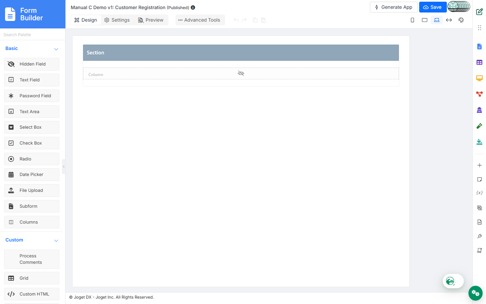
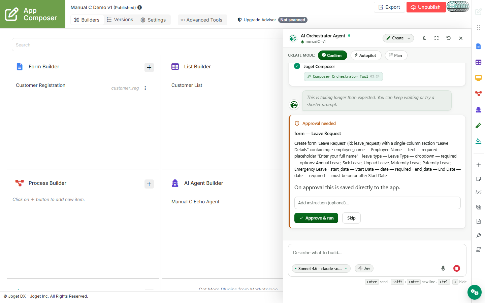

# How the Composers Work

This page explains how the AI Composers and the Orchestrator work inside Joget: which parts take part, what happens between the moment you press Enter and the moment a change appears on the canvas, what is sent to the language model (LLM), how the browser and the server talk to each other, when anything is saved, and how to find the cause when something goes wrong. It is written for expert Joget implementers and plugin developers who have the Agent Builder jar and a running Joget DX Enterprise server, and who need to explain, operate and debug the composers without the source code.

## The moving parts

A composer is a chat panel that is added to a Joget builder page. It looks like one feature, but it is made of seven parts that you can see and measure from outside.

| Part | What it is | Where you can observe it |
|---|---|---|
| Browser panel | One shared JavaScript panel (the "pill" at the edge of the builder page and the chat window it opens). The same panel is used by every composer. | Browser developer tools: Elements, Console, Network |
| WebSocket endpoint | One WebSocket address per composer: `/<context>/web/socket/plugin/<composer class name>`. The panel connects to it when you send the first message, not when you open the pill. | Browser developer tools: Network, filter **WS** |
| Composer as a system agent | On the server, every request becomes a short run of a *system agent*: an agent that Agent Builder creates in code instead of loading from an app. A system agent has one task, one LLM and a fixed set of tools. | **Agent Execution Audit Trail** (the Agent Execution Audit Trail console page), the Joget log |
| The LLM | The AI service you selected in the panel. If none is selected, the active AI service of AI Central Config is used. | **Usage Dashboard**, the LLM nodes of a run |
| Composer tools (functions) | Java tools that hold a working copy of the artifact on the server and expose functions such as `add_section`, `add_field` or `update_element`. The model changes the artifact only by calling these functions. | Tool nodes of a run, `agentic_trace` frames |
| Skills and central instructions | Text you maintain in AI Central Config. Central instructions are added to every request. Skills are loaded on demand through the `invoke_skill` function. | Log line `invoke_skill for ...`, the LLM nodes of a run |
| Builder canvas | The Joget builder itself (Form Builder, Datalist Builder, Userview Builder, Process Builder, Theme Builder). The panel reads the current definition from it and loads changes into it. | `ComposerBridge` in the browser console |

There are five builder composers and one Orchestrator. The Orchestrator is a sixth composer whose "tools" are the other composers.

| Composer | Plugin name | Appears on | Function the Orchestrator calls |
|---|---|---|---|
| Form Composer | AI Composer - Form Builder Agent | Form Builder (`/web/console/app/<app>/<version>/form/builder/<form id>`) | `edit_form` |
| Datalist (List) Composer | AI Composer - Datalist Builder Agent | Datalist Builder | `edit_datalist` |
| UI Composer | AI Composer - UI Builder Agent | Userview Builder | `edit_userview` |
| Process Composer | AI Composer - Process Builder Agent | Process Builder | `edit_process` |
| Theme Composer | AI Composer - Theme Builder Agent | Theme Builder (`.../cbuilder/theme/design/<id>`) | `edit_theme` |
| Orchestrator | AI Orchestrator Agent | The app's builders page (`.../builders`) | none: it is the caller |

The panel on a builder page works on the artifact that is open in that builder. The Orchestrator works on the whole app and has no canvas of its own.

The whole system looks like this:

```text
 Browser (builder page)                                Joget server (one JVM)
 +------------------------------+   WebSocket         +--------------------------------------------+
 | Chat panel (shared script)   |  /web/socket/plugin | Composer class (one per builder)           |
 |  - sends the full current    | ------------------> |  - checks: enabled? session limit?         |
 |    builder JSON, the         |   agentic_edit      |  - starts a system agent run on a worker   |
 |    selected element, the     |                     |         |                                  |
 |    palette, last 6 messages     | <------------------ |         v                                  |
 |  - shows the live preview    |  agentic_trace      |  LLM  <->  composer tools (working copy)   |
 |  - Apply / Cancel            |  agentic_partial_   |         |                                  |
 +--------------+---------------+  update / complete  |         v                                  |
                |                                     |  repairs, then the result is sent back     |
                v                                     +--------------------------------------------+
        Builder canvas (loadJson)                       Orchestrator only: planner LLM -> edit_*
        You press Save in the builder                   -> composer run -> review -> save to the app
```



## The life of one message

This section follows one message in a builder composer (for example "add a mandatory email field" in the Form Composer). The Orchestrator follows a longer path, described in a later section.

### 1. The page and the pill

1. You open a builder page. Joget renders the page and asks every UI injector plugin whose address pattern matches the URL for HTML. The composer for that builder answers with the chat panel. If an administrator has disabled that composer type, the answer is empty and no pill appears.
2. The page loads the panel script, its style sheets and a small inline script that defines `window.ComposerBridge` (see the later section on how changes are applied).
3. The panel does not open a connection yet. It connects on the first click of the pill, or on the first message.
4. If you change app, app version, builder type or artifact, the panel clears the conversation and starts a new session id. The session id is kept in the browser's session storage.

### 2. Opening the WebSocket

1. The panel opens `wss://<host>/<context>/web/socket/plugin/<composer class name>` (`ws://` on plain HTTP). The class name is the full name of the composer class, for example `org.joget.ai.agent.lib.composer.FormComposerChat`.
2. The browser sends its normal Joget session cookie with the upgrade request. The server runs every callback of the socket as the logged-in Joget user.
3. The server checks, in this order:
   1. Is this composer type disabled? If yes, it sends an `error` frame with `errorCode` `COMPOSER_DISABLED` and closes the socket.
   2. Is the global limit of concurrent sessions switched on and already reached? If yes, it sends `SESSION_LIMIT_REACHED` and closes the socket. It never closes an older session to make room.
   3. Otherwise it accepts the session: the frame buffer is 2 MB, the container idle timeout is set (default 10 minutes), the session is added to the session list shown in **AI Session Monitor**, and a ping is scheduled every 30 seconds. If a maximum duration is configured, it sends `session_duration_info` with the deadline.
4. The panel sends `init`. The server checks that an active AI service exists. If none exists, it answers with an `error` frame with `errorCode` `AI_SERVICES_NOT_CONFIGURED` (the panel shows a card that links to AI Central Config). Otherwise it answers with a `status` frame. The Orchestrator also answers with a `chat_response` frame with `welcome` set to `true` (its greeting, with `capabilityLabels`). A builder composer sends a greeting only for a new conversation (`reconnect` is `false`). Because the panel opens the socket when you send the first message, it sends `reconnect` as `true` and the builder composers send no greeting: the panel shows its own empty state.

### 3. Sending the request

When you press Enter, the panel:

1. Reads the complete current definition from the canvas with `ComposerBridge.getJson()`. If the builder returns nothing, it shows an error and sends nothing.
2. Reads the selected element, the builder's palette of available element types, and the number of undo and redo steps.
3. Saves a copy of the definition as it was before the run. **Revert** restores this copy.
4. Collects uploaded images (base64, each at most 5 MB in the browser) and the last 6 messages of the conversation.
5. Sends one `agentic_edit` frame (the fields are listed in the protocol section).

Two requests are answered without the model. If you type `undo` or `redo` (also "undo that", "go back", "revert"), the panel uses the builder's own undo and redo stacks and does not contact the server.

### 4. Starting the run on the server

1. The composer checks again that an active AI service exists. If not, it answers `AI_SERVICES_NOT_CONFIGURED` and starts nothing.
2. It sends `agentic_text_delta` with the text "Working on your request..." so that the panel shows activity at once. This is the only text the server ever sends in this frame type.
3. It records the logged-in user, binds the composer identity to the worker thread (this is what makes central instructions and skills reach the right composer), and hands the run to a worker thread. The WebSocket thread is free again immediately.
4. The worker creates a run id of the form `RUN-<uuid>` and tells the socket. The socket keeps the run id so that **Stop** can find it.
5. If **Jev** is switched on and configured, a faster selection step runs first (see the Preview section). Otherwise the normal agent loop starts.

### 5. The agent loop

1. The server builds the request for the LLM (see the next section).
2. The LLM answers with text or with calls to composer functions. Each function call runs on the server and changes the working copy of the artifact. The result of the call goes back to the model, which decides the next call. The loop ends when the model answers with plain text and calls no more functions. The depth of consecutive tool-call rounds is limited to 100 per task.
3. After every successful tool call the server sends two frames: an `agentic_trace` frame (a step in the run timeline) and an `agentic_partial_update` frame that carries the whole working copy. The panel loads that copy into the canvas immediately. This is the live preview: you see a form grow section by section. Nothing is saved at this stage.
4. There is no token streaming. The model's words are never sent to the panel while it writes; you see steps, not text.

### 6. The result

1. When the loop ends, the server reads the working copy from the tools. The model is not asked to write JSON: the tools are the source of truth. If no tool changed anything and the model only answered in words, the answer is returned as a message with `changed` `false` and no definition is touched.
2. The server cleans and repairs the result (for example it makes sure forms keep the Form > Section > Column nesting, gives columns widths, adds missing labels and normalises validators).
3. It sends `agentic_complete` with a message, the definition (`json`) and, only when something changed, `actions` set to `["apply","cancel"]`.
4. The panel shows the message and the **Confirm** and **Revert** buttons. **Confirm** loads the final definition into the canvas again and waits for the builder to finish loading. **Revert** loads the copy that was taken before the run. Neither button sends anything to the server.
5. Whatever you choose, nothing is stored in the app until you press the builder's own **Save**.

### 7. After the run

The server clears all per-run state, deletes temporary image files and stops listening to the run's trace events. The socket stays open for the next message. History is not kept on the server: every request carries the last 6 messages from the browser. Turns without an answer (for example a message you stopped) are left out of the history that is sent to the model, so the model does not try to carry out the stopped request again.

## What is sent to the LLM

Every request to the model is assembled in the same order. The order matters because system messages come first and the model reads the artifact last.

| Order | Part | Content | Where you can see it |
|---|---|---|---|
| 1 | Central instructions | The text from the **Central Instructions** area of AI Central Config: the *global* text, then (after a blank line) the text for this composer class. Added as the first system message. Empty if nothing is configured. | LLM node of the run (request) |
| 2 | System prompt | A fixed text per composer. It names the role (for example "Joget Form Builder Assistant"), the rules of the artifact (for example Form > Section > Column nesting), how to behave in conversation (answer greetings and questions in plain text, call no tools), defaults to apply (two columns, placeholders, mandatory fields, icons), hash variable rules, and which functions to use. | LLM node (request) |
| 3 | Image prompts | Each uploaded image as a multimodal image part, placed before the text, with the instruction to reproduce what is visible. The model must support images. | LLM node (request) |
| 4 | Conversation history | The last 6 messages from the browser, as alternating user and assistant messages. | LLM node (request) |
| 5 | The current instruction | Your message, followed by the current state: the complete current definition of the artifact (the Form Composer sends it in a compact YAML form), the selected element (so that "this field" can be understood), the number of undo and redo steps, and the list of skills available to this composer (name and one-line description). | LLM node (request) |
| 6 | Functions | The function definitions of the composer's tools (see the table below), plus `invoke_skill` when skills exist for this composer, plus `get_app_context`. | LLM node (functions) |

The model call is made with a maximum output of 16,000 tokens. Model timeouts and retries are described in the section on timeouts and limits.

### Functions the model can call

| Composer | Tools | Examples of functions |
|---|---|---|
| Form | Form context tool, Form mutation tool, skill tool, app context tool | `get_form_context`, `get_palette_tools`, `get_element_definition`; `init_form`, `add_section`, `add_field`, `update_element`, `remove_element`, `get_current_form`, `apply_form_json` (whole-form replacement only) |
| Datalist | Datalist tool (27 functions), skill tool, app context tool | `init_datalist`, `create_enhanced_datalist`, filters, formatters, joins |
| UI | UI tool plus navigation (16 functions), page content (43), theme (5) and settings (4) helpers, skill tool, app context tool | `generate_dashboard`, `patch_userview`, `mutate_element`, page and menu functions |
| Process | Process tool (18 functions), skill tool | `create_process`, `add_participant`, `add_activity`, `add_route`, `configure_activity_plugin`, `add_workflow_variable` |
| Theme | Theme tool, skill tool, app context tool | `update_header_theme`, `update_nav_theme`, `apply_component_changes`, `check_color_contrast` |

Two functions are shared:

- `invoke_skill(name, section)` is offered only when at least one skill is scoped to the current composer. Skills are read in two steps: first the name returns a section index with one-line hints, then the name plus a section returns that section. The model fetches only what it needs. Scoping, status and editing of skills are described in [Skills, Central Instructions and Tool Templates](22-skills-and-tool-templates.md).
- `get_app_context` returns the forms, datalists and userviews that already exist in the app, so that the model uses real ids and table names instead of inventing them.

If two tools declare a function with the same name, the first tool in the list keeps it. For that reason the app context tool is always added last.

### App context, palette and the working copy

Before the loop starts, the server prepares three things for the tools on the worker thread:

- **App context**: the existing forms, datalists, userviews and their fields, read from the app. If this cannot be built, the composer still runs, and the log says so (see the debugging section). Without it the model has to guess cross-form references.
- **Palette**: the element types the builder offers. In a browser composer the panel sends the palette it reads from the open builder. In an Orchestrator run the server builds the palette itself.
- **Working copy**: the definition from the canvas. For a new, empty form the working copy starts empty so that the model must call `init_form`, which gives the form an id. `init_form` does not write anything to the app.

### What is not sent

- The server keeps no chat history of its own and does not store your messages.
- Other users' sessions are never mixed into a request.
- API keys are read on the server when the call is made and are not part of the data sent to the browser.

## The WebSocket protocol

You can see every frame in the browser developer tools: open **Network**, filter by **WS** (or by `socket/plugin`), select the connection and open **Messages**. Each frame is one JSON text message. A frame larger than 2 MB is rejected by the server.

### Connection

| Item | Value |
|---|---|
| Address | `/<context>/web/socket/plugin/<composer class name>` (`wss` on HTTPS) |
| Authentication | The Joget session cookie of the logged-in user. There is no separate token. |
| Ping | The server sends a WebSocket ping every 30 seconds. A failed ping removes the session on the server. |
| Reconnect | After an unexpected close, and only if a conversation exists, the panel reconnects with waits of 1 s, 2 s, 4 s and so on up to 30 s, at most 8 times, and then asks you to reload the page. A tab that received `SESSION_LIMIT_REACHED`, `SESSION_KILLED` or `SESSION_DURATION_EXCEEDED` does not reconnect until you reload. |

Composer class names for the address:

| Composer | Class name |
|---|---|
| Form | `org.joget.ai.agent.lib.composer.FormComposerChat` |
| Datalist | `org.joget.ai.agent.lib.composer.DatalistComposerChat` |
| UI | `org.joget.ai.agent.lib.composer.UiComposerChat` |
| Process | `org.joget.ai.agent.lib.composer.ProcessComposerChat` |
| Theme | `org.joget.ai.agent.lib.composer.ThemeBuilderComposerChat` |
| Orchestrator | `org.joget.ai.agent.lib.composer.OrchestratorChat` |

### Frames from the browser to the server

Every outgoing frame is stamped with these fields in addition to its own: `appId`, `appVersion` (read from the page address), `selectedAiService` (the service chosen in the panel), and `artifactIdCandidate` (the last segment of the page address; the server uses it only to show the artifact id in AI Session Monitor).

| `type` | Sent when | Own fields | Server action |
|---|---|---|---|
| `init` | The socket opens, after a reconnect, after **Reset** | `sessionId`, `reconnect` (boolean) | Builder composers: aborts a still-running run of this session, checks the AI service, answers `status` (and a greeting when `reconnect` is `false`). Orchestrator: checks the AI service and answers with the greeting only |
| `agentic_edit` | Every message in a builder composer | `message`, `json` (the complete current definition), `selectedElement`, `paletteElements`, `hasImage`, `images` (list of `{base64, fileName}`), `imageBase64` and `imageFileName` (the first image, kept for older servers), `sessionId`, `undoSteps`, `redoSteps`, `history` (last 6 `{role, content}` turns), `activeProcessId` (Process Builder only; the Process Builder's JSON holds all processes of the app), `jevAcceleration` (only when the Jev toggle is on) | Starts a run |
| `abort_run` | **Stop** | none | Composer: writes an abort request for the current run. Orchestrator: cancels the running orchestration |
| `orchestrate` | Every message in the Orchestrator, and the plan card | `mode` (`interactive`, `ask_create`, `auto`, `plan`), `message`, `sessionId`, `hasImage`, `images`, `imageBase64`, `imageFileName`, `history`, `jevAcceleration` | Starts an orchestration |
| `orchestrator_confirm` | **Approve** or **Skip** on an approval card | `confirmId`, `approved`, `instruction` | Completes the waiting approval |

There is no frame that lets you answer a question during a composer run. The only interactions during a run are the Orchestrator approval card and **Stop**.

The Orchestrator modes appear in the panel as **Ask** (`interactive`) and **Create** with three choices: **Confirm** (`ask_create`, the default), **Autopilot** (`auto`) and **Plan** (`plan`). The mode control exists only in the Orchestrator.

### Frames from the server to the browser

| `type` | Fields | What the panel does |
|---|---|---|
| `status` | `message` | Marks the connection as initialised; releases the "no AI service" state |
| `chat_response` | `content`, `welcome` (boolean), `capabilityLabels` (Orchestrator greeting) | `welcome: true`: fills the empty state of the Orchestrator (and shows the greeting of a builder composer, if one is sent). Otherwise shows the text as an assistant message. The Orchestrator ends every run with this frame |
| `error` | `message`, `errorCode` (optional) | See the error codes below |
| `session_duration_info` | `deadlineAt` (milliseconds since 1970) | Starts a local countdown |
| `agentic_text_delta` | `text` | Shows the first activity message |
| `agentic_trace` | `runId`, `payload` | Adds or updates a step in the run timeline. `payload` has `id`, `runId`, `nodeId`, `defId`, `parentId`, `type` (`Task`, `Prompt`, `LLM`, `LLMMessage`, `Tool`, `Jev`, or `End` for the end event), `label`, `personalizedName`, `status` (`RUNNING`, `SUCCESS`, `FAILED`, `END`, `ABORTED`, `WAITING_INPUT`), `request`, `response`, `createdAt`. Very long `request` and `response` texts are shortened in this frame (200,000 characters) |
| `agentic_partial_update` | `json`, `step`, `progress` (optional: `index`, `label`, `total`) | Loads `json` into the canvas (live preview) and shows a short message such as "Building section 2 of 4: Contact details" |
| `agentic_complete` | `message`, `json`, `actions` (only when changed; the list `["apply","cancel"]`) | Shows the message; shows the **Confirm** and **Revert** buttons when `actions` is present |
| `agentic_aborted` | none | Ends the run after **Stop** |
| `agentic_error` | `message` | Marks the run as failed and re-enables the input |
| `jev_accelerated` | `runId`, `stats` | Shows the small Jev badge on the reply (Preview) |
| `jev_escalated` | `runId`, `reason` | Shows the "Thinking deeper" chip (Preview) |
| `orchestrator_confirm_request` | `confirmId`, `description`, `artifactType`, `artifactName`, `mode`, `willSave` | Shows the approval card. `willSave` is `true` only in Confirm mode |
| `orchestrator_plan` | `plan`, `originalMessage` | Shows the plan card (Plan mode) |
| `orchestrator_artifact_available` | `artifactId`, `artifactName`, `builderPath`, `builderType`, `composerFunction`, `artifactInUrl`, `persistedToDb`, `mode`, `tableName` (optional) | Draws a "created" card and adds the artifact to the side list |
| `orchestrator_suggest` | `suggestions` (list), `pendingItems` (list), `summary` | Stores each result for the builder and draws the buttons and the completion report |

`error` codes:

| `errorCode` | Meaning | Panel behaviour |
|---|---|---|
| `AI_SERVICES_NOT_CONFIGURED` | No AI service is configured and active | Shows a card; recovers when a later `init` succeeds |
| `COMPOSER_DISABLED` | The composer type is disabled | Message; the socket is closed |
| `SESSION_LIMIT_REACHED` | The concurrent-session limit is reached | The tab is blocked until reload; the panel offers a link to AI Session Monitor |
| `SESSION_KILLED` | An administrator ended the session | The tab is blocked until reload |
| `SESSION_DURATION_EXCEEDED` | The maximum session duration was reached | The tab is blocked until reload |
| none | Any other server-side error | Shows the message as an error bubble |

A frame with an unknown `type` is shown as a plain message if it has `content`, `response` or `answer`, and otherwise as raw JSON.

### A typical exchange

```text
out  init            {"type":"init","sessionId":"session_x1","reconnect":false,"appId":"hr","appVersion":"1",...}
in   status          {"type":"status","message":"Form designer initialized successfully"}
in   chat_response   {"type":"chat_response","content":"Welcome! ...","welcome":true}
out  agentic_edit    {"type":"agentic_edit","message":"add a mandatory email field","json":{...whole form...},...}
in   agentic_text_delta {"type":"agentic_text_delta","text":"Working on your request...\n"}
in   agentic_trace   {"type":"agentic_trace","runId":"RUN-...","payload":{"type":"Tool","status":"RUNNING",...}}
in   agentic_trace   {"type":"agentic_trace","runId":"RUN-...","payload":{"type":"Tool","status":"SUCCESS",...}}
in   agentic_partial_update {"type":"agentic_partial_update","json":{...},"step":"..."}
in   agentic_complete {"type":"agentic_complete","message":"Added a mandatory Email field.","json":{...},"actions":["apply","cancel"]}
```

## How changes are applied and when they are saved

### On the canvas: the builder composers

The panel talks to the builder through three functions on a global object named `window.ComposerBridge`. You can call them in the browser console to see what the panel sees.

| Function | What it does |
|---|---|
| `ComposerBridge.getJson()` | Returns the current definition of the open artifact (the builder's own `CustomBuilder.getJson()`), or `null` if it cannot be read |
| `ComposerBridge.loadJson(json)` | Replaces the canvas with `json` (the builder's own `CustomBuilder.loadJson`). It throws an error if the builder is not ready, so the panel never reports "applied" for a builder that loaded nothing |
| `ComposerBridge.getPaletteElements()` | Returns the element types the builder offers |

The same bridge is used by all five composers. A composer for a builder that is not a Joget `CustomBuilder` must supply its own bridge (see [Custom Composer Tools and Building Your Own Composer](28-custom-composer-tools-and-composers.md)).

What the user sees, in order:

1. During the run: each successful tool call loads the working copy into the canvas (live preview). The canvas shows unsaved content.
2. At the end: **Confirm** loads the final definition again and waits for the builder to finish loading (up to 15 seconds). **Revert** loads the pre-run copy.
3. Saving: **Save** in the builder, as for any manual change. The composer never presses it for you. If you close the builder without saving, the change is lost.
4. Undo: the builder's own undo history contains the loads, so Ctrl+Z works in the builder.

### Orchestrator: what is saved and what is staged

The Orchestrator has no canvas, so saving is a property of the mode, not of the composer.

| Mode (panel) | `mode` value | What happens to each artifact |
|---|---|---|
| **Ask** | `interactive` | Nothing is saved. The result is staged in the browser (`localStorage`, key `joget.orchestrator.suggestion.<type>[.<artifact id>]`). When you open that artifact's builder within 30 minutes and the builder is empty, the staged result is loaded into it; otherwise the panel offers an **Apply** button there. You press **Save** yourself. The orchestrator model asks for your approval before each artifact |
| **Create > Confirm** | `ask_create` | The orchestrator model asks for approval first. Then the artifact is written to the app directly, through the same data access that the builders use, with no builder open |
| **Create > Autopilot** | `auto` | No approval is requested. Each artifact is written to the app directly |
| **Create > Plan** | `plan` | Nothing is built. The model returns a plan inside `<plan>` tags. The plan card lets you run it in Ask, Confirm or Autopilot |

Saving in Confirm and Autopilot repairs known structure problems first: forms are forced into the Form > Section > Column shape, duplicate transitions in a process are removed, duplicate row actions in a datalist are removed, and values that the builders normally fix when they load are normalised. A process package is merged into the app's package (the same process id replaces the old one). Components that are not installed on the server are replaced by an installed equivalent or removed, and the change is listed in the report.

Approval is requested by the orchestrator model through a function call (`request_user_permission`), which the system prompt tells it to use in Ask and Confirm. The save itself is decided by the mode, not by the answer to the card. See the limitations section.

## The Orchestrator

### What it is

The Orchestrator is a composer that plans and delegates. It does not edit artifacts itself. It has one function for each enabled builder composer (`edit_form`, `edit_datalist`, `edit_userview`, `edit_process`, `edit_theme`), a few helper functions, and a second short step that writes a completion report. Each `edit_*` call runs the real composer (the same code, model and tools as the panel on the builder page) without a browser.

Discovery is automatic: the Orchestrator offers every installed composer class that declares an orchestrator function name, is enabled, and is not disabled by an administrator. A composer that you add as a separate plugin appears without a change in Agent Builder. See [Custom Composer Tools and Building Your Own Composer](28-custom-composer-tools-and-composers.md).

### The run, step by step

1. **Start.** The panel sends `orchestrate`. The server checks that an AI service exists, sends `agentic_text_delta`, and starts the orchestration on its own background thread, independent of the WebSocket. Run id: `ORCH-<uuid>`.
2. **Plan mode.** If the mode is `plan`, one run without tools produces the plan text and ends here.
3. **Existing artifacts.** The server lists the forms, datalists and userviews that already exist in the app (id and name).
4. **Design brief.** A separate model call without tools (role "Joget Solution Designer") turns your request into a detailed brief: one block per artifact in build order, with ids, names, tables, every field with type and rule, sections, layout, placeholders, columns, filters, activities, menus. For a question, greeting or off-topic request it answers `NO_BRIEF` and the brief is empty. If the call fails, the brief is skipped and the build continues. The brief is appended to the planner's own task and, later, to every composer call.
5. **Approval wiring.** In Ask and Confirm the server prepares the approval channel. An approval waits up to 30 minutes for your answer and counts as "not approved" afterwards.
6. **Optional Jev routing** (Preview): described in its own section.
7. **Planner run, task 1 ("orchestration").** The planner model sees the system prompt, your history, your message and the brief. Its tools:
   - `get_app_context`: existing artifacts.
   - `request_user_permission(description, artifactType, artifactName)`: only in Ask and Confirm.
   - `add_artifact_note(artifactId, note)`: records a manual step the user must do afterwards.
   - one `edit_*` function per composer.
   - `get_palette`, `get_element_schema`, `get_form_json` (palette and form lookups), `search_knowledge` (searches skills, composer rules and central instructions by keyword) and `invoke_skill`.
8. **Gap analysis, task 2.** A second, short run writes the completion report with a `report_completion` function. It runs only if at least one artifact was built or a failure was recorded, so a question causes no extra model call.
9. **Finish.** The server sends `chat_response` with the summary, then `orchestrator_suggest` when there are results or pending items. Temporary files are deleted.

The planner's system prompt is generated from the installed composers. It contains routing rules (which request goes to which `edit_*`), the build order (forms first; datalists after forms; userviews after forms and datalists; processes standalone; themes independent), naming rules (identifiers in snake_case, at most 20 characters, no generic suffix), scope rules, rules for existing artifacts (pass `existingArtifactId` to update an artifact built earlier in the same run instead of creating a second one), quality rules, image routing and the instructions of the current mode. Each composer can add its own text through its orchestrator rules; this is the only way to teach the planner about the order of a new artifact type.

### What happens in each `edit_*` call

For every call, the Orchestrator:

1. Builds the request for the composer. The text the planner wrote is extended by the framework with a block "CONTEXT FROM THE ORCHESTRATOR": your complete original request, the design brief, and the list of artifacts already built in this run with id, name, table and a short digest. This is added by code, so it does not depend on the planner copying it.
2. Starts from the earlier version of the artifact if `existingArtifactId` names one built in this run. For a datalist it adds the form that was built in this run and is named in the instruction (or the last form built). It forwards uploaded images (the UI Composer uses the first image only).
3. Builds the palette on the server, because there is no browser.
4. Runs the composer (the same agent loop as in the panel) and waits for the result. The built-in composers run on the same thread, so the call returns when they finish.
5. **Reviews the result** (below).
6. Removes components that are not installed, and for a userview wires the row actions of the datalists built in this run to the userview's menus and saves those datalists again.
7. Reads the artifact id, name and table from the result. A custom artifact type must carry a top-level `id` and `name`, or it cannot be saved or announced.
8. In Confirm and Autopilot, **saves** the artifact. A process with broken references is checked before saving; if the check or the save fails, the composer is called again with the exact problem, at most twice per artifact. If the save still fails, the version before the last refinement is saved. If that fails too, the artifact is listed in the report as "Built but NOT saved".
9. Announces the artifact once with `orchestrator_artifact_available`.
10. Returns a short summary to the planner (status, message, id, name, digest, review result), never the full definition, because large results make the planner's next answer shorter or incomplete.

### Review and refinement

After a build that changed something, the Orchestrator acts as the person who would inspect a first draft in the builder:

1. It makes a digest of the artifact: a short text with the structure that matters (for a form: sections and fields with class, required, validator, placeholder, icon and option count; for a datalist: binder, columns, filters, actions, sort; for a userview: categories and menus; for a process: lanes, activities, routes).
2. A model call without tools (the selected AI service) compares the digest with your request and the brief and returns whether the artifact is complete and up to 6 issues.
3. If issues remain, the same composer is called again to fix only those issues in the same artifact ("REFINEMENT"), with the artifact's current definition.
4. The loop repeats up to **2 rounds** (default), and only while it is making progress: a further round runs only if the number of issues went down and the new issues are not a restatement of the old ones. Issues that were already sent once in the same run are not sent again.
5. A refinement that returns a different artifact id is discarded and the previous build is kept.
6. Any failure of the reviewer, or of a refinement, keeps the last good result. A review can never block or lose a build.

The planner sees the result as `review {rounds, resolved, remainingIssues}` next to the digest. It may call the same `edit_*` with `existingArtifactId` at most twice more for one artifact.

Two JVM options (set in `CATALINA_OPTS`) change this behaviour: `-Daiab.orchestrator.review=false` switches the review loop off, and `-Daiab.orchestrator.review.rounds=N` sets the number of rounds (0 to 3).

### Completion report and manual steps

The completion report lists, for every artifact, what was built, and adds *pending items* where a person must act. Two sources feed it:

- Detected by code: for example a process that contains an email activity gets the note "Configure SMTP credentials in Admin > General Settings > Email".
- Judged by the model: for example every userview gets "Assign roles and permissions in Userview Builder", and failures and refusals are listed with their reason.

The panel keeps the report in the browser (`joget.orchestrator.report.<app>.<version>`) and shows it in the Orchestrator and, filtered for that artifact, in each builder.

### Questions and queries

A question about Joget ("What are hash variables?") makes no `edit_*` call: the brief is `NO_BRIEF`, the planner answers in text, and no report is produced. The planner can also ask a composer a question; the composer answers with `changed` `false` and no definition, and nothing is reviewed or saved.



## Timeouts and limits

| Item | Default | Notes |
|---|---|---|
| WebSocket frame size | 2 MB | Large definitions plus several images can approach this |
| Container idle timeout | 10 minutes | Always on. Set in **AI Session Monitor** > **Idle timeout (minutes)** |
| Server ping | every 30 seconds | Fixed |
| Maximum concurrent sessions | Off. 10 when switched on | **Limit max concurrent sessions**. Counted per Joget node and across all composer types |
| Maximum session duration | Off. 30 minutes when switched on | **Limit max session duration (minutes)**. The idle timeout must be lower than this value |
| "Taking longer than expected" notice | after 20 seconds without a trace frame | Display only; does not stop the run |
| Browser reconnect | up to 8 attempts, 1 s doubling to 30 s | Only if a conversation exists |
| History sent per request | last 6 messages | From the browser |
| Image size in the browser | 5 MB each | Images are sent in the same frame |
| Model output | 16,000 tokens per call for composer runs, the design brief and the review call | The planner's own calls use the output limit of the AI service |
| LLM connect timeout | 30 seconds | Applies to system agents with the defaults |
| LLM read timeout | 120 seconds | Per attempt |
| LLM attempts | 3 (1 s initial wait, doubling, at most 30 s, plus up to 1 s random) | Retried on HTTP 429, HTTP 5xx and connection failures |
| Tool-call rounds | 100 per task | After that the model gets one final call without tools |
| Orchestrator approval | 30 minutes | After that the answer is "not approved" |
| Wait for a sub-composer | 300 seconds | Built-in composers run on the calling thread and report before this wait starts, so it does not interrupt a long build; the model time limits above apply per call |
| Review rounds | 2 (0 to 3 with the JVM option) | At most 6 issues per review |
| Repair rounds after a failed check or save | 2 per artifact | Each round is one composer call |
| Digest size | 3,500 characters | Copied into later composer calls |
| Staged Ask result | auto-applied only if less than 30 minutes old | Only to an empty builder on the same artifact |

There is no limit on the number of artifacts in an orchestrated build and no time limit for the whole run. Cost grows with the number of artifacts: each artifact needs at least one composer run and one review call, and each refinement adds a composer run and another review call. Add the planner turns, one brief call and one report call per run. Cost reporting is described in [Runtime Settings, Monitoring and Cost](09-runtime-and-monitoring.md).

## What happens on errors

| Situation | What the user sees | What happens on the server |
|---|---|---|
| No AI service is active | A card that links to AI Central Config | No run is started. The `error` frame carries `AI_SERVICES_NOT_CONFIGURED` |
| The model provider fails (rate limit, timeout, unavailable, key rejected, network) | Datalist, Process, Theme and UI Composers show a short sentence for the type of failure (for example "The AI service is currently rate-limited. Please wait a moment and try again."). The Form Composer can show the provider's own message as a normal reply | The call is retried up to 3 times for HTTP 429, HTTP 5xx and connection errors. An authentication error (HTTP 401 or 403) is not retried |
| The prompt is too long | A sentence asking you to split the request | The run ends with `agentic_error` |
| The model answers with plain text and changes nothing | The text as a reply, no **Confirm** button | `agentic_complete` with `changed` `false` |
| The run stops before it finishes (Form Composer) | The partial result with a note that the agent stopped before it could finish; **Confirm** and **Revert** | The tools' working copy is returned |
| You press **Stop** | The message "Generation stopped." There are no **Confirm** and **Revert** buttons after a stop. The canvas keeps the steps that were already loaded as live preview; use the builder's undo, or reload the builder without saving, to go back | The abort request is written to the database and the run is stopped between steps. The run may still emit one final event; the panel drops events of a stopped run |
| The browser connection is lost during a run | A reconnect message; the run result is not delivered | The run keeps going until the next model call; frames to a closed session are ignored. Orchestrator runs continue and can still save artifacts |
| A composer fails inside an Orchestrator run | The planner continues or reports the failure | The failure is added to the pending items of the report with the reason |
| The design brief or the review fails | Nothing visible | The step is skipped and the build continues |
| A save fails in Confirm or Autopilot | The report lists "Built but NOT saved" and the reason | Repair rounds, then the pre-refinement version, then the report entry |
| An exception inside the system agent | Can look like a normal reply that contains the exception text | The log contains `SystemAgent.run error` |
| An administrator disables a composer or kills a session | A notice; the tab is blocked until reload | The session is closed and removed from the session list |

## Infrastructure

### Session and identity

The socket uses the browser's Joget session. A run is attributed to the user who sent the message: the user name is captured on the connection thread and carried to the worker thread, so that the run appears in **Agent Execution Audit Trail** under that user and not as an anonymous user. Whoever can open a builder page and see the panel can use the composer; the panel does not add its own role check. Restrict who may open builders in your normal Joget way, and see [Security and Governance](11-security-and-governance.md).

### Cluster

- Sessions, the session list, the session limits and **Kill** actions are *per node*. A node counts and lists only the sockets connected to it. The limits themselves are stored as Joget system settings (`aiComposerSessionLimits` for limits, `aiComposerEnablement` for the list of disabled composer types), so every node reads the same values.
- A WebSocket stays on the node that accepted it for its whole life. Use a load balancer that keeps a connection on one node; sticky sessions are not required for correctness of the socket itself, but a reconnect that lands on another node starts a new session there, which is harmless because the conversation lives in the browser.
- **Stop** in a builder composer writes an abort request to the database, which every node can see. **Stop** in the Orchestrator cancels the run on the node where it runs; because the socket is on that node, this works as expected.
- The composer reads the AI services, skills and central instructions from shared storage (database settings and the skills folder of the Joget instance). Keep these shared as described in the installation page.

### Joget Cloud

On Joget Cloud, plugin instances are wrapped by a proxy, so the class name of a composer carries a suffix. The composers resolve the real class name for enablement, skills scope, central instructions per composer and the session list. No setting is needed. Cloud restrictions on files and threads apply to custom code that you add; the built-in composers write temporary image files and fall back to inline image data if the platform refuses a temporary file.

## Preview: faster selection with Jev

> **Note:** This is a Preview feature. It is off by default and needs a TypeSafe credential.

**Jev** is the model of TypeSafe System One. When Jev acceleration is on, TypeSafe makes the *selections* of a request (what kind of request it is, which artifact, which element type, which of a fixed list of values) and your selected LLM only writes text. If Jev is unsure, or fails for any reason, the request *escalates*: the normal agent loop runs, with Jev's plan added as hints.

To use it:

1. In **AI Central Config** > **AI Credentials**, add a credential of provider **TypeSafe** with an **API Key**. The other fields are **Model** (default `jev-latest`), **Base URL** (default `https://api.typesafe.ai`) and **Timeout (ms)** (default 4000, a total budget per request including retries). A **Test connection** button checks the key.
2. Open a builder page or the Orchestrator. Next to the model picker a button with a lightning symbol and the label **Jev** appears. It is disabled, with the tooltip "Add a TypeSafe credential in AI Central Config", until the credential exists.
3. Click it to switch on (default: off). The choice is remembered per composer in the browser. While it is on, `agentic_edit` and `orchestrate` frames carry `jevAcceleration: true`.

What you see: a **Jev** step in the run timeline; a small "Jev" badge on a reply that Jev handled completely (`jev_accelerated`); and a "Thinking deeper" chip when the request escalated to the normal loop (`jev_escalated`). In the Orchestrator, a confident request for a single composer is sent straight to that composer without the planner turn; requests for several artifacts, images and Plan mode go through the normal path, and the flag is passed on to each composer. Your text and the artifact are sent to TypeSafe in addition to your AI service. Jev works with any AI service.

## Debugging guide

Use only what you can observe: the browser, the Joget log, the run history and the settings pages.

### Where to look

| Source | How to open | What it shows |
|---|---|---|
| WebSocket frames | Browser developer tools > Network > WS > Messages | Every frame in order; the `runId` in the first `agentic_trace` frame |
| Browser console | Set the environment variable `debug` to `true` on the server, restart, reload the page | The panel then logs its outgoing messages and decisions to the console |
| Builder state | In the console: `ComposerBridge.getJson()` | The exact definition the panel would send |
| Stored results | Browser developer tools > Application > Local Storage | `joget.orchestrator.suggestion.*` (staged results), `joget.orchestrator.report.<app>.<version>` (reports) |
| Joget log | `catalina.out` or your Joget log file | Lines listed below |
| Run history | The **Agent Execution Audit Trail** console page (the menu entry has the same name) | One row per run. Composer runs have agent names such as "Form Composer Agent" and the trigger source **System Agent** (stored as `SYSTEM_AGENT`); Orchestrator runs have the agent name "Orchestrator Agent". Search by **Run ID** |
| Usage | **Usage Dashboard** | Token use; composer calls are grouped under the plugin name "AI Composer" |
| Live sessions | **AI Session Monitor** page (`/<context>/web/console/plugin/AI%20Session%20Monitor`; administrators and app creators) | Sessions with user, composer type, artifact id and age; **Kill**; **Kill All Sessions**; the session limits; **AI Composer Availability** (enable or disable each composer type) |

### Reproducing one run

1. Open the builder, open the developer tools on **WS**, and send the message.
2. Copy the `runId` from the first `agentic_trace` frame (`RUN-...` for a composer, `ORCH-...` for the Orchestrator).
3. Open **Agent Execution Audit Trail**, search for the run id, and open the run. Each LLM node shows the request that was sent (central instructions, system prompt, history, current state, functions) and the model's answer. Each tool node shows the function arguments and result.
4. In the log, search for the run's lines around that time (see the table).

### Log lines worth searching for

| Log text | Meaning |
|---|---|
| `Rejecting new session: max concurrent sessions (N) reached.` | The session limit stopped a new tab |
| `Rejecting new session: this composer type has been disabled by an administrator.` | The composer is disabled |
| `Session <id> reached the maximum session duration (N min), closing automatically.` | The duration limit closed a session |
| `Session <id> was killed by an administrator.` | **Kill** was used |
| `Refusing '<type>' for session <id>: no AI service is configured and activated.` | No active AI service |
| `invoke_skill for <composer class>: N skill(s) offered [names]` | Which skills the model was offered in this request. `0 skill(s)` means none are scoped to this composer |
| `No composer is bound to this thread, so ... has no skills to offer` | Skills and central instructions did not reach the run (typical for a custom composer that starts its own thread) |
| `Form composer app context: ...` or `Datalist composer app context: ...` | App context was built (the text summarises it) |
| `Form composer running without app context ... Cross-form references will be guessed rather than resolved.` | App context failed; expect invented ids |
| `Repaired form layout so the builder can render it (...)` | The server corrected the nesting of a form |
| `Failed to forward agent trace` | A trace event could not be sent; the timeline or live preview may be missing a step |
| `SystemAgent.run error` | An exception inside the run that was turned into a text reply |
| `Design brief skipped: ...` | The Orchestrator brief failed; the build went on without it |
| `Updating edit_x '<id>' built earlier in this run instead of creating a new one` | `existingArtifactId` was honoured |
| `Review of edit_x found N gap(s); refinement round M: [...]` | The issues the reviewer asked to fix |
| `Review of edit_x left N issue(s) after M refinement round(s)` | The loop stopped with issues open |
| `Refinement of edit_x '<a>' came back as '<b>', a different artifact. Discarding it and keeping '<a>'.` | A refinement was discarded |
| `Artifact review skipped: ...` | The reviewer failed and the artifact was treated as complete |
| `Healed <id> (round N) after: ...` | A check or save problem was sent back for repair |
| `Persisted artifact <id> to DB (<mode> mode)` | An artifact was saved |
| `Preview only - artifact <id> was NOT persisted (mode=interactive).` | Ask mode; nothing is saved by design |
| `persistArtifact returned false for artifactId=<id> in <mode> mode` | A save failed |
| `Saved the pre-refinement build of <id> instead` | The fallback save worked |
| `Cannot persist ... result in <mode> mode: the returned JSON carries no artifact id.` | The artifact has no `id` |
| `Confirm wait ended without a response` | An approval timed out after 30 minutes |
| `Abort requested for orchestration runId=ORCH-... (cancelled=true)` | **Stop** in the Orchestrator |

## Limitations and things to know

- **No streaming of model text.** The panel shows steps and the live preview, never the words of the model.
- **Server keeps no history.** Only the last 6 messages, held in the browser, are sent. Reloading the page clears the conversation.
- **Live preview is unsaved.** If you close the tab or leave the builder before **Save**, the canvas content is lost. In Orchestrator Ask mode, results are kept only in the browser's local storage on the machine that ran the request.
- **Approval is model-driven.** In Ask and Confirm, the orchestrator model is instructed to ask before building each artifact. The save in Confirm mode does not wait for a separate code-level approval. If you need a hard guarantee, use Ask or Plan, or disable the Orchestrator for everyone under **AI Composer Availability** in **AI Session Monitor**.
- **Orchestrator Stop is cooperative.** It cancels the orchestration thread, but a model call already in progress ends when the call returns. Artifacts that were already saved stay saved. Composer Stop is checked between steps.
- **Images.** The UI Composer uses only the first uploaded image when called from the Orchestrator. The model must support images.
- **Builder composers differ in error text.** See the error table.
- **The review is structural.** It reads a digest, not the rendered result. It cannot prove that a build is correct, and a refinement can make an artifact worse; the safeguards are the id check and the save fallback.
- **Session numbers are per node.** In a cluster each node counts its own sessions.
- **Naming for custom types.** The planner's build order and naming text are written for the five built-in types. A new artifact type gets ordering only through its own orchestrator rules.
- **Jev is a Preview** and sends your text to a third-party service.
- **Gap and completion text is written by an LLM** from structured inputs. Check the pending items instead of trusting the summary alone.

## Troubleshooting

| Symptom | Likely cause | What to do |
|---|---|---|
| No pill on the builder page | The composer type is disabled, or the page address does not match the builder pattern | Check **AI Composer Availability** in AI Session Monitor; check the browser console for script errors |
| "No AI services configured" card | No active AI service | Add and activate one in **AI Central Config** > **AI Services** |
| The socket closes at once with `SESSION_LIMIT_REACHED` | The global session limit is on and full | Raise or switch off the limit, or **Kill** idle sessions in AI Session Monitor |
| The socket closes after a long wait | The idle timeout, the duration limit, or a proxy timeout | Check the limits; raise the proxy read timeout (see Infrastructure) |
| The model never calls `invoke_skill` | No skill is scoped to this composer, or the thread has no composer bound | Look for `invoke_skill for ... 0 skill(s)` and `No composer is bound to this thread` |
| Central instructions seem ignored by one composer | The per-composer text is saved under a different class name, or the thread has no composer bound | Check the composer name in Central Instructions; check the same log lines |
| The model invents ids or table names | App context could not be built | Look for `running without app context`; check that the app and version exist |
| "Applied" but the canvas is empty or blank | The form nesting was invalid before repair, or the builder was not ready | Check for `Repaired form layout`; press **Revert** and retry; reload the builder |
| Orchestrator result is not in the app | Ask mode never saves; or a save failed | Check the card text ("saved" or "preview") and the `Persisted artifact` or `persistArtifact returned false` log lines |
| A second artifact with a `_2` suffix appears | An `edit_*` call without `existingArtifactId` | Ask the planner to update the artifact built earlier; check the `Updating ...` log line |
| The Orchestrator approval card waits for a long time | Approvals wait up to 30 minutes | Answer the card or press **Stop** |
| Stop pressed, run still logging | Orchestrator Stop does not interrupt a model call in progress | Wait for the call to return; artifacts already saved stay saved |
| The timeline or live preview stops but the run continues | A trace event could not be forwarded | Look for `Failed to forward agent trace`; the final result still arrives |

## Where to go next

- [AI Composers User Guide](12-composers-user-guide.md) for the everyday use of each composer.
- [The Orchestrator: Building Whole Apps](13-orchestrator.md) for modes, requests and results from the user's side.
- [Skills, Central Instructions and Tool Templates](22-skills-and-tool-templates.md) for the skills and instructions that are added to each request.
- [Custom Composer Tools and Building Your Own Composer](28-custom-composer-tools-and-composers.md) for adding your own composer or tool.
- [Voice Input and the Joget AI Assistant](16-voice-and-assistant.md) for dictation in the composer panel.
