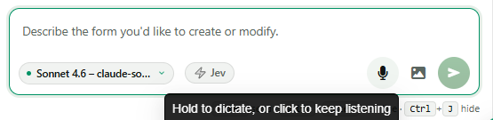
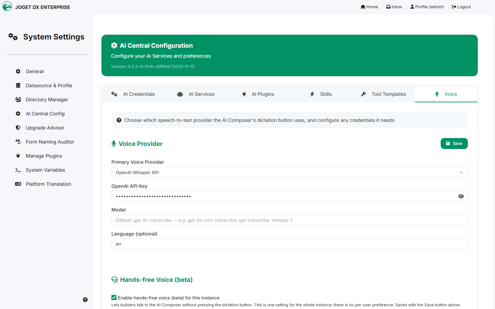
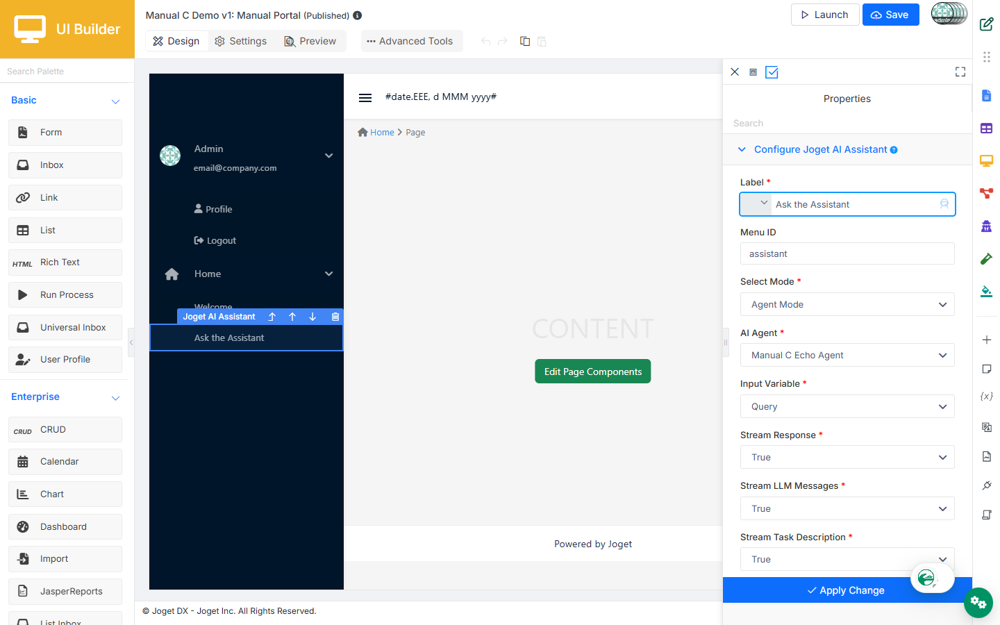
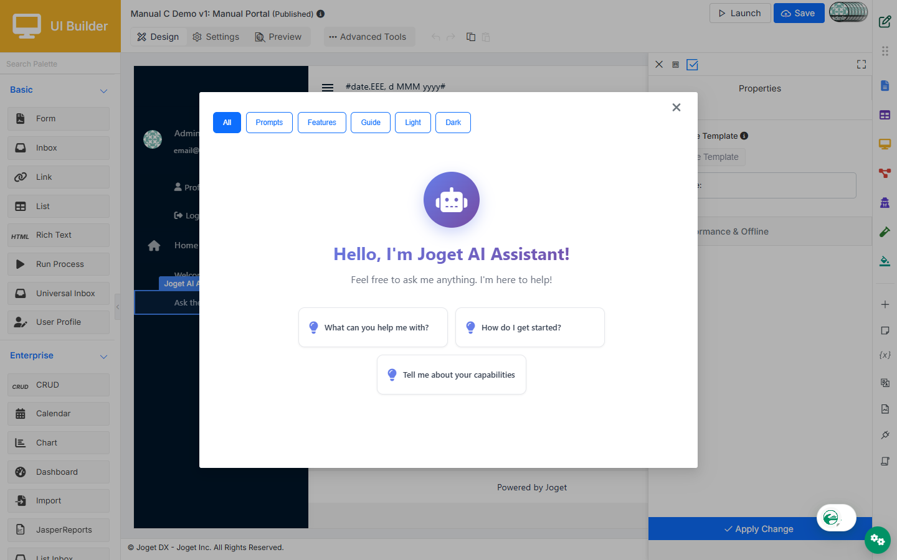
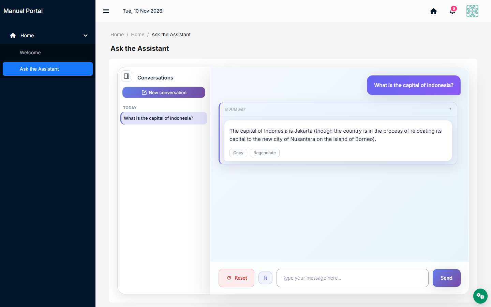

# Voice Input and the Joget AI Assistant

This page has two parts. The first part explains how to talk to the AI Composers: dictation with a microphone button, the optional live transcript, the **Voice** tab of AI Central Config, and the hands-free voice mode (a Preview feature). The second part explains the **Joget AI Assistant**, a Userview menu element that gives the users of your app a chat page backed by a saved Joget process or a saved AI agent, with conversation history, file uploads and questions from the agent. It is written for administrators and implementers who configure voice for the builders and who add the assistant to apps.

## Voice input in the composers

There are three ways to speak to a composer. All three need a microphone in the browser and an OpenAI account, a browser with speech recognition, or both.

| Way | Where | What it does | Status |
|---|---|---|---|
| Dictation | The microphone button in every composer panel | You speak, the text appears in the message box, you read it and send it yourself | Available |
| Live transcript | The same button, when **Speech-to-text mode** is **Realtime** | The words appear in the message box while you speak | Available. On by default when an OpenAI key is saved |
| Hands-free voice | The whole Joget console | You talk without pressing a button. A TypeSafe service decides what you mean and the composer acts on it | Preview. Off by default |

Voice input only fills the message box (dictation) or sends commands (hands-free). The composer then works as described in [How the Composers Work](15-how-composers-work.md).

### Dictation

1. Open a builder with a composer panel, for example the Form Builder.
2. Click the pill to open the panel. The microphone button is next to the message box. Its tooltip reads "Hold to dictate, or click to keep listening".
3. Use one of two gestures:
   - **Hold**: press and hold the button, speak, and release. The text is transcribed when you release.
   - **Latch**: click once (a press shorter than about 0.4 seconds). The panel keeps listening until you click the button again or press **Esc**. The status line reads "Listening — click the mic or press Esc to stop".
4. The text is inserted at the cursor position in the message box. With a provider that delivers partial results, you see words appear while you speak. With a batch provider the status line reads "Transcribing..." after you stop, and the text appears when it is ready.
5. Read the text, correct it, and press Enter to send.

If no voice provider can run in the browser, the button is not shown, or the panel shows "Voice input is not available in this browser". If microphone permission is refused, the panel shows "Microphone permission denied".

### The voice providers

Two providers ship with Agent Builder, and a third entry is added when the live transcript is on.

| Provider | Where audio is processed | Needs configuration | Live words while speaking | Browsers |
|---|---|---|---|---|
| **OpenAI Whisper API** (id `whisper`) | Sent from the browser to Joget as a WAV file, then from Joget to OpenAI (`https://api.openai.com/v1/audio/transcriptions`). The OpenAI key stays on the server | An OpenAI API key (required). Model and language are optional | No. Text appears after you stop | Any browser that supports microphone capture and AudioWorklet |
| **Google Web Speech API** (id `web-speech`) | In the browser, by the browser's own speech service (for Chrome this is a Google service) | None | Yes | Chrome and other Chromium browsers, for example Edge. Not supported in Firefox. Disabled by default in Brave |
| **OpenAI Realtime transcription** (id `openai-realtime`) | The browser streams the microphone directly to an OpenAI transcription session. Joget creates a short-lived session secret with your stored key, so the key never reaches the browser | The same OpenAI key as Whisper, and **Speech-to-text mode** set to **Realtime** (the default) | Yes | Any browser that supports WebSocket and microphone capture |

How Agent Builder chooses between them when you press the button:

1. If **Speech-to-text mode** is **Realtime** and an OpenAI key is saved, OpenAI Realtime transcription is tried first.
2. Then the **Primary Voice Provider** you selected.
3. Then the other built-in provider.
4. A provider that is not configured (for example Whisper without a key) is skipped without trying.
5. If a provider cannot start in this browser, or fails with an error that another provider could avoid (for example a network error of the Web Speech service, or a failed realtime connection), the next provider is used while you still hold the button. The choice is remembered until the page is reloaded.
6. A refused microphone permission is not a reason to switch, because every provider needs the microphone.

On a fresh installation without an OpenAI key, Web Speech is therefore the working provider in Chromium browsers, and nothing works in Firefox until a key is saved.

### The Voice tab

Open **Settings > AI Central Config** (see [AI Central Config Reference](03-ai-central-config.md)) and click the **Voice** tab. The description reads: "Choose which speech-to-text provider the AI Composer's dictation button uses, and configure any credentials it needs". There is one **Save** button for the whole tab. After a successful save the tab shows "Voice provider configuration saved successfully".

#### Voice Provider section

| Field | What it does | Default | Notes |
|---|---|---|---|
| **Primary Voice Provider** | The provider that is tried first (after the realtime provider, if that is on). The list shows every provider that is installed: **OpenAI Whisper API** and **Google Web Speech API** | **OpenAI Whisper API** | Selecting a provider shows its own fields. The value stored is the provider's label |
| **OpenAI API Key** | The OpenAI key used for Whisper dictation, for the live transcript and for hands-free voice | empty | Required for Whisper. Shown as a password. It is stored encrypted. Shown only when **OpenAI Whisper API** is the selected primary provider |
| **Model** | The OpenAI transcription model for dictation | empty (the placeholder reads "Default: gpt-4o-transcribe - e.g. gpt-4o-mini-transcribe, gpt-transcribe, whisper-1") | Any model id is accepted; there is no list. When empty, `gpt-4o-transcribe` is used |
| **Language (optional)** | An ISO 639-1 language code sent to OpenAI as a hint, for example `en`, `id`, `de` | empty (OpenAI detects the language) | Detection can fail on short clips: it may return fluent text in the wrong language. Set a language if your users speak one language. A newer model that does not understand this parameter may ignore it |
| (note) | When you select **Google Web Speech API**, the **OpenAI API Key**, **Model** and **Language (optional)** fields are hidden, and the tab shows the note: "Only works in Chrome and other Chromium-based browsers (e.g. Edge). Not supported in Firefox, and disabled by default in Brave." | | Web Speech has no settings. While it is the selected primary provider you cannot edit the OpenAI key on this tab. Select **OpenAI Whisper API** again to show the fields |

The language of Web Speech is the browser's own language (`navigator.language`, for example `id-ID`). It cannot be set in AI Central Config.

#### Hands-free Voice (beta) section

The second section of the same tab is headed **Hands-free Voice (beta)**. It controls both the hands-free mode and the live transcript of the dictation button.

| Field | What it does | Default | Allowed values and notes |
|---|---|---|---|
| **Enable hands-free voice (beta) for this instance** | Switches hands-free voice on for the whole installation. There is no per-user setting | Off | The switch is disabled, with the message "Hands-free voice cannot be turned on yet:", until a TypeSafe credential and the OpenAI key exist |
| **Speech-to-text mode** | How speech becomes text, in hands-free voice and in dictation | **Realtime - live transcript (gpt-live-transcribe)** | **Realtime** or **Per utterance**. Realtime shows words while you speak over a short-lived OpenAI session. If the live session cannot connect, it falls back to per utterance |
| **Realtime model** | The OpenAI model for the live transcript | `gpt-live-transcribe` | `gpt-live-transcribe` (live words while speaking) or `gpt-transcribe` (transcribes after each utterance). Shown only in Realtime mode |
| **Live transcript delay** | How long the live model waits before showing words | **Low (default)** | **Minimal (fastest)**, **Low (default)**, **Medium**, **High (most accurate)**. Shown only in Realtime mode |
| **Per-utterance transcription model** | The model used in per-utterance mode, and as the fallback when a realtime session cannot connect | `gpt-4o-mini-transcribe` | `gpt-4o-mini-transcribe` (faster, lower cost) or `gpt-4o-transcribe` (more accurate) |
| **Voice navigation** | Whether a spoken "open ..." command opens the page in a new tab or in the current tab | **Open in a new tab** | **Open in a new tab** or **Open in the same tab**. The same tab keeps listening across pages and avoids pop-up blockers |
| **Addressed-to-Composer threshold** (under **Advanced**) | How sure TypeSafe must be that your speech is meant for the Composer before it is handled | 0.85 | A number from 0 to 1 |
| **Action threshold** (under **Advanced**) | The minimum confidence to act on a recognised command. Below it the Composer asks "Did you mean...?" | 0.70 | A number from 0 to 1 |
| **Auto-apply threshold** (under **Advanced**) | The minimum confidence to apply an edit without waiting for you to say "apply" | 0.90 | A number from 0 to 1 |

If a threshold is not a number from 0 to 1, saving fails with "Thresholds must be numbers between 0 and 1". If you save with the switch on while TypeSafe or the OpenAI key is missing, hands-free voice is left off and the tab shows "Hands-free voice was left off: it needs a TypeSafe credential and an OpenAI Whisper API key".

The **Speech-to-text mode** setting also changes the dictation button. With **Realtime** (the default) and an OpenAI key, the dictation button uses the live transcript first, even if you never enable hands-free voice.

### Requirements

| Requirement | Detail |
|---|---|
| Secure connection | Browsers allow microphone capture only on a secure page: HTTPS, or `localhost`. On plain HTTP to another host the button cannot capture audio. Use HTTPS on the Joget server or on the reverse proxy |
| Microphone permission | The browser asks the first time. If you choose **Block**, reset the site permission in the browser's address bar settings |
| User role | Whisper, the live transcript and hands-free voice are available to administrators and app creators. Other users get an error from the server |
| Browser | Whisper and the live transcript need microphone capture and audio worklets (use a current version of your browser). Web Speech needs Chromium |
| Network | The Joget server must reach `api.openai.com` over HTTPS. For the live transcript the browser must reach `wss://api.openai.com`. A proxy that blocks outbound WebSocket connections from browsers makes the live transcript give up after three attempts and use per-utterance transcription for the rest of the page. If you set a Content-Security-Policy on Joget, allow `connect-src wss://api.openai.com` as well as `'self'` |
| Privacy | Audio always leaves your network: to OpenAI (Whisper and live transcript) or to the browser's speech service (Web Speech). Check this against your data policy before you enable voice |

### Languages

- **Web Speech** uses the language of the browser.
- **Whisper dictation** uses the **Language (optional)** field. If it is empty, OpenAI detects the language, which can be wrong on short clips. For Bahasa Indonesia set `id`.
- **Live transcript and hands-free voice** send English as the language hint to OpenAI and are designed for English commands. If your users dictate in another language, set **Speech-to-text mode** to **Per utterance** so that the **Primary Voice Provider** (with its **Language**) is used, or choose **Google Web Speech API** as the primary provider and use a Chromium browser set to the right language.
- The composers understand a request in any language that your LLM understands. Voice only affects how the text gets into the message box.

## Hands-free voice (Preview)

> **Note:** Hands-free voice is a **Preview** feature. It is off by default. The Voice tab labels it "beta". It needs a TypeSafe credential and an OpenAI API key, and it sends your speech to OpenAI and the transcripts to TypeSafe.

Hands-free voice lets an administrator or app creator talk to Joget without pressing a button. A voice indicator (the "HUD") appears in the Joget console. Every utterance is turned into text, TypeSafe decides whether it is meant for the Composer and what it means, and the console acts on it: it opens an app, a builder or a console page, selects an element, sends an edit to the open composer, applies or cancels a pending edit, undoes, saves, or asks a question.

### Switch it on

1. In **Settings > AI Central Config** > **AI Credentials**, add a credential of provider **TypeSafe** with its **API Key** (see [AI Central Config Reference](03-ai-central-config.md)). Defaults: **Model** `jev-latest`, **Base URL** `https://api.typesafe.ai`, **Timeout (ms)** 4000. Use **Test connection** to check it.
2. In the **Voice** tab, select **OpenAI Whisper API** as the **Primary Voice Provider**, enter the **OpenAI API Key**, and click **Save**.
3. In the **Hands-free Voice (beta)** section, switch on **Enable hands-free voice (beta) for this instance**. If the switch is disabled, the message under it names what is missing.
4. Choose **Speech-to-text mode**, **Voice navigation** and, if you wish, the thresholds. Click **Save**.
5. Reload a console page. For administrators and app creators the voice indicator now appears. Other users never see it.

### Use it

1. Look for the voice indicator at the bottom right of a console page. When hands-free voice is enabled and not listening, it reads **Voice off**. Click its microphone button (the tooltip reads "Start listening"). The indicator shows **Listening**. Click it again, or press **Esc**, to stop.
2. Speak a command, for example "open the Leave app", "open the form builder", or, in a builder with a composer, "add a mandatory email field".
3. The indicator shows the states **Hearing you...**, **Thinking...** and **Working...**. The words you said appear in a chip (and, on a builder page, in the composer's message box) and the result appears under it, for example "Opening Local testing".
4. Speech that is not meant for the Composer is ignored and fades.
5. If TypeSafe is not sure what you meant, the Composer asks "Did you mean...?". Say **yes** or **no**.
6. Actions are graded by risk. Reading and navigating run at once. Edits to a composer are shown as a preview and applied when you say "apply" (or "cancel"), unless the confidence is higher than the **Auto-apply threshold** and the change is small and not destructive. A destructive action, for example deleting a user, asks "Say yes to confirm or no to cancel." Some actions are refused and show a message.
7. If a command opens another page, the remaining steps run after the page has loaded, so "open the leave form and add a date field" can be said in one sentence. With **Open in a new tab**, a blocked pop-up becomes a link you can click.
8. The microphone follows the tab that has the focus. When you dictate with the composer's button, hands-free listening pauses and resumes afterwards. A pause you made yourself stays.
9. The indicator has a history list of the last commands.

### Limits of the Preview

- The language is English (see Languages).
- It is one setting for the whole installation. There is no per-user switch.
- The microphone is open while it is listening. In realtime mode the audio streams to OpenAI only while speech is detected.
- The commands depend on the page: the list of actions comes from the page you are on.
- Accuracy depends on the quality of the microphone and on TypeSafe. Test it with your users' voices before you rely on it.

## Writing a custom voice provider

Agent Builder has an internal extension point for voice providers: an interface named `org.joget.ai.config.voice.VoiceProviderPlugin` with a server part (id, label, configuration fields, `transcribe`) and a browser part (a script that registers a constructor in `window.ComposerVoiceProviders`). The two built-in providers use it.

**An external plugin cannot use it with the plugin jar.** Two things prevent it:

1. The package `org.joget.ai.config.voice` is not in the list of packages that the Agent Builder bundle exports. A plugin that imports the interface cannot resolve it, and a copy embedded in your own plugin is a different class that Agent Builder does not recognise. You can check this yourself: open `META-INF/MANIFEST.MF` in the Agent Builder jar and read the `Export-Package` header. Compare it with the packages that [Extending Agent Builder: Overview and Development Setup](23-extending-overview.md) lists as usable (for example `org.joget.ai.agent.lib.composer`, `org.joget.ai.agent.model`).
2. The composer panel loads the browser scripts of the two built-in providers and of the realtime provider only. The script of an extra provider would have to be added to the page by another mechanism of your own.

What you can do instead:

- Choose between **OpenAI Whisper API** and **Google Web Speech API**, and set the **Model** and **Language** of Whisper.
- Use your browser's or operating system's own dictation, which types into the message box like a keyboard. It works in every composer without any configuration.
- If you need a different speech service, raise it with Joget as a requirement for an exported provider interface.

The Whisper provider always calls the OpenAI address shown above. There is no setting for a different endpoint or a self-hosted model.

## The Joget AI Assistant

### What it is

The **Joget AI Assistant** is a Userview menu element. It is listed in the **Marketplace** category when you add a menu item in the **Userview Builder**. It gives the users of your app a chat page with a welcome screen, a message box and a **Reset** button. What answers the chat depends on the mode:

| Mode | What answers | History | Typical use |
|---|---|---|---|
| **Process Mode** | A saved Joget **process** that runs once per message | The browser sends the conversation so far with each message. Nothing is stored on the server by the assistant | Put an existing workflow (which may call an agent or any other logic) behind a chat page |
| **Agent Mode** | A saved **AI agent** of the same app, one run per message | Conversations are stored on the server for logged-in users, with a conversation list, file uploads, questions from the agent and result panels | Let users talk to an agent |

The assistant is part of the Agent Builder plugin and needs the Enterprise edition of Joget DX. It can be set as the home page of a Userview. The mode list in this build offers these two modes only.

### Add it to an app

1. Open the app in the **App Composer** and open the **UI Builder** (the Userview Builder).
2. Drag **Joget AI Assistant** from the **Marketplace** group of the palette on the left onto a category of the userview, or select an existing assistant menu.
3. Set **Label** and, if you need one, **Menu ID** (the Custom ID).
4. Set **Select Mode** to **Process Mode** or **Agent Mode** and complete the settings for that mode.
5. Optionally choose a **Welcome Template** in the **Welcome Section**.
6. Apply the change, save, and publish the Userview.

### Properties

#### General

| Field | What it does | Default | Notes |
|---|---|---|---|
| **Label** | The menu name | Joget AI Assistant | Required |
| **Custom ID** (shown as **Menu ID** in the builder) | An HTML `id` for your own CSS or JavaScript, and the last part of the menu address | empty | Letters, digits and underscore only; otherwise "Invalid ID" |
| **Select Mode** | What answers the chat | none | Required. **Process Mode** or **Agent Mode** |

#### Process Mode (section "Configure Process Mode")

| Field | What it does | Default | Notes |
|---|---|---|---|
| **Process** | The process that runs on every message | none | Required. Choose from the processes of the app. The latest version of the process is started |
| **Workflow Variable (Prompt)** | The process variable that receives the user's message | none | Required |
| **Workflow Variable (History)** | The process variable that receives the conversation so far, as question and answer pairs | none | Not marked required in the editor. Select a variable if your process needs earlier turns |
| **Workflow Variable (Result)** | The process variable the assistant reads when the process has finished, and shows as the reply | none | Required |
| **Stream Response** | Shows the reply with a typing effect | none | Required. **True** or **False**. In Process Mode this is only a display effect on the finished reply |

The variable lists show the variables of the whole app. Choose variables that exist in the selected process. The assistant starts the process, then checks it once per second for up to 5 minutes until it is completed, and then reads the **Result** variable. A process that waits for a person, or runs longer than 5 minutes, returns an empty or incomplete reply. Use a process that finishes by itself.

#### Agent Mode (fields shown when **Select Mode** is **Agent Mode**)

These fields appear in the same section as **Label**, **Menu ID** and **Select Mode**, which the builder titles **Configure Joget AI Assistant**. The Process Mode fields have their own sub-section, **Configure Process Mode**.

| Field | What it does | Default | Notes |
|---|---|---|---|
| **AI Agent** | The saved agent that runs for every message | none | Required. The list shows the agents saved in this app |
| **Input Variable** | The agent input variable that receives the user's message | none | Required. The list shows the input variables of the chosen agent and refreshes when you change the agent |
| **Stream Response** | Streams the run to the chat while it happens | none | Required. **True** or **False**. Questions, forms and display panels need **True** |
| **Stream LLM Messages** | Shows the model's answer text progressively | none | Shown only when **Stream Response** is **True**. Required then |
| **Stream Task Description** | Shows the name of each task when it starts | none | Shown only when **Stream Response** is **True** |
| **Stream Tool Description** | Shows the name of each tool when the agent calls it | none | Shown only when **Stream Response** is **True** |
| **Keep Conversation History** | Saves the conversations of logged-in users, lists them in a sidebar and gives the agent the earlier messages | **True** | **True** or **False**. Anonymous users get no history |
| **Messages Sent To Agent** | How many of the latest messages of the conversation the agent receives with each new message | `10` | A whole number of one to three digits; the server accepts 0 to 200. `0` sends no earlier messages. Shown only when history is on |
| **Maximum Upload Size (MB)** | The largest file a user may attach | `10` | A whole number; the server accepts 1 to 100 |
| **Allowed Upload File Types** | The file extensions users may attach | `pdf,png,jpg,jpeg,gif,webp,bmp,txt,csv,json,md,xml,html,log` | Comma-separated, without dots |

#### Welcome Section (both modes)

| Field | What it does | Default | Notes |
|---|---|---|---|
| **Welcome Template** | The layout of the screen shown before the first message | empty | Empty shows the built-in screen: in Agent Mode the greeting "Hello, I'm Joget's Agent Assistant!" and three prompt cards ("What questions can I ask you?", "What are your capabilities?" and "Who are you?"). Click **Choose Template** and pick a layout; filter by **All**, **Prompts**, **Features**, **Guide**, **Light** or **Dark** |
| **Title**, **Subtitle**, **Badge Label**, **Footer Note** | Text in the template | empty | Plain text |
| **Avatar Icon** | The icon of the template's avatar | empty | A Font Awesome icon tag, for example `<i class="fas fa-robot"></i>` |
| **Suggested Prompt 1** to **3**, **Prompt 1 Icon** to **Prompt 3 Icon** | Cards that send their text as the first message when clicked | empty | |
| **Feature 1 Icon**, **Feature 1 Title**, **Feature 1 Description** (and 2, 3) | Feature call-outs in some templates | empty | |
| **Background Color**, **Accent Color** | The two theme colours of the template | `#1e3a5f` and `#2563eb` | |

A field of the Welcome Section appears only when the chosen template contains the matching placeholder. A template without a second feature block has no **Feature 2** fields.

## Agent Mode in use

### Talking to the agent

Type a message and press **Enter**, or click **Send**. While the agent works, **Send** is replaced by **Stop**. Answers are shown as Markdown (lists, tables, code blocks, links). Every answer has a **Copy** button, and the latest answer has **Regenerate**, which sends the last message again. **Retry** appears after an error. **Reset** starts a new conversation and returns to the welcome screen; it does not delete the old conversation.

### Memory and the conversation list

- The first message of a chat creates a conversation. All following messages of that chat are added to it.
- With every new message the agent receives the latest **Messages Sent To Agent** messages of the conversation (default 10). Each earlier message is cut to 2,000 characters when it is sent. This is how the agent remembers what was said.
- Each run is a new run of the agent. The agent sees earlier turns through the history, not through variables that a previous run set.
- Conversations belong to one user, one agent and one app (not one app version), so they survive a new app version. A user never sees the conversations of another user.
- Only logged-in users get history. For anonymous visitors the sidebar stays empty and every message starts fresh.

The sidebar lists the user's conversations for this agent, newest first, grouped under **Today**, **Yesterday**, **Previous 7 days** and **Older**. It shows at most the 200 most recently changed conversations. The title is the first message, shortened to 80 characters.

| Action | How |
|---|---|
| New chat | **New conversation** |
| Open | Click the conversation. The saved messages replace the current chat |
| Rename | The pencil icon, type the new title, **Enter** (**Esc** cancels) |
| Delete | The bin icon, then **Delete** to confirm or **Cancel** |
| Collapse | The toggle at the top of the sidebar. The choice is remembered in the browser |
| Keyboard | Arrow keys, **Home** and **End** move between rows; **F2** renames; **Delete** deletes |

You cannot open, rename or delete a conversation while a run is in progress. At 768 pixels width or less, the sidebar becomes a drawer that is closed by default.

What is stored: the user's messages, the agent's answers (including each answer during a long run), each question the agent asked the user and the user's answer, the conversation title and the times. What is not stored: progress (task, tool and sub-agent steps), the interactive forms, display panels and links, attached files and the values of the **Inputs** form. A reopened conversation shows the saved messages as plain chat.

### Extra inputs and files

If the agent declares input variables besides the one chosen as **Input Variable**, an **Inputs** section appears above the message box with one field per variable (a text box for text, a file picker for files). The description of a variable is the hint in its field. The values are sent with the next message.

Files are attached with the paperclip button, by drag and drop, or by pasting an image. Each file appears as a chip that can be removed before sending.

- A message can carry at most 10 files.
- A file larger than **Maximum Upload Size (MB)**, or with an extension that is not in **Allowed Upload File Types**, is rejected with a message. The server checks the limits again, so they cannot be bypassed in the browser.
- An attached file goes to the agent's file input. If the agent declares exactly one file input, any file attached with the paperclip, drag and drop or paste is used for it. If it declares none or more than one, files attached this way are refused; use the file pickers in the **Inputs** section.
- PDFs and images are passed to the model as images, and text files as text. The model must support images for the first.
- Uploaded files are kept in a temporary folder that the web server does not serve, and are deleted when the run ends.
- Text typed into any input is limited to 100,000 characters.

### Questions from the agent

When the agent calls the **User Input** tool, the run pauses and the chat shows the request. The run continues when the user answers. The request shows a countdown, and an unanswered request expires after 5 minutes (the tool's default timeout); the form is then disabled.

| Tool mode | What the user sees |
|---|---|
| **Ask Question** | The question, a text box and **Send** |
| **Confirmation** | The question and two buttons, **Yes** and **No** (unless renamed) |
| **Action Choice** | The question and one button per option supplied by the agent |
| **Get Permission** | A description of the action and the reason, with **Allow** and **Deny** |

After the answer the form is locked and shows the answer. If the run ends, is stopped, or the page is reloaded, an unanswered form is disabled. A question from a sub-agent (called with the **Run Agent** tool) appears in the chat like any other, and the answer is recorded in the conversation. The **HTML UI** tool can put a complete HTML form into the chat; the submitted values go back to the agent.

Questions, forms and panels reach the user over the stream, so **Stream Response** must be **True** for an agent that uses them.

### Results: display tools

The **Display Mode** of a display tool decides where its content appears.

| Display Mode | What the user sees |
|---|---|
| **Panel** | The content opens in a panel next to the chat, with a close button |
| **Inline** | The content is placed inside the chat message |
| **Link** | A button appears in the chat; clicking it opens the content in the panel |
| **New Tab** | A URL opens in a new browser tab. Content that is not a URL opens in the panel instead |

The content comes from the **HTML Markup Display**, **Ajax Display**, **URL Display**, **File Viewer** (PDF, image, video, YouTube) and **Script Runner** tools. Only `http`, `https` and relative links are opened; any other link is blocked and the chat shows "Blocked an unsafe link."

With **Stream Task Description** and **Stream Tool Description** on, the chat shows a collapsible block for each task with the tools called. Steps of a sub-agent appear in the same block with the prefix "Sub-agent:". A failed step is a muted line ending in "failed".

### Stopping a run

**Stop** asks the server to abort the run, disables open question forms, and ends the turn with "Stopped". The part of the answer that was already written stays on screen but is not saved in the conversation, so it is gone after a reload. Only the user who started a run can stop it or answer its questions.

## Designing an agent for the assistant

- Give the agent one input for the message. The default input variable `query` is fine; choose it as **Input Variable**. Add more inputs only for values the user sets on purpose (a language, a customer id) and give each a description, because it becomes the hint in the **Inputs** section.
- Each message starts a new run. To keep one run open for a whole chat, build a loop: a task answers the latest message and then calls **User Input** in **Ask Question** mode to ask what the user wants next; a **Response Condition** route ends on a closing phrase (for example "DONE") and a final **Always** route uses **Go to Task** to return to the same task. Set a sensible iteration limit on the agent so that the loop cannot run forever.
- Keep question texts short. They are shown in the chat and stored in the history.
- Prefer **Confirmation**, **Action Choice** and **Get Permission** to free text for decisions.
- With the default of 10 history messages, long chats are partly forgotten. Raise **Messages Sent To Agent**, or store important facts with the **Mem0 Memory** tool.

## Permissions, security and storage

- **Who can chat.** Anyone who can open the Userview menu can chat with the agent. Set the Userview's permission (and login requirement) for the audience you want. Without a login, users get no history.
- **Whose data.** The conversation list, messages, rename and delete always work on the logged-in user's own conversations for this agent. Answering a question or stopping a run is allowed only for the user who started the run.
- **Server-side configuration.** The settings of the menu are sent to the browser in encrypted form. The browser cannot change which agent runs.
- **Security token.** Every request of the chat page carries a token that is created when the page loads and is tied to this app and this menu. A page left open for a long time can have an expired token; the user then sees "Your session may have expired. Please refresh the page and try again."
- **Cleaned output.** Markdown answers and question texts are cleaned before they are shown: scripts, frames, forms and unknown attributes are removed and unsafe links are blocked.
- **Agent-written HTML runs scripts.** The content of the **HTML UI**, **HTML Markup Display**, **Ajax Display** and **Script Runner** tools is placed in the page and its scripts run with the user's session. Use only agents that you or your team wrote and trust, and be careful when an agent builds such content from outside data.
- **Frames.** Pages from another site shown by **URL Display** are placed in a restricted frame. Pages from the same server are not restricted.
- **What the model sees.** Conversation history, typed inputs and attached files are sent to the LLM provider of the agent. Do not attach files that the provider must not receive.

### Where conversations are stored

Agent Mode stores everything in the Joget database. Nothing depends on the memory or the disk of one server.

| Table | Content |
|---|---|
| `ai_assistant_conversation` | One row per conversation: app, agent, user, title, message count and times |
| `ai_assistant_message` | The messages of each conversation, in order |
| `ai_assistant_run` | A short-lived record of each active run, linking it to its user so that only that user can answer its questions or stop it. Records left behind, for example after a crash, are removed after 12 hours |

Deleting a conversation in the sidebar hides it and makes it unreadable for the user; the rows remain in the tables. Process Mode stores nothing: the history lives in the browser page and is sent with each message.

Because the state is in the database, the assistant works in a cluster (different nodes can handle different messages of one chat) and on Joget Cloud without extra configuration. The answer is streamed over HTTP, so a reverse proxy in front of Joget must not buffer or time out streaming responses on the assistant's address (for nginx: `proxy_buffering off` for that location, and a read timeout longer than your longest agent run).

### Joget versions

The assistant has one dependency: the **Choose Template** dialog of the Userview Builder, which reuses the template chooser of the Enterprise edition's information tile component. If the dialog does not open, check that this component is available on your installation and look for a message in the browser console. The assistant is not available on the Community edition.

## Limitations and things to know

- **Voice**
  - Audio is processed by OpenAI or by the browser's speech service. It leaves your network.
  - The live transcript and hands-free voice send English as the language hint.
  - Web Speech works in Chromium browsers only. Whisper and the live transcript need an OpenAI key.
  - The Whisper provider calls a fixed OpenAI address. There is no custom endpoint.
  - Voice features are available to administrators and app creators.
  - If you switch the **Primary Voice Provider** to Web Speech, the OpenAI key field is hidden. Keep **OpenAI Whisper API** as primary if you use the live transcript or hands-free voice.
  - Hands-free voice is a Preview. It needs TypeSafe and OpenAI, is switched on for the whole installation, and its commands are English.
  - An external plugin cannot add a voice provider with this jar.
- **Assistant, both modes**
  - One assistant menu serves one process or one agent. Use several menus for several agents.
  - The assistant passes the message and the declared inputs only. It does not pass Userview or form data by itself. Give the agent tools and prompts for that.
- **Process Mode**
  - The process must finish by itself within 5 minutes.
  - The history is rebuilt in the browser and sent with every message.
  - **Reset** clears only the page, not what a completed run wrote to forms or variables.
- **Agent Mode**
  - Progress, interactive forms and display panels are live only. A reopened conversation shows text.
  - Attachments and **Inputs** values are not saved. **Regenerate** and **Retry** send the last message again with the current inputs.
  - A run is tied to the browser page. If the user reloads or leaves during a run, the chat no longer follows the run, and any open question is disabled.
  - The sidebar lists at most 200 conversations per user and agent and has no search.
  - Messages above 100,000 characters are cut when saved; earlier messages are cut to 2,000 characters when sent to the agent.
  - Anonymous users have no history.

## Troubleshooting

| Symptom | Cause | Fix |
|---|---|---|
| No microphone button in the composer | No voice provider can run in this browser | Use Chrome or Edge, or save an OpenAI key in the **Voice** tab |
| "Microphone permission denied" | The browser blocked the microphone, or the page is not HTTPS | Allow the microphone for the site; serve Joget over HTTPS |
| Text is in the wrong language | **Language (optional)** is empty and auto-detect failed, or the live transcript is on | Set **Language (optional)**; set **Speech-to-text mode** to **Per utterance** for languages other than English |
| Dictation does nothing in Firefox | Web Speech is not supported and no OpenAI key is saved | Save an OpenAI key and keep **OpenAI Whisper API** as primary |
| The enable switch for hands-free voice is disabled | TypeSafe credential or OpenAI key is missing | Add them as described, and save |
| Hands-free voice indicator does not appear | The switch is off, the user is not an administrator or app creator, or the page is a pop-up | Check the switch; sign in as an administrator; reload the console page |
| Live words never appear, text comes after you stop | The realtime session could not connect (key, proxy, network) | Check outbound access to `api.openai.com` and `wss://api.openai.com`; the panel then uses per-utterance transcription |
| The assistant menu shows "No AI agent is selected for this assistant" | **AI Agent** is empty | Select an agent in the menu properties |
| "The AI agent for this assistant was not found" | The agent was deleted or renamed | Select an agent again |
| "Your session may have expired. Please refresh the page and try again." | The page's security token or the login expired | Refresh the page, sign in again if asked, and resend |
| "Sorry, there was an error processing your request. Please try again." | The agent cannot run (agent missing, LLM connection failing, rejected input or file) | Check the agent, the LLM connection and the Joget log; use **Retry** |
| "The connection was lost before the agent finished." | The stream broke: network, or a proxy that closes or buffers long responses | Use **Retry**; configure the proxy for streaming |
| "The response stream ended unexpectedly. The answer may be incomplete." | The stream ended without a closing event | **Retry** or **Regenerate** |
| "The agent finished without producing an answer." | The run returned no text | Check the agent's last task and prompts |
| A form shows "This request expired." or "This request is no longer active." | The 5-minute wait ended, or the run finished or was stopped | Send the message again |
| An attachment is rejected | Too large, wrong type, more than 10 files, or the agent takes no file | Adjust the file or the menu settings |
| The sidebar is empty | **Keep Conversation History** is **False**, or the user is not logged in | Turn history on and require login |
| "Could not load conversations." | History is off, the login expired, or a server error | Click **Retry** or refresh |
| The agent forgets earlier messages | **Messages Sent To Agent** is low, or history is off | Raise the number or turn history on |
| Process Mode replies are empty | The process did not finish in 5 minutes, or the **Result** variable is wrong | Use a process that completes by itself and check the variable |

## Where to go next

- [AI Central Config Reference](03-ai-central-config.md) for the **Voice** tab, the TypeSafe credential and the AI services.
- [How the Composers Work](15-how-composers-work.md) for what the composer does with your dictated text.
- [Using Agents Inside Joget Apps](08-using-agents-in-apps.md) for other ways to put an agent in front of users.
- [Building Agents Step by Step](05-building-agents-tutorials.md) for building the agent that Agent Mode runs.
- [Security and Governance](11-security-and-governance.md) for who may use the composers and the assistant.
