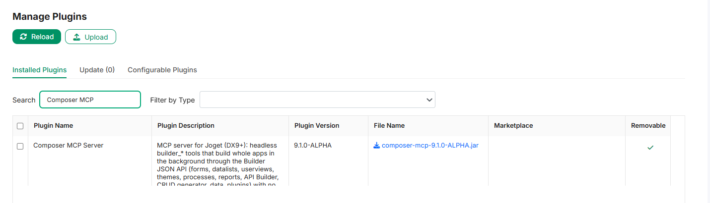

# Composer MCP: Overview and How It Works

Composer MCP is a Joget plugin that lets an external AI coding assistant, such as Claude Code, build complete Joget DX applications (apps, forms, lists, userviews, themes, processes and sample data) through the Model Context Protocol, without a builder page open in a browser. This page explains what the plugin is, how it differs from the AI Composers inside Joget, how a request travels through it, what you get with and without Agent Builder, and which limits apply. It is for implementers who decide whether and how to use Composer MCP. Installation is on [Composer MCP: Install, Configure and Connect](18-composer-mcp-setup.md), the tools are on [Composer MCP: Tool Reference](19-composer-mcp-tools.md), and security is on [Composer MCP: Security, Clustering and Troubleshooting](21-composer-mcp-security-and-operations.md).

## What MCP is

The Model Context Protocol (MCP) is an open standard that lets an AI assistant call tools that live in another program. The assistant (the MCP client) asks the program (the MCP server) which tools it offers. The server answers with a list: each tool has a name, a description and a schema for its arguments. During a conversation the assistant decides when to call a tool, sends the arguments, and receives a result that it reads and uses in its next step. Messages are JSON-RPC 2.0 documents. MCP also lets a server offer **prompts** (ready-made instruction texts) and **resources** (readable documents).

An MCP server can run on your own machine or on a remote server. A remote server is reached over HTTP. The transport that Composer MCP uses is called Streamable HTTP: the client sends each message as an HTTP `POST` and the server writes the reply on the same HTTP response. No connection is held open between messages. The client sends its credentials as an HTTP header on every request.

## What Composer MCP is

Composer MCP is an MCP server that runs inside Joget. You install it like any other Joget plugin: you upload one jar in **Settings > Manage Plugins**. After that, Joget answers MCP requests at this address:

```text
http(s)://<joget-host>/jw/mcp/composer/mcp
```

The plugin gives an MCP client three things:

1. **Builder tools** (names start with `builder_`). They create, read, change and delete the parts of a Joget app: forms, lists (datalists), userviews, themes, processes, reports, API Builder definitions, sample data and more. The tools run inside the Joget server, in the same Java process, and use the same services that the Joget builders use. They need no browser.
2. **A skill library.** The jar contains a curated set of Joget "skills": written domain knowledge about how to build forms, lists, userviews, themes and processes the right way. The assistant reads the relevant skills before it builds. The server also lists the skills you have configured in Agent Builder, if it is installed.
3. **Optional browser-connected composers.** If you have a Joget builder page open, the assistant can edit that open canvas live. This is an extra and is described below.

The plugin is delivered as `composer-mcp-9.1.0-ALPHA.jar`. The file name has the pattern `composer-mcp-<version>.jar`. It is an alpha build and requires Joget DX 9.1 or later, Enterprise edition (built against DX 9.1.1). It does not run on Joget 8.x, because it uses the Jakarta servlet API of DX 9. The plugin appears in the plugin list as **Composer MCP Server**.

> **Note:** Composer MCP does not call any AI model itself. It contains no model provider, no API credential and no prompt-sending code. All reasoning happens in the MCP client that connects to it.

## Composer MCP compared with the in-product AI Composers

Agent Builder includes AI Composers: chat panels inside the Joget form, list, userview, process and theme builders, plus the Orchestrator that builds a whole app from one prompt (see [AI Composers User Guide](12-composers-user-guide.md) and [The Orchestrator: Building Whole Apps](13-orchestrator.md)). Composer MCP builds the same kinds of things from the other side: the model and the conversation are outside Joget.

| Question | In-product AI Composers | Composer MCP |
|---|---|---|
| Who is the model? | The model you configured in **AI Central Config** (**AI Credentials**, for example an OpenAI or Anthropic model), called by the Joget server. | The model of the MCP client, for example the Claude model behind your Claude Code. Joget never sees or chooses it. |
| Who pays for tokens? | The account behind the AI credential stored in Joget. Joget spends the tokens. | The user of the MCP client, through their own subscription or API account. Joget spends none. |
| Where does the conversation happen? | In a chat panel inside the Joget builder page. | In the client: a terminal, an IDE or a desktop application. |
| Where does the work happen? | Joget calls the model, receives its tool calls and applies them to the open builder canvas. You press **Save**. | The client calls tools on Joget. The builder tools write to the app directly and in-process. No canvas is involved and no Save button is pressed. |
| Needs Agent Builder installed? | Yes. | No. Agent Builder adds optional features (see below). |
| Needs a browser tab open? | Yes. | No for the builder tools. Only the optional browser-connected composers need a tab. |
| Who controls knowledge and rules? | Agent Builder: Central Instructions and skills in **AI Central Config**. | The skill library in the jar, plus the skills you configured in Agent Builder, plus your own project instructions in the client (for example `CLAUDE.md`). |
| Typical user | A business or low-code user who works in the builder. | A developer or implementer who works with an AI coding assistant and wants a whole app, or a repeatable build, from a prompt. |

Both approaches write ordinary Joget definitions. An app built through Composer MCP opens in the Joget builders like any other app and can be edited by hand or with the AI Composers afterwards.

Choose Composer MCP when you want the assistant you already use (and already pay for) to do the build, when you want the build to run without anyone watching a builder page, or when you want your own project rules (naming conventions, language, standards) applied through the assistant. Choose the in-product composers when users work inside Joget and you want one governed model, one credential and one place for cost reporting.

## Architecture and request flow

```text
 MCP client (Claude Code, an IDE, ...)
      |  Streamable HTTP: JSON-RPC in an HTTP POST
      |  header X-Builder-Api-Key: <key>   (or Authorization: Bearer <key>)
      v
 <joget>/jw/mcp/composer/mcp          the Composer MCP plugin, inside Joget
      |
      +-- builder_* tools ----> tool whitelist, argument checks, confirm:true gate
      |                              |
      |                              v
      |                         Builder API code, called in the same Java process
      |                         (key check, lint gates, page-wipe guard, explicit app id
      |                          and version, cache refresh, git commit if configured)
      |                              |
      |                              v
      |                         Joget services: app, form, list, userview, process, data
      |
      +-- joget_skill* tools, prompts, resources --> skill library (read-only)
      |
      +-- list_sessions, connect_session, form_* list_* ui_* theme_* process_*   (optional)
               slots registered by open builder tabs; state mirrored in the Joget database
```

A typical tool call travels like this:

1. The client sends `initialize`. The server creates a session and returns its id in the `Mcp-Session-Id` response header. The client sends this header on every later request.
2. The client sends `tools/list`. The server returns the builder tools, the skill tools, the two session tools, and (only when a matching builder tab is open) the browser composer tools.
3. The model decides to call a tool, for example `builder_form` with `operation: "create"`. The client sends `tools/call`.
4. For a `builder_*` tool, the plugin first checks the credentials. If they are not accepted, it returns an error result (`isError: true`) whose text contains `"status": 401` (or 403) and does nothing else. The HTTP response that carries this result is still HTTP 200: the status code is inside the result, not in the HTTP status line.
5. If the credentials are accepted, the plugin checks the arguments against its whitelist of operations, requires `confirm: true` for operations with side effects, and then calls the Builder API code in the same Java process. There is no HTTP call back into Joget.
6. The Builder API code runs its own guards (lint, page-wipe protection, explicit target) and writes through the normal Joget services. For writes made with the shared key, Joget records the configured **run-as** user (default `admin`) as creator and modifier.
7. The result goes back as JSON in the HTTP response. A failure sets `isError: true` and carries the platform's error body, so the model can read and fix the problem.

Three design points matter to an operator:

- **Headless is the default.** The builder tools do not need a browser tab, a slot or a session connection. They work as soon as the plugin runs and access is configured.
- **Every guard still runs.** Because the tools call the Builder API code directly, authentication, lint gates, the page-wipe guard and the explicit app id and version requirement apply unchanged. The same code also serves a REST API under `/jw/api/*`, protected by the same key.
- **No sticky sessions.** Each request is self-contained and session state is mirrored in the Joget database, so any node behind a load balancer can answer any request. See [Composer MCP: Security, Clustering and Troubleshooting](21-composer-mcp-security-and-operations.md).

## Safety rules built into the builder tools

The tools are designed so that a model can build quickly but cannot easily do damage by mistake. These rules apply to every connection that is allowed to use the builder tools.

| Rule | What it means for you |
|---|---|
| Deny by default | Until an operator configures access, the builder tools answer 401. Skill tools and prompts work without access. |
| Whitelist | Only the listed tools and operations exist. There is no tool that calls any URL or runs SQL. |
| Confirm gate | Deleting, deploying a process, starting or completing workflow, submitting data or files, generating CRUD, and uploading a plugin need `confirm: true`. The assistant should set it only after you agreed to that specific action. |
| Explicit target | Every call needs an `appId` and a numeric `appVersion`. There are no defaults. |
| Lint gate | Saving a form or list runs lint. Errors block the save and come back as `errors[]`. The assistant should fix them and not turn lint off. |
| Page-wipe guard | A userview update that would remove existing pages is refused unless the call allows it explicitly (and carries `confirm: true`). `patch`, `menu_add` and `page_update` change a userview safely. |
| Update replaces | `update` replaces the whole definition. The assistant reads it with `get`, edits it and then calls `update`, or uses `patch` for a small change. `create` on an id that exists returns 409. |
| Service-layer writes | Changes go through Joget services. The app cache is refreshed, and the change is committed to git if the instance has git configured. |

## Terms used on these pages

| Term | Meaning |
|---|---|
| MCP client | The assistant program that calls tools, for example Claude Code. |
| MCP server | The program that offers tools. Here: the Composer MCP plugin inside Joget. |
| Tool | A named action with typed arguments, for example `builder_form`. |
| Prompt | A ready-made instruction text that the server offers to the client. |
| Resource | A document the client can read, addressed as `joget-skill://<skill>/<path>`. |
| Skill | A folder of written Joget knowledge with a short `SKILL.md` that routes to deeper files. |
| Slot | A registered, open builder tab that the browser-connected composers can edit. |
| Builder API key | The shared secret that clients send to use the builder tools. |
| Opt-in feature | A dangerous operation that is off until an operator enables it: `app-create` or `plugin-upload`. |
| Run-as user | The Joget user under which key-authenticated writes are recorded. |

## The two families of capability

### Headless builder tools (the default)

These tools are always listed and always available. They need no browser. Each takes an `operation` argument and, where relevant, `appId`, `appVersion`, `id`, `params`, `body` and `confirm`. The groups are:

| Group | Tools | What they do |
|---|---|---|
| Status and checks | `builder_status`, `builder_lint`, `builder_verify_app` | Show how the connection is authorised; dry-run lint of a form or list definition; audit an app without changing it. |
| App | `builder_app` | Create a new app (only when the `app-create` feature is enabled). |
| Definitions | `builder_form`, `builder_datalist`, `builder_userview`, `builder_theme`, `builder_process`, `builder_report`, `builder_apibuilder` | List, get, create, update, patch and delete these definitions; validate and deploy processes. |
| Data and workflow | `builder_data`, `builder_workflow` | Read, seed and upload data; start and complete process instances. |
| Generators and introspection | `builder_generate_crud`, `builder_introspect` | Generate a form, list and CRUD menu together; list element classes and their property schemas. |
| Plugins | `builder_plugin` | Check, and (only when the `plugin-upload` feature is enabled) upload a plugin jar. |

The exact operations, arguments and results are on [Composer MCP: Tool Reference](19-composer-mcp-tools.md).

### Browser-connected composers (optional)

If a Joget builder page is open (Form, List, Userview, Theme or Process builder), the plugin injects a small script into that page. The script registers the page as a **slot** and then polls the server about every 1.2 seconds for changes. The assistant calls `list_sessions` to see open slots and `connect_session` to attach to one. After that the composer tools for that type (`form_*`, `list_*`, `ui_*`, `theme_*`, `process_*`) change the open canvas live, field by field.

Differences from the headless tools:

- The changes are made to the canvas in the browser. They are **not saved** by the assistant. You press the builder's **Save** button, so manual edits are never overwritten without your action.
- The composer tools for a type appear in `tools/list` only while a builder tab of that type is open and polling. When you close the tab, they disappear again.
- They are not covered by the Builder API key. See the security notes below and on the security page.
- They need Agent Builder on the same instance (see below).

### When to use which

| Situation | Use |
|---|---|
| Build or change an app with nobody watching a builder page | Headless builder tools |
| Scripted or repeatable builds, continuous integration, a server without a desktop | Headless builder tools |
| Seed sample data, start a process instance, audit an app | Headless builder tools |
| Pair with a user who has a form open and wants to see the form change as the assistant works | Browser-connected composers |
| Make a few edits to the canvas that the user will review and save themselves | Browser-connected composers |

Start with the headless tools. Add the browser-connected composers only when you want the live-canvas experience.

## How skills and prompts reach the client

The server publishes its knowledge three ways so that any MCP client can use it:

1. **Skill tools.** `joget_skills_list` lists skills, `joget_skill_read` reads a skill (the short `SKILL.md` first, then one section or file at a time), `joget_skill_search` searches by keyword, and `joget_get_contract` returns the exact property contract of a plugin class. Every MCP client that supports tools gets the skills this way.
2. **Prompts.** `prompts/list` returns the instruction prompts (`joget_global_instructions`, `joget_build_instructions`, `joget_review_instructions`, role prompts for builder and checker agents, and one prompt `skill_<name>` per skill). Clients that support prompts show them as slash commands or a prompt picker.
3. **Resources.** Every bundled skill file can be read as `joget-skill://<skill>/<path>`, for example `joget-skill://joget-form-builder/SKILL.md`. Support for resources depends on the client.

When a client connects, the server also sends a short instruction text in its `initialize` reply. It tells the assistant to read the matching skill before building, to start with `builder_status`, and to prefer the headless tools. The skill tools, prompts and resources are read-only and are **not** protected by the key (see the security page). The content of the skills, the prompts and how to add your own skills is on [Composer MCP: Skills, Prompts and the App Generator](20-composer-mcp-skills-and-prompts.md).

## Relationship with Agent Builder

Composer MCP is a separate plugin and does not require Agent Builder. When Agent Builder is installed on the same Joget instance, a few extra things work.

| Feature | Without Agent Builder | With Agent Builder installed |
|---|---|---|
| Headless `builder_*` tools | Work in full. | Work in full. No change. |
| Bundled skill library, prompts, resources | Work in full. | Work in full. |
| Skills you configured in Joget (**AI Central Config**) | Not available. `joget_skills_list` shows bundled skills only. | Listed with `source: central` and readable with `joget_skill_read`. Active skills only. A configured skill with the same name as a bundled skill does **not** replace it: the bundled skill keeps the plain name, and the configured skill is listed and read as `central:<name>`. |
| Prompts `joget_form_instructions`, `joget_list_instructions`, `joget_ui_instructions`, `joget_theme_instructions`, `joget_process_instructions` | The prompts are listed and return the bundled global rules. | Return the bundled global rules plus the per-composer Central Instructions you entered in **AI Central Config** for that composer. The text in the **Global** box of the Central Instructions is **not** included (see the limitations). |
| Prompts for configured skills (`skill_<name>`) | Bundled skills only. | Configured skills also get prompts. If a configured skill has the same name as a bundled skill, its prompt is named `skill_central_<name>`. |
| Browser-connected composers | Not supported. Install Agent Builder to use them. | Supported. They read the same Central Config skills. |
| Model, credentials, tokens | Not needed. | Not used by Composer MCP. The in-product composers use them separately. |

Every failure to read Agent Builder data degrades to "no central skills", never to an error, so the bundled knowledge keeps working. For how to define Central Instructions and skills in Agent Builder, see [Skills, Central Instructions and Tool Templates](22-skills-and-tool-templates.md).

## Supported clients

Composer MCP works with an MCP client that supports **Streamable HTTP** and lets you set **custom request headers** (or at least a bearer token). Tools are supported by every such client. Support for prompts and resources varies.

| Client | Connects with | Notes |
|---|---|---|
| Claude Code | `claude mcp add --transport http` or a project `.mcp.json` | The primary client for this manual. Full set-up on the setup page. |
| Claude Desktop | The `mcp-remote` bridge | The built-in connector flow has no field for a static header. |
| Cursor | `.cursor/mcp.json` | Environment variable expansion supported. |
| VS Code with GitHub Copilot | `.vscode/mcp.json` | Agent mode. The key can be prompted for. |
| Windsurf | `mcp_config.json` | Check the file format against the current Windsurf documentation. |
| Codex CLI | `~/.codex/config.toml` | Key read from an environment variable. |
| Gemini CLI | `settings.json` | Use `httpUrl`. |
| Cline | `cline_mcp_settings.json` | Set the type to `streamableHttp`. |
| Zed | `settings.json`, `context_servers` | Always supply the header. |

The exact configuration for each client is on [Composer MCP: Install, Configure and Connect](18-composer-mcp-setup.md). A client that can only use the older "SSE" transport, or that cannot send a header, cannot connect.

## Quick start

This is the shortest path from nothing to a first built app. Each step links to the page with the details.

1. **Install the jar.** In **Settings > Manage Plugins**, click **Upload** and upload `composer-mcp-9.1.0-ALPHA.jar`. Confirm that **Composer MCP Server** is listed and active.
2. **Set the access key on the server.** Choose any long random string and set it as the environment variable `JOGET_BUILDER_API_KEY` for the Joget process. To let the assistant create new apps, also set `JOGET_BUILDER_API_ENABLE=app-create`. Restart Joget.
3. **Connect Claude Code.**

   ```bash
   claude mcp add joget-composer --transport http \
     http://localhost:8080/jw/mcp/composer/mcp \
     --header "X-Builder-Api-Key: <your key>"
   ```

4. **Check the connection.** Run `claude mcp list` and expect `joget-composer` to be connected. Then ask Claude: "Call builder_status and tell me what this connection is allowed to do." The answer shows `authorizedAs: api-key`, which opt-in features are on, and the tool list.
5. **Ask for an app.** Give the target app id and the numeric version. For example:

   ```text
   Build a leave-request app in Joget app "leave_mgmt" version 1:
   - a Leave Request form (employee name, leave type, start/end date, reason, status)
   - a list of requests with filters on status and leave type
   - a userview with a "Requests" menu and a manager approval process
   - add 5 realistic sample rows and verify the app.
   ```

6. **Watch what happens.** Claude loads the rules and skills, then builds in this order: the app (`builder_app create`, only if allowed and the app does not exist), forms, lists, userview, theme, then the process (`validate`, then `deploy`). It seeds data with `builder_data submit` and can start or complete a process instance with `builder_workflow`. Every call that changes data, deploys a process or deletes something needs `confirm: true`, which the assistant should set only after you agreed to that action. At the end it runs `builder_verify_app` and `builder_lint`, fixes what it finds and reports what it could not check.
7. **Review in Joget.** Open the app in the Joget App Composer and check the forms, lists, userview and process. The app must be **published** before userview pages and CRUD menus work: menus return a 404 until then. `builder_generate_crud` publishes the app, and so does `builder_app` `create` with the parameter `publish=true`. You can also publish from the Joget console. There is no separate publish tool.

> **Note:** Always give the assistant the target app id and a numeric app version. There are no defaults. The assistant must never guess ids.



The result of a `builder_status` call made with a valid key (the `tools` array is shortened here):

```json
{
  "mode": "headless",
  "authorizedAs": "api-key",
  "optInFeatures": { "plugin-upload": false, "app-create": true },
  "tools": ["builder_app", "builder_form", "builder_datalist", "...", "builder_status"],
  "note": "Writes need an explicit appId + numeric appVersion. Destructive operations need confirm:true. Changes are in the database immediately; builder pages open in a browser must be reloaded to see them."
}
```

## Limitations and things to know

- **Alpha build.** The jar is `9.1.0-ALPHA`. Test on a development or test instance before you use it on anything shared, and report problems.
- **Joget DX 9.1 or later, Enterprise only.** The plugin is built against DX 9.1.1. It does not load on Joget 8.x. Use a DX 9.1.x server.
- **Access must be configured first.** Until you set a key (or another access mode), the `builder_*` tools answer 401. A connected server does not mean working tools; see the security page.
- **No tool to list apps, publish an existing app, or export and import apps.** The Builder API has no such routes. Give the assistant the app id and version, create the app through `builder_app` (when allowed) or in the Joget console, and publish from the console (or with `builder_generate_crud`).
- **Apps are not published by default.** Menus and CRUD pages return a 404 until the app is published.
- **`builder_verify_app` reads definitions; it does not open pages.** It checks the published flag, list lint, the menu tree and broken references. It does not render pages over HTTP, so you still look at the running app.
- **List lint is partial.** Forms are checked against the live element property schemas. Lists get structural and formatter checks, but not the full property-schema checks that forms get.
- **Global Central Instructions are not served.** The five `joget_*_instructions` prompts carry the per-composer Central Instructions only. The text in the **Global** box of the Central Instructions in **AI Central Config** does not reach MCP clients, and `joget_global_instructions` returns the bundled global rules only. Put rules that must reach MCP clients in a skill or in the project's `CLAUDE.md`.
- **Browser-connected composers are not behind the key.** The endpoints `register` and `slot-status`, and the `list_sessions`, `connect_session`, `form_*`, `list_*`, `ui_*`, `theme_*` and `process_*` tools, do not check the key. The MCP endpoint also answers cross-origin requests from any origin. Treat the Joget host as trusted-network only.
- **No programmatic save in the browser composers.** The user presses **Save** in the builder.
- **The Process composer is limited.** It has `process_get_current`, `process_get_context` and `process_patch_json` (replace the whole process JSON), and no incremental tools. For processes, prefer the headless `builder_process` tool.
- **Open builder pages do not refresh after headless changes.** The headless tools write straight to the database. A builder page that is already open must be reloaded to show the change.
- **The assistant quality depends on the model and the prompt.** Clear prompts with explicit app ids, field lists and rules give better results than short ones. See [Writing Good Composer Prompts](14-composer-prompt-guide.md) for the same principles.
- **Server-side cost is zero, client-side cost is not.** A whole-app build can use many model calls in the client. Check your client's usage limits before you start a large build.

## Where to go next

- [Composer MCP: Install, Configure and Connect](18-composer-mcp-setup.md) to install the jar, set the key and connect your client.
- [Composer MCP: Tool Reference](19-composer-mcp-tools.md) for every builder tool, operation and argument.
- [Composer MCP: Skills, Prompts and the App Generator](20-composer-mcp-skills-and-prompts.md) for the skill library, prompts and the app generator.
- [Composer MCP: Security, Clustering and Troubleshooting](21-composer-mcp-security-and-operations.md) for the security model, settings reference and error fixes.
- [The Orchestrator: Building Whole Apps](13-orchestrator.md) for the in-product way to build a whole app from one prompt.
