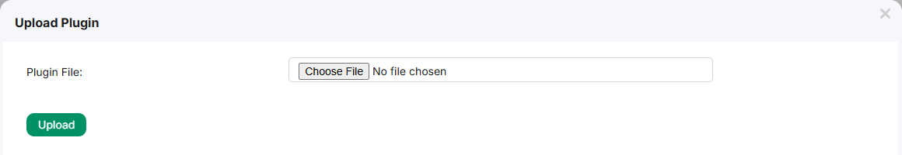
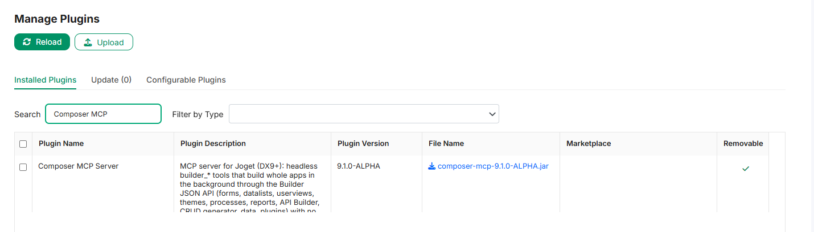

# Composer MCP: Install, Configure and Connect

This page takes you from the Composer MCP jar to a working connection: upload the plugin, configure server-side access (the key, the opt-in flags and the run-as user), restart Joget, connect Claude Code and other clients, and check that everything works, with and without an AI client. It is for the person who installs and operates the plugin and for developers who connect their tools to it. For what the plugin is, read [Composer MCP: Overview and How It Works](17-composer-mcp-overview.md) first. Security reasoning and the full settings table are on [Composer MCP: Security, Clustering and Troubleshooting](21-composer-mcp-security-and-operations.md).

## Prerequisites

| Item | Requirement |
|---|---|
| Joget | Joget DX Enterprise, version 9.1 or later. The plugin is built against DX 9.1.1. Joget 8.x is not supported. |
| Plugin jar | `composer-mcp-9.1.0-ALPHA.jar` (file name pattern `composer-mcp-<version>.jar`), supplied with this manual. |
| Rights | A Joget administrator account, to upload the plugin. Access to the server's startup configuration (or your container or service settings), to set the key. |
| Restart | You must be able to restart Joget. Access settings are read from the Joget process environment. |
| Network | The MCP client must reach the Joget address, for example `http://localhost:8080/jw`. If Joget is behind a reverse proxy, the proxy must forward custom headers (see below). |
| MCP client | A client that supports Streamable HTTP and custom headers, for example Claude Code. |
| Agent Builder (optional) | Needed only for the browser-connected composers and for skills configured in **AI Central Config**. The plugin jar is `agent-builder-plugin-8.2.5-ALPHA.jar`. See [Installing and Setting Up Your Joget Instance](02-installation-and-setup.md). |
| Database | The Joget database user must be allowed to create tables. The plugin creates two tables, `mcp_artifact_slot` and `mcp_session`, on first start. |

> **Note:** Use the base URL of your own Joget in every example. This page uses `http://localhost:8080/jw`. The MCP endpoint is always the base URL plus `/mcp/composer/mcp`. If your context path is not `/jw`, change it.

## Upload the jar

1. Sign in to Joget as an administrator.
2. Open **Settings > Manage Plugins**.
3. Choose **Upload**. The **Upload Plugin** dialog opens. Choose **Choose File** next to **Plugin File:**, select `composer-mcp-9.1.0-ALPHA.jar`, and choose **Upload**.
4. Wait for the upload to finish. The bundle takes up to about two minutes to start. A 404 on the MCP address during this time is normal.
5. In the **Installed Plugins** tab, confirm that one new entry named **Composer MCP Server** is listed. Its **Plugin Version** is `9.1.0-ALPHA` and its **File Name** is `composer-mcp-9.1.0-ALPHA.jar`. The jar adds only this one entry to the list; the other parts of the plugin (the Builder API and the script that registers builder pages) do not appear as separate entries. Use the **Search** box to find it quickly.
6. Open the Joget log (for example `catalina.out` or the console window). Look for this line, which the plugin writes at start-up:

   ```text
   Builder API/MCP auth posture: deny-by-default: only an authenticated admin session is accepted until joget.builder.api.key is configured; opt-in features: none
   ```

   The text after `posture:` tells you which access mode is active. After you configure a key (next sections), it reads `shared-secret required (joget.builder.api.key set) or admin session`. You may also see a line that registers the filter `Composer MCP Server`.

On the first start the plugin creates the two tables automatically. No manual migration is needed.





> **Note:** The Composer MCP plugin is provided as a ready-built jar. You do not build it. It targets Joget DX 9.1.x Enterprise.

## Configure server-side access

Every `builder_*` tool and every `/jw/api/*` route is **deny-by-default**. Until you configure access, only a signed-in Joget administrator session is accepted, and an MCP client does not normally have one. The usual solution is a **shared key**: a secret string that you set on the server and that the client sends with each request.

The skill tools, prompts and resources do not need the key. Only the builder tools (and the `/jw/api/*` routes) check it.

### The settings

Each setting can be given as a **JVM system property** (a `-D` option on the Java command line) or as an **environment variable**. If both are set, the system property wins. A blank value counts as not set. Leading and trailing spaces are removed.

The environment variable name is the property name in upper case with each dot replaced by an underscore. For example, `joget.builder.api.runAs` becomes `JOGET_BUILDER_API_RUNAS`.

| System property | Environment variable | What it does | Default | Allowed values |
|---|---|---|---|---|
| `joget.builder.api.key` | `JOGET_BUILDER_API_KEY` | The shared key. Clients send it as `X-Builder-Api-Key: <key>` or `Authorization: Bearer <key>`. | Not set. Without it (and without another mode), the builder tools answer 401. | Any non-empty string. Use 32 or more random characters. |
| `joget.builder.api.runAs` | `JOGET_BUILDER_API_RUNAS` | The Joget user name under which calls made with the key (or in anonymous mode) write. It is recorded as `createdBy` and `modifiedBy`. | `admin` | A user name in the Joget directory. |
| `joget.builder.api.enable` | `JOGET_BUILDER_API_ENABLE` | Switches on opt-in features that are off by default. | None (all off). | A comma-separated list: `plugin-upload`, `app-create`, or `all`. Case does not matter. Spaces around commas are allowed. |
| `joget.builder.api.allowAnonymous` | `JOGET_BUILDER_API_ALLOWANONYMOUS` | If `true`, the key check is switched off and no credentials are needed. | `false` | `true` to enable. Any other value means off. |

There is one more optional setting, meant for people who write their own skills:

| System property | What it does | Default |
|---|---|---|
| `joget.mcp.knowledge.dir` | A folder of skills that the server reads live instead of the skills in the jar. New and edited skills show up within about 2 seconds, without restart. System property only (no environment variable). | Not set. The skills in the jar are used. |

### The opt-in features

| Value | Unlocks | Warning |
|---|---|---|
| `app-create` | `builder_app` with `operation: create`, which creates new apps on the server. | Enable it when you want the assistant to create apps. |
| `plugin-upload` | `builder_plugin` with `operation: upload`, which uploads a plugin jar. | **This deploys arbitrary code into Joget.** Keep it off, except in controlled provisioning. |
| `all` | Both of the above, and any later opt-in feature. | Avoid `all` in shared environments. |

A feature that is not enabled returns an error result with `"status":403` and a message that names the exact setting to change, for example `'plugin-upload' is disabled. An administrator must opt in by starting Joget with -Djoget.builder.api.enable=plugin-upload (or env JOGET_BUILDER_API_ENABLE=plugin-upload).` A `builder_status` call lists which features are on.

### Generate a key

The key is just a shared string. Nothing needs to be generated by Joget, and the format does not matter. Make it long and random:

```bash
openssl rand -hex 32
```

Or in PowerShell:

```powershell
-join ((48..57)+(97..102) | Get-Random -Count 64 | ForEach-Object {[char]$_})
```

The PowerShell example gives a random string of 64 hexadecimal characters. For production, use a password manager or your secret store to generate and keep it. Do not put the key in a prompt, a skill, an app definition or a source repository.

### Ways to set the configuration

Pick one way. All of them need a Joget restart afterwards.

#### Option 1: Tomcat `setenv` script (Linux and macOS)

Edit `<JOGET_HOME>/tomcat/bin/setenv.sh`, creating it next to `catalina.sh` if it does not exist:

```bash
export JOGET_BUILDER_API_KEY="<your key>"
export JOGET_BUILDER_API_ENABLE="app-create"
export JOGET_BUILDER_API_RUNAS="admin"
```

Or pass the same settings as system properties:

```bash
export CATALINA_OPTS="$CATALINA_OPTS -Djoget.builder.api.key=<your key> -Djoget.builder.api.enable=app-create"
```

#### Option 2: Tomcat `setenv` script (Windows)

Edit `<JOGET_HOME>\tomcat\bin\setenv.bat`:

```bat
set JOGET_BUILDER_API_KEY=<your key>
set JOGET_BUILDER_API_ENABLE=app-create
set CATALINA_OPTS=%CATALINA_OPTS% -Djoget.builder.api.runAs=admin
```

#### Option 3: User-level or system-level environment variable (no script edit)

You do not have to put the key in a start-up script. On Windows, set a persistent environment variable once:

```bat
setx JOGET_BUILDER_API_KEY "<your key>"
```

`setx` affects only programs started afterwards from a new command window. Close the window where Joget was started, open a new one, and start Joget from there. If Joget runs as a Windows service, set the variable at machine level (`setx /M`, as an administrator) or in the service's own settings, then restart the service. On Linux, put an `export` line in the profile of the user that runs Joget, or in the service definition (for a systemd service, an `Environment=` line in the unit file). The advantage is that the key stays out of the Joget installation folder and of scripts that you copy between servers.

#### Option 4: Docker or Kubernetes

Set environment variables on the container. For Kubernetes, take the key from a Secret so that it is never in the manifest:

```yaml
env:
  - name: JOGET_BUILDER_API_KEY
    valueFrom:
      secretKeyRef:
        name: joget-builder
        key: api-key
  - name: JOGET_BUILDER_API_ENABLE
    value: "app-create"
```

For plain Docker: `docker run -e JOGET_BUILDER_API_KEY=<your key> -e JOGET_BUILDER_API_ENABLE=app-create ...`. Set the same values on every Joget node or pod.

#### Option 5: Anonymous mode (trusted development machine only)

Set `joget.builder.api.allowAnonymous=true` (or `JOGET_BUILDER_API_ALLOWANONYMOUS=true`), for example in your IDE's run configuration or the service settings. Clients then send no header and no key is needed. Calls run as the run-as user.

> **Warning:** In anonymous mode any process on any machine that can reach Joget can write to your apps. Browser-originated requests (requests that carry an `Origin` header) are still refused. Never use this mode on a shared or network-reachable instance. If a key is configured, the key is required and anonymous mode has no effect.

#### Option 6: A signed-in Joget administrator session (no server setting)

You can configure nothing on the server and instead send the cookie of a signed-in administrator session with each request, for example:

```bash
claude mcp add joget-composer --transport http \
  http://localhost:8080/jw/mcp/composer/mcp \
  --header "Cookie: JSESSIONID=<value>"
```

Trade-offs: the detection is best-effort, and the cookie stops working when the session ends or Joget restarts, so this suits a quick manual test and is fragile for daily use. The caller keeps their own Joget identity instead of the run-as user. Requests that look like cross-site browser requests are refused for session authentication.

#### The order in which access is decided

For each `builder_*` call the plugin checks, in this order:

1. A signed-in administrator session (role `ROLE_ADMIN`). Accepted unless the request looks cross-site.
2. If a key is configured: the key presented as `X-Builder-Api-Key` or `Authorization: Bearer`. A wrong or missing key gives 401, and no other mode is tried.
3. If no key is configured and anonymous mode is on: accepted, unless the request has an `Origin` header (403).
4. Otherwise: 401.

### Restart Joget

Restart the Joget (Tomcat) process so that it reads the new environment. Then open the log and check the posture line again:

```text
Builder API/MCP auth posture: shared-secret required (joget.builder.api.key set) or admin session; opt-in features: app-create
```

If it still says `deny-by-default`, the process did not receive your variable. Check where you set it and that you restarted the process, not only the application.

In the Joget log (`joget.log`) the line looks like this (the date and time differ on your server):

```text
INFO  10 Nov 2026 15:08:11 org.joget.builder.api.BuilderAuth - Builder API/MCP auth posture: shared-secret required (joget.builder.api.key set) or admin session; opt-in features: app-create
```

## Connect Claude Code

### One command

```bash
claude mcp add joget-composer --transport http \
  http://localhost:8080/jw/mcp/composer/mcp \
  --header "X-Builder-Api-Key: <your key>"
```

Replace `<your key>` with the key you set on the server and `localhost:8080/jw` with your Joget base URL. The endpoint path is always `/mcp/composer/mcp` after the base URL. The transport must be `http`.

To make the server available in every project of your user account, add `--scope user`. To keep the key out of your shell history, read it from an environment variable:

```bash
claude mcp add --transport http --scope user joget-composer "$JOGET_URL/mcp/composer/mcp" \
  --header "X-Builder-Api-Key: $JOGET_API_KEY"
```

PowerShell:

```powershell
claude mcp add --transport http --scope user joget-composer "$env:JOGET_URL/mcp/composer/mcp" --header "X-Builder-Api-Key: $env:JOGET_API_KEY"
```

These commands store the expanded key in your Claude Code user configuration, outside any project. Do not use `--scope project` with a literal key: that scope writes the key into the shared `.mcp.json` file. Use the project file below instead.

### Authorization: Bearer instead of the custom header

The plugin accepts the same key as a bearer token. Use this form when a proxy removes custom headers, or when a client offers only a bearer-token field:

```bash
claude mcp add joget-composer --transport http \
  http://localhost:8080/jw/mcp/composer/mcp \
  --header "Authorization: Bearer <your key>"
```

### Share a configuration with the team: `.mcp.json`

Put a file named `.mcp.json` in the project root and commit it. It contains no key:

```json
{
  "mcpServers": {
    "joget-composer": {
      "type": "http",
      "url": "http://localhost:8080/jw/mcp/composer/mcp",
      "headers": {
        "X-Builder-Api-Key": "${JOGET_BUILDER_API_KEY}"
      }
    }
  }
}
```

The value `${JOGET_BUILDER_API_KEY}` is not the key. It tells Claude Code to read the key from the environment variable `JOGET_BUILDER_API_KEY` of the person who starts Claude Code. The key therefore comes from each developer's own environment and is never written into a file that you commit. Each developer sets the variable before starting Claude Code, for example:

```bash
export JOGET_BUILDER_API_KEY="<your key>"
```

```powershell
$env:JOGET_BUILDER_API_KEY = "<your key>"
```

Notes about `.mcp.json`:

- `${VAR}` and `${VAR:-default}` are expanded in `url` and `headers` when Claude Code starts. A variable that is not set and has no default stays as the literal text `${VAR}` and Claude Code shows a warning in `/mcp`. Joget then answers 401 to builder calls.
- `"type": "http"` is required. An entry with a `url` and no type is treated as a local command and fails.
- Claude Code asks each user to approve a project server the first time.
- The same environment variable name (`JOGET_BUILDER_API_KEY`) is used on the server and in the client in this manual. They can be different variables: only the value must match.
- If the URL differs between environments (development, test, customer), see "One registration per Joget environment" below.

### If you used the old `sse` transport

An earlier registration of this server may have used the `sse` transport and an address ending in `/sse`. That endpoint no longer exists, so the client shows a 404 or a failed connection. Remove the old registration and add it again with `--transport http`:

```bash
claude mcp remove joget-composer
claude mcp add joget-composer --transport http http://localhost:8080/jw/mcp/composer/mcp \
  --header "X-Builder-Api-Key: <your key>"
```

### HTTPS and reverse proxies

The key is a bearer secret and travels in a header on every request. Expose Joget over HTTPS for anything beyond a machine you control. Make sure the proxy or ingress forwards `X-Builder-Api-Key` (or `Authorization`) and `Mcp-Session-Id` unchanged. Do not buffer or rewrite the JSON body. If the proxy removes custom headers, use `Authorization: Bearer`.

## Other IDEs and clients

All clients use the same address, `http(s)://<joget-host>/jw/mcp/composer/mcp`, and the same key. The configuration formats below come from each vendor's documentation at the time of writing. Client products change quickly. When a client rejects a snippet, check the vendor's current documentation for the file name and key names, and test the connection with `builder_status` (see "Verify the connection").

In these examples the placeholders `JOGET_URL` (for example `http://localhost:8080/jw`) and `JOGET_API_KEY` stand for your base URL and your key. Keep the key out of any file that you commit.

What each client gets: every client that supports tools gets the builder tools and the three skill tools (`joget_skills_list`, `joget_skill_read`, `joget_skill_search`). Prompts and resources depend on the client. To make the agent read the skills before it builds, add short guidance to the project instructions of that client (see "Add guidance to your project's CLAUDE.md").

### Claude Desktop

Claude Desktop's built-in "custom connectors" take a URL and then ask you to sign in with OAuth. They have no field for a static header such as `X-Builder-Api-Key`, and connectors may be reached from a cloud service rather than from your PC, so a `localhost` Joget may not be reachable. For a static key, use the `mcp-remote` bridge. It needs Node.js. Edit `claude_desktop_config.json` (Windows: `%APPDATA%\Claude\claude_desktop_config.json`; macOS: `~/Library/Application Support/Claude/claude_desktop_config.json`) and restart Claude Desktop:

```json
{
  "mcpServers": {
    "joget-composer": {
      "command": "npx",
      "args": [
        "-y", "mcp-remote",
        "https://joget.example.com/jw/mcp/composer/mcp",
        "--header", "X-Builder-Api-Key:${JOGET_HEADER_VALUE}"
      ],
      "env": { "JOGET_HEADER_VALUE": "<your Builder API key>" }
    }
  }
}
```

- The key is passed through `env` and referenced as `${...}` in the argument, with no space after the colon. This works around the way Claude Desktop handles spaces in arguments on Windows.
- `mcp-remote` refuses plain `http://` addresses. For a local trusted instance, add `"--allow-http"` to `args`.
- The file contains the key in clear text, so keep it on your machine only.

### Cursor

Project file `.cursor/mcp.json` (or the global file `~/.cursor/mcp.json`):

```json
{
  "mcpServers": {
    "joget-composer": {
      "url": "${env:JOGET_URL}/mcp/composer/mcp",
      "headers": { "X-Builder-Api-Key": "${env:JOGET_API_KEY}" }
    }
  }
}
```

Cursor resolves `${env:NAME}` in `url` and `headers`. The variable must exist in the environment from which Cursor was started (start Cursor from that shell, or set the variable system-wide). Cursor also reads a root `AGENTS.md` file for project instructions.

### VS Code with GitHub Copilot

Workspace file `.vscode/mcp.json`. The top-level key is `servers` (not `mcpServers`). The `inputs` section makes VS Code ask for the values, so the file holds no secret:

```json
{
  "inputs": [
    { "type": "promptString", "id": "joget-url", "description": "Joget base URL, e.g. http://localhost:8080/jw" },
    { "type": "promptString", "id": "joget-key", "description": "Joget Builder API key", "password": true }
  ],
  "servers": {
    "joget-composer": {
      "type": "http",
      "url": "${input:joget-url}/mcp/composer/mcp",
      "headers": { "X-Builder-Api-Key": "${input:joget-key}" }
    }
  }
}
```

VS Code asks for the values when the server first starts and stores them securely. `${env:NAME}` is also supported. Use agent mode in Copilot Chat to call the tools. Copilot also reads `.github/copilot-instructions.md` and `AGENTS.md`.

### Windsurf

Per-user file `~/.codeium/windsurf/mcp_config.json` (Windows: `%USERPROFILE%\.codeium\windsurf\mcp_config.json`), also reachable from the Cascade MCP panel:

```json
{
  "mcpServers": {
    "joget-composer": {
      "serverUrl": "${env:JOGET_URL}/mcp/composer/mcp",
      "headers": { "X-Builder-Api-Key": "${env:JOGET_API_KEY}" }
    }
  }
}
```

The Windsurf documentation moved while this manual was prepared and no longer states these JSON keys, so test this once. If the `${env:...}` values are not resolved in your version, put the literal key in this per-user file only, never in a file inside a project. Windsurf reads project rules from `.windsurf/rules/` and an `AGENTS.md` file.

### Codex CLI

`~/.codex/config.toml`:

```toml
[mcp_servers.joget-composer]
url = "http://localhost:8080/jw/mcp/composer/mcp"
startup_timeout_sec = 20

[mcp_servers.joget-composer.env_http_headers]
"X-Builder-Api-Key" = "JOGET_API_KEY"
```

`env_http_headers` maps a header name to the name of an environment variable, so the key is read from your environment and is not stored in the file. As an alternative, the bearer form is `bearer_token_env_var = "JOGET_API_KEY"`. The `url` value is literal: Codex does not expand variables in it. Codex reads `AGENTS.md` from `~/.codex` and from the repository root down to the current folder.

### Gemini CLI

`~/.gemini/settings.json` (user) or `.gemini/settings.json` (project):

```json
{
  "mcpServers": {
    "joget-composer": {
      "httpUrl": "http://localhost:8080/jw/mcp/composer/mcp",
      "headers": { "X-Builder-Api-Key": "<your Builder API key>" },
      "timeout": 30000,
      "trust": false
    }
  }
}
```

- Use `httpUrl` for Streamable HTTP. The `url` key is for the older SSE transport.
- Keep `trust` at `false` so that every tool call asks for confirmation. `true` skips all prompts.
- The Gemini documentation describes variable expansion for the `env` block only. Put the literal key in the user file `~/.gemini/settings.json`, never in a file inside a repository. You can try `"$JOGET_API_KEY"` in `headers`, but check with `/mcp` that it authenticates.
- MCP prompts from the server can be called as slash commands. Gemini reads project guidance from `GEMINI.md`.

### Cline

Open the **MCP Servers** panel, choose **Configure**, then **Configure MCP Servers**. This opens `cline_mcp_settings.json`:

```json
{
  "mcpServers": {
    "joget-composer": {
      "type": "streamableHttp",
      "url": "http://localhost:8080/jw/mcp/composer/mcp",
      "headers": { "X-Builder-Api-Key": "<your Builder API key>" },
      "disabled": false,
      "autoApprove": []
    }
  }
}
```

- Set `type` explicitly. If you leave it out, Cline uses the older SSE transport.
- `autoApprove` lists tools that run without asking. Leave it empty. Do not auto-approve the `builder_*` write tools.
- Cline does not document variable expansion for remote headers, so the key is a literal value in a per-user settings file that lives outside your repositories.
- Roo Code is a fork of Cline with a similar settings file. Its key names for Streamable HTTP can differ (for example `streamable-http`). Check its documentation. This manual does not give a Roo Code configuration.

### Zed

`settings.json` (macOS and Linux `~/.config/zed/settings.json`, Windows `%APPDATA%\Zed\settings.json`, or the **Open Settings** command):

```json
{
  "context_servers": {
    "joget-composer": {
      "url": "http://localhost:8080/jw/mcp/composer/mcp",
      "headers": { "X-Builder-Api-Key": "<your Builder API key>" }
    }
  }
}
```

Without a `headers` entry Zed starts an OAuth sign-in, which this plugin does not offer. Always provide the header. Zed supports MCP tools and prompts; resources are not supported, so use the `joget_skill*` tools. The key is a literal value in your user settings file.

## Verify the connection

### With the client

1. In Claude Code run:

   ```bash
   claude mcp list
   ```

   `joget-composer` should show as connected. Inside Claude Code, the `/mcp` command shows the state of each server and its tools.
2. Ask: "Call builder_status and tell me what this connection is allowed to do."

   A correct answer contains, among other fields:

   ```json
   {
     "mode": "headless",
     "authorizedAs": "api-key",
     "optInFeatures": { "plugin-upload": false, "app-create": true },
     "tools": ["builder_app", "builder_form", "..."]
   }
   ```

   `authorizedAs` is `api-key`, `admin-session` or `anonymous-optin`. It tells you which mode the connection ended up in.
3. Ask: "Call joget_skills_list." You should see the bundled skills (`source: bundled`), and, if Agent Builder is installed, the skills configured in Joget (`source: central`).

> **Important:** A connected server does not prove that the key is right. Initialising the connection, listing tools, and reading skills and prompts need no key. A wrong or missing key shows up only when a `builder_*` tool is called, as a 401 error. Always run `builder_status`.

### Smoke test without any AI client

You can test the server with `curl` alone. No model, no Claude Code and no tokens are needed. The examples use `bash`; on Windows use Git Bash or WSL.

Set two variables:

```bash
URL="http://localhost:8080/jw/mcp/composer/mcp"
KEY="<your key>"
```

**Step 1. Initialise.** The reply carries the session id in the `Mcp-Session-Id` header:

```bash
curl -s -i -X POST "$URL" \
  -H "Content-Type: application/json" \
  -H "Accept: application/json,text/event-stream" \
  -d '{"jsonrpc":"2.0","id":1,"method":"initialize","params":{"protocolVersion":"2025-03-26","capabilities":{},"clientInfo":{"name":"smoke","version":"1"}}}'
```

Expected: HTTP 200, a header `Mcp-Session-Id: <uuid>`, and a JSON body with `protocolVersion` `2025-03-26`, `serverInfo` `{"name":"joget-composer-mcp","version":"9.1.0-ALPHA"}`, capabilities for tools, prompts and resources, and an `instructions` text. The server answers with protocol version `2025-03-26` even if the client asks for a newer one. Copy the session id. Every later call except `initialize` must send it in the `Mcp-Session-Id` header; without it the server answers HTTP 404 `Session not found or expired — re-initialize.`:

```bash
SID="<the Mcp-Session-Id value>"
```

**Step 2. Confirm the initialisation** (the server answers 202 and no body):

```bash
curl -s -o /dev/null -w "%{http_code}\n" -X POST "$URL" \
  -H "Content-Type: application/json" -H "Mcp-Session-Id: $SID" \
  -d '{"jsonrpc":"2.0","method":"notifications/initialized"}'
```

**Step 3. List the tools:**

```bash
curl -s -X POST "$URL" \
  -H "Content-Type: application/json" -H "Accept: application/json,text/event-stream" \
  -H "Mcp-Session-Id: $SID" \
  -d '{"jsonrpc":"2.0","id":2,"method":"tools/list"}'
```

Expected: a JSON `result.tools` array that contains `builder_status`, `builder_form`, `joget_skills_list`, `joget_skill_read`, `list_sessions` and `connect_session`. With no builder page open it has 22 tools: the 16 `builder_*` tools, the four `joget_*` skill tools and the two session tools. (A `ping` request, `{"jsonrpc":"2.0","id":9,"method":"ping"}`, answers `{"result":{},"id":9,"jsonrpc":"2.0"}`.)

**Step 4. Call a skill tool (no key needed):**

```bash
curl -s -X POST "$URL" \
  -H "Content-Type: application/json" -H "Mcp-Session-Id: $SID" \
  -d '{"jsonrpc":"2.0","id":3,"method":"tools/call","params":{"name":"joget_skills_list","arguments":{}}}'
```

**Step 5. Call a builder tool without the key.** Expected: HTTP 200 and a result with `"isError":true`. The result text is a JSON string with `"status":401`. If the server has a key, the message starts `Unauthorized: present the Builder API key as 'X-Builder-Api-Key' or 'Authorization: Bearer <key>', or use an authenticated Joget admin session.` If the server has no key and no other access mode, the message says `Unauthorized: the Builder API is deny-by-default.` and names the setting to configure. A wrong key gives the same refusal as a missing key. Check the `401` in the text, not the HTTP status:

```bash
curl -s -X POST "$URL" \
  -H "Content-Type: application/json" -H "Mcp-Session-Id: $SID" \
  -d '{"jsonrpc":"2.0","id":4,"method":"tools/call","params":{"name":"builder_status","arguments":{}}}'
```

**Step 6. Call it with the key.** Expected: `"authorizedAs":"api-key"` and no `isError`. The `Authorization: Bearer <your key>` header gives the same result:

```bash
curl -s -X POST "$URL" \
  -H "Content-Type: application/json" -H "Mcp-Session-Id: $SID" \
  -H "X-Builder-Api-Key: $KEY" \
  -d '{"jsonrpc":"2.0","id":5,"method":"tools/call","params":{"name":"builder_status","arguments":{}}}'
```

A plain `GET` on the MCP address in a browser returns the text `Joget Composer MCP Server — connect via POST /mcp/composer/mcp`. This confirms that the plugin is active and that the path is right.

### The `smoke-test.sh` script

The examples repository (`ai-partner-samples`) contains `05-composer-mcp/smoke-test.sh`. It runs the steps above and prints PASS or FAIL for each. It needs only `bash` and `curl`.

```bash
bash smoke-test.sh http://localhost:8080/jw
JOGET_BUILDER_API_KEY=<your key> bash smoke-test.sh
```

The first argument is the Joget base URL (default `http://localhost:8080/jw`). Without the key, the last step expects the 401 refusal and prints a SKIP for the keyed step. With the key set in the shell, it also calls `builder_status` with the key. The exit code is 0 only when every step passed.

The script runs `initialize`, `tools/list`, `joget_skills_list`, `joget_skill_read`, `prompts/list` and the status step. It also checks that four sample skills of the examples repository are listed (`acme-naming-conventions`, `acme-app-standards`, `acme-standards-lookup`, `acme-standards-reference`). Those four checks fail until you have installed the sample skills from `04-custom-skills`; that is expected on a fresh server and does not mean the plugin is broken. Edit the script to remove those lines if you do not use the sample skills. See [The Examples Repository](29-examples-repository.md) and [Composer MCP: Skills, Prompts and the App Generator](20-composer-mcp-skills-and-prompts.md).

## One registration per Joget environment

Register one MCP server name for each Joget instance you work against, each with its own URL and its own key. For example:

```bash
claude mcp add joget-dev  --transport http http://dev.example.com/jw/mcp/composer/mcp  --header "X-Builder-Api-Key: <dev key>"
claude mcp add joget-test --transport http http://test.example.com/jw/mcp/composer/mcp --header "X-Builder-Api-Key: <test key>"
```

Reasons: a key then unlocks one environment only; the assistant cannot send a development build to the wrong server by accident; and you can switch off one registration without affecting the others. Name the target in your prompts ("use joget-dev") when more than one is registered. With a shared `.mcp.json`, use a different variable for each (for example `JOGET_DEV_KEY` and `JOGET_TEST_KEY`) and a different server name for each entry.

Behind a load balancer with several Joget nodes, register the load balancer address once. Set the same key and the same opt-in flags on every node.

## Add guidance to your project's CLAUDE.md

The server tells the assistant to read skills first, but your own project rules make the result more consistent: naming rules, language, standards, what to confirm. In Claude Code, such rules go in the project's `CLAUDE.md` file. The examples repository contains a ready snippet, `05-composer-mcp/CLAUDE.md.snippet`. It is written for the Acme sample skills; adapt the names to your own conventions:

```markdown
## Joget (Acme example) via Composer MCP

The MCP server `joget-composer` builds Joget apps. Rules:

1. Before building, call `builder_status`, then `joget_skills_list`. Read with `joget_skill_read` (index first, then only the sections you need): `acme-naming-conventions`, `acme-app-standards`, `acme-standards-reference`, and the matching `joget-*-builder` skill for what you build.
2. Every builder call passes an explicit `appId` and numeric `appVersion`. Ids: snake_case, at most 20 characters, no generic suffix (`purchase_request`, not `purchase_request_form`). One record type is one table: `tbl_<first form id>`, reused by approver forms.
3. Field ids start with `acme_`. Labels, menus and seed data are Bahasa Indonesia; stored values and ids are English.
4. Use `builder_introspect` for real plugin class names and `builder_lint` before saving. Finish with `builder_verify_app`.
5. Delete, deploy and data submit need `confirm:true`; ask first.
6. Keep replies short. At the end print: skills used, then a table of created artefact ids (type, id, table).
7. Stock Joget text (login page, standard buttons) stays English; say so instead of claiming it is translated.
8. Never print or store the Builder API key.
```

Good rules for any project: name the skills to read, require explicit `appId` and `appVersion`, require `builder_lint` before saving and `builder_verify_app` at the end, say which actions need your approval, and forbid printing the key. Other clients have equivalent files: `AGENTS.md` (Codex, Cursor, Copilot, Windsurf, Zed), `GEMINI.md` (Gemini CLI), `.cursor/rules` (Cursor) and custom instructions (Cline).

## Optional: set up the browser-connected composers

The browser-connected composers let the assistant edit a builder page that you have open. They are optional. The headless tools do not need any of the steps below.

1. Install Agent Builder (`agent-builder-plugin-8.2.5-ALPHA.jar`) on the same Joget instance. It supplies the composer targets and the **AI Central Config** skills that these tools use.
2. Make sure the Composer MCP plugin is active. The plugin injects a registration script into these builder pages: the form builder, the list (datalist) builder, the userview builder, the process builder and the theme designer.
3. Open one of those builder pages in the browser. Reload the page if you opened it before you uploaded the plugin. The script registers the page as a slot with the server. In the browser developer console you see `[MCP] Registered with server — slotId: ...`.
4. In the MCP client, ask the assistant to call `list_sessions`. It lists open tabs with `slot_id`, type, artifact name, app and status (`available`, `active (current)`, `connected` or `in use by another session`).
5. Ask it to call `connect_session` with the `slot_id`. After that, the tools for that type (`form_*`, `list_*`, `ui_*`, `theme_*`, `process_*`) appear in the tool list and change the canvas. Switch to another artifact by connecting to another slot.
6. Review what changed on the canvas and press the builder's **Save** button. The assistant cannot save.

How it works in short: the page polls the server about every 1.2 seconds, and the server treats a tab as open while it was polled in the last 15 seconds. Each change bumps a version number, and the next poll applies the change to the canvas. State is mirrored to the database, so any Joget node can answer.

Composer tools are listed only while a tab of that type is open. If you do not see `form_*` tools, no form builder tab is registered and polling. Keep the builder tab visible; a browser may slow down polling in a background tab, and the slot then looks closed.

> **Important:** These endpoints and tools are not protected by the key. See [Composer MCP: Security, Clustering and Troubleshooting](21-composer-mcp-security-and-operations.md).

The registration is not visible on the builder page itself. You see it only in the browser developer console and in the answer of `list_sessions`. With the Form Builder open on a form named `leave_request` in app `leave_app`, `list_sessions` returns this text:

```text
Open builder tabs:

slot_id: 54c3cb4e-8a7b-45d7-bed4-78b5a1b77348
  type:   form
  name:   Form Builder : Leave Request
  id:     leave_request
  app:    leave_app
  status: available

Call connect_session(slot_id) to start working on an artifact.
```

The `name` is the title of the builder page. While a Form Builder tab is open, `tools/list` shows 35 tools: the 22 tools above and 13 `form_*` tools.

## Limitations and things to know

- **Restart after every access change.** The key, the run-as user and the flags are read from the Joget process environment. Changing them in a file does nothing until Joget restarts.
- **One key only.** The server accepts a single shared key. To change it, change the value, restart Joget and update every client.
- **Alpha build.** Test on a development instance first.
- **A 404 right after upload is normal** for about two minutes while the bundle starts.
- **Client configuration formats change.** The IDE snippets here follow vendor documentation at the time of writing. The Windsurf and Roo Code formats, and variable expansion in some clients (Gemini CLI, Cline, Zed), could not be confirmed from vendor documentation; test them once.
- **Helper scripts are not part of the jar.** The jar is the only plugin artefact you receive. Use the project instruction files described above to give your IDE guidance.
- **`claude mcp list` can show connected with a wrong key.** Always check `builder_status`.

## Troubleshooting

| Symptom | Cause | Fix |
|---|---|---|
| `claude mcp list` shows failed, or a 404 | Wrong path, plugin not active yet, or an old `sse` registration | Check the URL ends in `/jw/mcp/composer/mcp` and that a browser `GET` on it returns the text `Joget Composer MCP Server`. Wait two minutes after upload. Remove an old registration and add it with `--transport http`. |
| `builder_status` result has `"status":401` (HTTP stays 200) | The server has no key, the client sent none, or the values differ | Check the posture line in the log. Set `JOGET_BUILDER_API_KEY` on the server and restart. Check the client header. In `.mcp.json`, check that the variable is set in the shell that started Claude Code. |
| Posture line still says deny-by-default after you set the key | The variable never reached the Joget process | Set it where the process starts (script, service, container). Restart the process. A `setx` value is visible only to newly started processes. |
| 403 "is disabled" | An opt-in feature is not enabled | Set `JOGET_BUILDER_API_ENABLE` to `app-create` or `plugin-upload` and restart. |
| 403 about a browser-originated request | Anonymous mode with an `Origin` header | Configure the key instead of anonymous mode. |
| Key works on `curl` but not from the IDE | The IDE does not expand the variable, or a proxy removes the header | See the client section. Use `Authorization: Bearer`. |
| Plugin is missing from **Manage Plugins** | The bundle did not resolve | Upload again and read the Joget log for bundle errors. Check that the server is DX 9. |

More symptoms and fixes are on [Composer MCP: Security, Clustering and Troubleshooting](21-composer-mcp-security-and-operations.md).

## Where to go next

- [Composer MCP: Tool Reference](19-composer-mcp-tools.md) for the tools you can now call.
- [Composer MCP: Skills, Prompts and the App Generator](20-composer-mcp-skills-and-prompts.md) to add your own skills and to build whole apps from a prompt.
- [Composer MCP: Security, Clustering and Troubleshooting](21-composer-mcp-security-and-operations.md) before you expose the server beyond your own machine.
- [The Examples Repository](29-examples-repository.md) for the sample prompts and scripts in `05-composer-mcp`.
