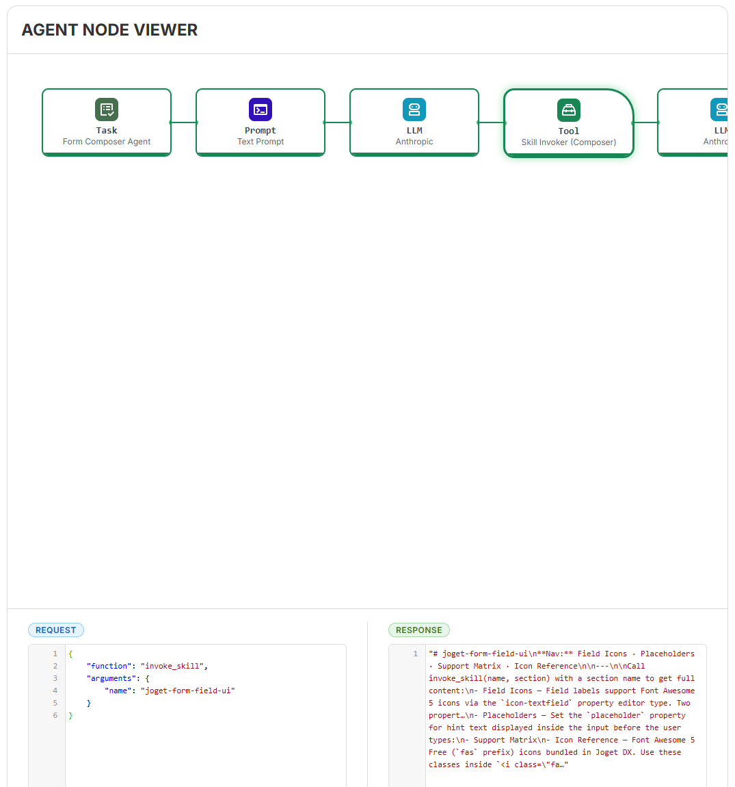

# Skills, Central Instructions and Tool Templates

This page explains the three no-code ways to steer Agent Builder agents and the AI Composers: skills (knowledge that is read on demand), central instructions (rules that are always sent) and tool templates (saved tool configurations that a skill can switch on during a run). It is for the person who owns the quality of generated apps at your company: you write the rules once, and every agent and composer follows them. At the end you will find three complete, ready-to-use skills (a naming convention, a Bahasa Indonesia terminology list and a brand and theme skill) and a procedure that proves each skill changes the output.

## What the three things are and how they differ

| | Skill | Central instruction | Tool template |
|---|---|---|---|
| What it is | A markdown document with a name, a one-line description and `##` sections | One block of plain text | A saved, pre-configured instance of an existing tool |
| When the model sees it | Only the name and description are always visible. The body is read on demand, section by section | Always. It is added to the start of every run in scope | Never directly. It is added to the live tool list after a linked skill is read |
| Good for | Naming rules, terminology lists, brand values, checklists, long reference material | Short house rules: tone, language of replies, "never invent values" | A lookup the model must call for real data (option lists, approval rules, glossary search) |
| Stored in | Files, one folder per skill, on the Joget server | Joget database (setting) | Joget database (setting) |
| Edited in | **Settings > AI Central Config**, tab **Skills**; or by editing the file | **Settings > AI Central Config**, tab **Skills**, section **Central Instructions** | **Settings > AI Central Config**, tab **Tool Templates** |

How to choose:

- If the rule must hold in every request and is short (one to ten lines), use a central instruction.
- If the content is longer, only sometimes relevant, or is reference data (a glossary, a table of values), use a skill.
- If the model must fetch real data instead of guessing (cost centres from your finance system, an approval matrix), write a tool, wrap it in a tool template, and link the template to a skill. See [Writing Custom Tools](24-custom-tools.md) for the tool itself and [Custom Composer Tools and Building Your Own Composer](28-custom-composer-tools-and-composers.md) for tools that composers call.

> **Note:** A skill is advice, not enforcement: the model decides whether to read it and how closely to follow it. Test every skill with the with/without comparison later on this page.

## Where each one is stored and how you edit it

### Storage

| Item | Where it is stored | Size limit |
|---|---|---|
| Skill | One folder per skill: `<JOGET_HOME>/wflow/app_ai_skills/<skill-folder>/SKILL.md`. The base directory is the `wflow` directory of the running profile; with virtual hosting (Joget Cloud and other multi-tenant setups) each tenant has its own folder | None in the store. The practical limit is the token cost of what the model reads |
| Central instructions | One row in the Joget settings table (`wf_setup`, property `AI_CENTRAL_INSTRUCTIONS`): the Global text and one text per composer | 64 KB on MySQL and MariaDB. A save that is too large fails with "Nothing was saved ... the `wf_setup.value` database column only holds ... KB" and the previous value stays |
| Tool templates | One row in the same table (property `AI_TOOL_TEMPLATES`): the whole list of templates is one value, rewritten on every template edit | The same 64 KB column, shared by all templates |

Skills are files, so they are not part of an app export (`.jwa`). They belong to the server (or the tenant), not to an app.

### The Skills tab

Open **Settings > AI Central Config** and select the tab **Skills** ("Define reusable skill instructions and global system instructions for your AI Composers"). You need the Admin or App Creator role. The tab has **Central Instructions** at the top and the list of skills below it.

#### Central Instructions section

| Control | What it does |
|---|---|
| **Global** (text area) | Text added to every composer and agent run. Help text: "These instructions are always injected into every composer and agent system message" |
| One collapsible block per target | **Agent Builder** and one block per installed composer, named as the plugin names them (the screen lists them in this order): **AI Composer - Datalist Builder Agent**, **AI Composer - Form Builder Agent**, **AI Composer - Process Builder Agent**, **AI Composer - Theme Builder Agent**, **AI Composer - UI Builder Agent**, **AI Orchestrator Agent**. Click the header of a block to open or close its text box. Text in a block is added only to runs of that target, after the Global text |
| **Save** | Saves the Global text and all blocks together. |

Every field is optional. Saving replaces the stored values with what is on the screen, so clear a field and save to remove its text.

#### The skill list

Each skill is a card: name, status badge, the composers it is available for, linked tool templates, and usage statistics ("{n} invocations", "{n} success", "{n} failed", "Last: {time}", or "Never invoked"). The statistics come from the run traces in the database. **Refresh** reloads the list and the statistics. Each card has edit and delete buttons; a bundled skill can also show **Update Available** and a sync button (see "Bundled skills and what Sync does").

#### Add Skill and Edit Skill

Select **Add Skill**. The form opens with a two-section template body.

| Field | What it does | Default | Notes |
|---|---|---|---|
| **Skill Name** | The unique name the model passes when it reads the skill | empty | Required. Placeholder `weekly-status-report`. Use lower-case letters, digits and hyphens. A duplicate shows "A skill with this name already exists" |
| **Description** | When the model should read this skill | empty | The only text the model sees before it decides. Write "Use when ..." |
| **Instruction** | The body in markdown, with tabs **Write** and **Preview** | A two-section template | Use `##` headings for sections. A live strip shows the section list the model will receive first |
| Nav button (refresh icon) | Rebuilds the `**Nav:**` line from your `##` headings | n/a | Replaces the whole line with the headings joined by " - ". Notes you typed on that line are lost, so click it first and add notes afterwards |
| **Available For** | One checkbox for **Agent Builder** and one per installed composer | none ticked | A skill with nothing ticked is never offered |
| **Associated Tool Templates** | One checkbox per active tool template | none | "When this skill is invoked, these tool templates are also made available for use in that conversation turn" |
| **Status** | **Active** ("Discoverable and executable"), **Draft** ("Hidden from all agents and composers"), **Deprecated** ("Not discoverable, but still executable by name") | Active | |

The popup button **Add Skill** creates the skill ("Skill created successfully") and writes the file. Renaming a skill renames its folder. Messages you may see: "Nothing was saved - the skill file could not be written."

### The Tool Templates tab

Select the tab **Tool Templates** and then **Add Tool Template**.

| Field | What it does | Default | Notes |
|---|---|---|---|
| **Display Name** | Name shown in lists and in the skill form | empty | Example: "Fetch Design References" |
| **Template Name (slug)** | The unique identifier that skills write in `tools:` | filled from the display name | Required. A duplicate shows "Tool template name already exists" |
| **Description** | What the template does | empty | For people only |
| **Tool Type** | The tool class the template configures | `-- -- Select a tool type -- --` | Required. Lists every installed agent tool that is not hidden, by its display name (for example **Documentation Search** or **JSON API**), except the skill tools, **Tool Group**, **Run AI Agent**, App Context, **Set Agent Variable** and the **AI Agent** process tool |
| **Tool Configuration** | The tool's own property form, as on the canvas | the tool's defaults | Appears when you choose a **Tool Type**. Includes the function name the model calls. For **Acme Standards Lookup**: **Function name** (prefilled `lookup_acme_standard`), **Function description** and **Override standards (JSON)** |
| **Available For** | Composers and Agent Builder for which the template is listed | none ticked | The same seven check boxes as on the skill form. Used when templates are listed for a target. Skill-linked injection ignores it |
| **Status** | **Active**, **Draft**, **Deprecated** | Active | Only active templates appear in a skill's **Associated Tool Templates** list |

There is no import or export button for skills, central instructions or tool templates. See "Moving skills between environments".

## The SKILL.md format in full

A skill is a text file with two parts: a block of metadata (front matter) between two lines of `---`, and the markdown body that the model reads.

````markdown
---
id: 6f1d2c34-5b7a-4e8f-9a10-2b3c4d5e6f70
name: acme-naming
description: "Use when building or editing any form, list, process or userview for an Acme app: id prefixes and naming rules."
status: active
builtinVersion: 1
createdAt: 2026-11-05T10:00:00Z
composers:
  - org.joget.ai.agent.lib.composer.FormComposerChat
  - org.joget.ai.agent.lib.composer.OrchestratorChat
tools:
  - lookup_acme_standard
---

# acme-naming
**Nav:** FieldIds - Labels - Checks

Preamble: what the skill governs and when to read which section.

---

## FieldIds

When you add a field, its id starts with `acme_`.

- Rule NAM-1: ...
````

### Front matter fields

| Key | Required | What it does | Allowed values and notes |
|---|---|---|---|
| `id` | Yes | Identifies the skill when it is saved | A UUID. The Add Skill form generates a new one. If you create the file by hand, generate one UUID and keep the same value in every environment, so that the edit form updates the skill instead of creating a second copy |
| `name` | Yes | The name the model uses to read the skill | Exact, case-sensitive, unique. If the key is missing, the folder name is used |
| `description` | Yes | The only text the model sees before it decides to read the skill | One line. Put it in double quotes. See the rules below |
| `status` | No | Whether the skill is offered | `active`, `draft` or `deprecated`, lower case only. A missing status means `active`. `Active` or `enabled` is not recognised and the skill is silently never offered |
| `builtinVersion` | No | A whole number. For the skills that ship with the plugin it decides whether the plugin refreshes the skill on upgrade | For your own skills it has no effect. Keep it as a visible change counter if you like |
| `createdAt`, `modifiedAt`, `updatedAt` | No | Timestamps written by the editor | ISO 8601, for example `2026-11-05T10:00:00Z` |
| `composers` | Yes in practice | The composers and agents the skill is offered to | A list of full class names, or `AGENT_BUILDER`. An empty list means the skill is never offered to any composer or agent. See "Scoping a skill" |
| `tools` | No | Tool template names to switch on when the skill is read | A list of template names (the **Template Name (slug)** values), not class names. `tools: []` for none |

Rules for how the file is read:

- The first line of the file must be `---` (no text before it, no byte-order mark). The front matter ends at the next line that is exactly `---`. A file that breaks this rule is skipped and a warning is written to the Joget log ("does not start with a '---' frontmatter block" or "frontmatter block is not closed").
- A value is written as `key: value` on one line. A list is `key:` followed by lines that start with `  - `, or `key: []` for an empty list. A line without a colon is ignored.
- A value in double quotes is read as a JSON string, so `\"` and `\n` work. A value in single quotes is not unquoted: the quotes become part of the text. Folded or literal text (`description: >` or `description: |`) is not supported: you would get the single character `>`.
- The folder name is the skill name in lower case, with every run of characters other than `a-z`, `0-9`, `.`, `_`, `-` replaced by `-`, at most 100 characters. If the folder name is taken, `-1`, `-2` and so on are added.

### The body: title, Nav line, preamble, sections

| Part | What to write | Why |
|---|---|---|
| Title | `# <skill-name>` | Convention. Identifies the file |
| Nav line | `**Nav:** Section A - Section B - Section C` | A table of contents. It is part of the preamble, so the model sees it on the first read. Add a short note after a name if it helps routing, for example `Formats (dates and money)` |
| Preamble | One to three sentences: what the skill governs, when each section applies, and which other skill holds related detail | Returned every time the skill is read |
| Sections | `## Section Name` headings, 3 to 15 of them. Separate them with a line of `---` for readability | Each section is the unit the model fetches |
| First line of a section | A "When X, do Y" sentence | It becomes the hint in the index (see below) |
| Content | Numbered rules, short tables, right and wrong examples | Concrete values are followed far better than general advice |

### How the model decides to read a skill and what it receives

The model gets one function, `invoke_skill`, which works in three steps.

1. **Listing.** On every request in scope, the function description lists the name and description of each active skill in scope. For composers the same list also appears as `- invoke_skill('acme-naming') - <description>` in the composer's own instructions. This list is the whole standing cost of a skill. From the user's request and these descriptions the model decides whether a skill is relevant.
2. **Index.** The model calls `invoke_skill(name)`. It receives the preamble (title, Nav line, intro), the line "Call invoke_skill(name, section) with a section name to get full content:" and one line per `##` section: `- <Section name> - <hint>`. The hint is the first line of the section that is not empty, not inside a code block and does not begin with `---`, `|` or `#`, cut at 100 characters.
3. **Section.** The model calls `invoke_skill(name, section)` and receives the full text of that section.

A section name is matched like this: the request and each heading are reduced to lower-case letters and digits. The first heading, in document order, that starts with the request (or contains it when the request has three or more characters) is returned. If nothing matches, the model gets the index again with "Section '<x>' not found. Use a name from the list above." Every call is recorded in the run trace as a tool step, visible in the Agent Node Viewer, and feeds the statistics on the skill card. In a composer run the step is labelled **Skill Invoker (Composer)**; in an agent that you built on the canvas it carries the name of the tool you added, **Invoke Skill**.

What this means for the way you write:

- Make section headings distinct. If one heading begins another (`Format`, `Formats`), a request for `Format` returns the first.
- Start every section with a sentence, never a table or a code block, or the index hint is poor.
- Do not put a line that starts with `## ` inside a code block. Sections are split by a plain text rule, not a markdown parser. Use `###` or indent the line. (`###` headings stay inside their section.)
- Keep the preamble short and put routing rules there ("For any form task read FieldIds first").
- The description is the trigger. If it does not match the user's wording, the model will not read the skill. Include the artifact types and the words people use.

### Size guidance

- Description: 40 to 400 characters, one or two sentences, no `#` characters.
- Ten skills with 300-character descriptions cost about 6,000 characters on every request (composers list them twice). Do not create skills you do not need.
- A section of a few kilobytes works; a section of 10 KB or more is hard for the model to apply, so split it. There is no limit on the whole skill in the store, but split by concern (language, naming, brand) rather than writing one large skill.

## Scoping a skill and how skills reach agents and composers

### Composer values

The `composers` list holds the full class names of the composers that may discover the skill. The Skills tab shows them as checkboxes; you need the class names when you write files by hand.

| Target (checkbox in the editor) | Value in `composers` |
|---|---|
| **AI Composer - Form Builder Agent** | `org.joget.ai.agent.lib.composer.FormComposerChat` |
| **AI Composer - Datalist Builder Agent** | `org.joget.ai.agent.lib.composer.DatalistComposerChat` |
| **AI Composer - Process Builder Agent** | `org.joget.ai.agent.lib.composer.ProcessComposerChat` |
| **AI Composer - UI Builder Agent** | `org.joget.ai.agent.lib.composer.UiComposerChat` |
| **AI Composer - Theme Builder Agent** | `org.joget.ai.agent.lib.composer.ThemeBuilderComposerChat` |
| **AI Orchestrator Agent** | `org.joget.ai.agent.lib.composer.OrchestratorChat` |
| **Agent Builder** (agents you build on the canvas) | `AGENT_BUILDER` |

A composer that you or a partner add as a plugin appears in the list automatically, and you scope skills to it by its class name. A hand-written entry may also be a simple class name (`FormComposerChat`) or words such as `Form`, `List`, `UI`, `Process`, `Theme`, `Orchestrator` or `Agent Builder`; the plugin converts them. Use the full class names: the editor writes them and refuses a name that matches no installed composer.

### How a skill reaches each kind of run

| Run | What happens |
|---|---|
| **A composer** (Form, Datalist, Process, UI, Theme) | Nothing to configure. The platform adds `invoke_skill` to every composer request, listing the active skills whose `composers` contain that composer. If no active skill is in scope, the function is left out and the request carries no skill text |
| **The Orchestrator** | The same, for skills that list `OrchestratorChat`. When it hands work to a sub-composer, that run uses the sub-composer's own scope and central instructions. A skill listed only for the Orchestrator is not seen by the sub-composers, so a rule such as "all field ids start with `acme_`" must list the Form Composer as well |
| **An agent on the canvas** | Add the **Invoke Skill** tool to a task. Its property **Enabled Skills** is a list of checkboxes: leave all unticked to allow every skill, or tick some to restrict the agent. The skills it can see are those that list `AGENT_BUILDER` |
| **The Orchestrator's knowledge search** | It searches all active skills and the Global central instruction and ignores scope |
| **A Composer MCP client** | See "Skills and Composer MCP" below |

Scope controls discovery, not access: a model that knows the exact name of a non-draft skill can read it even if it is not scoped to the current composer (only the canvas tool's **Enabled Skills** list is checked at read time). Keep secrets out of skills. If the platform cannot tell which composer is running (for example a custom system agent that is not a composer), it offers no composer skills and uses the central instructions of the **Agent Builder** target.

### Status

| Status | Listed to the model | Can be read by exact name |
|---|---|---|
| `active` | Yes (if in scope) | Yes |
| `draft` | No | No. The read answers "Skill not found" and counts as a failed call in the statistics |
| `deprecated` | No | Yes. Use it to retire a skill without breaking a prompt that names it |

Use `draft` while you write and when you want to switch a skill off for a test.

## Central instructions

Central instructions are plain text added as the first system message of a run: the Global text, a blank line, then the text of the target (composer or Agent Builder). If only one is set, only that one is sent; if both are empty, nothing is added.

| Run | Per-target text added after the Global text |
|---|---|
| A composer run | The text of that composer |
| An Orchestrator run | The text of the Orchestrator. Each sub-composer run it starts gets the Global text plus the text of that sub-composer |
| A canvas agent | The text of **Agent Builder** |

They are read on every run, so a saved change applies to the next run without a restart. They are added when an agent's prompts are processed, so an agent with no prompts at all receives none; composers always have prompts.

### What belongs in central instructions

Use them for rules that are always true and short: five to ten imperative sentences, each testable. Keep Global to what holds for every composer. Put reference material in a skill. Do not put secrets in them: the text is sent to the language model service and is readable by anyone who can open the settings. The total must fit in 64 KB on MySQL and MariaDB, and it is paid for on every request.

Global example:

```text
Reply in English unless the user writes in Bahasa Indonesia; then reply in Bahasa Indonesia.
Never invent endpoints, plugin class names, credentials or master data. If a value is not given, say so and ask.
Use snake_case English identifiers for every id. Visible text for end users is in Bahasa Indonesia.
```

**AI Composer - Form Builder Agent** example:

```text
Every field id starts with acme_.
Option values are English codes. Only the option label is Bahasa Indonesia.
Mark mandatory fields with a validator, not with extra text in the label.
```

## Tool templates and linking a tool to a skill

### What a tool template is

An Agent Builder tool (see [Building Block Reference: Tools](06-reference-tools.md)) is a class with properties. A tool template saves one configured instance of it under a name, and skills refer to it by that name.

Stored record (this is what the Tool Templates tab writes; you do not edit it by hand):

```json
{
  "id": "<uuid>",
  "name": "lookup_acme_standard",
  "displayName": "Acme Standards Lookup",
  "description": "Returns Acme option lists (cost centres, departments, leave types, request status), the purchase approval matrix and the date/currency/request-number formats.",
  "toolClass": "org.joget.samples.composertool.AcmeStandardsTool",
  "status": "active",
  "composers": [
    "org.joget.ai.agent.lib.composer.FormComposerChat",
    "org.joget.ai.agent.lib.composer.OrchestratorChat",
    "org.joget.ai.agent.lib.composer.ProcessComposerChat"
  ],
  "properties": {
    "name": "lookup_acme_standard",
    "overrideJson": ""
  }
}
```

The JSON keys map to the form fields: `name` is **Template Name (slug)**, `displayName` is **Display Name**, `toolClass` is **Tool Type**, `composers` is **Available For**, and `properties` is **Tool Configuration**. Keep `name` and `properties.name` identical. The function name accepts letters, digits, underscore and dash, at most 64 characters.

### The complete chain, with the examples repository

The folders `03-composer-custom-tool` and `04-custom-skills` of the examples repository contain every part:

1. **The tool.** `03-composer-custom-tool/bundle` builds `composer-tool-1.0.0.jar`. It registers the class `org.joget.samples.composertool.AcmeStandardsTool`, an agent tool (see [Writing Custom Tools](24-custom-tools.md)) with one function, `lookup_acme_standard(topic)`. Upload the jar at **Settings > Manage Plugins > Upload Plugin**. The tool must not declare itself hidden, or it will not appear in the **Tool Type** list.
2. **The tool template.** `03-composer-custom-tool/tool-template/lookup_acme_standard.json` is the record shown above. Create it in the UI: **Settings > AI Central Config > Tool Templates > Add Tool Template**, enter **Display Name** `Acme Standards Lookup`, **Template Name (slug)** `lookup_acme_standard`, select **Tool Type** `Acme Standards Lookup`, keep **Function name** `lookup_acme_standard` in **Tool Configuration**, tick the three composers under **Available For** and select **Create**.
3. **The skill.** `04-custom-skills/acme-standards-lookup/SKILL.md` lists the template in its front matter:

````markdown
---
id: a17b14ca-8bdb-47fc-94bf-2266b38f6ee2
name: acme-standards-lookup
description: "Use when a form needs a dropdown, radio or checkbox for cost centres, departments, leave types or request status, or when a process needs the Acme approval matrix. Gives you the tool lookup_acme_standard, which returns the real Acme lists."
status: active
builtinVersion: 1
composers:
  - org.joget.ai.agent.lib.composer.FormComposerChat
  - org.joget.ai.agent.lib.composer.OrchestratorChat
  - org.joget.ai.agent.lib.composer.ProcessComposerChat
tools:
  - lookup_acme_standard
---

# acme-standards-lookup
**Nav:** WhenToCall - UsingTheResult - Topics

Reading this skill adds the function lookup_acme_standard(topic) to your tools for the rest of this run. Call it BEFORE you add any option list or approval step; never invent cost centres, departments, leave types or approval thresholds.

---

## WhenToCall

When the request needs a list of choices or an approval rule, call lookup_acme_standard with the matching topic first, then build.

- Cost centre dropdown: topic `cost_centres`. Department: `departments`. Leave type: `leave_types`. Request status: `request_status`.
- Number of approval steps or who approves last: topic `approval_matrix`. Date, currency or request number format: `formats`.
- One call per topic. Do not call it for free-text fields.
````

The sections UsingTheResult (copy the returned `{value, label}` items exactly, keep their order, report an `error` instead of inventing values) and Topics (the list of topics) are in the file `04-custom-skills/acme-standards-lookup/SKILL.md`.

4. **Install the skill.** Either add it on the Skills tab (the form fields map to the front matter; note the form assigns a new `id`), or copy the folder `acme-standards-lookup` to `<JOGET_HOME>/wflow/app_ai_skills/`. The skill card must show the tool `lookup_acme_standard`.

### What happens at run time

1. The user writes a request in the Form Composer: "Create a purchase request form with ... department (dropdown), cost centre (dropdown) ...".
2. The model sees `invoke_skill` with the list of skills, including `acme-standards-lookup` and its description. It matches "dropdown" and "cost centre" to the description and calls `invoke_skill("acme-standards-lookup")`.
3. The platform returns the index, and because the skill lists `tools: [lookup_acme_standard]` it also looks up the template of that name, creates the tool with the saved properties and adds its function to the tool list of the running request. It does this after the tool call and before the next call to the language model.
4. On its next step the model sees `lookup_acme_standard`, calls it with `departments`, `cost_centres` and `request_status`, and copies the returned `{value, label}` items into the fields.
5. The trace shows the sequence: `invoke_skill`, three calls of the tool, then the field creation steps.

Rules that follow from this:

- The tool is available only after the model reads the skill, and only until the end of that run. In a composer each chat message is a new run, so the model has to read the skill again. Say so in the skill ("Call it BEFORE you add any option list").
- The skill text must tell the model to use the tool, by its exact function name.
- The template is found by its `name`. A name in `tools:` that matches no template is skipped with a warning in the log ("Tool template not found").
- If two templates expose a function with the same name, the first one wins; later ones are ignored. Give every template a distinct function name.
- Composer MCP clients do not get linked tools (see below).

### A no-code lookup: Documentation Search

If the data is small and static you do not need to write a tool. The tool **Documentation Search** stores a block of markdown and exposes one function with a `query` parameter; it returns every section that contains the query (case-insensitive), joined with `---`.

1. **Settings > AI Central Config > Tool Templates > Add Tool Template**. **Display Name** `Search Acme glossary`, **Template Name (slug)** `search_acme_glossary`, **Tool Type** Documentation Search.
2. In **Tool Configuration**: **Function name** `search_acme_glossary`; **Description** `Search the Acme glossary. Pass an English or a Bahasa term.`; **Documentation**: paste the glossary with one `## ` heading per term group; **Section Delimiter** `## `. Leave **Bundled Documentation File** empty; it is for the templates that ship with the plugin.
3. Tick the template in the skill's **Associated Tool Templates** and add a sentence to the skill: "When a term is not in the table, call search_acme_glossary before you invent a translation."

The pasted text counts against the shared 64 KB on MySQL and MariaDB; put long text in a skill.

## Skills and Composer MCP

Composer MCP (see [Composer MCP: Skills, Prompts and the App Generator](20-composer-mcp-skills-and-prompts.md)) lets an outside client such as Claude Code use the composers. It reads the skills from the same folder `app_ai_skills` as Agent Builder does, and merges them with the skill packs that ship inside the Composer MCP plugin.

| Aspect | Behaviour |
|---|---|
| Tools | `joget_skills_list` lists bundled and Joget skills together. Joget skills have `source: central` and `kind: central`, and the list shows their `composers` value. `joget_skill_read {name}` returns the body of a skill with a section index; `{name, section}` returns one section. `joget_skill_search {query}` searches both (up to five Joget skill hits are added) |
| Which skills are listed | Only `active` skills. A `deprecated` skill can still be read by its exact name. A `draft` skill is never served |
| Scope is ignored | The MCP tools do not filter by `composers`. A skill scoped only to the Form Composer is visible to every MCP client. If your skill text talks about "the form composer", make sure it still makes sense to an outside assistant |
| Linked tools are ignored | `tools:` has no effect over MCP. Tool templates are switched on only inside Agent Builder runs. If the same data must reach an MCP client, publish a second, static skill that holds the data (the examples repository does this with `acme-standards-reference`, which has `composers: []`) |
| Name clash | If a Joget skill has the same name as a bundled MCP skill (the Agent Builder skills `joget-form-builder` and others share names with MCP skills), the MCP skill keeps the plain name and the Joget skill is listed as `central:<name>`. Read it with `joget_skill_read {name: "central:joget-form-builder"}` |
| Prompts | Each active Joget skill is also offered as a prompt named `skill_<slug>`, where the slug is the skill name in lower case with every other character replaced by `_` (`acme-naming` becomes `skill_acme_naming`). If a bundled prompt has the same slug, the Joget skill is `skill_central_<slug>` |
| Central instructions | The prompts `joget_<type>_instructions` (`form`, `list`, `ui`, `theme`, `process`) return the Composer MCP's own text followed by the central instruction text of that composer, so per-composer central text reaches MCP clients. The Global central text does **not** reach them; put anything an MCP client must follow in a skill or in the per-composer text |
| Per-composer skill tools | The browser-session tools `form_list_skills`, `form_invoke_skill` and `form_save_skill` (and the equivalents for the other composer types) read and write an older settings row that current Agent Builder no longer uses. They do not see skills created on the Skills tab. Do not use `form_save_skill` to author skills; author them in Agent Builder |

## Bundled skills and what Sync does

### The skills that ship with Agent Builder

When the plugin starts, it writes these skills to `app_ai_skills` if they are missing. Each is offered to the composer it is named after and to the Orchestrator, except where noted.

- `joget-form-builder`, `joget-form-validators-binders`, `joget-form-field-ui`: Form Composer.
- `joget-datalist-builder`: Datalist Composer. `joget-process-builder`: Process Composer. `joget-userview-builder`: UI Composer. `joget-theme-builder`: Theme Composer.
- `joget-orchestrator` and `joget-app-design`: Orchestrator only (delegation rules; breaking a request into entities, roles and stages).
- `joget-known-solutions` and `joget-hash-variables`: all composers and the Orchestrator (proven native solutions; the hash variable reference). `joget-hash-variables` lists the tool template `search_hash_variables` in `tools:`.

The tool template `search_hash_variables` (tool **Documentation Search**) also ships with the plugin and is the model for your own linked templates.

### Refresh on plugin upgrade

Each bundled skill has a version number (`builtinVersion`) inside the plugin. At every start the plugin compares it with the number stored in the skill file:

| Situation | What the plugin does |
|---|---|
| The skill does not exist | Creates it: new `id`, status `active`, body from the plugin. This includes a bundled skill you deleted: it comes back at the next start |
| The stored number is the same or higher | Leaves the skill alone. Your edits survive. It only corrects a `composers` entry that is a label rather than a class name. Entries that are class names are never touched, so a narrowed scope you set survives |
| The stored number is lower | Replaces the description, the `composers`, the `tools` and the whole body with the plugin's version. Your `status` and `id` are kept. **Your edits to the body are lost** |

### The Update Available badge and the Sync button

For seven bundled skills (`joget-form-builder`, `joget-form-validators-binders`, `joget-datalist-builder`, `joget-process-builder`, `joget-userview-builder`, `joget-theme-builder`, `joget-orchestrator`) the card shows a badge **Update Available** ("Plugin has a newer version of this skill") when the saved body or scope differs from the plugin's. A sync button ("Sync instructions from plugin") then appears.

Selecting it asks: "Sync "<name>" instructions from the plugin? This will overwrite your current content." After you confirm:

- The saved body is replaced by the plugin's body.
- The `composers` list is reset to the plugin's default scope.
- The description, the `tools`, the `status` and the `id` stay as they are.
- The stored version number does not change, so a later plugin upgrade can still refresh the skill.

The other four bundled skills (`joget-form-field-ui`, `joget-app-design`, `joget-known-solutions`, `joget-hash-variables`) have no Sync button; they follow the upgrade rule above.

**The rule for your company: never edit a bundled skill in place.** The next plugin upgrade can overwrite it without warning. Put your rules in your own skills (for example `acme-naming`) and let the bundled skills update freely. If you must change a bundled skill's scope, change only the `composers` list: it survives upgrades.

## Authoring guide

### Rules that work

1. One skill per concern: language, naming, approval matrix, brand. Four to fifteen sections each. Do not write one giant skill.
2. The description is a trigger. Start with "Use when ..." and name the artifact types and the words users say. One or two sentences.
3. Scope tightly. List only the composers that need the skill. Add `OrchestratorChat` only if the Orchestrator itself must apply the rule when it plans (artifact ids, menu names). A rule about fields must also list `FormComposerChat`, because the sub-composer does the work.
4. Number every rule (`NAM-1`, `NAM-2`). Reviewers, test cases and the model's own report can then cite them.
5. Give exact values in tables or code blocks. "Use a short id" is not followed; "`acme_` plus two or three English words, `^acme_[a-z0-9_]+$`" is.
6. Show wrong and right pairs. State the consequence of the wrong form in one line.
7. Add a final **Checks** section: "Before you finish, verify ..." with one check per rule, and ask the model to name the skill and list the ids it created. This makes failures visible in the reply.
8. Say what not to do, and what to do when the rule cannot be met ("If the value is not in the table, say so in your reply; do not invent one").
9. Refer to other skills by name instead of repeating them ("the date pattern is in `joget-form-builder`, section DatePicker").
10. Never include secrets or private customer data. Keep the status `draft` until you have tested the skill with the comparison on this page.

### Anti-patterns

| Anti-pattern | Why it fails | Instead |
|---|---|---|
| A description such as "Acme standards" | The model cannot tell when it applies | "Use when building or editing any form for an Acme app: ..." |
| An empty `composers` list | The skill is never offered | List the composers, or keep it empty on purpose for a skill used only through MCP |
| Relying on a skill for a hard rule | A model may skip a skill | Put a very short version in a central instruction as well, and add a check in your review |
| Copying the `id` between two different skills | The editor overwrites one with the other | One UUID per skill, stable across environments |

## Moving skills between environments

There is no export or import button, and skills are not part of an app export. Choose one of these routes.

| Route | How | Notes |
|---|---|---|
| Copy the files (recommended) | Keep the skill folders in a version control repository. To deploy, copy each folder to `<JOGET_HOME>/wflow/app_ai_skills/<name>/SKILL.md` on the target server | No restart: a change is noticed when the file's modification time changes, and the body is read from disk each time. Keep the same `id` in every environment. Copy only your own folders (the directory also holds the bundled skills and `.skills.lock`) |
| Re-create in the UI | **Add Skill** on each environment, pasting the body | Fine for one or two skills. The editor generates a new `id`, so edit-in-place across environments is not guaranteed |
| Ship in a plugin | Your own plugin contains the skill files and writes them at start-up, using the public classes in the package `org.joget.ai.config.utils` that Agent Builder exports. Write a skill only if it is missing or its `builtinVersion` differs, keep the admin's `status` and `id`, and never delete skills on uninstall | For many environments and for products you deliver to customers. See [Extending Agent Builder: Overview and Development Setup](23-extending-overview.md) |
| Settings | Central instructions and tool templates are database rows. Re-enter them through the UI on each environment, or copy the two settings rows (`AI_CENTRAL_INSTRUCTIONS`, `AI_TOOL_TEMPLATES`) with your database tools | Keep the intended text in your repository |

A practical workflow: keep one repository with a folder per skill, the central instruction texts, and the tool template settings written down (name, tool type, every property value). Change a skill in a test environment first and run the with/without comparison below. Promote by copying the folders, then open **Settings > AI Central Config > Skills** and check the status and scope. If a tool template uses a custom tool, install the tool's jar on the target first.

### Clusters

- Central instructions and tool templates are in the shared database, so every node sees the same values.
- Skills are files. Every node must read the same `app_ai_skills` folder, so put the `wflow` directory (or at least `app_ai_skills`) on shared storage.
- When the Skills tab saves a skill, the plugin takes a lock (`.skills.lock`) so two nodes do not write at once. On a file system that cannot lock (some NFS and SMB mounts) it logs a warning and continues without the cross-node lock, so avoid saving the same skill from two nodes at once. Copying files by hand bypasses the lock.
- A copy tool that keeps the old modification time may not be noticed, because metadata is cached by file time. If a copied skill does not appear, touch the file or save it once in the UI.

### Joget Cloud and multi-tenant servers

With virtual hosting the skills folder is per tenant: a skill written by one tenant is not visible to another. If you cannot reach the server file system, create skills with **Add Skill** and keep the text in your repository.

## Worked example: three skills for an Acme app

This example builds three skills. Each is complete: save it as `<JOGET_HOME>/wflow/app_ai_skills/<name>/SKILL.md`, or paste the description and the text after the closing `---` into **Add Skill**. Set `status: draft` while you edit.

> **Note:** The values (the `acme_` prefix, the terms, the colours) are samples that show the structure. Replace them with your company's real standards. Have a native speaker review the Bahasa Indonesia terms before customers see the output.

### Skill 1: company naming convention

Scope: the Form, Datalist, Process and UI composers and the Orchestrator. Folder: `acme-naming`.

````markdown
---
id: 6f1d2c34-5b7a-4e8f-9a10-2b3c4d5e6f70
name: acme-naming
description: "Use when building or editing any form, datalist, process or userview for an Acme app: id prefix acme_ for fields, snake_case artifact ids of at most 20 characters, and the standard ids of status, request number and list columns."
status: active
builtinVersion: 1
createdAt: 2026-11-05T10:00:00Z
composers:
  - org.joget.ai.agent.lib.composer.FormComposerChat
  - org.joget.ai.agent.lib.composer.DatalistComposerChat
  - org.joget.ai.agent.lib.composer.ProcessComposerChat
  - org.joget.ai.agent.lib.composer.UiComposerChat
  - org.joget.ai.agent.lib.composer.OrchestratorChat
tools: []
---

# acme-naming
**Nav:** FieldIds - ArtifactIds - StandardFields - Checks

Acme naming rules. Read FieldIds before you add or change a field, ArtifactIds before you name a form, list, process or userview, and StandardFields when the record has a status or a request number. Visible text is covered by the skill acme-bahasa-terminology.

---

## FieldIds

When you add a field, its id starts with acme_ followed by two or three short English words in snake_case.

- Rule NAM-1: every field id matches `^acme_[a-z0-9_]+$`. `acme_requester_name` is right. `nama_pemohon` (no prefix, Bahasa) and `acme_namaPemohon` (camelCase) are wrong.
- Rule NAM-2: never rename a field that already exists, and never reuse an id for a different meaning.
- Section ids, buttons and the form id do not take the prefix.

---

## ArtifactIds

When you name a form, datalist, process or userview, use the core entity in snake_case, at most 20 characters, with no generic suffix.

- Rule NAM-3: `purchase_request` is right. `purchase_request_form`, `PurchaseRequestMgmt` and `purchase-request` are wrong.
- Rule NAM-4: one record type is one table. Approver and read-only forms of the same record reuse the first form's table and the same acme_ field ids.
- Rule NAM-5: the process id equals the entity id. Activity ids are verb first and English: `submit`, `review_manager`, `done`.

---

## StandardFields

When the record has a status, a request number or a requester, use these ids so that lists and processes can rely on them.

| Purpose | Field id | Notes |
|---|---|---|
| Status | `acme_status` | Values `draft`, `submitted`, `approved`, `rejected` |
| Request number | `acme_request_no` | ID generator field, read-only |
| Requester | `acme_requester` | Default `#currentUser.fullName#`, read-only |
| Remarks | `acme_remarks` | Required when a request is rejected |

Datalist columns for a request list, in this order: `acme_request_no`, requester, the main amount (if any), `acme_status`, `dateCreated`. Use real field ids only.

---

## Checks

Before you finish, verify each rule and fix the artifact if one fails.

1. NAM-1 and NAM-2: every new field id starts with `acme_` and is snake_case English.
2. NAM-3 to NAM-5: every artifact id is snake_case, at most 20 characters, with no generic suffix.
3. The status field is `acme_status` and the request number is `acme_request_no` where they exist.
4. In your reply, list the ids you created and name this skill (acme-naming) as the source.
````

### Skill 2: Bahasa Indonesia terminology

Scope: all five composers and the Orchestrator. Folder: `acme-bahasa-terminology`. If your glossary grows beyond a few hundred lines, keep the rules and the common terms here and move the rest to a **Documentation Search** template (see above), linked through `tools:`.

````markdown
---
id: 8a2e4b16-3c5d-4f70-8e91-a0b1c2d3e4f5
name: acme-bahasa-terminology
description: "Use whenever you write text that end users see in an Acme customer app: labels, buttons, section titles, option labels, column titles, menu names, messages. Gives the approved Bahasa Indonesia terms and style rules. Not for ids; ids stay English (see acme-naming)."
status: active
builtinVersion: 1
createdAt: 2026-11-05T10:00:00Z
composers:
  - org.joget.ai.agent.lib.composer.FormComposerChat
  - org.joget.ai.agent.lib.composer.DatalistComposerChat
  - org.joget.ai.agent.lib.composer.ProcessComposerChat
  - org.joget.ai.agent.lib.composer.UiComposerChat
  - org.joget.ai.agent.lib.composer.ThemeBuilderComposerChat
  - org.joget.ai.agent.lib.composer.OrchestratorChat
tools: []
---

# acme-bahasa-terminology
**Nav:** Scope - Style - Terms - Checks

Approved Bahasa Indonesia terminology. Apply it to every piece of text a user sees. If a term is missing from the Terms tables, follow Style and say in your reply which terms you chose yourself.

---

## Scope

When you decide whether a string is translated, use this table.

| Translate to Bahasa Indonesia | Keep in English |
|---|---|
| Labels, placeholders, help text, section titles | Ids of forms, fields, lists, processes, userviews |
| Button text, option labels, column titles | Stored option values (`approved`, not `disetujui`) |
| Menu and category names, tile titles, messages you write | Table names, class names, hash variables, stock Joget text you cannot change |

Do not claim that stock Joget text (login page, system buttons) is translated. Mention it in your closing report.

---

## Style

When you write any user-visible text, follow these rules.

- Rule BHS-1: polite neutral register. Address the user as "Anda". No slang, no abbreviations such as "tgl" or "jml".
- Rule BHS-2: Title Case for labels and menu names: `Nama Pemohon`, `Kotak Masuk Persetujuan`.
- Rule BHS-3: a label is a noun phrase, a button is a verb: `Tanggal Mulai` (label), `Ajukan` (button).
- Rule BHS-4: money fields end with `(Rp)`. Dates are written dd/MM/yyyy.
- Rule BHS-5: one English term has one Bahasa term across the whole app. Use the Terms table.
- Rule BHS-6: for a term not in the tables, choose the standard Indonesian term. Keep an English word only if it is in everyday use in Indonesian business writing (for example "email").

---

## Terms

When you name a button, label, option, menu or column, use these terms.

| English | Bahasa Indonesia | English | Bahasa Indonesia |
|---|---|---|---|
| Save | Simpan | Request | Permintaan |
| Submit | Ajukan | Requester | Pemohon |
| Cancel | Batal | Employee | Karyawan |
| Approve | Setujui | Department | Departemen |
| Reject | Tolak | Cost centre | Pusat Biaya |
| Edit | Ubah | Amount | Jumlah |
| Delete | Hapus | Reason | Alasan |
| Search | Cari | Remarks | Catatan |
| Back | Kembali | Attachment | Lampiran |
| Draft | Draf | Start date / End date | Tanggal Mulai / Tanggal Selesai |
| Submitted | Diajukan | Line manager | Atasan Langsung |
| Approved | Disetujui | Department head | Kepala Departemen |
| Rejected | Ditolak | Dashboard | Dasbor |
| My Requests | Permintaan Saya | Approval Inbox | Kotak Masuk Persetujuan |
| New Request | Buat Permintaan Baru | Request No. | No. Permintaan |

---

## Checks

Before you finish, verify each rule and fix the text if one fails.

1. BHS-1 to BHS-3: every visible string is Bahasa Indonesia, in the right register and form.
2. BHS-5: every term that is in the tables uses the table's wording.
3. Stored option values and all ids are still English.
4. In your reply, list the terms you chose yourself and name this skill (acme-bahasa-terminology) as the source.
````

### Skill 3: brand and theme

Scope: the Theme Composer, the UI Composer and the Orchestrator. Folder: `acme-brand-theme`. The colours are samples; replace them with your brand's.

````markdown
---
id: c3d4e5f6-1a2b-4c3d-9e8f-7a6b5c4d3e2f
name: acme-brand-theme
description: "Use when creating or changing a theme, colours, fonts, the sidebar, the login page, dashboard tiles or charts for an Acme app. Gives the brand colours and fonts and the rules for applying them."
status: active
builtinVersion: 1
createdAt: 2026-11-05T10:00:00Z
composers:
  - org.joget.ai.agent.lib.composer.ThemeBuilderComposerChat
  - org.joget.ai.agent.lib.composer.UiComposerChat
  - org.joget.ai.agent.lib.composer.OrchestratorChat
tools: []
---

# acme-brand-theme
**Nav:** Palette - Rules - Checks

Acme brand values. When the user gives no colours, use the Palette exactly; when the user gives brand colours, the user's values win and the Rules still apply. General theme rules are in the skill joget-theme-builder.

---

## Palette

When you set colours, use these values. Write colours as six-digit hex unless the table shows rgba.

| Role | Value | Applies to |
|---|---|---|
| Primary | `#0B5FA5` | `primaryColor`, buttons, links, active menu |
| Page / content background | `#F4F7FA` / `#FFFFFF` | `pageBackground` / `contentBackground` |
| Border | `rgba(11,95,165,0.12)` | `borderColor` |
| Sidebar background / link | `#0A2540` / `rgba(255,255,255,0.65)` | `navBackground` / `navLinkColor` |
| Approved / Pending | `#1E8E5A` / `#D98A00` | status pills Disetujui / Diajukan |
| Rejected / Draft | `#C0392B` / `#6B7785` | status pills Ditolak / Draf |

---

## Rules

When you apply the palette, follow these rules.

- Rule BRD-1: dark sidebar (`update_sidebar_mode` with `dark-sidebar`), light page.
- Rule BRD-2: the logo area shows the text "Acme"; do not draw or invent a logo image.
- Rule BRD-3: one font family, Inter, loaded once with a single CSS import. Headings are weight 600 or heavier.
- Rule BRD-4: dashboard tiles show one measure each, with Bahasa Indonesia titles; charts use the Palette status colours, never new colours.
- Rule BRD-5: `primaryColor` must be exactly `#` plus six hex digits. Never use `rgb(...)`, `rgba(...)`, short hex, a colour name or a CSS variable for it: such a value can break every page of the app.
- Rule BRD-6: text on the Primary colour and on the sidebar keeps a contrast ratio of at least 4.5 to 1.
- Rule BRD-7: no emoji or decorative symbols in labels, tiles or menu names.

---

## Checks

Before you finish, verify and fix.

1. BRD-1 to BRD-4: sidebar, logo text, font and tiles follow the rules.
2. BRD-5: `primaryColor` is six-digit hex.
3. In your reply, list the colours and the font you applied and name this skill (acme-brand-theme) as the source.
````

### Installing the three skills

1. Save the three files as described above, **or** use **Settings > AI Central Config > Skills > Add Skill** for each.
2. Open **Settings > AI Central Config > Skills** and select **Refresh**. All three cards must show Active and the composers you chose.
3. Optionally add a short rule to the **AI Composer - Form Builder Agent** block of **Central Instructions** so that a missed skill still gets the main rule: `Every field id starts with acme_. Every visible label is in Bahasa Indonesia. Option values stay English.` Select **Save**.

## Proving that a skill has an effect

A skill is useful only if the output changes. Compare a run with the skill against a run without it, using the same request, the same language model service and the same empty target.

### The with/without comparison

1. **Prepare.** Open a new empty form in Form Builder.
2. **Run 1, without the skills.** On the Skills tab set `acme-naming` and `acme-bahasa-terminology` to **Draft**, and clear the Form Composer central instruction. Open the Form Composer and send:

   > Create a leave request form with employee name (required), department (dropdown), leave type (dropdown), start date, end date, reason (text area) and status.

   Record the field ids, labels and option lists (open the form definition and copy the field list).
3. **Run 2, with the skills.** Set both skills to **Active**, empty the form again and send exactly the same request.
4. **Compare** with the table below.
5. **Check the evidence.** Open **Monitor > Agent Execution Audit Trail**, click the run (**Form Composer Agent**) and look at the **Agent Node Viewer**. Click a **Skill Invoker (Composer)** node to see which skill it read. Run 2 shows such steps for both skills, followed by the sections read; run 1 shows none. On the Skills tab the two cards show "1 invocations" or more and "Last: {time}". The Joget log has `invoke_skill for org.joget.ai.agent.lib.composer.FormComposerChat: 2 skill(s) offered [...]`.



Expected pattern (the model's exact wording varies):

| | Without the skills | With the skills |
|---|---|---|
| Field ids | `employee_name`, `department` | `acme_employee_name`, `acme_department` |
| Labels | English ("Employee Name") | Bahasa Indonesia ("Nama Karyawan", "Departemen") |
| Option values | Invented, English labels | English codes with Bahasa labels (`annual`, "Cuti Tahunan") |
| Closing reply | Names no standard | Lists the ids created and names the skills |

### The other two skills

- **Brand skill.** In the Theme Composer send `Create a theme for the app.` on a new theme with `acme-brand-theme` in Draft, then Active. With the skill the sidebar is `#0A2540`, the primary colour `#0B5FA5` and the font Inter.
- **Linked tool.** With the template and `acme-standards-lookup` in place, ask the Form Composer for a form with department and cost centre dropdowns. The trace shows **Skill Invoker (Composer)**, then calls of `lookup_acme_standard`, and the dropdowns hold exactly the returned lists. With the skill in Draft the options are invented.

### If the skill makes no difference

Check in order: (1) is the skill Active, with the composer ticked? (2) does the log line `invoke_skill for <composer>: N skill(s) offered [...]` contain its name? (3) does the trace show a **Skill Invoker (Composer)** step (or **Invoke Skill** in a canvas agent)? If not, fix the description. (4) If it was read but ignored, fix the rule text: a numbered rule, an exact value, and a check.

## Limitations and things to know

- **No export or import.** Skills, central instructions and tool templates have no export button, and skills are not in an app export. Use the routes in "Moving skills between environments".
- **A skill is advice.** The model chooses whether to read a skill, which sections to read and how closely to follow them. Put the one or two most important rules in a central instruction as well, and review the output.
- **Composer MCP** clients ignore scope and linked tools, and the Global central text does not reach them.
- **Scope is not security.** Scope decides what the model is offered. A model that knows an exact skill name can read any non-draft skill, and the Orchestrator's search covers all active skills. Do not store secrets in skills, central instructions or tool templates.
- **Linked tools last one run.** A linked tool is added when its skill is read and lasts until the end of that run. Each composer chat message is a new run, so the skill text must tell the model to read the skill and call the tool every time.
- **Template status is not checked at injection.** A linked template is found by name whatever its status. To switch a linked tool off, set the skill to Draft or remove the name from `tools:`.
- **Templates of the same tool class.** Two templates of one tool class used in one run may share a tool instance, and their properties could overwrite each other. Use one template per tool class per skill, with its own function name, until you have tested a combination.
- **64 KB on MySQL and MariaDB.** Central instructions, and the whole list of tool templates, are each stored in a 64 KB column on these databases. A save that does not fit is refused and nothing changes.

## Troubleshooting

| Symptom | Cause | Fix |
|---|---|---|
| The skill is not on the Skills tab | The file is not at `app_ai_skills/<folder>/SKILL.md`, does not start with `---`, or the front matter is not closed | Check the path and the first line. The Joget log says "does not start with a '---' frontmatter block" or "frontmatter block is not closed" |
| The skill is listed but no composer uses it | `status` is not exactly `active`; the composer is not in `composers`; `composers` holds a label | Set `status: active`; tick the composer or write the full class name. The log line `invoke_skill for <composer>: N skill(s) offered [...]` shows what was offered. If none was, the log warns "No skill is available to <composer>" and lists each stored skill with its status and composers |
| The model never reads the skill | The description does not match the request, or too many skills are in scope | Rewrite the description as "Use when ..." with the users' own words; reduce the skills in scope; name the skill in a central instruction |
| The model reads the skill but ignores a rule | The rule is buried in a paragraph or in a section that was not read | Number the rule, give the exact value, put it in the first section and in Checks, repeat it in a central instruction |
| A section is cut short | A `## ` line sits inside a code block | Use `###` or indent the line |
| A bundled skill came back after you deleted it, or your edit is gone | The plugin recreates a missing bundled skill and refreshes it on a higher bundled version | Set bundled skills to Draft instead of deleting; keep your rules in your own skills |
| "Nothing was saved ... database column only holds ... KB" | Central instructions or tool templates are too large | Shorten them; move reference material into a skill |
| The linked tool is never available | The skill was not read in this run; the name in `tools:` differs from the **Template Name (slug)**; the tool plugin is not installed | Make the skill tell the model to call the tool first; compare the names exactly; check the log for "Tool template not found" or "Could not inject tool template" |

## Where to go next

- [AI Central Config Reference](03-ai-central-config.md) for the other tabs of the same page.
- [Writing Custom Tools](24-custom-tools.md) to build the tool that a tool template wraps.
- [Composer MCP: Skills, Prompts and the App Generator](20-composer-mcp-skills-and-prompts.md) for how outside clients use skills.
- [Writing Good Composer Prompts](14-composer-prompt-guide.md) to combine your skills with good requests.
- [The Examples Repository](29-examples-repository.md) for the sample skills, the tool template and the comparison files used on this page.
