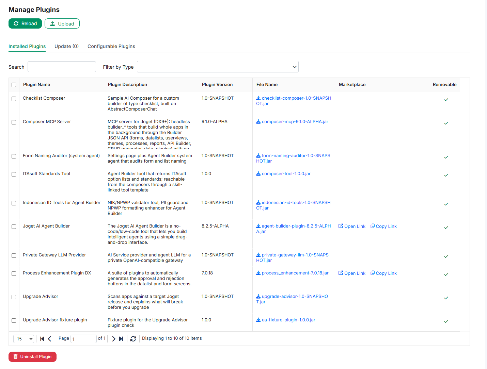
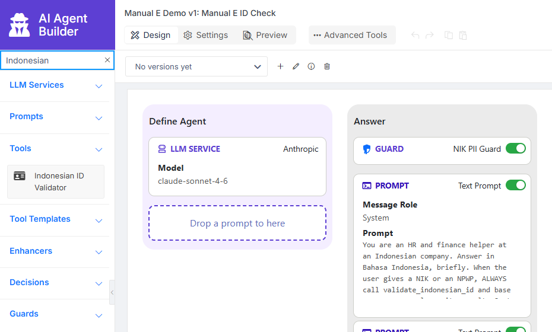

# Extending Agent Builder: Overview and Development Setup

This page is for Joget plugin developers who want to add their own building blocks to Agent Builder. It lists every way to extend the product, from the lightest (no code) to the heaviest (a Java plugin), shows what an external plugin can and cannot do, and then sets up a complete development environment: JDK, Maven, the Agent Builder API jar and the Joget platform jars, a full `pom.xml`, the Activator, build, deploy, reload and upgrade. The pages [Writing Custom Tools](24-custom-tools.md) and [Writing Custom Guards, Enhancers, Decisions and Prompts](25-custom-guards-enhancers-decisions-prompts.md) build on this setup.

## Before you start

You need:

- A Joget DX Enterprise server with the Agent Builder plugin installed and active (see [Installing and Setting Up Your Joget Instance](02-installation-and-setup.md)). Agent Builder is an Enterprise feature. A plugin that extends it does nothing on Joget Community.
- Admin access to that server, to upload plugins at **Settings > Manage Plugins**.
- JDK 17 and Apache Maven 3.8 or later on your build machine. The plugins themselves are compiled for Java 11.
- The examples repository (`ai-partner-samples`). It contains the Agent Builder API jar and two scripts that install the build prerequisites into your local Maven repository: the API jar, and the Joget platform jars of your own Joget installation. See [The Examples Repository](29-examples-repository.md).
- Basic knowledge of Joget plugin development: a Joget plugin is a Java class that extends `org.joget.plugin.base.ExtDefaultPlugin` and is registered as an OSGi service by a bundle Activator. If you have written a Joget Process Tool or Datalist Action before, you know everything you need.

You do not need the Agent Builder source code, and you do not build Agent Builder. You compile your plugin against the API jar from the examples repository. At run time your classes use the Agent Builder plugin that is already installed on the server.

## The ways to extend Agent Builder, lightest first

Start at the top of this list and stop at the first row that solves your problem. Every step down adds code, a build pipeline and an upgrade test to your maintenance work.

| Level | Mechanism | Use it when | What you give up | Where to learn more |
|---|---|---|---|---|
| 1 | **Skills and Central Instructions** (text) | You want the AI Composers or an agent to follow your rules, naming conventions or domain knowledge. | Text only. A skill advises the model; it does not enforce anything. | [Skills, Central Instructions and Tool Templates](22-skills-and-tool-templates.md) |
| 2 | **Tool templates** | You want a pre-configured copy of an existing tool (for example a **JSON API** tool with your base URL and key) that agents and composers can reuse. | You can only configure tools that already exist. | [Skills, Central Instructions and Tool Templates](22-skills-and-tool-templates.md) |
| 3 | **Built-in generic blocks** configured in the agent: **JSON API** tool, **Database Query** tool, **MCP Client** tool, **Rule-Based Guard**, **Response Condition** decision | The need is one HTTP call, one SQL query, an existing MCP server, a regular-expression rule or a text condition. | No response shaping, no pagination loops. The model writes the SQL for the **Database Query** tool. | [Building Block Reference: Tools](06-reference-tools.md), [Building Block Reference: Prompts, LLMs, Enhancers, Decisions and Guards](07-reference-other-blocks.md) |
| 4 | **BeanShell blocks**: **BeanShell** tool, enhancer, prompt and decision | You need a few lines of Joget API code in one agent. | The script lives in the agent definition. No compile-time checking, no unit tests, no reuse across agents except by copying. | [Building Block Reference: Tools](06-reference-tools.md) |
| 5 | **Custom plugin blocks** (this page and the two pages that follow): your own tool, guard, enhancer, prompt or decision as a Java plugin | You need a stable, tested, reusable function contract; secrets and policy kept in plugin properties; response shaping; caching; or a guard, enhancer or decision with behaviour the built-in ones cannot give you. | A Maven project, an OSGi bundle, and a test after every Agent Builder upgrade. | [Writing Custom Tools](24-custom-tools.md), [Writing Custom Guards, Enhancers, Decisions and Prompts](25-custom-guards-enhancers-decisions-prompts.md) |
| 6 | **Custom LLM provider** | You must call a model service that Agent Builder does not support. | You maintain the provider code and its model list. | [Adding a Custom LLM Provider](26-custom-llm-providers.md) |
| 7 | **System agent** | You want to run an agent from your own Java code (a plugin, a scheduled job) without a canvas. | Your code owns the prompt and the tool wiring. | [System Agents](27-system-agents.md) |
| 8 | **Custom composer tool or composer** | You want an AI Composer to call your tool or you want a new composer type. | The most coupling to Agent Builder internals. | [Custom Composer Tools and Building Your Own Composer](28-custom-composer-tools-and-composers.md) |

Rules of thumb:

- "One GET request that returns JSON" is level 3, even if the endpoint needs a key. Put the key in a tool template.
- "Read some rows from a database" is level 3 before you consider a tool class.
- If the logic is ten lines and one agent uses it, use level 4. If three agents want it, or you want to unit-test it, move to level 5.
- Choose level 5 for a guard, enhancer or decision only when the rule-based, regular-expression or BeanShell variants cannot express the behaviour. For personal data, the **Rule-Based Guard** (deterministic patterns) is usually the better first choice.
- Do not choose level 5 because "Java is cleaner". Choose it because you need a contract.

## The extension points and what each can do

An extension point is a Java class that you extend. Agent Builder finds your class through the Joget plugin manager and offers it on the agent canvas.

| Extension point | Base class to extend (package `org.joget.ai.agent.model`) | Appears in the palette under | When the agent runs it | What it can do | What it cannot do |
|---|---|---|---|---|---|
| Tool | `AgentToolAbstract` | Tools | When the model asks to call one of its functions. | Offer one or more functions to the model. Run any Java code. Return a string to the model. | Show a rich UI panel in the chat (see the next section). |
| Guard | `AgentGuardAbstract` | Guards | Before the model call (request side) and after the model and tool calls (answer side). | Pass, block, mask or redirect. Change the request or the answer in place. | Run at any other point. |
| Enhancer | `AgentEnhancerAbstract` | Enhancers | After the answer and the output guards. | Change the final answer. Take extra steps (store, notify). | Return a different value: only changes to the `Response` object count. |
| Prompt | `AgentPromptAbstract` | Prompts | At the start of the task, before the model call. | Add messages (usually system or user) to the task's conversation. | Change messages that other prompts already added (you can, but you should not). |
| Decision | `AgentDecisionAbstract` | Decisions | After the task, its guards and its enhancers. | Continue, stop the agent, or jump to another task. | Change the answer. |
| LLM provider | `AgentLLMAbstract` | LLM Services | For every model call. | Call any model service. | See [Adding a Custom LLM Provider](26-custom-llm-providers.md). |
| System agent | `SystemAgentAbstract` | Not in the palette | When your Java code runs it. | Run a prompt with tools and return a result. | See [System Agents](27-system-agents.md). |

The agent runs the parts of a task in this order:

```text
1. Central Instructions and the task's prompts   (AgentPrompt.generate)
2. Input guards                                  (AgentGuard.filterInput)
3. Model call, with the functions of all tools in the task
4. Tool calls, in rounds, until the model answers (AgentTool.execute)
5. Output guards                                 (AgentGuard.filterOutput)
6. Enhancers                                     (AgentEnhancer.enhance)
7. Decisions                                     (AgentDecision.decide)  -> continue, go to a task, or stop
```

Two properties are added to every element by the builder: **Personalized Name** (`personalizedName`) and **Is Enabled** (`isEnabled`), on the first page of the element's configuration. Do not define them in your own property JSON. An element whose **Is Enabled** is off is skipped.

Each base class extends `org.joget.plugin.base.ExtDefaultPlugin`. You always implement these methods, inherited from the Joget plugin interfaces:

| Method | What to return |
|---|---|
| `getName()` | A short internal name, for example `CostCentreLookupTool`. |
| `getVersion()` | Your plugin version as text. |
| `getLabel()` | The name shown in the palette. |
| `getDescription()` | One sentence shown in the plugin list. |
| `getClassName()` | The full class name, as a class literal: `MyTool.class.getName()`. |
| `getPropertyOptions()` | The configuration form as JSON text (see [Property-options JSON reference](#property-options-json-reference)). |
| `getIcon()` | An HTML snippet for the palette icon, for example `<i class="fas fa-building"></i>`. |

Tools, enhancers, prompts and decisions also implement `getInfoTemplate()`, the small HTML card shown on the canvas. It may contain `${properties.name}` placeholders, which the builder fills with the configured values. The guard base class returns an empty card unless you override `getBuilderJavaScriptTemplate()`.

`isHidden()` is declared in the API as `public default Boolean isHidden()`. The return type is `Boolean`, not `boolean`. If you override it, declare `public Boolean isHidden()`. A hidden element is not shown in the palette.

## What an external plugin cannot do

The Agent Builder plugin shares only some of its Java packages with other plugins (an OSGi bundle "exports" a package to make it visible). Your plugin can use only exported packages. Classes in other packages exist inside the Agent Builder jar, but your bundle cannot load them: you get a `NoClassDefFoundError` the first time your code touches one.

Exported by the Agent Builder plugin:

| Package | Contains (examples) |
|---|---|
| `org.joget.ai.agent` | The plugin classes `AgentBuilder`, `Activator` |
| `org.joget.ai.agent.lib` | The built-in tools, guards, enhancers, prompts and LLMs (for example `JsonApiAgentTool`) |
| `org.joget.ai.agent.lib.composer` | `AbstractComposerChat` and the composer classes |
| `org.joget.ai.agent.model` | `AgentToolAbstract`, `AgentGuardAbstract`, `AgentEnhancerAbstract`, `AgentPromptAbstract`, `AgentDecisionAbstract`, `Function`, `Functions`, `ToolExecution`, `Response`, `Messages`, `Message`, `LLMConfig`, `GuardResult`, `DecisionResult`, `AgentException`, `SystemAgentAbstract`, `AgentTrace` |
| `org.joget.ai.agent.core` | `AgentFactory`, event and input buses |
| `org.joget.ai.agent.embedding` | Embedding provider types |
| `org.joget.ai.assistant` | Assistant classes |
| `org.joget.ai.config`, `.config.feature`, `.config.llm`, `.config.config`, `.config.utils`, `.config.model`, `.config.dao`, `.config.exception` | AI Central Config: credentials, LLM provider types, skill and tool template utilities |

Not exported (do not use from an external plugin):

| Package | Consequence |
|---|---|
| `org.joget.ai.agent.model.display` | You cannot build a **display tool** (a tool that pushes an HTML, AJAX, URL or file panel to the chat), because its result type `AgentDisplayResult` is in this package. `AgentInteractiveToolAbstract` (tools that pause the run and ask the user a question) uses the same package, so it is not supported for external plugins either. Use a plain tool that returns text, or configure one of the built-in display tools in the palette. |
| `org.joget.ai.agent.utils` | Helper classes such as the plugin-proxy and thread-user helpers are not available. Copy the few lines you need. |
| `org.joget.ai.agent.mcp` | The MCP client classes. Use the **MCP Client** tool in the palette. |
| `org.joget.ai.core` | Internal path and app-context helpers. Note: `org.joget.ai.agent.core` (with `agent`) is exported; `org.joget.ai.core` is not. |
| `org.joget.ai.decision`, `org.joget.ai.typesafe`, `org.joget.ai.agent.jev` | Decision-provider and typed-answer internals. |
| `org.joget.ai.config.voice` | Voice provider types. |

Other limits you should plan for:

- **No external guard, decision or enhancer for the AI Composers.** The composers run their own fixed set of tools. A tool of yours reaches a composer only through a tool template linked to a skill (see [Writing Custom Tools](24-custom-tools.md)). Guards, enhancers, prompts and decisions cannot be added to a composer this way.
- **You cannot change how the palette groups or sorts elements.** The palette lists elements by their interface (tool, guard and so on).
- **Agent Builder never scans your bundle.** It finds your element only if your bundle registers it as an OSGi service under the element's class name (see the Activator below).
- **Libraries inside Agent Builder are not shared.** Agent Builder carries its own copies of some libraries, for example Apache HttpClient, and does not export them. Your bundle cannot load their classes. A method of the API whose signature names such a class (`prepareRequestHeader` and `parseResponse` of `AgentLLMAbstract`) therefore cannot be overridden from an external plugin; see [Adding a Custom LLM Provider](26-custom-llm-providers.md) for the way around it.

## Development environment

### Install the API jar

You compile against the Agent Builder API jar. The examples repository provides it in its `00-setup` folder (`00-setup/lib/agent-builder-api-8.2.5-ALPHA.jar`, with a pom file that declares no dependencies), together with an install script. [The Examples Repository](29-examples-repository.md) describes the folder in detail. In short:

1. Open a terminal in the `00-setup` folder of the examples repository.
2. Run the script that matches your system. On Windows (PowerShell) run `.\install-api-jar.ps1`. On macOS, Linux or Git Bash run `./install-api-jar.sh`.
3. The script installs the jar into your local Maven repository (`~/.m2/repository`) and prints `Installed org.joget.ai.agent:agent-builder-api:8.2.5-ALPHA`: group id `org.joget.ai.agent`, artifact id `agent-builder-api`, version `8.2.5-ALPHA`. You use that version in your `pom.xml` as the property `agent-builder.version`.

You must repeat this step whenever you receive a new Agent Builder release together with a new API jar. Compile against the API jar that matches the Agent Builder plugin installed on your server. A stale API jar compiles but fails at run time with `NoSuchMethodError` or a missing class.

### Install the Joget platform jars

Your project also compiles against Joget platform artifacts of the group `org.joget`: `wflow-core`, `wflow-commons` and `wflow-plugin-base` (a plugin that uses the workflow engine or the directory also needs `wflow-wfengine` and `wflow-directory`). The Joget Maven repository asks for a login, so Maven cannot download them without one. Every Joget installation contains them. This is why `00-setup` has a second script, which installs the jars of your own Joget installation into your local Maven repository:

```powershell
.\install-joget-jars.ps1 -JogetHome "<JOGET_HOME>"
```

```bash
./install-joget-jars.sh <JOGET_HOME>
```

The script prints the version it found, for example `Done. Build the samples with:  mvn clean package "-Djoget.version=9.1.2"`. Build your plugin with that value as the property `joget.version`. The default in the sample poms and in the `pom.xml` below is `9.1.2`. You do not need the script if you build Joget from source or have your own login for the Joget Maven repository; in the second case add the repository to your Maven `settings.xml`. The `pom.xml` below has no `<repositories>` section.

### Working samples

The examples repository has a complete, buildable project for each kind of extension. Each folder has a README with the build, install and test steps.

| Folder | Extension | Described on |
|---|---|---|
| `01-agent-builder-tools` | A tool, a guard and an enhancer in one bundle | [Writing Custom Tools](24-custom-tools.md), [Writing Custom Guards, Enhancers, Decisions and Prompts](25-custom-guards-enhancers-decisions-prompts.md) |
| `02-system-agent` | A system agent with a page in **Settings** | [System Agents](27-system-agents.md) |
| `03-composer-custom-tool` | A tool for the AI Composers | [Custom Composer Tools and Building Your Own Composer](28-custom-composer-tools-and-composers.md) |
| `06-custom-llm-provider` | An LLM provider and LLM plugin | [Adding a Custom LLM Provider](26-custom-llm-providers.md) |
| `07-custom-composer` | A composer of your own | [Custom Composer Tools and Building Your Own Composer (continued)](28b-custom-composer-tools-and-composers-continued.md) |

The folder `.claude/skills` of the repository holds three short developer cheat sheets in skill format (`agent-builder-extension-dev`, `agent-builder-system-agents` and `joget-plugin-dx9-cloud-rules`). They are plain Markdown files that you can also read yourself.

### Project structure

```text
cost-centre-lookup/
  pom.xml
  src/main/java/org/acme/lab/
    Activator.java            registers the plugins; touches no Agent Builder class
    Registrar.java            the only class that names Agent Builder types at start-up
    Ext.java                  small shared helpers (reads the property JSON)
    CostCentreLookupTool.java the palette element
  src/main/resources/
    properties/CostCentreLookupTool.json   the configuration form
    messages/costCentre.properties         labels used by the form (@@key@@)
  src/test/java/org/acme/lab/
    CostCentreLookupToolTest.java
```

This is the project built step by step in [Writing Custom Tools](24-custom-tools.md). A bundle with several elements has one Java class and one JSON file per element, and one `Registrar` line per element.

## The pom.xml

### Complete pom.xml

This is the pom of the project `cost-centre-lookup`. It follows the conventions of the sample poms in the examples repository: the same properties, the same exclusions and no `<repositories>` section.

```xml
<?xml version="1.0" encoding="UTF-8"?>
<project xmlns="http://maven.apache.org/POM/4.0.0" xmlns:xsi="http://www.w3.org/2001/XMLSchema-instance" xsi:schemaLocation="http://maven.apache.org/POM/4.0.0 http://maven.apache.org/maven-v4_0_0.xsd">
    <modelVersion>4.0.0</modelVersion>
    <groupId>org.acme.lab</groupId>
    <artifactId>cost-centre-lookup</artifactId>
    <packaging>bundle</packaging>
    <version>1.0.0</version>
    <name>cost-centre-lookup</name>
    <description>Agent Builder tool that looks up a cost centre record in a Joget form.</description>

    <properties>
        <project.build.sourceEncoding>UTF-8</project.build.sourceEncoding>
        <maven.compiler.release>11</maven.compiler.release>
        <!--
            The Joget platform version to compile against. Override it on the command line with the version that is
            in your local Maven repository, for example:  mvn clean package "-Djoget.version=9.1.2"
            (00-setup/install-joget-jars installs the jars of your own Joget installation and prints the version).
        -->
        <joget.version>9.1.2</joget.version>
        <!-- The Agent Builder API jar, installed by 00-setup/install-api-jar. -->
        <agent-builder.version>8.2.5-ALPHA</agent-builder.version>
        <!-- Public libraries the platform classes refer to. Compile only; Joget supplies its own copies at run time. -->
        <spring.version>5.3.39</spring.version>
        <json.version>20231013</json.version>
        <osgi.version>6.0.0</osgi.version>
    </properties>

    <!--
        No <repositories> on purpose: everything except the Joget artifacts comes from Maven Central, and the Joget
        artifacts come from your local Maven repository (see 00-setup). If you have a login for the Joget Maven
        repository, add that repository and its credentials in your own Maven settings.xml.
    -->

    <build>
        <plugins>
            <plugin>
                <artifactId>maven-compiler-plugin</artifactId>
                <version>3.13.0</version>
            </plugin>
            <plugin>
                <artifactId>maven-resources-plugin</artifactId>
                <version>3.3.1</version>
            </plugin>
            <plugin>
                <artifactId>maven-surefire-plugin</artifactId>
                <version>3.2.5</version>
            </plugin>
            <plugin>
                <groupId>org.apache.felix</groupId>
                <artifactId>maven-bundle-plugin</artifactId>
                <version>5.1.9</version>
                <extensions>true</extensions>
                <configuration>
                    <instructions>
                        <Bundle-SymbolicName>org.acme.lab.cost-centre-lookup</Bundle-SymbolicName>
                        <!-- Nothing is exported: other bundles never call into this one. -->
                        <Private-Package>org.acme.lab.*</Private-Package>
                        <Export-Package>!*</Export-Package>
                        <Bundle-Activator>org.acme.lab.Activator</Bundle-Activator>
                        <!--
                            Every package is resolved lazily from whichever bundle exports it (Agent Builder exports
                            org.joget.ai.agent.model; Joget exports the rest). Only the packages named here are checked
                            when the bundle resolves. javax.servlet is named on purpose: Joget DX 9 converts a jar to
                            jakarta at install only when its manifest mentions javax.servlet, and version="0" stops the
                            bundle plugin writing a [4.0,5) range.
                        -->
                        <Import-Package>!*,javax.servlet;version="0",javax.servlet.http;version="0",org.osgi.framework;version="1.3.0"</Import-Package>
                        <DynamicImport-Package>*</DynamicImport-Package>
                        <Joget-Name>Cost Centre Lookup for Agent Builder</Joget-Name>
                        <Joget-Description>Agent Builder tool that looks up a cost centre record in a Joget form</Joget-Description>
                    </instructions>
                </configuration>
            </plugin>
        </plugins>
        <resources>
            <resource>
                <directory>src/main/resources</directory>
                <filtering>false</filtering>
                <excludes>
                    <exclude>messages/*.properties</exclude>
                </excludes>
            </resource>
            <!-- the messages file carries ext.version=${project.version} -->
            <resource>
                <directory>src/main/resources</directory>
                <filtering>true</filtering>
                <includes>
                    <include>messages/*.properties</include>
                </includes>
            </resource>
        </resources>
    </build>

    <dependencies>
        <!--
            Joget platform, compile only. Each artifact is named explicitly and its own dependency tree is excluded,
            so the build needs exactly these jars from your local Maven repository and nothing else from Joget.
        -->
        <dependency>
            <groupId>org.joget</groupId>
            <artifactId>wflow-core</artifactId>
            <version>${joget.version}</version>
            <scope>provided</scope>
            <exclusions><exclusion><groupId>*</groupId><artifactId>*</artifactId></exclusion></exclusions>
        </dependency>
        <dependency>
            <groupId>org.joget</groupId>
            <artifactId>wflow-commons</artifactId>
            <version>${joget.version}</version>
            <scope>provided</scope>
            <exclusions><exclusion><groupId>*</groupId><artifactId>*</artifactId></exclusion></exclusions>
        </dependency>
        <dependency>
            <groupId>org.joget</groupId>
            <artifactId>wflow-plugin-base</artifactId>
            <version>${joget.version}</version>
            <scope>provided</scope>
            <exclusions><exclusion><groupId>*</groupId><artifactId>*</artifactId></exclusion></exclusions>
        </dependency>
        <dependency>
            <!-- Compile only: at run time the classes come from the installed Agent Builder plugin. Never embed this jar. -->
            <groupId>org.joget.ai.agent</groupId>
            <artifactId>agent-builder-api</artifactId>
            <version>${agent-builder.version}</version>
            <scope>provided</scope>
            <exclusions><exclusion><groupId>*</groupId><artifactId>*</artifactId></exclusion></exclusions>
        </dependency>

        <!-- Public libraries (Maven Central), compile only. -->
        <dependency>
            <groupId>org.json</groupId>
            <artifactId>json</artifactId>
            <version>${json.version}</version>
            <scope>provided</scope>
        </dependency>
        <dependency>
            <groupId>org.osgi</groupId>
            <artifactId>org.osgi.core</artifactId>
            <version>${osgi.version}</version>
            <scope>provided</scope>
        </dependency>
        <dependency>
            <groupId>org.springframework</groupId>
            <artifactId>spring-context</artifactId>
            <version>${spring.version}</version>
            <scope>provided</scope>
        </dependency>

        <dependency>
            <groupId>org.junit.jupiter</groupId>
            <artifactId>junit-jupiter</artifactId>
            <version>5.10.1</version>
            <scope>test</scope>
        </dependency>
    </dependencies>
</project>
```

Why each choice matters:

| Choice | Reason |
|---|---|
| `<packaging>bundle</packaging>` and the `maven-bundle-plugin` | Produces an OSGi bundle (a jar with an OSGi manifest) that the Joget plugin manager can load. |
| `agent-builder-api` with scope `provided` and all transitive dependencies excluded | At run time the classes come from the installed Agent Builder plugin. If you embedded your own copy of `AgentToolAbstract`, the server would see a different class with the same name, the check "is this plugin a tool?" would fail, and your tool would not load. The excluded tree (HTTP client, JSON and PDF libraries) is already present in the host. |
| `wflow-core`, `wflow-commons` and `wflow-plugin-base` with scope `provided`, each with its dependency tree excluded | Joget supplies them at run time. Never embed them. With the exclusions the build needs exactly the jars that `install-joget-jars` installed, and nothing else from the Joget Maven repository. |
| `org.json`, the OSGi core API and Spring context with scope `provided` | Public libraries from Maven Central that the platform classes refer to. They are named because the dependency trees of the Joget jars are excluded. Joget supplies its own copies at run time. |
| No `<repositories>` section | Everything except the Joget artifacts and the API jar comes from Maven Central. |
| `joget.version` `9.1.2` | The version of the platform jars to compile against. Pass your own on the command line. |
| `Private-Package` plus `Export-Package` set to `!*` | Nobody calls into your bundle. Keeping your packages private means they cannot collide with another bundle. |
| `Import-Package` set to `!*,...` plus `DynamicImport-Package` set to `*` | `!*` stops the bundle tool from writing static imports. The bundle then always resolves, whatever the Agent Builder version. Classes are found lazily from whichever bundle exports their package. The price: a missing or incompatible Agent Builder shows up as a `LinkageError` at first use, which the Activator catches (see below). |
| `javax.servlet;version="0"` named on purpose | See "javax and jakarta" below. |
| `maven.compiler.release` 11 | The bytecode level of the plugin. It runs on Java 11 and later. |
| Two `resource` blocks | Only the messages file is filtered, so that it can carry `ext.version=${project.version}`. The JSON files must not be filtered. |

If your plugin needs a library that the host does not provide (for example a PDF library), add it with `compile` scope and add the `Embed-Dependency` instruction of the standard Joget plugin template. Never embed `agent-builder-api`, `wflow-core` or `wflow-plugin-base`. Prefer the JDK: the HTTP client in `java.net.http` needs no extra jar.

### javax and jakarta

Joget DX 9 uses the `jakarta.servlet` packages, where older plugin code uses `javax.servlet`. Joget DX 9 migrates an installed plugin jar to jakarta automatically, but only when the main manifest mentions `javax.servlet`. That is why the `Import-Package` line names `javax.servlet` and `javax.servlet.http` even though your code may not use servlets. The `version="0"` stops the bundle tool from writing a version range that would not follow the package into jakarta. Keep the line as it is. The examples of this manual were built against the Joget DX 9 platform jars and run on Joget DX 9. A plugin whose own source names servlet classes must be compiled with the namespace of the platform jars it is built against; the sample `02-system-agent` shows how its pom selects the namespace from `joget.version`.

## The Activator and the Registrar

An OSGi bundle starts through its Activator. Agent Builder does not scan bundles. Your Activator must register every element as an OSGi service under the element's class name. Agent Builder then lists the services by interface, and at run time rebuilds a saved element with the plugin manager's `getPlugin(className)`. The class name is the identity of the element.

```java
package org.acme.lab;

import java.util.ArrayList;
import java.util.Collection;
import org.joget.commons.util.LogUtil;
import org.osgi.framework.BundleActivator;
import org.osgi.framework.BundleContext;
import org.osgi.framework.ServiceRegistration;

public class Activator implements BundleActivator {

    private static final String AGENT_BUILDER_MARKER = "org.joget.ai.agent.model.AgentToolAbstract";
    private final Collection<ServiceRegistration> registrations = new ArrayList<>();

    @Override
    public void start(BundleContext context) {
        try {
            Class.forName(AGENT_BUILDER_MARKER, false, Activator.class.getClassLoader());
            Registrar.register(context, registrations);
            LogUtil.info(Activator.class.getName(), "Cost centre lookup registered: " + registrations.size() + " plugin(s)");
        } catch (ClassNotFoundException | LinkageError e) {
            LogUtil.warn(Activator.class.getName(), "Agent Builder is not available, nothing registered: " + e);
        }
    }

    @Override
    public void stop(BundleContext context) {
        for (ServiceRegistration registration : registrations) {
            try {
                registration.unregister();
            } catch (IllegalStateException e) {
                // already unregistered by the framework
            }
        }
        registrations.clear();
    }
}
```

```java
package org.acme.lab;

import java.util.Collection;
import org.joget.plugin.property.model.PropertyEditable;
import org.osgi.framework.BundleContext;
import org.osgi.framework.ServiceRegistration;

/** Registers each palette element as an OSGi service under its own class name. */
final class Registrar {

    private Registrar() {
    }

    static void register(BundleContext context, Collection<ServiceRegistration> sink) {
        add(context, sink, new CostCentreLookupTool());
    }

    private static void add(BundleContext context, Collection<ServiceRegistration> sink, PropertyEditable plugin) {
        sink.add(context.registerService(plugin.getClassName(), plugin, null));
    }
}
```

The rules behind this pattern:

- Register with `plugin.getClassName()` as the service name. The plugin manager looks elements up by exactly that string.
- Keep every Agent Builder type out of the Activator's fields and method signatures. Only `Registrar` and your element classes name Agent Builder types. Then a server without Agent Builder gives a caught `ClassNotFoundException` or `LinkageError` in `start`, not a bundle that fails to start.
- Do not register the Agent Builder interfaces yourself. The Agent Builder plugin registers `AgentTool`, `AgentGuard`, `AgentEnhancer`, `AgentPrompt`, `AgentDecision` and `AgentLLM` as Joget custom plugin interfaces when it starts on an Enterprise server. In **Settings > Manage Plugins**, **Filter by Type** then offers the types **AI Agent Tool**, **AI Agent Guard**, **AI Agent Enhancer**, **AI Agent Prompt**, **AI Agent Decision** and **AI Agent LLM**, and lists your jar under the types of its elements.
- Do not write a Joget Community fallback. On Community the interfaces are not registered and your elements never appear.

## Build, deploy, reload and upgrade

### Build

```text
cd cost-centre-lookup
mvn clean package "-Djoget.version=9.1.2"
```

Replace `9.1.2` with the Joget version that `install-joget-jars` printed. On PowerShell keep the quotation marks. The result is `target/cost-centre-lookup-1.0.0.jar`. The unit tests run during the build and need no Joget server. The first build needs internet access to download the Maven plugins and the public libraries from Maven Central once. After that, `mvn -o clean package "-Djoget.version=9.1.2"` (offline) works.

### Deploy

1. In the Joget admin console go to **Settings > Manage Plugins**.
2. Click **Upload**. In the **Upload Plugin** dialog choose the jar and click **Upload**.
3. Check that the plugin is in the list **Installed Plugins**. The list has one row per jar: **Plugin Name** is the `Joget-Name` of your `pom.xml`, and **File Name** is the jar. The server log (`catalina.out` or `joget.log`) shows a line such as `Cost centre lookup registered: 1 plugin(s)`. If it shows `Agent Builder is not available, nothing registered`, see Troubleshooting.
4. Open an agent in Agent Builder. Your element appears in the palette: tools under **Tools**, guards under **Guards**, enhancers under **Enhancers**, prompts under **Prompts**, decisions under **Decisions** and LLM plugins under **LLM Services**. Use **Search Palette** with your element's label.



The palette has the sections **LLM Services**, **Prompts**, **Tools**, **Tool Templates**, **Enhancers**, **Decisions** and **Guards**.



You can also copy the jar into the `<JOGET_HOME>/wflow/app_plugins` folder. The plugin manager watches that folder and loads or replaces a jar without a restart (hot deploy). Use one method consistently.

### Reload and replace

- Uploading a jar with the same file name replaces the earlier one. The plugin manager stops the old bundle (your `stop` method unregisters the services) and starts the new one.
- Agents that already use your element keep working. A saved agent stores only the class name and the configured properties. After the new bundle is registered, the next run uses the new code.
- A re-upload of a `SNAPSHOT` version can still serve cached resources (for example the property JSON). Change the `<version>` for every jar you give to another person. Hand-overs with the same version number are a common source of "my change does not show".
- Another person who uploads a jar with the same file name replaces yours silently. Use distinct artifact ids on a shared server.

### What happens when your bundle is not available

A saved agent keeps the class name of every element. If the plugin that provides the class is uninstalled, stopped or failed to register, the agent cannot build that element. The run fails at the start of the task with an error such as `AgentTool class could not be loaded: org.acme.lab.CostCentreLookupTool` (the first words change with the element type: `AgentGuard`, `AgentEnhancer`, `AgentPrompt`, `AgentDecision`). The agent does not run without the element.

### Start order

If your bundle starts before Agent Builder is active, `Class.forName` in the Activator fails and nothing is registered. Upload or refresh your bundle again after Agent Builder is active. For a production plugin that must survive any start order, register lazily: re-check on first use, or use an OSGi `ServiceTracker`.

### Upgrade Agent Builder

Your bundle uses `DynamicImport-Package: *`. OSGi wires a dynamic import on first use and keeps the wiring. After you upgrade or replace the Agent Builder plugin, upload your bundle again (or stop and start it) so that it wires to the new Agent Builder. Put this step in your release checklist. Also install the API jar that matches the new Agent Builder release, rebuild, and run your unit tests: a rebuilt bundle fails at compile time where an old jar would fail at run time.

## Property-options JSON reference

`getPropertyOptions()` returns the configuration form of your element as a JSON array of pages. Each page is an object with a `title` and a list of `properties`. The builder shows one tab or section per page.

The usual implementation reads a file from your jar. `AppUtil.readPluginResource` replaces `@@key@@` labels with text from a message file in your jar:

```java
AppUtil.readPluginResource(className, "/properties/CostCentreLookupTool.json", null, true, "messages/costCentre");
```

The fifth argument is the message file path without `.properties`. The fourth argument (`true`) turns on the `@@key@@` replacement. If you pass `false`, write plain labels in the JSON and pass `null` as the message path. A missing key shows `@@key@@` in the form; a unit test that checks every key (see [Writing Custom Guards, Enhancers, Decisions and Prompts](25-custom-guards-enhancers-decisions-prompts.md)) prevents this.

The JSON itself is read each time the form is shown. The resource inside your jar can be cached by the plugin manager, so change the version number when you change the JSON (see above).

### Property types used by the built-in palette

| `type` | What it shows | Value you read in Java |
|---|---|---|
| `header` | A section heading. Has only `label`. | None. |
| `textfield` | One-line text. | `getPropertyString("name")` |
| `number` | Number field. | A string such as `"10"`. Parse it yourself and handle blanks. |
| `password` | Masked text. | The clear text. Stored in the agent definition. |
| `textarea` | Multi-line text. Optional `rows`. | A string with line breaks. |
| `selectbox` | Drop-down list. | The selected `value`. |
| `checkbox` | One check box (a single option) or a list of options. | `"true"` or empty for a single box; a comma-separated string for several. |
| `codeeditor` | Code editor. Optional `mode`: `java`, `javascript`, `json`, `markdown`. | A string. |
| `grid` | Repeatable rows with columns. | An `Object[]` of `Map`, one map per row. |
| `hidden` | A value the user cannot see. | A string. |
| `readonly` | A value the user cannot change. | A string. |

The `truefalse` type is used for a grid column (a yes/no cell). Joget's standard property editor has more types, for example `radio` and `elementselect`. Only the types in the table are used by the shipped palette. Test any other type in the builder before you rely on it.

### Common keys

| Key | Meaning |
|---|---|
| `name` | The property key. You read it with `getPropertyString("name")`. |
| `label` | The visible label. |
| `description` | Help text under the field. |
| `value` | The default value. |
| `required` | The string `"True"` to make the field required. |
| `regex_validation`, `validation_message` | A regular expression the value must match, and the message if it does not. |
| `options` | For `selectbox` and `checkbox`: a list of `{"value": ..., "label": ...}`. |
| `control_field`, `control_value`, `control_use_regex` | Show this field only when another field has a given value. |
| `options_ajax`, `options_ajax_on_change` | Load the options from a URL, and reload them when another field changes. |

### Examples

Text, password and number:

```json
{"label": "Connection", "type": "header"},
{"name": "baseUrl", "label": "ERP base URL", "type": "textfield", "required": "True",
 "regex_validation": "^https?://.+", "validation_message": "Must be an http(s) URL",
 "description": "For example https://erp.example.com/api"},
{"name": "apiKey", "label": "API key", "type": "password"},
{"name": "timeoutSeconds", "label": "Timeout (seconds)", "type": "number", "value": "10"}
```

Static drop-down:

```json
{"name": "region", "label": "Region filter", "type": "selectbox", "value": "ALL",
 "options": [{"value": "ALL", "label": "All regions"},
             {"value": "EMEA", "label": "EMEA"},
             {"value": "APAC", "label": "APAC"}]}
```

One check box, and several:

```json
{"name": "allowBudget", "label": "Allow budget", "type": "checkbox",
 "options": [{"value": "true", "label": ""}]},
{"name": "allowedOperations", "label": "Allowed operations", "type": "checkbox", "value": "SELECT",
 "options": [{"value": "SELECT", "label": "SELECT"}, {"value": "INSERT", "label": "INSERT"}]}
```

Pickers for forms, datalists, workflow variables and agents. The tokens `[CONTEXT_PATH]` and `[APP_PATH]` are filled in by the builder. These URLs are the ones the built-in palette uses:

```json
{"name": "formDefId", "label": "Form", "type": "selectbox",
 "options_ajax": "[CONTEXT_PATH]/web/json/console/app[APP_PATH]/forms/options"},
{"name": "listId", "label": "Datalist", "type": "selectbox",
 "options_ajax": "[CONTEXT_PATH]/web/json/console/app[APP_PATH]/datalist/options"},
{"name": "processVariable", "label": "Workflow variable", "type": "selectbox",
 "options_ajax": "[CONTEXT_PATH]/web/json/console/app[APP_PATH]/workflowVariable/options"},
{"name": "agentId", "label": "Agent", "type": "selectbox",
 "options_ajax": "[CONTEXT_PATH]/web/json/console/app[APP_PATH]/cbuilder/agent/options"}
```

A field list that depends on the chosen form:

```json
{"name": "fieldId", "label": "Field", "type": "selectbox",
 "options_ajax_on_change": "formDefId",
 "options_ajax": "[CONTEXT_PATH]/web/json/console/app[APP_PATH]/form/columns/options"}
```

Grid with a drop-down column and a yes/no column:

```json
{"name": "extraCodes", "label": "Extra cost centres", "type": "grid",
 "columns": [
   {"key": "code",   "label": "Code", "required": "True"},
   {"key": "region", "label": "Region",
    "options": [{"value": "EMEA", "label": "EMEA"}, {"value": "APAC", "label": "APAC"}]},
   {"key": "mandatory", "label": "Mandatory", "type": "truefalse"}
 ]}
```

Read a grid in Java as an array of maps. Guard against blank cells and against the literal text `"null"`:

```java
Object raw = getProperty("extraCodes");
if (raw instanceof Object[]) {
    for (Object row : (Object[]) raw) {
        if (row instanceof java.util.Map) {
            String code = String.valueOf(((java.util.Map<?, ?>) row).get("code")).trim();
            // ...
        }
    }
}
```

Code editor, and a field shown only for one choice:

```json
{"name": "context", "label": "Context text", "type": "codeeditor", "mode": "markdown"},
{"name": "redirectTaskId", "label": "Redirect task id", "type": "textfield",
 "control_field": "onViolation", "control_value": "redirect", "control_use_regex": "false"}
```

`control_value` can be a regular expression when `control_use_regex` is `"true"`, for example `"goto_label|goto_id"` to show a field for either of two choices.

Every guard needs the two properties `onViolation` and `redirectTaskId`; see [Writing Custom Guards, Enhancers, Decisions and Prompts](25-custom-guards-enhancers-decisions-prompts.md).

Two `custom` properties in the shipped palette load a selector widget from Agent Builder's own internal service. Do not copy them.

Property values are processed before your code reads them. Joget hash variables in a value (text between `#` characters, for example `#currentUser.username#`) are replaced. Do not pass untrusted text or text that may contain `#` characters through a property.

## Unit testing

You can test the behaviour of every element with plain JUnit. No Joget server, no Spring context and no model are needed. The method that needs Joget is `getPropertyOptions()`, because it calls `AppUtil.readPluginResource`. Test the JSON files separately (parse them, and check that every `@@key@@` exists in the message file).

Rules that make tests simple:

1. **Put every external call behind a small interface** and pass a fake in a package-private constructor. In [Writing Custom Tools](24-custom-tools.md) the `RecordSource` interface hides the Joget `AppService`.
2. **Set properties one key at a time** with `plugin.setProperty("key", value)`. Do not call `setProperties(Map)`: it resolves hash variables through the Joget Spring context and throws a `NullPointerException` in a plain test. The Agent Builder runtime calls `setProperties` itself, so production code is not affected. A grid value is `plugin.setProperty("rows", new Object[]{ rowMap })`.
3. **Fake the call.** `new ToolExecution("lookup_cost_centre", new JSONObject().put("code", "CC-1000"))`. Pass `null` for the `AgentLLM` argument when your element does not call the model, and `new LLMConfig()` for the config. For an enhancer or a guard use `new Response("text")` and `new Messages()`.
4. **Assert on what the runtime reads.** For a tool, the returned JSON text. For an enhancer, `response.getContent()` after the call (not the return value). For a guard, the `GuardResult` action and, for masking, the changed message or response. For a decision, `getAction()`, `getTarget()` and `getTargetType()`.
5. **Assert the contract.** `assertTrue(new MyGuard() instanceof AgentGuardAbstract)`. Check the function schema: the required parameter list, and that optional parameters are nullable in strict mode.
6. **Test every error path.** Bad input, unknown record, a failing back end, a `null` `ToolExecution`, missing configuration.
7. **Tracing is a no-op in tests.** When no trace handler is set, the trace wrapper runs your code directly.

Things a unit test cannot cover, which you check by hand on a development server: `getPropertyOptions()` and the shape of the form in the builder, messages loaded through Joget, hash-variable resolution, the Activator against a real framework, palette rendering and a real agent run.

## Clusters and Joget Cloud

Plan for these points if your plugin runs in a cluster or on Joget Cloud:

- **Registered instances are shared.** The plugin manager keeps one instance of your class. Agent Builder sets the properties of the configured element on that instance before each use, so two agents with different settings, or two tools from one class, use the same object. Read properties into local variables at the top of your method, keep no per-call data in fields, and make the class thread-safe.
- **Keep state out of server memory.** In a cluster another node can handle the next call. Keep durable state in the database. Per-run data that must exist only for one run can be kept in a map keyed by `LLMConfig.getRunId()`, with the understanding that it is local to one server.
- **Use a class literal for the class name.** On Joget Cloud, plugin beans can be wrapped in a Spring proxy. For a proxied bean `getClass().getName()` returns a name such as `MyTool$$SpringCGLIB$$0`, and a lookup by that name finds nothing. Return `MyTool.class.getName()` from `getClassName()` and register with `plugin.getClassName()`. If you store class names yourself, remove everything from the first `$$` on when you read them back.
- **Threads and identity.** Agent Builder runs parallel tool calls on its own worker threads and passes the current user to them. Cloud's security manager accepts only the platform's own way of setting a thread user. If your plugin starts its own threads, they do not inherit the user, the current app or any thread-local value.
- **Avoid operations that sandboxes commonly refuse.** For a plugin that must run on Joget Cloud, avoid reflection that changes member accessibility (including binding JSON to your own classes with Gson or Jackson), starting your own threads, writing files outside the Joget base directory, starting operating-system processes, and changing system properties. Parse JSON with `org.json`, as the examples do. Check the final plugin on a Cloud test tenant.

## Limitations and things to know

1. **Extend the abstract class.** A guard or a decision that only implements the interface appears in the palette but fails at run time (`AgentGuard class could not be loaded: <class>`). Extend `AgentGuardAbstract` and `AgentDecisionAbstract`. Do the same for the other types: the abstract classes add the trace wrapper and the canvas card.
2. **Not registered means the task fails.** Every configured element must load. There is no "skip a missing element" mode.
3. **Never embed `agent-builder-api`.** Use scope `provided` and exclude its transitive dependencies.
4. **Unexported packages fail at first use** with `NoClassDefFoundError`. Use only the packages in the export table.
5. **Use a class literal in `getClassName()`** and register with it.
6. **Keep Agent Builder types out of the Activator** and catch `LinkageError` around the Registrar.
7. **Start order and upgrades.** Re-upload your bundle after Agent Builder starts or is upgraded.
8. **Instances are shared.** See "Clusters and Joget Cloud".
9. **Thread locals do not follow a tool into parallel tool calls.** One tool that is not parallel-safe makes the whole batch of tool calls sequential. Return `false` from `isParallelSafe()` if your tool relies on per-thread state.
10. **Throwing from a tool ends the task.** Return an error as text instead (see [Writing Custom Tools](24-custom-tools.md)).
11. **An enhancer must call `response.setContent`.** The runtime ignores the value that `enhance` returns. A guard that masks text must change the message or response itself.
12. **Duplicate function names: the first wins, silently.** Two tools in one task that offer the same function name collide, and the later one is not offered. Prefix your function names when you share a server.
13. **Hash variables in properties are resolved.** See the property-options section.
14. **The function schema is strict by default.** `new Function(name, description)` lists every parameter as required, and makes optional ones nullable. Read optional arguments with `optString` and `optBoolean`. Give every function at least one required parameter.
15. **Unit tests need `setProperty`, not `setProperties`.**
16. **A missing message key shows `@@key@@`.** Test that all keys exist.
17. **DX 9 migration needs `javax.servlet` in the manifest.** Keep the `Import-Package` line from the `pom.xml`.
18. **Enterprise only.** On Community nothing in your bundle appears.
19. **A SNAPSHOT re-upload can show stale resources.** Change the version for every hand-over.
20. **`isHidden()` returns `Boolean`.** A hidden tool is also left out of the **Tool Type** list in AI Central Config, so a tool you want to offer through a tool template must not be hidden.
21. **`orchestratorOnly` is not access control.** `Function.orchestratorOnly()` sets a flag that outside programs (for example the Composer MCP) read and honour. The Agent Builder runtime does not enforce it: such a function is still offered to the model in a normal agent. Never use it to protect a dangerous function.
22. **A guard you rely on must load.** Because a missing guard fails the task, there is no fail-open for a missing guard. But a guard that you write to call a remote service and that returns "pass" on an error does fail open. Decide on purpose what your guard returns when its dependency is down.

## Troubleshooting

| Symptom | Likely cause | Fix |
|---|---|---|
| The build fails with `Could not find artifact org.joget.ai.agent:agent-builder-api:jar:8.2.5-ALPHA`. | The API jar is not in your local Maven repository. | Run `install-api-jar` in the `00-setup` folder of the examples repository. |
| The build fails with `Could not find artifact org.joget:wflow-core:jar:9.1.2` (or another version). | The platform jars of the version you build with are not in your local Maven repository. | Run `install-joget-jars`, then build with `-Djoget.version=<the version it printed>`. |
| The log shows `Agent Builder is not available, nothing registered`. | Your bundle started before Agent Builder, or Agent Builder is not installed or not active, or its version does not contain the class your Activator checks. | Check that Agent Builder is active in **Settings > Manage Plugins**. Upload your bundle again. |
| Your element does not appear in the palette. | The service was not registered; the server is Joget Community; the element is hidden (`isHidden()` returns `true`); the element is registered under a different name than `getClassName()`. | Check the log line from the Activator. Check the edition. Register with `plugin.getClassName()`. |
| The palette shows the element, but the run fails with `AgentGuard class could not be loaded: ...` (or `AgentDecision ...`). | The class implements only the interface, not the abstract class. | Extend `AgentGuardAbstract` or `AgentDecisionAbstract`. |
| The run fails with `AgentTool class could not be loaded: ...` (or another element type). | The plugin is uninstalled, stopped, or registered under a different class name (for example a proxy name on Cloud). | Install or start the plugin; use a class literal in `getClassName()`. |
| `NoClassDefFoundError` for an `org.joget.ai...` class. | The class is in a package Agent Builder does not export, or Agent Builder is stopped or older than the API jar you compiled against. | Use only exported packages. Check that Agent Builder is active and its version matches the API jar. Upload your bundle again. |
| `NoSuchMethodError` after an Agent Builder update. | The API jar you compiled against is older than the installed plugin. | Install the matching API jar, rebuild, upload again. |
| The build fails with `Alternatives in a multi-catch statement cannot be related by subclassing`. | `JSONException` is a `RuntimeException`. | Catch `RuntimeException` alone. |
| The build fails because `isHidden` cannot be overridden. | The override uses `boolean`. | Declare `public Boolean isHidden()`. |
| The form shows `@@some.key@@` as a label. | A key is missing in the message file, or the fourth argument of `readPluginResource` is `false`. | Add the key; check the arguments. |
| The change to the JSON or message file does not show after re-upload. | Cached resource of a SNAPSHOT version. | Increase the `<version>` and upload again. |
| Unit test fails with `NullPointerException` in `PropertyUtil`. | The test calls `setProperties(Map)`. | Call `setProperty(key, value)` for each key. |
| Two tools offer the same function name and only one is ever called. | The first function with a name wins, silently. | Rename one function. |

## Where to go next

- [Writing Custom Tools](24-custom-tools.md): build a complete tool step by step.
- [Writing Custom Guards, Enhancers, Decisions and Prompts](25-custom-guards-enhancers-decisions-prompts.md): the other four element types.
- [The Examples Repository](29-examples-repository.md): the API jar, the two install scripts and the sample bundles.
- [Skills, Central Instructions and Tool Templates](22-skills-and-tool-templates.md): expose your tool to the AI Composers.
- [Custom Composer Tools and Building Your Own Composer](28-custom-composer-tools-and-composers.md): go further than a palette element.
