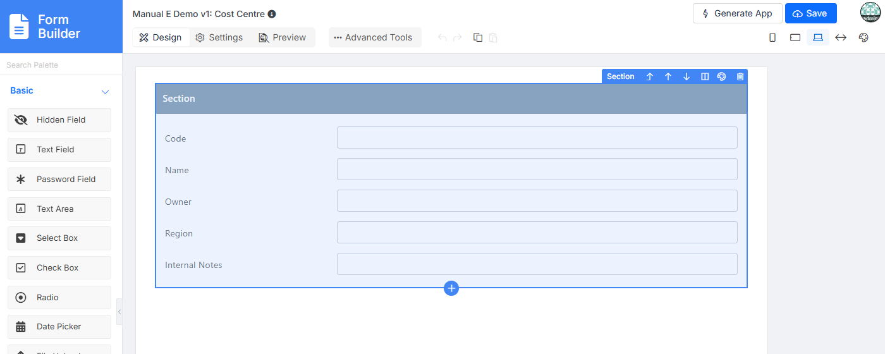
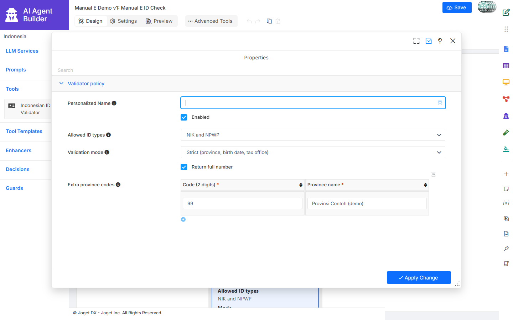

# Writing Custom Tools

This page explains how to write a custom tool for Agent Builder: the Java contract, what the language model sees, how results and errors are handled, parallel execution, how to reach Joget services from a tool, and rules for tools that a model uses well. It ends with a complete walkthrough that builds a real tool from an empty folder, with the Java class, the configuration JSON, the message bundle, the Activator, the unit test, and a run in an agent. It is for Joget plugin developers. Read [Extending Agent Builder: Overview and Development Setup](23-extending-overview.md) first: it sets up the JDK, Maven, the API jar and the `pom.xml` that this page uses.

## What a tool is

A tool is a Java class that gives the language model something it can do. The agent shows the model a list of functions (a name, a description and a list of parameters). When the model decides to call a function, Agent Builder runs your `execute` method with the arguments the model chose. The text you return becomes the tool message in the conversation, and the model reads it and continues.

```text
Agent task
  1. Agent Builder asks every tool of the task for its functions        getFunctions()
  2. The model sees the function list and the conversation
  3. The model answers with a request to call a function                 name + arguments
  4. Agent Builder runs your code                                        execute(llm, config, call)
  5. The string you return is added to the conversation as a tool message
  6. The model is called again. It may call more functions, or give the final answer.
```

Steps 3 to 6 repeat, up to the agent setting **Max Tool Call Depth** (default 100 rounds per task). After the limit, every unexecuted call gets a "skipped" result, and the model is called once more without tools to produce a text answer.

A tool is registered like any other palette element (see the Activator in [Extending Agent Builder: Overview and Development Setup](23-extending-overview.md)). A tool that is non-hidden and extends `AgentToolAbstract` also appears in the **Tool Type** list when you create a tool template in AI Central Config.

## The contract

Extend `org.joget.ai.agent.model.AgentToolAbstract`. It extends the Joget `ExtDefaultPlugin` and implements `org.joget.ai.agent.model.AgentTool`.

| Method | Who calls it and when | What you must do |
|---|---|---|
| `Functions getFunctions()` | Agent Builder, each time a task that contains your tool is assembled, before the model call. It is called on the instance with the properties of that palette element already set. | Return the function schema. Build it fresh: do not cache a `Functions` object in a field. Return at least one function. |
| `String execute(AgentLLM llm, LLMConfig config, ToolExecution call)` | Agent Builder, when the model calls one of your functions. May throw `AgentException`. | Do the work and return a string for the model. Return errors as text. Never return `null`. |
| `String getInfoTemplate()` | The builder, to draw the card of the element on the canvas. | Return a small HTML snippet. `${properties.name}` placeholders are replaced by the configured values. |
| `String getPropertyOptions()` | The builder, to draw the configuration form. | Return the property JSON (see [Extending Agent Builder: Overview and Development Setup](23-extending-overview.md)). |
| `getName()`, `getVersion()`, `getLabel()`, `getDescription()`, `getClassName()`, `getIcon()` | The plugin manager and the palette. | See the overview page. |
| `boolean isParallelSafe()` | Agent Builder, when the model asks for several calls at once. Default `true`. | Return `false` if your tool depends on per-thread state. See "Parallel execution". |
| `boolean isSupersedable()` | Agent Builder, after a call. Default `false`. | Return `true` only for read-only tools whose result can be fetched again. See "Superseding results". |
| `Boolean isHidden()` | The palette and AI Central Config. Default `false`. | Return `true` only for helper tools that must not be picked by a builder. The return type is `Boolean`. |
| `Functions getSubFunctions(String groupName)` | Only for group-style tools. Default `null`. | Leave it. |

`executeWithTrace` is `final` in `AgentToolAbstract`. It calls your `execute` inside a trace span that records `{function, arguments}` and the result. You cannot override it. You see the trace in the **Agent Execution Audit Trail**.

The three arguments of `execute`:

| Argument | What it is |
|---|---|
| `AgentLLM llm` | The model service of the task. A tool that does not call the model ignores it. In a unit test pass `null`. |
| `LLMConfig config` | The task's model settings. Useful to you: `config.getRunId()`, a string that identifies the current run. |
| `ToolExecution call` | The call. `call.getName()` is the function the model called. `call.getArguments()` is a `JSONObject` with the arguments. `call.getId()` is the model's call id. `call.getMetadata()` gives the agent id and name (`getAgentId()`, `getName()`) and the conversation so far (`getMessages()`). |

## What the model sees

The model sees only three things about your tool: the function **name**, the **description** and the **parameter schema**. It does not see your class, your property values or your Java code. Whether the model calls the tool, and with which arguments, depends almost entirely on these texts.

You build a function like this:

```java
Function f = new Function("lookup_cost_centre",
        "Look up ONE cost centre by its code (for example CC-1000). Use it whenever the user mentions a cost centre code "
      + "and you need its name, owner or region. Do not guess these values. Returns JSON with the cost centre fields. "
      + "If the code is unknown the result contains an error field.");
f.addParameter("code", Function.ParameterType.STRING,
        "Cost centre code: two letters and 3 to 6 digits, for example CC-1000", true);
Functions fs = new Functions();
fs.add(f);
return fs;
```

### Function constructors

| Constructor | Use |
|---|---|
| `new Function(name, description)` | Strict schema (the default). |
| `new Function(name, description, strict)` | Pass `false` for a non-strict schema if a provider needs it. |
| `new Function(name, description, strict, additionalProperties)` | Also allow unknown top-level arguments. |
| `new Function(String json)` | Build the function from a complete JSON schema string. |

In a strict schema every parameter is listed as required, and an optional parameter gets a nullable type (for example `["boolean","null"]`). The model then sends `null` for an optional parameter it does not want to set. Read optional arguments with `args.optString(...)`, `args.optBoolean(...)` and so on, and treat `null` and empty as "not set".

### addParameter overloads

| Call | Meaning |
|---|---|
| `addParameter(name, description)` | A required string parameter. |
| `addParameter(name, type, description)` | A required parameter of the given type. |
| `addParameter(name, type, description, required)` | Required or optional. |
| `addParameter(name, type, description, String[] options, required)` | A parameter limited to a list of allowed values (an enum). |
| `addParameter(name, type, description, isArray, required)` | An array of the type. |
| `addParameter(name, type, description, options, isArray, required)` | All options. |

`Function.ParameterType` has `STRING`, `BOOLEAN`, `NUMBER`, `INTEGER` and `OBJECT`. An `OBJECT` parameter accepts any properties.

The schema guides the model; it does not enforce anything. The model can send a wrong type or a value outside the list. Validate every argument in `execute`.

### Rules for names

- Use lowercase letters, digits and underscores, and keep the name under 64 characters. Model providers restrict function names.
- Name the function as a verb phrase: `lookup_cost_centre`, not `cost_centre`.
- Keep the name stable. Saved agents, prompts and skills refer to it.
- Keep it unique. If two tools in one task offer the same function name, the first one registered wins and the later one is silently left out. When you share a server with other teams, prefix your names (`acme_lookup_cost_centre`).
- A tool may offer several functions: add several `Function` objects to the `Functions`. Prefer a few focused functions over one function with a `mode` parameter, and keep the total small.
- A tool can take the function name from a property (this is how the **BeanShell** tool serves many palette entries with one class). Use this when the builder should name the function.

## Results and errors

### Return a string

`execute` returns a `String`. The string goes to the model unchanged. Return compact JSON with stable field names, as in the walkthrough, or short plain text. Return only what the model needs: the result stays in the model's context for the rest of the task, and a large result costs tokens and may push earlier conversation out of the context window.

### Return errors, do not throw

What happens when `execute` throws depends on how the model asked for the call:

| Situation | What Agent Builder does |
|---|---|
| One tool call, or several calls that run one after the other (the default) | The exception is rethrown. The task fails and the agent run ends as failed. The model never sees the problem. |
| Several calls in parallel (the agent setting **Enable Parallel Tool Calls** is on and all tools are parallel-safe) | The exception is caught and the model receives the text `Error: <message>`. The run continues. |
| The model calls a function name that no tool of the task offers | The model receives `Error: tool '<name>' is not available to this task. Use one of the provided tools, or answer without a tool.` The run continues. |

The same bug would therefore end the run in one case and be hidden in another. Avoid both: catch your own failures and return an error as text:

```java
private static String error(String message) {
    return new JSONObject().put("error", message).toString();
}
```

Write the message so that the model can act on it: what failed and what to do (try another code, ask the user, tell the user the system is unavailable). Do not put stack traces, URLs with keys, SQL text or host names in it. Write the detail to the log with `LogUtil.warn(...)`.

Throw an `org.joget.ai.agent.model.AgentException` only when the run must stop: for example when a security check fails and no answer should be given. The task then fails with your message.

### Show the real request in the trace

By default the trace records the function name and the model's arguments. If your tool sends something else to a back end (a URL, a SQL statement), call `org.joget.ai.agent.model.AgentTrace.recordRequest(payload)` inside `execute` to show it in the trace. The call is ignored when no trace is active, so it is safe in unit tests. Never record secrets.

## Parallel execution

When the agent setting **Enable Parallel Tool Calls** is on (it is off by default) and the model asks for more than one function in a single reply, Agent Builder can run the calls at the same time on a thread pool (**Parallel Tool Call Threads**, default 4). The batch runs in parallel only if every tool in the batch qualifies. One tool that returns `false` from `isParallelSafe()` makes the whole batch run one after the other. A group tool or an interactive tool has the same effect.

What worker threads receive: the current Joget user, and the run context that Agent Builder itself keeps. What they do not receive: any value you or Joget keep in a `ThreadLocal`. A tool that reads or writes thread-bound state can find nothing, or a fresh value, in a worker thread, and no exception tells you. Joget keeps some of its own context per thread, for example the current app definition. If your tool depends on such context, return `false` from `isParallelSafe()` and test the tool with **Enable Parallel Tool Calls** switched on.

Return `false` from `isParallelSafe()` when your tool:

- reads state that Joget keeps per thread (for example `AppUtil.getCurrentAppDefinition()` in the walkthrough),
- reads or writes a `ThreadLocal` of your own, or
- changes shared data in a way that depends on the order of the calls.

Return `true` (the default) for pure functions and for tools that only use the arguments, their own properties and thread-safe clients.

Whatever you choose, the class must be thread-safe, because the registered instance is shared (next section).

## The instance is shared

The plugin manager creates one instance of your class. Whenever an agent uses the element, Agent Builder sets the configured property values on that instance and then uses it. Two agents with different settings, and two tool templates built from your class, can share one object. Therefore:

- Read all properties into local variables at the top of `execute` (and of `getFunctions`).
- Keep no per-call data in fields. Keep no mutable fields at all unless they are thread-safe.
- Do not rely on `getFunctions()` having been called before `execute()` on the same call path.

## Superseding results

`isSupersedable()` returns `false` by default. When it returns `true`, a new call with the same function name and the same arguments replaces the earlier result in the conversation with the stub `[superseded]`. This keeps the history small when the model fetches the same data again. Only calls with identical arguments match: two lookups of different codes both stay.

Use it only for read-only tools whose result goes stale or can be fetched again. Never use it for a tool that changes data.

## Hidden and orchestrator-only functions

| Setting | What it does | What it does not do |
|---|---|---|
| `isHidden()` returns `true` | The element is not shown in the palette, and it is left out of the **Tool Type** list when someone creates a tool template. | It does not stop an agent that already references the class by name from using it. It is not a security control. |
| `new Function(...).orchestratorOnly()` | Adds the flag `orchestratorOnly: true` to the function definition. The flag is kept outside the schema that goes to the model. Programs that expose a tool's functions to outsiders (the Composer MCP, for example) read the flag and refuse such functions. | Agent Builder itself does not check the flag: in a normal agent the model is still offered the function. Do not use it to protect a dangerous function. |

Use `isHidden()` for internal helper tools that you do not want in the palette. Do not use either setting as an access control.

## Using Joget services from a tool

A tool runs inside the Joget server, so it can use the Joget Java API like any plugin. The usual entry points:

| Need | Code |
|---|---|
| A Spring bean (service, DAO) | `AppUtil.getApplicationContext().getBean("appService")` |
| The app the agent runs in | `AppUtil.getCurrentAppDefinition()` (use `getAppId()` and `getVersion()`) |
| Form data by record id | `appService.loadFormData(appId, appVersion, formDefId, recordId)` returns a `FormRowSet` |
| The current user | the `workflowUserManager` bean: `getCurrentUsername()` |
| Logging | `LogUtil.info(...)`, `LogUtil.warn(...)`, `LogUtil.error(...)` |
| JSON | `org.json.JSONObject`, `JSONArray` (already used by the API) |

Rules:

- Put all Joget calls behind a small interface of your own, so that a unit test can replace it. The walkthrough does this with `RecordSource`.
- Joget calls that need an app context use thread-bound state. Mark such a tool `isParallelSafe() == false`.
- Check permissions yourself. A tool is code that runs with the rights of the Joget user of the run. If the data is not for every user, decide in `execute` what the user may see, or limit the data with a property (the walkthrough returns only the fields the builder allowed).
- Do not log or return secrets. A `password` property is stored in the agent definition as text.
- Calls out of the server (HTTP, SQL) need a timeout. A hung call blocks the run. The JDK `java.net.http.HttpClient` needs no extra jar.

## Design rules for tools the model uses well

A tool that compiles and returns correct data can still fail because the model never calls it, or calls it wrongly. These rules are about the model, not about Java.

### The description is a decision rule

The model decides whether to call your function from the name and the description. Write the description as a rule: when to use it, when not to, and what comes back.

| Weak | Strong |
|---|---|
| "Cost centre tool" | "Look up ONE cost centre by its code (for example CC-1000). Use it whenever the user mentions a cost centre code and you need its name, owner or region. Do not guess these values. Returns JSON with the cost centre fields. If the code is unknown the result contains an error field." |

### Describe every parameter

Give each parameter a description with an example value and the format ("two letters and 3 to 6 digits, for example CC-1000"). Use the `options` overload for a fixed list of values. Mark a parameter optional only when it really is. Declare at least one required parameter on every function: a function without parameters is a risk with some providers when responses are streamed.

### Keep results small and stable

Return only the fields the model needs, as JSON, with the same field names every time. Cut long values. Do not return internal ids, notes or flags that the model has no use for.

### Make errors readable

Return `{"error": "..."}` with a sentence the model can act on. See "Results and errors".

### Put policy in properties, not in the prompt

What a tool may do (which form, which fields, which operations, whether a budget may be shown) belongs in the palette properties, set by the builder and enforced in `execute`. The model cannot argue its way around a property. Instructions in a prompt can be ignored.

### One responsibility per function

A tool with a few focused functions (`lookup`, `search`, `list`) is easier for the model than one function with a `mode` parameter. Keep the total number of functions of a task small: every function costs tokens in every model call.

### Idempotence

Where you can, make tools that change data idempotent: the model may call the same function twice. Return a clear message that says what changed.

### Secrets

Use a `password` property, or put the tool in a tool template. Do not put keys in descriptions or in results.

## Walkthrough: build the Cost Centre Lookup tool

You build a tool called **Cost Centre Lookup**. The builder chooses a Joget form that holds the cost centres and the list of fields the tool may return. The model calls `lookup_cost_centre(code)` and receives the allowed fields of that record as compact JSON. The tool is read-only, returns errors as text, and keeps all Joget access in one small class that tests replace with a fake.

You will build and unit-test the tool, install it, create the cost centre form with data, and run an agent that uses it.

### Step 0. Prerequisites

- Everything in "Before you start" of [Extending Agent Builder: Overview and Development Setup](23-extending-overview.md): JDK, Maven, and the Agent Builder API jar and the Joget platform jars installed with the two scripts in the `00-setup` folder of the examples repository (`install-api-jar` and `install-joget-jars`).
- A development Joget Enterprise server with Agent Builder active and an AI service (credential) configured in AI Central Config (see [AI Central Config Reference](03-ai-central-config.md)).

### Step 1. Create the project

Create this folder structure:

```text
cost-centre-lookup/
  pom.xml
  src/main/java/org/acme/lab/
    Activator.java
    Registrar.java
    Ext.java
    RecordSource.java
    CostCentreLookupTool.java
  src/main/resources/properties/CostCentreLookupTool.json
  src/main/resources/messages/costCentre.properties
  src/test/java/org/acme/lab/CostCentreLookupToolTest.java
```

### Step 2. The pom.xml

Use the complete `pom.xml` from [Extending Agent Builder: Overview and Development Setup](23-extending-overview.md) unchanged. It is the pom of this project. Its property `agent-builder.version` is `8.2.5-ALPHA`, the version that `install-api-jar` prints; if your script printed another version, set the property to it. Its property `joget.version` is `9.1.2`; you pass your own Joget version when you build.

### Step 3. The Activator and the Registrar

Use `Activator.java` and `Registrar.java` from the same page unchanged. They are part of this project. `Registrar` has one `add` line for `CostCentreLookupTool`.

### Step 4. Shared helper `Ext.java`

`Ext` loads the property JSON from the jar, replaces the `@@key@@` labels with the text of `messages/costCentre.properties`, and reads the plugin version.

```java
package org.acme.lab;

import java.io.IOException;
import java.io.InputStream;
import java.io.InputStreamReader;
import java.nio.charset.StandardCharsets;
import java.util.Properties;
import org.joget.apps.app.service.AppUtil;

/** Shared constants and helpers. Touches no Agent Builder class. */
final class Ext {

    static final String MESSAGES = "messages/costCentre";
    static final String VERSION = readVersion();

    private Ext() {
    }

    /** Loads /properties/NAME.json from this jar and resolves its @@key@@ labels from messages/costCentre.properties. */
    static String propertyOptions(String className, String name) {
        return AppUtil.readPluginResource(className, "/properties/" + name + ".json", null, true, MESSAGES);
    }

    private static String readVersion() {
        try (InputStream in = Ext.class.getResourceAsStream("/" + MESSAGES + ".properties")) {
            Properties p = new Properties();
            if (in != null) {
                p.load(new InputStreamReader(in, StandardCharsets.UTF_8));
            }
            String v = p.getProperty("ext.version", "").trim();
            return v.isEmpty() || v.startsWith("${") ? "unknown" : v;
        } catch (IOException e) {
            return "unknown";
        }
    }
}
```

### Step 5. The message bundle

`src/main/resources/messages/costCentre.properties`. Maven filters this file, so `ext.version` becomes the project version.

```properties
ext.version=${project.version}
tool.config=Cost centre source
tool.formId=Form
tool.formId.desc=The form that holds the cost centres. The record id of each row must be the cost centre code, for example CC-1000.
tool.fields=Fields to return
tool.fields.desc=Comma-separated field ids, for example name,owner,region. The model can never read any other field.
tool.maxLength=Maximum value length
tool.maxLength.desc=Longer values are cut and end with "...". This keeps the result small.
```

### Step 6. The configuration form

`src/main/resources/properties/CostCentreLookupTool.json`. The form has three fields: the form to read, the fields to return, and a length limit.

```json
[
    {
        "title": "@@tool.config@@",
        "properties": [
            {
                "name": "formId",
                "label": "@@tool.formId@@",
                "description": "@@tool.formId.desc@@",
                "type": "selectbox",
                "required": "True",
                "options_ajax": "[CONTEXT_PATH]/web/json/console/app[APP_PATH]/forms/options"
            },
            {
                "name": "allowedFields",
                "label": "@@tool.fields@@",
                "description": "@@tool.fields.desc@@",
                "type": "textfield",
                "required": "True",
                "value": "name,owner,region"
            },
            {
                "name": "maxValueLength",
                "label": "@@tool.maxLength@@",
                "description": "@@tool.maxLength.desc@@",
                "type": "number",
                "value": "200"
            }
        ]
    }
]
```

### Step 7. The data seam `RecordSource.java`

This interface is the only place that talks to Joget. A unit test passes a lambda instead.

```java
package org.acme.lab;

import java.util.LinkedHashMap;
import java.util.Map;
import org.joget.apps.app.model.AppDefinition;
import org.joget.apps.app.service.AppService;
import org.joget.apps.app.service.AppUtil;
import org.joget.apps.form.model.FormRow;
import org.joget.apps.form.model.FormRowSet;

/**
 * The only place that talks to Joget. A test passes a lambda instead, so no Joget server is needed.
 */
interface RecordSource {

    /** @return the record's field values keyed by field id, or null when there is no such record */
    Map<String, String> load(String formId, String recordId);

    /** Production implementation: reads the record through the Joget AppService in the current app. */
    static RecordSource joget() {
        return (formId, recordId) -> {
            AppDefinition appDef = AppUtil.getCurrentAppDefinition();
            if (appDef == null) {
                throw new IllegalStateException("There is no current app");
            }
            AppService appService = (AppService) AppUtil.getApplicationContext().getBean("appService");
            FormRowSet rows = appService.loadFormData(appDef.getAppId(), appDef.getVersion().toString(), formId, recordId);
            if (rows == null || rows.isEmpty()) {
                return null;
            }
            FormRow row = rows.get(0);
            Map<String, String> values = new LinkedHashMap<>();
            for (Object key : row.keySet()) {
                values.put(String.valueOf(key), row.getProperty(String.valueOf(key)));
            }
            return values;
        };
    }
}
```

### Step 8. The tool `CostCentreLookupTool.java`

```java
package org.acme.lab;

import java.util.Locale;
import java.util.Map;
import java.util.regex.Pattern;
import org.joget.ai.agent.model.AgentLLM;
import org.joget.ai.agent.model.AgentToolAbstract;
import org.joget.ai.agent.model.Function;
import org.joget.ai.agent.model.Functions;
import org.joget.ai.agent.model.LLMConfig;
import org.joget.ai.agent.model.ToolExecution;
import org.joget.commons.util.LogUtil;
import org.json.JSONObject;

/**
 * Palette tool: looks up ONE cost centre record in a Joget form, by record id, and returns only the fields the
 * builder allowed. The form and the field list are palette properties, so the model cannot ask for anything else.
 */
public class CostCentreLookupTool extends AgentToolAbstract {

    public static final String FUNCTION = "lookup_cost_centre";
    private static final Pattern CODE = Pattern.compile("^[A-Za-z]{2}-?[0-9]{3,6}$");

    private final RecordSource source;

    /** Used by Joget: the registered instance reads from the real app. */
    public CostCentreLookupTool() {
        this(null);
    }

    /** Used by tests: pass a fake source. */
    CostCentreLookupTool(RecordSource source) {
        this.source = source;
    }

    @Override
    public Functions getFunctions() {
        Function f = new Function(FUNCTION, "Look up ONE cost centre by its code (for example CC-1000). Use it whenever "
                + "the user mentions a cost centre code and you need its name, owner or region. Do not guess these values. "
                + "Returns JSON with the cost centre fields. If the code is unknown the result contains an error field.");
        f.addParameter("code", Function.ParameterType.STRING,
                "Cost centre code: two letters and 3 to 6 digits, for example CC-1000", true);
        Functions fs = new Functions();
        fs.add(f);
        return fs;
    }

    @Override
    public String execute(AgentLLM llm, LLMConfig config, ToolExecution call) {
        // Read every property into a local first: the registered instance is shared by all agents.
        String formId = trim(getPropertyString("formId"));
        String fieldList = trim(getPropertyString("allowedFields"));
        int maxLength = parseInt(getPropertyString("maxValueLength"), 200);

        JSONObject args = call == null || call.getArguments() == null ? new JSONObject() : call.getArguments();
        try {
            String raw = args.optString("code", "").trim();
            if (!CODE.matcher(raw).matches()) {
                return error("code must look like CC-1000");
            }
            if (formId.isEmpty() || fieldList.isEmpty()) {
                return error("This tool is not configured: choose a form and the fields to return");
            }
            String code = normalise(raw);
            Map<String, String> record = (source != null ? source : RecordSource.joget()).load(formId, code);
            if (record == null) {
                return error("No cost centre with code " + code);
            }
            JSONObject out = new JSONObject().put("code", code);
            for (String field : fieldList.split("\\s*,\\s*")) {
                String value = record.get(field);
                if (value != null && !value.isEmpty()) {
                    out.put(field, value.length() > maxLength ? value.substring(0, maxLength) + "..." : value);
                }
            }
            return out.toString();
        } catch (RuntimeException e) {
            LogUtil.warn(CostCentreLookupTool.class.getName(), FUNCTION + " failed: " + e);
            return error("The lookup failed. Tell the user the cost centre system is unavailable.");
        }
    }

    /** The default is true. This tool reads per-thread Joget state (the current app), so keep batches sequential. */
    @Override
    public boolean isParallelSafe() {
        return false;
    }

    /** Read-only and re-fetchable: a repeat call with the same code replaces the earlier result in the history. */
    @Override
    public boolean isSupersedable() {
        return true;
    }

    /** "cc1000", "CC1000" and "cc-1000" all become "CC-1000". */
    static String normalise(String raw) {
        String compact = raw.replace("-", "");
        return compact.substring(0, 2).toUpperCase(Locale.ROOT) + "-" + compact.substring(2);
    }

    private static String trim(String s) {
        return s == null ? "" : s.trim();
    }

    private static int parseInt(String s, int fallback) {
        try {
            return Integer.parseInt(trim(s));
        } catch (NumberFormatException e) {
            return fallback;
        }
    }

    private static String error(String message) {
        return new JSONObject().put("error", message).toString();
    }

    @Override
    public String getName() {
        return "CostCentreLookupTool";
    }

    @Override
    public String getVersion() {
        return Ext.VERSION;
    }

    @Override
    public String getLabel() {
        return "Cost Centre Lookup";
    }

    @Override
    public String getDescription() {
        return "Looks up one cost centre record in a Joget form and returns the allowed fields";
    }

    @Override
    public String getClassName() {
        return CostCentreLookupTool.class.getName();
    }

    @Override
    public String getPropertyOptions() {
        return Ext.propertyOptions(getClassName(), "CostCentreLookupTool");
    }

    @Override
    public String getIcon() {
        return "<i class=\"fas fa-building\"></i>";
    }

    @Override
    public String getInfoTemplate() {
        return "<div><dl><dt>Function</dt><dd>lookup_cost_centre</dd><dt>Form</dt><dd>${properties.formId}</dd>"
                + "<dt>Fields</dt><dd>${properties.allowedFields}</dd></dl></div>";
    }
}
```

What the code does, by design rule:

| Design point | Where it is in the code |
|---|---|
| The description is a decision rule | The text passed to `new Function(...)`. |
| Policy is in properties | `allowedFields` limits what can be read; the model never chooses the form or the fields. |
| Properties are read into locals first | The first three lines of `execute`. |
| Validate everything the model sends | The `CODE` pattern, then `normalise`. |
| Errors are returned as text | `error(...)`; nothing is thrown out of `execute`. |
| No internal detail leaks | The `catch` block logs the exception and returns a fixed sentence. |
| Compact result | Only allowed, non-empty fields; long values are cut. |
| Thread-bound state | `isParallelSafe()` returns `false` because the current app definition is context that Joget keeps per thread. |
| Read-only and re-fetchable | `isSupersedable()` returns `true`. |
| Testable | `RecordSource` is the only place that talks to Joget. |

## Walkthrough, part 2: test, install and run

Part 1 created the project files. Part 2 tests them, builds the jar, installs it and runs an agent.

### Step 9. The unit test

`src/test/java/org/acme/lab/CostCentreLookupToolTest.java`:

```java
package org.acme.lab;

import static org.junit.jupiter.api.Assertions.assertEquals;
import static org.junit.jupiter.api.Assertions.assertFalse;
import static org.junit.jupiter.api.Assertions.assertTrue;

import java.util.LinkedHashMap;
import java.util.Map;
import org.joget.ai.agent.model.AgentToolAbstract;
import org.joget.ai.agent.model.LLMConfig;
import org.joget.ai.agent.model.ToolExecution;
import org.json.JSONArray;
import org.json.JSONObject;
import org.junit.jupiter.api.Test;

/** Plain JUnit: no Joget server, no Spring, no model. */
class CostCentreLookupToolTest {

    private static final Map<String, String> RECORD = new LinkedHashMap<>();

    static {
        RECORD.put("name", "Finance");
        RECORD.put("owner", "a.keller");
        RECORD.put("region", "EMEA");
        RECORD.put("internalNotes", "do not show");
    }

    /** Properties are set one key at a time: setProperties(Map) needs the Joget Spring context. */
    private static CostCentreLookupTool tool(RecordSource source) {
        CostCentreLookupTool t = new CostCentreLookupTool(source);
        t.setProperty("formId", "cost_centre");
        t.setProperty("allowedFields", "name, owner, region");
        t.setProperty("maxValueLength", "200");
        return t;
    }

    private static JSONObject run(CostCentreLookupTool t, JSONObject args) {
        return new JSONObject(t.execute(null, new LLMConfig(), new ToolExecution(CostCentreLookupTool.FUNCTION, args)));
    }

    @Test
    void returnsOnlyTheAllowedFields() {
        JSONObject r = run(tool((form, id) -> "CC-1000".equals(id) && "cost_centre".equals(form) ? RECORD : null),
                new JSONObject().put("code", "cc1000"));
        assertEquals("CC-1000", r.getString("code"));
        assertEquals("Finance", r.getString("name"));
        assertEquals("a.keller", r.getString("owner"));
        assertFalse(r.has("internalNotes"));
        assertFalse(r.has("error"));
    }

    @Test
    void cutsLongValues() {
        CostCentreLookupTool t = tool((form, id) -> RECORD);
        t.setProperty("maxValueLength", "4");
        assertEquals("Fina...", run(t, new JSONObject().put("code", "CC-1000")).getString("name"));
    }

    @Test
    void anUnknownCodeIsAnErrorTextNotAnException() {
        JSONObject r = run(tool((form, id) -> null), new JSONObject().put("code", "CC-9999"));
        assertEquals("No cost centre with code CC-9999", r.getString("error"));
    }

    @Test
    void aBackendFailureIsAnErrorTextAndLeaksNothing() {
        JSONObject r = run(tool((form, id) -> {
            throw new IllegalStateException("jdbc:mysql://secret-host/db refused");
        }), new JSONObject().put("code", "CC-1000"));
        assertTrue(r.has("error"));
        assertFalse(r.getString("error").contains("secret-host"));
    }

    @Test
    void badInputAndMissingConfigurationAreErrorTexts() {
        assertTrue(run(tool((f, i) -> RECORD), new JSONObject().put("code", "hello")).has("error"));
        assertTrue(run(tool((f, i) -> RECORD), new JSONObject()).has("error"));
        assertTrue(new JSONObject(tool((f, i) -> RECORD).execute(null, null, null)).has("error"));
        CostCentreLookupTool unconfigured = new CostCentreLookupTool((f, i) -> RECORD);
        assertTrue(run(unconfigured, new JSONObject().put("code", "CC-1000")).getString("error").contains("not configured"));
    }

    @Test
    void theSchemaIsWhatTheModelNeeds() {
        CostCentreLookupTool t = tool((f, i) -> RECORD);
        assertTrue(t instanceof AgentToolAbstract);
        JSONObject fn = t.getFunctions().get(0).getJSONObject("function");
        assertEquals("lookup_cost_centre", fn.getString("name"));
        JSONArray required = fn.getJSONObject("parameters").getJSONArray("required");
        assertEquals("code", required.getString(0));
        assertFalse(t.isParallelSafe());
        assertTrue(t.isSupersedable());
    }
}
```

### Step 10. Build

```text
mvn clean package "-Djoget.version=9.1.2"
```

Replace `9.1.2` with the Joget version that `install-joget-jars` printed. Expected: six tests pass, and `target/cost-centre-lookup-1.0.0.jar` exists (about 14 KB). The manifest in the jar has `Bundle-Activator`, `DynamicImport-Package: *`, an `Import-Package` that names `javax.servlet`, and no `Export-Package`.

### Step 11. Install

1. Go to **Settings > Manage Plugins**, click **Upload**, choose the jar in the **Upload Plugin** dialog and click **Upload**.
2. Check that **Cost Centre Lookup for Agent Builder** is listed and active, and that the log shows `Cost centre lookup registered: 1 plugin(s)`.

### Step 12. Create the data

You need a form with the cost centres. Do this in a test app.

1. In the App Composer create a form with the **Form ID** `cost_centre` (the table name can be the same).
2. Add a text field with the **ID** `id` and the label **Code**. Joget uses a field named `id` as the record's primary key, so the value you type becomes the record id. Add text fields `name`, `owner`, `region` and `internalNotes`.
3. Save the form. Open the form preview and add a record with Code `CC-1000`, name `Finance`, owner `a.keller`, region `EMEA` and internal notes `do not show`.



### Step 13. Use the tool in an agent

Follow [Building Agents Step by Step](05-building-agents-tutorials.md) to create an agent with an AI service and one task. Then:

1. Give the task a system prompt such as: "You answer questions about cost centres. Use the lookup tool for every cost centre code."
2. In the left palette, search for "Cost Centre" and drag **Cost Centre Lookup** from **Tools** into the task.
3. Click the tool card. Set **Form** to `cost_centre`. Leave **Fields to return** as `name,owner,region`. Leave **Maximum value length** as `200`.
4. Use the **Preview** tab and ask: `Who owns CC-1000 and which region is it in?`
5. Expected: the audit trail shows a tool call `lookup_cost_centre` with the argument `{"code":"CC-1000"}` and the result `{"code":"CC-1000","name":"Finance","owner":"a.keller","region":"EMEA"}`. The field `internalNotes` is never in the result. The model answers with the owner and region.
6. Ask about a code that does not exist: `What is CC-9999?` Expected: the result is `{"error":"No cost centre with code CC-9999"}`, and the run completes. It must not fail.
7. Change **Fields to return** to `name` and ask again about CC-1000: the owner disappears from the result, and the model says it cannot tell the owner.

A click on a tool card opens its **Properties**. The picture shows this for the sample tool **Indonesian ID Validator** of the examples repository (folder `01-agent-builder-tools`); your tool opens the same dialog with its own fields.



## Exposing the tool to the AI Composers

The AI Composers have fixed tool sets. You cannot drop your tool into them directly. The supported route is a tool template plus a skill:

1. Create a tool template for your tool class in **Settings > AI Central Config**, tab **Tool Templates**. Your class appears in the **Tool Type** list if it is registered, extends `AgentToolAbstract` and is not hidden.
2. Create a skill (or edit one) and select the template under **Associated Tool Templates**. Choose which composers the skill is available for.
3. When a composer invokes that skill, the tool is added to the composer's functions for the rest of that run.

The details of skills and tool templates are on [Skills, Central Instructions and Tool Templates](22-skills-and-tool-templates.md). Things to design for:

- The tool is available only after the model has invoked the skill. Write the skill description so that the model chooses it when the topic comes up.
- A function name that the composer already uses is not added again. Use a distinctive name.
- The template stores the tool's configuration, including any password. Treat a key in a template as readable by administrators and app creators.
- Two templates of the same tool class share one plugin instance, so use one template per tool class.
- A tool template whose plugin is uninstalled stays in the catalogue and silently stops working.
- Only tools can be injected this way, not guards, enhancers, prompts or decisions.

A complete working example of this route is the folder `03-composer-custom-tool` of the examples repository, and the folder `01-agent-builder-tools` has a second complete tool (with a guard and an enhancer) for the agent canvas; see [The Examples Repository](29-examples-repository.md). To go further, for example to write a tool for a composer's own workflow or to build a new composer, see [Custom Composer Tools and Building Your Own Composer](28-custom-composer-tools-and-composers.md).

## Limitations and things to know

- **Errors end the run unless you return them.** In the normal sequential path an exception from `execute` fails the task. Return `{"error": ...}`.
- **Function names must be unique per task.** The first one wins and no message tells you about the other.
- **The schema does not enforce anything.** Validate every argument.
- **Optional parameters arrive as `null` in a strict schema.** Read them with `opt...` methods.
- **One non-parallel-safe tool serialises the whole batch** of tool calls of that model reply.
- **`orchestratorOnly` and `isHidden` are not security controls.**
- **A tool reaches an AI Composer only through a tool template linked to a skill,** and only after the model invoked that skill.
- **Display tools are not possible, and interactive tools are not supported,** from an external plugin, because the package that holds their result type (`org.joget.ai.agent.model.display`) is not exported. A tool can return text, including Markdown or HTML text, but whether the chat renders it as markup is not guaranteed.
- **Tool results are not kept after the task.** Tool messages and task prompts are dropped after each task; only the final answer carries forward to the next task.
- **Property values are stored in the agent definition.** That includes a `password` property.

## Troubleshooting

| Symptom | Cause | Fix |
|---|---|---|
| The tool is in the palette but the model never calls it. | The description does not say when to use the tool, or the system prompt does not mention it. | Rewrite the description as a rule ("Use it whenever..."). Add a sentence to the task prompt. Check in the audit trail that the function is in the list sent to the model. |
| The model calls the tool with wrong arguments. | The parameter description is vague. | Add an example value and the exact format to each parameter description. Validate in `execute` and return a clear error so the model can retry. |
| The run fails with the exception text of your tool. | `execute` threw an exception. | Catch `RuntimeException` and return `{"error": ...}`. |
| The run fails with `AgentTool class could not be loaded: <class>`. | The plugin is not installed or not registered under that class name. | Install or start the bundle. Check the log line from the Activator. |
| The log shows `tool '<name>' is not available to this task`. | The model called a function that is not in the task, or two tools offered the same name and yours lost. | Rename the function. Check which tools the task contains. |
| `There is no current app` or a null app definition in the log. | The tool ran on a thread without the app context (for example a parallel worker). | Return `false` from `isParallelSafe()`. Test with **Enable Parallel Tool Calls** on. |
| The lookup says "No cost centre with code ..." although the record exists. | The record id is not the code (the form has no `id` field, so Joget generated a random id), or the form is in another app. | Check the record id in the form data list. Use a field with the ID `id`. Run the agent in the same app as the form. |
| The result is missing a field. | The field is not in **Fields to return**, the field id is spelled differently, or the value is empty. | Compare with the field ids in the form. Empty values are left out on purpose. |
| The form in the palette shows `@@tool.formId@@`. | A key is missing in the message bundle or the bundle was not found. | Add the key and increase the version. |
| After a change, the old behaviour remains. | Cached SNAPSHOT resources, or the old bundle is still active. | Increase the version, upload again, check the plugin list. |

## Where to go next

- [Writing Custom Guards, Enhancers, Decisions and Prompts](25-custom-guards-enhancers-decisions-prompts.md): the other four element types, with complete examples.
- [Skills, Central Instructions and Tool Templates](22-skills-and-tool-templates.md): make the tool available to the AI Composers.
- [Custom Composer Tools and Building Your Own Composer](28-custom-composer-tools-and-composers.md): tools that belong to a composer.
- [Building Block Reference: Tools](06-reference-tools.md): the built-in tools, for comparison.
- [The Examples Repository](29-examples-repository.md): the Indonesian ID tool, guard and enhancer sample.
