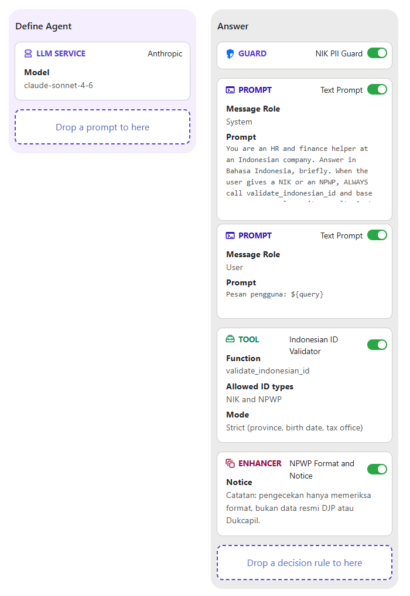

# Writing Custom Guards, Enhancers, Decisions and Prompts

This page shows how to write the other four kinds of custom building block for Agent Builder: guards, enhancers, decisions and prompts. For each one it gives the Java contract, the point in a task where it runs, what happens when it fails, and a complete example (Java class, configuration JSON, message bundle, registration and unit test) that you can build and install. It is for Joget plugin developers. Read [Extending Agent Builder: Overview and Development Setup](23-extending-overview.md) first (JDK, Maven, API jar, `pom.xml`, Activator) and [Writing Custom Tools](24-custom-tools.md) for the shared patterns.

## Where each element runs

A task in an agent can contain prompts, guards, tools, enhancers and decisions. They run in this order, once per run of the task:

```text
 1. Central Instructions, then the task's prompts            AgentPrompt.generate(llm, config, messages)
 2. Input guards                                             AgentGuard.filterInput(messages, config)
 3. Model call (with the functions of the task's tools)
 4. Tool calls, in rounds, until the model gives its answer
 5. Output guards                                            AgentGuard.filterOutput(response, config)
 6. The answer is added to the conversation for the next task
 7. Enhancers                                                AgentEnhancer.enhance(llm, config, response)
 8. Decisions                                                AgentDecision.decide(llm, config, response)
        CONTINUE: next task   GOTO: another task   ABORT: stop the agent, return the answer
```

Facts that follow from this order:

- The messages that prompts and input guards see are a copy for this task: the conversation so far plus the task's own prompts. What a prompt adds does not carry over to the next task. Only the final answer of each task is carried forward.
- An input guard checks the messages that will really be sent to the model, including text that prompts built from variables. A guard that changes those messages in place changes what the model receives.
- An output guard runs after all tool calls. It sees the final answer, not the tool results in between.
- Enhancers and decisions see the answer after the output guards. A decision sees the answer after the enhancers.
- In a routing-only agent that has no model (a "Decision" agent), prompts, enhancers and decisions still run, but the `AgentLLM` argument is `null`. Do not use it without a null check.
- Several elements of one kind run in the order of the canvas. Disabled elements (**Is Enabled** off) are skipped.

## Rules that apply to all four

| Rule | Why |
|---|---|
| Extend the abstract class: `AgentGuardAbstract`, `AgentEnhancerAbstract`, `AgentPromptAbstract`, `AgentDecisionAbstract`. | The guard and decision are loaded by the abstract class. The abstract classes also add the trace wrapper and the canvas card. |
| Register the element as an OSGi service under `getClassName()`, with a class literal. | Agent Builder rebuilds a saved element with `getPluginManager().getPlugin(className)`. |
| Read properties into local variables at the start of the method. | The registered instance is shared by all agents. Keep no per-call data in fields. |
| Do not define `personalizedName` or `isEnabled` in your JSON. | The builder adds them to the first page. |
| Return normally when the element has nothing to do (no configuration, no match). | A thrown exception ends the task. |

### What happens when an element fails

| Situation | What Agent Builder does |
|---|---|
| The class named in a saved agent is not registered (bundle uninstalled, stopped, not started yet). | The task fails before the model is called, with `AgentPrompt class could not be loaded: <class>`, `AgentGuard class could not be loaded: <class>`, `AgentEnhancer class could not be loaded: <class>` or `AgentDecision class could not be loaded: <class>`. The agent never runs without an element it was built with. |
| A guard or decision class is registered, but extends only the interface (`AgentGuard`, `AgentDecision`) and not the abstract class. | The same error: `AgentGuard class could not be loaded: <class>`. The element still shows in the palette, because the palette lists by interface. |
| `filterInput`, `filterOutput`, `generate`, `enhance` or `decide` throws `AgentException`. | The task fails with your message. For the whole agent the run ends as failed. |
| One of them throws another `RuntimeException` (for example `NullPointerException`). | The task fails and the run ends as failed, with the exception text. |
| A guard returns `null`, or `GuardResult.pass()`. | Nothing happens. The content continues. |
| A decision returns `null`, or `DecisionResult.continueExecution()`. | The next decision of the task is tried. If none acts, the agent goes to the next task. |
| An enhancer returns a value but does not call `response.setContent(...)`. | The change is lost. The runtime ignores the returned string. |
| A prompt adds nothing. | Nothing happens. |

So there is no "fail open" for a missing element. But you decide the behaviour for your own errors: if your guard calls a remote service and returns `pass()` when the call fails, it fails open. If it throws `AgentException`, it fails closed (the task fails). A cosmetic enhancer should not fail the task over a configuration error, so it logs and returns. A guard that enforces a legal or security rule should fail closed.

## Guards

### Contract

Extend `org.joget.ai.agent.model.AgentGuardAbstract`.

| Method | When | What to return |
|---|---|---|
| `GuardResult filterInput(Messages messages, LLMConfig config)` | Once per task, after the prompts, before the model call. `messages` holds the conversation for this task: system messages (Central Instructions, task prompts), earlier answers and user messages. | A `GuardResult`. Never `null` (the runtime tolerates `null` as "pass"). |
| `GuardResult filterOutput(Response response, LLMConfig config)` | After the tool calls are done, before the enhancers. `response.getContent()` is the answer. | A `GuardResult`. |
| `String getOnViolationAction()` | Inherited. Returns the property `onViolation`: `block`, `sanitize` or `redirect`. | Do not override. |
| `String getRedirectTaskId()` | Inherited. Returns the property `redirectTaskId`. | Do not override. |
| `protected GuardResult resolveViolation(String sanitizedContent, String reason)` | Inherited helper. Converts the builder's **On violation** choice into the right `GuardResult`. Block is the default. | Call it when your check finds a violation. |

`GuardResult` factories: `GuardResult.pass()`, `GuardResult.block(reason)`, `GuardResult.sanitize(newContent, reason)` and `GuardResult.redirect(taskId, reason)`. Inspect a result with `getAction()` (`PASS`, `BLOCK`, `SANITIZE`, `REDIRECT`), `getReason()`, `getSanitizedContent()` and `getRedirectTaskId()`.

### What the runtime does with a result

| Result | Runtime action |
|---|---|
| `PASS` or `null` | Nothing. |
| `BLOCK` | The task fails with `Content blocked by guard: <reason>`. The model is not called (input side), or the answer is discarded (output side). The reason goes into the log and the audit trail and into the error text, so do not put the sensitive text itself in the reason. |
| `REDIRECT` | The run jumps to the task whose id equals the redirect task id. If no task has that id, the run stops with the response so far (a warning is logged). |
| `SANITIZE` | Nothing by itself. The runtime reads only the reason. Your guard must change the `Messages` or the `Response` in place before it returns the result. |

### Rules for guards

1. **Define both properties `onViolation` and `redirectTaskId`** in your JSON, as in the example. `resolveViolation` reads them. Without them it blocks.
2. **For sanitize, change the object yourself.** On the input side, change the `content` of the message object in place: `message.put("content", clean)`. On the output side, call `response.setContent(clean)`.
3. **On the input side, check only the messages you mean to check.** The messages include the system prompt and earlier assistant messages. The example checks only messages with role `user` and string content.
4. **Messages are `JSONObject` instances.** Iterate with `messages.optJSONObject(i)`.
5. **The same guard instance serves input and output.** Add a `direction` property if you want to watch only one side.
6. **Keep the reason free of sensitive text.** Count or categorise, do not quote.
7. **Decide what happens when your check cannot run** (remote service down, bad configuration). See the table above.
8. **A guard that depends on a library or a network call must have a timeout.**
9. **The canvas card of a guard is empty** unless you override `getBuilderJavaScriptTemplate()`. The example returns a short card.

### Complete example: Blocked Terms Guard

The guard blocks, masks or redirects when a configured term (for example an internal project code name) appears in the request or in the answer.

`BlockedTermsGuard.java`:

```java
package org.acme.extras;

import java.util.ArrayList;
import java.util.List;
import java.util.Locale;
import java.util.regex.Matcher;
import java.util.regex.Pattern;
import org.joget.ai.agent.model.AgentException;
import org.joget.ai.agent.model.AgentGuardAbstract;
import org.joget.ai.agent.model.GuardResult;
import org.joget.ai.agent.model.LLMConfig;
import org.joget.ai.agent.model.Messages;
import org.joget.ai.agent.model.Response;
import org.json.JSONObject;

/**
 * Guard: keeps configured terms (for example internal project code names) out of the request and the answer.
 *
 * Contract: extend AgentGuardAbstract. The runtime fails the task for a guard that only implements AgentGuard.
 * filterInput runs once per task, after the task's prompts and before the model call; filterOutput runs after
 * the model (and any tool calls) have finished and before the enhancers. resolveViolation() turns the builder's
 * "On violation" choice (block, sanitize or redirect) into a GuardResult. A SANITIZE result changes nothing by
 * itself, so this guard rewrites the message or the response in place before it returns.
 */
public class BlockedTermsGuard extends AgentGuardAbstract {

    static final String REPLACEMENT = "[removed]";

    @Override
    public GuardResult filterInput(Messages messages, LLMConfig config) throws AgentException {
        Pattern terms = termsPattern();
        if (messages == null || terms == null || !watches("input")) {
            return GuardResult.pass();
        }
        List<String> found = new ArrayList<>();
        List<JSONObject> affected = new ArrayList<>();
        for (int i = 0; i < messages.length(); i++) {
            JSONObject message = messages.optJSONObject(i);
            // Only what the user typed. System prompts and tool results are not this guard's business.
            if (message == null || !"user".equals(message.optString("role")) || !(message.opt("content") instanceof String)) {
                continue;
            }
            List<String> hits = find(terms, message.getString("content"));
            if (!hits.isEmpty()) {
                found.addAll(hits);
                affected.add(message);
            }
        }
        if (found.isEmpty()) {
            return GuardResult.pass();
        }
        GuardResult result = resolveViolation(null, found.size() + " blocked term(s) in the request");
        if (result.getAction() == GuardResult.Action.SANITIZE) {
            for (JSONObject message : affected) { // the runtime does not do this for you
                message.put("content", terms.matcher(message.getString("content")).replaceAll(REPLACEMENT));
            }
        }
        return result;
    }

    @Override
    public GuardResult filterOutput(Response response, LLMConfig config) throws AgentException {
        Pattern terms = termsPattern();
        String text = response == null ? null : response.getContent();
        if (terms == null || text == null || text.isEmpty() || !watches("output")) {
            return GuardResult.pass();
        }
        List<String> found = find(terms, text);
        if (found.isEmpty()) {
            return GuardResult.pass();
        }
        String clean = terms.matcher(text).replaceAll(REPLACEMENT);
        GuardResult result = resolveViolation(clean, found.size() + " blocked term(s) in the answer");
        if (result.getAction() == GuardResult.Action.SANITIZE) {
            response.setContent(clean); // the runtime does not do this for you
        }
        return result;
    }

    /** One case-insensitive alternation of the configured terms, one term per line. Null when none are configured. */
    private Pattern termsPattern() {
        String raw = getPropertyString("terms");
        if (raw == null || raw.trim().isEmpty()) {
            return null;
        }
        List<String> parts = new ArrayList<>();
        for (String line : raw.split("\\r?\\n")) {
            if (!line.trim().isEmpty()) {
                parts.add(Pattern.quote(line.trim()));
            }
        }
        return parts.isEmpty() ? null : Pattern.compile(String.join("|", parts), Pattern.CASE_INSENSITIVE | Pattern.UNICODE_CASE);
    }

    private static List<String> find(Pattern terms, String text) {
        List<String> found = new ArrayList<>();
        Matcher m = terms.matcher(text);
        while (m.find()) {
            String term = m.group().toLowerCase(Locale.ROOT);
            if (!found.contains(term)) {
                found.add(term);
            }
        }
        return found;
    }

    private boolean watches(String side) {
        String direction = getPropertyString("direction");
        return direction == null || direction.isEmpty() || "both".equals(direction) || side.equals(direction);
    }

    @Override
    public String getName() {
        return "BlockedTermsGuard";
    }

    @Override
    public String getVersion() {
        return Ext.VERSION;
    }

    @Override
    public String getLabel() {
        return "Blocked Terms Guard";
    }

    @Override
    public String getDescription() {
        return "Blocks, masks or redirects when a configured term appears in the request or the answer";
    }

    @Override
    public String getClassName() {
        return BlockedTermsGuard.class.getName();
    }

    @Override
    public String getPropertyOptions() {
        return Ext.propertyOptions(getClassName(), "BlockedTermsGuard");
    }

    @Override
    public String getIcon() {
        return "<i class=\"fas fa-ban\"></i>";
    }

    /** Optional: an AgentGuardAbstract card is empty on the canvas unless you override this. */
    @Override
    public String getBuilderJavaScriptTemplate() {
        return "{\"html\" : \"<div>Blocked terms guard: ${properties.direction}, on violation ${properties.onViolation}</div>\"}";
    }
}
```

`properties/BlockedTermsGuard.json`:

```json
[
    {
        "title": "@@guard.config@@",
        "properties": [
            {
                "name": "terms",
                "label": "@@guard.terms@@",
                "description": "@@guard.terms.desc@@",
                "type": "textarea",
                "rows": "5",
                "required": "True"
            },
            {
                "name": "direction",
                "label": "@@guard.direction@@",
                "description": "@@guard.direction.desc@@",
                "type": "selectbox",
                "value": "both",
                "options": [
                    {"value": "both", "label": "@@guard.dir.both@@"},
                    {"value": "input", "label": "@@guard.dir.input@@"},
                    {"value": "output", "label": "@@guard.dir.output@@"}
                ]
            }
        ]
    },
    {
        "title": "@@guard.violation@@",
        "properties": [
            {
                "name": "onViolation",
                "label": "@@guard.onViolation@@",
                "type": "selectbox",
                "required": "True",
                "value": "block",
                "options": [
                    {"value": "block", "label": "@@guard.block@@"},
                    {"value": "sanitize", "label": "@@guard.sanitize@@"},
                    {"value": "redirect", "label": "@@guard.redirect@@"}
                ]
            },
            {
                "name": "redirectTaskId",
                "label": "@@guard.redirectTaskId@@",
                "type": "textfield",
                "control_field": "onViolation",
                "control_value": "redirect",
                "control_use_regex": "false"
            }
        ]
    }
]
```

How it behaves on a violation, depending on **On violation**:

| Setting | Input side | Output side |
|---|---|---|
| Block the task | The task fails with `Content blocked by guard: 1 blocked term(s) in the request`. The model is not called. | The task fails with `Content blocked by guard: 1 blocked term(s) in the answer`. |
| Replace the term and continue | The terms in user messages become `[removed]` and the model receives the cleaned text. | The answer is cleaned with `response.setContent`. |
| Jump to another task | The run continues at the task whose id is in **Redirect task id**. | The same. |

## Enhancers

### Contract

Extend `org.joget.ai.agent.model.AgentEnhancerAbstract`.

| Method | When | What to do |
|---|---|---|
| `String enhance(AgentLLM llm, LLMConfig config, Response response)` | After the output guards, once per task, in canvas order. | Change the answer by calling `response.setContent(newText)`. You may also take extra steps (store data, send a message). The returned string is ignored. |
| `String getInfoTemplate()` | By the builder. | Return the canvas card HTML. |

`Response` offers `getContent()` / `setContent(String)` (the answer text), `getToolExecutions()` (the tool calls of the last model reply), `getFullJsonResponse()`, `getMessage()` and `getExecutionMessages()`. `new Response(String)` creates one for tests. `enhance` may throw `AgentException` to fail the task.

### Rules for enhancers

1. **Write the result back with `response.setContent(...)`.** This is the most common mistake: an enhancer that only returns the new text changes nothing.
2. **Do nothing when there is nothing to do.** Return the text unchanged for `null`, empty text or missing configuration. Do not throw.
3. **A cosmetic enhancer must not fail the task.** Catch configuration errors (for example a bad regular expression), log them with `LogUtil.warn`, and leave the answer unchanged.
4. **An enhancer with side effects runs again whenever its task runs again.** A decision that jumps back to the task, or a guard redirect, can run the task more than once in a run. Make side effects idempotent.
5. **Enhancers run in canvas order.** Each one sees the answer as the previous one left it.
6. **Do not rely on tool results in the answer.** To act on data a tool returned, use the tool's own return value or `response.getToolExecutions()`.

### Complete example: Reference Link Enhancer

The enhancer turns ticket numbers such as `REQ-1042` and `INC-77` in the answer into Markdown links to a help desk.

`ReferenceLinkEnhancer.java`:

```java
package org.acme.extras;

import java.util.regex.Matcher;
import java.util.regex.Pattern;
import java.util.regex.PatternSyntaxException;
import org.joget.ai.agent.model.AgentEnhancerAbstract;
import org.joget.ai.agent.model.AgentException;
import org.joget.ai.agent.model.AgentLLM;
import org.joget.ai.agent.model.LLMConfig;
import org.joget.ai.agent.model.Response;
import org.joget.commons.util.LogUtil;

/**
 * Enhancer: turns ticket numbers in the final answer (REQ-1042, INC-77) into Markdown links to the help desk.
 *
 * Contract: enhance() must write its result back with response.setContent(...). The runtime ignores the String
 * that enhance() returns. An exception thrown here fails the task, so a cosmetic enhancer catches its own
 * configuration errors and leaves the answer unchanged.
 */
public class ReferenceLinkEnhancer extends AgentEnhancerAbstract {

    static final String DEFAULT_PATTERN = "\\b(?:REQ|INC)-\\d{2,6}\\b";

    @Override
    public String enhance(AgentLLM llm, LLMConfig config, Response response) throws AgentException {
        String text = response == null ? null : response.getContent();
        String urlTemplate = getPropertyString("urlTemplate");
        if (text == null || text.isEmpty() || urlTemplate == null || !urlTemplate.contains("{id}")) {
            return text; // nothing to do, or not configured
        }
        String regex = getPropertyString("pattern");
        Pattern pattern;
        try {
            pattern = Pattern.compile(regex == null || regex.trim().isEmpty() ? DEFAULT_PATTERN : regex.trim());
        } catch (PatternSyntaxException e) {
            LogUtil.warn(ReferenceLinkEnhancer.class.getName(), "Pattern is not a valid regular expression: " + e.getMessage());
            return text;
        }
        Matcher m = pattern.matcher(text);
        StringBuffer out = new StringBuffer();
        while (m.find()) {
            boolean alreadyLinked = m.start() > 0 && text.charAt(m.start() - 1) == '[';
            String id = m.group();
            String replacement = alreadyLinked ? id : "[" + id + "](" + urlTemplate.trim().replace("{id}", id) + ")";
            m.appendReplacement(out, Matcher.quoteReplacement(replacement));
        }
        m.appendTail(out);
        String result = out.toString();
        response.setContent(result); // REQUIRED: the return value alone changes nothing
        return result;
    }

    @Override
    public String getName() {
        return "ReferenceLinkEnhancer";
    }

    @Override
    public String getVersion() {
        return Ext.VERSION;
    }

    @Override
    public String getLabel() {
        return "Reference Link Enhancer";
    }

    @Override
    public String getDescription() {
        return "Turns ticket numbers in the answer into links";
    }

    @Override
    public String getClassName() {
        return ReferenceLinkEnhancer.class.getName();
    }

    @Override
    public String getPropertyOptions() {
        return Ext.propertyOptions(getClassName(), "ReferenceLinkEnhancer");
    }

    @Override
    public String getIcon() {
        return "<i class=\"fas fa-link\"></i>";
    }

    @Override
    public String getInfoTemplate() {
        return "<div><dl><dt>Link</dt><dd>${properties.urlTemplate}</dd></dl></div>";
    }
}
```

`properties/ReferenceLinkEnhancer.json`:

```json
[
    {
        "title": "@@enh.config@@",
        "properties": [
            {
                "name": "pattern",
                "label": "@@enh.pattern@@",
                "description": "@@enh.pattern.desc@@",
                "type": "textfield"
            },
            {
                "name": "urlTemplate",
                "label": "@@enh.url@@",
                "description": "@@enh.url.desc@@",
                "type": "textfield",
                "regex_validation": "^https?://.*[{]id[}].*$",
                "validation_message": "Must start with http:// or https:// and contain {id}"
            }
        ]
    }
]
```

## Prompts

### Contract

Extend `org.joget.ai.agent.model.AgentPromptAbstract`.

| Method | When | What to do |
|---|---|---|
| `void generate(AgentLLM llm, LLMConfig config, Messages messages)` | At the start of the task, in canvas order, after Central Instructions have been added. | Append messages to `messages`. |
| `String getInfoTemplate()` | By the builder. | Return the canvas card HTML. |

Create a message with `new Message(Message.Role.SYSTEM, text)` (roles: `USER`, `SYSTEM`, `TOOL`, `ASSISTANT`) and add it with `messages.add(message)`. You can also use `messages.addMessage(role, content)`.

### Rules for prompts

1. **Only append.** Do not remove or edit messages that other prompts added.
2. **Use the `SYSTEM` role for instructions and context,** and `USER` for the question text.
3. **The messages are a copy for this task.** What you add is not carried into the next task.
4. **`llm` may be `null`** (agents without a model). Do not call it without a check.
5. **Show the real inputs in the trace.** The trace viewer shows the messages your prompt added. To show the configuration that produced them, call `AgentTrace.recordRequest(payload)` inside `generate`.
6. **Property values go through hash-variable processing before you read them.** Text between `#` characters in a property value may be replaced by Joget. That is useful (`#currentUser.username#` in a prompt text) and dangerous for text you did not write. Add untrusted text from code, not through a property.
7. **Do not read secrets into prompts.** Everything in a prompt is sent to the model provider.
8. **Make time and randomness testable.** Pass a `Clock` into a package-private constructor, as the example does.

### Complete example: Current Date Prompt

The prompt tells the model today's date and time in a configured time zone. Models do not know the date and otherwise guess.

`CurrentDatePrompt.java`:

```java
package org.acme.extras;

import java.time.Clock;
import java.time.DateTimeException;
import java.time.ZoneId;
import java.time.ZonedDateTime;
import java.time.format.DateTimeFormatter;
import java.util.Locale;
import org.joget.ai.agent.model.AgentException;
import org.joget.ai.agent.model.AgentLLM;
import org.joget.ai.agent.model.AgentPromptAbstract;
import org.joget.ai.agent.model.LLMConfig;
import org.joget.ai.agent.model.Message;
import org.joget.ai.agent.model.Messages;
import org.joget.ai.agent.model.AgentTrace;
import org.json.JSONObject;

/**
 * Prompt: adds one system message that tells the model today's date and time in a configured time zone.
 *
 * Contract: generate() appends to the Messages it is given. It runs at the start of the task, in task order,
 * before the input guards and the model call. The messages belong to this task only: nothing you add here
 * carries over to the next task.
 */
public class CurrentDatePrompt extends AgentPromptAbstract {

    static final String DEFAULT_TEXT = "Today is {now} ({zone}). Use this when the user says today, tomorrow or this week.";

    private final Clock clock;

    public CurrentDatePrompt() {
        this(Clock.systemUTC());
    }

    CurrentDatePrompt(Clock clock) {
        this.clock = clock;
    }

    @Override
    public void generate(AgentLLM llm, LLMConfig config, Messages messages) throws AgentException {
        if (messages == null) {
            return;
        }
        ZoneId zone = zone(getPropertyString("timezone"));
        String pattern = getPropertyString("pattern");
        DateTimeFormatter format;
        try {
            format = DateTimeFormatter.ofPattern(pattern == null || pattern.trim().isEmpty() ? "EEEE, d MMMM yyyy HH:mm" : pattern.trim(), Locale.ENGLISH);
        } catch (IllegalArgumentException e) {
            throw new AgentException("Current Date Prompt: the date pattern is not valid: " + e.getMessage());
        }
        String template = getPropertyString("text");
        if (template == null || template.trim().isEmpty()) {
            template = DEFAULT_TEXT;
        }
        String now = ZonedDateTime.now(clock.withZone(zone)).format(format);
        // Show this prompt's real inputs in the trace viewer. Ignored when no trace is active.
        AgentTrace.recordRequest(new JSONObject().put("timezone", zone.getId()).put("pattern", format.toString()));
        messages.add(new Message(Message.Role.SYSTEM, template.replace("{now}", now).replace("{zone}", zone.getId())));
    }

    private static ZoneId zone(String id) {
        try {
            return id == null || id.trim().isEmpty() ? ZoneId.of("UTC") : ZoneId.of(id.trim());
        } catch (DateTimeException e) {
            return ZoneId.of("UTC");
        }
    }

    @Override
    public String getName() {
        return "CurrentDatePrompt";
    }

    @Override
    public String getVersion() {
        return Ext.VERSION;
    }

    @Override
    public String getLabel() {
        return "Current Date Prompt";
    }

    @Override
    public String getDescription() {
        return "Tells the model today's date and time";
    }

    @Override
    public String getClassName() {
        return CurrentDatePrompt.class.getName();
    }

    @Override
    public String getPropertyOptions() {
        return Ext.propertyOptions(getClassName(), "CurrentDatePrompt");
    }

    @Override
    public String getIcon() {
        return "<i class=\"fas fa-calendar-day\"></i>";
    }

    @Override
    public String getInfoTemplate() {
        return "<div><dl><dt>Time zone</dt><dd>${properties.timezone}</dd></dl></div>";
    }
}
```

`properties/CurrentDatePrompt.json`:

```json
[
    {
        "title": "@@prm.config@@",
        "properties": [
            {
                "name": "timezone",
                "label": "@@prm.timezone@@",
                "description": "@@prm.timezone.desc@@",
                "type": "textfield",
                "value": "Asia/Jakarta"
            },
            {
                "name": "pattern",
                "label": "@@prm.pattern@@",
                "description": "@@prm.pattern.desc@@",
                "type": "textfield",
                "value": "EEEE, d MMMM yyyy HH:mm"
            },
            {
                "name": "text",
                "label": "@@prm.text@@",
                "description": "@@prm.text.desc@@",
                "type": "textarea",
                "rows": "3",
                "value": "Today is {now} ({zone}). Use this when the user says today, tomorrow or this week."
            }
        ]
    }
]
```

## Decisions

### Contract

Extend `org.joget.ai.agent.model.AgentDecisionAbstract`.

| Method | When | What to return |
|---|---|---|
| `DecisionResult decide(AgentLLM llm, LLMConfig config, Response response)` | After the task, its guards and its enhancers. `response` is the final answer of the task. | A `DecisionResult`. |
| `String getInfoTemplate()` | By the builder. | Return the canvas card HTML. |

`DecisionResult` factories:

| Factory | Meaning |
|---|---|
| `continueExecution()` | Do nothing. Try the next decision of the task, then go to the next task. |
| `abort()` | Stop the agent now and return the current answer. |
| `goTo(taskId)` | Jump to the task whose id equals `taskId`. |
| `goToLabel(label)` | Jump to the task whose label matches, ignoring case. |
| `goToIndex(n)` | Jump to the n-th task, counting from 1. |

Inspect a result with `getAction()` (`CONTINUE`, `ABORT`, `GOTO`), `getTarget()` and `getTargetType()` (`ID`, `LABEL`, `INDEX`).

### Rules for decisions

1. **The first result that is not `CONTINUE` wins.** The other decisions of the task are not asked.
2. **Return `continueExecution()` when nothing applies.** Never return `null` from your own logic.
3. **A target that does not exist stops the agent.** If the task id, label or index cannot be resolved, the agent stops and returns the current answer. A warning is logged. Validate the target text in your property form where you can.
4. **Endless loops are stopped by the agent setting Max Iterations** (default 50 task executions per run). When the limit is reached the agent stops with the current answer. Do not rely on it as the normal exit.
5. **The decision does not change the answer.** To change it, use an enhancer.
6. **A decision should be cheap and deterministic.** If you call a model or a service to decide, set timeouts and decide what the fallback is (usually `continueExecution()`).
7. **`llm` can be `null`** in an agent without a model.

### Complete example: Confidence Route Decision

The decision looks for a marker in the answer (for example `CONFIDENCE: LOW`, which you ask the model to print in the task prompt). When it finds the marker, it jumps to another task (for example a review task) or stops the agent.

`ConfidenceRouteDecision.java`:

```java
package org.acme.extras;

import org.joget.ai.agent.model.AgentDecisionAbstract;
import org.joget.ai.agent.model.AgentException;
import org.joget.ai.agent.model.AgentLLM;
import org.joget.ai.agent.model.DecisionResult;
import org.joget.ai.agent.model.LLMConfig;
import org.joget.ai.agent.model.Response;
import org.joget.commons.util.LogUtil;

/**
 * Decision: when the task's answer contains a marker (for example "CONFIDENCE: LOW"), jump to another task or stop
 * the agent. Otherwise carry on with the next task.
 *
 * Contract: extend AgentDecisionAbstract (the runtime fails the task for a class that only implements
 * AgentDecision). decide() runs after the task, its guards and its enhancers, and receives the final Response.
 * Decisions on a task are tried in order and the first result that is not CONTINUE wins.
 */
public class ConfidenceRouteDecision extends AgentDecisionAbstract {

    @Override
    public DecisionResult decide(AgentLLM llm, LLMConfig config, Response response) throws AgentException {
        String text = response == null ? null : response.getContent();
        String marker = trim(getPropertyString("marker"));
        if (text == null || marker.isEmpty() || !text.toLowerCase().contains(marker.toLowerCase())) {
            return DecisionResult.continueExecution();
        }
        String action = trim(getPropertyString("whenFound"));
        String target = trim(getPropertyString("target"));
        switch (action) {
            case "abort":
                return DecisionResult.abort();
            case "goto_label":
            case "goto_id":
                if (target.isEmpty()) {
                    LogUtil.warn(ConfidenceRouteDecision.class.getName(), "Marker found but no target is configured");
                    return DecisionResult.continueExecution();
                }
                return "goto_id".equals(action) ? DecisionResult.goTo(target) : DecisionResult.goToLabel(target);
            default:
                return DecisionResult.continueExecution();
        }
    }

    private static String trim(String s) {
        return s == null ? "" : s.trim();
    }

    @Override
    public String getName() {
        return "ConfidenceRouteDecision";
    }

    @Override
    public String getVersion() {
        return Ext.VERSION;
    }

    @Override
    public String getLabel() {
        return "Confidence Route";
    }

    @Override
    public String getDescription() {
        return "Jumps to another task or stops the agent when the answer contains a marker";
    }

    @Override
    public String getClassName() {
        return ConfidenceRouteDecision.class.getName();
    }

    @Override
    public String getPropertyOptions() {
        return Ext.propertyOptions(getClassName(), "ConfidenceRouteDecision");
    }

    @Override
    public String getIcon() {
        return "<i class=\"fas fa-route\"></i>";
    }

    @Override
    public String getInfoTemplate() {
        return "<div><dl><dt>Marker</dt><dd>${properties.marker}</dd><dt>Then</dt><dd>${properties.whenFound} ${properties.target}</dd></dl></div>";
    }
}
```

`properties/ConfidenceRouteDecision.json`:

```json
[
    {
        "title": "@@dec.config@@",
        "properties": [
            {
                "name": "marker",
                "label": "@@dec.marker@@",
                "description": "@@dec.marker.desc@@",
                "type": "textfield",
                "required": "True",
                "value": "CONFIDENCE: LOW"
            },
            {
                "name": "whenFound",
                "label": "@@dec.whenFound@@",
                "type": "selectbox",
                "required": "True",
                "value": "goto_label",
                "options": [
                    {"value": "goto_label", "label": "@@dec.goLabel@@"},
                    {"value": "goto_id", "label": "@@dec.goId@@"},
                    {"value": "abort", "label": "@@dec.abort@@"}
                ]
            },
            {
                "name": "target",
                "label": "@@dec.target@@",
                "description": "@@dec.target.desc@@",
                "type": "textfield",
                "control_field": "whenFound",
                "control_value": "goto_label|goto_id",
                "control_use_regex": "true"
            }
        ]
    }
]
```

## Registering the four elements

The Activator, the `Ext` helper and the message bundle follow the pattern of [Writing Custom Tools](24-custom-tools.md). Only the `Registrar` changes: it registers every element.

`Registrar.java`:

```java
package org.acme.extras;

import java.util.Collection;
import org.joget.plugin.property.model.PropertyEditable;
import org.osgi.framework.BundleContext;
import org.osgi.framework.ServiceRegistration;

/** Registers each palette element as an OSGi service under its own class name. */
final class Registrar {

    private Registrar() {
    }

    static void register(BundleContext context, Collection<ServiceRegistration> sink) {
        add(context, sink, new BlockedTermsGuard());
        add(context, sink, new ReferenceLinkEnhancer());
        add(context, sink, new ConfidenceRouteDecision());
        add(context, sink, new CurrentDatePrompt());
    }

    private static void add(BundleContext context, Collection<ServiceRegistration> sink, PropertyEditable plugin) {
        sink.add(context.registerService(plugin.getClassName(), plugin, null));
    }
}
```

`Activator.java` is the Activator from [Extending Agent Builder: Overview and Development Setup](23-extending-overview.md) with the package `org.acme.extras`, the log text changed, and the marker class `org.joget.ai.agent.model.AgentGuardAbstract`. `Ext.java` is the helper from [Writing Custom Tools](24-custom-tools.md) with `MESSAGES = "messages/extras"`. The `pom.xml` is the one from the overview page (`joget.version` `9.1.2`, `agent-builder.version` `8.2.5-ALPHA`) with these changes: `groupId` `org.acme.extras`, `artifactId` `agent-extras`, `Bundle-SymbolicName` `org.acme.extras.agent-extras`, `Private-Package` `org.acme.extras.*`, `Bundle-Activator` `org.acme.extras.Activator`, and your own `Joget-Name` and `Joget-Description`.

`src/main/resources/messages/extras.properties`:

```properties
ext.version=${project.version}
guard.config=Terms to watch
guard.terms=Blocked terms
guard.terms.desc=One term per line. Matching ignores upper and lower case.
guard.direction=Direction
guard.direction.desc=Where to look for the terms.
guard.dir.both=Request and answer
guard.dir.input=Request only
guard.dir.output=Answer only
guard.violation=When a term is found
guard.onViolation=On violation
guard.block=Block the task
guard.sanitize=Replace the term and continue
guard.redirect=Jump to another task
guard.redirectTaskId=Redirect task id
enh.config=Links
enh.pattern=Reference pattern
enh.pattern.desc=A Java regular expression. Leave empty for REQ-123 and INC-123 style numbers.
enh.url=Link address
enh.url.desc=Use {id} where the reference goes, for example https://helpdesk.example.com/tickets/{id}. Leave empty to switch the enhancer off.
dec.config=Route
dec.marker=Marker text
dec.marker.desc=The decision fires when the answer contains this text. Case is ignored.
dec.whenFound=When the marker is found
dec.goLabel=Go to the task with this label
dec.goId=Go to the task with this id
dec.abort=Stop the agent
dec.target=Task label or id
dec.target.desc=The label or the id of the task to jump to.
prm.config=Date and time
prm.timezone=Time zone
prm.timezone.desc=A Java time zone id, for example Asia/Jakarta. An unknown id falls back to UTC.
prm.pattern=Date pattern
prm.pattern.desc=A Java date and time pattern. Leave empty for EEEE, d MMMM yyyy HH:mm.
prm.text=Message
prm.text.desc=Use {now} for the date and {zone} for the time zone. Leave empty for the default text.
```

## Unit tests

One test class covers the contract of all four elements. It needs no Joget server. It checks that every element extends the abstract class the runtime requires, that every `@@key@@` in the JSON exists in the message file, and the behaviour of each element, including the error paths.

`src/test/java/org/acme/extras/ExtrasTest.java`:

```java
package org.acme.extras;

import static org.junit.jupiter.api.Assertions.assertEquals;
import static org.junit.jupiter.api.Assertions.assertFalse;
import static org.junit.jupiter.api.Assertions.assertThrows;
import static org.junit.jupiter.api.Assertions.assertTrue;

import java.io.InputStream;
import java.io.InputStreamReader;
import java.nio.charset.StandardCharsets;
import java.time.Clock;
import java.time.Instant;
import java.time.ZoneOffset;
import java.util.Properties;
import java.util.regex.Matcher;
import java.util.regex.Pattern;
import org.joget.ai.agent.model.AgentDecisionAbstract;
import org.joget.ai.agent.model.AgentEnhancerAbstract;
import org.joget.ai.agent.model.AgentException;
import org.joget.ai.agent.model.AgentGuardAbstract;
import org.joget.ai.agent.model.AgentPromptAbstract;
import org.joget.ai.agent.model.DecisionResult;
import org.joget.ai.agent.model.GuardResult;
import org.joget.ai.agent.model.LLMConfig;
import org.joget.ai.agent.model.Message;
import org.joget.ai.agent.model.Messages;
import org.joget.ai.agent.model.Response;
import org.json.JSONArray;
import org.junit.jupiter.api.Test;

/**
 * Plain JUnit: no Joget server, no Spring, no model. Properties are set one key at a time because
 * setProperties(Map) needs the Joget Spring context.
 */
class ExtrasTest {

    private static Messages userMessage(String text) {
        Messages messages = new Messages();
        messages.add(new Message(Message.Role.SYSTEM, "You are helpful."));
        messages.add(new Message(Message.Role.USER, text));
        return messages;
    }

    private static BlockedTermsGuard guard(String onViolation) {
        BlockedTermsGuard g = new BlockedTermsGuard();
        g.setProperty("terms", "Project Falcon\nQ3 layoffs");
        g.setProperty("direction", "both");
        g.setProperty("onViolation", onViolation);
        g.setProperty("redirectTaskId", "task_safe");
        return g;
    }

    // ---- contract checks that catch silent skips -----------------------------------------------------------

    @Test
    void everyElementExtendsTheAbstractClassTheRuntimeChecks() {
        assertTrue(new BlockedTermsGuard() instanceof AgentGuardAbstract);
        assertTrue(new ReferenceLinkEnhancer() instanceof AgentEnhancerAbstract);
        assertTrue(new ConfidenceRouteDecision() instanceof AgentDecisionAbstract);
        assertTrue(new CurrentDatePrompt() instanceof AgentPromptAbstract);
    }

    @Test
    void everyMessageKeyUsedByThePropertyFilesExists() throws Exception {
        Properties messages = new Properties();
        try (InputStream in = getClass().getResourceAsStream("/messages/extras.properties")) {
            messages.load(new InputStreamReader(in, StandardCharsets.UTF_8));
        }
        for (String file : new String[] {"BlockedTermsGuard", "ReferenceLinkEnhancer", "ConfidenceRouteDecision", "CurrentDatePrompt"}) {
            String json;
            try (InputStream in = getClass().getResourceAsStream("/properties/" + file + ".json")) {
                json = new String(in.readAllBytes(), StandardCharsets.UTF_8);
            }
            new JSONArray(json); // must be valid JSON
            Matcher m = Pattern.compile("@@([A-Za-z0-9_.]+)@@").matcher(json);
            while (m.find()) {
                assertTrue(messages.containsKey(m.group(1)), file + " uses a missing key: " + m.group(1));
            }
        }
    }

    // ---- guard ---------------------------------------------------------------------------------------------

    @Test
    void guardPassesCleanText() {
        assertEquals(GuardResult.Action.PASS, guard("block").filterOutput(new Response("Hello"), new LLMConfig()).getAction());
        assertEquals(GuardResult.Action.PASS, guard("block").filterInput(userMessage("Hello"), new LLMConfig()).getAction());
    }

    @Test
    void guardBlocksAndLeavesTheTextAlone() {
        Response response = new Response("We discussed project falcon today.");
        GuardResult r = guard("block").filterOutput(response, new LLMConfig());
        assertEquals(GuardResult.Action.BLOCK, r.getAction());
        assertEquals("1 blocked term(s) in the answer", r.getReason());
        assertEquals("We discussed project falcon today.", response.getContent());
    }

    @Test
    void guardSanitizeMutatesTheResponseInPlace() {
        Response response = new Response("About Project Falcon and the Q3 layoffs.");
        GuardResult r = guard("sanitize").filterOutput(response, new LLMConfig());
        assertEquals(GuardResult.Action.SANITIZE, r.getAction());
        assertEquals("About [removed] and the [removed].", response.getContent());
    }

    @Test
    void guardSanitizeMutatesOnlyUserMessagesInPlace() {
        Messages messages = userMessage("Tell me about PROJECT FALCON");
        messages.add(new Message(Message.Role.SYSTEM, "Never mention Project Falcon."));
        GuardResult r = guard("sanitize").filterInput(messages, new LLMConfig());
        assertEquals(GuardResult.Action.SANITIZE, r.getAction());
        assertEquals("Tell me about [removed]", messages.getJSONObject(1).getString("content"));
        assertEquals("Never mention Project Falcon.", messages.getJSONObject(2).getString("content"));
    }

    @Test
    void guardRedirectCarriesTheTaskId() {
        GuardResult r = guard("redirect").filterOutput(new Response("Project Falcon"), new LLMConfig());
        assertEquals(GuardResult.Action.REDIRECT, r.getAction());
        assertEquals("task_safe", r.getRedirectTaskId());
    }

    @Test
    void guardWithNoTermsOrWrongDirectionPasses() {
        BlockedTermsGuard none = new BlockedTermsGuard();
        none.setProperty("onViolation", "block");
        assertEquals(GuardResult.Action.PASS, none.filterOutput(new Response("Project Falcon"), new LLMConfig()).getAction());
        BlockedTermsGuard inputOnly = guard("block");
        inputOnly.setProperty("direction", "input");
        assertEquals(GuardResult.Action.PASS, inputOnly.filterOutput(new Response("Project Falcon"), new LLMConfig()).getAction());
    }

    // ---- enhancer ------------------------------------------------------------------------------------------

    private static ReferenceLinkEnhancer enhancer() {
        ReferenceLinkEnhancer e = new ReferenceLinkEnhancer();
        e.setProperty("urlTemplate", "https://helpdesk.example.com/tickets/{id}");
        return e;
    }

    @Test
    void enhancerWritesTheResultBackIntoTheResponse() {
        Response response = new Response("See REQ-1042 and INC-77.");
        enhancer().enhance(null, new LLMConfig(), response);
        assertEquals("See [REQ-1042](https://helpdesk.example.com/tickets/REQ-1042) and [INC-77](https://helpdesk.example.com/tickets/INC-77).",
                response.getContent());
    }

    @Test
    void enhancerLeavesExistingLinksAndUnconfiguredInstancesAlone() {
        Response linked = new Response("See [REQ-1042](http://x).");
        enhancer().enhance(null, new LLMConfig(), linked);
        assertEquals("See [REQ-1042](http://x).", linked.getContent());

        Response plain = new Response("See REQ-1042.");
        new ReferenceLinkEnhancer().enhance(null, new LLMConfig(), plain);
        assertEquals("See REQ-1042.", plain.getContent());
    }

    @Test
    void enhancerSurvivesABadPatternAndNullResponse() {
        ReferenceLinkEnhancer e = enhancer();
        e.setProperty("pattern", "([unclosed");
        Response response = new Response("See REQ-1042.");
        e.enhance(null, new LLMConfig(), response);
        assertEquals("See REQ-1042.", response.getContent());
        assertEquals(null, e.enhance(null, new LLMConfig(), null));
    }

    // ---- decision ------------------------------------------------------------------------------------------

    private static ConfidenceRouteDecision decision(String whenFound, String target) {
        ConfidenceRouteDecision d = new ConfidenceRouteDecision();
        d.setProperty("marker", "CONFIDENCE: LOW");
        d.setProperty("whenFound", whenFound);
        d.setProperty("target", target);
        return d;
    }

    @Test
    void decisionContinuesWhenTheMarkerIsAbsent() {
        assertEquals(DecisionResult.Action.CONTINUE,
                decision("goto_label", "Review").decide(null, new LLMConfig(), new Response("All good")).getAction());
        assertEquals(DecisionResult.Action.CONTINUE, decision("abort", "").decide(null, new LLMConfig(), null).getAction());
    }

    @Test
    void decisionJumpsByLabelOrIdOrAborts() {
        Response low = new Response("Not sure.\nconfidence: low");
        DecisionResult byLabel = decision("goto_label", "Human review").decide(null, new LLMConfig(), low);
        assertEquals(DecisionResult.Action.GOTO, byLabel.getAction());
        assertEquals(DecisionResult.TargetType.LABEL, byLabel.getTargetType());
        assertEquals("Human review", byLabel.getTarget());

        DecisionResult byId = decision("goto_id", "task_review").decide(null, new LLMConfig(), low);
        assertEquals(DecisionResult.TargetType.ID, byId.getTargetType());

        assertEquals(DecisionResult.Action.ABORT, decision("abort", "").decide(null, new LLMConfig(), low).getAction());
    }

    @Test
    void decisionWithoutATargetContinues() {
        assertEquals(DecisionResult.Action.CONTINUE,
                decision("goto_label", "").decide(null, new LLMConfig(), new Response("CONFIDENCE: LOW")).getAction());
    }

    // ---- prompt --------------------------------------------------------------------------------------------

    private static CurrentDatePrompt prompt() {
        Clock fixed = Clock.fixed(Instant.parse("2026-11-10T17:30:00Z"), ZoneOffset.UTC);
        CurrentDatePrompt p = new CurrentDatePrompt(fixed);
        p.setProperty("timezone", "Asia/Jakarta");
        p.setProperty("pattern", "yyyy-MM-dd HH:mm");
        p.setProperty("text", "Now: {now} {zone}");
        return p;
    }

    @Test
    void promptAddsOneSystemMessageInTheConfiguredZone() {
        Messages messages = new Messages();
        prompt().generate(null, new LLMConfig(), messages);
        assertEquals(1, messages.length());
        assertEquals("system", messages.getJSONObject(0).getString("role"));
        assertEquals("Now: 2026-11-11 00:30 Asia/Jakarta", messages.getJSONObject(0).getString("content"));
    }

    @Test
    void promptFallsBackToUtcAndRejectsABadPattern() {
        CurrentDatePrompt p = prompt();
        p.setProperty("timezone", "Mars/Olympus");
        Messages messages = new Messages();
        p.generate(null, new LLMConfig(), messages);
        assertTrue(messages.getJSONObject(0).getString("content").endsWith("UTC"));

        p.setProperty("pattern", "yyyy-MM-dd BBBBBBBBBBBBBBBBBBBBBBBBBBBBBBBBBBBBBBBBBBB");
        assertThrows(AgentException.class, () -> p.generate(null, new LLMConfig(), new Messages()));
        assertFalse(messages.length() == 0);
    }
}
```

## Install and try the elements

1. Build with `mvn clean package "-Djoget.version=9.1.2"` (use your own Joget version) and upload `target/agent-extras-1.0.0.jar` at **Settings > Manage Plugins** (see [Extending Agent Builder: Overview and Development Setup](23-extending-overview.md)). A complete guard and a complete enhancer that you can build without typing are in the folder `01-agent-builder-tools` of the examples repository (see [The Examples Repository](29-examples-repository.md)).
2. Open an agent. In the palette search for the four labels: **Current Date Prompt** (Prompts), **Blocked Terms Guard** (Guards), **Reference Link Enhancer** (Enhancers) and **Confidence Route** (Decisions).
3. Build an agent with two tasks:
   - Task 1, label `Answer`: add **Current Date Prompt** (leave the defaults), a task prompt such as "Answer the question. End with a line `CONFIDENCE: HIGH` or `CONFIDENCE: LOW`.", **Blocked Terms Guard** (**Blocked terms**: `Project Falcon`; **On violation**: **Replace the term and continue**), **Reference Link Enhancer** (**Link address**: `https://helpdesk.example.com/tickets/{id}`) and **Confidence Route** (**Marker text**: `CONFIDENCE: LOW`; **When the marker is found**: **Stop the agent**).
   - Task 2, label `Summarise`: a prompt such as "Rewrite the previous answer in two short sentences." This task runs only when the first answer was confident.
4. In **Preview** ask: `What day is it today, and what is the status of REQ-1042?` Expected: the answer names today's date in Jakarta time, and `REQ-1042` appears as a link.
5. Ask: `Tell me about Project Falcon.` Expected: the model receives `[removed]` instead of the name. Switch **On violation** to **Block the task** and ask again: the task fails with `Content blocked by guard: 1 blocked term(s) in the request`.
6. Ask something the model cannot know, for example `What was the revenue of cost centre CC-1000 last week?`. When the answer ends with `CONFIDENCE: LOW`, the decision stops the agent after the first task and the audit trail shows no `Summarise` task. Change **When the marker is found** to **Go to the task with this label** and **Task label or id** to `Summarise` to see a jump instead.
7. Open the audit trail to see each element as a node of the task: the prompt (with the message it added), the guard, the enhancer and the decision with its result.

On the canvas each element is a card in its task: **GUARD** cards first, then **PROMPT**, **TOOL** and **ENHANCER** cards, then the decisions. The picture shows the custom guard, tool and enhancer of the sample `01-agent-builder-tools` of the examples repository in a task; your elements appear in the same way.



## Limitations and things to know

- **A guard must change the content itself to mask it.** The `SANITIZE` result alone does nothing. The same is true for enhancers: only changes to the `Response` count.
- **The reason of a block appears in the error text.** Keep sensitive text out of it.
- **A missing or unloadable element fails the task.** There is no skip mode. This also covers a guard or decision that extends only the interface.
- **Input guards see the whole task conversation,** including system prompts and earlier answers. Select the messages to check by role.
- **Output guards see only the final answer.** They do not see tool results or text that the model produced before a tool call. To control tool output, check it in the tool.
- **Redirect and goto targets that do not exist stop the agent** with the answer so far. Test the ids and labels.
- **Decisions in an endless loop are stopped only by Max Iterations** (default 50).
- **`llm` can be `null`** in agents without a model.
- **You cannot add these elements to an AI Composer.** The composers run their own fixed set. Use Central Instructions and skills to guide a composer (see [Skills, Central Instructions and Tool Templates](22-skills-and-tool-templates.md)).
- **A guard that calls an external service decides its own failure mode.** Built-in guards that call out can fail open on errors: the LLM safety check passes on an error, and the webhook guard blocks on a non-200 reply but passes on a network failure. Choose on purpose for yours.
- **The registered instance is shared.** Keep no per-call data in fields.
- **Property values are hash-variable processed.** Do not pass untrusted text through a property.

## Troubleshooting

| Symptom | Cause | Fix |
|---|---|---|
| The run fails with `AgentGuard class could not be loaded: <class>` although the guard is in the palette. | The guard extends only `AgentGuard`. | Extend `AgentGuardAbstract`. |
| Same message with `AgentDecision`. | The decision extends only `AgentDecision`. | Extend `AgentDecisionAbstract`. |
| The run fails with `AgentEnhancer class could not be loaded` (or `AgentPrompt ...`). | The plugin is not installed, not active, or was uploaded before Agent Builder started. | Check **Settings > Manage Plugins**; upload the bundle again. |
| The enhancer runs (the trace shows it) but the answer does not change. | The code returns the new text but does not call `response.setContent`. | Call `response.setContent(result)`. |
| The guard says "sanitize" in the trace, but the model still saw the original text. | The guard did not change the message object in place. | Call `message.put("content", clean)` on the message from `messages.optJSONObject(i)`. |
| The task fails with `Content blocked by guard` for a request that looks fine. | A configured term matches inside a longer word. | Use more specific terms, or change the guard to match whole words. |
| The agent stops after a decision with a warning `GOTO target task ... not found`. | The label, id or index does not exist. | Use the exact label (case does not matter) or the exact task id. |
| The guard never fires on the answer. | **Direction** is set to **Request only**, or the text appears only in a tool result. | Set **Direction**; check what the output guard sees. |
| The prompt text still contains `{now}`. | The text is processed by a different component, or the placeholder is spelled differently. | Use exactly `{now}` and `{zone}`. |
| A `NullPointerException` in a unit test inside `setProperties`. | The test calls `setProperties(Map)`. | Use `setProperty(key, value)` per key. |

## Where to go next

- [Writing Custom Tools](24-custom-tools.md): the tool contract and a full walkthrough.
- [Extending Agent Builder: Overview and Development Setup](23-extending-overview.md): pom, Activator, property JSON reference, deployment.
- [Building Block Reference: Prompts, LLMs, Enhancers, Decisions and Guards](07-reference-other-blocks.md): the built-in blocks to compare with before you write your own.
- [Security and Governance](11-security-and-governance.md): where guards fit in a governance plan.
