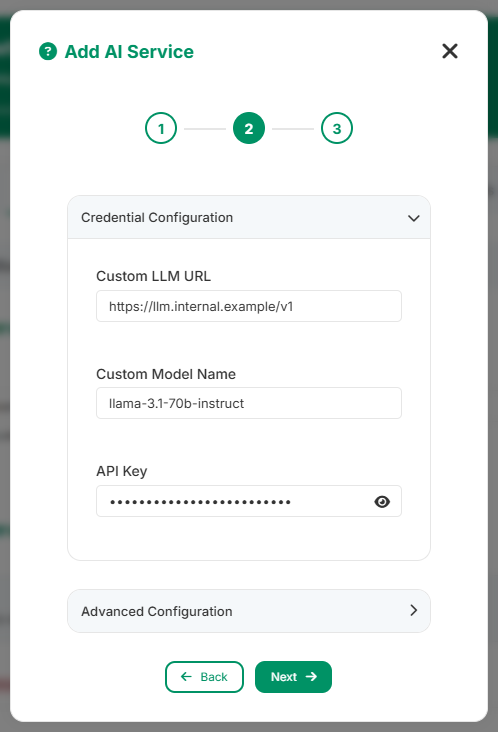

# Adding a Custom LLM Provider

This page is for implementers and plugin developers who must connect Agent Builder to a language model that is not a built-in provider: a model you host yourself, or one behind a company or sovereign-cloud gateway. It shows the route that needs no code (a **Custom** AI Service) and its limits, then the extension points, their contracts, how a model call is built, retried, timed out, streamed and metered, and a complete working provider with full code, a test and troubleshooting.

Development setup (project, `pom.xml`, build, deploy) is on [Extending Agent Builder: Overview and Development Setup](23-extending-overview.md). Compile against the Agent Builder API jar from the examples repository (see [The Examples Repository](29-examples-repository.md)). The provider of the walkthrough is the folder `06-custom-llm-provider` of that repository, ready to build. This page shows only what is specific to an LLM provider. The LLM plugin class of the walkthrough, registration and configuration, testing, advice for small models, limitations and troubleshooting are on [Adding a Custom LLM Provider (continued)](26b-custom-llm-providers-continued.md).

## Do you need a custom provider?

Start with the no-code route. Write code only when you meet one of the cases below.

| Your situation | Use |
|---|---|
| The server speaks the OpenAI chat completions protocol (vLLM, Ollama, LiteLLM, many company gateways) and you accept the standard request | The **Custom** Model Class. No code. |
| The gateway needs an extra HTTP header (tenant, audit id) or another authorization scheme | A custom provider |
| The gateway rejects a field the standard request always sends (`user`, `max_completion_tokens`, `parallel_tool_calls`, `stream_options`), or replies differ (`content` is `null`, tool arguments are an object, `<think>...</think>` text in the answer) | A custom provider |
| You want your own form fields, your own tuning parameter, or your own name in the AI Usage Dashboard (**Custom** is recorded as `OpenAI`) | A custom provider |
| The model API is not shaped like the OpenAI API | A custom provider that overrides the request and reply methods |

## The no-code route: a Custom endpoint

The **Custom** Model Class runs the built-in OpenAI wire format against a URL that you choose. Composers, the Orchestrator and system agents can use it, because it is a normal AI Service.

Before you start: the Joget server (not your browser) must reach the model server, which must implement `POST <base URL>/chat/completions` in the OpenAI format. For composers the model must support tool calling. You need the exact model id.

### Step 1: store the credential (optional)

Store the base URL and key once if several AI Services use them.

1. Open **Settings > AI Central Config**, open the **AI Credentials** tab and click **Add Credential**.
2. Fill in the **Add AI Credential** form and click **Add**.

| Field | What it does | Default | Notes |
|---|---|---|---|
| **Configuration Type** | The provider of the credential | None | Select **Custom** |
| **API Key** | Sent as `Authorization: Bearer <key>` | None | Required by the form. If the gateway needs no key, enter any value, for example `none`. The gateway receives it and must ignore it. |
| **Base URL** | The address of the server | None | Required. For example `https://llm.internal.example/v1` |
| **Configuration Name** | The name you pick later | None | Required, unique |

### Step 2: create the AI Service

Open the **AI Services** tab and click **Add AI Service**. The form has three steps. Step 1 has **Use Saved Credential (Optional)** and **Model Class**. Step 2 has the section **Credential Configuration** with the fields of the provider, and the section **Advanced Configuration**. Step 3 has **AI Service Name**. Click **Next** after steps 1 and 2, and **Add** in step 3.

| Field | What it does | Default | Notes |
|---|---|---|---|
| **Use Saved Credential (Optional)** | Takes key and base URL from a credential of Step 1 | `-- None (Manual Setup) --` | The credential's **Base URL** replaces **Custom LLM URL**, and its **API Key** replaces the key of the service |
| **Model Class** | The provider | The first entry of the list | Select **Custom** |
| **Custom LLM URL** | The base URL | None | Required for manual setup. Do not end it with `/`. |
| **Custom Model Name** | The model id sent in the request | None | Required. Exactly as the server expects it |
| **API Key** | The key | None | Optional in this form |
| **AI Service Name** | The name that composers and **Active AI Service** show | None | Required, unique |

The **Advanced Configuration** section lists **Temperature** (default `0.2`), **Max Tokens** (default `16000`), **Top P**, **Top K**, **Reasoning Effort** and **Thinking Budget Tokens**, and every parameter that an installed custom provider declares. For **Custom** the form does not filter them by model. Read the next table before you rely on them.



### Step 3: make it the active service

To make it the default for composers, the Orchestrator and system agents, select it in **Active AI Service** (section **Current AI Service** of the **AI Services** tab) and click **Save**. To use it for one session, select it in the AI service list of the composer's chat panel.

### What the Custom route sends

| Item | Behaviour |
|---|---|
| URL | **Custom LLM URL** is used as is. `/chat/completions` is appended unless the URL ends with `/completions`. A trailing `/` gives `//chat/completions`. |
| Authorization | `Authorization: Bearer <API Key>` is always sent |
| Output limit | Sent as `max_completion_tokens`, never `max_tokens`. Composers ask for `16000`. A server that understands only `max_tokens` ignores the limit. |
| Sampling | `temperature` and `top_p` are sent only when the model id starts with `gpt-4`, `gpt-3`, `chatgpt-`, `text-`, `davinci` or `gpt-oss`. Any other id (for example `llama-3.1-70b-instruct` or an internal name) is treated as a reasoning model and gets neither. |
| Extra fields | `user` (the current Joget user) is always sent. `parallel_tool_calls` is sent when tools are present. `stream_options.include_usage` is sent when the call streams. |
| Tools, JSON mode, usage | OpenAI `tools` with `tool_choice: "auto"`; `response_format` for structured output; usage rows with Model Class `OpenAI` |
| Advanced Configuration | Saved with the service, but composers and system agents do not copy the values into the request |

IBM watsonx and OpenRouter have canvas elements but are not Model Classes, so composers cannot use them. An administrator can hide providers from the lists with the Java system property `ai.central.config.hidden.providers`.

**Canvas agents** do not use AI Services. Add the **Open AI** LLM element and set **API URL**, **Model** and **API Key**; the table above applies. Its credential list offers only credentials of type **OpenAI**.

## The extension points

A complete provider is up to four OSGi services that must agree on one provider name.

| Extension point | Interface (base class) | Plugin interface id | Purpose |
|---|---|---|---|
| Provider | `org.joget.ai.config.llm.LLMProviderPlugin` (`LLMProviderAbstract`) | `llm.provider.plugin` | Adds the name to **Model Class** of **AI Services**; supplies model suggestions, credential fields and the Central Config view of a service |
| LLM plugin | `org.joget.ai.agent.model.AgentLLM` (`AgentLLMAbstract`) | `agentBuilder.llm` | Builds the HTTP request and reads the reply. An element on the agent canvas. Runs for composers and system agents. |
| Parameter rules | `org.joget.ai.config.llm.LLMModelCapabilityProvider` | `llm.model.capability` | States which parameters each model accepts and declares extra parameters. Optional, but needed for a correct form. |
| Credential type | `org.joget.ai.config.config.AIConfigProvider` (`AIConfigProviderAbstract`) | `ai.config.provider` | Adds the name to **Configuration Type** in **AI Credentials**. Optional. |

Agent Builder registers the four plugin interface ids. Your bundle registers only its implementations, as OSGi services from its activator. Install it after Agent Builder.

### Why composers need the LLM plugin as well

```text
1. LLMConfigFactory.createByServiceOrActive(serviceName)
     finds the LLMProviderPlugin whose getProviderName() equals the Model Class
     and calls createConfig(...)                              -> Central Config view
2. The caller copies apiKey, model, apiUrl and the service fields into a property map
     and sets maxTokens = 16000
3. AgentFactory.createLLM(pluginManager, providerName, properties)
     a. looks the name up in the AgentComponent registry
     b. else matches the name against installed AgentLLM plugins (first match wins)
     c. else fails: "No plugin found for provider: <name>"
4. The LLM plugin receives the properties and sends the request
```

A bundle with only a provider shows the name in the list, accepts credentials, and fails at the first composer run (step 3c). A bundle with only an LLM plugin works on the canvas, but composers cannot select it. Register the LLM plugin in the `AgentComponent` registry (step 3a); otherwise any installed LLM plugin whose name contains your provider name can win step 3b. A canvas agent skips steps 1 and 2.

## Contracts, method by method

Use only classes from the API jar. Do not use packages that Agent Builder does not export (for example `org.joget.ai.agent.utils`).

**Plugin basics.** Every implementation is a Joget plugin (`ExtDefaultPlugin`). Implement `getName()`, `getVersion()`, `getDescription()`, `getLabel()`, `getClassName()` (the name of your class) and `getPropertyOptions()`, or inherit them from the abstract base class.

### LLMProviderPlugin

| Method | Contract |
|---|---|
| `String getProviderName()` | The unique name. Shown in **Model Class**, stored in the service as `modelClass`, matched case-insensitively. |
| `List<String> getModelNames()` | Suggestions for **Model Name**. Any text is also accepted. May be empty. |
| `LLMConfig createConfig(LLMCredentialData data)` | The Central Config view of one saved service. Called each time a composer or system agent starts. |
| `LLMService createService(LLMConfig config, LLMCallsDao dao)` | A text-in, text-out wrapper (`LLMService`, with `generateText(prompt, images, urls)` as its main method). Agents, composers and system agents never call it; only code that uses `LLMServiceFactory` does. You may throw `UnsupportedOperationException`. |
| `String getPropertyOptions()` | For a provider: the credential fields of the **Add AI Service** form, a JSON array of `{name, label, type, required, placeholder}` with `type` `textfield` or `password`. Every field is saved with the service and reaches your LLM plugin as a property of the same name. Do not name a field `apiKey`: the form has a field of its own with that name and would show both. When a provider declares fields, only those fields are saved, so declare your own key field and your own URL field. |

### LLMConfig and AbstractLLMConfig

`org.joget.ai.config.config.LLMConfig` is the view of a saved service. Do not confuse it with `org.joget.ai.agent.model.LLMConfig`, the request object of one model call. Extend `AbstractLLMConfig`.

In your constructor set the protected fields `providerName`, `apiKey`, `modelName` and `customEndpointUrl`. `getApiEndpoint()` returns the custom URL if set, else `getDefaultApiEndpoint()`. Abstract methods to implement: `getDefaultApiEndpoint()` (protected), `getDefaultModelName()`, `getDefaultTemperature()`, `getDefaultMaxLength()`, `getBasePrompt()`, `setBasePrompt(String)`. `validate()` demands a key, a model and a provider name; override it if no key is needed. `getAdditionalConfig()` is a map of every saved field of the service; composers and system agents copy it into the properties of the LLM plugin.

Only the constructor `AbstractLLMConfig(LLMCredentialData)` fills `getAdditionalConfig()`. Call `super(credentialData)`. Otherwise your credential fields and Advanced Configuration values never reach the LLM plugin of a composer. `LLMCredentialData` offers `getAiServiceName()`, `getModelName()`, `isUsing()`, `getApiKey()`, `getAdditionalConfig()` (the whole saved object), `getCustomLlmUrl()` (also when it comes from a saved credential), `getModelClass()`, `getCustomModelName()` and `getAiConfigName()`.

### AIConfigProvider (credential type)

Methods: `getProviderName()` is the name in **Configuration Type**; for an LLM it must equal the provider name, because a service that uses a saved credential takes the credential's provider as its Model Class. `getSupportedCategories()` returns `"LLM"`. `getCreateFormFields()` returns a JSON array of `{name, type (text or password), label, placeholder, required}`. `getEditFormFields()` defaults to the create fields. `AIConfigProviderAbstract` offers `buildApiKeyField(boolean)` (name `apiKey`) and `buildBaseUrlField(boolean)` (name `baseUrl`). It reads `getLabel()` and `getDescription()` from message files that your bundle does not have, so override both, with `getVersion()` and `getClassName()`. The saved fields reach the model call in `getAdditionalConfig()`, and `baseUrl` becomes the custom URL.

A minimal form is `new JSONArray().put(buildBaseUrlField(true)).put(buildApiKeyField(false)).toString()`. Register the class like the other services.

### AgentLLM and AgentLLMAbstract (the LLM plugin)

| Method of `AgentLLM` | Contract |
|---|---|
| `Response getResponse(LLMConfig config, Messages messages, Functions functions)` | **You implement it.** One blocking call: fill the request, call `callService`, return the `Response`. Throw `AgentException` for a failure that must not be retried. |
| `Response getStreamingResponse(config, messages, functions, Consumer<String> tokenCallback)` | The default ignores the callback and calls `getResponse`. Call `callStreamingService` to stream. |
| `getResponseWithTrace(...)`, `getStreamingResponseWithTrace(...)` | The entry points of the runtime. In `AgentLLMAbstract` they are `final`: they wrap your method in an "LLM" trace node that records the real request body. |
| `void injectStructuredOutput(LLMConfig config, String mode, String jsonSchema)` | Called when a task asks for structured output. `mode` is `AgentLLM.MODE_JSON_OBJECT` or `AgentLLM.MODE_JSON_SCHEMA`. Change `config` in place. |
| `void processingImageFileMessage(Message, InputStream)` | Turns an attached image into your format. `AgentLLMAbstract` writes an OpenAI `image_url` with a base64 data URI. |
| `createFunctionResponseMessage(...)`, `extractToolCallIds(...)`, `getToolResultId(...)`, `setExecutionMetadata(...)`, `setLogSafeMode(boolean)` | Tool-result message and trimming helpers (default: the OpenAI shape); usage attribution and log-safe mode, set by the runtime |
| `AgentLLM.Type getLLMType()` | **You implement it.** The fixed list is `OPENAI`, `ANTHROPIC`, `GEMINI`, `IBM`, `EXTERNAL`. Return `EXTERNAL`. |
| `getIcon()` | You implement it: an HTML snippet for the palette entry |

| Method of `AgentLLMAbstract` | What it does | Override? |
|---|---|---|
| `callService(url, config, messages, functions)` | Builds the body, sends it with timeouts and retry, calls `parseResponse`, writes the usage row | Call it |
| `callStreamingService(url, config, messages, functions, callback)` | The same for Server-Sent Events; adds `"stream": true` | Call it |
| `preparePayload(config, messages, functions)` | Copies `config`, removes keys that start with `_task_`, sets `messages`, adds `tools` and `tool_choice: "auto"` | To remove or add fields |
| `prepareRequestHeader(HttpRequestBase)` | `Content-Type` and `Authorization: Bearer <apiKey property>` | Not from an external plugin (see the note below) |
| `parseResponse(...)`, `parseStreamingResponse(...)` | Read an OpenAI reply (`choices[0].message`, `tool_calls`, an `error` object) or an OpenAI stream (`data:` lines, `delta.content`, tool calls by `index`, `usage`, `[DONE]`) | Not from an external plugin (see the note below) |
| `persistLLMCall(Response, LLMConfig)` | Writes the usage row of one call | Call it when you send the request yourself |
| `convertMessages(Messages)`, `convertFunctions(Functions)`, `extractTokenUsage(String)` | Identity, identity, `usage.prompt_tokens` and `usage.completion_tokens` | For a non-OpenAI API |
| `putOptional(JSONObject, property, jsonKey, Class)`, `applyDeclaredParameters(config, providerName, modelName[, alreadyHandled])` | Copy a property into the body with a type (empty values are skipped); write every declared parameter, or remove it if the model does not accept it | Call them |
| `getCapabilityProviderName()` | The name under which capabilities are registered. Default: `getLLMTypeName()`. | Yes |
| `getLLMTypeName()` | The Model Class written to usage rows. Default: the `getLLMType()` text. | Yes |

> **Note:** `prepareRequestHeader`, `parseResponse` and `parseStreamingResponse` have parameters of the Apache HttpClient library (`HttpRequestBase`, `CloseableHttpResponse`). Agent Builder carries its own copy of that library and does not export it. A class in your bundle that names these types compiles, and then fails with `NoClassDefFoundError: org/apache/http/client/methods/HttpRequestBase` at the first model call. Putting the library into your own jar does not help, because your copy of the class is not the copy that Agent Builder uses. So from an external plugin you have two choices. If the default header (`Authorization: Bearer <apiKey property>`) and the default parser fit, call `callService`. If you need another header or another parser, send the request yourself in `getResponse`, for example with the HTTP client of the JDK (`java.net.http`), as the walkthrough does.

`presetConfig(config, functions)` is a convention, not an interface method: your `getResponse` calls it to fill the request before `callService`. The value classes are JSON objects in the OpenAI chat format: `Messages`/`Message`, `Functions`/`Function`, `Response` (`getContent()`, `getMessage()`, `getToolExecutions()`, `getFullJsonResponse()`, `getRequestPayload()`) and `ToolExecution` (name, arguments, id). The request object `org.joget.ai.agent.model.LLMConfig` is a `JSONObject` (its fields become the body) with the Java settings `getRunId()`, `isParallelToolCalls()` and get/set methods for `LlmSocketTimeoutSeconds`, `LlmConnectTimeoutSeconds`, `LlmRetryMaxAttempts`, `LlmRetryInitialDelayMs` and `LlmRetryMaxDelayMs`.

Notes for `parseResponse`: the default parser throws on `"content": null` (normal with tool calls) and expects `arguments` as a string; that exception is retried. Throw `AgentException` for a known error: it is not retried. Store the raw reply with `result.setFullJsonResponse(body)`: the token counts of the run are read from its top-level `usage` object.

### LLMModelCapabilityProvider

| Method | Contract |
|---|---|
| `String getProviderName()` | Equal to the provider name (case-insensitive). A built-in name (`OpenAI`, `Anthropic`, `Google Gemini`) changes how that provider is treated. |
| `Capabilities getCapabilities(String modelName)` | The parameters this model accepts, and its thinking style. The argument is lower-case, without a vendor prefix (`meta-llama/Llama-3.1-70B` arrives as `llama-3.1-70b`) and without a trailing date. An empty string asks for the default profile; an unknown model id gets it. Return the profile of your newest generation there. `null` defers to the next provider. |
| `List<LLMParameter> getParameters()` | Extra parameters (default none). An id equal to a built-in id replaces that declaration. |

Built-in parameter ids are the constants `LLMModelCapability.TEMPERATURE`, `TOP_P`, `TOP_K`, `MAX_TOKENS`, `THINKING_BUDGET_TOKENS` and `REASONING_EFFORT` (values `temperature`, `topP`, `topK`, `maxTokens`, ...). `Thinking` is `NONE`, `BUDGET` or `ADAPTIVE`. `LLMParameter.builder(id)` accepts `jsonKey`, `valueType` (`STRING`, `INTEGER`, `DECIMAL`, `BOOLEAN`), `label`, `description`, `placeholder`, `options` and `validation(regex, message)` (a value that matches the regex is rejected).

One `LLMParameter` gives you a typed field in **Advanced Configuration**, the rule that the field appears only for models whose `getCapabilities` lists its id, and the body key and type through `applyDeclaredParameters`. Register a capability provider as an OSGi service, or call `LLMModelCapabilityRegistry.register(provider)` and, when your bundle stops, `LLMModelCapabilityRegistry.unregister(providerName)`. The walkthrough uses `register`: a capability provider that is registered as an OSGi service is also listed in **Manage Plugins** as a separate plugin of the type **LLM Model Capability Provider**. The plugin-based list is cached for 30 seconds; `register` and `unregister` clear it, and `LLMModelCapabilityRegistry.invalidate()` does it by hand.

**AgentComponent.** `AgentComponent.register(name, implClassName, apiType)` adds an entry that `AgentFactory` reads first. Use your provider name, the LLM class name and `AgentLLMAbstract.class`. There is no `unregister`: after an uninstall the entry stays until Joget restarts.

## How a model call runs

**Build.** For each task the runtime creates a fresh request object with the run id, timeouts and retry settings and an empty body, so nothing leaks between tasks. Task overrides of a canvas agent (**model**, **temperature**, **maxTokens**, **topP**) are stored in keys that start with `_task_`, for your `presetConfig`. If the task asks for structured output, `injectStructuredOutput` runs. Prompts and tools are built, old messages are trimmed to the context budget, and the runtime calls `getResponseWithTrace` (or the streaming variant). If the model answers with tool calls, the runtime runs them and calls the model again, up to **Max Tool Call Depth** (default `100`) rounds. `preparePayload` removes only keys that start with `_task_`: any other key that starts with an underscore (for example `_nativeStructuredOutput`) is sent to the server unless you remove it.

**Timeouts.**

| Setting | Default | Applies to |
|---|---|---|
| **LLM Connect Timeout (seconds)** | `30` | Opening the connection |
| **LLM Socket Timeout (seconds)** | `120` | The longest silence on a blocking call |
| Streaming | no limit between tokens | The socket timeout is `0`; the connect timeout still applies |

On the canvas you change them in the agent settings and per task. Composers and system agents use the defaults, but your LLM plugin can change them: set them on the request object before `callService`, or apply your own value when you send the request yourself, as the walkthrough does.

**Retry.** `callService` makes up to **LLM Retry Max Attempts** attempts (default `3`). The wait before the next attempt is the smaller of **LLM Retry Initial Delay (ms)** (default `1000`) doubled for each earlier attempt and **LLM Retry Max Delay (ms)** (default `30000`), plus 0 to 999 ms at random.

| Result | What happens |
|---|---|
| HTTP `429` or `5xx`, attempts left | Wait and retry. `Retry-After` is ignored. |
| HTTP `429` or `5xx` on the last attempt | The body is parsed. A JSON `error` becomes an `AgentException`. |
| Network error, timeout, or an exception from your parser that is not an `AgentException` | Wait and retry |
| `AgentException` | Thrown at once, not retried. The request and raw reply stay attached for the trace. |

A stalled model costs up to *attempts* times *socket timeout* plus the waits. A streaming call is one attempt. A plugin that sends the request itself must implement the retry itself; the walkthrough follows the same rules.

**Streaming.** Tokens stream to the user interface only when an agent runs in streaming mode and **Enable Token Streaming** is on (shipped default: off). A system agent run through `run(...)` is always a blocking call. `callStreamingService` fails on HTTP `400` and above with the body in the message. A usage block arrives only if the server honours `stream_options.include_usage`; without it the run records zero tokens.

**Metering.**

- Each successful call writes one usage row: Model Class (`getLLMTypeName()`), model, temperature, output limit (read from `max_tokens` or `maxTokens`, so a call that writes only `max_completion_tokens` shows `0`), prompt and completion tokens, request and reply text (empty in log-safe mode), plugin name, plugin class, session (the run id) and user. A failed call writes no row.
- For a run, the runtime adds `usage.prompt_tokens` and `usage.completion_tokens` (or `input_tokens` and `output_tokens`, or Gemini `usageMetadata`) of every reply to the run's totals in **Monitor > Agent Execution Audit Trail**. An OpenAI-shaped `usage` object is enough.
- Only tokens are recorded: no price table, no spending limit. Rows keep full prompt and reply text, so a secret in a prompt is stored as written (log-safe mode avoids this).

## Capabilities: tool calling, vision, streaming, JSON mode

Agent Builder has no feature flags such as "supports tools". A capability exists when your LLM plugin implements it. Only request **parameters** are declared, through `LLMModelCapabilityProvider`.

| Capability | How it works | What you do |
|---|---|---|
| Tool calling | `preparePayload` adds `tools`; `parseResponse` returns the calls in `Response.getToolExecutions()` | Keep the OpenAI shape, or convert in `convertFunctions` and `parseResponse`. Without tool calling composers cannot work. |
| Vision | An attached image becomes an `image_url` entry (base64 data URI) | Override `processingImageFileMessage` for another format. Nothing stops an image from reaching a text-only model. |
| Streaming | `getStreamingResponse` | Call `callStreamingService` (default headers and the OpenAI stream format only); otherwise the call is blocking |
| JSON mode | `injectStructuredOutput` | Set `response_format` if the server supports it, else carry an instruction (see the walkthrough). The default method of `AgentLLMAbstract` is not a working fallback: it stores its instruction where the request builder overwrites it, so the model never sees it. |
| Parameters and reasoning | `Capabilities.parameters(...)`, `Capabilities.thinking(...)`, `applyDeclaredParameters` | List only what the model accepts: a rejected field is a hard HTTP `400`. Return `Thinking.NONE` for a normal model and remove reasoning text in `parseResponse`. |

## Walkthrough: a provider for a private gateway

The scenario: a model runs behind an OpenAI-compatible gateway at `https://llm.internal.example/v1`. The gateway needs a tenant header and may need no key. The provider is `PrivateGateway`. The complete project is the folder `06-custom-llm-provider` of the examples repository; the classes below are its source files. It was built, unit-tested, installed and run on Joget DX 9.1.2.

**Project.** The `pom.xml` has the conventions of [Extending Agent Builder: Overview and Development Setup](23-extending-overview.md) (`joget.version` `9.1.2`, `agent-builder.version` `8.2.5-ALPHA`, every Joget artifact with its dependency tree excluded, no `<repositories>` section) with these `maven-bundle-plugin` instructions:

```xml
<Bundle-SymbolicName>org.joget.samples.private-gateway-llm</Bundle-SymbolicName>
<Private-Package>org.joget.samples.llm.*</Private-Package>
<Export-Package>!*</Export-Package>
<Bundle-Activator>org.joget.samples.llm.Activator</Bundle-Activator>
<Import-Package>!*,javax.servlet;version="0",javax.servlet.http;version="0",org.osgi.framework;version="1.3.0"</Import-Package>
<DynamicImport-Package>*</DynamicImport-Package>
<Joget-Name>Private Gateway LLM Provider</Joget-Name>
```

Dependencies with scope `provided`: `wflow-core`, `wflow-commons`, `wflow-plugin-base`, `agent-builder-api`, `org.json`, the OSGi core API and Spring context, as in the sample `01-agent-builder-tools`. Dependencies with scope `test`: `org.junit.jupiter:junit-jupiter` `5.10.1`, and `org.apache.httpcomponents:httpclient` `4.5.13` and `commons-beanutils:commons-beanutils` `1.11.0`, which `AgentLLMAbstract` needs when a unit test loads it outside Joget. No HTTP library is a compile dependency. All classes are in the package `org.joget.samples.llm`.

**GatewayNames** keeps the names that must be identical everywhere, and the names of the two credential fields.

```java
package org.joget.samples.llm;

/**
 * The names that must be identical in every extension point. A mismatch is silent, so keep them in one place.
 */
public final class GatewayNames {

    /** Shown in the Model Class list. Matched case-insensitively. */
    public static final String PROVIDER = "PrivateGateway";

    public static final String DEFAULT_BASE_URL = "http://localhost:8000/v1";
    public static final String DEFAULT_MODEL = "private-chat";

    /**
     * Names of the two credential fields of the AI Service form. Do not call a field "apiKey": the form has a
     * field of its own with that name, and the two would both be shown.
     */
    public static final String URL_FIELD = "gatewayUrl";
    public static final String KEY_FIELD = "gatewayKey";

    /** Id of the one extra parameter this provider declares. */
    public static final String REPETITION_PENALTY = "repetitionPenalty";

    private GatewayNames() {
    }
}
```

**GatewayLLMConfig** is the Central Config view of a service. `super(data)` delivers the saved fields to the LLM plugin. Composers and system agents pass `getApiKey()` and `getApiEndpoint()` to the LLM plugin as the properties `apiKey` and `apiUrl`, so the constructor takes both from the fields **Gateway API Key** and **Gateway Base URL** of the service. `validate()` does not demand a key.

```java
package org.joget.samples.llm;

import org.joget.ai.config.config.AbstractLLMConfig;
import org.joget.ai.config.model.LLMCredentialData;
import org.json.JSONObject;

/** The Central Config view of one saved service. super(data) delivers the saved fields to the LLM plugin. */
public class GatewayLLMConfig extends AbstractLLMConfig {

    public GatewayLLMConfig(LLMCredentialData data) {
        super(data);
        this.providerName = GatewayNames.PROVIDER;
        JSONObject saved = data.getAdditionalConfig() == null ? new JSONObject() : data.getAdditionalConfig();
        // Composers and system agents pass getApiKey() and getApiEndpoint() to the LLM plugin as apiKey and apiUrl.
        this.apiKey = first(data.getApiKey(), saved.optString(GatewayNames.KEY_FIELD, ""));
        this.customEndpointUrl = first(data.getCustomLlmUrl(), saved.optString(GatewayNames.URL_FIELD, ""));
        this.modelName = first(data.getModelName(), GatewayNames.DEFAULT_MODEL);
    }

    private static String first(String value, String fallback) {
        return value != null && !value.trim().isEmpty() ? value.trim() : fallback.trim();
    }

    @Override
    protected String getDefaultApiEndpoint() {
        return GatewayNames.DEFAULT_BASE_URL;
    }

    @Override
    public String getDefaultModelName() {
        return GatewayNames.DEFAULT_MODEL;
    }

    @Override
    public float getDefaultTemperature() {
        return 0.2f;
    }

    @Override
    public int getDefaultMaxLength() {
        return 4096;
    }

    @Override
    public String getBasePrompt() {
        return basePrompt == null ? "You are a helpful assistant." : basePrompt;
    }

    @Override
    public void setBasePrompt(String prompt) {
        this.basePrompt = prompt;
    }

    /** The default demands an API key. A gateway inside the company network may not use one. */
    @Override
    public void validate() throws Exception {
        if (modelName == null || modelName.isEmpty()) {
            throw new Exception("Model name is required for " + providerName);
        }
    }
}
```

## Walkthrough: provider, parameter rules and registration

**GatewayProvider** puts `PrivateGateway` in **Model Class**. `getPropertyOptions()` defines the credential fields of the service form.

```java
package org.joget.samples.llm;

import java.util.Arrays;
import java.util.List;
import org.joget.ai.config.config.LLMConfig;
import org.joget.ai.config.dao.LLMCallsDao;
import org.joget.ai.config.llm.LLMProviderAbstract;
import org.joget.ai.config.llm.LLMService;
import org.joget.ai.config.model.LLMCredentialData;

/** Adds "PrivateGateway" to the Model Class list of AI Central Config > AI Services. */
public class GatewayProvider extends LLMProviderAbstract {

    @Override
    public String getProviderName() {
        return GatewayNames.PROVIDER;
    }

    /** Suggestions for Model Name. The box also accepts any id the user types. */
    @Override
    public List<String> getModelNames() {
        return Arrays.asList("private-chat", "private-chat-large", "private-lite-8b");
    }

    @Override
    public LLMConfig createConfig(LLMCredentialData credentialData) {
        return new GatewayLLMConfig(credentialData);
    }

    /** Only code that uses LLMServiceFactory calls this. Agents, composers and system agents never do. */
    @Override
    public LLMService createService(LLMConfig config, LLMCallsDao llmCallsDao) {
        throw new UnsupportedOperationException(GatewayNames.PROVIDER + " does not provide an LLMService.");
    }

    /** The credential fields of the AI Service form. Each is saved with the service and passed to the LLM plugin. */
    @Override
    public String getPropertyOptions() {
        return "["
                + "{\"name\":\"" + GatewayNames.URL_FIELD + "\",\"label\":\"Gateway Base URL\",\"type\":\"textfield\","
                + "\"placeholder\":\"" + GatewayNames.DEFAULT_BASE_URL + "\"},"
                + "{\"name\":\"" + GatewayNames.KEY_FIELD + "\",\"label\":\"Gateway API Key\",\"type\":\"password\"},"
                + "{\"name\":\"tenantId\",\"label\":\"Tenant ID\",\"type\":\"textfield\"},"
                + "{\"name\":\"maxOutputTokens\",\"label\":\"Max Output Tokens Allowed\",\"type\":\"textfield\"},"
                + "{\"name\":\"socketTimeoutSeconds\",\"label\":\"Read Timeout (seconds)\",\"type\":\"textfield\"}"
                + "]";
    }

    @Override
    public String getName() {
        return "Private Gateway Provider";
    }

    @Override
    public String getVersion() {
        return "1.0.0";
    }

    @Override
    public String getDescription() {
        return "AI Service provider for a private OpenAI-compatible gateway";
    }

    @Override
    public String getLabel() {
        return "Private Gateway";
    }

    @Override
    public String getClassName() {
        return getClass().getName();
    }
}
```

**GatewayCapabilityProvider**: a model whose id contains `lite` or `8b` gets only temperature and output limit. Every other model, and an unknown id, gets the full profile with **Repetition Penalty**.

```java
package org.joget.samples.llm;

import java.util.List;
import org.joget.ai.config.llm.LLMModelCapability;
import org.joget.ai.config.llm.LLMModelCapabilityProvider;
import org.joget.ai.config.llm.LLMParameter;
import org.joget.plugin.base.ExtDefaultPlugin;

/** States which parameters the models accept, and declares one parameter of our own. */
public class GatewayCapabilityProvider extends ExtDefaultPlugin implements LLMModelCapabilityProvider {

    private static final LLMParameter REPETITION_PENALTY =
            LLMParameter.builder(GatewayNames.REPETITION_PENALTY)  // property name and capability id
                    .jsonKey("repetition_penalty")                 // key written into the request body
                    .valueType(LLMParameter.ValueType.DECIMAL)
                    .label("Repetition Penalty")
                    .description("Penalises tokens that already appeared. 1.0 turns it off.")
                    .placeholder("e.g. 1.1")
                    .build();

    @Override
    public String getProviderName() {
        return GatewayNames.PROVIDER;
    }

    @Override
    public List<LLMParameter> getParameters() {
        return List.of(REPETITION_PENALTY);
    }

    /** modelName is lower-case, without vendor prefix and date. "" asks for the default profile. */
    @Override
    public LLMModelCapability.Capabilities getCapabilities(String modelName) {
        if (modelName.contains("lite") || modelName.contains("8b")) {
            return LLMModelCapability.Capabilities.builder()
                    .parameters(LLMModelCapability.TEMPERATURE, LLMModelCapability.MAX_TOKENS)
                    .thinking(LLMModelCapability.Thinking.NONE)
                    .build();
        }
        return LLMModelCapability.Capabilities.builder()
                .parameters(LLMModelCapability.TEMPERATURE, LLMModelCapability.TOP_P,
                        LLMModelCapability.MAX_TOKENS, REPETITION_PENALTY.getId())
                .thinking(LLMModelCapability.Thinking.NONE)
                .build();
    }

    @Override
    public String getName() {
        return "Private Gateway Capabilities";
    }

    @Override
    public String getVersion() {
        return "1.0.0";
    }

    @Override
    public String getDescription() {
        return "Per-model parameter support for the private gateway";
    }
}
```

**Registrar** registers the provider and the LLM plugin as OSGi services, the `AgentComponent` entry and the parameter rules.

```java
package org.joget.samples.llm;

import java.util.Collection;
import org.joget.ai.agent.model.AgentComponent;
import org.joget.ai.agent.model.AgentLLMAbstract;
import org.joget.ai.config.llm.LLMModelCapabilityRegistry;
import org.osgi.framework.BundleContext;
import org.osgi.framework.ServiceRegistration;

/**
 * Registers the provider and the LLM plugin as OSGi services under their own class names, and the parameter rules
 * in the capability registry. Agent Builder registers the plugin interfaces; this bundle registers only
 * implementations, so install it after Agent Builder.
 */
final class Registrar {

    private Registrar() {
    }

    static void register(BundleContext context, Collection<ServiceRegistration> sink) {
        sink.add(context.registerService(GatewayProvider.class.getName(), new GatewayProvider(), null));
        sink.add(context.registerService(GatewayAgentLLM.class.getName(), new GatewayAgentLLM(), null));

        // Composers and system agents look the LLM class up here first, and match by name second.
        AgentComponent.register(GatewayNames.PROVIDER, GatewayAgentLLM.class.getName(), AgentLLMAbstract.class);

        // Which parameters each model accepts, and the extra parameter of this provider.
        LLMModelCapabilityRegistry.register(new GatewayCapabilityProvider());
    }

    static void unregister() {
        LLMModelCapabilityRegistry.unregister(GatewayNames.PROVIDER);
    }
}
```

`Activator` is the Activator of [Extending Agent Builder: Overview and Development Setup](23-extending-overview.md) with the marker class `org.joget.ai.agent.model.AgentLLMAbstract`. Its `stop` method also calls `Registrar.unregister()`, inside a `try` block that catches `LinkageError`.

The LLM plugin `GatewayAgentLLM` and the steps to install, configure and test the provider are on [Adding a Custom LLM Provider (continued)](26b-custom-llm-providers-continued.md).

## Where to go next

- [Adding a Custom LLM Provider (continued)](26b-custom-llm-providers-continued.md)
- [Extending Agent Builder: Overview and Development Setup](23-extending-overview.md)
- [The Examples Repository](29-examples-repository.md)
- [AI Central Config Reference](03-ai-central-config.md)
