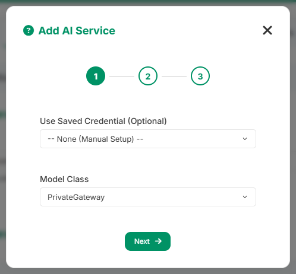
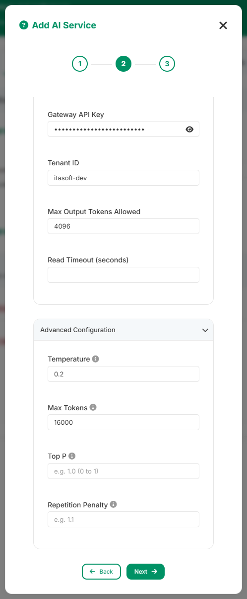
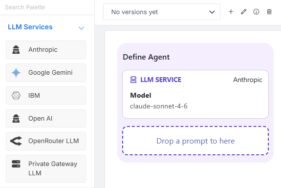

# Adding a Custom LLM Provider (continued)

This page continues [Adding a Custom LLM Provider](26-custom-llm-providers.md). It shows the LLM plugin class of the walkthrough provider `PrivateGateway`, then how to build, install, configure and test the provider, practical advice for small and private models, limitations and troubleshooting. It is for plugin developers. The complete project is the folder `06-custom-llm-provider` of the examples repository (see [The Examples Repository](29-examples-repository.md)).

## Walkthrough: the LLM plugin, identity and request

`GatewayAgentLLM` is one class, shown in two parts. Put both parts in one file; the second part ends with the closing brace of the class. This first part has the identity, the properties dialog and the request. Composers always ask for `16000` output tokens, so the request is limited to **Max Output Tokens Allowed**. The class names no Apache HttpClient type.

```java
package org.joget.samples.llm;

import java.net.ProxySelector;
import java.net.URI;
import java.net.http.HttpClient;
import java.net.http.HttpRequest;
import java.net.http.HttpResponse;
import java.nio.charset.StandardCharsets;
import java.time.Duration;
import java.util.concurrent.ThreadLocalRandom;
import java.util.regex.Pattern;
import org.joget.ai.agent.model.AgentException;
import org.joget.ai.agent.model.AgentLLM;
import org.joget.ai.agent.model.AgentLLMAbstract;
import org.joget.ai.agent.model.Functions;
import org.joget.ai.agent.model.LLMConfig;
import org.joget.ai.agent.model.Messages;
import org.joget.ai.agent.model.Response;
import org.joget.ai.agent.model.ToolExecution;
import org.joget.ai.config.llm.LLMModelCapability;
import org.json.JSONArray;
import org.json.JSONObject;

/**
 * Wire format and transport for an OpenAI-compatible chat/completions gateway.
 *
 * The class sends the request itself with the HTTP client of the JDK. It does not override prepareRequestHeader or
 * parseResponse of AgentLLMAbstract: their signatures name Apache HttpClient classes, and Agent Builder does not
 * export that library, so a class in another bundle that names them cannot be loaded.
 */
public class GatewayAgentLLM extends AgentLLMAbstract {

    private static final Pattern THINK_BLOCK = Pattern.compile("(?s)<think>.*?</think>\\s*");
    private static final String JSON_INSTRUCTION_KEY = "_jsonInstruction";

    // ---- identity ------------------------------------------------------------------------------

    @Override
    public String getName() {
        return "PrivateGatewayAgentLLM";
    }

    @Override
    public String getVersion() {
        return "1.0.0";
    }

    @Override
    public String getClassName() {
        return getClass().getName();
    }

    @Override
    public String getLabel() {
        return "Private Gateway LLM";
    }

    @Override
    public String getDescription() {
        return "Chat model behind a private OpenAI-compatible gateway";
    }

    @Override
    public String getIcon() {
        return "<i class=\"fas fa-server\"></i>";
    }

    /** AgentLLM.Type is a fixed list. EXTERNAL is the value for everything that is not built in. */
    @Override
    public AgentLLM.Type getLLMType() {
        return AgentLLM.Type.EXTERNAL;
    }

    /** Written to the Model Class column of the usage rows. */
    @Override
    public String getLLMTypeName() {
        return GatewayNames.PROVIDER;
    }

    /** The name under which GatewayCapabilityProvider is registered. */
    @Override
    protected String getCapabilityProviderName() {
        return GatewayNames.PROVIDER;
    }

    /** The properties dialog of this element on the agent canvas. */
    @Override
    public String getPropertyOptions() {
        return "[{\"title\":\"Private Gateway LLM\",\"properties\":["
                + "{\"name\":\"apiKey\",\"label\":\"API Key\",\"type\":\"password\"},"
                + "{\"name\":\"tenantId\",\"label\":\"Tenant ID (X-Tenant-Id header)\",\"type\":\"textfield\"},"
                + "{\"name\":\"model\",\"label\":\"Model\",\"type\":\"textfield\",\"required\":\"True\","
                + "\"value\":\"" + GatewayNames.DEFAULT_MODEL + "\"},"
                + "{\"name\":\"apiUrl\",\"label\":\"API URL\",\"type\":\"textfield\","
                + "\"value\":\"" + GatewayNames.DEFAULT_BASE_URL + "\"},"
                + "{\"name\":\"maxTokens\",\"label\":\"Max Tokens\",\"type\":\"number\",\"value\":\"4096\"},"
                + "{\"name\":\"temperature\",\"label\":\"Temperature\",\"type\":\"number\"},"
                + "{\"name\":\"topP\",\"label\":\"Top P\",\"type\":\"number\"},"
                + "{\"name\":\"" + GatewayNames.REPETITION_PENALTY + "\",\"label\":\"Repetition Penalty\","
                + "\"type\":\"number\"},"
                + "{\"name\":\"socketTimeoutSeconds\",\"label\":\"Read Timeout (seconds)\",\"type\":\"number\"},"
                + "{\"name\":\"nativeJson\",\"label\":\"Gateway supports response_format\",\"type\":\"checkbox\","
                + "\"options\":[{\"value\":\"true\",\"label\":\"\"}]}"
                + "]}]";
    }

    // ---- request -------------------------------------------------------------------------------

    /** A property of this element or service, trimmed; empty when not set. */
    private String valueOf(String property) {
        String v = getPropertyString(property);
        return v == null ? "" : v.trim();
    }

    /** The base URL gets /chat/completions appended unless it already ends with /completions. */
    protected String getUrl() {
        String url = valueOf("apiUrl");
        if (url.isEmpty()) {
            url = GatewayNames.DEFAULT_BASE_URL;
        }
        while (url.endsWith("/")) {
            url = url.substring(0, url.length() - 1);
        }
        return url.endsWith("/completions") ? url : url + "/chat/completions";
    }

    /** Content type, the key if there is one (a gateway inside the company network may need none), the tenant. */
    private void addHeaders(HttpRequest.Builder request) {
        request.header("Content-Type", "application/json");
        String key = valueOf("apiKey");
        if (!key.isEmpty()) {
            request.header("Authorization", "Bearer " + key);
        }
        String tenant = valueOf("tenantId");
        if (!tenant.isEmpty()) {
            request.header("X-Tenant-Id", tenant);
        }
    }

    /** Fills the request body: task override (_task_*), then plugin property. Parameters the model rejects are removed. */
    protected void presetConfig(LLMConfig config, Functions functions) {
        String taskModel = config.optString("_task_model", "");
        String model = taskModel.isEmpty() ? getPropertyString("model") : taskModel;
        if (model == null || model.isEmpty()) {
            model = GatewayNames.DEFAULT_MODEL;
        }
        config.put("model", model);
        LLMModelCapability.Capabilities caps = LLMModelCapability.resolve(getCapabilityProviderName(), model);

        config.remove("max_tokens");
        putOptional(config, "maxTokens", "max_tokens", Integer.class);
        if (config.has("_task_maxTokens")) {
            config.put("max_tokens", config.getInt("_task_maxTokens"));
        }
        int ceiling = positiveInt(getPropertyString("maxOutputTokens"));   // composers ask for 16000
        if (ceiling > 0 && config.optInt("max_tokens", 0) > ceiling) {
            config.put("max_tokens", ceiling);
        }

        if (caps.supports(LLMModelCapability.TEMPERATURE)) {
            putOptional(config, "temperature", "temperature", Double.class);
            if (config.has("_task_temperature")) {
                config.put("temperature", config.getDouble("_task_temperature"));
            }
        } else {
            config.remove("temperature");
        }
        if (caps.supports(LLMModelCapability.TOP_P)) {
            putOptional(config, "topP", "top_p", Double.class);
            if (config.has("_task_topP")) {
                config.put("top_p", config.getDouble("_task_topP"));
            }
        } else {
            config.remove("top_p");
        }

        // Our own declared parameter(s): typed, written under their JSON key, or removed.
        applyDeclaredParameters(config, getCapabilityProviderName(), model,
                LLMModelCapability.getBuiltInParameterIds());

        if (functions != null && !functions.isEmpty()) {     // some servers reject this without tools
            config.put("parallel_tool_calls", config.isParallelToolCalls());
        } else {
            config.remove("parallel_tool_calls");
        }
    }

    /** The base class removes only _task_ keys. Remove every other key that starts with an underscore too. */
    @Override
    protected String preparePayload(LLMConfig config, Messages messages, Functions functions) {
        JSONObject payload = new JSONObject(super.preparePayload(config, messages, functions));
        String instruction = payload.optString(JSON_INSTRUCTION_KEY, "");
        payload.keySet().removeIf(k -> k.startsWith("_"));
        if (!instruction.isEmpty() && payload.has("messages")) {
            JSONArray withInstruction = new JSONArray();
            withInstruction.put(new JSONObject().put("role", "system").put("content", instruction));
            JSONArray original = payload.getJSONArray("messages");
            for (int i = 0; i < original.length(); i++) {
                withInstruction.put(original.get(i));
            }
            payload.put("messages", withInstruction);
        }
        return payload.toString();
    }

    /** JSON mode: response_format if supported, and always the instruction as a leading system message. */
    @Override
    public void injectStructuredOutput(LLMConfig config, String mode, String jsonSchema) {
        boolean hasSchema = jsonSchema != null && !jsonSchema.trim().isEmpty();
        if ("true".equals(getPropertyString("nativeJson"))) {
            config.put("response_format", new JSONObject().put("type", "json_object"));
        }
        config.put(JSON_INSTRUCTION_KEY, hasSchema
                ? "Respond with one valid JSON object that matches this schema exactly. "
                  + "No prose, no markdown fences.\nSchema:\n" + jsonSchema.trim()
                : "Respond with one valid JSON object only. No prose, no markdown fences.");
    }
```

## Walkthrough: the LLM plugin, reply and transport

The second part of the same class. `readReply` accepts `content: null` and tool arguments as an object or a string, and removes `<think>...</think>`. It throws an `AgentException` (no retry) for a server error, an HTML error page or arguments that are not JSON, and it writes the arguments back as a string because servers expect a string when the history is sent again. `getResponse` sends the request with the HTTP client of the JDK, retries HTTP `429`, `5xx` and network errors with the settings of the run, uses **Read Timeout (seconds)** when it is set, stores the request body for the trace, and calls `persistLLMCall` to write the usage row. The class does not override `getStreamingResponse`, so a streaming run also arrives in `getResponse` and the answer comes in one piece.

```java
    // ---- response ------------------------------------------------------------------------------

    /**
     * Reads one reply into the result. Unlike the default parser it accepts content that is null, tool arguments
     * as an object, and reasoning text. An AgentException is not retried.
     */
    void readReply(Response result, String body) {
        result.setFullJsonResponse(body);      // the token counts are read from the "usage" object of this text
        if (body == null || body.isEmpty()) {
            return;
        }
        JSONObject json;
        try {
            json = new JSONObject(body);
        } catch (Exception notJson) {
            throw new AgentException("API Error: the gateway returned a reply that is not JSON: "
                    + abbreviate(body, 300));
        }
        if (json.has("error")) {
            Object err = json.get("error");
            String msg = err instanceof JSONObject
                    ? ((JSONObject) err).optString("message", err.toString()) : String.valueOf(err);
            throw new AgentException("API Error: " + msg);
        }
        JSONArray choices = json.optJSONArray("choices");
        JSONObject message = choices == null || choices.isEmpty() ? null : choices.getJSONObject(0).optJSONObject("message");
        if (message == null) {
            return;
        }

        String content = message.isNull("content") ? null : message.optString("content", null);
        if (content != null) {
            content = THINK_BLOCK.matcher(content).replaceAll("").trim();   // keep the visible answer only
            message.put("content", content);
        }
        message.remove("reasoning_content");
        result.setMessage(message);
        if (content != null && !content.isEmpty()) {
            result.setContent(content);
        }

        JSONArray toolCalls = message.optJSONArray("tool_calls");
        for (int i = 0; toolCalls != null && i < toolCalls.length(); i++) {
            JSONObject call = toolCalls.getJSONObject(i);
            JSONObject fn = call.optJSONObject("function");
            if (fn == null) {
                continue;
            }
            String name = fn.optString("name");
            Object raw = fn.opt("arguments");   // a string on OpenAI, an object on some gateways
            JSONObject args;
            try {
                args = raw instanceof JSONObject ? (JSONObject) raw
                        : (raw == null || String.valueOf(raw).trim().isEmpty()) ? new JSONObject()
                        : new JSONObject(String.valueOf(raw));
            } catch (Exception badJson) {
                throw new AgentException("API Error: the model sent arguments for tool '" + name
                        + "' that are not valid JSON: " + abbreviate(String.valueOf(raw), 300));
            }
            fn.put("arguments", args.toString());   // the history must carry a string
            ToolExecution execution = new ToolExecution(name, args);
            execution.setId(call.optString("id"));
            result.addToolExecution(execution);
        }
    }

    private static String abbreviate(String s, int max) {
        return s.length() <= max ? s : s.substring(0, max) + "...";
    }

    private static int positiveInt(String s) {
        try {
            return s == null || s.trim().isEmpty() ? 0 : Math.max(0, Integer.parseInt(s.trim()));
        } catch (NumberFormatException e) {
            return 0;
        }
    }

    // ---- transport and entry point ---------------------------------------------------------------

    /**
     * One blocking call. getStreamingResponse of the base class is not overridden, so a streaming run also comes
     * here and the answer arrives in one piece.
     */
    @Override
    public Response getResponse(LLMConfig config, Messages messages, Functions functions) throws AgentException {
        presetConfig(config, functions);
        int readSeconds = positiveInt(getPropertyString("socketTimeoutSeconds"));   // slow models need more than 120 s
        if (readSeconds == 0) {
            readSeconds = config.getLlmSocketTimeoutSeconds();
        }
        String payload = preparePayload(config, messages, functions);
        HttpClient client = HttpClient.newBuilder()
                .connectTimeout(Duration.ofSeconds(Math.max(1, config.getLlmConnectTimeoutSeconds())))
                .proxy(ProxySelector.getDefault())
                .build();
        HttpRequest.Builder request = HttpRequest.newBuilder(URI.create(getUrl()))
                .timeout(Duration.ofSeconds(Math.max(1, readSeconds)))
                .POST(HttpRequest.BodyPublishers.ofString(payload, StandardCharsets.UTF_8));
        addHeaders(request);

        int attempts = Math.max(1, config.getLlmRetryMaxAttempts());
        String lastProblem = "";
        for (int attempt = 1; attempt <= attempts; attempt++) {
            Response result = new Response();
            result.setRequestPayload(payload);          // shown in the "LLM" node of the trace
            try {
                HttpResponse<String> reply = client.send(request.build(),
                        HttpResponse.BodyHandlers.ofString(StandardCharsets.UTF_8));
                int status = reply.statusCode();
                if ((status == 429 || status >= 500) && attempt < attempts) {
                    lastProblem = "HTTP " + status + " from the gateway";
                } else {
                    readReply(result, reply.body());
                    persistLLMCall(result, config);     // the usage row of the AI Usage Dashboard
                    return result;
                }
            } catch (AgentException known) {            // a clear answer from the gateway: do not retry
                if (known.getResponse() == null) {
                    known.setResponse(result);          // keeps the request and the raw reply for the trace
                }
                throw known;
            } catch (InterruptedException interrupted) {
                Thread.currentThread().interrupt();
                throw new AgentException("The call to the gateway was interrupted");
            } catch (Exception networkOrTimeout) {
                lastProblem = String.valueOf(networkOrTimeout);
            }
            if (attempt < attempts) {
                pause(config, attempt);
            }
        }
        throw new AgentException("API Error: the gateway call failed after " + attempts + " attempt(s): " + lastProblem);
    }

    /** Waits initialDelay * 2^(attempt-1), at most maxDelay, plus up to one second at random. */
    private static void pause(LLMConfig config, int attempt) {
        long delay = Math.min((long) Math.max(0, config.getLlmRetryInitialDelayMs()) << (attempt - 1),
                Math.max(0, config.getLlmRetryMaxDelayMs())) + ThreadLocalRandom.current().nextInt(1000);
        try {
            Thread.sleep(delay);
        } catch (InterruptedException interrupted) {
            Thread.currentThread().interrupt();
            throw new AgentException("The retry was interrupted");
        }
    }
}
```

## Registering and configuring the provider

1. In `06-custom-llm-provider` run `mvn clean package "-Djoget.version=9.1.2"` (use your own Joget version). The two unit tests run offline. The result is `target/private-gateway-llm-1.0-SNAPSHOT.jar`.
2. With Agent Builder active, upload the jar in **Settings > Manage Plugins** (**Upload**). The list **Installed Plugins** then contains **Private Gateway LLM Provider**; it is also listed when you select **LLM Provider Plugin** or **AI Agent LLM** in **Filter by Type**. The log shows `Private Gateway LLM provider registered: 2 plugins` and `Bundle org.joget.samples.private-gateway-llm started`.
3. Open **Settings > AI Central Config** (reload it if it was open), the **AI Services** tab, and click **Add AI Service**. In step 1 select **PrivateGateway** as **Model Class** and click **Next**.
4. In step 2 enter or pick a **Model Name** and fill in the fields of the table below. **Advanced Configuration** has **Temperature**, **Max Tokens**, **Top P** and **Repetition Penalty**; for a model whose id contains `lite` or `8b` only **Temperature** and **Max Tokens** are shown. Click **Next**.
5. In step 3 enter an **AI Service Name** and click **Add**. Make it the **Active AI Service** or select it in a composer.

| Field | What it does | Default | Notes |
|---|---|---|---|
| **Model Name** | The model id sent in the request | `private-chat` | Suggestions: `private-chat`, `private-chat-large`, `private-lite-8b`. Any text is accepted. |
| **Gateway Base URL** | The address of the gateway | Empty: `http://localhost:8000/v1` | `/chat/completions` is appended unless the URL ends with `/completions`. Trailing `/` characters are removed. |
| **Gateway API Key** | Sent as `Authorization: Bearer <key>` | Empty | Empty: no `Authorization` header is sent |
| **Tenant ID** | Sent as the header `X-Tenant-Id` | Empty | Empty: no header |
| **Max Output Tokens Allowed** | The largest `max_tokens` the plugin sends | Empty: no limit | Composers ask for `16000` |
| **Read Timeout (seconds)** | The wait for the reply | Empty: `120` | |





On the canvas, drag the **Private Gateway LLM** element from the palette section **LLM Services** into the box **Define Agent** of an agent (onto **Add a LLM service to here**, or onto the **LLM SERVICE** card when the agent already has one) and fill in its properties (**API Key**, **Tenant ID (X-Tenant-Id header)**, **Model**, **API URL** and the others). A canvas agent uses these properties, not an AI Service.



## Testing the provider

**Unit tests, no Joget and no model.** The file `src/test/java/org/joget/samples/llm/GatewayAgentLLMTest.java` of the sample has two tests. In the first, a small HTTP server in the JVM (`com.sun.net.httpserver.HttpServer`) stands in for the gateway and the test calls the real `getResponse`. The server answers the first call with HTTP `503` and the second with a reply that contains `<think>hmm</think>Hello`. The test proves the retry (two calls), the removed reasoning text (`Hello`), the header `X-Tenant-Id`, a dropped parameter (no `top_p` for `private-lite-8b`) and the clamped output limit (`16000` becomes `4096`). The second test builds a `GatewayLLMConfig` from an `LLMCredentialData` object and proves that the fields of the service become the URL and the key of the call.

Rules for such a test: use `setProperty(key, value)` (`setProperties(Map)` needs a Joget context), register the parameter rules with `LLMModelCapabilityRegistry.register(new GatewayCapabilityProvider())` (there is no plugin manager), and set `config.setLlmRetryInitialDelayMs(10)` so that the retry does not slow the test down. The missing database is logged as the warning `AgentLLMRegistry: no DAO wired, skipping token tracking`. The complete test class:

```java
package org.joget.samples.llm;

import static org.junit.jupiter.api.Assertions.assertEquals;
import static org.junit.jupiter.api.Assertions.assertFalse;

import com.sun.net.httpserver.HttpServer;
import java.net.InetSocketAddress;
import java.nio.charset.StandardCharsets;
import java.util.concurrent.atomic.AtomicInteger;
import java.util.concurrent.atomic.AtomicReference;
import org.joget.ai.agent.model.Functions;
import org.joget.ai.agent.model.LLMConfig;
import org.joget.ai.agent.model.Message;
import org.joget.ai.agent.model.Messages;
import org.joget.ai.agent.model.Response;
import org.joget.ai.config.llm.LLMModelCapabilityRegistry;
import org.joget.ai.config.model.LLMCredentialData;
import org.json.JSONObject;
import org.junit.jupiter.api.Test;

/** A throw-away HTTP server stands in for the gateway. No Joget runtime and no model. */
class GatewayAgentLLMTest {

    @Test
    void retriesTheRequestAndSendsOnlyWhatTheModelAccepts() throws Exception {
        LLMModelCapabilityRegistry.register(new GatewayCapabilityProvider());   // there is no plugin manager here
        AtomicReference<String> body = new AtomicReference<>();
        AtomicReference<String> tenant = new AtomicReference<>();
        AtomicInteger calls = new AtomicInteger();
        HttpServer server = HttpServer.create(new InetSocketAddress("127.0.0.1", 0), 0);
        server.createContext("/v1/chat/completions", exchange -> {
            body.set(new String(exchange.getRequestBody().readAllBytes(), StandardCharsets.UTF_8));
            tenant.set(exchange.getRequestHeaders().getFirst("X-Tenant-Id"));
            boolean first = calls.incrementAndGet() == 1;       // the first call fails with 503
            byte[] reply = (first ? "busy" : "{\"choices\":[{\"message\":{\"role\":\"assistant\","
                    + "\"content\":\"<think>hmm</think>Hello\"}}]}").getBytes(StandardCharsets.UTF_8);
            exchange.sendResponseHeaders(first ? 503 : 200, reply.length);
            exchange.getResponseBody().write(reply);
            exchange.close();
        });
        server.start();
        try {
            GatewayAgentLLM llm = new GatewayAgentLLM();
            llm.setProperty("apiUrl", "http://127.0.0.1:" + server.getAddress().getPort() + "/v1");
            llm.setProperty("model", "private-lite-8b");     // the lite profile: no top_p
            llm.setProperty("tenantId", "t-42");
            llm.setProperty("topP", "0.9");
            llm.setProperty("maxTokens", "16000");
            llm.setProperty("maxOutputTokens", "4096");
            LLMConfig config = new LLMConfig();
            config.setLlmRetryInitialDelayMs(10);
            Messages messages = new Messages();
            messages.add(new Message(Message.Role.USER, "hi"));

            Response response = llm.getResponse(config, messages, new Functions());

            assertEquals(2, calls.get());                     // the 503 was retried
            assertEquals("Hello", response.getContent());     // <think> removed
            assertEquals("t-42", tenant.get());
            JSONObject sent = new JSONObject(body.get());
            assertFalse(sent.has("top_p"));
            assertEquals(4096, sent.getInt("max_tokens"));    // 16000 clamped to the ceiling
        } finally {
            server.stop(0);
        }
    }

    @Test
    void theServiceFieldsBecomeUrlAndKeyOfTheModelCall() {
        LLMCredentialData saved = new LLMCredentialData();
        saved.setModelName("private-chat-large");
        saved.setApiKey(new JSONObject().put(GatewayNames.URL_FIELD, "https://llm.internal.example/v1")
                .put(GatewayNames.KEY_FIELD, "sk-example-not-a-real-key").put("tenantId", "t-42"));

        GatewayLLMConfig config = new GatewayLLMConfig(saved);

        assertEquals("https://llm.internal.example/v1", config.getApiEndpoint());
        assertEquals("sk-example-not-a-real-key", config.getApiKey());
        assertEquals("private-chat-large", config.getModelName());
        assertEquals("t-42", config.getAdditionalConfig().get("tenantId"));   // reaches the LLM plugin as a property
        assertEquals(GatewayNames.DEFAULT_BASE_URL, new GatewayLLMConfig(new LLMCredentialData()).getApiEndpoint());
    }
}
```

**In an agent.** Create an agent with one task and the **Private Gateway LLM** element, and run the preview. In **Monitor > Agent Execution Audit Trail** open the run and its "LLM" node: it shows the exact body that was sent. Add a tool and ask a question that needs it.

**In a composer.** Select the service in the AI service list of the chat panel and ask for something small, for example a form with five fields. This is a strict test: a composer needs tool calling, long instructions and long answers. Then open **Monitor > AI Usage Dashboard**. The tab **By Model Class** must show prompt tokens and completion tokens above zero for `PrivateGateway` (the page writes the name in capital letters), and the list **LLM Calls** must have a row for each call with **Model Class** `PrivateGateway`. Zero tokens mean that the server does not return `usage`.

## Small and private models: practical advice

No list of models known to work with the composers exists. The advice below follows from how the composers work. Test each model.

| Topic | What to expect | What to do |
|---|---|---|
| Tool calling | Every composer is a tool-calling agent. A model without reliable function calling answers in text and builds nothing. | Choose a model trained for tool use. Test one tool call in an agent first. |
| Tool arguments | A small model may produce cut-off or invalid JSON. The default parser throws and the identical call is retried. | Use the walkthrough method `readReply`, which names the tool and the bad text. Raise the output limit if answers are cut off. |
| Context and output size | Composers load long skill files (the largest is about 48,000 characters, about 12,000 tokens), the conversation grows with each tool call, and they ask for `16000` output tokens. Old messages are trimmed above **Max Characters** (default `400000`, about 100,000 tokens). | Use at least 32,000 tokens of context; 8,000 is not enough. Clamp the output limit in your plugin, as the walkthrough does. On the canvas set **Max Characters** below (context tokens minus output tokens) times 4. Composers use the default. |
| Speed | A local model may be silent for more than 120 seconds. A timeout is retried, so the wait triples. | Set a read timeout in your plugin |
| JSON mode and reasoning | Small models add prose or fences around JSON. Reasoning models leak `<think>` or `reasoning_content` into answers, arguments and history. | Use `response_format` if supported plus the instruction fallback, and the **JSON Extractor** enhancer on the canvas. Remove reasoning text when you read the reply (streamed text reaches the user interface). |
| Quality | A smaller model builds smaller or less careful apps. The Orchestrator is the most demanding use. | Open the artifacts and check fields, validators and menus. Start with single composers. |

## Limitations and things to know

- **Names must match exactly** in the provider, the capability provider, the credential type, the `AgentComponent` entry and `getCapabilityProviderName()`. A mismatch gives no error: declarations are not used. The Gemini name is `Google Gemini`.
- **Fixed settings for composers and system agents:** output limit `16000`, timeouts `30` and `120` seconds, `3` attempts, **Max Tool Call Depth** `100`. Your LLM plugin can change the output limit, the timeouts and the attempts.
- **Saved Advanced Configuration values** reach composers only if your `LLMConfig` calls `super(credentialData)`. The built-in **Custom** route does not.
- **Metering.** Failed calls write no usage row, so totals are a lower bound. No `usage` in the reply means zero tokens.
- **No `AgentComponent.unregister`:** a stale entry survives an uninstall until Joget restarts.
- **Apache HttpClient types cannot be used from an external plugin.** Do not override `prepareRequestHeader`, `parseResponse` or `parseStreamingResponse`, and do not name another class of that library. Send the request yourself, as the walkthrough does. The walkthrough plugin does not stream tokens.
- **A provider that declares credential fields must declare its key and URL fields itself,** under names other than `apiKey`. There is no credential type in the walkthrough, so **Use Saved Credential (Optional)** offers nothing for `PrivateGateway`.

## Troubleshooting

| Symptom | Cause | Fix |
|---|---|---|
| The provider is not in **Model Class** | Bundle not active or started before Agent Builder; provider hidden by `ai.central.config.hidden.providers` | Check **Manage Plugins** and the log. Reinstall after Agent Builder. Reload the page. |
| `NoClassDefFoundError: org/apache/http/client/methods/HttpRequestBase` in the log at the first model call; a composer then shows no answer of the model | The LLM plugin overrides `prepareRequestHeader` or `parseResponse`, or names another Apache HttpClient class | Send the request yourself, as `GatewayAgentLLM.getResponse` does |
| The service form shows two fields **API Key** | A provider field is named `apiKey` | Use another field name, as the walkthrough does |
| "No plugin found for provider: PrivateGateway" in a composer | The LLM plugin is not registered, or the `AgentComponent` entry is missing | Register `GatewayAgentLLM` as a service and call `AgentComponent.register(...)`, as `Registrar` does |
| "Unsupported LLM provider" | The provider bundle is stopped | Start the bundle |
| **Repetition Penalty** never appears, or appears for the wrong model | Provider names differ, or the 30-second cache | Compare the `getProviderName()` values. Wait 30 seconds. Check what `getCapabilities` returns for the lower-case model id. |
| HTTP `400` "unknown field" or "extra fields not permitted" | A key the server rejects: an underscore key, `user`, `parallel_tool_calls`, `stream_options`, `max_completion_tokens` | Open the "LLM" node of the run, read the body, remove the field in `preparePayload` or `presetConfig` |
| HTTP `404`, or every call takes 6 minutes and fails | Doubled `/v1`, trailing `/`, or another path; or a timeout with 3 attempts | Fix the base URL (`/chat/completions` is added). Raise the read timeout. |
| Tokens are zero | No top-level `usage` in the reply, or none in the stream | Return `usage`; call `setFullJsonResponse` and `persistLLMCall`; for a plugin that calls `callStreamingService`, add `stream_options.include_usage` |
| A composer answers in text and builds nothing | The model does not call tools | Use a model with tool calling. Test one tool in an agent. |

## Where to go next

- [Adding a Custom LLM Provider](26-custom-llm-providers.md)
- [The Examples Repository](29-examples-repository.md)
- [AI Central Config Reference](03-ai-central-config.md)
- [System Agents](27-system-agents.md)
- [Troubleshooting](30-troubleshooting.md)
