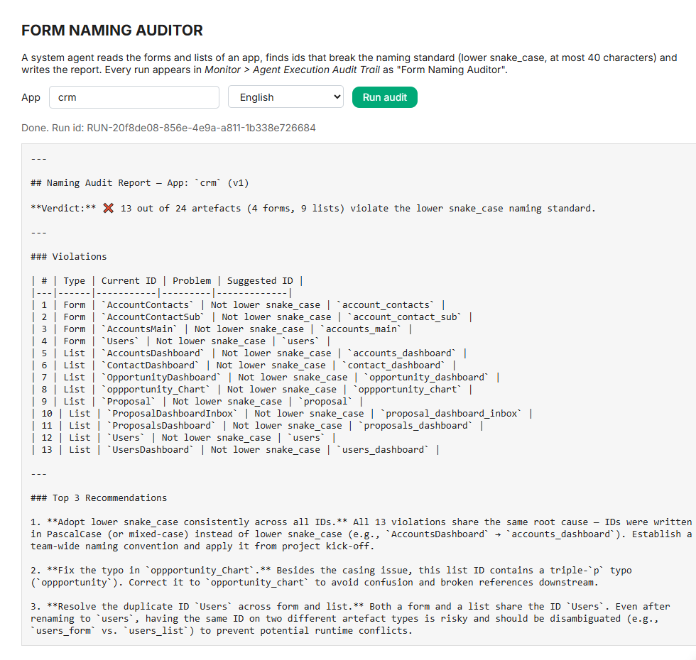

# System Agents

A system agent is an agent that you define in Java code in a plugin, not on the agent canvas. It runs on the same engine as a canvas agent, with the same tool loop, tracing, execution history and usage records. This page is for plugin developers. It covers when to use one, the API and what each call returns, tasks, tools, triggers, progress, what is recorded, a complete working example (a form naming auditor) and an outline for a second one (an implementation reviewer).

Development setup (project, `pom.xml`, build, deploy) is on [Extending Agent Builder: Overview and Development Setup](23-extending-overview.md). Compile against the Agent Builder API jar from the examples repository (see [The Examples Repository](29-examples-repository.md); the working sample is the folder `02-system-agent`). This page shows only what is specific to system agents. Triggers (a process tool, a timer), progress for a user interface, an outline of a second agent, testing, limitations and troubleshooting are on [System Agents (continued)](27b-system-agents-continued.md).

## What a system agent is, and when to use one

The AI Composers and the Orchestrator are system agents. Your code supplies the model, the prompts, the tools and the way it is started. Agent Builder supplies the run.

| | Canvas agent | System agent |
|---|---|---|
| Defined in | An app, drawn on the canvas | Java in a plugin bundle |
| Changed by | Implementers, without a deploy | Developers, with a plugin deploy |
| Model | The LLM element of the agent | Your code; any AI Service of AI Central Config |
| Prompts and tools | Elements of the palette | Whatever your code builds. Tools must be registered plugins. |
| Several steps | Task order, sub-agents | Tasks in code: order, parallel groups, dependencies, conditions, prompts built from the previous result |
| Started by | Userview, process tool, API route, datalist action | Any Java code that you write |
| Guards, decisions, memory, user input | Available | Not offered by the request API (enhancers only) |
| In an app export | Yes | No. It belongs to your plugin. |
| Agent Type in history | AI Agent Builder | AI Composer |

Use a system agent when the logic ships to many apps or customers as a product, needs deterministic Java around the model, needs coordinated tasks, or must start outside an app (a Settings page, a timer). The strongest pattern is: Java finds the facts, the model explains them. Use a canvas agent when an implementer owns it, it belongs to one app, and a prompt plus a tool loop is enough.

## The API

Agent Builder exports these packages to other bundles: `org.joget.ai.agent`, `org.joget.ai.agent.lib`, `org.joget.ai.agent.lib.composer`, `org.joget.ai.agent.model`, `org.joget.ai.agent.core`, `org.joget.ai.agent.embedding`, `org.joget.ai.assistant`, `org.joget.ai.config`, `org.joget.ai.config.feature`, `org.joget.ai.config.llm`, `org.joget.ai.config.config`, `org.joget.ai.config.utils`, `org.joget.ai.config.model`, `org.joget.ai.config.dao` and `org.joget.ai.config.exception`. Do not use other packages, for example `org.joget.ai.agent.utils`.

### SystemAgentAbstract

`org.joget.ai.agent.model.SystemAgentAbstract` is the base class. The subclass can be empty: its identity is all it needs.

| Method | Contract |
|---|---|
| `protected String getAgentId()` | Stable id. Default: the class name. Return a class literal (`MyAgent.class.getName()`): on Joget Cloud an instance can be a proxy whose class name differs. Used as the id of the `ai_system_agent` row and as the plugin class name of usage rows. |
| `protected String getAgentName()` | The name people see in **Agent Name** of Agent Execution Audit Trail. Default: the simple class name. |
| `protected String getLoggedName()` | The name of the usage rows (**Plugin Name** in the AI Usage Dashboard). Default: `getAgentName()`. Override it to group several agents under one name. |
| `Response run(SystemAgentRequest request, Map<String,Object> properties)` | Runs one task. Never throws (see the next section). May return `null`. |
| `List<TaskResult> runAll(SystemAgentRequest request, Map<String,Object> properties)` | Runs every task of a request built with the builder, in order. With no tasks it runs the single task of the legacy constructor. |
| `Response runTask(String label, SystemAgentRequest request, Map<String,Object> properties)` | Runs one task by label. Ignores `dependsOn` and `runCondition`. Throws `IllegalArgumentException` for an unknown label. |
| `UUID subscribe(String runId, Consumer<String> consumer)` | Receives the trace events of the run as JSON text. Returns the listener id, or `null` for a null run id or consumer. |
| `void unsubscribe(String runId, UUID listenerId)` | Removes the listener and then **all** listeners of that run |

`SystemAgentAbstract.TaskResult` has `getLabel()`, `getResponse()`, `getErrorMessage()`, `isSuccess()` (no error message and a response object) and `isError()` (an error message).

The `properties` map of `run`, `runAll` and `runTask` carries information about the caller:

| Key | Effect |
|---|---|
| `username`, `fullName` | Recorded on the execution when the current thread has no real user (a timer or pool thread has none) |
| `appId` | Recorded as the app of the run when no app is bound to the thread |
| `triggerSource` | Any text. Recorded in **Trigger Source** and removed from the map. Without it a system agent run shows **System Agent**. |
| any other key | Becomes an input variable of the run. Unused keys are harmless. |

### SystemAgentRequest

| Member | Contract |
|---|---|
| `new SystemAgentRequest(llm, agentPrompts, taskPrompts, tools, enhancers, debugMode)` | One task. `agentPrompts` are system-level prompts, `taskPrompts` the prompts of the task. Null lists become empty. `llm` and `taskPrompts` are required, otherwise `run` returns a response with an error text. |
| `setRunId(String)`, `getRunId()` | The id of the run. If you do not set one, `run` creates `RUN-<uuid>`. Set it yourself when you need to follow the events. All tasks of a `runAll` share it. |
| `SystemAgentRequest.builder()` | Fluent builder for several tasks (next sections) |
| `withMaxHistoryMessages(int)` | Has no effect. Do not use it. |

### Helper classes

| Class | Use |
|---|---|
| `org.joget.ai.agent.core.AgentFactory` | `create(pluginManager, AgentComponent, Map)` builds a prompt, tool or enhancer from the registry. `createLLM(pluginManager, providerName, Map)` builds the LLM plugin of a provider. |
| `org.joget.ai.agent.model.AgentComponent` | Constants for the built-in elements. `PersonaAgentPrompt` takes the properties `role` and `backstory`. `TextPromptAgentPrompt` takes `msgRole` (`SYSTEM` or `USER`) and `prompt`. |
| `org.joget.ai.config.llm.LLMConfigFactory` | `createByServiceOrActive(serviceName)` reads an AI Service of AI Central Config |
| `AgentToolAbstract`, `Function`, `Functions`, `ToolExecution` | Your own tools. See [Writing Custom Tools](24-custom-tools.md). |
| `org.joget.ai.agent.model.Response` | `getContent()`, `isFailed()`, `getToolExecutions()`, `getMessage()`, `getFullJsonResponse()` |

## What run returns, and how to handle it safely

`run` catches its own exceptions and returns a value. `LinkageError` is the exception to this: it is thrown when Agent Builder is not installed and your class cannot link. Catch it where you start the run. Every outcome below must be handled.

| Situation | `run` returns | Status in history |
|---|---|---|
| The model answers | A `Response`, `isFailed()` false, `getContent()` is the answer | SUCCESS |
| The AI service fails (bad key, HTTP error after the retries), a tool throws, a tool or prompt class cannot be loaded, or the LLM cannot be built | A `Response` with `isFailed()` **true**. `getContent()` is the message, for example `API Error [invalid_api_key]: ...`, `Agent LLM not available.` or `AgentTool class could not be loaded: <class>`. | FAILED |
| The request is invalid (no LLM, no task prompts) | A `Response` with `isFailed()` **false** and the message as content (`request.llm is required`) | No row |
| An administrator clicked **Abort** on the running execution in **Monitor > Agent Execution Audit Trail**. The run stops after the current task. | `null` | ABORTED |
| An error in the engine outside the task (for example a database failure) | `null`. The error is in the Joget log. | |

So `null`, `isFailed()` and the content all matter, and "the model answered" is not proof that the job was done. Check in this order:

1. `response == null`: stopped (aborted, or an engine error). Report it.
2. `response.isFailed()`: failed. The content is the message to show.
3. Empty content: failed.
4. Your own proof of success: a flag that **your tool** sets when it was called with valid data. A model can answer without calling any tool, and then its text is invented.

The sample `02-system-agent` makes checks 1 to 3 in one line of `NamingAuditor.audit` (it also treats a text that starts with `API Error` as a failure). Check 4 is not in the sample. To add it, let the tool remember the run id and ask for it after `run`:

```java
// In NamingCheckTool: the run ids for which the tool returned data.
private static final Set<String> CALLED = ConcurrentHashMap.newKeySet();

/** True once for a run id that called the tool (the entry is removed). */
static boolean wasCalled(String runId) {
    return runId != null && CALLED.remove(runId);
}

// In NamingCheckTool.execute, just before the result is returned:
if (config != null && config.getRunId() != null) {
    CALLED.add(config.getRunId());
}

// In NamingAuditor.audit, as the last part of the check:
boolean ok = r != null && !r.isFailed() && !text.isEmpty() && !text.startsWith("API Error")
        && NamingCheckTool.wasCalled(runId);
```

The set is in the memory of one node, which is enough here: the tool and the check run on the node that runs the agent.

For `runAll`, a `TaskResult` is a success when the task returned without throwing and was not skipped. That is all it means: its response can still be `null` or failed, so apply the four checks to `tr.getResponse()`. A task is skipped with the error message `Skipped: dependencies not yet completed: [...]` or `Skipped: run condition not met`. If your own prompt-building function (the lazy supplier) throws, the error message holds the exception text, the following tasks still run, and they receive `null` as the previous response. An abort ends the task that is running; it does not stop the later tasks of the request, so stop your own flow when a result is `null`.

## Tasks, tools and dependencies in code

**One task** is the legacy constructor (see the walkthrough). **Several tasks** use the builder:

| Builder call | Meaning |
|---|---|
| `llm(l)`, `systemPrompt(p)`, `systemPrompts(list)`, `enhancers(list)`, `debugMode(b)` | Request level settings. System prompts apply to every task unless the task has its own. |
| `addTask(label, prompts, tools)` | A sequential task. Tasks run in the order added. |
| `addTask(label, systemPrompts, prompts, tools)` | The same, with system prompts of its own that replace the request's for this task |
| `addTask(label, Function<Response,List<AgentPromptAbstract>> supplier, tools)` and the variant with `systemPrompts` | The prompts are built just before the task runs, from the previous task's `Response` (can be `null`) |
| `addParallelTask(label, prompts, tools)` and `endParallelGroup()` | Tasks added between them run at the same time on separate threads. `endParallelGroup()` is required after the last one. |
| `addDependentTask(label, prompts, tools, String... dependsOn)` and the lazy variant | Skipped unless every named task has completed |
| `addDependentTask(label, systemPrompts, supplier, tools, BooleanSupplier runCondition, String... dependsOn)` | The same, plus a condition that is evaluated just before the task |

How it behaves:

- **Each task is a complete, separate run**: its own conversation, execution row, trace and END event, all with the request's run id. A task sees only what you give it: prompts built from the previous response, or your own state keyed by run id.
- "Completed" for `dependsOn` means that the earlier task **returned**. A task that failed or returned `null` counts as completed. To stop a task after a failure, use a `runCondition` that reads a flag set by your tool.
- A task can depend only on a task defined before it. A dependency on a later label is never met.
- `runCondition` is not evaluated for parallel tasks, and `addParallelTask` has no `dependsOn`.
- If you forget `endParallelGroup()`, the next task shares the group, the group runs sequentially, and there is no error. A group with one parallel task also runs sequentially.
- A request with a lazy first task has no single-task prompts: pass it to `runAll` or `runTask`, not `run`.
- Parallel tasks run on pool threads. The current user is carried over; other thread-local state is not.
- One request has one LLM for all tasks. To use two models, run two requests.

**Tools** are plugins that extend `AgentToolAbstract` (see [Writing Custom Tools](24-custom-tools.md)) and are registered as OSGi services in your activator. `new MyTool()` in the request is only a carrier: Agent Builder sends the class name and properties and rebuilds the tool from the plugin manager for the run. An unregistered tool fails the run with "AgentTool class could not be loaded". `execute(llm, config, call)` receives the request-level `LLMConfig`; `config.getRunId()` is the id of your run in every task, so use it as the key for any per-run state. Return `{"error": ...}` instead of throwing: an exception from a tool fails the task. Keep tool instances free of per-run fields, because instances are rebuilt for each run.

**Prompts.** Hash variables (`#...#`) in prompt text are resolved against the app bound to the thread. A timer or pool thread has none, so keep such variables out of the text, or bind an app first with `AppUtil.setCurrentAppDefinition(...)` and clear it in a `finally` block.

**Central instructions and skills.** Text saved as central instructions for the Agent Builder is added to the conversation of a system agent as for a canvas agent. See [Skills, Central Instructions and Tool Templates](22-skills-and-tool-templates.md).

## Choosing the LLM and the service

A system agent uses an AI Service of AI Central Config, as the composers do. `LLMConfigFactory.createByServiceOrActive(null)` returns the active service; a service name returns that service (`LLMCredentialNotFoundException` if it does not exist). Copy the values into a property map and let `AgentFactory.createLLM` build the LLM plugin of the service's provider. The walkthrough method `activeLlm` does this:

- `getAdditionalConfig()` first (the saved fields of the service), then `apiKey`, `model` and `apiUrl` (the custom URL if set), then `maxTokens` (the sample uses `3000`; the composers use `16000`).
- The provider name decides the LLM plugin. A **Custom** service uses the OpenAI plugin. A provider that you add yourself needs its own LLM plugin (see [Adding a Custom LLM Provider](26-custom-llm-providers.md)).
- Timeouts (`30` and `120` seconds), `3` attempts and 100 tool-call rounds are the defaults and cannot be set per request.

## Token usage and audit trail

| Where | What is recorded |
|---|---|
| **Monitor > Agent Execution Audit Trail** | One row for each `run`: one for a single task, one per task for `runAll`, all with the same run id. Columns: **Start Time**, **Agent Name** (`getAgentName()`), **Agent Type** (always **AI Composer** for system agents), **Trigger Source**, **App ID**, **Run ID**, **Status**, **Username**, **Nodes** and **Prompt Tokens**. Open a row for the trace: every task, prompt, model call and tool call with request and response. |
| **Monitor > AI Usage Dashboard** | One row for each successful model call: **Plugin Name** (`getLoggedName()`), **Model Name**, **Model Class**, prompt and completion tokens. Tabs **By Model Class** and **By Plugin Name** group them. |
| Table `ai_system_agent` | One row per agent id (`getAgentId()`): name, the definition of the last run (password properties are encrypted) and the dates. It is audit information; it is never read to run an agent. |

Token counts come from the `usage` object of each reply, so they depend on the LLM plugin and the server. Only tokens are recorded, not money. A failed model call writes no usage row. Every call stores the full prompt and reply text, so do not put secrets in prompts. Give users and the app to the run through the `properties` map, or the rows show an empty user.

## Walkthrough: the form naming auditor

The example is the folder `02-system-agent` of the examples repository. The classes below are its source files. A Settings page asks for an app id. A tool reads the forms and lists of the app and returns the ids that break the rule (lower snake_case, at most 40 characters, no double underscore), each with a suggested id. The model only writes the report, in English or Bahasa Indonesia. Java finds the facts.

| Class | Role |
|---|---|
| `NamingAuditorAgent` | The agent: identity only |
| `NamingAuditor` | Builds the request (LLM, prompts, tool), runs it, checks the response |
| `NamingCheckTool` | The registered tool `check_app_naming(appId, appVersion)` |
| `NamingRules` | The deterministic rule and the suggested id. Replace it with your standard. |
| `NamingAuditorPage`, `page.html` | The Settings page and its HTML |
| `Activator` | Registers the page and the tool |

Bundle instructions of its `pom.xml` (the rest follows the conventions of the setup page; `agent-builder-api` has scope `provided` and all transitive dependencies excluded):

```xml
<Bundle-SymbolicName>org.joget.samples.form-naming-auditor</Bundle-SymbolicName>
<Private-Package>org.joget.samples.systemagent.*</Private-Package>
<Export-Package>!*</Export-Package>
<Bundle-Activator>org.joget.samples.systemagent.Activator</Bundle-Activator>
<Import-Package>!*,${servlet.namespace}.servlet;version="0",${servlet.namespace}.servlet.http;version="0",org.osgi.framework;version="1.3.0"</Import-Package>
<DynamicImport-Package>*</DynamicImport-Package>
```

`NamingAuditorPage` overrides a platform method that takes servlet classes, so it must be compiled with the servlet namespace of the platform jars, which is `jakarta.servlet` on Joget DX 9. The source file uses `javax.servlet`. The pom derives the property `servlet.namespace` from `joget.version` and compiles a copy of that one file in which `javax.servlet` is replaced by `jakarta.servlet`. You do not set the property yourself. The sample also depends on `wflow-wfengine` and `wflow-directory`, for `WorkflowUtil`.

`Activator` registers the page and the tool. The tool must be a registered plugin because Agent Builder rebuilds every tool by class name. The `LinkageError` guard keeps the bundle starting when Agent Builder is missing.

```java
package org.joget.samples.systemagent;

import java.util.ArrayList;
import java.util.Collection;
import org.joget.commons.util.LogUtil;
import org.osgi.framework.BundleActivator;
import org.osgi.framework.BundleContext;
import org.osgi.framework.ServiceRegistration;

/** Registers the console page (the trigger) and the tool (the agent's only capability). */
public class Activator implements BundleActivator {

    private final Collection<ServiceRegistration> registrations = new ArrayList<>();

    @Override
    public void start(BundleContext context) {
        registrations.add(context.registerService(NamingAuditorPage.class.getName(), new NamingAuditorPage(), null));
        try {
            // Agent Builder rebuilds every tool of a run by class name, so the tool must be a registered plugin.
            registrations.add(context.registerService(NamingCheckTool.class.getName(), new NamingCheckTool(), null));
        } catch (LinkageError e) {
            LogUtil.warn(Activator.class.getName(), "Agent Builder is not available, the auditor tool was not registered: " + e);
        }
    }

    @Override
    public void stop(BundleContext context) {
        for (ServiceRegistration registration : registrations) {
            try {
                registration.unregister();
            } catch (IllegalStateException e) {
                // already unregistered by the framework
            }
        }
        registrations.clear();
    }
}
```

`NamingAuditorAgent` is the whole agent. The class literal keeps `getAgentId()` stable.

```java
package org.joget.samples.systemagent;

import org.joget.ai.agent.model.SystemAgentAbstract;

/**
 * The whole "agent" is its identity. The model, the prompts and the tools travel in the request that
 * {@link NamingAuditor} builds, and the run goes through the same engine as a canvas agent.
 *
 * getAgentName is what Agent Execution Audit Trail shows in the Agent Name column. getAgentId is stored in the
 * ai_system_agent table; it is a class literal because the default, getClass().getName(), differs when Joget
 * Cloud wraps the instance in a proxy. getLoggedName (not overridden) labels the AI usage dashboard.
 */
public class NamingAuditorAgent extends SystemAgentAbstract {

    public static final String AGENT_ID = NamingAuditorAgent.class.getName();
    public static final String AGENT_NAME = "Form Naming Auditor";

    @Override
    protected String getAgentId() {
        return AGENT_ID;
    }

    @Override
    protected String getAgentName() {
        return AGENT_NAME;
    }
}
```

## Walkthrough: building and checking the run

`NamingAuditor.audit` follows the four steps of every system agent: LLM, prompts, tools, run. After `run` it checks the response: `null`, `isFailed()`, an empty text and a text that starts with `API Error` all give `ok` false. `activeLlm` takes the active AI Service.

```java
package org.joget.samples.systemagent;

import java.util.Collections;
import java.util.HashMap;
import java.util.List;
import java.util.Map;
import java.util.UUID;
import org.joget.ai.agent.core.AgentFactory;
import org.joget.ai.agent.model.AgentComponent;
import org.joget.ai.agent.model.AgentLLMAbstract;
import org.joget.ai.agent.model.AgentPromptAbstract;
import org.joget.ai.agent.model.AgentToolAbstract;
import org.joget.ai.agent.model.Response;
import org.joget.ai.agent.model.SystemAgentRequest;
import org.joget.ai.config.config.LLMConfig;
import org.joget.ai.config.llm.LLMConfigFactory;
import org.joget.apps.app.service.AppUtil;
import org.joget.plugin.base.PluginManager;
import org.joget.workflow.util.WorkflowUtil;

/**
 * Builds the request and runs the agent. This is the only class that touches the LLM; call it from anything that
 * can run Java in Joget (a console page as here, a process tool, a scheduler, a servlet).
 */
public final class NamingAuditor {

    /** Outcome of one run. {@code ok} is false for an empty answer or an error text from the AI service. */
    public static final class Result {
        public final boolean ok;
        public final String runId;
        public final String report;

        Result(boolean ok, String runId, String report) {
            this.ok = ok;
            this.runId = runId;
            this.report = report;
        }
    }

    private NamingAuditor() {
    }

    public static Result audit(String appId, String language) {
        PluginManager pm = (PluginManager) AppUtil.getApplicationContext().getBean("pluginManager");

        // 1. The model: whatever AI service is active in AI Central Config (provider, key and model live there).
        AgentLLMAbstract llm = activeLlm(pm);

        // 2. Prompts: a persona for the whole agent, then the task text.
        AgentPromptAbstract persona = AgentFactory.create(pm, AgentComponent.PersonaAgentPrompt, Map.of(
                "role", "Joget implementation reviewer",
                "backstory", "You review Joget apps against the naming standard. Always call check_app_naming first and report "
                        + "only what it returns. Never invent ids. Write a short Markdown report: a one-line verdict, "
                        + "a table of violations (id, problem, suggested id) and the top three recommendations."));
        String lang = "id".equals(language) ? "Bahasa Indonesia" : "English";
        AgentPromptAbstract task = AgentFactory.create(pm, AgentComponent.TextPromptAgentPrompt, Map.of(
                "msgRole", "USER", "prompt", "Audit the naming of app " + appId + ". Write the report in " + lang + "."));

        // 3. Tools: our own plugin; only its class name travels, Agent Builder re-creates it from the plugin manager.
        List<AgentToolAbstract> tools = List.of(new NamingCheckTool());

        SystemAgentRequest req = new SystemAgentRequest(llm, List.of(persona), List.of(task), tools, Collections.emptyList(), false);
        String runId = "RUN-" + UUID.randomUUID();
        req.setRunId(runId);

        // 4. Properties tell Agent Builder who the run is for; they appear in Agent Execution Audit Trail.
        Map<String, Object> props = new HashMap<>();
        props.put("username", nz(WorkflowUtil.getCurrentUsername()));
        props.put("fullName", nz(WorkflowUtil.getCurrentUserFullName()));
        props.put("appId", appId);
        props.put("triggerSource", "NAMING_AUDITOR_PAGE");

        Response r = new NamingAuditorAgent().run(req, props);
        String text = r == null || r.getContent() == null ? "" : r.getContent().trim();
        // run() returns normally even when the provider failed, so check the response itself.
        boolean ok = r != null && !r.isFailed() && !text.isEmpty() && !text.startsWith("API Error");
        return new Result(ok, runId, text);
    }

    /** The active AI Central Config service as an Agent Builder LLM plugin. */
    static AgentLLMAbstract activeLlm(PluginManager pm) {
        LLMConfig c;
        try {
            c = LLMConfigFactory.createByServiceOrActive(null);
        } catch (Exception e) {
            throw new IllegalStateException("No active AI service in AI Central Config: " + e.getMessage(), e);
        }
        Map<String, Object> p = new HashMap<>();
        if (c.getAdditionalConfig() != null) {
            p.putAll(c.getAdditionalConfig());
        }
        p.put("apiKey", c.getApiKey());
        p.put("model", c.getModelName());
        String custom = c.getCustomEndpointUrl();
        p.put("apiUrl", custom == null || custom.isEmpty() ? c.getApiEndpoint() : custom);
        p.put("maxTokens", "3000");
        return AgentFactory.createLLM(pm, c.getProviderName(), p);
    }

    private static String nz(String s) {
        return s == null ? "" : s;
    }
}
```

## Walkthrough: the tool and the rule

The tool reads the forms and lists with the Joget DAOs and returns facts as JSON. A problem is returned as `{"error": ...}`, never thrown.

```java
package org.joget.samples.systemagent;

import java.util.Collection;
import org.joget.ai.agent.model.AgentLLM;
import org.joget.ai.agent.model.AgentToolAbstract;
import org.joget.ai.agent.model.Function;
import org.joget.ai.agent.model.Functions;
import org.joget.ai.agent.model.LLMConfig;
import org.joget.ai.agent.model.ToolExecution;
import org.joget.apps.app.dao.AppDefinitionDao;
import org.joget.apps.app.dao.DatalistDefinitionDao;
import org.joget.apps.app.dao.FormDefinitionDao;
import org.joget.apps.app.model.AppDefinition;
import org.joget.apps.app.model.DatalistDefinition;
import org.joget.apps.app.model.FormDefinition;
import org.joget.apps.app.service.AppUtil;
import org.joget.commons.util.LogUtil;
import org.json.JSONArray;
import org.json.JSONObject;

/**
 * The agent's one tool: reads the forms and lists of a Joget app and returns every id that breaks the naming rule,
 * with a suggested replacement. Deterministic facts in, so the model only has to write them up.
 *
 * It must be a registered plugin (see Activator): Agent Builder rebuilds each tool of a run by class name.
 * Errors are returned as {"error": ...}; a thrown exception would end the whole task.
 */
public class NamingCheckTool extends AgentToolAbstract {

    public static final String FUNCTION = "check_app_naming";

    @Override
    public Functions getFunctions() {
        Function f = new Function(FUNCTION, "Check the naming of all forms and lists of a Joget app against the naming standard. "
                + "Returns {appId, appVersion, formsChecked, listsChecked, violations[{type, id, name, problems[], suggestion}]}.");
        f.addParameter("appId", Function.ParameterType.STRING, "Joget app id", true);
        f.addParameter("appVersion", Function.ParameterType.STRING, "App version number; empty for the published (or latest) version", false);
        Functions fs = new Functions();
        fs.add(f);
        return fs;
    }

    @Override
    public String execute(AgentLLM llm, LLMConfig config, ToolExecution call) {
        JSONObject args = call == null || call.getArguments() == null ? new JSONObject() : call.getArguments();
        String appId = args.optString("appId", "").trim();
        if (appId.isEmpty()) {
            return error("appId is required");
        }
        try {
            AppDefinitionDao appDao = (AppDefinitionDao) AppUtil.getApplicationContext().getBean("appDefinitionDao");
            Long version = parseVersion(args.optString("appVersion", ""));
            if (version == null) {
                version = appDao.getPublishedVersion(appId);
            }
            if (version == null) {
                version = appDao.getLatestVersion(appId);
            }
            AppDefinition app = version == null ? null : appDao.loadVersion(appId, version);
            if (app == null) {
                return error("App " + appId + " was not found");
            }
            JSONArray violations = new JSONArray();
            int forms = 0;
            int lists = 0;
            FormDefinitionDao formDao = (FormDefinitionDao) AppUtil.getApplicationContext().getBean("formDefinitionDao");
            Collection<FormDefinition> formDefs = formDao.getFormDefinitionList(null, app, null, null, null, null);
            for (FormDefinition f : formDefs == null ? new java.util.ArrayList<FormDefinition>() : formDefs) {
                forms++;
                check(violations, "form", f.getId(), f.getName());
            }
            DatalistDefinitionDao listDao = (DatalistDefinitionDao) AppUtil.getApplicationContext().getBean("datalistDefinitionDao");
            Collection<DatalistDefinition> listDefs = listDao.getDatalistDefinitionList(null, app, null, null, null, null);
            for (DatalistDefinition l : listDefs == null ? new java.util.ArrayList<DatalistDefinition>() : listDefs) {
                lists++;
                check(violations, "list", l.getId(), l.getName());
            }
            return new JSONObject().put("appId", appId).put("appVersion", version).put("formsChecked", forms)
                    .put("listsChecked", lists).put("violations", violations).toString();
        } catch (RuntimeException e) {
            LogUtil.warn(NamingCheckTool.class.getName(), FUNCTION + " failed: " + e);
            return error("Check failed: " + e.getMessage());
        }
    }

    private static void check(JSONArray violations, String type, String id, String name) {
        java.util.List<String> problems = NamingRules.problems(id);
        if (!problems.isEmpty()) {
            violations.put(new JSONObject().put("type", type).put("id", id).put("name", name == null ? "" : name)
                    .put("problems", new JSONArray(problems)).put("suggestion", NamingRules.suggest(id)));
        }
    }

    private static Long parseVersion(String s) {
        try {
            return s == null || s.trim().isEmpty() ? null : Long.valueOf(s.trim());
        } catch (NumberFormatException e) {
            return null;
        }
    }

    private static String error(String message) {
        return new JSONObject().put("error", message).toString();
    }

    @Override
    public String getName() {
        return "NamingCheckTool";
    }

    @Override
    public String getVersion() {
        return "1.0";
    }

    @Override
    public String getLabel() {
        return "App Naming Check";
    }

    @Override
    public String getDescription() {
        return "Lists the forms and lists of an app whose id breaks the naming standard";
    }

    @Override
    public String getClassName() {
        return NamingCheckTool.class.getName();
    }

    @Override
    public String getPropertyOptions() {
        return "[]";
    }

    @Override
    public String getIcon() {
        return "<i class=\"fas fa-check-double\"></i>";
    }

    @Override
    public String getInfoTemplate() {
        return "<div><strong>check_app_naming</strong>(appId, appVersion)</div>";
    }
}
```

```java
package org.joget.samples.systemagent;

import java.util.ArrayList;
import java.util.List;
import java.util.Locale;
import java.util.regex.Pattern;

/**
 * The deterministic part of the audit: what counts as a good form / list id. The model never decides this, it only
 * explains the findings. The rule below is a stand-in for a customer convention: replace it with the real standard.
 *
 * Rule: lower snake_case, starts with a letter, at most 40 characters, no double underscore.
 */
final class NamingRules {

    static final int MAX_LENGTH = 40;
    private static final Pattern SNAKE = Pattern.compile("^[a-z][a-z0-9_]*$");

    private NamingRules() {
    }

    /** Problems found in one id; empty when the id follows the convention. */
    static List<String> problems(String id) {
        List<String> out = new ArrayList<>();
        if (id == null || id.isEmpty()) {
            out.add("id is empty");
            return out;
        }
        if (!SNAKE.matcher(id).matches()) {
            out.add("not lower snake_case (letters a-z, digits and underscores, starting with a letter)");
        }
        if (id.length() > MAX_LENGTH) {
            out.add("longer than " + MAX_LENGTH + " characters");
        }
        if (id.contains("__")) {
            out.add("contains a double underscore");
        }
        return out;
    }

    /** employeeLeaveRequest, Employee-Leave Request and employee_leave_request all become employee_leave_request. */
    static String suggest(String id) {
        if (id == null) {
            return "";
        }
        String s = id.replaceAll("([a-z0-9])([A-Z])", "$1_$2").toLowerCase(Locale.ROOT)
                .replaceAll("[^a-z0-9]+", "_").replaceAll("_+", "_").replaceAll("^_+|_+$", "");
        if (s.isEmpty() || !Character.isLetter(s.charAt(0))) {
            s = "f_" + s;
        }
        return s.length() > MAX_LENGTH ? s.substring(0, MAX_LENGTH).replaceAll("_+$", "") : s;
    }
}
```

## Walkthrough: the page

The page is a console page in **Settings**. Joget calls `isAuthorized()` first (401 when false), then `render()` for `/web/console/plugin/FormNamingAuditor`, or the method whose `@Path` matches a longer path. `/api/apps` lists the published apps for the suggestions of the **App** field. `/api/audit` runs the agent and waits for the report; it answers 409 when Agent Builder cannot be linked and 500 for another error.

```java
package org.joget.samples.systemagent;

import java.io.IOException;
import java.io.InputStream;
import java.nio.charset.StandardCharsets;
import java.util.Collection;
import javax.servlet.http.HttpServletRequest;
import javax.servlet.http.HttpServletResponse;
import org.joget.apps.app.dao.AppDefinitionDao;
import org.joget.apps.app.model.AppDefinition;
import org.joget.apps.app.model.ConsolePagePluginAbstract;
import org.joget.apps.app.service.AppUtil;
import org.joget.commons.util.LogUtil;
import org.joget.workflow.util.WorkflowUtil;
import org.json.JSONArray;
import org.json.JSONObject;

/**
 * Settings > Form Naming Auditor: the entry point that triggers the system agent.
 *
 * How Joget calls a console page: requests to /web/console/plugin/NAME first go through isAuthorized() (401 when
 * false). With no further path, render() supplies the page body. A longer path is matched against the @Path
 * patterns of the methods declared on this class and the method is invoked with the live request and response.
 * A system agent has no UI and no scheduler of its own: this page, a process tool, a servlet or a timer is what
 * decides when it runs.
 */
public class NamingAuditorPage extends ConsolePagePluginAbstract {

    public static final String NAME = "FormNamingAuditor";

    @Override
    public String getName() {
        return NAME;
    }

    @Override
    public String getVersion() {
        return "1.0";
    }

    @Override
    public String getDescription() {
        return "Audits the form and list ids of an app with an Agent Builder system agent";
    }

    @Override
    public String getLabel() {
        return "Form Naming Auditor";
    }

    /** The Settings menu reads this; a console page is not PropertyEditable, so the default would show the name. */
    @Override
    public String getI18nLabel() {
        return getLabel();
    }

    @Override
    public String getClassName() {
        return NamingAuditorPage.class.getName();
    }

    @Override
    public String getPluginIcon() {
        return "<i class=\"fas fa-spell-check\"></i>";
    }

    @Override
    public int getOrder() {
        return 370;
    }

    @Override
    public Location getLocation() {
        return Location.SETTINGS;
    }

    @Override
    public boolean isAuthorized() {
        return WorkflowUtil.isCurrentUserInRole(WorkflowUtil.ROLE_ADMIN);
    }

    @Override
    public String render(HttpServletRequest request, HttpServletResponse response) {
        String base = request.getContextPath() + "/web/console/plugin/" + NAME;
        return resource("/templates/page.html").replace("__BASE__", base);
    }

    /** GET .../api/apps lists the apps the dropdown offers. */
    @Path("/api/apps")
    public void apiApps(HttpServletRequest request, HttpServletResponse response) throws IOException {
        JSONArray apps = new JSONArray();
        AppDefinitionDao dao = (AppDefinitionDao) AppUtil.getApplicationContext().getBean("appDefinitionDao");
        Collection<AppDefinition> published = dao.findPublishedApps("name", false, null, null);
        if (published != null) {
            for (AppDefinition a : published) {
                apps.put(new JSONObject().put("id", a.getAppId()).put("version", a.getVersion()).put("name", a.getName()));
            }
        }
        write(response, 200, new JSONObject().put("apps", apps));
    }

    /**
     * GET .../api/audit?appId=...&amp;lang=en|id runs the agent and waits for the report. It is a GET to keep the
     * sample small; a real page that triggers a billable action should POST with the CSRF token.
     */
    @Path("/api/audit")
    public void apiAudit(HttpServletRequest request, HttpServletResponse response) throws IOException {
        String appId = request.getParameter("appId");
        if (appId == null || appId.trim().isEmpty()) {
            write(response, 400, new JSONObject().put("error", "appId is required"));
            return;
        }
        try {
            NamingAuditor.Result r = NamingAuditor.audit(appId.trim(), request.getParameter("lang"));
            write(response, 200, new JSONObject().put("ok", r.ok).put("runId", r.runId).put("report", r.report));
        } catch (LinkageError e) {
            write(response, 409, new JSONObject().put("error", "Agent Builder is not installed or cannot be linked: " + e));
        } catch (RuntimeException e) {
            LogUtil.warn(NamingAuditorPage.class.getName(), "Audit failed: " + e);
            write(response, 500, new JSONObject().put("error", String.valueOf(e.getMessage())));
        }
    }

    private static void write(HttpServletResponse response, int status, JSONObject body) throws IOException {
        response.setStatus(status);
        response.setContentType("application/json;charset=UTF-8");
        response.setHeader("Cache-Control", "no-store");
        response.getWriter().write(body.toString());
    }

    private static String resource(String path) {
        try (InputStream in = NamingAuditorPage.class.getResourceAsStream(path)) {
            return in == null ? "" : new String(in.readAllBytes(), StandardCharsets.UTF_8);
        } catch (IOException e) {
            return "";
        }
    }
}
```

The HTML and script of the page are `src/main/resources/templates/page.html`.

```html
<div id="fna" style="padding:20px;max-width:960px">
  <h2 style="margin-top:0">Form Naming Auditor</h2>
  <p>A system agent reads the forms and lists of an app, finds ids that break the naming standard
     (lower snake_case, at most 40 characters) and writes the report. Every run appears in
     <em>Monitor &gt; Agent Execution Audit Trail</em> as "Form Naming Auditor".</p>
  <p>
    <label for="fna-app">App</label>
    <input id="fna-app" list="fna-apps" placeholder="app id, for example crm" style="margin:0 8px;min-width:240px">
    <datalist id="fna-apps"></datalist>
    <select id="fna-lang"><option value="en">English</option><option value="id">Bahasa Indonesia</option></select>
    <button id="fna-run" type="button" style="margin-left:8px">Run audit</button>
  </p>
  <div id="fna-status" style="color:#666;margin:8px 0"></div>
  <pre id="fna-out" style="white-space:pre-wrap;background:#f6f6f6;padding:12px;border:1px solid #ddd;display:none"></pre>
</div>
<script>
(function () {
  var base = "__BASE__";
  var $ = function (id) { return document.getElementById(id); };
  fetch(base + "/api/apps", { credentials: "same-origin" }).then(function (r) { return r.json(); }).then(function (d) {
    (d.apps || []).forEach(function (a) {
      var o = document.createElement("option"); o.value = a.id; o.label = a.name; $("fna-apps").appendChild(o);
    });
  }).catch(function () {});
  $("fna-run").onclick = function () {
    var app = $("fna-app").value.trim();
    if (!app) { $("fna-status").textContent = "Pick or type an app id first."; return; }
    $("fna-run").disabled = true; $("fna-out").style.display = "none";
    $("fna-status").textContent = "Running the agent, this takes 10 to 40 seconds...";
    fetch(base + "/api/audit?appId=" + encodeURIComponent(app) + "&lang=" + $("fna-lang").value, { credentials: "same-origin" })
      .then(function (r) { return r.json(); })
      .then(function (d) {
        $("fna-status").textContent = d.error ? "Error: " + d.error : (d.ok ? "Done. Run id: " + d.runId : "The AI service did not return a report. Run id: " + d.runId);
        if (d.report) { $("fna-out").textContent = d.report; $("fna-out").style.display = "block"; }
      })
      .catch(function (e) { $("fna-status").textContent = "Request failed: " + e; })
      .then(function () { $("fna-run").disabled = false; });
  };
})();
</script>
```

To try it: build with `mvn clean package "-Djoget.version=9.1.2"` (your own Joget version), upload `target/form-naming-auditor-1.0-SNAPSHOT.jar`, reload the console and open **Settings > Form Naming Auditor**. Type an app id in **App**, choose the language and click **Run audit**. The status line shows `Done. Run id: RUN-...` and the report appears below it.



Other triggers, progress lines for the page, testing, limitations and troubleshooting are on [System Agents (continued)](27b-system-agents-continued.md).

## Where to go next

- [System Agents (continued)](27b-system-agents-continued.md)
- [Writing Custom Tools](24-custom-tools.md)
- [Adding a Custom LLM Provider](26-custom-llm-providers.md)
- [Runtime Settings, Monitoring and Cost](09-runtime-and-monitoring.md)
- [The Examples Repository](29-examples-repository.md)
