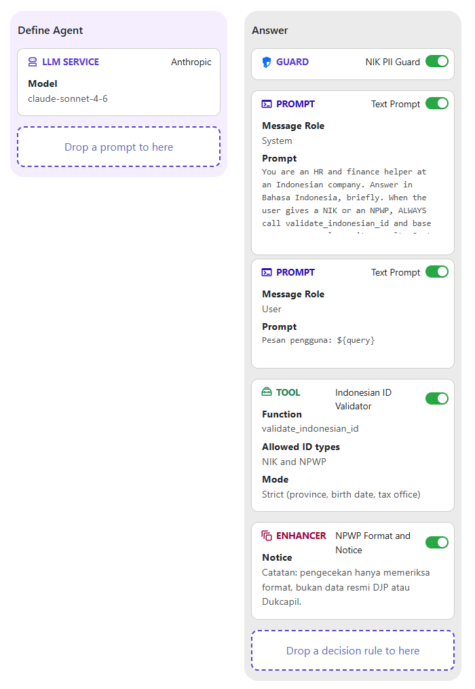
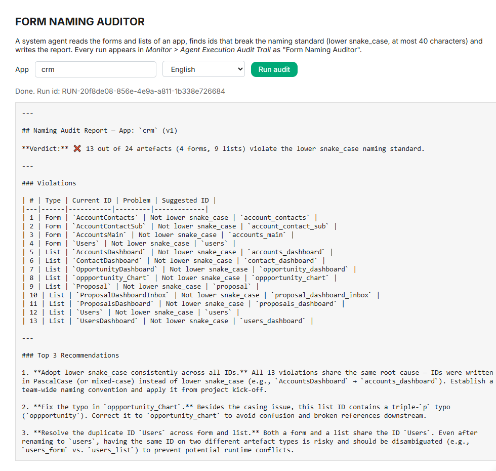

# The Examples Repository

This page is a guide to the examples repository `ai-partner-samples` that goes with this manual. It explains what is in the repository, how to prepare your machine, how to build and install each sample, and what each sample teaches. It is for plugin developers and implementers who want working code to copy from. You need only the repository, the two plugin jars and a Joget DX Enterprise installation; you do not need the source code of Agent Builder or Composer MCP.

## What is in the repository

The repository has one setup folder and seven samples. Five samples are Java plugins that you build with Maven. Two samples contain files that you install or use as they are.

| Folder | What it shows | What you get | Needs an AI service to try |
|---|---|---|---|
| `00-setup` | One-time setup: the Agent Builder API jar, scripts that install the build prerequisites, optional install scripts | nothing to build | no |
| `01-agent-builder-tools` | A custom Tool, Guard and Enhancer for the Agent Builder palette. The example checks Indonesian identity numbers (NIK and NPWP) | `indonesian-id-tools-1.0-SNAPSHOT.jar` | yes |
| `02-system-agent` | A system agent written in Java, with its own page in **Settings** that starts it. The example audits form and list ids | `form-naming-auditor-1.0-SNAPSHOT.jar` | yes |
| `03-composer-custom-tool` | A custom tool that the AI Composers can call, through a tool template and a skill | `composer-tool-1.0.0.jar` | yes |
| `04-custom-skills` | Four skills (`SKILL.md` files) that teach the AI Composers a company standard | four skill folders | yes |
| `05-composer-mcp` | Connecting Claude Code to Joget through Composer MCP: configuration, a smoke test, example prompts | scripts and prompts | no for the smoke test |
| `06-custom-llm-provider` | A custom LLM provider, `PrivateGateway`, for a model behind your own OpenAI-compatible gateway: a Model Class for AI Services and an LLM element for the palette | `private-gateway-llm-1.0-SNAPSHOT.jar` | no for the unit tests and the form. A chat completions server to send a real message |
| `07-custom-composer` | A composer of your own for a new artifact type: a class that extends `AbstractComposerChat`, its tool, and the build route for the `jakarta` packages. See [Custom Composer Tools and Building Your Own Composer (continued)](28b-custom-composer-tools-and-composers-continued.md) | `checklist-composer-1.0-SNAPSHOT.jar` | no for the unit tests; yes to send a message |

Other files in the repository root:

| File or folder | Purpose |
|---|---|
| `README.md` | Table of contents, prerequisites, quick start |
| `.mcp.json` | Project configuration that connects an MCP (Model Context Protocol) client to Composer MCP on `http://localhost:8080/jw`. It reads the key from the environment variable `JOGET_BUILDER_API_KEY` |
| `.claude/skills/` | Three developer cheat sheets in skill format: `agent-builder-extension-dev`, `agent-builder-system-agents` and `joget-plugin-dx9-cloud-rules`. Claude Code loads them automatically when you work in the repository. |
| `package.json`, `scripts/joget-browser.js` | Dependencies and a shared helper for the optional Node.js scripts |

Every sample folder has its own `README.md` with the same headings, from "What the sample shows" to "Troubleshooting". The README files repeat the commands of this page next to the code.

The business data in the samples (cost centres, departments, approval matrix, naming rules, labels) is example data. Replace it with your own.

## Prerequisites

| Requirement | Version | Needed for |
|---|---|---|
| Joget DX Enterprise with the Agent Builder plugin installed | Agent Builder 8.2.5-ALPHA | everything |
| An AI credential and an active AI service in **Settings > AI Central Config** | any supported provider. The demo app of sample 01 expects an Anthropic credential | trying samples 01 to 04 |
| JDK (Java Development Kit) | 17 | building samples 01, 02, 03, 06 and 07 |
| Apache Maven | 3.8 or later | building samples 01, 02, 03, 06 and 07 |
| Composer MCP plugin | the plugin jar. Joget DX 9.1 or later | sample 05 |
| `bash` and `curl` | any. On Windows use Git Bash | `05-composer-mcp/smoke-test.sh` |
| Node.js and Chrome, Chromium or Edge | Node.js 22.12 or later | only the optional scripts |

Install Agent Builder and configure an AI service first. See [Installing and Setting Up Your Joget Instance](02-installation-and-setup.md) and [AI Central Config Reference](03-ai-central-config.md).

### Which jars to install on Joget, and in which order

1. `agent-builder-plugin-8.2.5-ALPHA.jar`: always first. A sample bundle starts without it, but it registers nothing until Agent Builder is there.
2. The Composer MCP plugin jar: only for sample 05, and only on Joget DX 9.1 or later. Install it after Agent Builder, so that the skills from AI Central Config are also visible over MCP.
3. The four sample jars: any order, after Agent Builder. They do not depend on each other.

If you replace the Agent Builder jar later and the sample elements are missing from the palette, from **Tool Type** or from **Model Class** in AI Central Config, upload the sample jars again.

## Installing the API jar and the Joget platform jars

The Java samples compile against two things that are not on a public Maven repository:

1. The Agent Builder API jar, `agent-builder-api`. It contains the classes that an extension extends or calls, for example `org.joget.ai.agent.model.AgentToolAbstract`. It is delivered in the repository, in `00-setup/lib`. It is the same API jar that is inside `agent-builder-plugin-8.2.5-ALPHA.jar`.
2. Five Joget platform jars: `wflow-core`, `wflow-commons`, `wflow-plugin-base`, `wflow-wfengine` and `wflow-directory`. The Joget Maven repository asks for a login, so Maven cannot download them without one. Every Joget installation contains them. This is why there is a second script: it takes the jars from your own Joget installation.

The folder `00-setup` installs both into your local Maven repository. You do this once per machine. All other libraries come from Maven Central.

### Step 1: install the API jar

Windows (PowerShell):

```powershell
cd 00-setup
.\install-api-jar.ps1
```

Linux, macOS or Git Bash:

```bash
cd 00-setup
./install-api-jar.sh
```

Expected result:

```text
Installed org.joget.ai.agent:agent-builder-api:8.2.5-ALPHA
```

The script runs `mvn install:install-file` with the jar and the pom file in `00-setup/lib`. The pom file declares no dependencies, so Maven resolves nothing else.

The sample poms then use these coordinates:

```xml
<dependency>
    <groupId>org.joget.ai.agent</groupId>
    <artifactId>agent-builder-api</artifactId>
    <version>8.2.5-ALPHA</version>
    <scope>provided</scope>
</dependency>
```

> **Note:** Always use the scope `provided`. Never put the API jar inside your own plugin jar. At run time the classes come from the installed Agent Builder plugin. A second copy of a base class makes Agent Builder reject your plugin as the wrong type.

### Step 2: install the Joget platform jars

You have three ways to get the platform jars into your local Maven repository.

| Way | When to use it |
|---|---|
| A. The script `install-joget-jars` in `00-setup` | You have a Joget installation on the machine. This is the quickest way |
| B. Build Joget from source with `mvn install` | You already build Joget yourself. The artifacts are then in your local repository, and you skip this step |
| C. Your own login for the Joget Maven repository | You have one. Add the repository and the credentials to your Maven `settings.xml`. The sample poms contain no `<repositories>` section |

Way A, Windows (PowerShell):

```powershell
.\install-joget-jars.ps1 -JogetHome "<JOGET_HOME>"
```

Way A, Linux, macOS or Git Bash:

```bash
./install-joget-jars.sh <JOGET_HOME>
```

`<JOGET_HOME>` is the Joget installation folder, the one that contains the `apache-tomcat-...` folder and the `wflow` folder. You can also set the environment variable `JOGET_HOME` and leave the argument out.

Expected result (the version and the Tomcat folder are those of your installation):

```text
Reading Joget jars from <JOGET_HOME>\apache-tomcat-11.0.26\webapps\jw\WEB-INF\lib
Installed org.joget:wflow-core:9.1.2  (from wflow-core-9.1.2.jar)
Installed org.joget:wflow-commons:9.1.2  (from wflow-commons-9.1.2.jar)
Installed org.joget:wflow-plugin-base:9.1.2  (from wflow-plugin-base-9.1.2.jar)
Installed org.joget:wflow-wfengine:9.1.2  (from wflow-wfengine-9.1.2.jar)
Installed org.joget:wflow-directory:9.1.2  (from wflow-directory-9.1.2.jar)

Done. Build the samples with:  mvn clean package "-Djoget.version=9.1.2"
```

The script looks for `apache-tomcat*/webapps/jw/WEB-INF/lib` under the Joget folder, reads the version from the file name `wflow-core-<version>.jar`, and runs `mvn install:install-file` for each of the five jars with a generated pom without dependencies.

The scripts have options, listed in `00-setup/README.md`:

| PowerShell parameter | Shell equivalent | Meaning |
|---|---|---|
| `-JogetHome <folder>` | first argument, or `JOGET_HOME` | The Joget installation folder |
| `-LibDir <folder>` | `LIB_DIR=<folder>` | The folder that holds the `wflow-*.jar` files, when it is not under a standard Joget folder |
| `-Version <text>` | `JOGET_VERSION=<text>` | Install under this version instead of the version in the file names |
| `-RepoLocal <folder>` | `MAVEN_REPO_LOCAL=<folder>` (for `install-api-jar.sh`: the first argument) | Use another local Maven repository folder |

## Building the samples

Each Java sample is an independent Maven project. Go to its folder and run Maven with the Joget version that `install-joget-jars` printed:

```bash
cd 01-agent-builder-tools
mvn clean package "-Djoget.version=9.1.2"
```

Replace `9.1.2` with your version. On PowerShell keep the quotation marks around `-Djoget.version=...`. The jar is in the `target` folder. The unit tests run during the build and do not need a running Joget.

| Sample | Folder to build in | Result | Unit tests |
|---|---|---|---|
| 01 | `01-agent-builder-tools` | `target/indonesian-id-tools-1.0-SNAPSHOT.jar` | 14 |
| 02 | `02-system-agent` | `target/form-naming-auditor-1.0-SNAPSHOT.jar` | 3 |
| 03 | `03-composer-custom-tool/bundle` | `target/composer-tool-1.0.0.jar` | 13 |
| 06 | `06-custom-llm-provider` | `target/private-gateway-llm-1.0-SNAPSHOT.jar` | 2 |
| 07 | `07-custom-composer` (not `bundle`) | `bundle/target/checklist-composer-1.0-SNAPSHOT.jar` | 5 |

A successful build ends with `Tests run: ..., Failures: 0, Errors: 0, Skipped: 0` and `BUILD SUCCESS`.

### The properties in the poms

| Property | What it does | Default | Notes |
|---|---|---|---|
| `joget.version` | The version of the Joget platform jars to compile against | `9.1.2` | Pass the version of your own Joget on the command line: `-Djoget.version=<version>` |
| `agent-builder.version` | The version of the API jar | `8.2.5-ALPHA` | Change it only when you install a newer API jar |
| `maven.compiler.release` | The Java language level of the plugin | `11` | The build itself needs JDK 17 |

The samples were built and unit-tested against this platform version:

| `joget.version` | Source of the platform jars | Samples 01, 02, 03 and 07 | Sample 06 |
|---|---|---|---|
| `9.1.2` (the default) | A Joget DX 9.1.2 Enterprise installation, with `install-joget-jars` | Build and unit tests pass. The jars were installed and started on Joget DX 9.1.2 Enterprise | Build and unit tests pass. The jar was installed and started on Joget DX 9.1.2 Enterprise |

Build with the version of the Joget that you install the jar on. If the version you pass is not in your local Maven repository, the build stops with `Could not find artifact org.joget:wflow-core:jar:<version>`.

### javax and jakarta

Joget DX 9 uses the `jakarta.servlet` packages, where older plugin code uses `javax.servlet`. This has two effects.

- **Where a jar runs.** The samples were built against the Joget DX 9 platform jars and run on Joget DX 9. Joget DX 9 converts a plugin jar to jakarta when you install it, on one condition: the manifest of the jar names `javax.servlet` in `Import-Package`. The sample poms do that, so the same pom also serves a plugin whose source uses `javax.servlet`.
- **Sample 07.** A composer extends the API class `AbstractComposerChat`, which has servlet and websocket types in its method signatures. Its source uses `jakarta.websocket`, and its build first makes a `jakarta` copy of the API jar to compile against. The install-time conversion covers `javax.websocket` too, but it cannot help here: a `javax` composer does not compile against the Joget DX 9 platform jars.
- **Sample 02.** Of the other samples, only sample 02 names servlet classes in its source: `NamingAuditorPage` overrides a platform method that takes `HttpServletRequest` and `HttpServletResponse`. The source uses `javax.servlet`. The build compiles a converted copy of that one file with `jakarta.servlet`. The pom does this by itself.

### How the sample poms keep the build small

Each Joget artifact is named explicitly in the pom, and its own dependency tree is excluded:

```xml
<dependency>
    <groupId>org.joget</groupId>
    <artifactId>wflow-core</artifactId>
    <version>${joget.version}</version>
    <scope>provided</scope>
    <exclusions><exclusion><groupId>*</groupId><artifactId>*</artifactId></exclusion></exclusions>
</dependency>
```

So the build needs exactly the platform jars that the pom names (three in samples 01, 03 and 06, five in sample 02) from your local repository, and a few public libraries (`org.json`, the OSGi core API, Spring context, the servlet API) from Maven Central. Use the same pattern in your own plugin when you want a build that does not depend on the Joget Maven repository.

Keep three OSGi instructions of the sample poms in your own plugin. `Import-Package` names only `javax.servlet`, `javax.servlet.http` and `org.osgi.framework`, so only these are checked when the bundle starts, and Joget DX 9 converts the jar. `DynamicImport-Package` is `*`, so Agent Builder and Joget packages are found at run time and the bundle starts even without Agent Builder. `Export-Package` is `!*`: nothing is exported.

## Deploying a sample to Joget

The manual route always works:

1. Log in to Joget as an administrator.
2. Open **Settings > Manage Plugins**.
3. Click **Upload**. In the **Upload Plugin** dialog choose the jar from the `target` folder and click **Upload**.
4. The plugin appears in the list **Installed Plugins**. No restart is needed.

The repository also has an optional script for a Joget on the same machine. It first copies an installed jar with the same file name to `<JOGET_HOME>/wflow/app_plugins_backup`, and then uploads the new jar through the same upload form. The upload needs Node.js, `npm install` in the repository root, and Chrome.

```powershell
$env:JOGET_HOME = "<JOGET_HOME>"
.\00-setup\deploy-plugin.ps1 -Jar .\01-agent-builder-tools\target\indonesian-id-tools-1.0-SNAPSHOT.jar
```

```bash
JOGET_HOME=<JOGET_HOME> ./00-setup/deploy-plugin.sh 01-agent-builder-tools/target/indonesian-id-tools-1.0-SNAPSHOT.jar
```

Add `-ViaCopy` (PowerShell) or `--via-copy` (shell) to copy the jar into `<JOGET_HOME>/wflow/app_plugins` instead of using a browser. Joget loads a jar from that folder within a few seconds.

To check what is installed, open **Settings > Manage Plugins**. The list **Installed Plugins** has one row per jar: **Indonesian ID Tools for Agent Builder** (sample 01), **Form Naming Auditor (system agent)** (sample 02), **Acme Standards Tool** (sample 03) and **Private Gateway LLM Provider** (sample 06). **Filter by Type** lists the jars that contain a plugin of a type: a custom tool is an **AI Agent Tool**, a guard an **AI Agent Guard**, an enhancer an **AI Agent Enhancer**, an LLM plugin an **AI Agent LLM**, a provider an **LLM Provider Plugin** and a Settings page a **Console Page**.

The optional script `node 00-setup/check-install.js` lists the plugin classes inside the jars. It prints one line per expected plugin with the type in square brackets, for example `FOUND    01-agent-builder-tools: NIK PII Guard [AI Agent Guard] version 1.0-SNAPSHOT`, and `MISSING` for a plugin that is not installed.

## Sample 01: a custom Tool, Guard and Enhancer

### What it teaches

Sample 01 is one small plugin jar that adds three elements to the Agent Builder palette. It needs no external system. NIK is the 16-digit Indonesian national identity number; NPWP is the tax number: 15 digits (the old format) or 16 digits. A 16-digit NPWP of an individual is the holder's NIK; a 16-digit NPWP of a company or a non-resident is `0` followed by the old 15 digits. The tool checks a 16-digit NPWP that starts with `0` as those 15 digits, and any other 16-digit NPWP as a NIK.

| Palette section | Label | Class | What it does |
|---|---|---|---|
| **Tools** | Indonesian ID Validator | `org.joget.samples.agenttools.IndonesianIdValidatorTool` | Gives the model the function `validate_indonesian_id(idType, number)`. It checks a NIK or an NPWP and decodes province, birth date, gender and tax office code |
| **Guards** | NIK PII Guard | `org.joget.samples.agenttools.NikPiiGuard` | Blocks the task, masks the number (`317401******0001`) or jumps to another task when a real-looking NIK is in the request or in the answer |
| **Enhancers** | NPWP Format and Notice | `org.joget.samples.agenttools.NpwpFormatEnhancer` | Rewrites a bare 15-digit NPWP as `09.254.294.4-407.000` and appends a notice to the answer |

The lessons in the code:

1. A palette element is a normal Joget plugin, registered under its own class name. Agent Builder does not scan bundles.
2. A tool returns errors as JSON text. A tool that throws ends the task.
3. Policy is a palette property that your Java code enforces, so the model cannot argue its way around it.
4. A guard that masks must change the message or the response itself. An enhancer must call `response.setContent(...)`; the value it returns is not used.

The registration is the part every extension needs. `Activator` first checks that Agent Builder is present (`Class.forName("org.joget.ai.agent.model.AgentToolAbstract", false, loader)`, catching `ClassNotFoundException` and `LinkageError`) and then calls `Registrar`. This is the complete `Registrar` class:

```java
package org.joget.samples.agenttools;

import java.util.Collection;
import org.joget.plugin.property.model.PropertyEditable;
import org.osgi.framework.BundleContext;
import org.osgi.framework.ServiceRegistration;

/** Registers each palette element as an OSGi service under its own class name. */
final class Registrar {

    private Registrar() {
    }

    static void register(BundleContext context, Collection<ServiceRegistration> sink) {
        add(context, sink, new IndonesianIdValidatorTool());
        add(context, sink, new NikPiiGuard());
        add(context, sink, new NpwpFormatEnhancer());
    }

    private static void add(BundleContext context, Collection<ServiceRegistration> sink, PropertyEditable plugin) {
        sink.add(context.registerService(plugin.getClassName(), plugin, null));
    }
}
```

The class name is the identity of an element. Saved agents refer to it, so do not rename a class after agents use it. The full contracts are in [Writing Custom Tools](24-custom-tools.md) and [Writing Custom Guards, Enhancers, Decisions and Prompts](25-custom-guards-enhancers-decisions-prompts.md).

### Files

- `pom.xml`: the build file.
- `src/main/java/org/joget/samples/agenttools/`: `Activator` and `Registrar` (start and registration), the three elements, `IndonesianIds` (the NIK and NPWP rules in plain Java) and `Ext` (loads the property options).
- `src/main/resources/properties/*.json` and `messages/idTools.properties`: the configuration panel of each element and its labels.
- `src/test/java/.../IdToolsTest.java`: 11 unit tests.
- `demo-app/acme_tools.jwa`: a Joget app with three ready agents. `demo-app/agents/*.json` holds the same agent definitions as readable JSON.
- `demo-app/build-demo-app.js` and `demo-app/run-agent.js`: optional scripts.
- `images/agent-canvas.png`: how the first demo agent looks in the builder.

### How to run it

1. Build: `mvn clean package "-Djoget.version=<your version>"` in `01-agent-builder-tools`.
2. Upload `target/indonesian-id-tools-1.0-SNAPSHOT.jar` in **Settings > Manage Plugins** (**Upload**). The list now contains **Indonesian ID Tools for Agent Builder**, and the Joget log shows `Indonesian ID tools registered: 3 plugins`.
3. Import the demo app: in **Design Apps**, click **Import App** and choose `demo-app/acme_tools.jwa`. The app is `Acme Tools Demo` (id `acme_tools`).
4. Give the agents a model. The agents use an Anthropic model (`claude-sonnet-4-6`) through the AI credential named `Anthropic`. Do one of these:
   - Create an Anthropic credential with exactly the name `Anthropic` in **Settings > AI Central Config**, tab **AI Credentials**.
   - Or open each agent, click the **LLM SERVICE** card, and choose your own credential and model.
   - Or regenerate the app for your credential name with `AI_SERVICE="<credential name>" node demo-app/build-demo-app.js`, and import the new file.
5. Open the agent **Acme 1 ID Check (tool + guard + enhancer)**. Type `Indonesian` in **Search Palette** to find the tool under **Tools**; search `NIK` for the guard and `NPWP` for the enhancer.
6. Open the **Preview** tab and send: `Tolong cek NIK 3174011501900001 dan NPWP 092542944407000`.



No API key is stored in the `.jwa` file or in the JSON files. The numbers in the examples are made up; they only have a valid structure.

Each element has a small configuration panel. The tool has **Allowed ID types** (default NIK and NPWP), **Validation mode** (default Strict), **Return full number** (default not ticked: the number comes back masked) and **Extra province codes** (a grid). The guard has **Direction** (default Request and answer), **On violation** (Block the task, Mask the number and continue, or Jump to another task; default mask) and **Redirect task id**. The enhancer has **Notice text**; leave it empty to switch the notice off. The sample README has the full table.

### Expected result

| Agent | Message | Expected |
|---|---|---|
| Acme 2 ID Check (tool only) | `Tolong cek NIK 3174011501900001 dan NPWP 092542944407000` | The answer shows the NIK in full, `3174011501900001`. No notice at the end |
| Acme 1 ID Check (tool + guard + enhancer) | the same | The tool result in the trace holds the full number. The answer shows `317401******0001`, the NPWP as `09.254.294.4-407.000`, and ends with the notice `Catatan: pengecekan hanya memeriksa format, bukan data resmi DJP atau Dukcapil.` |
| Acme 3 PII Input Block (guard only) | `Cek KTP saya 3174011501900001 ya` | The task fails with `Content blocked by guard: 1 NIK number(s) in the request`. The model is not called |

The wording of the answer differs from run to run. The masking, the NPWP layout and the notice come from Java code and do not change. To see what happened inside a run, open it in **Monitor > Agent Execution Audit Trail**.

### How to adapt it

- **Another tool:** copy `IndonesianIdValidatorTool`. Change `getFunctions()` (name, description and parameters are all the model sees), `execute()` and the properties JSON. Give the function a name with your own prefix: when two tools have the same function name, the first one wins without a message.
- **Another guard:** copy `NikPiiGuard`. Keep the properties `onViolation` and `redirectTaskId`, and keep the call `resolveViolation(cleanText, reason)`.
- **Another enhancer:** copy `NpwpFormatEnhancer`. Always end with `response.setContent(result)`.
- **Register it:** add one line in `Registrar.register(...)`.
- **Unit tests:** set properties one by one with `setProperty(key, value)`. `setProperties(...)` needs the running Joget.

Things to know: the checks are structural only. On the request side, use **Block the task** or **Jump to another task**; masking the request and continuing is not guaranteed to reach the model in masked form. A blocked task ends as failed, with the reason as the response.

## Sample 02: a system agent

### What it teaches

A system agent is an agent that you write in Java instead of drawing it in the Agent Builder. It runs through the same engine as a drawn agent, so it gets the same tracing and the same entry in Agent Execution Audit Trail. Sample 02 audits the ids of the forms and lists of a Joget app against a naming rule and writes a report in English or Bahasa Indonesia. Java finds the facts; the model only writes them up. The concept is explained in [System Agents](27-system-agents.md).

| Class | Role |
|---|---|
| `NamingAuditorAgent` | The agent. It extends `SystemAgentAbstract` and is identity only |
| `NamingAuditor` | Builds the request and calls `run`. This is the only class that touches the model |
| `NamingCheckTool` | The tool `check_app_naming(appId, appVersion)`. It reads the forms and lists of an app and returns the ids that break the rule, each with a suggested id |
| `NamingRules` | The rule in plain Java: lower snake_case, starts with a letter, at most 40 characters, no double underscore |
| `NamingAuditorPage` | A page in **Settings** that starts the agent. A system agent has no screen and no scheduler of its own |
| `Activator` | Registers the page and the tool |

The agent class is short. This is the complete class:

```java
package org.joget.samples.systemagent;

import org.joget.ai.agent.model.SystemAgentAbstract;

public class NamingAuditorAgent extends SystemAgentAbstract {

    public static final String AGENT_ID = NamingAuditorAgent.class.getName();
    public static final String AGENT_NAME = "Form Naming Auditor";

    @Override
    protected String getAgentId() {
        return AGENT_ID;
    }

    @Override
    protected String getAgentName() {
        return AGENT_NAME;
    }
}
```

`getAgentName()` is the name that Agent Execution Audit Trail shows. `getAgentId()` uses a class literal on purpose, so that the id stays the same when the instance is wrapped in a proxy.

The request is built in `NamingAuditor.audit(appId, language)`, in four steps:

1. **The model.** `LLMConfigFactory.createByServiceOrActive(null)` returns the AI service that is active in AI Central Config. `AgentFactory.createLLM(pluginManager, providerName, properties)` turns it into an LLM plugin, with the properties `apiKey`, `model`, `apiUrl` and `maxTokens`.
2. **The prompts.** `AgentFactory.create(pluginManager, AgentComponent.PersonaAgentPrompt, Map.of("role", ..., "backstory", ...))` creates the persona, and `AgentFactory.create(pluginManager, AgentComponent.TextPromptAgentPrompt, Map.of("msgRole", "USER", "prompt", ...))` creates the task text.
3. **The request.** `new SystemAgentRequest(llm, List.of(persona), List.of(task), List.of(new NamingCheckTool()), Collections.emptyList(), false)`, then `setRunId("RUN-" + UUID.randomUUID())`.
4. **The run.** `new NamingAuditorAgent().run(request, properties)`. The properties `username`, `fullName`, `appId` and `triggerSource` are what Agent Execution Audit Trail shows for the run. The code then checks the `Response`: `isFailed()`, an empty text and an `API Error` prefix all count as a failed run.

Read `NamingAuditor.java` for the complete code with imports.

### Files

- `pom.xml`: the build file. It also selects the servlet namespace from `joget.version`.
- `src/main/java/org/joget/samples/systemagent/*.java`: the six classes.
- `src/main/resources/templates/page.html`: the HTML and JavaScript of the Settings page.
- `src/test/java/.../AuditorTest.java`: 3 unit tests for the naming rule.
- `sample-output/report-example.md`: an example of a report the agent wrote.
- `trigger-audit.js`: optional script that runs the audit in a headless browser.

### How to run it

1. Build: `mvn clean package "-Djoget.version=<your version>"` in `02-system-agent`.
2. Upload `target/form-naming-auditor-1.0-SNAPSHOT.jar`. The list now contains **Form Naming Auditor (system agent)**. The jar holds the Settings page **Form Naming Auditor** (a Console Page) and the tool **App Naming Check** (an AI Agent Tool).
3. Make sure one AI service is active in **Settings > AI Central Config**, tab **AI Services**. The agent uses that service; it has no model setting of its own.
4. Reload the console and open **Settings > Form Naming Auditor**.
5. Type an app id in **App** (the field suggests your published apps), choose **English** or **Bahasa Indonesia**, and click **Run audit**. A run usually takes 10 to 60 seconds.



Other ways to start the agent:

| Way | How |
|---|---|
| URL, as a logged-in administrator | `GET http://localhost:8080/jw/web/console/plugin/FormNamingAuditor/api/audit?appId=<id>&lang=en` (or `lang=id`). The answer is JSON: `{"ok": true, "runId": "...", "report": "..."}` |
| Your own Java code | `NamingAuditor.audit(appId, "en")`. Call it from a process tool, a scheduler or a web service plugin, for example for a nightly run |
| Optional script | `node trigger-audit.js <appId> out`. It saves `out/report.md` and two screenshots |

### Expected result

- The status line shows `Done. Run id: RUN-...` and the report appears below it as Markdown text.
- For an app whose ids are all lower snake_case, the report says that all checks passed and gives the number of forms and lists checked.
- For an app with camelCase ids, the report has a one-line verdict, a table of violations (id, problem, suggested id) and three recommendations. The file `sample-output/report-example.md` is such a report.
- **Monitor > Agent Execution Audit Trail** has a new row with the agent name `Form Naming Auditor`. Open it to see the prompts and the result of the tool `check_app_naming`. The tool result is the evidence; the report text is the model's summary of it.

### How to adapt it

- **Your own rule:** change `NamingRules.problems(id)` and `NamingRules.suggest(id)`.
- **Check more things:** `NamingCheckTool.execute` reads forms and lists. Add userviews or processes in the same way, or write a second tool and add it to the list in `NamingAuditor.audit`. Register every tool in `Activator`; an unregistered tool fails the run.
- **Another agent:** copy `NamingAuditorAgent` with a new id and name, and write your own request builder like `NamingAuditor`.
- **Another trigger:** keep `NamingAuditor.audit` and call it from your own plugin. The page is only one possible caller.

Things to know: `run()` returns normally even when the AI provider fails, so always check the response as the sample does. The audit endpoint is a `GET` request to keep the sample short; a page that starts work that costs money should use `POST` with the console CSRF (cross-site request forgery) token. There is no token streaming: the page waits for the complete answer.

## Sample 03: a custom tool for the AI Composers

### What it teaches

The AI Composers have fixed tool sets. Sample 03 shows the supported way to give them one more tool of your own. The tool is `lookup_acme_standard(topic)`. It returns a company's option lists (cost centres, departments, leave types, request status), the purchase approval matrix and the date, currency and request-number formats. With it, a generated form carries the company's data instead of lists that the model invented.

The chain has four parts:

```text
1. Plugin jar       03-composer-custom-tool/bundle     registers the class AcmeStandardsTool
2. Tool template    AI Central Config                  a saved, configured instance of that class
3. Skill            acme-standards-lookup           lists the template under "tools:" and is scoped to composers
4. At run time      the composer reads the skill (invoke_skill)
                    -> Agent Builder adds the template's function to the run
                    -> the model calls lookup_acme_standard
```

Rules that matter:

- The tool is added only after the model reads the skill, and only for that run. Each chat message is a new run.
- The name in the skill's `tools:` list must equal the **Template Name (slug)** of the template.
- The function name the model sees is the tool's property **Function name**. Keep it equal to the template name.
- If another tool already has the same function name, the first one wins without a message.

The background is in [Skills, Central Instructions and Tool Templates](22-skills-and-tool-templates.md) and [Custom Composer Tools and Building Your Own Composer](28-custom-composer-tools-and-composers.md).

### Files

- `bundle/pom.xml`: the build file of the plugin jar.
- `bundle/src/main/java/org/joget/samples/composertool/`: `AcmeStandardsTool` (the tool: one function with one parameter, `topic`), `StandardsCatalogue` (where the data comes from; replace this class to read your own system), `Activator`, `Registrar` and `Ext`.
- `bundle/src/main/resources/standards/acme-standards.json`: the example data. `properties/AcmeStandardsTool.json` and `messages/composerTool.properties` are the configuration panel and its labels.
- `bundle/src/test/java/...`: 13 unit tests. One of them checks that the skill `acme-standards-reference` of sample 04 holds the same data as the JSON file.
- `tool-template/lookup_acme_standard.json`: the tool template as data, for the optional script.
- `scripts/central-config.js`: optional script that creates the template or a skill from a file, or lists them.

### How to run it

1. Build: `mvn clean package "-Djoget.version=<your version>"` in `03-composer-custom-tool/bundle`.
2. Upload `bundle/target/composer-tool-1.0.0.jar`. The list now contains **Acme Standards Tool**. The jar holds the tool **Acme Standards Lookup** (an AI Agent Tool).
3. Create the tool template. Open **Settings > AI Central Config**, tab **Tool Templates**, and click **Add Tool Template**. Enter **Display Name** `Acme Standards Lookup`. **Template Name (slug)** fills itself with `acme-standards-lookup`: replace that text with `lookup_acme_standard`. Select **Tool Type** **Acme Standards Lookup**. In **Tool Configuration**, keep **Function name** `lookup_acme_standard` and leave **Override standards (JSON)** empty. Under **Available For**, tick **AI Composer - Form Builder Agent**, **AI Orchestrator Agent** and **AI Composer - Process Builder Agent**. Keep **Status** **Active** and click **Create**.
4. Install two skills of sample 04: copy the folders `acme-standards-lookup` and `acme-naming-conventions` from `04-custom-skills` into `<JOGET_HOME>/wflow/app_ai_skills/`. No restart is needed.
5. Check: on the tab **Skills**, the card `acme-standards-lookup` shows the linked tool template `lookup_acme_standard`.
6. Open a form in the Form Builder, open the composer chat panel (Ctrl+J), and send:

   ```text
   Create a purchase request form with requester name (required), department (dropdown), cost centre (dropdown), item description (textarea), total amount and status.
   ```

Step 3 can also be done with the optional script: `node scripts/central-config.js tool-template tool-template/lookup_acme_standard.json`.

### Expected result

- The run in **Monitor > Agent Execution Audit Trail** shows a call of `invoke_skill` for `acme-standards-lookup`, then calls of **Acme Standards Lookup** with the topics `departments`, `cost_centres` and `request_status`.
- The cost centre dropdown contains exactly `CC-1000`, `CC-2000`, `CC-3000` and `CC-4100` with their labels.
- The department dropdown contains the five departments with English stored values and Bahasa Indonesia labels.
- With `acme-naming-conventions` installed, the field ids start with `acme_` and the labels are in Bahasa Indonesia.

A second test, in the Orchestrator: ask how many approval steps a purchase request of Rp 20.000.000 needs. The Orchestrator reads the skill, calls the tool for `approval_matrix`, and answers 2 approval steps.

The model decides the order of its calls, so a trace can differ in detail. The option lists must be exact.

### How to adapt it

- **Change the data without code:** edit the tool template and paste JSON into **Override standards (JSON)**. It has the same shape as `acme-standards.json`: an object of topics. A topic you give replaces the bundled topic of the same name. Example:

  ```json
  {"departments": {"description": "Departments", "options": [{"value": "legal", "label": "Hukum"}]}}
  ```

- **Read your own system:** replace `StandardsCatalogue`. Keep the two methods `topics()` and `topic(name)` and fetch the data from your own source.
- **Your own tool:** copy `AcmeStandardsTool`, change the function name, the description and `execute`. Return errors as `{"error": "..."}`.
- **Rename the function:** change **Function name** in the template, the template name, and the name in the skill's `tools:` list and text. All three must agree.

Things to know: the tool reaches a composer only through a tool template plus a skill. The template field **Available For** does not limit a tool that a skill links. If a form id already exists in the app, the Form Composer creates a new id (for example `purchase_request_2`) instead of overwriting the form.

## Sample 04: custom skills

### What it teaches

A skill is a folder with one file, `SKILL.md`: a short header (front matter), then Markdown sections. The AI Composers see only the name and the description of each skill, and read the body when the description matches the task. Sample 04 contains four skills for an example company standard: field ids start with `acme_`, labels are in Bahasa Indonesia, stored values are English codes, and option lists come from the company. The format is described in full in [Skills, Central Instructions and Tool Templates](22-skills-and-tool-templates.md).

| Skill | Available for | Purpose |
|---|---|---|
| `acme-naming-conventions` | Form Composer | Field ids `acme_*`, Bahasa Indonesia labels, English stored values, date, currency and request-number formats |
| `acme-app-standards` | Orchestrator, List Composer, Process Composer, UI Composer | Artifact ids, process and activity names, approval step rules, list column order, menu names |
| `acme-standards-lookup` | Form Composer, Orchestrator, Process Composer | Links the tool of sample 03 through `tools: [lookup_acme_standard]` |
| `acme-standards-reference` | none (`composers: []`) | The same data as that tool, as static text, for clients that connect through Composer MCP |

### Files

Four folders, each with one `SKILL.md`, and the folder `expected-result` with two text files: the fields of a form generated with the skills active (`with-skills.fields.txt`) and from the same prompt without them (`without-skills.fields.txt`).

### How to run it

There is nothing to build. Install the skills in one of two ways.

Way 1, copy the folders. The result must be `<JOGET_HOME>/wflow/app_ai_skills/<skill name>/SKILL.md`:

```bash
cp -r acme-naming-conventions acme-app-standards acme-standards-lookup acme-standards-reference "<JOGET_HOME>/wflow/app_ai_skills/"
```

No restart is needed. Joget reads a skill again when the time stamp of its file changes.

Way 2, the AI Central Config page. Open **Settings > AI Central Config**, tab **Skills**, click **Add Skill**, and fill in **Skill Name**, **Description**, **Instruction**, **Available For**, **Associated Tool Templates** and **Status**. Joget writes the same `SKILL.md` file and gives the skill a new `id`.

Then try these prompts in the Form Composer, in an empty form:

```text
Create a purchase request form with requester name (required), department (dropdown), cost centre (dropdown), item description (textarea), total amount and status.
```

```text
Add a date needed field and a request number.
```

To see the difference a skill makes, set `acme-naming-conventions` and `acme-standards-lookup` to **Draft** on the **Skills** tab, start a new chat in an empty form, and send the first prompt again. Then set them back to **Active**.

### Expected result

| | Without the skills | With the skills |
|---|---|---|
| Field ids | `requester_name`, `department` | `acme_requester_name`, `acme_department` |
| Labels | English | Bahasa Indonesia (`Nama Pemohon`, `Pusat Biaya`) |
| Cost centres | invented, for example `cc001 = CC001 - Corporate` | the list of the standard: `CC-1000 - Kantor Pusat Jakarta` and three more |
| Status values | invented, for example `draft`, `pending_approval`, `approved`, `rejected`, `cancelled` | `draft`, `submitted`, `approved`, `rejected`, with Bahasa Indonesia labels |

The second prompt should add a date field with the format `dd/MM/yyyy` and an ID generator field `acme_request_no`. The model's output differs from run to run. Judge the result by the rules (prefix, language, exact option lists), not by an exact match with the two files.

### How to adapt it

1. Copy a skill folder and rename it. Change `name`, give it a new `id` (any UUID), and write a new `description` that starts with "Use when".
2. Replace the rules with your own. Give each rule a short code, a right example and a wrong example.
3. Make the first line of every `## ` section a "When X, do Y" sentence. The model first receives an index with the first sentence of each section, and then reads one section at a time.
4. Keep a `Checks` section at the end: a numbered list that the model verifies before it finishes.
5. Set `composers:` to the full class names of the composers that should use the skill.

Things to know: a skill is guidance, not enforcement. Rules that must never be broken belong in code. Skills are files on the server; they are not part of an app export (`.jwa`). Over Composer MCP, the `composers:` scope and the `tools:` link of a skill have no effect; this is why `acme-standards-reference` exists.

## Sample 05: Composer MCP

### What it teaches

Composer MCP is a Joget plugin that offers the Joget builders and the skill library as tools over the Model Context Protocol. The model is not in Joget: it is the MCP client on the developer's machine, for example Claude Code. The Composer MCP jar is ready to install; nothing in this folder needs to be built. The full description is in [Composer MCP: Install, Configure and Connect](18-composer-mcp-setup.md) and [Composer MCP: Tool Reference](19-composer-mcp-tools.md).

### Files

| File | Content |
|---|---|
| `smoke-test.sh` | Checks Composer MCP over HTTP with `curl`: `initialize`, `tools/list`, the skill tools, the prompts and the access rule |
| `E2E-PROMPT.md` | A prompt for Claude Code: build a small purchase-request app through Composer MCP |
| `E2E-PROMPT-orchestrator.md` | A prompt for the Orchestrator in Joget: build the same app |
| `CLAUDE.md.snippet` | Rules to paste into the `CLAUDE.md` of a project that uses Composer MCP |
| `.mcp.json` (repository root) | Project configuration for the MCP connection |

### How to run it

1. Upload the Composer MCP jar in **Settings > Manage Plugins** (**Upload**). The list now contains **Composer MCP Server**.
2. Configure the key on the server. The `builder_*` tools change your Joget, so they are refused until a key is set. Set the environment variable `JOGET_BUILDER_API_KEY` for the Joget process and restart Joget. The skill tools and the prompts work without a key.
3. Run the smoke test. It needs no model:

   ```bash
   bash 05-composer-mcp/smoke-test.sh
   bash 05-composer-mcp/smoke-test.sh http://myserver:8080/jw
   JOGET_BUILDER_API_KEY=<your key> bash 05-composer-mcp/smoke-test.sh
   ```

4. Connect Claude Code. Either run the command below, or set `JOGET_BUILDER_API_KEY` in your shell and start Claude Code in the repository folder, where `.mcp.json` is read:

   ```bash
   claude mcp add joget-composer --transport http http://localhost:8080/jw/mcp/composer/mcp --header "X-Builder-Api-Key: <your key>"
   claude mcp list
   ```

5. Ask: `Call joget_skills_list and tell me which skills have kind central.`
6. Copy the content of `CLAUDE.md.snippet` into the `CLAUDE.md` of your project, then paste the prompt from `E2E-PROMPT.md` into a new session.

### Expected result

The smoke test without a key, with the four skills of sample 04 installed:

```text
PASS  initialize (session 6fa87293-56f3-4fdb-82d5-d33d65bdbbd2)
PASS  tools/list has builder_status
... (8 more PASS lines: tools, the bundled skill and the four custom skills)
PASS  joget_skill_read acme-naming-conventions#FieldIds
PASS  prompt skill_acme_naming_conventions
PASS  builder_status refused without a key (expected, 401 deny-by-default)
SKIP  keyed builder_* steps (set JOGET_BUILDER_API_KEY, and the same key on the server)
```

The exit code is 0 when every step passes. With the key set on the server and in your shell, the last two lines become `PASS  builder_status with key`.

From Claude Code, `joget_skills_list` names the four `acme-*` skills with `kind: central`. The build prompt asks for a form `purchase_request`, an approval form, a list `purchase_requests`, a process and a userview `purchase_portal`, and for a closing table of the created ids and a list of manual follow-ups.

### How to adapt it

- **Another Joget:** change the address in the `claude mcp add` command or in `.mcp.json`, and pass it to `smoke-test.sh`.
- **Your own skills in the smoke test:** edit the list of names in step 3 of the script, and the name in steps 4 and 5.
- **Your own standards:** replace the skill names and the rules in `CLAUDE.md.snippet` and in the prompts.
- **A smaller first build:** use steps 1, 3, 5 and 6 of `E2E-PROMPT.md` only, and add the process later.

Things to know: the key is one shared secret, so use Composer MCP on development and test servers on a trusted network. A whole-app build is long and uses many model tokens, and its result differs from run to run. Always finish with `builder_verify_app` and check the app in Joget. Mapping process participants to users stays a manual step.

## Sample 06: a custom LLM provider

### What it teaches

Sample 06 connects Agent Builder to a language model that is not a built-in provider: a model behind your own gateway that speaks the OpenAI chat completions protocol, needs a tenant header and may need no key. The provider name is `PrivateGateway`. It is the project that [Adding a Custom LLM Provider](26-custom-llm-providers.md) explains class by class. Use the built-in **Custom** Model Class first: it needs no code.

| Class | Role |
|---|---|
| `GatewayProvider` | The provider. It adds **PrivateGateway** to **Model Class** of **Settings > AI Central Config**, tab **AI Services**, with model suggestions and five credential fields |
| `GatewayLLMConfig` | The view of one saved service. It turns the saved fields into the URL, the key and the model of a call |
| `GatewayAgentLLM` | The LLM plugin. It builds the request, sends it and reads the reply. It is also the element **Private Gateway LLM** in the **LLM Services** section of the Agent Builder palette |
| `GatewayCapabilityProvider` | States which parameters each model accepts and declares one extra parameter, **Repetition Penalty** |
| `GatewayNames` | The names that must be identical in all of the classes above |
| `Activator`, `Registrar` | Start the bundle and register the provider, the LLM plugin and the parameter rules |

The lessons in the code:

1. A provider that the AI Composers, the Orchestrator and system agents can use needs two plugins with the same name: the provider (the form and the saved service) and the LLM plugin (the call). `Registrar` also puts the LLM class into the `AgentComponent` registry, so that the right class is found.
2. Do not name a credential field `apiKey`. The AI Service form has a field of its own with that name, and both would be shown. The sample uses `gatewayUrl` and `gatewayKey`.
3. The LLM plugin sends the request with the HTTP client of the JDK (`java.net.http`). It does not override `prepareRequestHeader` or `parseResponse` of `AgentLLMAbstract`. Those two methods name classes of the Apache HttpClient library, which Agent Builder does not export: a class in another bundle that names them fails with `NoClassDefFoundError` at the first call.
4. The AI Composers always ask for 16000 output tokens. The plugin limits the request to **Max Output Tokens Allowed**.

### Files

- `pom.xml`: the build file, with the same conventions as sample 01.
- `src/main/java/org/joget/samples/llm/`: the seven classes.
- `src/test/java/.../GatewayAgentLLMTest.java`: 2 unit tests. A small HTTP server inside the test stands in for the gateway, so the tests need no Joget and no model.

### How to run it

1. Build: `mvn clean package "-Djoget.version=<your version>"` in `06-custom-llm-provider`.
2. Upload `target/private-gateway-llm-1.0-SNAPSHOT.jar`. The list now contains **Private Gateway LLM Provider**. The jar holds the provider **Private Gateway** (an LLM Provider Plugin) and the LLM plugin **Private Gateway LLM** (an AI Agent LLM). The Joget log shows `Private Gateway LLM provider registered: 2 plugins`.
3. Open **Settings > AI Central Config**, tab **AI Services** (reload the page if it was open), and click **Add AI Service**. In step 1 select **Model Class** **PrivateGateway** and click **Next**.
4. In step 2 fill in **Model Name** (default `private-chat`), **Gateway Base URL** (for example `https://llm.internal.example/v1`; empty means `http://localhost:8000/v1`), **Gateway API Key** (leave it empty if the gateway needs none), **Tenant ID**, **Max Output Tokens Allowed** (for example `4096`) and **Read Timeout (seconds)**. **Advanced Configuration** has **Temperature**, **Max Tokens**, **Top P** and **Repetition Penalty**. Click **Next**, enter an **AI Service Name** and click **Add**.
5. Select the service in the AI service list at the bottom of a composer chat panel and send a small request. To use it everywhere, select it in **Active AI Service** and click **Save**.
6. For an agent on the canvas, drag **Private Gateway LLM** from the palette section **LLM Services** into the box **Define Agent** (onto **Add a LLM service to here**, or onto the **LLM SERVICE** card when the agent already has one) and fill in its properties. A canvas agent uses these properties, not the AI Service.

To send a real message you need a server that implements `POST <base URL>/chat/completions` in the OpenAI format and that the Joget server can reach. For the AI Composers the model must support tool calling.

### Expected result

- The gateway receives `POST <base URL>/chat/completions` with `Authorization: Bearer <key>` (only when a key is set) and `X-Tenant-Id: <tenant>` (only when a tenant is set).
- The body of a composer request contains `model`, `messages`, `tools`, `tool_choice`, `parallel_tool_calls`, `temperature` and `max_tokens`. With **Max Output Tokens Allowed** `4096`, `max_tokens` is `4096` and not `16000`.
- The answer of the model appears in the chat panel.
- **Monitor > AI Usage Dashboard**, tab **By Model Class**, shows the prompt tokens and the completion tokens of `PrivateGateway` (in capital letters), and the list **LLM Calls** has a row for each call.

### How to adapt it

- **Your own name and defaults:** change `GatewayNames`. The provider, the capability provider, the `AgentComponent` entry and `getCapabilityProviderName()` must all return the same provider name.
- **Your own headers or authorization:** change `GatewayAgentLLM.addHeaders`, and add a field to `GatewayProvider.getPropertyOptions()` for each value an administrator must enter.
- **A field the gateway rejects:** remove it in `presetConfig` or `preparePayload`. **A reply in another shape:** change `readReply`.
- **Your own models and parameters:** change `GatewayProvider.getModelNames()` and `GatewayCapabilityProvider`.

Things to know: the sample does not stream tokens; a streaming run receives the answer in one piece. It has no credential type, so enter the URL and the key in the service. No list of models that work with the AI Composers exists: test each model.

## The repository's scripts

Every step in the repository can be done by hand in the Joget console. The scripts only save time. The Node.js scripts drive a headless browser, because the Joget console protects its forms with a CSRF token and refuses a plain HTTP login. Set them up once, in the repository root:

```bash
npm install
```

This installs `puppeteer-core` and `adm-zip`. The scripts use a browser that is already on your machine.

| Script | What it does | Needs | Manual route |
|---|---|---|---|
| `00-setup/install-api-jar.ps1`, `.sh` | Installs the API jar into the local Maven repository | Maven | none; required for building |
| `00-setup/install-joget-jars.ps1`, `.sh` | Installs the Joget platform jars of your installation into the local Maven repository | Maven, a Joget installation | build Joget from source, or your own repository login |
| `00-setup/deploy-plugin.ps1`, `.sh` | Backs up an installed jar of the same file name and installs a new one | Node.js and Chrome, or `JOGET_HOME` with `-ViaCopy` / `--via-copy` | **Settings > Manage Plugins > Upload** |
| `00-setup/deploy-upload.js` | The upload step of `deploy-plugin`: `node 00-setup/deploy-upload.js <jar>` | Node.js, Chrome | the same |
| `00-setup/check-install.js` | Lists which plugins of the repository (samples 01, 02, 03, 06 and 07), Agent Builder and Composer MCP are installed. Exit code 0 when Agent Builder and all sample plugins are there | Node.js, Chrome | **Settings > Manage Plugins** |
| `01-agent-builder-tools/demo-app/build-demo-app.js` | Regenerates `acme_tools.jwa` and the JSON files in `agents/`. `AI_SERVICE` sets the credential name, `AI_MODEL` the model id | Node.js | edit the agents in the builder |
| `01-agent-builder-tools/demo-app/run-agent.js` | Runs a demo agent and prints the events: `node run-agent.js <agent> "<message>" [out-dir]`. `AI_SERVICE` and `AI_MODEL` replace the values of the agent file for one run | Node.js, Chrome, the imported demo app | the **Preview** tab of the agent builder |
| `02-system-agent/trigger-audit.js` | Runs the naming audit and saves the report and two screenshots: `node trigger-audit.js <appId> [out-dir] [en or id]` | Node.js, Chrome | **Settings > Form Naming Auditor** |
| `03-composer-custom-tool/scripts/central-config.js` | `tool-template <file>`, `skill <SKILL.md>`, `list-tool-templates`, `list-skills` | Node.js, Chrome | **Settings > AI Central Config** |
| `05-composer-mcp/smoke-test.sh` | Checks Composer MCP | `bash`, `curl` | none |

Environment variables used by the scripts. All are optional.

| Variable | What it does | Default |
|---|---|---|
| `JOGET_HOME` | The Joget installation folder, for `install-joget-jars` and `deploy-plugin` | none |
| `JW_BASE` | The Joget address with the context path | `http://localhost:8080/jw` |
| `JW_USER` | A Joget administrator | `admin` |
| `JW_PASS` | The password of that user | `admin`, the password of a new Joget installation |
| `CHROME_PATH` | The full path of Chrome, Chromium or Edge | found automatically in the usual places |
| `JOGET_BUILDER_API_KEY` | The Composer MCP key, for `smoke-test.sh` and `.mcp.json` | none |

Never write a real key or password into a file of the repository. Use environment variables.

## Limitations and things to know

- **Alpha API.** Agent Builder 8.2.5-ALPHA is an alpha build. The API that your extensions compile against can change in a later build. Use the API jar that belongs to the Agent Builder jar you run, and build again when you receive a new one.
- **Packages you cannot use.** The API jar contains more packages than Agent Builder exports at run time. Code that uses `org.joget.ai.agent.utils`, `org.joget.ai.agent.model.display` or `org.joget.ai.decision` compiles, and then fails with `NoClassDefFoundError`. The samples use only `org.joget.ai.agent.model`, `org.joget.ai.agent.core`, `org.joget.ai.config.llm`, `org.joget.ai.config.config`, `org.joget.ai.config.model` and `org.joget.ai.config.dao`.
- **Libraries inside Agent Builder.** Agent Builder carries its own copies of some libraries (for example Apache HttpClient) and does not export them. A method of the API whose signature names a class of such a library cannot be overridden from another bundle. Sample 06 shows the way around it for an LLM plugin.
- **Platform jars without a dependency tree.** `install-joget-jars` installs the jars with a pom that has no dependencies. This is enough for the samples, because their poms name every library they need. A project of your own that expects the full dependency tree of `wflow-core` needs a source build of Joget or a login for the Joget Maven repository.
- **Composer MCP needs Joget DX 9.1 or later.** Samples 01 to 04 do not need Composer MCP.

## Troubleshooting

| Symptom | Cause | Fix |
|---|---|---|
| `Could not find artifact org.joget.ai.agent:agent-builder-api:jar:8.2.5-ALPHA` | The API jar is not in the local Maven repository | Run `00-setup/install-api-jar` |
| `Could not find artifact org.joget:wflow-core:jar:9.1.2` (or another version) | The platform jars of the version you build with are not in your local Maven repository. Without `-Djoget.version` the build uses `9.1.2` | Run `00-setup/install-joget-jars`, then build with the version it printed |
| Sample 02 fails with `method does not override or implement a method from a supertype` | The servlet namespace does not match the platform jars | Pass the real `joget.version`; do not set `servlet.namespace` yourself |
| The plugin is in **Manage Plugins**, but its elements are not in the palette or in **Tool Type** | Agent Builder was not installed or not started when the sample bundle started. The log shows `Agent Builder is not available, nothing registered` | Install Agent Builder, then upload the sample jar again |
| Form Naming Auditor shows `Error: No active AI service in AI Central Config` | No AI service is active | Activate one in **Settings > AI Central Config**, tab **AI Services** |
| The composer builds the form without calling `lookup_acme_standard` | The skill was not read, or the name in `tools:` differs from the template name, or the template is not Active | Check scope and status of the skill; make the names equal; set the template to Active |
| `PrivateGateway` is not in **Model Class** | Agent Builder was not running when the bundle of sample 06 started, or the page was open during the install | Upload the jar again after Agent Builder is active, and reload the page |
| `FAIL  initialize: no Mcp-Session-Id` in the smoke test | Composer MCP is not installed or the address is wrong | Check **Manage Plugins**; the path is `<JW_BASE>/mcp/composer/mcp` |

More problems and fixes are in [Troubleshooting](30-troubleshooting.md).

## Where to go next

- [Extending Agent Builder: Overview and Development Setup](23-extending-overview.md)
- [Adding a Custom LLM Provider](26-custom-llm-providers.md)
- [System Agents](27-system-agents.md)
- [Skills, Central Instructions and Tool Templates](22-skills-and-tool-templates.md)
- [Composer MCP: Install, Configure and Connect](18-composer-mcp-setup.md)
