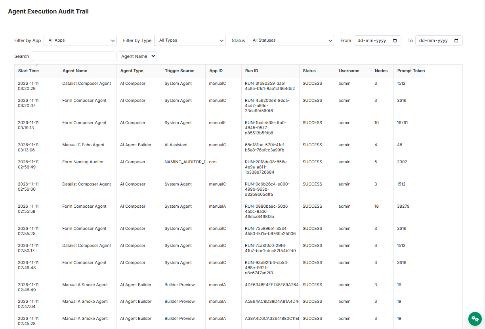
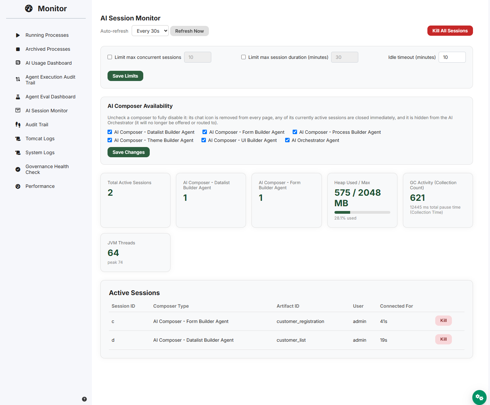

# Troubleshooting

This page helps you find the cause of a problem with Agent Builder, the AI Composers, the Orchestrator, voice input, the Joget AI Assistant, custom plugins and Composer MCP, and fix it. Start with the triage flow to decide where to look first. Then go to the table for your area. The last sections list the error messages and log lines you may see, and the information to collect before you ask Joget for support. It is written for implementers and administrators who run the plugins on a Joget DX Enterprise server.

## How to use this page

1. Read **Where to look first**. It tells you which tool shows the fault fastest.
2. Find your area in the list of sections below and read the table. Each row has a symptom, the likely cause, how to check it and the fix.
3. If the message on your screen or in the log is known, look it up in **Index of error messages and log lines**.
4. If you cannot solve the problem, collect the items in **What to collect before you ask Joget for support**.

Each area table uses the same columns: **Symptom**, **Likely cause**, **How to check**, **Fix**.

> **Note:** Always check the saved result, not only the chat message. A composer or agent can report success while the saved form, list or process is different from what you asked for. Open the saved artifact in its builder or read the saved row in the database.

## Where to look first

There are four layers. A failure belongs to one of them first.

| Layer | What it is | Typical signs |
|---|---|---|
| Browser | The composer panel (JavaScript), the WebSocket connection, the console pages | The panel does not open, it shows "Connection failed", buttons do nothing |
| Plugin runtime | Java code of Agent Builder on the Joget server | A run fails, a tool does nothing, a log line from the plugin |
| Model provider | The HTTP service of OpenAI, Anthropic, Google, IBM, OpenRouter or your own endpoint | Authentication, rate limit, timeout, "unsupported parameter" |
| Joget platform | Builders, database, plugin loader | A plugin is not active, a table is missing |

Work down this list. Stop at the first step that shows a fault.

| Step | Where | What you look for | How |
|---|---|---|---|
| 1 | Browser developer console | Red errors, a WebSocket that closes, a blocked script | Press F12, open **Console** and **Network**. Reload the page and repeat the action. |
| 2 | The message in the panel | The composer panel shows fixed texts for the common faults (see the index below). The text tells you the class of fault. | Read the exact sentence. |
| 3 | Joget server log | Lines written by the plugins | The file is normally `joget.log` in the `logs` folder of Tomcat. Use the filter below. |
| 4 | **Monitor > Agent Execution Audit Trail** | Was a run created? Its status, **Trigger Source**, user, tokens, duration | Open the run, then the node that failed (the trace). |
| 5 | The trace node | The request and the response of the failing step. For a tool node: the arguments and the result. | In the node viewer, a yellow node is running, green is success, red is failed. |
| 6 | Table `ai_llm_calls` | The exact prompt and reply of each model call that succeeded | SQL below. A call that failed is not in this table. |
| 7 | The saved artifact | Does the saved form, list, userview or process contain what the chat said? | Reopen it in its builder. |
| 8 | **Monitor > AI Session Monitor** | Is a composer type switched off? Is the session limit reached? Heap and GC tiles | Open the page. |
| 9 | **Settings > AI Central Config** | Is there an AI credential, an AI service, and is one service the **Active AI Service**? | Open each tab. |





### Filter the server log

On Linux, run this on the server:

```bash
grep -E "Rejecting new session|Refusing '|was killed by an administrator|Tool template not found|Could not inject tool template|Guard (BLOCK|REDIRECT)|ContextWindowManager|Async agent job|Agent Process Tool failure|Model rejected reasoning_effort|Repaired form layout|LLM API returned HTTP|LLM call failed on attempt|Gemini API error|No skill is available|handleToolCalls|processTasks|Voice transcription failed|failing open" joget.log | tail -50
```

On Windows PowerShell:

```powershell
Select-String -Path .\joget.log -Pattern "Rejecting new session|Refusing '|Tool template not found|Guard BLOCK|Async agent job|Agent Process Tool failure|LLM API returned HTTP|LLM call failed|No skill is available|failing open" | Select-Object -Last 50
```

### Read recent runs and model calls

The statements are read only. Column names are from the plugin's table mappings. If a column name differs on your build, run `SHOW COLUMNS FROM <table>` (MySQL) or the equivalent for your database.

```sql
-- the last 20 runs of any agent, composer or system agent
SELECT run_id, agent_name, trigger_source, status, input_token_count, output_token_count, created_at
FROM ai_agent_execution ORDER BY created_at DESC LIMIT 20;

-- the last model calls that succeeded (model, token counts)
SELECT session_id, llm_model, prompt_tokens, completion_tokens, created_at
FROM ai_llm_calls ORDER BY created_at DESC LIMIT 10;

-- async jobs that failed or are still running
SELECT id, agent_id, status, error_message, created_at, modified_at
FROM ai_agent_async_job WHERE status IN ('FAILED','RUNNING') ORDER BY created_at DESC;
```

`ai_llm_calls.session_id` is the `run_id` of the run in `ai_agent_execution`. The column `user_id` in `ai_agent_execution` holds the user name and `username` holds the full name.

## What to collect before you ask Joget for support

Collect these items first. They save the most time.

| Item | How to get it |
|---|---|
| Versions | The Agent Builder jar file name (for example `agent-builder-plugin-8.2.5-ALPHA.jar`), the Composer MCP version if used, the exact Joget version (for example DX 9.1.2 Enterprise), the Java version, the database product and version, the browser and its version. |
| Where it runs | One node or a cluster; Joget Cloud, container or your own server; whether a reverse proxy or load balancer is in front, and which one. |
| The model | Provider, model name, API URL (base address only), whether a **Custom** endpoint is used. Do not send the API key. |
| What you did | The exact steps, the exact text you typed in the composer or the agent input, and what you expected. |
| What happened | The exact message on screen. A screenshot of the panel and of the browser console. |
| Server log | The lines around the time of the fault, from 2 minutes before to 2 minutes after, with the time zone. Use the filter above, then send the surrounding lines. Remove API keys and personal data first. |
| The run | The `run_id` from **Agent Execution Audit Trail** and a screenshot of the trace with the failed node open. |
| The saved artifact | The JSON or the app export (`.jwa`) of the form, list, userview, process or agent that is wrong. Remove confidential data first. |
| Settings that matter | The runtime settings of the agent (screenshot of the **Settings** tab), the session limits in **AI Session Monitor**, the system properties you set (`agent.async.pollInterval`, `agent.async.workerThreads`, `aiab.orchestrator.review`, `aiab.orchestrator.review.rounds`, `ai.central.config.hidden.providers`) and the Composer MCP variables you set (without the key value). |
| Skills and templates | The names and status of the skills and tool templates you added, and the `SKILL.md` text if the problem is about a skill. |
| Reproducibility | Whether it happens every time, with another model, with a short prompt, and for another user. |

> **Note:** The tables `ai_llm_calls` and `ai_agent_trace_event` contain the full prompts and replies, which can contain personal and business data. Check with the data owner before you send rows from them.

## Installation and plugin loading

| Symptom | Likely cause | How to check | Fix |
|---|---|---|---|
| The upload page says the plugin is installed, but no AI pages or blocks appear | The Joget server is not an Enterprise edition. The plugin registers its blocks only on Enterprise. | The log contains `This plugin jar does not support community version`. | Use Joget DX Enterprise. |
| **AI Central Config** is not in the **Settings** menu, or the page shows no content | The user is not an administrator or app creator, or the bundle is not active. | Log in as an administrator. Open **Settings > Manage Plugins** and find the Agent Builder plugin; it must be active. Search the log for `Failed to start module`. | Use an administrator or app creator account. If the module failed to start, read the reason after the colon in that log line. |
| **AI Session Monitor**, **AI Usage Dashboard**, **Agent Execution Audit Trail** or **Agent Eval Dashboard** is missing from **Monitor** | Same causes as above. These pages are for administrators and app creators. | Same checks. | Same fix. |
| After an upgrade the panels or pages look wrong, or old text appears | The browser keeps the old bundled JavaScript and CSS. | Reload with the cache cleared (hard refresh). | Hard refresh. Clear the cache of the reverse proxy if it caches `/jw/plugin/` files. |
| Several lines in the log after start: `Could not wire LLMCallsDao into AgentLLMRegistry` | The usage table could not be connected at start. | The log message and the text after it. | Token usage rows will be missing. Check that the database user can create tables (next row), then restart Joget. |
| Runs fail with a database error about a missing table such as `ai_agent_execution` | The plugin creates its tables when it starts (the Hibernate setting `hbm2ddl.auto` is `update`). The database user has no right to create or alter tables. | Look for the tables in the Joget database: `ai_agent_execution`, `ai_agent_trace_event`, `ai_llm_calls`, `ai_agent_async_job`, `ai_agent_abort_request`, `ai_eval_run`, `ai_system_agent`, `ai_agent_version`, `ai_agent_input_response`, `ai_assistant_conversation`, `ai_assistant_message`, `ai_assistant_run`. | Give the user the right to create and alter tables, then deactivate and activate the plugin, or restart Joget. |
| A custom plugin or sample jar does not load after the Agent Builder jar changed | The custom plugin imports Agent Builder packages. | Open the custom plugin's log for `ClassNotFoundException` (see **Custom plugins**). | Rebuild against the installed Agent Builder version. |

## AI Central Config and credentials

AI Central Config is at **Settings > AI Central Config**. It has six tabs: **AI Credentials**, **AI Services**, **AI Plugins**, **Skills**, **Tool Templates** and **Voice**. Only administrators and app creators can open it. See [AI Central Config Reference](03-ai-central-config.md).

| Symptom | Likely cause | How to check | Fix |
|---|---|---|---|
| A composer shows **No AI Service Configured** with the button **Go to AI Central Config**. In the log: `Refusing '<type>' for session <id>: no AI service is configured and activated.` | No AI service exists, or none is set as the active one. | **AI Services** tab. Is a service listed? Is it selected in **Current AI Service** > **Active AI Service**? | Add a credential and a service. Select the service in **Active AI Service** and press **Save**. Then press **New chat** in the composer. |
| You added a service but the composer still does not use it | A new service is not active until you save it as the **Active AI Service**. | **Current AI Service** on the **AI Services** tab. | Select it and press **Save**. The message "Current AI Service saved successfully!" confirms it. |
| An agent node does not use the credential you expect | An agent LLM node uses the **AI Configuration** (credential) you select, or the key you type in the node. The composers use the **Active AI Service**. They are two different settings. | Open the LLM node and read the **AI Configuration** field. | Select the right credential in the node. Do not expect the node to follow the Active AI Service. |
| "AI Service Name already exists" or "AI configuration name already exists" | The name is used. | The list on the tab. | Use another name. |
| "Cannot delete credential "X" because it is currently used by the following AI Service(s): ..." | An AI service still points at the credential. | The service names in the message. | Edit or delete those services first, then delete the credential. |
| "Failed to create AI Service", "Failed to update AI Service", "Failed to create AI configuration", "Failed to update AI configuration" | A server error while saving. | The Joget log at that time. | Fix the cause in the log (often a database problem) and save again. |
| "Nothing was saved — this change needs N KB but the wf_setup.value database column only holds M KB." | The setting you save (central instructions, tool templates) is larger than the database column (about 64 KB). | The message gives both sizes. | Shorten the text. Move long reference text into a skill. Skills are stored as files and have no such limit. |
| "A TypeSafe (System One) credential cannot be used as an AI Service model" | You linked a **TypeSafe** credential to an AI service. That credential type is not a chat model. | The credential's type. | Use an OpenAI, Anthropic, Google Gemini or **Custom** credential for an AI service. The TypeSafe credential is only for hands-free voice and fast decisions. |
| A provider is missing in the **Model Class** list | The provider is hidden by the system property `ai.central.config.hidden.providers`, or its plugin is not installed. | Look at the Tomcat start options for `-Dai.central.config.hidden.providers=...`. Check the **AI Plugins** tab. | Remove the name from the property and restart, or install the plugin. |
| The **AI Configuration** dropdown in an agent node is empty and shows **Create AI Configuration** | No credential exists for that provider. | The **AI Credentials** tab. | Press **Create AI Configuration**. It opens AI Central Config with the provider filled in. Save the credential, return, and the dropdown refreshes. |
| The API key looks readable in the database | The settings table is `wf_setup`. Credentials are stored under the property `AI_CONFIGS` and services under `MY_AI_SERVICES`. Secret values are meant to be stored as encrypted text inside `%%%%...%%%%`. | Read the row for the property `AI_CONFIGS`. | If you see a key as plain text, restrict access to the database and the console, rotate the key at the provider, and save the credential again. Send Joget the case if it repeats. |
| The **Voice** tab says "Hands-free voice cannot be turned on yet: add a TypeSafe credential under AI Credentials" or "configure the OpenAI Whisper API key above and save" | Hands-free voice (beta) needs both a TypeSafe credential and the OpenAI API key of the Whisper provider. | The **Voice** tab and the **AI Credentials** tab. | Add both, save, and enable hands-free voice. See **Voice**. |

## LLM calls

These rows apply to agents, composers and the Orchestrator. The composer panel maps the common provider faults to fixed sentences.

| Symptom | Likely cause | How to check | Fix |
|---|---|---|---|
| Composer: "There was an authentication issue with the AI service. Please check your AI service configuration." Agent: `API Error [...]` with an authentication type | The API key is wrong, expired, revoked, or has no access to the model. | The key in the credential. The provider's console. | Create a new key, save it in the credential, and try again. A permanent error such as 401 is not retried. |
| Composer: "Could not reach the AI service. Please check your network and AI service configuration." | The Joget server cannot reach the provider: firewall, proxy, DNS, wrong **API URL**. | From the Joget server, test the provider address with `curl`. Read the **API URL** field. | Open the firewall or set the proxy. Enter only the base address in **API URL**, without a request path such as `/chat/completions`. |
| "The AI service is currently rate-limited. Please wait a moment and try again." Log: `LLM API returned HTTP 429 on attempt 1/3. Retrying in N ms.` | The provider limit for requests or tokens is reached. | The provider's usage page. The number of runs at the same time. | Wait. Lower the number of parallel runs or async workers. Ask the provider for a higher limit. Raise **LLM Retry Initial Delay (ms)**. |
| "The AI model appears to be temporarily unavailable. Please try again shortly." | The provider returned a 5xx error. | The provider's status page. The log lines `LLM API returned HTTP 5xx`. | Wait and try again. The agent already retried. |
| "The request timed out. The model may be busy — please try again in a moment." | The model took longer than **LLM Socket Timeout (seconds)** (default 120). Large prompts and reasoning models can take longer. | The model, the size of the request, the time it took. | Raise **LLM Socket Timeout (seconds)**. Use a faster model for simple work. Split the request. A reverse proxy in front of Joget may also have a shorter timeout: raise it. |
| An agent run fails only after several minutes | The service accepted the connection and never answered. Default settings try 3 times with a 120 second wait each. | The log lines `LLM call failed on attempt a/b`. | Lower **LLM Socket Timeout (seconds)** and **LLM Retry Max Attempts** for interactive agents. |
| "That prompt was a bit too long for me to process in one go. Try breaking it into smaller sections or simplifying the request." | The request is larger than the model context. | The size of the prompt and of the artifact. | Shorten the request. Split a big request into steps. Use a model with a larger context. |
| An agent answer ends in the middle | **Max Tokens** of the model is too small. | The **Max Tokens** field of the LLM node or AI service. | Raise it. Anthropic needs a value. The defaults are OpenAI 4096, Anthropic 32000, Gemini 8192, IBM 4096. |
| The provider returns 400 "unsupported parameter" (for example for `temperature`, `top_p`, `top_k`, `max_tokens` or a thinking budget) | Some models reject parameters that other models accept. For example, the GPT-5 family and the o-series ignore or reject **Temperature**, and newer Claude models reject **Temperature**, **Top P** and **Top K** together or a fixed thinking budget. | The model ID. The reply text in the trace. | Clear **Temperature**, **Top P**, **Top K** and **Thinking Budget Tokens** and use **Reasoning Effort** for the newer models. Try a model ID the plugin knows. For an unknown ID the plugin assumes the newest behaviour of the provider. |
| OpenAI returns 400 when tools are used with **Reasoning Effort** set. Log: `Model rejected reasoning_effort with function tools; retrying with ...` | The model does not accept reasoning effort together with function tools. | The log line. | The plugin retries without it. To remove the warning, set **Reasoning Effort** to none or empty. |
| The model never calls a tool, writes JSON in the chat, or the composer says it made no change | The model does not support function (tool) calling, or does so poorly. Small and free models often do not. | The model name. The trace shows no tool node. | Use a model that supports tool calling. Test the model with a simple agent that has one tool. |
| Gemini rejects the tool calls. Log: `Gemini API error: ...` | The tool schema or a parameter is not accepted by that Gemini model. | Read the text after `Gemini API error:`. | Change the model. Simplify the tool parameters. |
| A call is billed by the provider but is missing in `ai_llm_calls` | Only successful calls are recorded. A failed attempt is not. | - | Treat the token totals in Joget as a minimum. Use the provider's usage page for the exact numbers. |

## Agent runs

### Tools, guards and decisions

| Symptom | Likely cause | How to check | Fix |
|---|---|---|---|
| The model never uses a tool | The tool block is switched off, the tool plugin is not installed, the function description is vague, or the model does not support tool calling. | The trace has no tool node. Log: `Tool template not found: <name>` for a template. The block's enabled flag. | Switch the block on. Install the plugin. Write the **Function Description** so it says when to use the tool. Change the model. |
| The model calls a tool that is not there. The tool result says "Error: tool 'X' is not available to this task." Log: `handleToolCalls: no tool registered for 'X'` | The model invented a function name, or the tool was removed from the task. | The tool list of the task. | Add the tool to the task, or improve the prompt so the model uses only the listed tools. |
| Parallel tool calls do not run in parallel, or results are lost | Parallel execution needs the setting on, more than one call, no **User Input** or **Group** tool in the batch, and every tool reporting that it is parallel safe. It is all or nothing for a batch. | The setting **Enable Parallel Tool Calls**. The tools in the batch. | Turn the setting on. A tool that uses thread-local state must return `false` from `isParallelSafe()`. |
| A run stops with a partial answer and no error | **Max Iterations** (default 50) was reached. Log: `processTasks: maxIterations (N) reached`. | The log line. | Remove the loop in the **GOTO** decisions, or raise the limit. |
| An answer contains "Tool call skipped: maximum tool call depth (N) reached." | A task used the whole **Max Tool Call Depth** (default 100). A tool may call itself in a loop. Log: `handleToolCalls: maxToolCallDepth (N) reached`. | The trace of the task. | Find the loop. Fix the tool or its description. Raise the limit only after you know the cause. |
| An input guard blocked or redirected a message that looks safe | A pattern or a guard model was too strict. Log: `Guard BLOCK — runId=...` or `Guard REDIRECT → task '...'`. | The guard settings. The log line shows the reason. | Change the pattern or the guard prompt. Test the guard with safe and unsafe text. |
| A guard did not stop bad content | **LLM-Based Guard** and **Webhook Guard** pass the content when they cannot do their check: an exception, a network error, a time-out. The log shows `LLM safety check failed — failing open (pass)` or `Webhook guard call failed — failing open: ...`. A **Rule-Based Guard** skips a pattern with a syntax error and writes a warning. | The log around the run. | Do not use one guard that calls out as the only control. Add a **Rule-Based Guard** for hard rules. Test the guard model or the webhook before go-live. |
| The **Webhook Guard** blocked everything | The webhook answered with a status other than 200. The plugin treats that as a violation and applies your **On Violation** action. A network error or exception passes the content. | The log line `Webhook guard returned HTTP <status>: ...`. | Make the endpoint answer 200 with `{"safe": true}` for good content. |
| The agent forgets early turns, or log: `ContextWindowManager: message context is at ...` | The conversation reached the character budget. The agent drops old messages and never summarises them. | The log warning at 80 percent of **Max Characters** (default 400000). | Lower the history, use **Sliding Window** with **Max Messages**, or split the work into tasks. |
| Log: `ContextWindowManager: failed to trim messages:` | The trimming raised an error. The run continues. | The text after the colon. | Collect the log for support. |
| A task with a **Task Timeout (seconds)** fails with "Task '...' exceeded timeout of Ns" | The task ran longer than its timeout. | The task's **Timeout Settings**. | Raise or clear the timeout. A task with a timeout runs on its own worker thread. Test the agent variables after you set one. |

### Variables

| Symptom | Likely cause | How to check | Fix |
|---|---|---|---|
| A later task does not see data from an earlier task | Between tasks only the final assistant answer is carried forward. Tool calls, tool results and task prompts are dropped. | The messages in the trace of the later task. | Store the data in an agent variable with **Set Agent Variable** or **Store to Agent Variable**, and read it with the **Agent Variable** prompt. |
| An agent variable is empty after a tool in a parallel batch | The tool ran on a worker thread. | **Enable Parallel Tool Calls** is on. | Run those tools sequentially, or pass the value in the tool result. |
| The workflow variable is not set after an agent ran | The variable name does not exist in the process, or the process had already ended (async), or the enhancer ran before the answer was ready. | Names in **Store to Process Variable**. For async, the job error text. | Use the exact variable name. For async runs, store the answer in a form. |

### Asynchronous runs

An asynchronous run is a job in `ai_agent_async_job` with status `PENDING`, `RUNNING`, `DONE` or `FAILED`. See [Runtime Settings, Monitoring and Cost](09-runtime-and-monitoring.md).

| Symptom | Likely cause | How to check | Fix |
|---|---|---|---|
| Jobs stay `PENDING` | The background executor did not start, or the poll interval is large. | Log: `AgentJobExecutor started (workers=N, pollInterval=Ns)`. Table `ai_agent_async_job`. | Check `-Dagent.async.pollInterval` (default 5 seconds). Restart Joget. |
| Changing `agent.async.pollInterval` or `agent.async.workerThreads` has no effect | The values are read once when Joget starts. | The start line of the executor shows the active values. | Restart Joget. |
| A job stays `RUNNING` for ever | The node stopped while the job ran. The plugin does not requeue or time out such rows. | `status = 'RUNNING'` and an old `modified_at`. | Decide a policy. Mark the row `FAILED` or reset it to `PENDING` by hand after you know the node is gone. See [Runtime Settings, Monitoring and Cost](09-runtime-and-monitoring.md). |
| A job is `FAILED` with "Process instance ... is no longer running (...), so the agent's answer could not be stored in workflow variable '...'" | The process ended before the agent finished. | The `error_message` column. | Store the answer in a form record, or use synchronous mode. |
| A job is `FAILED` with "Agent returned empty content", "Agent LLM not available." or a provider error | The agent produced nothing, has no model, or the provider failed. | The matching row in **Agent Execution Audit Trail**. The trace shows an `AsyncJob` node: "Async agent job failed". | Fix the agent. Start the business step again, the plugin does not retry failed jobs. |

## Integration routes

See [Using Agents Inside Joget Apps](08-using-agents-in-apps.md) for each route.

| Symptom | Likely cause | How to check | Fix |
|---|---|---|---|
| The process continues although the agent failed | **On Agent Failure** is **Continue (log only)** (the default). It only writes a log line. | The setting. The log line `Agent Process Tool failure: <reason>`. | Use **Set Status & Continue** and route on the **Failure Status Variable**, or **Terminate the process**. |
| **On Agent Failure** is not shown | It applies only to **Synchronous** run mode. | **Run Mode**. | Use synchronous mode if you need the reaction. |
| Partial data remains after a failure | The rollback restores only the form record and variable this activity wrote, only for synchronous runs with **Terminate** or **Set Status & Continue**. It does not undo e-mails or calls to other systems. | The setting. | Design side effects so that they can be repeated safely. |
| Log: `Agent Process Tool failure: Agent not found or returned no response`, `Agent returned empty content`, `Agent returned no JSON response` or `agent returned a provider error: ...` | The tool treats these as failures. | The reason after the colon. | Check that the agent exists and has a model. Test it in Preview. |
| The datalist action works for one row only | The **Run AI Agent** datalist action works on one row at a time. | - | Design the list so that users run it per row. |
| **User Input** or **HTML UI** tools do nothing in a process | They need a person at a chat. They work in the datalist chat window and in the assistant agent mode, not in a process activity. | The place where the agent runs. | Do not use these tools in a process activity. |
| The AI Decision (Multiple Choice) tool always returns `uncertain` | The provider is not installed or has no credential, or the confidence is below the **Confidence Threshold**. | The **Status Variable** (`decided`, `none`, `uncertain`). | Install the provider, select a credential, lower the threshold, or set a fallback provider. |

## Evaluation

See [Evaluating Agents](10-evaluating-agents.md).

| Symptom | Likely cause | How to check | Fix |
|---|---|---|---|
| All cases fail with **Exact Match** | Small differences in wording or case. | The expected and actual text in the run. | Use **Contains** with the key phrases, or **LLM Judge**. |
| **LLM Judge** gives a wrong score | The judge agent must return a number from 0 to 10. The scorer takes the first number in the reply. | The judge agent's reply in the trace. | Tell the judge to reply with only the number. |
| The suite cannot start | The target agent is not saved or has no model. | The suite settings. | Save the agent. Run the agent in Preview first. |

## Composers

See [AI Composers User Guide](12-composers-user-guide.md) and [How the Composers Work](15-how-composers-work.md).

| Symptom | Likely cause | How to check | Fix |
|---|---|---|---|
| The composer pill (round button) does not appear in the builder | The composer type is switched off, the plugin is not active, or the page is not a supported builder page. Log when a disabled composer is opened: `Rejecting new session: this composer type has been disabled by an administrator.` | **AI Session Monitor** > **AI Composer Availability**. **Settings > Manage Plugins**. | Select the composer and press **Save Changes**. Open the artifact in its own builder (form, list, userview, process or theme). Hard refresh. |
| The panel says "This AI Composer feature is currently disabled by an administrator." (code `COMPOSER_DISABLED`) | An administrator switched the composer off. | **AI Composer Availability**. | An administrator re-enables it. You reload the page. |
| The panel says "No AI services configured." or **No AI Service Configured** | No active AI service. | **Settings > AI Central Config > AI Services**. | See **AI Central Config and credentials**. |
| The panel shows **Maximum Sessions Reached** ("Maximum number of active sessions has been reached.") or "Maximum number of active sessions has been reached. An administrator can increase this limit in AI Session Monitor." Log: `Rejecting new session: max concurrent sessions (N) reached.` | The optional global limit **Limit max concurrent sessions** (value 10 when switched on) is reached on this node. A new session is refused. No old session is closed. | **AI Session Monitor** > **Total Active Sessions**. | Raise the limit, switch it off, or use **Kill** on idle sessions. In a cluster the count is per node. |
| The session closes by itself (**Session Terminated**, **Session Duration Exceeded**) | **Limit max session duration (minutes)** (30 when switched on) was reached, or the **Idle timeout (minutes)** (10, always on) passed, or an administrator pressed **Kill**. Log: `Session <id> was killed by an administrator.` | **AI Session Monitor** limits. | Change the limits. The idle timeout must be smaller than the maximum duration. Press **New chat** to start again. |
| The panel says "Connection lost. Trying to reconnect..." then "Connection failed. Reload the page to reconnect." | The WebSocket is cut. | The browser console and Network tab (filter **WS**). | Reload the page. |
| "This is taking longer than expected. You can keep waiting or try a shorter prompt." | No progress for about 20 seconds. | The timeline in the panel. | Wait, or press **Stop** and send a shorter request. |
| "Could not connect, so your message was not sent. Press Send to try again." | The socket was not open when you sent. | - | Press **Send** again. |
| Nothing changed in the saved artifact | The standalone composers load the result into the builder as a preview. **Confirm** keeps it on the canvas. It does not write to the database. | The builder's own **Save** button. | Press **Save** in the builder. For an existing process the composer's edit is a preview until you save. |
| The reply is plain text or JSON and nothing changed | The model answered instead of calling its functions. | The trace shows no tool node. | Press **Revert** if shown. Restate the request with the exact ids. Try a model that is better at tool calling. |
| "That prompt was a bit too long...", "The request timed out...", "...rate-limited", "...authentication issue" | Provider faults. | See **LLM calls**. | See **LLM calls**. |
| Canvas looks empty after a build | The saved structure is valid JSON but the builder cannot draw it. The plugin repairs a form layout when it can. Log: `Repaired form layout so the builder can render it (N change(s))`. | Press **Revert**, or reload the form. Ask "show the current form". | Reload the form. Ask the composer to show the current form and fix the structure. If it repeats, collect the saved JSON and the log. |
| The form composer changes only one section | A request is limited to the section the builder has selected. | The selected element bar of the panel. | Select the section you want, then send the request. |
| A saved validator or binder does nothing | The model chose a class that this server does not have. | Compare the saved `className` with **Settings > Manage Plugins**. | Add a skill that lists only the classes your server has. See [Skills, Central Instructions and Tool Templates](22-skills-and-tool-templates.md). |
| After **Stop** the next message repeats the stopped request | A new request was sent while the old one was still stopping. | The panel. | Press **New chat**, then send the new request. |
| An image upload is refused: "Image size must be less than 5MB." | One image is larger than 5 MB. | - | Use a smaller image. |

## The Orchestrator

See [The Orchestrator: Building Whole Apps](13-orchestrator.md).

| Symptom | Likely cause | How to check | Fix |
|---|---|---|---|
| The Orchestrator says it saved, but the artifact is missing or empty | You used **Ask** mode, which previews and saves nothing. Or the build failed after the plan. | The mode in the panel header. The saved app in the App Composer. | Use **Confirm** or **Autopilot** to save. Verify the saved artifacts, not the chat message. |
| Duplicate artifacts such as `leave_request_2` | The request was sent again as "build the form" instead of "update the existing form". | The list of forms in the app. | Name the existing id and say "update". Delete the duplicates by hand. |
| An id was changed or two forms use one table | The Orchestrator uses ids in lower case with underscores and at most 20 characters, and tables named `tbl_<formId>`. Your names were different. | The ids in the saved artifacts. | Give short ids that follow the rule. Repeat the exact ids in every request, because the panel sends the last 6 messages only. |
| The output is thinner than a single composer, or slower than a single composer | The Orchestrator makes more model calls: a design brief, a review of each artifact and up to 2 refinement rounds. | Number of model calls in **Agent Execution Audit Trail**. | To make it faster, set `-Daiab.orchestrator.review=false` or `-Daiab.orchestrator.review.rounds=N` (0 to 3, default 2) and restart. Quality can drop. |
| A sub-composer error says "<name> timed out after 300 seconds" | One sub-composer run took longer than 300 seconds. | The trace. | Split the request into smaller steps. Use a faster model. |
| The Orchestrator does not offer one artifact type | That composer is switched off in **AI Composer Availability**. | **AI Session Monitor**. | Switch the composer on. |
| Confirm mode waits and then stops | The plan card waits for your approval and expires (30 minutes). | - | Send the request again. |

## Voice

Voice input has two parts. **Dictation** is the microphone button in the composer. **Hands-free voice (beta)** lets builders talk to the composer without pressing a button. Both are set up on the **Voice** tab of AI Central Config. See [Voice Input and the Joget AI Assistant](16-voice-and-assistant.md).

| Symptom | Likely cause | How to check | Fix |
|---|---|---|---|
| "Voice input is not available in this browser" | No voice provider can run. The Google Web Speech API works only in Chrome and other Chromium browsers (for example Edge). The OpenAI Whisper API provider needs an API key. | The browser. The **Voice** tab. | Use a Chromium browser, or save an OpenAI key on the **Voice** tab. |
| "Microphone permission denied" | The browser blocked the microphone for the Joget site. | The padlock icon of the address bar. | Allow the microphone for the site. The page must use HTTPS (or `localhost`). |
| "Voice input failed. Please try again." | The provider returned an error, or the audio could not be sent. Log: `Voice transcription failed`. | The browser console and the log. | Check the OpenAI key and the network. Try the other provider. |
| The live words do not appear, only the text after you stop | The realtime mode could not connect and fell back to per-utterance transcription. Messages such as "Live transcription is unavailable right now (...)" appear in the response of the voice service. | **Speech-to-text mode** on the **Voice** tab. The network from the browser to OpenAI. | Check that the browser can reach OpenAI directly, and that the key is saved. Switch **Speech-to-text mode** to per utterance if your network blocks the live session. |
| Hands-free voice cannot be turned on | It needs a TypeSafe credential and the OpenAI key of the Whisper provider. | The **Voice** tab shows what is missing. | Add both, then enable it. |
| "No TypeSafe service is configured in AI Central Config." or "Voice routing is unavailable right now (...)" | The credential is missing or the TypeSafe service does not answer. | Press **Test connection** on the TypeSafe credential. | Fix the key, **Base URL** and **Timeout (ms)**. |
| Hands-free voice reacts to speech that is not for the composer, or ignores commands | The confidence limits are not suited to the room. | **Advanced** on the **Voice** tab: **Addressed-to-Composer threshold** (default 0.85), **Action threshold** (default 0.70), **Auto-apply threshold** (default 0.90). | Raise a limit to react less, lower it to react more. |

> **Note:** Audio leaves the Joget server with every voice provider: to OpenAI for Whisper and the realtime mode, to Google for the Web Speech API (inside the browser), and the text of hands-free commands goes to TypeSafe. Check your data rules before you switch voice on.

## The Joget AI Assistant

The Joget AI Assistant is a userview menu element in the **Marketplace** category, with **Chat Mode**, **Process Mode** and **Agent Mode**. See [Voice Input and the Joget AI Assistant](16-voice-and-assistant.md) and [Using Agents Inside Joget Apps](08-using-agents-in-apps.md).

| Symptom | Likely cause | How to check | Fix |
|---|---|---|---|
| The element is not in the menu list | The plugin is not active or the server is not Enterprise. | **Settings > Manage Plugins**. | See **Installation and plugin loading**. |
| "No AI agent is selected for this assistant. Select an agent in the AI Assistant settings." | **Agent Mode** has no **AI Agent**. | The menu settings. | Select an agent and an **Input Variable**. |
| "The AI agent for this assistant was not found. It may have been deleted..." | The selected agent was deleted or renamed. | The menu settings. | Select the agent again. |
| "Your session may have expired. Please refresh the page and try again." | The Joget login expired. | - | Log in again. |
| "Sorry, there was an error processing your request. Please try again." | A server error. | The log and **Agent Execution Audit Trail** (**Trigger Source** `AI Assistant`). | Fix the cause in the trace. |
| **Agent Mode**: no conversation history | **Keep Conversation History** is `False`, or the user is not logged in. | The menu settings. | History is saved only for logged-in users. |
| **Chat Mode**: "An error occurred while getting a response." | **Chat Mode** sends the question to the server named in **Domain**, with the **API Server Key**. It does not use the Active AI Service. | The **Domain** and **API Server Key** fields. The log: "Streaming API call failed: ..." or "Suggestion API returned error: ...". | Correct the **Domain** and the key, or use **Agent Mode**. |
| A file upload is refused | The file is larger than **Maximum Upload Size (MB)** (default 10) or its type is not in **Allowed Upload File Types**. | The menu settings. | Change the settings. |

## Skills not taking effect

See [Skills, Central Instructions and Tool Templates](22-skills-and-tool-templates.md).

| Symptom | Likely cause | How to check | Fix |
|---|---|---|---|
| The skill is not on the **Skills** tab | The file is not at `<wflow>/app_ai_skills/<folder>/SKILL.md`, or the file does not begin with `---`, or the front matter block is not closed. | Log: `Skipping <path> — it does not start with a '---' frontmatter block` or `Skipping <path> — the frontmatter block is not closed`. | Fix the first lines of the file. |
| The skill is listed but the composer does not use it | The status is not exactly `active`, or the composer is not in the skill's `composers` value. Draft skills are hidden. Log: `No skill is available to <composer> — ...` and, when skills are offered, `invoke_skill for <composer>: N skill(s) offered [...]`. | The **Skills** tab. The log lines. | Set the status to `active`. Select the composer. A skill for the Form Composer is not visible to the Theme Composer. |
| The model never reads the skill | The description does not match the request. The model sees only the name and description at first. | The skill description. | Write the description as "Use when ..." with the words your users use. |
| The model reads the skill and ignores a rule | The rule is hidden in a long paragraph. | The skill text. | Put the rule in a numbered list. Repeat it in a central instruction. |
| An edit to a bundled skill is gone after a plugin upgrade | A bundled skill is refreshed when the plugin carries a higher `builtinVersion`. Log: `Updated skill '<name>' to builtinVersion N`. | The skill front matter. | Copy a bundled skill under a new name before you change it. Put your own rules in your own skills. |
| A linked tool is not available | The skill was not read in this run, the name in `tools` differs from the **Template Name (slug)**, or the plugin is not installed. Log: `Tool template not found: <name>` or `Could not inject tool template '<name>': ...`. | The names. | Make the skill tell the model to call the tool. Compare the names exactly. |
| Saving skills or central instructions fails with the size message | See **AI Central Config and credentials**. | - | Shorten the text. |

## Custom plugins

See [Extending Agent Builder: Overview and Development Setup](23-extending-overview.md) and [Writing Custom Tools](24-custom-tools.md).

| Symptom | Likely cause | How to check | Fix |
|---|---|---|---|
| `ClassNotFoundException` or `NoClassDefFoundError` for a class such as `org.joget.ai.agent.model.AgentToolAbstract` | Your bundle does not import the Agent Builder packages. | The log of your plugin. The `Import-Package` and `DynamicImport-Package` lines in your `pom.xml`. | Add `<DynamicImport-Package>*</DynamicImport-Package>`, as in the samples. Agent Builder exports these packages: `org.joget.ai.agent`, `org.joget.ai.assistant`, `org.joget.ai.agent.lib`, `org.joget.ai.agent.lib.composer`, `org.joget.ai.agent.model`, `org.joget.ai.agent.core`, `org.joget.ai.agent.embedding`, `org.joget.ai.config` and its sub-packages `feature`, `llm`, `config`, `utils`, `model`, `dao`, `exception`. Classes in other packages are not visible to your plugin. |
| The bundle stays "installed" and does not start | An imported package cannot be resolved, or the Agent Builder bundle is not active. | **Settings > Manage Plugins** and the Joget log at upload time. | Make sure Agent Builder is active first. Remove imports that are not needed. |
| The block does not appear in the palette | The service is not registered, the class does not extend the right base class, the block is hidden, or the user opened the wrong list. | See the checklist below. | Follow the checklist. |
| A `Boolean isHidden()` override has no effect | It was declared with the primitive type `boolean`. | The method signature. | Declare `public Boolean isHidden()`. |
| Your plugin works locally and fails on Joget Cloud | Cloud restricts plugin behaviour (reflection-based JSON binding, files outside the base directory, new threads without the web-application class loader). | The cloud log. | Use `org.json` for JSON, keep thread-local state out of tools, and test on a cloud tenant. |
| A guard, decision or enhancer you wrote is ignored | It does not extend the abstract base class of its type. | Compare your class with the sample in `01-agent-builder-tools`. | Extend `AgentGuardAbstract`, `AgentDecisionAbstract`, `AgentEnhancerAbstract`, `AgentPromptAbstract` or `AgentToolAbstract`. |

Checklist when a block does not appear in the palette:

1. The jar is uploaded and the plugin is **active** in **Settings > Manage Plugins**.
2. The `Activator` registers the object with `context.registerService(MyTool.class.getName(), new MyTool(), null)`.
3. The class extends the abstract class of its type (`AgentToolAbstract`, `AgentGuardAbstract`, and so on). Do not register the six Agent Builder interfaces yourself. Agent Builder does that.
4. `getName()`, `getLabel()`, `getVersion()` and `getClassName()` return values, and `getPropertyOptions()` returns valid JSON.
5. `isHidden()` is not true.
6. Open the agent again (reload the builder page) so that the palette is read again.

## Composer MCP

Composer MCP is a separate plugin. It needs Joget DX 9 and the Agent Builder plugin for the browser-connected composers. The page [Composer MCP: Security, Clustering and Troubleshooting](21-composer-mcp-security-and-operations.md) has the full table. These are the most common faults.

| Symptom | Likely cause | How to check | Fix |
|---|---|---|---|
| `builder_*` tools return 401 | No key on the server, or the client sends no key, or the keys differ. | Log line `Builder API/MCP auth posture: ...` at start. Run `builder_status`. | Set `JOGET_BUILDER_API_KEY`, restart Joget, and send it as `X-Builder-Api-Key` or `Authorization: Bearer <key>`. |
| 403 "is disabled" | An opt-in feature is off. | The message names the setting. | Set `JOGET_BUILDER_API_ENABLE=app-create` (or `plugin-upload`), restart. |
| Client cannot connect, or the URL ends with `/sse` | An old registration uses the retired SSE transport. | `claude mcp list`. | Register `http://<host>:8080/jw/mcp/composer/mcp` with `--transport http`. |
| Menus or CRUD pages return 404 | The app is not published. | The app in the console. | Publish the app. |
| No `form_*`, `list_*` or `ui_*` tools | Those tools exist only while a builder tab of that type is open. | `list_sessions`. | Open the builder page, wait a few seconds, refresh the tool list of the client. |
| The plugin does not load | The server is not DX 9. | **Manage Plugins** and the log. | Use DX 9. |

## Index of error messages and log lines

Every message in this index exists in the plugin as shipped. "Panel" means the text the user sees. "Log" means a line in the Joget server log.

### Composer panel messages and error codes

| Message or code | Where | Meaning |
|---|---|---|
| `COMPOSER_DISABLED`: "This AI Composer feature is currently disabled by an administrator." | Panel | The composer type is switched off in **AI Composer Availability**. |
| `SESSION_LIMIT_REACHED`: "Maximum number of active sessions has been reached. An administrator can increase this limit in AI Session Monitor." | Panel | The global session limit is reached on this node. |
| `SESSION_KILLED`: "This session was closed by an administrator." | Panel | An administrator pressed **Kill** or **Kill All Sessions**. The tab is blocked until you reload. |
| `SESSION_DURATION_EXCEEDED`: "This session reached the maximum allowed duration and was closed automatically." | Panel | The maximum duration passed. |
| `AI_SERVICES_NOT_CONFIGURED`: "No AI services configured." | Panel | No active AI service. |
| "The partial result has been applied — you can continue from here." | Panel | The service failed part-way. What was done is kept. |
| "That prompt was a bit too long for me to process in one go. Try breaking it into smaller sections or simplifying the request." | Panel | The context is too large. |
| "The request timed out. The model may be busy — please try again in a moment." | Panel | Provider timeout. |
| "The AI service is currently rate-limited. Please wait a moment and try again." | Panel | HTTP 429 from the provider. |
| "The AI model appears to be temporarily unavailable. Please try again shortly." | Panel | HTTP 5xx from the provider. |
| "There was an authentication issue with the AI service. Please check your AI service configuration." | Panel | The key is rejected. |
| "Could not reach the AI service. Please check your network and AI service configuration." | Panel | Network failure to the provider. |
| "I wasn't able to complete that request. Please try rephrasing. Please also check the system logs for any errors." | Panel | The form, list or theme composer could not complete the work. |
| "No form data provided. Please ensure you are in the form builder." (and the same for datalist, process, theme and UI builders) | Panel | The panel could not read the builder's current definition. Open the artifact in its builder. |
| "Connection lost. Trying to reconnect..." / "Connection failed. Reload the page to reconnect." / "Could not connect, so your message was not sent. Press Send to try again." | Panel | WebSocket problems. |

### Server log lines

| Log text | Meaning |
|---|---|
| `Rejecting new session: this composer type has been disabled by an administrator.` | A user opened a composer that is switched off. |
| `Rejecting new session: max concurrent sessions (N) reached.` | The session limit is reached. |
| `Session <id> was killed by an administrator.` | An administrator killed the session. |
| `Refusing '<message type>' for session <id>: no AI service is configured and activated. Add and activate one in AI Central Config.` | A composer message was refused because there is no active AI service. |
| `This plugin jar does not support community version` | The server is not Enterprise. |
| `Failed to start module <name>: ...` | A module of the plugin failed to start. |
| `Could not wire LLMCallsDao into AgentLLMRegistry: ...` / `Could not register AgentTraceHandler: ...` | Usage rows or traces may be missing. |
| `LLM API returned HTTP <n> on attempt a/b. Retrying in N ms.` | A retry after HTTP 429 or 5xx. |
| `LLM call failed on attempt a/b (...). Retrying in N ms.` | A retry after a network error or time-out. |
| `Model rejected reasoning_effort with function tools; ...` | OpenAI retry without reasoning effort. |
| `Gemini API error: <message>` | Google returned an error. |
| `API Error [<type>]: <message>` | Error text returned by OpenAI, Anthropic, IBM or OpenRouter. It is the reply content of the failed call. |
| `LLM Provider not found: <name>` | An AI service names a model class whose plugin is not installed or is hidden. Install the plugin or choose another model class. |
| `Agent LLM not available.` / `Agent not found.` | The agent has no model, or the id is wrong. |
| `processTasks: maxIterations (N) reached` | **Max Iterations** reached. |
| `handleToolCalls: maxToolCallDepth (N) reached` and the result text `Tool call skipped: maximum tool call depth (N) reached.` | **Max Tool Call Depth** reached. |
| `handleToolCalls: no tool registered for '<name>'` | The model called a tool the task does not have. |
| `Task '<label>' exceeded timeout of Ns` | **Task Timeout (seconds)** passed. |
| `Guard BLOCK — runId=... reason=...` / `Guard REDIRECT → task '...'` | A guard acted. A blocked run ends with the error text `Content blocked by guard: <reason>`. |
| `LLM safety check failed — failing open (pass)` | The LLM-Based Guard could not check and let the content pass. |
| `Webhook guard returned HTTP <status>: ...` | The webhook answered with a status other than 200. The violation action is applied. |
| `Webhook guard call failed — failing open: ...` | The webhook could not be called. The content passes. |
| `ContextWindowManager: message context is at N ...` | The message size passed **Warn Threshold (%)**. |
| `ContextWindowManager: failed to trim messages: ...` | Trimming failed. The run continues. |
| `Tool template not found: <name>` | A skill names a tool template that does not exist. |
| `Could not inject tool template '<name>': ...` | A template could not be created. |
| `Async agent job queued: <id> agent=<agent id>` | A job was added. |
| `AgentJobExecutor started (workers=N, pollInterval=Ns)` | The executor started with these values. |
| `Async agent job completed: <id>` / `Async agent job failed: <id> - <reason>` | The end of a job. |
| `Datasource settings for profile ... no longer exist, stopping AgentJobExecutor` | A removed tenant. The poller stops. |
| `Agent Process Tool failure: <reason>` | The AI Agent process tool treated the run as failed. |
| `Repaired form layout so the builder can render it (N change(s))` | The Form Composer fixed the layout of its result. |
| `Review of <function> left N issue(s) ...` / `Review of <function> aborted: ...` | The Orchestrator review pass result. |
| `<composer name> timed out after 300 seconds` | A sub-composer of the Orchestrator took too long. |
| `Failed to forward agent trace` | The live trace could not be sent to the panel. The build continues. |
| `Skipping <path> — it does not start with a '---' frontmatter block` / `Skipping <path> — the frontmatter block is not closed` | A skill file is invalid. |
| `No skill is available to <composer> — ...` | No active skill is in scope for that composer. |
| `invoke_skill for <composer>: N skill(s) offered [...]` | Which skills the composer was given. |
| `Updated skill '<name>' to builtinVersion N` | A bundled skill was refreshed on start. |
| `Voice transcription failed` | The server-side speech-to-text call failed. |
| `Builder API/MCP auth posture: ...` | Composer MCP, at start. Shows whether a key is needed. |

### Composer MCP

| Message | Meaning |
|---|---|
| HTTP 401 "Unauthorized: ..." | No valid key or administrator session. |
| HTTP 403 "'<feature>' is disabled. An administrator must opt in ..." | An opt-in feature is off. |
| HTTP 403 "Browser-originated request refused while running in anonymous mode ..." | Anonymous mode does not accept calls with an `Origin` header. |
| HTTP 403 "Cross-site request refused for session authentication (CSRF protection)..." | An administrator session was used from another site. |
| HTTP 409, 412, 415, 422, 501 | Conflict, missing `confirm: true`, wrong content type, lint failure, capability missing. See [Composer MCP: Security, Clustering and Troubleshooting](21-composer-mcp-security-and-operations.md). |
| JSON-RPC `-32700` "Parse error", `-32601` "Method not found: <method>", `-32602`, `-32603` | Protocol errors from the endpoint. |
| "No builder tabs registered yet." | No builder page is open and polling. |
| "Slot '...' is already connected to another session." | Another client holds that tab. |

## Limitations and things to know

- **Failed model calls are not recorded.** Token totals in Joget are a minimum. A call that the provider bills but Joget saw as an error is not counted.
- **Some guards pass content when they cannot check.** The LLM-Based Guard and the Webhook Guard let content through on an error, timeout or network failure. Do not use them as the only control.
- **Composer sessions are per node.** The session list, the session limit and **Kill All Sessions** see only the node you are connected to. Abort requests, saved limits and the composer on/off settings are in the database and work across nodes.
- **A run waiting for user input is held in memory.** It does not continue after a restart or on another node.
- **No timeout for a whole run.** Bound a run with **Max Iterations**, **Max Tool Call Depth** and **Task Timeout (seconds)**, and set spending limits at the provider.
- **Async jobs are not retried or recovered.** Handle a `RUNNING` row after a restart by hand.
- **The Orchestrator is slower than a single composer by design.** It plans, builds, reviews and refines. Do not promise a build time to your customer.
- **Prompts and replies are stored in full** in `ai_llm_calls` and `ai_agent_trace_event`. There is no switch in the console to turn that off and no automatic clean-up.
- **Some features need services outside your server.** Hands-free voice needs TypeSafe and OpenAI. **Chat Mode** of the assistant needs the server in **Domain**. Check them first when these features fail.

## Where to go next

- [Runtime Settings, Monitoring and Cost](09-runtime-and-monitoring.md) for the settings, tables and purge statements mentioned here.
- [AI Composers User Guide](12-composers-user-guide.md) for the recovery table of each composer.
- [Composer MCP: Security, Clustering and Troubleshooting](21-composer-mcp-security-and-operations.md) for the full Composer MCP error tables.
- [Frequently Asked Questions](31-faq.md) for short answers to common questions.
- [Glossary and Reference Tables](32-glossary-and-reference.md) for settings, defaults, endpoints and tables.
